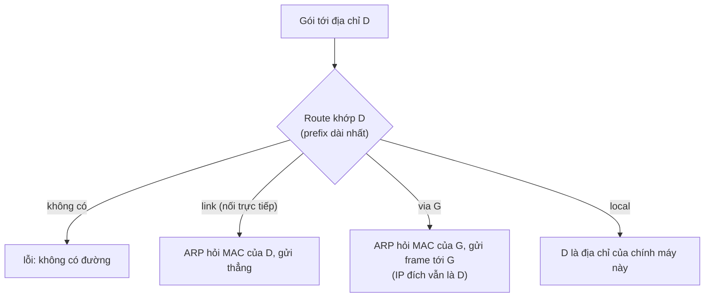
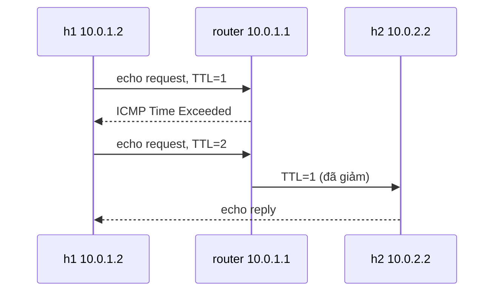
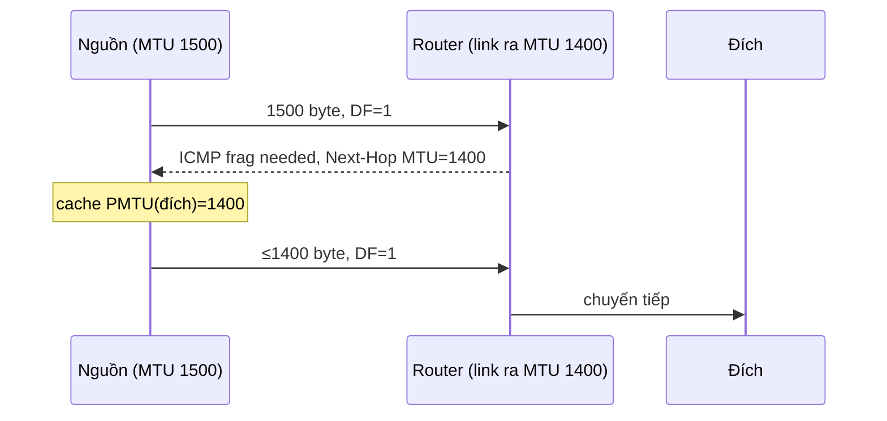

# P6 · Chương 03 — IP

## Bạn sẽ hiểu được gì

1. **Q1.** IP làm gì và không làm gì; forwarding khác routing ra sao? → mục 1
2. **Q2.** Header IPv4 có những trường nào; TTL, DF, phân mảnh, checksum giải quyết vấn đề gì, và vì sao router phải tính lại checksum ở mỗi hop? → mục 2
3. **Q3.** Cho `a.b.c.d/n`, tính địa chỉ mạng, broadcast, số địa chỉ thế nào; 10/8, 172.16/12, 192.168/16 và 127/8 là gì? → mục 3
4. **Q4.** Máy và router chọn đường thế nào: bảng định tuyến, longest prefix match, default gateway; đọc `ip route` ra sao? → mục 4
5. **Q5.** Routing protocol (distance vector, link state, BGP) khác forwarding ở đâu, ở mức khái niệm? → mục 5
6. **Q6.** `ping`, `traceroute` và Path MTU Discovery chạy ra sao; vì sao chặn ICMP làm kết nối TCP "treo" sau handshake? → mục 6 (kiểm chứng trong container: mục 7; tính lại bằng chương trình: mục 8)
7. **Q7.** NAT làm gì với địa chỉ và port, và vì sao kết nối *đến* khó? → mục 9
8. **Q8.** IPv6 đổi những gì (128 bit, header cố định, không phân mảnh ở router, dual-stack)? → mục 10

## Kiến thức cần trước

- [Chương 01 — Layering](./01-layering.md): encapsulation, IP là điểm hội tụ của kiến trúc Internet.
- [Chương 02 — Link layer](./02-link-layer.md): Ethernet, MAC, ARP — IP dựa vào chúng để chuyển gói qua *một* hop.

## 1. IP làm gì và không làm gì (Q1)

> **Trả lời ngắn.** IP chỉ lo một việc: đưa một gói dữ liệu từ máy nguồn tới máy đích qua nhiều mạng nối nhau[^rfc791-scope]. Nó không hứa gói sẽ đến, đến đúng thứ tự hay không bị trùng[^rfc1122-ip]. "Mỗi router nhìn địa chỉ đích rồi đẩy gói đi tiếp" (forwarding) là việc khác với "xây bảng chỉ đường" (routing)[^sa-fwd-rt].

**Giải thích.**

Hình dung (nhận xét của người soạn): IP giống bưu điện chuyển thư thường. Mỗi trạm chỉ đọc địa chỉ người nhận trên phong bì rồi chuyển tới trạm kế; không ai bảo đảm thư tới, và nếu cần chắc chắn thì tầng trên (TCP) tự đòi biên nhận.

RFC 791 giới hạn phạm vi IP rất hẹp: chuyển một gói bit (internet datagram) từ nguồn tới đích qua một hệ thống các mạng nối nhau[^rfc791-scope]. Việc chọn đường gọi là *routing*[^rfc791-routing]. Độ tin cậy do TCP dựng lên ([chương 05](./05-tcp-reliability-va-flow-control.md)).

Cần tách hai khái niệm: *forwarding* là nhận gói, tra địa chỉ đích trong bảng rồi gửi theo hướng bảng chỉ, làm cục bộ ở từng node; *routing* là quá trình xây các bảng đó bằng thuật toán phân tán phức tạp. Mục 4 nói về forwarding, mục 5 về routing.

<details><summary>Đi sâu: "best effort" và data plane / control plane</summary>

- Theo RFC 1122, datagram IP có thể hỏng, trùng, sai thứ tự hoặc không đến[^rfc1122-ip].
- Forwarding thuộc data plane (đơn giản, cục bộ); routing thuộc control plane (thuật toán phân tán phức tạp)[^sa-fwd-rt].

</details>

**Quay lại Q1:** IP chỉ chuyển gói theo kiểu cố gắng hết sức; forwarding là tra bảng từng hop, routing là xây bảng.

## 2. IPv4 header, TTL, phân mảnh và checksum (Q2)

> **Trả lời ngắn.** Header IPv4 là phần "phong bì" đi kèm mỗi gói: địa chỉ nguồn/đích, giao thức tầng trên, TTL, thông tin phân mảnh và checksum. TTL là bộ đếm giảm mỗi hop; TTL về 0 thì gói bị hủy[^rfc791-ttl], nhờ vậy gói kẹt trong vòng lặp định tuyến cuối cùng bị loại[^sa-ttl]. Checksum chỉ bảo vệ header và phải được tính lại ở mỗi nơi xử lý vì TTL (và vài trường khác) đổi giữa các hop[^rfc791-cksum-field]. Cờ DF=1 cấm phân mảnh: không giao nổi thì hủy gói[^rfc791-df].

**Giải thích.**

Hình dung (nhận xét của người soạn): header như phong bì thư. Ngoài tên người gửi/nhận còn có "số bước nhảy còn được phép" (TTL) và một con dấu kiểm tra chỉ áp lên phong bì, không áp lên nội dung thư (checksum).

### 2.1. Các trường

Header tối thiểu dài 20 byte (IHL nhỏ nhất là 5 từ 32 bit, 5 × 4 = 20 byte; phép nhân của người soạn). IHL là độ dài header tính theo từ 32 bit, giá trị nhỏ nhất hợp lệ là 5[^rfc791-ihl]. Trường **Protocol** cho biết giao thức tầng trên của payload[^rfc791-protocol] (số cụ thể do IANA gán), nên nó đóng vai demux key — chọn module tầng trên nhận payload; Systems Approach dùng đúng thuật ngữ này cho trường Next Header của IPv6, trường có cùng vai trò với Protocol của IPv4[^sa-nh-demux]. Các trường còn lại: TTL (2.2), Identification/Flags/Fragment Offset (2.3), Header Checksum (2.4); Total Length và địa chỉ 32 bit xem phần Đi sâu.

### 2.2. TTL: chống vòng lặp

Nếu TTL bằng 0 thì datagram phải bị hủy[^rfc791-ttl]. Mọi module xử lý datagram phải giảm TTL ít nhất 1, nên TTL chỉ là cận trên của thời gian tồn tại[^rfc791-ttl-bound]; thực tế nó là bộ đếm hop, bắt các gói kẹt trong vòng lặp định tuyến[^sa-ttl]. Trên Linux, TTL mặc định của gói do máy tự sinh (không phải chuyển tiếp) là sysctl `ip_default_ttl`[^ipsysctl-ttl].

### 2.3. Fragmentation và cờ DF

**Vấn đề.** Mỗi loại mạng có MTU — datagram IP lớn nhất nó chở được trong một frame[^sa-mtu]. Phân mảnh cần thiết khi datagram xuất phát từ mạng cho phép gói lớn mà phải đi qua mạng giới hạn gói nhỏ hơn[^rfc791-frag-need]; khác IPv6, ở IPv4 router dọc đường cũng được phép phân mảnh[^rfc8200-frag] (mục 10).

**Cơ chế.** Bên gửi gán Identification để ghép mảnh[^rfc791-ident]. Flags có DF (0 = may fragment, 1 = don't fragment)[^rfc791-df-bit] và MF (0 = mảnh cuối, 1 = còn mảnh)[^rfc791-mf-bit]. Fragment Offset đo bằng đơn vị 8 octet, mảnh đầu có offset 0[^rfc791-frag-offset]. Việc ghép làm ở *host đích*, không ở từng router[^sa-reasm-host]; buffer ghép được định danh bằng (source, destination, protocol, identification)[^rfc791-reasm-key]. Thiếu mảnh thì host đích hủy các mảnh đã nhận — IP không cố khôi phục[^sa-frag-lost].

**Ví dụ tính tay** (đã đối chiếu bằng chương trình ở mục 8). Header 20 byte + 4000 byte dữ liệu qua link MTU 1500: mỗi mảnh chở tối đa 1500 − 20 = 1480 byte dữ liệu; 1480/8 = 185 nên làm offset hợp lệ. Ba mảnh có dữ liệu 1480 / 1480 / 1040 (tổng 4000), Fragment Offset 0 / 185 / 370, MF = 1 / 1 / 0. Với MTU 1400, tải tối đa mỗi mảnh là ⌊(1400 − 20)/8⌋ × 8 = 1376 byte (không phải 1380) vì offset tính theo bội số 8.

**Cờ DF.** Datagram gắn DF mà không thể giao nếu không phân mảnh thì bị hủy[^rfc791-df]. DF là nền của Path MTU Discovery (6.3).

**Hệ quả với TCP.** RFC 9293 nêu việc tránh tạo IP datagram lớn hơn MTU nhỏ nhất trên đường đi, vì dẫn tới mất gói hoặc phân mảnh[^rfc9293-segsmall]; PMTUD giúp TCP chọn segment size tránh cả phân mảnh nguồn lẫn dọc đường[^rfc9293-pmtud].

### 2.4. Header checksum

Checksum chỉ bảo vệ header; dữ liệu có thể lỗi. Header hỏng thì datagram bị hủy ngay ở nơi phát hiện[^rfc791-cksum-purpose]. Vì một số trường (như TTL) đổi giữa các hop, checksum được tính lại và kiểm ở mỗi nơi xử lý header[^rfc791-cksum-field]. Thuật toán: bù-1 của tổng bù-1 mọi từ 16 bit trong header, trường checksum coi là 0 khi tính[^rfc791-cksum-algo].

<details><summary>Đi sâu: Total Length, địa chỉ 32 bit, 576/68 octet, Hop Limit của IPv6, ví dụ checksum</summary>

- Total Length (16 bit) cho phép datagram dài tối đa 65.535 octet[^rfc791-totlen]. Địa chỉ nguồn/đích dài 32 bit[^rfc791-addr32].
- RFC 791 quy định mọi host phải nhận được datagram 576 octet (nguyên hay theo mảnh)[^rfc791-576] và mọi module phải chuyển được 68 octet không cần phân mảnh thêm[^rfc791-68].
- IPv6 gọi trường TTL là Hop Limit, giảm 1 mỗi node chuyển tiếp[^rfc8200-hop] — Systems Approach nói nó chính là TTL "được đổi tên cho đúng thực tế sử dụng"[^sa-ipv6-hoplimit].
- Ví dụ checksum (các từ do người soạn chọn, đã chạy ở mục 8): `4500 0073 0000 4000 4011 0000 c0a8 0001 c0a8 00c7` cho tổng `0x479e` sau khi gập carry, checksum `0xb861`; thay `0000` bằng `b861` rồi cộng lại được `0xffff`.

</details>

**Quay lại Q2:** header mang địa chỉ, TTL, thông tin phân mảnh và checksum; checksum chỉ bao header nên phải tính lại mỗi hop vì TTL đổi.

## 3. Địa chỉ, CIDR và prefix (Q3)

> **Trả lời ngắn.** Địa chỉ `a.b.c.d/n` nghĩa là `n` bit đầu là phần "mạng", phần còn lại là số máy trong mạng đó[^rfc4632-notation]. Giữ `n` bit đầu và đặt phần máy bằng 0 ra địa chỉ mạng; đặt phần máy toàn 1 ra broadcast; khối có 2^(32−n) địa chỉ (công thức của người soạn). Ba khối 10/8, 172.16/12, 192.168/16 là địa chỉ riêng, dùng không cần xin phép registry[^rfc1918-blocks][^rfc1918-nocoord]; `127.x.y.z` là loopback[^rfc1122-loopback].

**Giải thích.**

Hình dung (nhận xét của người soạn): `/24` giống "số nhà + tên phố": `n` bit đầu là tên phố cố định, bit còn lại là số nhà. Phố càng dài (n lớn) thì càng ít nhà.

### 3.1. Từ "lớp" tới prefix

CIDR (RFC 4632) bỏ hẳn lớp: prefix `a.b.c.d/n` với `n` từ 0 đến 32 là số bit có nghĩa[^rfc4632-notation]; prefix mô tả khối kích thước lũy thừa của 2 bất kỳ từ 1 đến 2^32 địa chỉ[^rfc4632-flex]. CIDR cho phép *aggregation*: một entry trong forwarding table đại diện nhiều mạng[^sa-cidr-agg]. Ví dụ (phép tính của người soạn): `192.168.0.0/24` + `192.168.1.0/24` gộp thành `192.168.0.0/23` (mask 255.255.254.0, 512 địa chỉ, đến 192.168.1.255).

### 3.2. Cách tính

Với `a.b.c.d/n`: mask = n bit 1 rồi 32 − n bit 0; mạng = địa chỉ AND mask; broadcast = mạng OR (NOT mask); tổng = 2^(32−n). Số host dùng được thường tính bằng tổng − 2 (quy ước của người soạn: một địa chỉ làm địa chỉ mạng, một làm broadcast; ngoại lệ /31 và /32 ở phần Đi sâu). Các ví dụ dưới đây tính tay rồi đối chiếu bằng chương trình (mục 8):

| CIDR | Mask | Mạng | Broadcast | Tổng |
|---|---|---|---|---|
| `172.17.0.2/16` | 255.255.0.0 | 172.17.0.0 | 172.17.255.255 | 65.536 |
| `10.0.1.0/24` | 255.255.255.0 | 10.0.1.0 | 10.0.1.255 | 256 |
| `192.168.10.77/26` | 255.255.255.192 | 192.168.10.64 | 192.168.10.127 | 64 |
| `172.20.5.9/12` | 255.240.0.0 | 172.16.0.0 | 172.31.255.255 | 1.048.576 |

`/26`: 6 bit host → khối 64 địa chỉ, bắt đầu ở bội số của 64; 77 nằm trong 64–127. `/12`: 12 bit mạng = octet đầu + 4 bit đầu octet thứ hai, nên khối là 16 giá trị của octet thứ hai (172.16–172.31); 20 nằm trong đó nên mạng là 172.16.0.0. Dòng đầu trùng đầu ra thật của container (mục 7.1: `172.17.0.2/16 brd 172.17.255.255`).

### 3.3. Địa chỉ đặc biệt

**Private (RFC 1918).** IANA dành ba khối cho mạng riêng[^rfc1918-blocks]: `10.0.0.0/8`, `172.16.0.0/12` (172.16.0.0–172.31.255.255)[^rfc1918-172] và `192.168.0.0/16`. Dùng chúng không cần phối hợp với IANA hay registry[^rfc1918-nocoord]; RFC 1918 nói gói có địa chỉ nguồn hoặc đích riêng *không nên* (should not) được chuyển qua các link giữa các tổ chức[^rfc1918-filter].

**Loopback.** RFC 1122: địa chỉ `{127, <any>}` là loopback nội bộ và không được xuất hiện ngoài host[^rfc1122-loopback]. Linux có sẵn route `local 127.0.0.0/8 dev lo` trong bảng `local` (mục 7.6), nên mọi 127.x.y.z đều là máy mình, không chỉ 127.0.0.1.

<details><summary>Đi sâu: subnet mask thời lớp địa chỉ, ngoại lệ /31 và /32</summary>

- Thời đầu địa chỉ chia lớp A/B/C; subnet mask cho phép tách mạng con: host AND subnet mask với địa chỉ đích, nếu bằng số subnet của mình thì giao trực tiếp, không thì gửi cho router[^sa-subnet-and].
- Trên link point-to-point dùng prefix /31 chỉ còn 1 bit host, và hai địa chỉ {mạng, 0} và {mạng, −1} *phải* được hiểu là địa chỉ host[^rfc3021-31], nên /31 có 2 host dùng được chứ không phải 0; /32 là route cho đúng một host (xem `ip route`, mục 4).

</details>

**Quay lại Q3:** mạng = địa chỉ AND mask, broadcast = mạng OR phần host, tổng 2^(32−n); ba khối RFC 1918 là địa chỉ riêng và 127/8 là máy mình.

## 4. Forwarding: bảng định tuyến và longest prefix match (Q4)

> **Trả lời ngắn.** Mỗi máy giữ một bảng gồm các prefix và "đi tiếp qua đâu"; gói đi theo route có prefix dài nhất khớp với địa chỉ đích[^rfc4632-longest]. Một host có thể chỉ cần một default router cho mọi đích không nằm trên mạng nối trực tiếp[^sa-default-router]. Trên Linux, `ip route get <addr>` hỏi kernel sẽ đi đường nào (quan sát ở 7.1).

**Giải thích.**

Hình dung (nhận xét của người soạn): như tra danh bạ chỉ đường: "khu phố này thì đi thẳng, cả quận này thì qua bưu cục A, còn lại thì cứ giao cho bưu cục tổng". Khi nhiều dòng cùng khớp thì dòng cụ thể nhất thắng.

### 4.1. Quyết định của một host

Forwarding table về khái niệm là danh sách (mạng đích, next hop) cộng một *default router* dùng khi không entry nào khớp; với host, chỉ có default router và không gì khác là khá chấp nhận được[^sa-default-router]. Trên Linux, `default` tương đương `0.0.0.0/0` (hoặc `::/0`)[^iproute-default].



(Sơ đồ của người soạn; ARP xem [chương 02](./02-link-layer.md).)

### 4.2. Longest prefix match

Khi nhiều route chồng lấn, việc chuyển tiếp trên Internet theo nguyên tắc khớp dài nhất[^rfc4632-longest]: prefix dài nhất khớp đích thắng. Ví dụ bảng `0.0.0.0/0`, `10.0.0.0/8`, `10.1.0.0/16`, `10.1.2.0/24` (đã tính tay và chạy ở mục 8): `10.1.2.77` → `/24`; `10.1.9.9` → `/16`; `10.200.0.1` → `/8`; `8.8.8.8` → `/0`.

<details><summary>Đi sâu: forwarding table và routing table, <code>ip route</code>, scope, unreachable/blackhole, ip_forward</summary>

- Forwarding table được cấu trúc để tối ưu việc tra địa chỉ khi chuyển gói, còn routing table tối ưu cho việc tính thay đổi topo; hai bảng có thể tách riêng và Systems Approach nêu nhiều lý do để tách[^sa-ft-vs-rt].
- `ip route` hiển thị và sửa bảng (`ip-route(8)`): prefix không có độ dài nghĩa là route cho đúng một host[^iproute-prefix]; `scope` mặc định là global với route qua gateway, link với route trực tiếp, host với route local[^iproute-scope].
- Có loại route đặc biệt: `unreachable` hủy gói, sinh ICMP host unreachable và ứng dụng nhận `EHOSTUNREACH`[^iproute-unreach]; `blackhole` hủy im lặng và ứng dụng nhận `EINVAL`[^iproute-blackhole].
- Chuyển gói giữa các interface do sysctl `ip_forward` điều khiển; đổi giá trị này còn đặt lại các tham số cấu hình về mặc định[^ipsysctl-forward]. Làm router (chuyển gói giữa các interface) nên cần bật nó (suy luận của người soạn).

</details>

**Quay lại Q4:** tra bảng, lấy route khớp có prefix dài nhất; host có thể chỉ cần route trực tiếp và `default via gateway`.

## 5. Routing protocol (mức khái niệm) (Q5)

> **Trả lời ngắn.** Forwarding chỉ tra bảng có sẵn; routing protocol là thứ các router chạy với nhau để điền và cập nhật bảng đó khi mạng đổi[^sa-dynamic]. Distance vector nói mọi thứ mình biết cho láng giềng; link state nói điều chắc chắn (link của mình) cho mọi node[^sa-dv-vs-ls]. Giữa các tổ chức lớn (AS), BGP tìm đường theo chính sách chứ không chỉ theo một chi phí[^sa-interdomain].

**Giải thích.**

Hình dung (nhận xét của người soạn): distance vector giống hỏi hàng xóm "từ nhà anh ra ga mất bao xa?" rồi cộng thêm một bước; link state giống mọi người nộp bản vẽ đường quanh nhà mình lên một bảng chung rồi ai cũng tự vẽ bản đồ.

Router phải *biết* route trước khi forward. Trong mạng lớn, các routing protocol chạy phân tán giữa các router, thích ứng khi link/node hỏng hoặc chi phí đổi[^sa-dynamic].

**Distance vector (RIP).** Mỗi node nói với láng giềng trực tiếp mọi thứ nó đã học (khoảng cách tới mọi node)[^sa-dv-vs-ls]. Điểm yếu kinh điển: sau sự cố link, các node có thể cứ quảng cáo khoảng cách tăng dần cho nhau — "count to infinity"[^sa-count-inf].

**Link state (OSPF).** Mỗi node nói với *mọi* node, nhưng chỉ nói điều chắc chắn: trạng thái link nối trực tiếp của mình[^sa-dv-vs-ls]. Có thông tin từ mọi node, mỗi node tự dựng bản đồ toàn mạng[^sa-ls-map] và tính đường đi bằng thuật toán đường đi ngắn nhất của Dijkstra[^sa-dijkstra]. Đổi lại, bộ nhớ ở mỗi node lớn[^sa-ls-cons].

<details><summary>Đi sâu: IGP, quy mô, autonomous system và BGP</summary>

- Cả distance vector và link state là giao thức *intradomain* (IGP)[^sa-igp], thiết kế cho mạng cỡ vài trăm node[^sa-igp-size].
- **BGP (interdomain).** Internet chia thành các *autonomous system* (AS); thêm một tầng gom nhóm phân cấp để mở rộng quy mô[^sa-as]. Giữa các AS, bài toán không phải tối ưu một chi phí mà là tìm đường không lặp và tuân thủ chính sách của các AS dọc đường — phức tạp hơn nhiều[^sa-interdomain]. Giao thức là BGP, nay ở phiên bản 4[^sa-bgp4]. (Nhận xét của người soạn: "BGP" trong cloud/Kubernetes networking là cách các nhóm máy quảng cáo prefix cho nhau.)

</details>

**Quay lại Q5:** forwarding dùng bảng; routing protocol (DV, LS trong một miền, BGP giữa các AS) là cách bảng được xây.

## 6. ICMP, ping, traceroute và Path MTU Discovery (Q6)

> **Trả lời ngắn.** `ping` gửi ICMP echo request để gợi reply[^ping-man]; `traceroute` gửi probe với TTL tăng dần từ 1 để từng router dọc đường báo "hết TTL" về nguồn[^traceroute-man][^traceroute-probe]. Path MTU Discovery (PMTUD) cho nguồn dò kích thước gói lớn nhất đi hết đường: gửi với DF=1, router nào không chuyển nổi thì hủy và báo ngược[^rfc1191-idea]. Nếu ICMP báo lỗi đó bị chặn, RFC 8201 nêu hậu quả (cho IPv6/ICMPv6) là kết nối hoàn tất handshake rồi treo khi truyền dữ liệu[^rfc8201-bh]; với IPv4 cơ chế tương tự (suy luận của người soạn).

**Giải thích.**

Hình dung (nhận xét của người soạn): ICMP là "thư báo lỗi của bưu điện": khi một trạm không chuyển được thư, nó gửi ngược một giấy báo kèm lý do. `traceroute` cố tình gửi thư có "hạn dùng" 1, 2, 3 bước để mỗi trạm lần lượt gửi giấy báo về.

### 6.1. ICMP và ping

IP luôn đi kèm ICMP: thông báo lỗi gửi ngược về nguồn khi router/host không xử lý được datagram[^sa-icmp]; RFC 792 liệt kê các tình huống như datagram không tới được đích hoặc gateway thiếu buffer[^rfc792-intro]. Khi TTL về 0, gateway hủy datagram và có thể báo nguồn bằng Time Exceeded[^rfc792-ttl]. Destination Unreachable code 4 nghĩa là cần phân mảnh nhưng cờ DF đang đặt[^rfc792-code4].

`ping` dùng ICMP ECHO_REQUEST để gợi ECHO_RESPONSE[^ping-man]; echo reply trả lại đúng dữ liệu, còn identifier và sequence number giúp ghép reply với request[^rfc792-echo].

### 6.2. traceroute: lạm dụng TTL

`traceroute` khai thác TTL và chờ ICMP TIME_EXCEEDED từ từng gateway[^traceroute-man]: bắt đầu với TTL = 1, mỗi hop gửi vài probe (mặc định 3) và in địa chỉ gateway cùng RTT[^traceroute-probe]. TTL = 1 chết ở router đầu và router báo về; TTL = 2 chết ở router thứ hai; cứ thế đến khi tới đích.



(Nhận xét của người soạn: `ping` thông không chứng minh TCP port mở.)

### 6.3. Path MTU Discovery (IPv4, RFC 1191)

**Vấn đề.** Nguồn không biết MTU nhỏ nhất dọc đường (Path MTU = min MTU của các hop[^rfc1191-def]); gửi quá lớn thì bị phân mảnh hoặc rớt.

**Cơ chế.** Nguồn giả định PMTU bằng MTU hop đầu và gửi mọi datagram với DF=1; router nào không chuyển nổi sẽ hủy và trả ICMP "fragmentation needed and DF set"; nguồn hạ PMTU giả định[^rfc1191-idea]. Thông báo mang trường Next-Hop MTU và host phải giảm ước lượng theo đó[^rfc1191-reduce].



### 6.4. PMTUD cho IPv6 (RFC 8201) và "black hole"

IPv6 không để router phân mảnh (mục 10); để dùng MTU lớn hơn 1280, nguồn dựa vào PMTUD: node không chuyển nổi gói sẽ hủy nó và trả ICMPv6 Packet Too Big[^rfc8201-ptb]; router *phải* gửi Packet Too Big khi gói lớn hơn MTU link ra[^rfc4443-ptb]. RFC 8201 cảnh báo hệ quả khi ICMPv6 bị chặn: kết nối hoàn tất TCP handshake rồi treo khi truyền dữ liệu[^rfc8201-bh] ("black-hole connection"). (Nhận xét của người soạn: vì vậy không nên chặn ICMP "fragmentation needed"/"Packet Too Big".)

<details><summary>Đi sâu: cờ <code>ping -t</code>/<code>-M</code>, router cũ, cache PMTU trên Linux, <code>min_pmtu</code>, RFC 4821</summary>

- `ping -t` đặt TTL[^ping-t]; `-M do|want|dont` chọn chiến lược PMTU: `do` cấm phân mảnh kể cả cục bộ, `want` làm PMTU discovery và phân mảnh cục bộ khi cần, `dont` không đặt DF[^ping-m].
- Host cũng phải chịu được thông báo "frag needed" từ router cũ không có trường Next-Hop MTU[^rfc1191-old].
- Man page ip(7): khi bật `IP_MTU_DISCOVER`, Linux thực hiện PMTUD theo RFC 1191 trên socket `SOCK_STREAM`[^ip7-pmtu]. Với route, MTU có thể bị kernel cập nhật bởi PMTUD trừ khi dùng `mtu lock`[^iproute-mtu] (7.5 quan sát `cache ... mtu 1400`). Sàn của ước lượng là `min_pmtu`, mặc định 552[^ipsysctl-minpmtu].
- IPv6: node không được hạ ước lượng dưới IPv6 minimum link MTU (1280)[^rfc8201-min]. RFC 4821 (PLPMTUD) dành cho đường không bảo đảm nhận được ICMPv6[^rfc8201-plpmtud].

</details>

**Quay lại Q6:** ICMP báo lỗi về nguồn; `traceroute` lạm dụng TTL, PMTUD lạm dụng DF, và chặn ICMP làm hỏng cả hai cơ chế.

## 7. Thí nghiệm trong container (kiểm chứng Q2–Q6)

Chạy qua `./labs/linux.sh`. Quan sát về môi trường:

- Image **không có** `traceroute`/`tracepath`; mô phỏng bằng `ping -t` (7.3).
- `ip netns add` thất bại (`mount --make-shared /run/netns failed: Permission denied`) và `/proc/sys` chỉ đọc, nhưng `unshare -Urn` chạy được nên dựng được topology 3 node.
- Không có `iptables`/`nft` → **không** có thí nghiệm NAT; mục 9 chỉ dựa tài liệu.

### 7.1. Interface và route của container

```text
$ ip -4 addr
1: lo: <LOOPBACK,UP,LOWER_UP> mtu 65536 ...  inet 127.0.0.1/8 scope host lo
2: eth0@if117: <BROADCAST,MULTICAST,UP,LOWER_UP> mtu 1500 ...
    inet 172.17.0.2/16 brd 172.17.255.255 scope global eth0
$ ip route
default via 172.17.0.1 dev eth0
172.17.0.0/16 dev eth0 proto kernel scope link src 172.17.0.2
$ ip route get 8.8.8.8
8.8.8.8 via 172.17.0.1 dev eth0 src 172.17.0.2 uid 0
$ ip route get 127.0.0.1
local 127.0.0.1 dev lo src 127.0.0.1 uid 0
```

`172.17.0.2/16` khớp bảng 3.2. Hai route: mạng nối trực tiếp (`scope link`) và `default via 172.17.0.1`. 8.8.8.8 không khớp `/16` nên rơi vào `default` — `ip route get` chỉ hỏi bảng, không cần Internet. 127.0.0.1 khớp route `local` trên `lo`. `ping -c 2` tới `127.0.0.1` và `::1` đều báo `ttl=64` (quan sát).

### 7.2. Dựng h1 — router — h2

Chạy bằng `./labs/linux.sh unshare -Urn bash script.sh`; namespace hiện tại là router, hai host là namespace con tạo bằng `unshare -n sleep`, nối bằng veth qua PID:

```bash
unshare -n sleep 300 & P1=$!;  unshare -n sleep 300 & P2=$!     # h1, h2
ip link add v1r type veth peer name v1; ip link add v2r type veth peer name v2
ip link set v1 netns $P1; ip link set v2 netns $P2
h1() { nsenter -t $P1 -n "$@"; }; h2() { nsenter -t $P2 -n "$@"; }
ip addr add 10.0.1.1/24 dev v1r; ip addr add 10.0.2.1/24 dev v2r; ip link set v1r up; ip link set v2r up
h1 ip addr add 10.0.1.2/24 dev v1; h1 ip link set v1 up; h1 ip route add default via 10.0.1.1
```

Quan sát: bảng h1 chỉ có `default via 10.0.1.1 dev v1` và `10.0.1.0/24 dev v1 proto kernel scope link`. `h1 ip route get 10.0.2.2` → `via 10.0.1.1 dev v1 src 10.0.1.2`. `h1 ping -c 2 10.0.2.2` thành công với **`ttl=63`**. (Suy luận của người soạn: h2 phát reply với TTL 64 như loopback ở 7.1 và router giảm 1 — khớp mục 2.2.)

### 7.3. TTL và traceroute thủ công

```text
$ h1 ping -c 1 -t 1 10.0.2.2
From 10.0.1.1 icmp_seq=1 Time to live exceeded
$ h1 ping -c 1 -t 2 10.0.2.2
64 bytes from 10.0.2.2: icmp_seq=1 ttl=63 ...
```

TTL=1 chết ở router và thông báo đến từ `10.0.1.1`; TTL=2 (và 3) tới được h2 — một "traceroute" 2 hop làm tay.

### 7.4. Longest prefix match trên bảng thật

Thêm vào h1: `10.0.2.0/24 via 10.0.1.1` và `blackhole 10.0.2.128/25`. Kết quả `ip route get`:

```text
10.0.2.7    -> 10.0.2.7 via 10.0.1.1 dev v1 src 10.0.1.2   # /24
10.0.2.200  -> RTNETLINK answers: Invalid argument         # /25 blackhole thắng /24
8.8.8.8     -> 8.8.8.8 via 10.0.1.1 dev v1 src 10.0.1.2    # chỉ default
10.0.1.9    -> 10.0.1.9 dev v1 src 10.0.1.2                # /24 trực tiếp, không qua gateway
```

`10.0.2.200` khớp cả `/24`, `default` và `/25`; `/25` dài nhất thắng; `EINVAL` đúng như man page tả cho `blackhole`[^iproute-blackhole].

### 7.5. PMTU và phân mảnh

Đặt MTU của `v2r` (cổng ra phía h2) là 1400:

```text
$ h1 ping -c 1 -M do -s 1472 10.0.2.2      # 1472 + 8 + 20 = 1500, DF=1
From 10.0.1.1 icmp_seq=1 Frag needed and DF set (mtu = 1400)
$ h1 ip route get 10.0.2.2
10.0.2.2 via 10.0.1.1 dev v1 src 10.0.1.2 uid 0
    cache expires 599sec mtu 1400
$ h1 ping -c 1 -M do -s 1472 10.0.2.2
ping: local error: message too long, mtu=1400
```

Đúng chuỗi RFC 1191: router trả "frag needed" kèm MTU 1400; kernel h1 ghi `mtu 1400` vào cache route; lần sau gói bị chặn ngay ở máy gửi.

Với `-M dont` (DF=0), router phải phân mảnh. Bộ đếm `/proc/net/snmp`: router `FragOKs=1`, `FragCreates=2` (một datagram thành 2 mảnh — khớp 1376 + 104 = 1480 byte tính ở 2.3); h2 `ReasmReqds=2`, `ReasmOKs=1` (nhận 2 mảnh, ghép thành công). Lệnh là `ping -c 1 -M dont -s 1472` (datagram 1500 byte), chạy trên route chưa có PMTU cache. Trong lần chạy đó h1 **không nhận echo reply**, và h2 có `OutDiscards=1`, interface `v2` của h2 báo `dropped 1` ở chiều TX. Lúc đầu chương này chưa giải thích được; chạy lại thì thấy nguyên nhân nằm ở topology: chỉ `v2r` được đặt MTU 1400, còn `v2` của h2 vẫn 1500, nên reply 1500 byte của h2 bị bỏ ngay ở h2 trước khi tới router. Đặt thêm `ip link set v2 mtu 1400` ở h2 và chạy lại thì ping nhận reply (`ttl=63`), router vẫn `FragOKs=1`, `FragCreates=2`, còn h2 tự phân mảnh reply (`FragOKs=1`, `FragCreates=2`) (quan sát). Cơ chế kernel chính xác khiến veth/h2 bỏ khung vượt MTU của đầu kia chưa được đối chiếu với source (suy luận của người soạn). Kết luận về chiều đi (phân mảnh ở router, ghép ở đích) đúng như 2.3. Với `-s 1300` (gói 1328 < 1400), ping thành công.

### 7.6. IPv6 và bảng local

Trên h1: `fd00:1::2/64` kèm route `fd00:1::/64 dev v1` và `fe80::/64`; `ping -6` tới router `fd00:1::1` thành công (`ttl=64`). Router có IPv6 `forwarding = 0` và không sửa được, nên không có ping IPv6 *qua* router hay thí nghiệm PMTUD IPv6 — phần đó dựa trên RFC. `ip route show table local` có `local 127.0.0.0/8 dev lo`.

## 8. Tính lại bằng chương trình (Rust) (kiểm chứng Q2–Q4)

Mọi ví dụ CIDR, longest-match, checksum, phân mảnh ở trên được tính tay trước rồi đối chiếu bằng chương trình (rustc 1.95.0, chạy trên macOS vì chỉ tính toán thuần). Phần cốt lõi:

```rust
use std::net::Ipv4Addr;
fn parse(s: &str) -> (u32, u8) {
    let (a, n) = s.split_once('/').unwrap();
    (a.parse::<Ipv4Addr>().unwrap().to_bits(), n.parse().unwrap())
}
fn mask(n: u8) -> u32 { if n == 0 { 0 } else { !0u32 << (32 - n) } }
fn main() {
    let (a, n) = parse("192.168.10.77/26");
    let net = a & mask(n);
    println!("net={} bcast={}", Ipv4Addr::from_bits(net), Ipv4Addr::from_bits(net | !mask(n)));
    // longest-match: lọc route khớp (d & mask == net & mask), lấy max theo độ dài prefix
}
```

Đầu ra của chương trình đầy đủ (quan sát) trùng các số đã nêu ở mục 2–4: bảng CIDR ở 3.2, longest-match, checksum `0xb861` (kiểm lại `0xffff`), phân mảnh 4000/MTU 1500 → offset 0, 185, 370; 1480/MTU 1400 → offset 0 và 172, độ dài 1376 và 104. Các ví dụ IPv6 ở mục 10 (in `Ipv6Addr` rút gọn, `is_loopback()` của địa chỉ IPv4-mapped) cũng là đầu ra quan sát của chương trình đó.

## 9. NAT (RFC 3022) và hệ quả với kết nối đến (Q7)

> **Trả lời ngắn.** NAT cho nhiều máy trong mạng riêng ra Internet qua ít địa chỉ công cộng: nó viết lại địa chỉ (và port) trên gói đi qua[^rfc3022-napt]. Session truyền thống chỉ bắt đầu từ trong mạng riêng đi ra[^rfc3022-outbound], nên máy bên ngoài không tự kết nối vào được trừ khi có ánh xạ tĩnh[^rfc3022-static].

**Giải thích.**

Hình dung (nhận xét của người soạn): NAT như lễ tân công ty: nhân viên gọi ra ngoài qua một số tổng đài chung, lễ tân ghi nhớ "cuộc gọi này của ai"; người ngoài gọi vào số tổng đài mà không có sẵn ghi chú thì lễ tân không biết nối cho ai.

**Vấn đề.** Địa chỉ riêng (3.3) không nên được chuyển qua link giữa các tổ chức[^rfc1918-filter]; NAT cho host mạng riêng ra ngoài qua ít địa chỉ công cộng[^rfc3022-napt].

**NAPT.** NAPT dịch nhiều địa chỉ cùng các cổng TCP/UDP của chúng thành *một* địa chỉ và các cổng của nó[^rfc3022-napt].

**Hệ quả với kết nối đến.** Trong NAT truyền thống, session là một chiều, xuất phát từ mạng riêng đi ra[^rfc3022-outbound]; chiều ngược lại chỉ được phép ngoại lệ bằng static address map cho host chọn trước[^rfc3022-static]. Trong cấu hình NAPT mà địa chỉ đăng ký công cộng trùng địa chỉ giao diện WAN của router, mọi session đến được coi là gửi *tới chính NAT router*, trừ khi port dịch vụ được ánh xạ tĩnh sang node khác trong mạng nội bộ[^rfc3022-inbound].

Hệ quả thực tế (nhận xét của người soạn, suy ra từ các trích dẫn trên):

- Client sau NAT kết nối ra dễ, nhưng server không tự kết nối vào client; nhận kết nối đến cần ánh xạ tĩnh (port forwarding).
- Từ phía server, nhiều client sau cùng một NAT hiện ra *cùng IP nguồn, khác port* — đừng dùng IP làm định danh người dùng hay rate limit tuyệt đối theo IP.

NAT trong container/Docker nằm ở [chương mạng container](../08-containers/07-mang-container.md).

<details><summary>Đi sâu: Basic NAT, transport identifier, cùng một NAT router, mapping timer</summary>

- Basic NAT ánh xạ địa chỉ IP từ nhóm này sang nhóm khác, trong suốt với người dùng cuối[^rfc3022-basic]. NAPT phải nhìn cả "transport identifier" (port TCP/UDP hoặc ICMP query ID)[^rfc3022-id].
- Request và response của một session phải qua cùng một NAT router[^rfc3022-same].
- Bảng ánh xạ có timer: RFC 4787 (yêu cầu cho NAT với UDP) định nghĩa mapping timer là thời gian một ánh xạ còn sống khi không có gói nào đi qua NAT, và các NAT dùng giá trị rất khác nhau[^rfc4787-timer]; một NAT UDP không được hết hạn ánh xạ trước 2 phút (trừ ngoại lệ cho cổng well-known)[^rfc4787-req5]. Hệ quả (suy luận của người soạn): kết nối nhàn rỗi lâu có thể mất ánh xạ mà hai đầu không biết, nên keepalive định kỳ ngắn hơn timer của NAT trên đường đi là cách thường dùng; RFC 4787 chỉ nói về UDP, timer của TCP không được nguồn nào trong chương này chốt.

</details>

**Quay lại Q7:** NAT ánh xạ địa chỉ/port cho chiều đi ra; chiều vào không có ánh xạ sẵn nên cần port forwarding.

## 10. IPv6 (RFC 8200) (Q8)

> **Trả lời ngắn.** IPv6 nới địa chỉ từ 32 lên 128 bit[^rfc8200-128]. Header được đơn giản hóa nhưng luôn dài 40 byte[^sa-ipv6-40], và router dọc đường không còn phân mảnh gói — chỉ node nguồn làm[^rfc8200-frag]. Giai đoạn chuyển đổi dùng dual-stack: host/router chạy cả hai giao thức[^rfc4213-dual].

**Giải thích.**

Hình dung (nhận xét của người soạn): IPv6 như đổi hệ thống mã bưu chính sang mã dài hơn và thu gọn phong bì: ít trường tùy chọn trong phong bì chính, còn việc cắt nhỏ kiện hàng thì người gửi tự lo, bưu cục dọc đường không cắt.

**Vì sao.** RFC 8200 tăng địa chỉ từ 32 lên 128 bit, hỗ trợ nhiều mức phân cấp hơn, nhiều node hơn và autoconfiguration đơn giản hơn[^rfc8200-128]. Rust std: `Ipv6Addr` là số nguyên 128 bit theo RFC 4291[^rust-ip6].

**Cách viết.** Tám nhóm 16 bit hex; không cần viết số 0 đứng đầu mỗi nhóm nhưng phải còn ít nhất một chữ số[^rfc4291-zeros]; `::` nén một hay nhiều nhóm 16 bit toàn 0, và chỉ được xuất hiện một lần trong một địa chỉ[^rfc4291-compress]. Đã chạy (mục 8): `2001:0db8:0000:0000:0008:0800:200c:417a` in thành `2001:db8::8:800:200c:417a`. Loopback là `::1`; `::ffff:127.0.0.1` (IPv4-mapped) *không* phải loopback IPv6 — chỉ `::1` mới là[^rust-mapped] (chương trình xác nhận `is_loopback()` = `false`, còn `to_ipv4_mapped().unwrap().is_loopback()` = `true`).

**Header đơn giản hơn.** Một số trường IPv4 bị bỏ hoặc cho tùy chọn để giảm chi phí xử lý thông thường[^rfc8200-simpl]. Header có Version, Traffic Class, Flow Label, Payload Length (độ dài phần sau header, tính cả extension header[^rfc8200-paylen]), Next Header (dùng cùng giá trị với Protocol của IPv4[^rfc8200-nh]), Hop Limit, địa chỉ nguồn/đích 128 bit. Header tối thiểu dài hơn IPv4 tối thiểu 20 octet[^rfc8200-60], tức 20 + 20 = 40 octet (phép cộng của người soạn; Systems Approach cũng nói header IPv6 luôn dài 40 byte[^sa-ipv6-40]); vì thế MSS qua IPv6 là gói tối đa trừ 60 thay vì 40 (MTU 1500: IPv4 → 1460, IPv6 → 1440; phép trừ của người soạn). Danh sách trường trên không có checksum: RFC 8200 nói các trường header IPv6 mà ICMPv6 dựa vào, khác IPv4, không được bảo vệ bởi checksum tầng internet[^rfc8200-nocksum] (suy luận của người soạn: vì vậy router không phải tính lại checksum mỗi hop như IPv4); checksum tầng trên được sửa để bao gồm địa chỉ 128 bit[^rfc8200-pseudo].

<details><summary>Đi sâu: extension header</summary>

**Extension header.** Thông tin tùy chọn của tầng internet nằm trong các header riêng nối chuỗi qua Next Header. Trừ Hop-by-Hop Options, node dọc đường không xử lý, chèn hay xóa chúng[^rfc8200-ext]. Fragment header là một extension header như vậy: các trường phân mảnh không còn ở header chính[^sa-ipv6-frag].

</details>

**Không phân mảnh ở router.** Khác IPv4, phân mảnh IPv6 chỉ do node nguồn làm, không do router dọc đường[^rfc8200-frag]; nguồn dùng Fragment header khi gói lớn hơn path MTU[^rfc8200-fraghdr]. Mọi link phải có MTU ≥ 1280 octet[^rfc8200-1280]. RFC khuyến nghị mạnh mọi node cài PMTUD để tận dụng MTU lớn hơn 1280[^rfc8200-pmtud], và node phải ghép được gói phân mảnh dài tới 1500 octet sau ghép[^rfc8200-1500]. (Suy luận của người soạn: vì router không phân mảnh nên IPv6 không cần cờ DF.)

**Dual-stack.** Giai đoạn chuyển đổi dự kiến dài: có host/router chỉ IPv4, có cái chạy cả hai, có cái chỉ IPv6[^sa-ipv6-transition]. RFC 4213 định nghĩa dual stack là hỗ trợ đầy đủ cả hai giao thức trong host và router[^rfc4213-dual]. Thứ tự địa chỉ A/AAAA mà `getaddrinfo` trả về xem [chương DNS, mục 4](./08-dns-http-tls.md); `ToSocketAddrs` trả nhiều địa chỉ xem [chương socket, mục 7](./07-socket-va-kernel.md).

**Quay lại Q8:** IPv6 = địa chỉ 128 bit, header 40 byte cố định, chỉ nguồn phân mảnh, và sống chung với IPv4 qua dual-stack.

## 11. Liên hệ với Rust

- `Ipv4Addr` là số nguyên 32 bit theo RFC 791[^rust-ip4]; `to_bits()` ra `u32` big-endian (`u32::from_be_bytes(self.octets)`)[^rust-tobits]. `Ipv6Addr` là số nguyên 128 bit[^rust-ip6].
- `Ipv4Addr::is_private()`: doc nói các dải địa chỉ riêng được định nghĩa trong RFC 1918 của IETF[^rust-private]; source `[172, b, ..] if b >= 16 && b <= 31`[^rust-private-src] đúng khối `/12` ở 3.3.
- `is_loopback()`: IPv4-mapped `::ffff:127.0.0.1` không phải loopback IPv6[^rust-mapped].
- CIDR/longest-match: chương trình mục 8 tự dựng bằng `to_bits()` và mask.

`to_bits()` cho phép làm toán prefix bằng AND/OR trên `u32` như 3.2; và vì `Ipv6Addr::is_loopback()` không "nhìn xuyên" địa chỉ IPv4-mapped, code kiểm tra "địa chỉ nội bộ" cho socket dual-stack nên đổi IPv4-mapped về IPv4 trước (`to_ipv4_mapped()`).

## Tóm tắt

- IP chỉ chuyển datagram qua nhiều mạng; forwarding (tra bảng từng hop) khác routing (xây bảng).
- TTL giảm mỗi hop, 0 thì hủy; Protocol là demux key; checksum chỉ bảo vệ header và phải tính lại mỗi hop vì TTL đổi.
- Phân mảnh dùng Identification + DF/MF + Fragment Offset (đơn vị 8 byte), ghép ở host đích; DF=1 thì router hủy thay vì phân mảnh.
- CIDR `a.b.c.d/n`: mạng = AND mask, broadcast = OR phần host, 2^(32−n) địa chỉ; RFC 1918: 10/8, 172.16/12, 192.168/16; 127/8 là loopback.
- Chọn đường theo longest prefix match; host có thể chỉ cần route trực tiếp và `default via gateway`.
- Distance vector nói mọi thứ cho láng giềng; link state nói điều chắc chắn cho mọi node; BGP giữa các AS theo chính sách.
- `traceroute` dùng TTL tăng dần + ICMP Time Exceeded; thí nghiệm cho `ttl=63` sau một router.
- PMTUD: gửi DF=1, router trả "frag needed"/Packet Too Big; chặn ICMP gây black-hole.
- NAT/NAPT dịch địa chỉ+port; session mặc định chỉ từ trong ra; nhiều client chung một IP nguồn.
- IPv6: 128 bit, header chính luôn dài 40 byte (tùy chọn nằm ở extension header), router không phân mảnh, MTU tối thiểu 1280, dual-stack khi chuyển đổi.

## Câu hỏi tự kiểm tra

1. Vì sao router tính lại checksum header IPv4 ở mỗi hop? Nó có bảo vệ dữ liệu không?
<details><summary>Đáp án</summary>

Vì TTL (và vài trường khác) đổi giữa các hop nên checksum được tính lại và kiểm ở mỗi nơi xử lý header[^rfc791-cksum-field]; checksum chỉ bao header[^rfc791-cksum-purpose].

</details>

2. Header 20 byte + 4000 byte dữ liệu qua link MTU 1500: bao nhiêu mảnh, Fragment Offset và MF của từng mảnh?
<details><summary>Đáp án</summary>

Ba mảnh: 1480/1480/1040 byte, offset 0/185/370 (đơn vị 8 octet[^rfc791-frag-offset]), MF = 1/1/0[^rfc791-mf-bit]. Mục 2.3.

</details>

3. Distance vector khác link state ở điểm cốt lõi nào?
<details><summary>Đáp án</summary>

DV: nói mọi thứ đã học cho láng giềng trực tiếp; LS: nói điều chắc chắn (link trực tiếp) cho mọi node[^sa-dv-vs-ls]. DV có thể bị count to infinity[^sa-count-inf].

</details>

4. `ping -t 1 10.0.2.2` từ h1 trả `From 10.0.1.1 ... Time to live exceeded`. Giải thích, và `ttl=63` trong reply bình thường nghĩa là gì?
<details><summary>Đáp án</summary>

Router hủy datagram khi TTL về 0 và có thể báo Time Exceeded[^rfc792-ttl]; reply qua một router nên còn 63.

</details>

5. Mô tả PMTUD IPv4 khi router có link ra MTU 1400 và gói có DF=1.
<details><summary>Đáp án</summary>

Router hủy gói và trả ICMP "fragmentation needed and DF set" kèm Next-Hop MTU[^rfc1191-idea][^rfc1191-reduce]; nguồn hạ PMTU giả định[^rfc1191-idea]; MTU của route có thể được kernel cập nhật theo PMTUD[^iproute-mtu]; 7.5 quan sát `mtu 1400` trong cache của route.

</details>

6. Vì sao chặn toàn bộ ICMP có thể làm TCP "treo" sau handshake?
<details><summary>Đáp án</summary>

PMTUD dựa vào ICMP báo lỗi; nếu bị chặn thì nguồn không nhận được thông báo gói lớn bị hủy (suy luận của người soạn từ cơ chế). RFC 8201 nêu hậu quả cho IPv6: kết nối hoàn tất TCP handshake rồi treo khi truyền dữ liệu[^rfc8201-bh]; handshake xong vì gói handshake nhỏ là suy luận của người soạn.

</details>

7. Vì sao server công cộng không tự kết nối vào client sau NAPT, và server thấy gì khi nhiều client chung một NAT?
<details><summary>Đáp án</summary>

Session NAT truyền thống một chiều[^rfc3022-outbound], chiều ngược cần static map[^rfc3022-static]. Server thấy cùng IP, khác port, vì NAPT dịch nhiều địa chỉ thành một địa chỉ và các cổng của nó[^rfc3022-napt].

</details>

8. IPv6 khác IPv4 về phân mảnh ra sao, và vì sao MSS qua IPv6 là gói tối đa − 60?
<details><summary>Đáp án</summary>

Chỉ nguồn phân mảnh[^rfc8200-frag], link MTU ≥ 1280[^rfc8200-1280]. Header IPv6 tối thiểu dài hơn IPv4 20 octet nên cộng TCP 20 octet thành 60[^rfc8200-60].

</details>

## Đọc thêm

- [RFC 791](https://www.rfc-editor.org/rfc/rfc791.html) §3.1–3.2: header IPv4 và thuật toán phân mảnh/ghép mảnh đầy đủ.
- [RFC 4632](https://www.rfc-editor.org/rfc/rfc4632.html) §3–5: CIDR, aggregation, quy tắc longest-match.
- [Systems Approach §3.3 IP](https://book.systemsapproach.org/internetworking/basic-ip.html) và [§3.4 Routing](https://book.systemsapproach.org/internetworking/routing.html): phân mảnh, ICMP, subnetting, distance vector, link state; [Global Internet](https://book.systemsapproach.org/scaling/global.html) cho BGP.
- [RFC 1191](https://www.rfc-editor.org/rfc/rfc1191.html) và [RFC 8201](https://www.rfc-editor.org/rfc/rfc8201.html): PMTUD cho IPv4 và IPv6, gồm cảnh báo black-hole.
- [RFC 8200](https://www.rfc-editor.org/rfc/rfc8200.html): IPv6 header, extension header, packet size.
- [RFC 3022](https://www.rfc-editor.org/rfc/rfc3022.html): NAT.

[^rfc791-scope]: RFC 791, §1.2 Scope — <https://www.rfc-editor.org/rfc/rfc791.html> — "The internet protocol is specifically limited in scope to provide the functions necessary to deliver a package of bits (an internet datagram) from a source to a destination over an interconnected system of networks."
[^rfc791-routing]: RFC 791, §1.4 Operation — <https://www.rfc-editor.org/rfc/rfc791.html> — "The selection of a path for transmission is called routing."
[^rfc1122-ip]: RFC 1122, §1.1.3 Internet Layer — <https://www.rfc-editor.org/rfc/rfc1122.html> — "IP is a connectionless or datagram internetwork service, providing no end-to-end delivery guarantees. Thus, IP datagrams may arrive at the destination host damaged, duplicated, out of order, or not at all."
[^sa-fwd-rt]: Computer Networks: A Systems Approach, §3.4 Routing — <https://book.systemsapproach.org/internetworking/routing.html> — "Forwarding consists of receiving a packet, looking up its destination address in a table, and sending the packet in a direction determined by that table."
[^rfc791-ihl]: RFC 791, §3.1 Internet Header Format (IHL) — <https://www.rfc-editor.org/rfc/rfc791.html> — "Note that the minimum value for a correct header is 5."
[^rfc791-totlen]: RFC 791, §3.1 Internet Header Format (Total Length) — <https://www.rfc-editor.org/rfc/rfc791.html> — "This field allows the length of a datagram to be up to 65,535 octets."
[^rfc791-addr32]: RFC 791, §3.2 Discussion (Addressing) — <https://www.rfc-editor.org/rfc/rfc791.html> — "Addresses are fixed length of four octets (32 bits)."
[^rfc791-protocol]: RFC 791, §3.1 Internet Header Format (Protocol) — <https://www.rfc-editor.org/rfc/rfc791.html> — "Protocol: 8 bits This field indicates the next level protocol used in the data portion of the internet datagram."
[^rfc791-ttl]: RFC 791, §3.1 Internet Header Format (Time to Live) — <https://www.rfc-editor.org/rfc/rfc791.html> — "If this field contains the value zero, then the datagram must be destroyed."
[^rfc791-ttl-bound]: RFC 791, §3.1 Internet Header Format (Time to Live) — <https://www.rfc-editor.org/rfc/rfc791.html> — "since every module that processes a datagram must decrease the TTL by at least one even if it process the datagram in less than a second, the TTL must be thought of only as an upper bound on the time a datagram may exist."
[^sa-ttl]: Computer Networks: A Systems Approach, §3.3.2 Service Model (Packet Format) — <https://book.systemsapproach.org/internetworking/basic-ip.html> — "Thus, it became more of a hop count than a timer, which is still a perfectly good way to catch packets that are stuck in routing loops"
[^ipsysctl-ttl]: Linux kernel docs, networking/ip-sysctl, ip_default_ttl — <https://docs.kernel.org/networking/ip-sysctl.html> — "Default value of TTL field (Time To Live) for outgoing (but not forwarded) IP packets."
[^rfc8200-hop]: RFC 8200, §3 IPv6 Header Format (Hop Limit) — <https://www.rfc-editor.org/rfc/rfc8200.html> — "Hop Limit 8-bit unsigned integer. Decremented by 1 by each node that forwards the packet."
[^sa-ipv6-hoplimit]: Computer Networks: A Systems Approach, §4.3 IPv6 (Packet Format) — <https://book.systemsapproach.org/scaling/ipv6.html> — "The HopLimit field is simply the TTL of IPv4, renamed to reflect the way it is actually used."
[^sa-mtu]: Computer Networks: A Systems Approach, §3.3.2 Service Model (Fragmentation and Reassembly) — <https://book.systemsapproach.org/internetworking/basic-ip.html> — "every network type has a maximum transmission unit (MTU), which is the largest IP datagram that it can carry in a frame."
[^rfc791-ident]: RFC 791, §3.1 Internet Header Format (Identification) — <https://www.rfc-editor.org/rfc/rfc791.html> — "An identifying value assigned by the sender to aid in assembling the fragments of a datagram."
[^rfc791-df-bit]: RFC 791, §3.1 Internet Header Format (Flags) — <https://www.rfc-editor.org/rfc/rfc791.html> — "Bit 1: (DF) 0 = May Fragment, 1 = Don't Fragment."
[^rfc791-mf-bit]: RFC 791, §3.1 Internet Header Format (Flags) — <https://www.rfc-editor.org/rfc/rfc791.html> — "Bit 2: (MF) 0 = Last Fragment, 1 = More Fragments."
[^rfc791-frag-offset]: RFC 791, §3.1 Internet Header Format (Fragment Offset) — <https://www.rfc-editor.org/rfc/rfc791.html> — "The fragment offset is measured in units of 8 octets (64 bits). The first fragment has offset zero."
[^sa-reasm-host]: Computer Networks: A Systems Approach, §3.3.2 Service Model (Fragmentation and Reassembly) — <https://book.systemsapproach.org/internetworking/basic-ip.html> — "Reassembly is done at the receiving host and not at each router."
[^rfc791-reasm-key]: RFC 791, §3.2 Discussion (Fragmentation and Reassembly) — <https://www.rfc-editor.org/rfc/rfc791.html> — "For each datagram the buffer identifier is computed as the concatenation of the source, destination, protocol, and identification fields."
[^sa-frag-lost]: Computer Networks: A Systems Approach, §3.3.2 Service Model (Fragmentation and Reassembly) — <https://book.systemsapproach.org/internetworking/basic-ip.html> — "IP does not attempt to recover from missing fragments."
[^rfc791-df]: RFC 791, §3.2 Discussion (Fragmentation and Reassembly) — <https://www.rfc-editor.org/rfc/rfc791.html> — "If internet datagram marked don't fragment cannot be delivered to its destination without fragmenting it, it is to be discarded instead."
[^rfc791-576]: RFC 791, §3.1 Internet Header Format (Total Length) — <https://www.rfc-editor.org/rfc/rfc791.html> — "All hosts must be prepared to accept datagrams of up to 576 octets (whether they arrive whole or in fragments)."
[^rfc791-68]: RFC 791, §3.2 Discussion (Fragmentation and Reassembly) — <https://www.rfc-editor.org/rfc/rfc791.html> — "Every internet module must be able to forward a datagram of 68 octets without further fragmentation."
[^rfc9293-segsmall]: RFC 9293, §3.7 Segmentation — <https://www.rfc-editor.org/rfc/rfc9293.html> — "Avoiding sending a TCP segment that would result in an IP datagram larger than the smallest MTU along an IP network path because this results in either packet loss or packet fragmentation."
[^rfc9293-pmtud]: RFC 9293, §3.7.2 Path MTU Discovery — <https://www.rfc-editor.org/rfc/rfc9293.html> — "Both PMTUD and PLPMTUD help TCP choose segment sizes that avoid both on-path (for IPv4) and source fragmentation (IPv4 and IPv6)."
[^rfc791-cksum-purpose]: RFC 791, §1.4 Operation (Header Checksum) — <https://www.rfc-editor.org/rfc/rfc791.html> — "The data may contain errors. If the header checksum fails, the internet datagram is discarded at once by the entity which detects the error."
[^rfc791-cksum-field]: RFC 791, §3.1 Internet Header Format (Header Checksum) — <https://www.rfc-editor.org/rfc/rfc791.html> — "Since some header fields change (e.g., time to live), this is recomputed and verified at each point that the internet header is processed."
[^rfc791-cksum-algo]: RFC 791, §3.1 Internet Header Format (Header Checksum) — <https://www.rfc-editor.org/rfc/rfc791.html> — "The checksum field is the 16 bit one's complement of the one's complement sum of all 16 bit words in the header."
[^sa-subnet-and]: Computer Networks: A Systems Approach, §3.3.5 Subnetting and Classless Addressing — <https://book.systemsapproach.org/internetworking/basic-ip.html> — "the first thing it does is to perform a bitwise AND between its own subnet mask and the destination IP address."
[^rfc4632-notation]: RFC 4632, §3.1 CIDR Notation — <https://www.rfc-editor.org/rfc/rfc4632.html> — "followed by a decimal value between 0 and 32 that describes the number of significant bits."
[^rfc4632-flex]: RFC 4632, §3 — <https://www.rfc-editor.org/rfc/rfc4632.html> — "prefixes may be defined to describe any power of two-sized block of between one and 2^32 end system addresses."
[^sa-cidr-agg]: Computer Networks: A Systems Approach, §3.3.5 Subnetting and Classless Addressing (CIDR) — <https://book.systemsapproach.org/internetworking/basic-ip.html> — "That is, it lets us use a single entry in a forwarding table to tell us how to reach a lot of different networks."
[^rfc1918-blocks]: RFC 1918, §3 Private Address Space — <https://www.rfc-editor.org/rfc/rfc1918.html> — "The Internet Assigned Numbers Authority (IANA) has reserved the following three blocks of the IP address space for private internets:"
[^rfc1918-172]: RFC 1918, §3 Private Address Space — <https://www.rfc-editor.org/rfc/rfc1918.html> — "172.16.0.0 - 172.31.255.255 (172.16/12 prefix)"
[^rfc1918-nocoord]: RFC 1918, §2 Motivation — <https://www.rfc-editor.org/rfc/rfc1918.html> — "can do so without any coordination with IANA or an Internet registry."
[^rfc1918-filter]: RFC 1918, §3 Private Address Space — <https://www.rfc-editor.org/rfc/rfc1918.html> — "packets with private source or destination addresses should not be forwarded across such links."
[^rfc1122-loopback]: RFC 1122, §3.2.1.3 Source Address Validation (special addresses) — <https://www.rfc-editor.org/rfc/rfc1122.html> — "Internal host loopback address. Addresses of this form MUST NOT appear outside a host."
[^sa-default-router]: Computer Networks: A Systems Approach, §3.3.2 Service Model (Datagram Delivery) — <https://book.systemsapproach.org/internetworking/basic-ip.html> — "For a host, it may be quite acceptable to have a default router and nothing else"
[^iproute-default]: ip-route(8), iproute2 (Debian bookworm) — <https://manpages.debian.org/bookworm/iproute2/ip-route.8.en.html> — "default - which is equivalent to IP 0/0 or to IPv6 ::/0."
[^rfc4632-longest]: RFC 4632, §5.1 Rules for Route Advertisement — <https://www.rfc-editor.org/rfc/rfc4632.html> — "Forwarding in the Internet is done on a longest-match basis."
[^sa-ft-vs-rt]: Computer Networks: A Systems Approach, §3.4 Routing — <https://book.systemsapproach.org/internetworking/routing.html> — "the forwarding table needs to be structured to optimize the process of looking up an address when forwarding a packet, while the routing table needs to be optimized for the purpose of calculating changes in topology."
[^iproute-prefix]: ip-route(8), iproute2 (Debian bookworm) — <https://manpages.debian.org/bookworm/iproute2/ip-route.8.en.html> — "If the length of the prefix is missing, ip assumes a full-length host route."
[^iproute-scope]: ip-route(8), iproute2 (Debian bookworm) — <https://manpages.debian.org/bookworm/iproute2/ip-route.8.en.html> — "scope link for direct unicast and broadcast routes and scope host for local routes."
[^iproute-unreach]: ip-route(8), iproute2 (Debian bookworm) — <https://manpages.debian.org/bookworm/iproute2/ip-route.8.en.html> — "Packets are discarded and the ICMP message host unreachable is generated. The local senders get an EHOSTUNREACH error."
[^iproute-blackhole]: ip-route(8), iproute2 (Debian bookworm) — <https://manpages.debian.org/bookworm/iproute2/ip-route.8.en.html> — "blackhole - these destinations are unreachable. Packets are discarded silently. The local senders get an EINVAL error."
[^ipsysctl-forward]: Linux kernel docs, networking/ip-sysctl, ip_forward — <https://docs.kernel.org/networking/ip-sysctl.html> — "Forward Packets between interfaces. This variable is special, its change resets all configuration parameters to their default state (RFC1122 for hosts, RFC1812 for routers)"
[^sa-dynamic]: Computer Networks: A Systems Approach, §3.4.1 Network as a Graph — <https://book.systemsapproach.org/internetworking/routing.html> — "These protocols provide a distributed, dynamic way to solve the problem of finding the lowest-cost path in the presence of link and node failures and changing edge costs."
[^sa-dv-vs-ls]: Computer Networks: A Systems Approach, §3.4.3 Link State (Key Takeaway) — <https://book.systemsapproach.org/internetworking/routing.html> — "In distance-vector, each node talks only to its directly connected neighbors, but it tells them everything it has learned (i.e., distance to all nodes). In link-state, each node talks to all other nodes, but it tells them only what it knows for sure (i.e., only the state of its directly connected links)."
[^sa-count-inf]: Computer Networks: A Systems Approach, §3.4.2 Distance-Vector (RIP) — <https://book.systemsapproach.org/internetworking/routing.html> — "This situation is known as the count to infinity problem."
[^sa-ls-map]: Computer Networks: A Systems Approach, §3.4.3 Link State (Route Calculation) — <https://book.systemsapproach.org/internetworking/routing.html> — "Once a given node has a copy of the LSP from every other node, it is able to compute a complete map for the topology of the network"
[^sa-ls-cons]: Computer Networks: A Systems Approach, §3.4.3 Link State (Route Calculation) — <https://book.systemsapproach.org/internetworking/routing.html> — "the amount of information stored at each node (one LSP for every other node in the network) can be quite large."
[^sa-igp]: Computer Networks: A Systems Approach, §3.4 Routing — <https://book.systemsapproach.org/internetworking/routing.html> — "the protocols described in this section are collectively known as intradomain routing protocols, or interior gateway protocols (IGPs)."
[^sa-igp-size]: Computer Networks: A Systems Approach, §3.4 Routing — <https://book.systemsapproach.org/internetworking/routing.html> — "They are designed for networks of fairly modest size—up to a few hundred nodes, in practice."
[^sa-as]: Computer Networks: A Systems Approach, §4.1.1 Routing Areas / Interdomain Routing (BGP) — <https://book.systemsapproach.org/scaling/global.html> — "The basic idea behind autonomous systems is to provide an additional way to hierarchically aggregate routing information in a large internet, thus improving scalability."
[^sa-interdomain]: Computer Networks: A Systems Approach, §4.1.2 Interdomain Routing (BGP) — <https://book.systemsapproach.org/scaling/global.html> — "interdomain focuses on finding a non-looping, policy-compliant path—a much more complex optimization problem."
[^sa-bgp4]: Computer Networks: A Systems Approach, §4.1.2 Interdomain Routing (BGP) — <https://book.systemsapproach.org/scaling/global.html> — "The replacement for EGP was the Border Gateway Protocol (BGP), which has iterated through four versions (BGP-4)."
[^sa-icmp]: Computer Networks: A Systems Approach, §3.3.8 Error Reporting (ICMP) — <https://book.systemsapproach.org/internetworking/basic-ip.html> — "IP is always configured with a companion protocol, known as the Internet Control Message Protocol (ICMP), that defines a collection of error messages that are sent back to the source host whenever a router or host is unable to process an IP datagram successfully."
[^rfc792-intro]: RFC 792, Introduction — <https://www.rfc-editor.org/rfc/rfc792.html> — "ICMP messages are sent in several situations: for example, when a datagram cannot reach its destination, when the gateway does not have the buffering capacity to forward a datagram, and when the gateway can direct the host to send traffic on a shorter route."
[^rfc792-ttl]: RFC 792, Time Exceeded Message — <https://www.rfc-editor.org/rfc/rfc792.html> — "it must discard the datagram. The gateway may also notify the source host via the time exceeded message."
[^rfc792-code4]: RFC 792, Destination Unreachable Message (Code) — <https://www.rfc-editor.org/rfc/rfc792.html> — "4 = fragmentation needed and DF set;"
[^ping-man]: ping(8), iputils (Debian bookworm) — <https://manpages.debian.org/bookworm/iputils-ping/ping.8.en.html> — "ping uses the ICMP protocol's mandatory ECHO_REQUEST datagram to elicit an ICMP ECHO_RESPONSE from a host or gateway."
[^rfc792-echo]: RFC 792, Echo or Echo Reply Message — <https://www.rfc-editor.org/rfc/rfc792.html> — "The data received in the echo message must be returned in the echo reply message. The identifier and sequence number may be used by the echo sender to aid in matching the replies with the echo requests."
[^ping-t]: ping(8), iputils (Debian bookworm) — option -t — <https://manpages.debian.org/bookworm/iputils-ping/ping.8.en.html> — "ping only. Set the IP Time to Live."
[^ping-m]: ping(8), iputils (Debian bookworm) — option -M — <https://manpages.debian.org/bookworm/iputils-ping/ping.8.en.html> — "pmtudisc_option may be either do (prohibit fragmentation, even local one), want (do PMTU discovery, fragment locally when packet size is large), or dont (do not set DF flag)."
[^traceroute-man]: traceroute(1), traceroute (Debian bookworm) — <https://manpages.debian.org/bookworm/traceroute/traceroute.1.en.html> — "It utilizes the IP protocol's time to live (TTL) field and attempts to elicit an ICMP TIME_EXCEEDED response from each gateway along the path to the host."
[^traceroute-probe]: traceroute(1), traceroute (Debian bookworm) — <https://manpages.debian.org/bookworm/traceroute/traceroute.1.en.html> — "Three probes (by default) are sent at each ttl setting and a line is printed showing the ttl, address of the gateway and round trip time of each probe."
[^rfc1191-def]: RFC 1191, §1 Introduction — <https://www.rfc-editor.org/rfc/rfc1191.html> — "This datagram size is referred to as the Path MTU (PMTU), and it is equal to the minimum of the MTUs of each hop in the path."
[^rfc1191-idea]: RFC 1191, §2 Protocol overview — <https://www.rfc-editor.org/rfc/rfc1191.html> — "The basic idea is that a source host initially assumes that the PMTU of a path is the (known) MTU of its first hop, and sends all datagrams on that path with the DF bit set."
[^rfc1191-reduce]: RFC 1191, §3 Host specification — <https://www.rfc-editor.org/rfc/rfc1191.html> — "When a host receives a Datagram Too Big message, it MUST reduce its estimate of the PMTU for the relevant path, based on the value of the Next-Hop MTU field in the message"
[^rfc1191-old]: RFC 1191, §3 Host specification — <https://www.rfc-editor.org/rfc/rfc1191.html> — "Hosts MUST be able to deal with Datagram Too Big messages that do not include the next-hop MTU, since it is not feasible to upgrade all the routers in the Internet in any finite time."
[^ip7-pmtu]: ip(7), Linux man-pages (Debian bookworm) — <https://manpages.debian.org/bookworm/manpages/ip.7.en.html> — "When enabled, Linux will perform Path MTU Discovery as defined in RFC 1191 on SOCK_STREAM sockets."
[^iproute-mtu]: ip-route(8), iproute2 (Debian bookworm) — mtu lock — <https://manpages.debian.org/bookworm/iproute2/ip-route.8.en.html> — "If the modifier lock is not used, the MTU may be updated by the kernel due to Path MTU Discovery."
[^ipsysctl-minpmtu]: Linux kernel docs, networking/ip-sysctl, min_pmtu — <https://docs.kernel.org/networking/ip-sysctl.html> — "default 552 - minimum Path MTU. Unless this is changed manually, each cached pmtu will never be lower than this setting."
[^rfc8201-ptb]: RFC 8201, §3 Protocol Overview — <https://www.rfc-editor.org/rfc/rfc8201.html> — "that node will discard them and return ICMPv6 Packet Too Big messages."
[^rfc4443-ptb]: RFC 4443, §3.2 Packet Too Big Message — <https://www.rfc-editor.org/rfc/rfc4443.html> — "A Packet Too Big MUST be sent by a router in response to a packet that it cannot forward because the packet is larger than the MTU of the outgoing link."
[^rfc8201-min]: RFC 8201, §4 Protocol Requirements — <https://www.rfc-editor.org/rfc/rfc8201.html> — "A node must not reduce its estimate of the Path MTU below the IPv6 minimum link MTU on receipt of a Packet Too Big message."
[^rfc8201-bh]: RFC 8201, §1 Introduction — <https://www.rfc-editor.org/rfc/rfc8201.html> — "this will result in connections that complete the TCP three-way handshake correctly but then hang when data is transferred."
[^rfc8201-plpmtud]: RFC 8201, §1 Introduction — <https://www.rfc-editor.org/rfc/rfc8201.html> — "RFC 4821 defines a method for Packetization Layer Path MTU Discovery (PLPMTUD) designed for use over paths where delivery of ICMPv6 messages to a host is not assured."
[^rfc3022-basic]: RFC 3022, Abstract — <https://www.rfc-editor.org/rfc/rfc3022.html> — "Basic NAT is a method by which IP addresses are mapped from one group to another, transparent to end users."
[^rfc3022-napt]: RFC 3022, Abstract — <https://www.rfc-editor.org/rfc/rfc3022.html> — "Network Address Port Translation, or NAPT is a method by which many network addresses and their TCP/UDP (Transmission Control Protocol/User Datagram Protocol) ports are translated into a single network address and its TCP/UDP ports."
[^rfc3022-id]: RFC 3022, §2 Terminology — <https://www.rfc-editor.org/rfc/rfc3022.html> — "Transport identifier (such as TCP/UDP port or ICMP query ID)."
[^rfc3022-outbound]: RFC 3022, §3 (Traditional NAT) — <https://www.rfc-editor.org/rfc/rfc3022.html> — "In a traditional NAT, sessions are uni-directional, outbound from the private network."
[^rfc3022-static]: RFC 3022, §3 (Traditional NAT) — <https://www.rfc-editor.org/rfc/rfc3022.html> — "Sessions in the opposite direction may be allowed on an exceptional basis using static address maps for pre-selected hosts."
[^rfc3022-inbound]: RFC 3022, NAPT — <https://www.rfc-editor.org/rfc/rfc3022.html> — "All inbound sessions (including TCP, UDP and ICMP query sessions) are assumed to be directed to the NAT router as the end node, unless the target service port is statically mapped to a different node in the local network."
[^rfc3022-same]: RFC 3022, §3 Traditional NAT — <https://www.rfc-editor.org/rfc/rfc3022.html> — "It is mandatory that all requests and responses pertaining to a session be routed via the same NAT router."
[^rfc8200-128]: RFC 8200, §1 Introduction — <https://www.rfc-editor.org/rfc/rfc8200.html> — "increases the IP address size from 32 bits to 128 bits, to support more levels of addressing hierarchy, a much greater number of addressable nodes, and simpler autoconfiguration of addresses."
[^rust-ip6]: Rust core 1.95.0 source, library/core/src/net/ip_addr.rs (Ipv6Addr) — <https://raw.githubusercontent.com/rust-lang/rust/1.95.0/library/core/src/net/ip_addr.rs> — "IPv6 addresses are defined as 128-bit integers in [IETF RFC 4291]."
[^rfc4291-zeros]: RFC 4291, §2.2 Text Representation of Addresses — <https://www.rfc-editor.org/rfc/rfc4291.html> — "Note that it is not necessary to write the leading zeros in an individual field, but there must be at least one numeral in every field"
[^rust-mapped]: Rust core 1.95.0 source, library/core/src/net/ip_addr.rs (Ipv6Addr) — <https://raw.githubusercontent.com/rust-lang/rust/1.95.0/library/core/src/net/ip_addr.rs> — "while representing an IPv4 loopback address, is not itself an IPv6 loopback address; only `::1` is."
[^rfc8200-simpl]: RFC 8200, §1 Introduction (Header Format Simplification) — <https://www.rfc-editor.org/rfc/rfc8200.html> — "Some IPv4 header fields have been dropped or made optional, to reduce the common-case processing cost of packet handling and to limit the bandwidth cost of the IPv6 header."
[^rfc8200-paylen]: RFC 8200, §3 IPv6 Header Format (Payload Length) — <https://www.rfc-editor.org/rfc/rfc8200.html> — "Length of the IPv6 payload, i.e., the rest of the packet following this IPv6 header, in octets."
[^rfc8200-nh]: RFC 8200, §3 IPv6 Header Format (Next Header) — <https://www.rfc-editor.org/rfc/rfc8200.html> — "Uses the same values as the IPv4 Protocol field"
[^rfc8200-60]: RFC 8200, §8.3 Maximum Upper-Layer Payload Size — <https://www.rfc-editor.org/rfc/rfc8200.html> — "the minimum-length IPv6 header (i.e., an IPv6 header with no extension headers) is 20 octets longer than a minimum-length IPv4 header."
[^rfc8200-pseudo]: RFC 8200, §8.1 Upper-Layer Checksums — <https://www.rfc-editor.org/rfc/rfc8200.html> — "must be modified for use over IPv6, to include the 128-bit IPv6 addresses instead of 32-bit IPv4 addresses."
[^rfc8200-ext]: RFC 8200, §4 IPv6 Extension Headers — <https://www.rfc-editor.org/rfc/rfc8200.html> — "Extension headers (except for the Hop-by-Hop Options header) are not processed, inserted, or deleted by any node along a packet's delivery path"
[^sa-ipv6-frag]: Computer Networks: A Systems Approach, §4.3 IPv6 (Packet Format) — <https://book.systemsapproach.org/scaling/ipv6.html> — "fragmentation is now handled as an optional header, which means that the fragmentation-related fields of IPv4 are not included in the IPv6 header."
[^rfc8200-frag]: RFC 8200, §4.5 Fragment Header — <https://www.rfc-editor.org/rfc/rfc8200.html> — "unlike IPv4, fragmentation in IPv6 is performed only by source nodes, not by routers along a packet's delivery path"
[^rfc8200-fraghdr]: RFC 8200, §4.5 Fragment Header — <https://www.rfc-editor.org/rfc/rfc8200.html> — "The Fragment header is used by an IPv6 source to send a packet larger than would fit in the path MTU to its destination."
[^rfc8200-1280]: RFC 8200, §5 Packet Size Issues — <https://www.rfc-editor.org/rfc/rfc8200.html> — "IPv6 requires that every link in the Internet have an MTU of 1280 octets or greater."
[^rfc8200-pmtud]: RFC 8200, §5 Packet Size Issues — <https://www.rfc-editor.org/rfc/rfc8200.html> — "It is strongly recommended that IPv6 nodes implement Path MTU Discovery [RFC8201], in order to discover and take advantage of path MTUs greater than 1280 octets."
[^rfc8200-1500]: RFC 8200, §5 Packet Size Issues — <https://www.rfc-editor.org/rfc/rfc8200.html> — "A node must be able to accept a fragmented packet that, after reassembly, is as large as 1500 octets."
[^sa-ipv6-transition]: Computer Networks: A Systems Approach, §4.3 IPv6 — <https://book.systemsapproach.org/scaling/ipv6.html> — "The architects expected a long transition period in which some hosts and routers would run IPv4 only, some will run IPv4 and IPv6, and some will run IPv6 only."
[^rfc4213-dual]: RFC 4213, §1.1 Terminology / Overview (dual stack) — <https://www.rfc-editor.org/rfc/rfc4213.html> — "Dual IP layer (also known as dual stack): A technique for providing complete support for both Internet protocols -- IPv4 and IPv6 -- in hosts and routers."
[^rust-ip4]: Rust core 1.95.0 source, library/core/src/net/ip_addr.rs (Ipv4Addr) — <https://raw.githubusercontent.com/rust-lang/rust/1.95.0/library/core/src/net/ip_addr.rs> — "IPv4 addresses are defined as 32-bit integers in [IETF RFC 791]."
[^rust-tobits]: Rust core 1.95.0 source, library/core/src/net/ip_addr.rs (Ipv4Addr::to_bits) — <https://raw.githubusercontent.com/rust-lang/rust/1.95.0/library/core/src/net/ip_addr.rs> — "u32::from_be_bytes(self.octets)"
[^rust-private]: Rust core 1.95.0 source, library/core/src/net/ip_addr.rs (Ipv4Addr::is_private) — <https://raw.githubusercontent.com/rust-lang/rust/1.95.0/library/core/src/net/ip_addr.rs> — "The private address ranges are defined in [IETF RFC 1918] and include:"
[^rust-private-src]: Rust core 1.95.0 source, library/core/src/net/ip_addr.rs (Ipv4Addr::is_private) — <https://raw.githubusercontent.com/rust-lang/rust/1.95.0/library/core/src/net/ip_addr.rs> — "[172, b, ..] if b >= 16 && b <= 31 => true,"
[^rfc3021-31]: RFC 3021, §2.1 Addressing — <https://www.rfc-editor.org/rfc/rfc3021.html> — "In a point-to-point link with a 31-bit subnet mask, the two addresses above MUST be interpreted as host addresses."
[^sa-dijkstra]: Computer Networks: A Systems Approach, §3.4.3 Link State (Route Calculation) — <https://book.systemsapproach.org/internetworking/routing.html> — "The solution is based on a well-known algorithm from graph theory—Dijkstra’s shortest-path algorithm."
[^rfc4787-timer]: RFC 4787, §4.3 Mapping Refresh — <https://www.rfc-editor.org/rfc/rfc4787.html> — "The mapping timer is defined as the time a mapping will stay active without packets traversing the NAT. There is great variation in the values used by different NATs."
[^rfc4787-req5]: RFC 4787, §4.3 Mapping Refresh (REQ-5) — <https://www.rfc-editor.org/rfc/rfc4787.html> — "A NAT UDP mapping timer MUST NOT expire in less than two minutes, unless REQ-5a applies."
[^rfc8200-nocksum]: RFC 8200, §8.1 Upper-Layer Checksums — <https://www.rfc-editor.org/rfc/rfc8200.html> — "which, unlike IPv4, are not covered by an internet-layer checksum."
[^sa-ipv6-40]: Computer Networks: A Systems Approach, §4.3 IPv6 (Packet Format) — <https://book.systemsapproach.org/scaling/ipv6.html> — "Thus, the IPv6 header is always 40 bytes long."
[^sa-nh-demux]: Computer Networks: A Systems Approach, §4.3 IPv6 (Packet Format) — <https://book.systemsapproach.org/scaling/ipv6.html> — "If there are no special headers, the NextHeader field is the demux key identifying the higher-level protocol running over IP (e.g., TCP or UDP); that is, it serves the same purpose as the IPv4 Protocol field."
[^rfc791-frag-need]: RFC 791, §2.3 Function Description (Fragmentation) — <https://www.rfc-editor.org/rfc/rfc791.html> — "Fragmentation of an internet datagram is necessary when it originates in a local net that allows a large packet size and must traverse a local net that limits packets to a smaller size to reach its destination."
[^rfc4291-compress]: RFC 4291, §2.2 Text Representation of Addresses — <https://www.rfc-editor.org/rfc/rfc4291.html> — "The use of "::" indicates one or more groups of 16 bits of zeros. The "::" can only appear once in an address."
