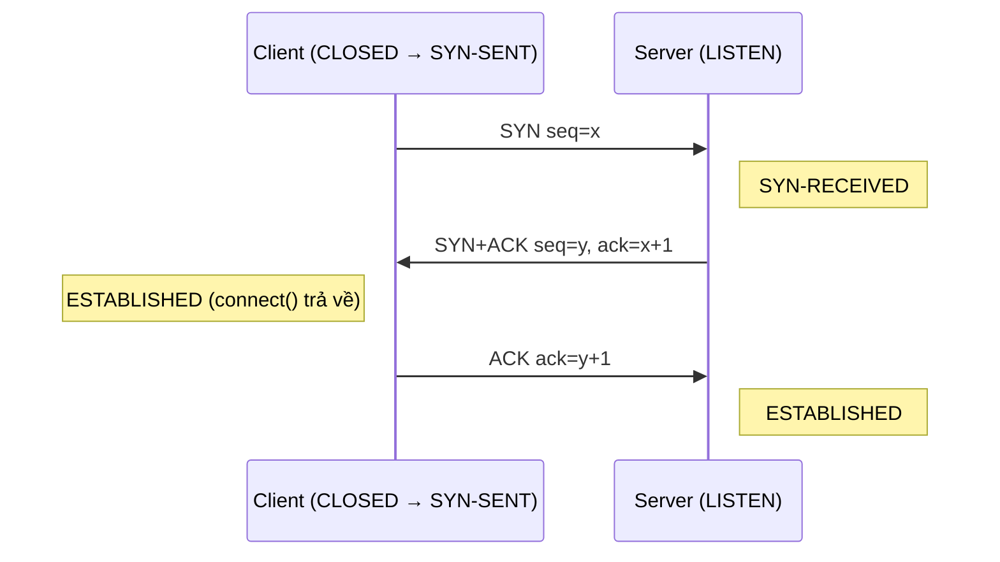
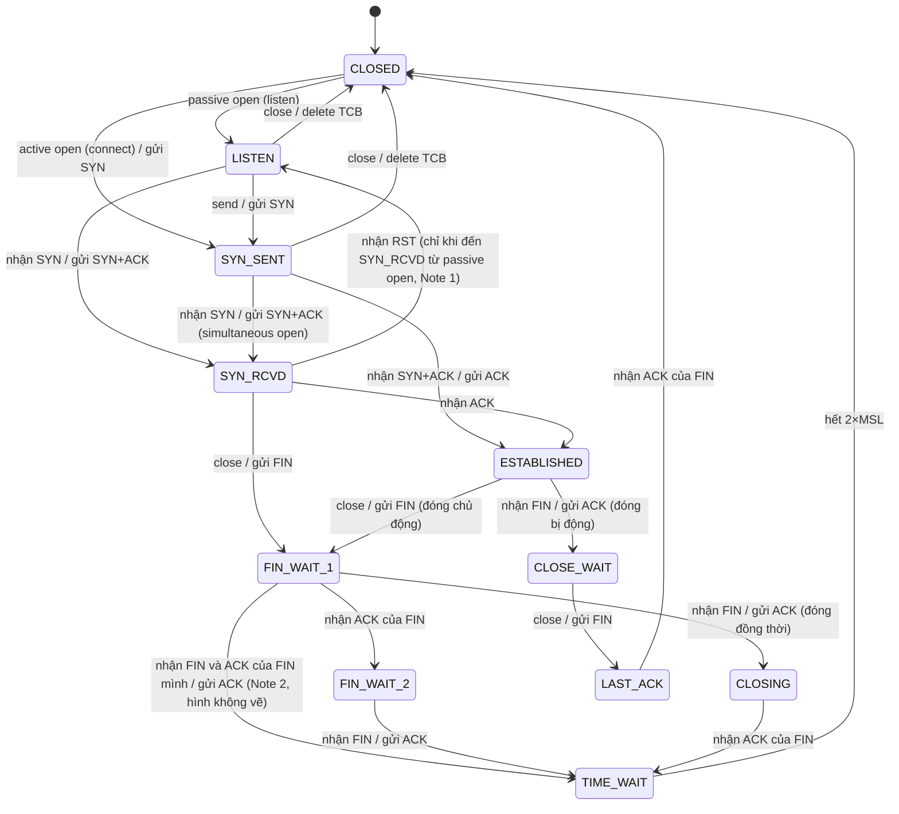
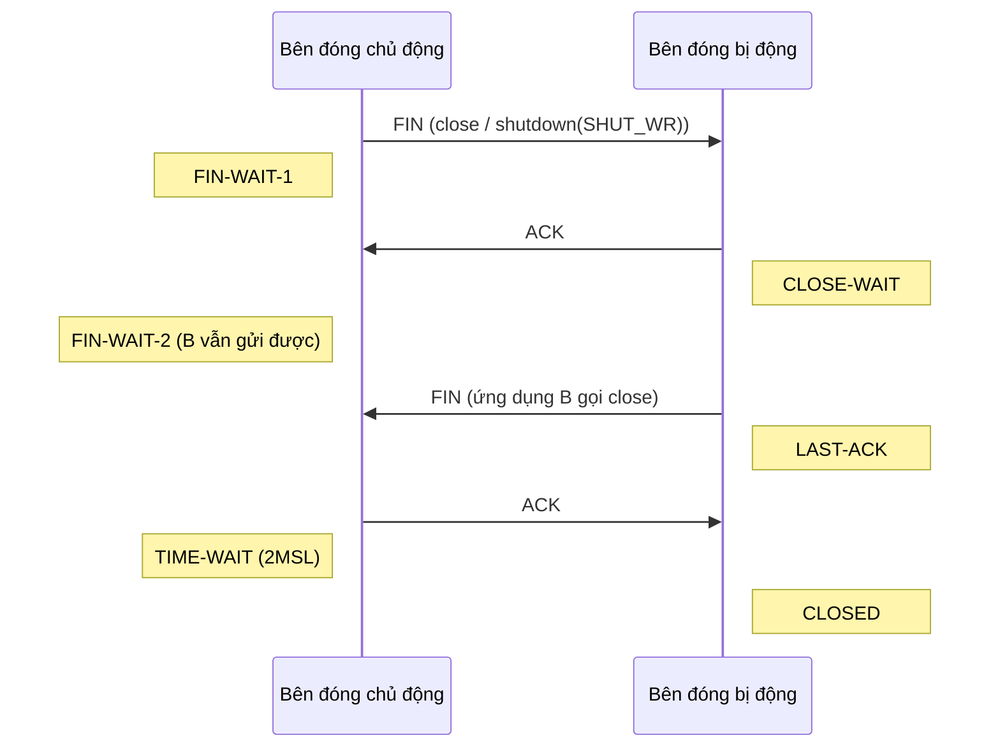

# P6 · Chương 04 — UDP và TCP cơ bản

## Bạn sẽ hiểu được gì

1. **Q1.** Port là gì, vì sao một server nghe ở `:8080` phục vụ được hàng nghìn client, và một kết nối TCP được định danh bằng gì? → mục 1
2. **Q2.** Header UDP gồm những gì, UDP thiếu gì so với TCP, khi nào chọn UDP? → mục 2
3. **Q3.** "Byte stream" của TCP nghĩa là gì và vì sao `write` 100 byte không bảo đảm `read` đúng 100 byte? → mục 3
4. **Q4.** Segment TCP có những trường nào (seq, ack, flags, window, options); MSS là gì và lấy từ đâu? → mục 4
5. **Q5.** Three-way handshake trao đổi gì, vì sao ISN phải khó đoán? → mục 5
6. **Q6.** Mỗi state trong máy trạng thái TCP ứng với tình huống nào, thấy chúng ở đâu trong `ss -tan`? → mục 6
7. **Q7.** Đóng bình thường, half-close, đóng đồng thời và RST khác nhau thế nào; TIME-WAIT/2MSL dài bao lâu trên Linux; CLOSE-WAIT chất đống nói lên điều gì? → mục 7

## Kiến thức cần trước

- [Chương 01 — Layering](01-layering.md) (demux key) và [chương 03 — IP](03-ip.md) (datagram, MTU): TCP và UDP là payload của IP.
- Phần sau chương này: truyền lại/RTO/window ở [chương 05](05-tcp-reliability-va-flow-control.md), congestion control ở [chương 06](06-congestion-control.md), `listen`/`accept`/backlog/`std::net` ở [chương 07](07-socket-va-kernel.md). Chương này chỉ lo **cấu trúc và vòng đời** kết nối.

## 1. Port và multiplexing (Q1)

> **Trả lời ngắn.** Port là một con số 16 bit cho kernel biết gói đến thuộc ứng dụng nào trên máy[^rfc9293-mux]. Một kết nối TCP được định danh bằng cặp hai socket, tức bộ bốn (IP nguồn, port nguồn, IP đích, port đích)[^rfc9293-pair]. Mỗi client cho một bộ bốn khác nhau nên một port như 8080 phục vụ được rất nhiều client cùng lúc (suy luận của người soạn từ định nghĩa).

**Giải thích.**

Hình dung (nhận xét của người soạn): IP là địa chỉ tòa nhà, port là số phòng. Cuộc gọi tới phòng 8080 được phân biệt với cuộc gọi khác bằng cả hai đầu: ai gọi từ đâu, tới phòng nào.

IP chỉ đưa datagram tới *máy*; tầng transport phải chọn *tiến trình*. RFC 9293 nói TCP dùng số port để nhận diện dịch vụ ứng dụng và ghép nhiều luồng riêng biệt giữa các host[^rfc9293-mux]. Phía kernel, số port được dùng để khớp một gói đến với socket descriptor của một process[^beej-port]. Port 16 bit[^rfc9293-ports-hdr] là demux key của tầng transport, đúng vai trò trường type của Ethernet và trường protocol của IP ở chương 01 (so sánh của người soạn).

**Socket pair.** Socket là sự ghép một địa chỉ Internet với một port TCP[^rfc9293-socket], và một kết nối được định nghĩa bởi một cặp socket[^rfc9293-pair]. Một kết nối TCP là bộ bốn (IP nguồn, port nguồn, IP đích, port đích). Server ở `10.0.0.1:8080` giữ được `(1.2.3.4:50000 ↔ 10.0.0.1:8080)` và `(1.2.3.4:50001 ↔ 10.0.0.1:8080)` cùng lúc vì bộ bốn khác nhau (suy luận của người soạn từ định nghĩa). Hệ quả (nhận xét của người soạn): giới hạn 65.535 port chỉ chặn số kết nối từ *một IP nguồn* tới *một (IP, port) đích*; vì vậy một reverse proxy gọi một backend duy nhất có thể cạn ephemeral port (28.232 cổng với dải mặc định) trong khi backend nhận được hàng trăm nghìn client.

<details><summary>Đi sâu: dải port của IANA và của Linux, namespace riêng cho từng giao thức</summary>

- IANA chia thành System/Well Known 0–1023, User/Registered 1024–49151 và Dynamic/Ephemeral 49152–65535[^rfc6335-ranges]. Đó là quy ước đăng ký; dải mà Linux thực sự cấp cho client khi `connect` không `bind` là sysctl riêng, mặc định 32768–60999[^kdoc-port-range] (container lab đo `net.ipv4.ip_local_port_range = 32768 60999`).
- RFC 6335: TCP, UDP, UDP-Lite, SCTP và DCCP đều dùng không gian tên 16 bit cho registry số port của mình[^rfc6335-ns], nên TCP 53 và UDP 53 là hai thứ khác nhau (suy luận của người soạn).

</details>

**Quay lại Q1:** port chọn tiến trình trên máy, còn bộ bốn (IP/port hai đầu) mới định danh một kết nối TCP.

## 2. UDP (RFC 768) (Q2)

> **Trả lời ngắn.** UDP chỉ thêm vào IP số port và checksum (suy luận của người soạn từ danh sách trường header): header 8 byte, không handshake, không bảo đảm giao hay không trùng[^rfc768]. So với TCP nó không có seq, ack, window hay trạng thái kết nối (suy luận của người soạn từ danh sách trường). Chọn UDP khi cần hỏi-đáp ngắn độc lập hoặc dữ liệu thời gian thực chịu mất gói (nhận xét của người soạn), hoặc làm nền cho giao thức mới như QUIC[^rfc9000-udp].

**Giải thích.**

Hình dung (nhận xét của người soạn): UDP như gửi bưu thiếp. Mỗi tấm độc lập, có địa chỉ, không ai báo đã tới hay chưa.

### Header và ngữ nghĩa

UDP cho ứng dụng gửi message với cơ chế giao thức tối thiểu; việc giao và chống trùng không được bảo đảm, ai cần luồng có thứ tự thì dùng TCP[^rfc768][^rfc768-tcp]. HPBN gọi nó là giao thức rỗng (null protocol) và nói RFC 768 có thể vừa trên một tờ khăn ăn[^hpbn-udp-null]. Header 8 byte gồm bốn trường 16 bit:

| Trường | Ghi chú |
|---|---|
| Source Port | tùy chọn: nếu không dùng thì điền giá trị 0[^rfc768-sport0] |
| Destination Port | có ý nghĩa trong ngữ cảnh của một địa chỉ đích internet cụ thể[^rfc768-dport] |
| Length | gồm cả header, tối thiểu 8[^rfc768-fields] |
| Checksum | bù một của tổng bù một trên pseudo header (địa chỉ nguồn, đích, protocol, độ dài), header UDP và dữ liệu; pseudo header giúp bảo vệ khỏi datagram bị chuyển nhầm đường[^rfc768-pseudo]; nếu tính ra 0 thì gửi toàn bit 1[^rfc768-csum0] |

Ở IPv4, checksum toàn 0 nghĩa là bên gửi không tính[^rfc768-csum0]; ở IPv6 thì mặc định checksum UDP không còn là tùy chọn[^rfc8200-udpcsum]. Không có seq, ack, window hay trạng thái kết nối: so với IP, UDP chỉ thêm ghép kênh theo port và phát hiện hỏng dữ liệu (suy luận của người soạn từ danh sách trường).

`udp(7)`: dịch vụ gói datagram không kết nối, không tin cậy; gói có thể bị đảo thứ tự hoặc bị trùng trước khi tới nơi[^udp7]. Mỗi datagram là một đơn vị; nếu buffer nhận nhỏ hơn, phần dư có thể bị bỏ[^recv2-trunc]. `connect()` trên UDP chỉ đặt đích mặc định và lọc nguồn nhận, không có handshake[^connect2-dgram].

### Khi nào dùng UDP

RFC 8085 nêu hai đặc trưng. UDP không phát sinh chi phí thiết lập và đóng kết nối, và trạng thái gắn với nó ở end system là tối thiểu[^rfc8085-noconn]; nhưng nó không có cơ chế kiểm soát tắc nghẽn vốn có[^rfc8085-nocc], nên việc dùng cơ chế phù hợp để tránh congestion collapse là việc của ứng dụng dùng UDP[^rfc8085-app]. Từ đó (nhận xét của người soạn): UDP hợp với hỏi-đáp ngắn độc lập (DNS truyền thống, chương 08), dữ liệu thời gian thực chịu được mất gói, và làm "thùng chở" cho transport mới — QUIC: gói QUIC được chở trong UDP datagram để dễ triển khai hơn trên hệ thống và mạng sẵn có[^rfc9000-udp]. Cần byte stream tin cậy thì dùng TCP; tự viết lại seq/ack/retransmit/congestion control trên UDP là viết lại TCP.

<details><summary>Đi sâu: bắt gói UDP thật, giải mã header, checksum offload</summary>

Trong container lab (kernel `6.8.0-117-generic`), một socket UDP đã `connect` tới `127.0.0.1:9099` (không ai nghe) gửi `hello`; `tcpdump -i lo -n -tt -X "udp port 9099 or icmp"` cho:

```text
IP 127.0.0.1.44918 > 127.0.0.1.9099: UDP, length 5
	0x0010:  7f00 0001 af76 238b 000d fe20 6865 6c6c
IP 127.0.0.1 > 127.0.0.1: ICMP 127.0.0.1 udp port 9099 unreachable, length 41
```

Dòng hex bắt đầu ở offset 0x10 của gói nên 4 byte đầu `7f00 0001` là địa chỉ đích 127.0.0.1, phần cuối của header IPv4 20 byte; 8 byte UDP theo sau: `af76` = 44918 (source), `238b` = 9099 (destination), `000d` = 13 = 8 + 5 (length), `fe20` (checksum), rồi payload `68 65 6c 6c` và `6f` (byte cuối nằm ở dòng 0x0020; ASCII `hello`). **`fe20` chưa phải checksum cuối.** Chạy lại với `tcpdump -vv` thì tcpdump in `bad udp cksum 0xfe20 -> 0xeafd!`, tức giá trị đúng của gói này là `0xeafd`. Tính tay (người soạn): tổng bù một của riêng pseudo header (127.0.0.1, 127.0.0.1, protocol 17, length 13) đúng bằng `0xfe20`, còn checksum đầy đủ trên pseudo header + header UDP (checksum = 0) + `hello` ra `0xeafd`. Khớp với cơ chế TX checksum offload của kernel: trường checksum có thể được điền sẵn tổng của pseudo-header cho UDP hoặc TCP để thiết bị/giai đoạn sau hoàn tất[^kdoc-csum-offload]. Hệ quả thực hành: bắt gói ngay trên máy gửi có thể thấy checksum "sai" mà gói không hỏng (suy luận của người soạn từ phép tính và tài liệu kernel; chưa đọc code của `lo`). Gói ICMP "port unreachable" quay về, nhưng lỗi `ECONNREFUSED` (script in `ConnectionRefusedError(111)`) xuất hiện ở lần `send` *kế tiếp*, đúng như `udp(7)`: lỗi này có thể do một gói gửi trước đó trên socket gây ra[^udp7-refused]

</details>

**Quay lại Q2:** UDP = IP + port + checksum, không kết nối, không tin cậy; chọn nó khi chấp nhận tự lo phần còn lại.

## 3. TCP là gì (RFC 9293) (Q3)

> **Trả lời ngắn.** TCP cho ứng dụng một dòng byte tin cậy và đúng thứ tự[^rfc9293-bytestream]. Nhưng dòng byte không giữ ranh giới các lần `write`[^rfc9293-segbound], nên `write` 100 byte không bảo đảm `read` được đúng 100 byte.

**Giải thích.**

Hình dung (nhận xét của người soạn): TCP như một đường ống nước. Bạn đổ vào từng xô, đầu kia hứng ra theo dòng chảy chứ không theo từng xô.

TCP cung cấp cho ứng dụng dịch vụ byte-stream tin cậy, đúng thứ tự[^rfc9293-bytestream]. Độ tin cậy là phát hiện mất gói (nhờ sequence number) và lỗi (nhờ checksum từng segment), cộng sửa lỗi bằng truyền lại[^rfc9293-reliab]. Khác UDP, TCP có **kết nối**: mỗi đầu phải duy trì trạng thái cho nhiều biến (lưu trong TCB: địa chỉ và port hai đầu, buffer, hàng đợi truyền lại, các sequence number…)[^rfc9293-tcb], dựng bằng handshake và dỡ bằng đóng kết nối (nhận xét của người soạn). Mỗi segment đi như một IP datagram[^rfc9293-bytestream-seg], nên MTU quyết định kích thước segment (MSS, mục 4.3).

**TCP không giữ ranh giới message.** RFC 9293 §3.7: TCP không bảo đảm tương quan nào giữa ranh giới các segment gửi/nhận và ranh giới các buffer đọc/ghi dữ liệu của ứng dụng[^rfc9293-segbound]. Ba `write` 10 byte có thể thành một `read` 30 byte hoặc 7 + 23; tầng ứng dụng (HTTP, RESP, gRPC) tự đóng khung bằng length prefix hay delimiter (nhận xét của người soạn).

<details><summary>Đi sâu: cờ PSH không phải ranh giới message</summary>

RFC chỉ gọi PSH là "Push function" (chức năng đẩy) và dẫn sang phần mô tả lời gọi Send ở mục 3.9.1[^rfc9293-psh].

</details>

**Quay lại Q3:** TCP đảm bảo thứ tự và độ tin cậy của byte, không bảo đảm ranh giới message; ứng dụng tự đóng khung.

## 4. Segment TCP (Q4)

> **Trả lời ngắn.** Segment TCP có header tối thiểu 20 byte (khi không có option, và lớn hơn nếu có option)[^rfc9293-tcphdrsize], gồm: port, sequence number, acknowledgment number, data offset, flags, window, checksum[^rfc9293-ports-hdr]. Sequence number đếm từng byte dữ liệu; SYN và FIN mỗi cái chiếm một số[^rfc9293-synseq]. MSS là kích thước segment lớn nhất mà đầu kia nhận, chỉ gửi trong SYN[^rfc9293-mss-syn] và tính từ MTU trừ header IP và TCP[^rfc9293-mss-calc].

**Giải thích.**

Hình dung (nhận xét của người soạn): header TCP như phiếu vận đơn dán trên mỗi kiện: số thứ tự kiện, "đã nhận đến kiện nào", còn chỗ chứa bao nhiêu, và các cờ báo hiệu.

### 4.1 Header

Header là 20 byte khi không có option, và lớn hơn nếu có option[^rfc9293-tcphdrsize]. Port 16 bit, sequence và acknowledgment number 32 bit[^rfc9293-ports-hdr]; Data Offset là số từ 32 bit trong header TCP, cho biết dữ liệu bắt đầu ở đâu[^rfc9293-doff].

| Trường | Ý nghĩa |
|---|---|
| Sequence Number | số thứ tự của octet dữ liệu đầu tiên trong segment; khi SYN bật thì là ISN và octet dữ liệu đầu tiên là ISN+1[^rfc9293-seqfield] |
| Acknowledgment Number | khi ACK bật: giá trị sequence number kế tiếp mà bên gửi segment mong nhận[^rfc9293-ackfield] |
| Flags | các bit điều khiển hiện được gán là CWR, ECE, URG, ACK, PSH, RST, SYN và FIN[^rfc9293-flags] |
| Window | số octet dữ liệu, tính từ octet được chỉ ra ở trường acknowledgment, mà bên gửi segment này sẵn sàng nhận[^rfc9293-window] |
| Checksum | bù một của tổng bù một các từ 16 bit của header và dữ liệu, cộng cả pseudo header[^rfc9293-csum]; với TCP không bao giờ là tùy chọn[^rfc9293-csum-req] |
| Options | dài (Data Offset − 5) × 4 byte (số học của người soạn từ định nghĩa Data Offset) |

Cần nhớ **SYN** (đồng bộ seq, mở kết nối), **FIN** (hết dữ liệu), **RST** (hủy), và ACK có mặt hầu như mọi segment sau segment đầu. Cách window vận hành ở [chương 05](05-tcp-reliability-va-flow-control.md).

### 4.2 Sequence number đếm byte

Mỗi octet dữ liệu gửi qua một kết nối TCP có một sequence number; vì mọi octet đều được đánh số nên mỗi octet có thể được ack[^rfc9293-seq]. Ack là *cumulative*: ack X nghĩa mọi octet trước X đã nhận[^rfc9293-cumack]. **SYN và FIN mỗi cái chiếm một số sequence; ACK thuần thì không**: ví dụ trong RFC, B ack 101 để xác nhận SYN đã chiếm sequence 100[^rfc9293-synseq], và ACK không chiếm không gian sequence number[^rfc9293-ackseq]. Kernel Linux v6.8: `end_seq = seq + syn + fin + len`[^tcpipv4-endseq].

### 4.3 Options và MSS

Option bắt buộc tối thiểu là End of Option List, No-Operation và **Maximum Segment Size**[^rfc9293-opts-core]; SACK, Timestamps, Window Scale được khuyến nghị cài đặt để đạt hiệu năng cao nhưng không cần thiết cho khả năng tương tác cơ bản của TCP[^rfc9293-opts-extra].

MSS: nếu option này có mặt thì nó cho biết kích thước segment nhận tối đa ở TCP endpoint gửi segment đó[^rfc9293-mss-opt]. Nó chỉ gửi trong SYN: trường này có thể được gửi trong yêu cầu kết nối ban đầu (segment có cờ SYN)[^rfc9293-mss-syn]. Nếu không nhận được MSS option lúc thiết lập kết nối thì phải giả định MSS gửi mặc định là 536 (576 − 40) cho IPv4 hoặc 1220 (1280 − 60) cho IPv6[^rfc9293-mss-default]; 576 và 1280 là effective MTU mặc định mà RFC 9293 nói là RFC 1122 khuyến nghị cho IPv4 (với đích không nối trực tiếp) và là mức tương ứng cho IPv6[^rfc9293-mtu-default], còn 40 và 60 là tổng header IP + TCP không option (số học của người soạn: 20 + 20 và 40 + 20). Giá trị quảng bá nên bằng MTU hiệu dụng trừ các header IP và TCP cố định[^rfc9293-mss-calc], tức 1500 − 40 = 1460 với Ethernet (số học của người soạn). Đặt quá nhỏ có thể ảnh hưởng khả năng PMTUD hoặc PLPMTUD tìm được path MTU lớn hơn[^rfc9293-mss-small]. Mục đích chung là tránh datagram vượt MTU nhỏ nhất của đường vì sẽ dẫn tới mất gói hoặc phân mảnh[^rfc9293-segsmall]. Trên Linux, `TCP_MAXSEG` đặt MSS nhưng giá trị lớn hơn MTU interface thì không có tác dụng[^tcp7-maxseg].

<details><summary>Đi sâu: giải mã một SYN từ byte thật (4.1b)</summary>


Trong container lab (kernel 6.8.0-117-generic), `tcpdump -i lo -n -S -vv -X "tcp port 7878"` bắt SYN đầu tiên của một kết nối (lần chạy riêng để giải mã byte nên cổng và seq khác các bảng ở mục 5). Sau 20 byte header IPv4 (offset 0x14) là 40 byte header TCP:

```text
ad40 1ec6 06cf da75 0000 0000 a002 ffd7 fe30 0000
0204 ffd7 0402 080a 2e98 9190 0000 0000 0103 0307
```

| Byte | Trường | Giá trị |
|---|---|---|
| `ad40` | Source Port | 44352 |
| `1ec6` | Destination Port | 7878 |
| `06cf da75` | Sequence Number | 114285173: ISN, vì SYN bật[^rfc9293-seqfield] |
| `0000 0000` | Acknowledgment Number | 0: trường này chỉ có nghĩa khi ACK bật[^rfc9293-ackfield] |
| `a0` | Data Offset (4 bit) + Reserved (4 bit) | `a` = 10 từ 32 bit = 40 byte header, tức 20 byte options[^rfc9293-doff]; reserved = 0 |
| `02` | Flags | `0x02`: chỉ bit SYN. Thứ tự bit từ cao xuống thấp là CWR ECE URG ACK PSH RST SYN FIN (đọc từ Figure 1 của RFC 9293[^rfc9293-flags]); tcpdump in `[S]` |
| `ffd7` | Window | 65495 |
| `fe30` | Checksum | chưa hoàn tất, cùng hiện tượng offload như UDP: tcpdump in `cksum 0xfe30 (incorrect -> 0xe28d)` |
| `0000` | Urgent Pointer | 0 (URG không bật) |

Options, 20 byte: `02 04 ffd7` là option kind 2 (MSS)[^rfc9293-opt-mss-kind] dài 4 byte với giá trị MSS 2 byte = 65495[^rfc9293-opt-mss-size]; `04 02` = SACK permitted; `08 0a 2e989190 00000000` = Timestamps (TSval, TSecr = 0); `01` = No-Operation (kind 1)[^rfc9293-opt-nop-kind], đệm cho thẳng hàng; `03 03 07` = Window Scale, dịch 7 bit. Tên của ba option SACK/Timestamps/Window Scale là tcpdump in (`sackOK`, `TS val … ecr 0`, `wscale 7`); RFC 9293 xếp chúng ngoài tập option bắt buộc[^rfc9293-opts-extra]. Cộng lại 4 + 2 + 10 + 1 + 3 = 20 byte, khớp Data Offset. SYN+ACK của server cùng kết nối có byte flags `0x12` (`a012`) = SYN + ACK, tcpdump in `[S.]`.

</details>

**Quay lại Q4:** header = port, seq, ack, offset, flags, window, checksum, options; seq đếm byte, MSS chỉ nằm trong SYN.


## 5. Three-way handshake (Q5)

> **Trả lời ngắn.** Handshake ba bước (SYN, SYN+ACK, ACK) giúp hai đầu thống nhất số thứ tự khởi đầu (ISN) cho từng chiều[^rfc9293-3whs-combine]. Cần vì hai đầu không có đồng hồ chung để biết segment đầu là cũ hay mới[^rfc9293-3whs]. ISN phải khó đoán vì kẻ tấn công ngoài đường truyền mà đoán được ISN sẽ gây vấn đề an ninh[^rfc9293-isn-sec].

**Giải thích.**

Hình dung (nhận xét của người soạn): như gọi điện "alô, nghe rõ không?" – "nghe rõ, anh nghe rõ không?" – "rõ". Chỉ khi cả hai chiều đã được xác nhận mới bắt đầu nói chuyện.

### Vì sao ba bước

Hai đầu phải đồng thuận ISN của *từng chiều*: A gửi SYN kèm X; B ack X; B gửi SYN kèm Y; A ack Y. Vì bước 2 và 3 gộp được thành một message nên gọi là bắt tay ba bước (three-way handshake, 3WHS)[^rfc9293-3whs-combine]. Cần ba bước vì sequence number không gắn với đồng hồ toàn cục trong mạng, và các cài đặt TCP có thể chọn ISN bằng những cơ chế khác nhau[^rfc9293-3whs]: bên nhận SYN đầu không biết đó là segment cũ hay mới nên phải bắt bên gửi xác nhận. Thủ tục cũng chạy nếu hai bên mở đồng thời (simultaneous open)[^rfc9293-hs-sim]. Chi phí: mọi kết nối TCP đều bắt đầu bằng bắt tay ba bước[^hpbn-hs], tức client phải chờ một RTT (SYN đi, SYN+ACK về) trước khi gửi được dữ liệu của mình — lý do connection pool/keep-alive có giá trị (nhận xét của người soạn).



### ISN: vì sao phải khó đoán

RFC 9293 mô tả một "clock" 32 bit thường tăng ít nhất mỗi ~4 µs, nhằm bảo đảm các ISN sinh ra là duy nhất trong một MSL[^rfc9293-isn]. Mục đích: không nhầm segment cũ với kết nối mới cùng bộ bốn — phải ngăn segment của một incarnation (lần kết nối trước) bị dùng khi các sequence number y hệt vẫn còn trong mạng từ incarnation đó[^rfc9293-incarnation]. (TIME-WAIT, mục 7, là nửa còn lại của bảo vệ này.) Bộ đếm thuần thì đoán được (suy luận của người soạn), mà nếu kẻ tấn công off-path dự đoán hay đoán được giá trị ISN thì nảy sinh vấn đề an ninh[^rfc9293-isn-sec]. Vì vậy RFC nói cài đặt nên (SHOULD) sinh ISN bằng `ISN = M + F(localip, localport, remoteip, remoteport, secretkey)`[^rfc9293-isn-expr], với F là hàm giả ngẫu nhiên (PRF) của các tham số kết nối và một khóa bí mật, và F không được (MUST NOT) tính ra được từ bên ngoài[^rfc9293-isn-prf]. HPBN: sequence number được chọn ngẫu nhiên ở cả hai phía vì lý do an ninh[^hpbn-isn]

<details><summary>Đi sâu: bắt handshake và FIN bằng tcpdump; ISN trong source Linux v6.8</summary>

Container lab (kernel 6.8.0-117-generic): server Python (`bind 127.0.0.1:7878`, `listen(8)`, `accept`, echo, **chưa** `close` sau khi thấy EOF, đóng sau 3 giây) và client (`connect`, gửi `hello\n`, đọc echo, `shutdown(SHUT_WR)`). Bắt bằng `tcpdump -i lo -n -tt -S "tcp port 7878"`; `-S` in seq tuyệt đối[^tcpdump-S], cờ `S` = SYN, `F` = FIN, `P` = PUSH, `R` = RST, `.` = ACK[^tcpdump-flags]. Cột đầu là mili-giây từ gói đầu (người soạn tính từ `-tt`); seq/ack sẽ khác ở máy bạn:

```text
   0.000 C→S [S]   seq 1908071040                         len 0  options [mss 65495,sackOK,TS,nop,wscale 7]
   0.007 S→C [S.]  seq 1581439220, ack 1908071041         len 0  options [mss 65495,sackOK,TS,nop,wscale 7]
   0.015 C→S [.]   ack 1581439221                         len 0
   0.035 C→S [P.]  seq 1908071041:1908071047, ack ...221  len 6  (hello\n)
   0.037 S→C [.]   ack 1908071047
   0.282 S→C [P.]  seq 1581439221:1581439227              len 6  (echo)
   0.289 C→S [.]   ack 1581439227
   0.309 C→S [F.]  seq 1908071047                         len 0  (shutdown(SHUT_WR))
  45.787 S→C [.]   ack 1908071048                                (ack của FIN, ~46 ms sau)
3002.567 S→C [F.]  seq 1581439227                                (server close() sau 3 s)
3002.583 C→S [.]   ack 1581439228
```

1. **Ba dòng đầu là handshake.** ISN client `1908071040`, server `1581439220`; server ack `…041` = ISN + 1 vì SYN chiếm một số sequence (mục 4.2).
2. **ISN không phải 0 và không phải bộ đếm thuần.** Ở thí nghiệm RST (mục 7) có hai kết nối cách nhau ~0,5 s tới cùng port đích; ISN client `3822641013` rồi `3935001349`, chênh ~1,1×10^8. Clock 4 µs của RFC chỉ tiến ~1,25×10^5 trong 0,5 s, còn clock 64 ns của Linux (bên dưới) tiến ~7,8×10^6; cả hai nhỏ hơn nhiều so với chênh lệch quan sát, và hai kết nối khác port nguồn nên phần hash cũng khác (suy luận của người soạn từ các con số).
3. `hello\n` chiếm đúng 6 sequence (`…041:…047`) và FIN của client có `seq 1908071047`, ack của nó là `…048`: FIN chiếm một số sequence.
4. SYN mang `mss 65495`. `lo` có MTU 65536 (`ip link show lo`); người soạn quan sát giá trị 65495 chứ không giải thích vì sao nhỏ hơn 65536 − 40 = 65496 một đơn vị, nên không kết luận về nó (con số trùng với 65535 − 40, nhưng người soạn chưa đối chiếu code kernel).


Linux v6.8 (source, chi tiết cài đặt chứ không phải bảo đảm): `secure_tcp_seq` tính `hash = siphash_3u32(saddr, daddr, sport << 16 | dport, &net_secret)`[^linux-isn-hash] rồi `seq_scale(hash)` cộng đồng hồ 64 ns: `return seq + (ktime_get_real_ns() >> 6);`[^linux-isn-clock]. Tức (suy luận của người soạn từ hai dòng code) cùng bộ bốn và cùng khóa thì phần hash cố định, ISN chỉ tiến theo đồng hồ; khác bộ bốn thì phần hash nhảy loạn — khớp quan sát.

</details>

**Quay lại Q5:** ba bước để hai chiều cùng đồng bộ ISN; ISN lấy từ đồng hồ cộng hàm giả ngẫu nhiên của bộ bốn để không đoán được.

## 6. State machine TCP (Q6)

> **Trả lời ngắn.** Mỗi kết nối TCP luôn ở một trong các state như LISTEN, SYN-SENT, ESTABLISHED, FIN-WAIT, CLOSE-WAIT, TIME-WAIT…[^rfc9293-states]; state cho biết kết nối đang ở chặng mở hay đóng nào. `ss -tan` in chúng bằng tên viết thường[^ss8-states].

**Giải thích.**

Hình dung (nhận xét của người soạn): như phiếu theo dõi đơn hàng: "đã nhận đơn", "đang giao", "chờ khách xác nhận", mỗi trạng thái ứng với một việc đang chờ.

RFC 9293: một kết nối đi qua một chuỗi state trong vòng đời, gồm LISTEN, SYN-SENT, SYN-RECEIVED, ESTABLISHED, FIN-WAIT-1, FIN-WAIT-2, CLOSE-WAIT, CLOSING, LAST-ACK, TIME-WAIT, và state hư cấu CLOSED[^rfc9293-states]. Sơ đồ dưới dựng lại mọi cạnh vẽ trong Figure 5 (người soạn đối chiếu từng cạnh với hình ASCII của RFC), cộng cạnh `FIN-WAIT-1 → TIME-WAIT` mà hình không vẽ nhưng Note 2 nêu: hình bỏ qua cạnh từ FIN-WAIT-1 sang TIME-WAIT khi nhận FIN và FIN cục bộ cũng đã được ack[^rfc9293-fig5-note2].



Ý nghĩa các state (RFC 9293 §3.3.2):

| State | RFC 9293 nói |
|---|---|
| LISTEN | chờ yêu cầu kết nối từ bất kỳ TCP peer và port từ xa nào[^rfc9293-listen] |
| SYN-SENT | chờ yêu cầu kết nối khớp sau khi đã gửi yêu cầu kết nối[^rfc9293-synsent] |
| SYN-RECEIVED | chờ ack xác nhận yêu cầu kết nối sau khi đã vừa nhận vừa gửi yêu cầu kết nối[^rfc9293-synrcvd] |
| ESTABLISHED | kết nối đang mở, dữ liệu nhận được có thể chuyển cho người dùng[^rfc9293-estab] |
| FIN-WAIT-1 | chờ FIN của peer, hoặc ack cho FIN mình đã gửi[^rfc9293-finwait1] |
| FIN-WAIT-2 | chờ yêu cầu ngắt kết nối từ TCP peer từ xa[^rfc9293-finwait2] |
| CLOSE-WAIT | chờ yêu cầu ngắt kết nối từ người dùng cục bộ[^rfc9293-closewait] |
| CLOSING | chờ ack của FIN mình gửi, sau khi đã nhận FIN của peer[^rfc9293-closing] |
| LAST-ACK | chờ ack cho FIN mình gửi (FIN này đã kèm ack cho FIN của peer)[^rfc9293-lastack] |
| TIME-WAIT | chờ đủ lâu để chắc peer nhận được ack của yêu cầu ngắt kết nối và tránh segment trễ của kết nối cũ ảnh hưởng kết nối mới[^rfc9293-timewait] |
| CLOSED | hoàn toàn không có state kết nối[^rfc9293-closed] |

<details><summary>Đi sâu: các ghi chú của Figure 5, state nội bộ của kernel, quan sát <code>ss -tan</code></summary>

Hai ghi chú khác của hình vẫn chưa được vẽ hết: cạnh `SYN-RECEIVED → LISTEN` khi nhận RST **chỉ áp dụng nếu SYN-RECEIVED đạt được sau passive OPEN** (Note 1)[^rfc9293-fig5-note1]; còn Note 3 nói RST có thể được gửi từ mọi state kèm cạnh tương ứng sang TIME-WAIT, và nhận RST từ mọi state dẫn tới LISTEN hoặc CLOSED — các cạnh này không vẽ cho dễ đọc[^rfc9293-fig5-note3]. RFC nhắc rằng sơ đồ chỉ là bản tóm tắt và không được coi là đặc tả đầy đủ[^rfc9293-fig5-note].

`ss` dùng tên viết thường: established, syn-sent, syn-recv, fin-wait-1, fin-wait-2, time-wait, closed, close-wait, last-ack, listening và closing[^ss8-states]. Kernel còn có hai state không nằm trong danh sách của RFC là `TCP_NEW_SYN_RECV` và `TCP_BOUND_INACTIVE` (chú thích trong source cho `TCP_BOUND_INACTIVE` là pseudo-state cho inet_diag)[^linux-states], nên bảng trên không phải danh sách đầy đủ những gì `ss` có thể in (suy luận của người soạn từ hai danh sách).

### Quan sát thật: `ss -tan`

Cùng thí nghiệm mục 5, `ss -tan 'sport = :7878 or dport = :7878'` chạy khi server đã thấy EOF của client nhưng chưa `close()`, rồi sau khi server `close()`:

```text
State      Recv-Q Send-Q Local Address:Port  Peer Address:Port
LISTEN     0      8          127.0.0.1:7878       0.0.0.0:*
FIN-WAIT-2 0      0          127.0.0.1:42648    127.0.0.1:7878
CLOSE-WAIT 0      0          127.0.0.1:7878     127.0.0.1:42648
  ... server close() ...
TIME-WAIT  0      0          127.0.0.1:42648    127.0.0.1:7878
```

(Chạy lại một lần nữa ở lab: nếu `ss` chạy *trước* khi server gọi `recv` để đọc EOF thì dòng CLOSE-WAIT hiện `Recv-Q 1` thay vì 0 — quan sát một lần chạy; vì FIN chiếm một số sequence nên người soạn đoán đó là cách `ss` đếm FIN chưa đọc, chưa kiểm nguồn.) Client đã gửi FIN và được ack nhưng server chưa đóng → client **FIN-WAIT-2**, server **CLOSE-WAIT**, đúng định nghĩa[^rfc9293-finwait2][^rfc9293-closewait]. Khi server `close()` dòng của server biến mất (CLOSED) và client — bên đóng chủ động — ở **TIME-WAIT**. Để thấy SYN-SENT: `nc -w 5 10.255.255.1 80` trong container (địa chỉ không ai trả lời, do người soạn chọn tùy ý) rồi `ss -tan state syn-sent` in `0 1 172.17.0.2:38852 10.255.255.1:80` — một lần chạy.

</details>

**Quay lại Q6:** mỗi state là một chặng đang chờ gì đó; `ss -tan` cho thấy chúng, ví dụ CLOSE-WAIT = đã nhận FIN, chờ ứng dụng đóng.

## 7. Đóng kết nối, half-close, RST, TIME-WAIT (Q7)

> **Trả lời ngắn.** Đóng bình thường là bốn segment FIN–ACK–FIN–ACK (đếm từ Figure 12 của RFC 9293, người soạn); hai chiều đóng độc lập nên có thể half-close, đóng một chiều mà vẫn nhận tiếp[^rfc9293-halfclose]. RST thì hủy kết nối ngay, bỏ state[^rfc9293-abort]. Bên đóng chủ động ở TIME-WAIT 2×MSL: RFC là 4 phút[^rfc9293-2msl][^rfc9293-msl-def], còn Linux v6.8 dùng 60 giây[^linux-tw-len]. CLOSE-WAIT chất đống thường nghĩa là ứng dụng chưa `close()` sau khi nhận FIN[^rfc9293-closewait] (suy luận của người soạn từ định nghĩa state).

**Giải thích.**

Hình dung (nhận xét của người soạn): đóng bình thường như cúp máy lịch sự: "tôi nói xong rồi" – "ok" – (lát sau) "tôi cũng xong" – "ok". RST như dập máy giữa chừng. TIME-WAIT là bên chủ động cúp trước đứng chờ thêm chút phòng lời cuối bị lạc.

### 7.1 Đóng bình thường và half-close

Vì hai chiều của một kết nối TCP đóng độc lập, kết nối có thể ở trạng thái "half closed" (nửa đóng), tức chỉ đóng một chiều, và host được phép tiếp tục gửi dữ liệu theo chiều còn mở[^rfc9293-halfclose]. RFC xử CLOSE theo kiểu simplex: người dùng đã CLOSE vẫn có thể tiếp tục RECEIVE cho tới khi TCP nhận được thông báo rằng peer từ xa cũng đã CLOSE[^rfc9293-close-simplex]. Bên nhận FIN thì có thể ACK nó và báo người dùng rằng kết nối đang đóng[^rfc9293-close-unsol], nhưng sẽ chỉ ACK chứ không gửi FIN của mình cho tới khi người dùng của nó cũng đã CLOSE kết nối[^rfc9293-close-case1]. Vậy đóng bình thường là bốn segment FIN–ACK–FIN–ACK (đếm từ Figure 12 của RFC 9293, người soạn), và khoảng giữa ACK và FIN thứ hai **tùy ứng dụng** — trong thí nghiệm là 3 giây. FIN được gửi lại tới khi có ack[^rfc9293-fin-retrans].



Trace mục 5 chính là kịch bản này (`[F.]` client, ack, `[F.]` server sau 3 s, ack cuối). Ở API, nửa đóng là `shutdown(2)`: với SHUT_WR thì các lần truyền tiếp theo bị cấm[^shutdown2]. Nó gửi EOF cho peer mà vẫn đọc tiếp được — mẫu "gửi xong request, đọc response đến hết" (nhận xét của người soạn). **Đóng đồng thời**: khi người dùng ở hai đầu CLOSE cùng lúc, hai bên trao đổi FIN segment (Figure 13)[^rfc9293-simclose]. Theo Figure 13, mỗi bên đi `FIN-WAIT-1 → CLOSING → TIME-WAIT`.

### 7.2 RST

RFC nêu hai cách kết thúc: đóng bằng FIN, hoặc "abort" khi một hay nhiều RST segment được gửi và state của kết nối bị hủy ngay lập tức[^rfc9293-abort]. Bên nhận RST thường chuyển thẳng về CLOSED: nó hủy kết nối, báo người dùng và vào state CLOSED[^rfc9293-rst-recv] (ngoại lệ: ở LISTEN thì bỏ qua RST, còn SYN-RECEIVED mà trước đó từ LISTEN thì quay về LISTEN[^rfc9293-rst-sm]). Ứng dụng thấy lỗi chứ không phải EOF (ví dụ `ConnectionResetError(104)` ở dưới). RST được kiểm tra hợp lệ bằng trường sequence: ở mọi state trừ SYN-SENT thì hợp lệ nếu sequence number nằm trong window[^rfc9293-rst-valid]; ở SYN-SENT thì RST được chấp nhận nếu trường ACK xác nhận SYN[^rfc9293-rst-synsent]. Quy tắc gửi: RST được gửi mỗi khi có segment đến mà rõ ràng không dành cho kết nối hiện tại[^rfc9293-rst-general]. Hai ví dụ đã chạy:

**(a) SYN tới port không ai nghe.** RFC: nếu kết nối không tồn tại (CLOSED) thì mọi segment đến (trừ một RST khác) đều được đáp bằng reset; SYN không khớp kết nối nào bị từ chối theo cách này[^rfc9293-rst-closed]

```text
127.0.0.1.58912 > 127.0.0.1.7979: Flags [S], seq 3822641013, win 65495, ...
127.0.0.1.7979 > 127.0.0.1.58912: Flags [R.], seq 0, ack 3822641014, win 0, length 0
```

Client nhận `ConnectionRefusedError(111)` ngay. SYN không có ACK nên RST có `seq 0` và ack bằng seq + độ dài segment (SYN chiếm 1)[^rfc9293-rst-closed-seq].

**(b) `close()` khi còn dữ liệu chưa đọc.** Client gửi 11 byte, server `accept` rồi `close()` mà chưa `recv`:

```text
... [P.]  seq 3935001350:3935001361, length 11   (client → server)
... [.]   ack 3935001361                          (server ack dữ liệu)
... [R.]  seq 1303656997, ack 3935001361          (server → client, lúc server close())
```

Lần `send` kế tiếp của client nhận `ConnectionResetError(104)`. Server không gửi FIN mà gửi RST. RFC 9293 §3.6.1 nêu cho kiểu close "half-duplex" (ứng dụng đã gọi CLOSE thì không đọc tiếp được) rằng nếu CLOSE khi còn dữ liệu nhận chưa đọc thì cài đặt nên gửi RST để báo dữ liệu đã mất, và dẫn sang RFC 2525 §2.17[^rfc9293-rst-datalost]; RFC 2525 xếp việc không làm vậy là lỗi cài đặt (không gửi RST khi đóng mà còn dữ liệu chờ), với mô tả TCP nên gửi RST nếu còn dữ liệu nhận được chưa đọc, hoặc nếu có dữ liệu mới đến thêm[^rfc2525-217]. Linux làm đúng điều này (source ở phần Đi sâu cuối mục). Bài học (nhận xét của người soạn): đóng socket khi chưa đọc hết request (trả lỗi sớm lúc body upload còn dở) có thể khiến client thấy `connection reset` thay vì response; nhiều server "drain" body trước khi đóng.

### 7.3 TIME-WAIT và 2MSL

Đặc tả: kết nối đóng chủ động phải nằm lại ở state TIME-WAIT trong 2×MSL[^rfc9293-2msl], với MSL được định nghĩa tùy ý là 2 phút[^rfc9293-msl-def] — tức đặc tả cho 4 phút. **Linux v6.8 không dùng 4 phút**: `#define TCP_TIMEWAIT_LEN (60*HZ) /* ... about 60 seconds */`[^linux-tw-len], một hằng số trong header; `tcp_minisocks.c` đặt `timeo = TCP_TIMEWAIT_LEN` cho state TIME_WAIT[^linux-tw-timeo]. Quan sát: `ss -tano state time-wait` ngay sau khi đóng in `timer:(timewait,59sec,0)` (`-o` hiện thông tin timer[^ss8-timer]), khớp 60 giây. `TCP_FIN_TIMEOUT` cũng định nghĩa bằng `TCP_TIMEWAIT_LEN`[^linux-fin-timeout] — comment ngay dưới dòng định nghĩa đó gọi nó là bộ phá deadlock FIN_WAIT2 kiểu BSD[^linux-fin-bsd], và đây là gốc của việc hai con số 60 giây hay bị nhầm là một (suy luận của người soạn) — nhưng sysctl `tcp_fin_timeout` **không** chỉnh TIME-WAIT: nó là khoảng thời gian một kết nối mồ côi (không còn ứng dụng nào tham chiếu) ở lại state FIN_WAIT_2 trước khi bị hủy ở đầu cục bộ[^kdoc-fin-timeout]

**Vì sao cần.** TIME-WAIT hạn chế tốc độ tái dùng kết nối, còn việc chọn ISN bảo vệ thêm khỏi sự mơ hồ về việc gói đến thuộc lần kết nối (incarnation) nào[^rfc9293-tw-limit]. Hai ý cụ thể (diễn giải của người soạn từ định nghĩa state): nếu ACK cuối mất, bên bị động (LAST-ACK) gửi lại FIN và bên chủ động phải còn state để ack lại thay vì trả RST; và 2×MSL đủ cho segment cũ chết hẳn, để kết nối mới không bị ảnh hưởng bởi segment trễ của các kết nối trước[^rfc9293-timewait]


(Nhận xét của người soạn: TIME-WAIT là *tính năng* của giao thức, nằm ở bên đóng chủ động — client trong ví dụ, nhưng nếu server đóng trước thì chính server tích TIME-WAIT. Khi hết ephemeral port, hãy hỏi ai đóng trước, có connection pool/keep-alive không và dải `ip_local_port_range` là bao nhiêu, thay vì đổ lỗi cho TIME-WAIT.)

### 7.4 CLOSE-WAIT tích tụ là bug ứng dụng

CLOSE-WAIT là kernel đã nhận FIN và ack, rồi chờ yêu cầu ngắt kết nối từ người dùng cục bộ[^rfc9293-closewait]: chỉ khi ứng dụng gọi `close()` mới sang LAST-ACK. Đọc socket trả 0 byte (EOF) — tài liệu nói giá trị 0 cho biết kết nối đã được shutdown đúng cách[^std-read-eof] — nhưng kernel không đóng thay bạn (suy luận của người soạn từ máy trạng thái; thí nghiệm trên giữ server ở CLOSE-WAIT 3 giây chỉ vì cố ý không `close()`). Có một ngoại lệ hợp lệ nhưng tạm thời: peer half-close để đợi phản hồi, còn ứng dụng này đang gửi nốt dữ liệu rồi mới `close()` — RFC cho phép tiếp tục gửi trên kết nối half-closed[^rfc9293-halfclose]. Khác TIME-WAIT (bình thường, hết sau ~60 s), nhiều CLOSE-WAIT kéo dài **gần như luôn là lỗi ứng dụng** (nhận xét của người soạn): quên `close()` sau EOF, rò connection trong pool, handler kẹt không thoát vòng đọc. `ss -tanp state close-wait` chỉ ra process giữ socket.

<details><summary>Đi sâu: RST khi close trong source Linux v6.8; <code>SO_REUSEADDR</code>, <code>tcp_tw_reuse</code>, <code>tcp_max_tw_buckets</code></summary>

- Linux gửi RST khi `close()` còn dữ liệu chưa đọc, có cả trong source v6.8: `__tcp_close` đếm `data_was_unread` khi dọn hàng đợi nhận, và comment viết "As outlined in RFC 2525, section 2.17, we send a RST here because" dữ liệu bị mất[^linux-close-rst]; nhánh đó gọi `tcp_send_active_reset` thay vì gửi FIN[^linux-close-zap]. Chạy lại ở lab: counter `TcpExtTCPAbortOnClose` (`nstat`) tăng từ 0 lên 1 sau đúng một lần `close()` như vậy (tên counter khớp `LINUX_MIB_TCPABORTONCLOSE` ngay trong nhánh code trên — suy luận của người soạn từ sự trùng tên). Lưu ý: nếu hàng đợi chỉ có FIN của peer mà không có byte dữ liệu thì `data_was_unread` vẫn bằng 0 vì code trừ FIN (`len--`), nên đi đường FIN bình thường.
- **Hệ quả trên Linux.** `bind` lại địa chỉ vừa dùng bị từ chối một thời gian trừ khi đã đặt cờ SO_REUSEADDR[^ip7-bound-reuse]; Rust std đặt `SO_REUSEADDR` cho `TcpListener::bind`[^std-reuseaddr]. `tcp_tw_reuse` bật tái dùng TIME-WAIT khi điều đó an toàn xét theo giao thức: 0 tắt, 1 bật toàn cục, 2 chỉ loopback, mặc định 2, và tài liệu kernel dặn không nên đổi nếu không có lời khuyên/yêu cầu của chuyên gia kỹ thuật[^kdoc-tw-reuse] (man page bookworm chỉ mô tả boolean[^tcp7-tw-reuse], cũ hơn kernel; container 6.8 đo được `net.ipv4.tcp_tw_reuse = 2`). Số TIME-WAIT có trần `tcp_max_tw_buckets`: số socket timewait tối đa mà hệ thống giữ đồng thời[^kdoc-tw-buckets]

</details>

**Quay lại Q7:** FIN–ACK–FIN–ACK để đóng êm (half-close được), RST để hủy; TIME-WAIT nằm ở bên đóng chủ động (~60 s trên Linux), còn CLOSE-WAIT kéo dài là lỗi của ứng dụng.

## 8. Liên hệ với Rust

Chi tiết `std::net` ở [chương 07](07-socket-va-kernel.md); ở đây chỉ nối với state machine.

- `TcpStream::shutdown(Shutdown::Write)` (doc: phần ghi của TcpStream sẽ bị đóng[^std-shutdown-write]) trên Unix map thành `libc::shutdown` với `SHUT_WR`[^std-shutdown-sys]. Nếu coi đóng chiều gửi tương ứng với CLOSE của RFC (suy luận của người soạn), thì TCP gửi FIN và vào FIN-WAIT-1, nơi RECEIVE vẫn được phép[^rfc9293-fw1-recv], nên vẫn đọc tiếp được.
- `Drop`: doc nói kết nối sẽ được đóng khi value bị drop[^std-stream-drop]. **Giữ `TcpStream` sống** (trong `Arc`, channel, task treo) vẫn tạo CLOSE-WAIT vì kernel không biết value còn được tham chiếu (suy luận của người soạn).
- `read` trả `Ok(0)` khi peer gửi FIN[^std-read-eof]; vòng `loop { read }` không xử lý `Ok(0)` là cách thường gặp để handler kẹt và giữ CLOSE-WAIT (suy luận của người soạn).
- `UdpSocket::connect` chỉ lọc để nhận dữ liệu từ địa chỉ được chỉ định[^std-udp-connect], cùng ngữ nghĩa với `connect(2)` ở mục 2; `recv_from` cắt datagram quá dài[^std-udp-trunc].

## Tóm tắt

- Port 16 bit là demux key của transport; kết nối TCP là bộ bốn (IP/port nguồn, IP/port đích), nên một port đích phục vụ nhiều client.
- UDP = IP + port + checksum: header 8 byte, không kết nối, không tin cậy, giữ ranh giới datagram, không congestion control.
- TCP là byte stream tin cậy, có thứ tự, có kết nối, không giữ ranh giới message.
- Sequence number đếm byte; SYN và FIN chiếm một số sequence, ACK thuần thì không; MSS chỉ nằm trong SYN, = MTU − header IP − header TCP, mặc định 536 (IPv4) nếu vắng.
- Handshake đồng bộ ISN hai chiều; ISN = clock + PRF(bộ bốn, secret) để off-path attacker không đoán được (Linux: SipHash + đồng hồ 64 ns).
- Đóng bình thường là FIN–ACK–FIN–ACK, có thể half-close bằng `shutdown(SHUT_WR)`; RST hủy ngay.
- TIME-WAIT ở bên đóng chủ động; RFC cần 2×MSL (MSL = 2 phút), Linux v6.8 cố định 60 giây; `tcp_fin_timeout` chỉnh FIN-WAIT-2 của socket mồ côi chứ không chỉnh TIME-WAIT.
- CLOSE-WAIT kéo dài gần như luôn là bug ứng dụng (không `close()` sau EOF).

## Câu hỏi tự kiểm tra

1. Server `:443` có 50.000 client; cái gì phân biệt các kết nối, và giới hạn 65.535 port áp vào đâu?
<details><summary>Đáp án</summary>

Bộ bốn socket pair[^rfc9293-pair][^rfc9293-socket]; giới hạn port áp cho số kết nối từ một IP nguồn tới một (IP, port) đích, tức vấn đề của client/proxy (suy luận, mục 1).

</details>

2. Đọc `af76 238b 000d fe20` trong header UDP.
<details><summary>Đáp án</summary>

Source 44918, destination 9099, length 13 (= 8 + 5 byte dữ liệu), checksum `0xfe20` — giá trị bắt được trên máy gửi, chưa phải checksum cuối (`tcpdump -vv` tính `0xeafd`, mục 2)[^kdoc-csum-offload]; length tối thiểu 8[^rfc768-fields].

</details>

3. Vì sao một `read` TCP có thể trả ít hơn hoặc gộp nhiều hơn các `write`?
<details><summary>Đáp án</summary>

Byte stream, không có tương quan nào giữa các ranh giới[^rfc9293-segbound]; UDP thì mỗi datagram là một đơn vị (suy luận từ recv(2))[^recv2-trunc].

</details>

4. Vì sao ack của SYN+ACK là `ISN_client + 1`, và ACK thuần có làm seq tăng không?
<details><summary>Đáp án</summary>

SYN chiếm một số sequence[^rfc9293-synseq]; ACK thuần thì không[^rfc9293-ackseq]; kernel `end_seq = seq + syn + fin + len`[^tcpipv4-endseq].

</details>

5. MSS nằm ở segment nào, bằng bao nhiêu với MTU 1500, và nếu vắng thì sao?
<details><summary>Đáp án</summary>

Chỉ trong SYN[^rfc9293-mss-syn]; MTU − header IP − header TCP[^rfc9293-mss-calc] = 1460; vắng thì 536 (IPv4) hoặc 1220 (IPv6)[^rfc9293-mss-default].

</details>

6. Vì sao handshake cần ba bước và ISN không được đoán trước?
<details><summary>Đáp án</summary>

Bên nhận SYN đầu không phân biệt được segment cũ/mới[^rfc9293-3whs]; off-path attacker đoán được ISN thì tấn công được[^rfc9293-isn-sec]; ISN = clock + PRF của bộ bốn và secret[^rfc9293-isn-expr], Linux dùng SipHash[^linux-isn-hash].

</details>

7. A `close()` trước, B đóng sau 3 giây: chuỗi state mỗi bên? B ở state nào ở giữa?
<details><summary>Đáp án</summary>

A: ESTABLISHED → FIN-WAIT-1 → FIN-WAIT-2 → TIME-WAIT → CLOSED. B: ESTABLISHED → CLOSE-WAIT → LAST-ACK → CLOSED[^rfc9293-states]. Ở giữa B ở CLOSE-WAIT[^rfc9293-closewait].

</details>

8. TIME-WAIT nằm ở bên nào, bao lâu theo RFC và Linux v6.8? `tcp_fin_timeout` có chỉnh nó không?
<details><summary>Đáp án</summary>

Bên đóng chủ động; 2×MSL, MSL = 2 phút[^rfc9293-2msl][^rfc9293-msl-def]; Linux 60 s[^linux-tw-len]. Không: nó áp cho FIN_WAIT_2 của socket mồ côi[^kdoc-fin-timeout].

</details>

9. Hai tình huống kernel gửi RST, và 8.000 socket CLOSE-WAIT cùng 30.000 TIME-WAIT thì lo cái nào?
<details><summary>Đáp án</summary>

SYN tới port không listener[^rfc9293-rst-closed] và close khi còn dữ liệu chưa đọc (RFC: SHOULD gửi RST[^rfc9293-rst-datalost]; Linux v6.8 làm vậy[^linux-close-rst]). CLOSE-WAIT đáng lo: ứng dụng chưa `close()` sau FIN[^rfc9293-closewait]; TIME-WAIT là bình thường, hết sau ~60 s[^linux-tw-len].

</details>

## Đọc thêm

1. RFC 9293 §3.3–§3.7 — <https://www.rfc-editor.org/rfc/rfc9293.html> — header, state machine, ISN, handshake, đóng kết nối, MSS.
2. RFC 768 — <https://www.rfc-editor.org/rfc/rfc768.html> — toàn bộ đặc tả UDP; RFC 8085 — <https://www.rfc-editor.org/rfc/rfc8085.html> — cách dùng UDP đúng.
3. `ss(8)` — <https://manpages.debian.org/bookworm/iproute2/ss.8.en.html> — bộ lọc state và timer.
4. [Chương 05](05-tcp-reliability-va-flow-control.md) và [chương 07](07-socket-va-kernel.md) — truyền lại/window và `listen`/`accept`/`std::net`.

[^rfc9293-mux]: RFC 9293, §2.2 Key TCP Concepts — <https://www.rfc-editor.org/rfc/rfc9293.html> — "TCP uses port numbers to identify application services and to multiplex distinct flows between hosts."
[^beej-port]: Beej's Guide to Network Programming, System Calls or Bust (bind) — <https://beej.us/guide/bgnet/html/split/system-calls-or-bust.html> — "The port number is used by the kernel to match an incoming packet to a certain process’s socket descriptor."
[^rfc9293-ports-hdr]: RFC 9293, §3.1 Header Format — <https://www.rfc-editor.org/rfc/rfc9293.html> — "Source Port: 16 bits The source port number. Destination Port: 16 bits The destination port number."
[^rfc6335-ranges]: RFC 6335, §6 Port Number Ranges — <https://www.rfc-editor.org/rfc/rfc6335.html> — "the Dynamic Ports, also known as the Private or Ephemeral Ports, from 49152-65535 (never assigned)"
[^kdoc-port-range]: Linux kernel docs, networking/ip-sysctl (bản mới nhất, không ghim phiên bản), ip_local_port_range — <https://docs.kernel.org/networking/ip-sysctl.html> — "The default values are 32768 and 60999 respectively."
[^rfc9293-socket]: RFC 9293, §2.2 Terminology (Glossary) — <https://www.rfc-editor.org/rfc/rfc9293.html> — "An address that specifically includes a port identifier, that is, the concatenation of an Internet Address with a TCP port."
[^rfc9293-pair]: RFC 9293, §3.4.1 Initial Sequence Number Selection — <https://www.rfc-editor.org/rfc/rfc9293.html> — "A connection is defined by a pair of sockets."
[^rfc6335-ns]: RFC 6335, §6 Port Number Ranges — <https://www.rfc-editor.org/rfc/rfc6335.html> — "TCP, UDP, UDP-Lite, SCTP, and DCCP use 16-bit namespaces for their port number registries"
[^rfc768]: RFC 768, User Datagram Protocol — <https://www.rfc-editor.org/rfc/rfc768.html> — "This protocol provides a procedure for application programs to send messages to other programs with a minimum of protocol mechanism. The protocol is transaction oriented, and delivery and duplicate protection are not guaranteed."
[^rfc768-tcp]: RFC 768, Introduction — <https://www.rfc-editor.org/rfc/rfc768.html> — "Applications requiring ordered reliable delivery of streams of data should use the Transmission Control Protocol (TCP)"
[^hpbn-udp-null]: High Performance Browser Networking, Building Blocks of UDP — <https://hpbn.co/building-blocks-of-udp/> — "null protocol, and RFC 768, which describes its operation, could indeed fit on a napkin."
[^rfc768-sport0]: RFC 768, Fields — <https://www.rfc-editor.org/rfc/rfc768.html> — "If not used, a value of zero is inserted."
[^rfc768-dport]: RFC 768, Fields — <https://www.rfc-editor.org/rfc/rfc768.html> — "Destination Port has a meaning within the context of a particular internet destination address."
[^rfc768-fields]: RFC 768, Fields — <https://www.rfc-editor.org/rfc/rfc768.html> — "Length is the length in octets of this user datagram including this header and the data. (This means the minimum value of the length is eight.)"
[^rfc768-pseudo]: RFC 768, Fields — <https://www.rfc-editor.org/rfc/rfc768.html> — "This information gives protection against misrouted datagrams."
[^rfc768-csum0]: RFC 768, Fields — <https://www.rfc-editor.org/rfc/rfc768.html> — "An all zero transmitted checksum value means that the transmitter generated no checksum"
[^rfc8200-udpcsum]: RFC 8200, §8.1 Upper-Layer Checksums — <https://www.rfc-editor.org/rfc/rfc8200.html> — "Unlike IPv4, the default behavior when UDP packets are originated by an IPv6 node is that the UDP checksum is not optional."
[^udp7]: udp(7), Linux man-pages (Debian bookworm) — <https://manpages.debian.org/bookworm/manpages/udp.7.en.html> — "It implements a connectionless, unreliable datagram packet service. Packets may be reordered or duplicated before they arrive."
[^recv2-trunc]: recv(2), Linux man-pages (Debian bookworm) — <https://manpages.debian.org/bookworm/manpages-dev/recv.2.en.html> — "If a message is too long to fit in the supplied buffer, excess bytes may be discarded depending on the type of socket the message is received from."
[^connect2-dgram]: connect(2), Linux man-pages (Debian bookworm) — <https://manpages.debian.org/bookworm/manpages-dev/connect.2.en.html> — "If the socket sockfd is of type SOCK_DGRAM, then addr is the address to which datagrams are sent by default, and the only address from which datagrams are received."
[^udp7-refused]: udp(7), Linux man-pages (Debian bookworm) — <https://manpages.debian.org/bookworm/manpages/udp.7.en.html> — "ECONNREFUSED No receiver was associated with the destination address. This might be caused by a previous packet sent over the socket."
[^rfc8085-noconn]: RFC 8085, §3 UDP Usage Guidelines (introduction) — <https://www.rfc-editor.org/rfc/rfc8085.html> — "UDP communication consequently does not incur connection establishment and teardown overheads, and there is minimal associated end-system state."
[^rfc8085-nocc]: RFC 8085, §3 UDP Usage Guidelines (introduction) — <https://www.rfc-editor.org/rfc/rfc8085.html> — "A second unique characteristic of UDP is that it provides no inherent congestion control mechanisms."
[^rfc8085-app]: RFC 8085, §3.1 Congestion Control Guidelines — <https://www.rfc-editor.org/rfc/rfc8085.html> — "it is up to the applications that use UDP for Internet communication to employ suitable mechanisms to prevent congestion collapse and establish a degree of fairness."
[^rfc9000-udp]: RFC 9000, §1 Overview — <https://www.rfc-editor.org/rfc/rfc9000.html> — "QUIC packets are carried in UDP datagrams [UDP] to better facilitate deployment in existing systems and networks."
[^rfc9293-bytestream]: RFC 9293, §2.2 Key TCP Concepts — <https://www.rfc-editor.org/rfc/rfc9293.html> — "TCP provides a reliable, in-order, byte-stream service to applications."
[^rfc9293-reliab]: RFC 9293, §2.2 Key TCP Concepts — <https://www.rfc-editor.org/rfc/rfc9293.html> — "TCP reliability consists of detecting packet losses (via sequence numbers) and errors (via per-segment checksums), as well as correction via retransmission."
[^rfc9293-bytestream-seg]: RFC 9293, §2.2 Key TCP Concepts — <https://www.rfc-editor.org/rfc/rfc9293.html> — "The application byte-stream is conveyed over the network via TCP segments, with each TCP segment sent as an Internet Protocol (IP) datagram."
[^rfc9293-segbound]: RFC 9293, §3.7 Segmentation — <https://www.rfc-editor.org/rfc/rfc9293.html> — "TCP guarantees no correlation between the boundaries of TCP segments sent and received and the boundaries of the read or write buffers of user application data."
[^rfc9293-psh]: RFC 9293, §3.1 Header Format (PSH) — <https://www.rfc-editor.org/rfc/rfc9293.html> — "Push function (see the Send Call description in Section 3.9.1)."
[^rfc9293-doff]: RFC 9293, §3.1 Header Format — <https://www.rfc-editor.org/rfc/rfc9293.html> — "The number of 32-bit words in the TCP header. This indicates where the data begins."
[^rfc9293-ackfield]: RFC 9293, §3.1 Header Format — <https://www.rfc-editor.org/rfc/rfc9293.html> — "If the ACK control bit is set, this field contains the value of the next sequence number the sender of the segment is expecting to receive."
[^rfc9293-flags]: RFC 9293, §3.1 Header Format (Control bits) — <https://www.rfc-editor.org/rfc/rfc9293.html> — "The currently assigned control bits are CWR, ECE, URG, ACK, PSH, RST, SYN, and FIN."
[^rfc9293-window]: RFC 9293, §3.1 Header Format (Window) — <https://www.rfc-editor.org/rfc/rfc9293.html> — "The number of data octets beginning with the one indicated in the acknowledgment field that the sender of this segment is willing to accept."
[^rfc9293-seq]: RFC 9293, §3.4 Sequence Numbers — <https://www.rfc-editor.org/rfc/rfc9293.html> — "A fundamental notion in the design is that every octet of data sent over a TCP connection has a sequence number. Since every octet is sequenced, each of them can be acknowledged."
[^rfc9293-cumack]: RFC 9293, §3.4 Sequence Numbers — <https://www.rfc-editor.org/rfc/rfc9293.html> — "The acknowledgment mechanism employed is cumulative so that an acknowledgment of sequence number X indicates that all octets up to but not including X have been received."
[^rfc9293-synseq]: RFC 9293, §3.5 Establishing a Connection — <https://www.rfc-editor.org/rfc/rfc9293.html> — "Note that the acknowledgment field indicates TCP Peer B is now expecting to hear sequence 101, acknowledging the SYN that occupied sequence 100."
[^rfc9293-ackseq]: RFC 9293, §3.5 Establishing a Connection — <https://www.rfc-editor.org/rfc/rfc9293.html> — "Note that the sequence number of the segment in line 5 is the same as in line 4 because the ACK does not occupy sequence number space"
[^tcpipv4-endseq]: Linux v6.8, net/ipv4/tcp_ipv4.c (tcp_v4_fill_cb) — <https://raw.githubusercontent.com/torvalds/linux/v6.8/net/ipv4/tcp_ipv4.c> — "TCP_SKB_CB(skb)->end_seq = (TCP_SKB_CB(skb)->seq + th->syn + th->fin + skb->len - th->doff * 4);"
[^rfc9293-opts-core]: RFC 9293, §3.2 Header Options — <https://www.rfc-editor.org/rfc/rfc9293.html> — "A TCP Option, in the mandatory option set, is one of an End of Option List Option, a No-Operation Option, or a Maximum Segment Size Option."
[^rfc9293-opts-extra]: RFC 9293, §3.2 Header Options — <https://www.rfc-editor.org/rfc/rfc9293.html> — "Additional RFCs define some other commonly used options that are recommended to implement for high performance but are not necessary for basic TCP interoperability."
[^rfc9293-mss-opt]: RFC 9293, §3.2 Header Options (Maximum Segment Size Option) — <https://www.rfc-editor.org/rfc/rfc9293.html> — "If this option is present, then it communicates the maximum receive segment size at the TCP endpoint that sends this segment."
[^rfc9293-mss-syn]: RFC 9293, §3.2 Header Options (Maximum Segment Size Option) — <https://www.rfc-editor.org/rfc/rfc9293.html> — "This field may be sent in the initial connection request (i.e., in segments with the SYN control bit set)"
[^rfc9293-mss-default]: RFC 9293, §3.7.1 Maximum Segment Size Option — <https://www.rfc-editor.org/rfc/rfc9293.html> — "MUST assume a default send MSS of 536 (576 - 40) for IPv4 or 1220 (1280 - 60) for IPv6"
[^rfc9293-mss-calc]: RFC 9293, §3.7.1 Maximum Segment Size Option — <https://www.rfc-editor.org/rfc/rfc9293.html> — "The MSS value to be sent in an MSS Option should be equal to the effective MTU minus the fixed IP and TCP headers."
[^rfc9293-mss-small]: RFC 9293, §3.7.1 Maximum Segment Size Option — <https://www.rfc-editor.org/rfc/rfc9293.html> — "setting the value in the MSS Option too small can impact the ability for PMTUD or PLPMTUD to find a larger path MTU"
[^rfc9293-segsmall]: RFC 9293, §3.7 Segmentation — <https://www.rfc-editor.org/rfc/rfc9293.html> — "Avoiding sending a TCP segment that would result in an IP datagram larger than the smallest MTU along an IP network path because this results in either packet loss or packet fragmentation."
[^tcp7-maxseg]: tcp(7), Linux man-pages (Debian bookworm), TCP_MAXSEG — <https://manpages.debian.org/bookworm/manpages/tcp.7.en.html> — "Values greater than the (eventual) interface MTU have no effect. TCP will also impose its minimum and maximum bounds over the value provided."
[^rfc9293-3whs-combine]: RFC 9293, §3.4.1 Initial Sequence Number Selection — <https://www.rfc-editor.org/rfc/rfc9293.html> — "Because steps 2 and 3 can be combined in a single message this is called the three-way (or three message) handshake (3WHS)."
[^rfc9293-3whs]: RFC 9293, §3.4.1 Initial Sequence Number Selection — <https://www.rfc-editor.org/rfc/rfc9293.html> — "A 3WHS is necessary because sequence numbers are not tied to a global clock in the network, and TCP implementations may have different mechanisms for picking the ISNs."
[^rfc9293-hs-sim]: RFC 9293, §3.5 Establishing a Connection — <https://www.rfc-editor.org/rfc/rfc9293.html> — "This procedure normally is initiated by one TCP peer and responded to by another TCP peer. The procedure also works if two TCP peers simultaneously initiate the procedure."
[^hpbn-hs]: High Performance Browser Networking, Building Blocks of TCP — <https://hpbn.co/building-blocks-of-tcp/> — "All TCP connections begin with a three-way handshake"
[^tcpdump-S]: tcpdump(8), Debian bookworm — <https://manpages.debian.org/bookworm/tcpdump/tcpdump.8.en.html> — "Print absolute, rather than relative, TCP sequence numbers."
[^tcpdump-flags]: tcpdump(8), Debian bookworm (TCP Packets) — <https://manpages.debian.org/bookworm/tcpdump/tcpdump.8.en.html> — "Tcpflags are some combination of S (SYN), F (FIN), P (PUSH), R (RST), U (URG), W (ECN CWR), E (ECN-Echo)"
[^rfc9293-isn]: RFC 9293, §3.4.1 Initial Sequence Number Selection — <https://www.rfc-editor.org/rfc/rfc9293.html> — "This clock is a 32-bit counter that typically increments at least once every roughly 4 microseconds, although it is neither assumed to be realtime nor precise, and need not persist across reboots. The clock component is intended to ensure that with a Maximum Segment Lifetime (MSL), generated ISNs will be unique"
[^rfc9293-incarnation]: RFC 9293, §3.4.1 Initial Sequence Number Selection — <https://www.rfc-editor.org/rfc/rfc9293.html> — "To avoid confusion, we must prevent segments from one incarnation of a connection from being used while the same sequence numbers may still be present in the network from an earlier incarnation."
[^rfc9293-isn-sec]: RFC 9293, §3.4.1 Initial Sequence Number Selection — <https://www.rfc-editor.org/rfc/rfc9293.html> — "There are security issues that result if an off-path attacker is able to predict or guess ISN values"
[^rfc9293-isn-expr]: RFC 9293, §3.4.1 Initial Sequence Number Selection — <https://www.rfc-editor.org/rfc/rfc9293.html> — "ISN = M + F(localip, localport, remoteip, remoteport, secretkey)"
[^rfc9293-isn-prf]: RFC 9293, §3.4.1 Initial Sequence Number Selection — <https://www.rfc-editor.org/rfc/rfc9293.html> — "F() MUST NOT be computable from the outside (MUST-9), or an attacker could still guess at sequence numbers from the ISN used for some other connection."
[^hpbn-isn]: High Performance Browser Networking, Building Blocks of TCP (Three-Way Handshake) — <https://hpbn.co/building-blocks-of-tcp/> — "The sequence numbers are picked randomly from both sides for security reasons."
[^linux-isn-hash]: Linux v6.8, net/core/secure_seq.c (secure_tcp_seq) — <https://raw.githubusercontent.com/torvalds/linux/v6.8/net/core/secure_seq.c> — "hash = siphash_3u32((__force u32)saddr, (__force u32)daddr, (__force u32)sport << 16 | (__force u32)dport, &net_secret);"
[^linux-isn-clock]: Linux v6.8, net/core/secure_seq.c (seq_scale) — <https://raw.githubusercontent.com/torvalds/linux/v6.8/net/core/secure_seq.c> — "return seq + (ktime_get_real_ns() >> 6);"
[^rfc9293-states]: RFC 9293, §3.3.2 State Machine Overview — <https://www.rfc-editor.org/rfc/rfc9293.html> — "A connection progresses through a series of states during its lifetime. The states are: LISTEN, SYN-SENT, SYN-RECEIVED, ESTABLISHED, FIN-WAIT-1, FIN-WAIT-2, CLOSE-WAIT, CLOSING, LAST-ACK, TIME-WAIT, and the fictional state CLOSED."
[^rfc9293-fig5-note2]: RFC 9293, §3.3.2 State Machine Overview (Figure 5, Note 2) — <https://www.rfc-editor.org/rfc/rfc9293.html> — "The figure omits a transition from FIN-WAIT-1 to TIME-WAIT if a FIN is received and the local FIN is also acknowledged."
[^rfc9293-fig5-note]: RFC 9293, §3.3.2 State Machine Overview (Figure 5) — <https://www.rfc-editor.org/rfc/rfc9293.html> — "This diagram is only a summary and must not be taken as the total specification."
[^rfc9293-listen]: RFC 9293, §3.3.2 State Machine Overview — <https://www.rfc-editor.org/rfc/rfc9293.html> — "LISTEN - represents waiting for a connection request from any remote TCP peer and port."
[^rfc9293-synsent]: RFC 9293, §3.3.2 State Machine Overview — <https://www.rfc-editor.org/rfc/rfc9293.html> — "waiting for a matching connection request after having sent a connection request"
[^rfc9293-synrcvd]: RFC 9293, §3.3.2 State Machine Overview — <https://www.rfc-editor.org/rfc/rfc9293.html> — "waiting for a confirming connection request acknowledgment after having both received and sent a connection request"
[^rfc9293-estab]: RFC 9293, §3.3.2 State Machine Overview — <https://www.rfc-editor.org/rfc/rfc9293.html> — "ESTABLISHED - represents an open connection, data received can be delivered to the user."
[^rfc9293-finwait1]: RFC 9293, §3.3.2 State Machine Overview — <https://www.rfc-editor.org/rfc/rfc9293.html> — "waiting for a connection termination request from the remote TCP peer, or an acknowledgment of the connection termination request previously sent"
[^rfc9293-finwait2]: RFC 9293, §3.3.2 State Machine Overview — <https://www.rfc-editor.org/rfc/rfc9293.html> — "FIN-WAIT-2 - represents waiting for a connection termination request from the remote TCP peer."
[^rfc9293-closewait]: RFC 9293, §3.3.2 State Machine Overview — <https://www.rfc-editor.org/rfc/rfc9293.html> — "CLOSE-WAIT - represents waiting for a connection termination request from the local user."
[^rfc9293-closing]: RFC 9293, §3.3.2 State Machine Overview — <https://www.rfc-editor.org/rfc/rfc9293.html> — "waiting for a connection termination request acknowledgment from the remote TCP peer"
[^rfc9293-lastack]: RFC 9293, §3.3.2 State Machine Overview — <https://www.rfc-editor.org/rfc/rfc9293.html> — "waiting for an acknowledgment of the connection termination request previously sent to the remote TCP peer"
[^rfc9293-timewait]: RFC 9293, §3.3.2 State Machine Overview — <https://www.rfc-editor.org/rfc/rfc9293.html> — "TIME-WAIT - represents waiting for enough time to pass to be sure the remote TCP peer received the acknowledgment of its connection termination request and to avoid new connections being impacted by delayed segments from previous connections."
[^rfc9293-closed]: RFC 9293, §3.3.2 State Machine Overview — <https://www.rfc-editor.org/rfc/rfc9293.html> — "represents no connection state at all"
[^ss8-states]: ss(8), iproute2 (Debian bookworm) — <https://manpages.debian.org/bookworm/iproute2/ss.8.en.html> — "All standard TCP states: established, syn-sent, syn-recv, fin-wait-1, fin-wait-2, time-wait, closed, close-wait, last-ack, listening and closing."
[^linux-states]: Linux v6.8, include/net/tcp_states.h — <https://raw.githubusercontent.com/torvalds/linux/v6.8/include/net/tcp_states.h> — "TCP_NEW_SYN_RECV, TCP_BOUND_INACTIVE, /* Pseudo-state for inet_diag */"
[^rfc9293-halfclose]: RFC 9293, §3.6.1 Half-Closed Connections — <https://www.rfc-editor.org/rfc/rfc9293.html> — "Since the two directions of a TCP connection are closed independently, it is possible for a connection to be \"half closed\", i.e., closed in only one direction, and a host is permitted to continue sending data in the open direction on a half-closed connection."
[^rfc9293-close-simplex]: RFC 9293, §3.6 Closing a Connection — <https://www.rfc-editor.org/rfc/rfc9293.html> — "We have chosen to treat CLOSE in a simplex fashion. The user who CLOSEs may continue to RECEIVE until the TCP receiver is told that the remote peer has CLOSED also."
[^rfc9293-close-unsol]: RFC 9293, §3.6 Closing a Connection — <https://www.rfc-editor.org/rfc/rfc9293.html> — "If an unsolicited FIN arrives from the network, the receiving TCP endpoint can ACK it and tell the user that the connection is closing."
[^rfc9293-close-case1]: RFC 9293, §3.6 Closing a Connection — <https://www.rfc-editor.org/rfc/rfc9293.html> — "Note that a TCP endpoint receiving a FIN will ACK but not send its own FIN until its user has CLOSED the connection also."
[^rfc9293-fin-retrans]: RFC 9293, §3.6 Closing a Connection — <https://www.rfc-editor.org/rfc/rfc9293.html> — "All segments preceding and including FIN will be retransmitted until acknowledged."
[^shutdown2]: shutdown(2), Linux man-pages (Debian bookworm) — <https://manpages.debian.org/bookworm/manpages-dev/shutdown.2.en.html> — "If how is SHUT_WR, further transmissions will be disallowed."
[^rfc9293-simclose]: RFC 9293, §3.6 Closing a Connection — <https://www.rfc-editor.org/rfc/rfc9293.html> — "A simultaneous CLOSE by users at both ends of a connection causes FIN segments to be exchanged (Figure 13)."
[^rfc9293-abort]: RFC 9293, §3.6 Closing a Connection — <https://www.rfc-editor.org/rfc/rfc9293.html> — "in which one or more RST segments are sent and the connection state is immediately discarded"
[^rfc9293-rst-recv]: RFC 9293, §3.5.3 Reset Processing — <https://www.rfc-editor.org/rfc/rfc9293.html> — "If the receiver was in any other state, it aborts the connection and advises the user and goes to the CLOSED state."
[^rfc9293-rst-valid]: RFC 9293, §3.5.3 Reset Processing — <https://www.rfc-editor.org/rfc/rfc9293.html> — "A reset is valid if its sequence number is in the window."
[^rfc9293-rst-general]: RFC 9293, §3.5.2 Reset Generation — <https://www.rfc-editor.org/rfc/rfc9293.html> — "As a general rule, reset (RST) is sent whenever a segment arrives that apparently is not intended for the current connection."
[^rfc9293-rst-closed]: RFC 9293, §3.5.2 Reset Generation — <https://www.rfc-editor.org/rfc/rfc9293.html> — "If the connection does not exist (CLOSED), then a reset is sent in response to any incoming segment except another reset. A SYN segment that does not match an existing connection is rejected by this means."
[^rfc9293-rst-closed-seq]: RFC 9293, §3.5.2 Reset Generation — <https://www.rfc-editor.org/rfc/rfc9293.html> — "otherwise, the reset has sequence number zero and the ACK field is set to the sum of the sequence number and segment length of the incoming segment."
[^rfc9293-rst-datalost]: RFC 9293, §3.6.1 Half-Closed Connections — <https://www.rfc-editor.org/rfc/rfc9293.html> — "its TCP implementation SHOULD send a RST to show that data was lost"
[^rfc9293-2msl]: RFC 9293, §3.6.1 Half-Closed Connections — <https://www.rfc-editor.org/rfc/rfc9293.html> — "When a connection is closed actively, it MUST linger in the TIME-WAIT state for a time 2xMSL (Maximum Segment Lifetime)"
[^rfc9293-msl-def]: RFC 9293, §2.2 Terminology (MSL) — <https://www.rfc-editor.org/rfc/rfc9293.html> — "Maximum Segment Lifetime, the time a TCP segment can exist in the internetwork system. Arbitrarily defined to be 2 minutes."
[^linux-tw-len]: Linux v6.8, include/net/tcp.h (TCP_TIMEWAIT_LEN) — <https://raw.githubusercontent.com/torvalds/linux/v6.8/include/net/tcp.h> — "#define TCP_TIMEWAIT_LEN (60*HZ) /* how long to wait to destroy TIME-WAIT * state, about 60 seconds */"
[^linux-tw-timeo]: Linux v6.8, net/ipv4/tcp_minisocks.c (tcp_time_wait) — <https://raw.githubusercontent.com/torvalds/linux/v6.8/net/ipv4/tcp_minisocks.c> — "if (state == TCP_TIME_WAIT) timeo = TCP_TIMEWAIT_LEN;"
[^ss8-timer]: ss(8), iproute2 (Debian bookworm), -o — <https://manpages.debian.org/bookworm/iproute2/ss.8.en.html> — "Show timer information. For TCP protocol, the output format is:"
[^linux-fin-timeout]: Linux v6.8, include/net/tcp.h (TCP_FIN_TIMEOUT) — <https://raw.githubusercontent.com/torvalds/linux/v6.8/include/net/tcp.h> — "#define TCP_FIN_TIMEOUT TCP_TIMEWAIT_LEN"
[^kdoc-fin-timeout]: Linux kernel docs, networking/ip-sysctl (bản mới nhất, không ghim phiên bản), tcp_fin_timeout — <https://docs.kernel.org/networking/ip-sysctl.html> — "The length of time an orphaned (no longer referenced by any application) connection will remain in the FIN_WAIT_2 state before it is aborted at the local end."
[^rfc9293-tw-limit]: RFC 9293, §3.4.1 Initial Sequence Number Selection — <https://www.rfc-editor.org/rfc/rfc9293.html> — "TIME-WAIT state limits the rate of connection reuse, while the initial sequence number selection described below further protects against ambiguity about which incarnation of a connection an incoming packet corresponds to."
[^ip7-bound-reuse]: ip(7), Linux man-pages (Debian bookworm) — <https://manpages.debian.org/bookworm/manpages/ip.7.en.html> — "A TCP local socket address that has been bound is unavailable for some time after closing, unless the SO_REUSEADDR flag has been set."
[^std-reuseaddr]: rust-lang/rust tag 1.95.0, library/std/src/sys/net/connection/socket/mod.rs (TcpListener::bind) — <https://raw.githubusercontent.com/rust-lang/rust/1.95.0/library/std/src/sys/net/connection/socket/mod.rs> — "unsafe { setsockopt(&sock, c::SOL_SOCKET, c::SO_REUSEADDR, 1 as c_int)? };"
[^kdoc-tw-reuse]: Linux kernel docs, networking/ip-sysctl (bản mới nhất, không ghim phiên bản), tcp_tw_reuse — <https://docs.kernel.org/networking/ip-sysctl.html> — "2 - enable for loopback traffic only It should not be changed without advice/request of technical experts. Default: 2"
[^tcp7-tw-reuse]: tcp(7), Linux man-pages (Debian bookworm) — <https://manpages.debian.org/bookworm/manpages/tcp.7.en.html> — "Allow to reuse TIME_WAIT sockets for new connections when it is safe from protocol viewpoint. It should not be changed without advice/request of technical experts."
[^kdoc-tw-buckets]: Linux kernel docs, networking/ip-sysctl (bản mới nhất, không ghim phiên bản), tcp_max_tw_buckets — <https://docs.kernel.org/networking/ip-sysctl.html> — "Maximal number of timewait sockets held by system simultaneously."
[^std-read-eof]: Rust std 1.95.0 source, library/std/src/io/mod.rs (Read::read) — <https://raw.githubusercontent.com/rust-lang/rust/1.95.0/library/std/src/io/mod.rs> — "on Linux, this method will call the `recv` syscall for a TcpStream, where returning zero indicates the connection was shut down correctly."
[^std-shutdown-write]: Rust std 1.95.0 source, library/std/src/net/mod.rs (enum Shutdown) — <https://raw.githubusercontent.com/rust-lang/rust/1.95.0/library/std/src/net/mod.rs> — "The writing portion of the TcpStream should be shut down."
[^std-stream-drop]: Rust std 1.95.0 source, library/std/src/net/tcp.rs (TcpStream) — <https://raw.githubusercontent.com/rust-lang/rust/1.95.0/library/std/src/net/tcp.rs> — "The connection will be closed when the value is dropped."
[^std-udp-connect]: Rust std 1.95.0 source, library/std/src/net/udp.rs (UdpSocket::connect) — <https://raw.githubusercontent.com/rust-lang/rust/1.95.0/library/std/src/net/udp.rs> — "Connects this UDP socket to a remote address, allowing the `send` and `recv` syscalls to be used to send data and also applies filters to only receive data from the specified address."
[^std-udp-trunc]: Rust std 1.95.0 source, library/std/src/net/udp.rs (UdpSocket::recv_from example) — <https://raw.githubusercontent.com/rust-lang/rust/1.95.0/library/std/src/net/udp.rs> — "If `buf` is too small to hold the message, it will be cut off."
[^kdoc-csum-offload]: Linux kernel docs, networking/checksum-offloads (TX Checksum Offload; bản mới nhất, không ghim phiên bản) — <https://docs.kernel.org/networking/checksum-offloads.html> — "thus it can be used to supply any needed corrections to the checksum (such as the sum of the pseudo-header for UDP or TCP)."
[^rfc9293-seqfield]: RFC 9293, §3.1 Header Format (Sequence Number) — <https://www.rfc-editor.org/rfc/rfc9293.html> — "If SYN is set, the sequence number is the initial sequence number (ISN) and the first data octet is ISN+1."
[^rfc9293-csum]: RFC 9293, §3.1 Header Format (Checksum) — <https://www.rfc-editor.org/rfc/rfc9293.html> — "The checksum field is the 16-bit ones' complement of the ones' complement sum of all 16-bit words in the header and text."
[^rfc9293-csum-req]: RFC 9293, §3.1 Header Format (Checksum) — <https://www.rfc-editor.org/rfc/rfc9293.html> — "The TCP checksum is never optional."
[^rfc9293-opt-mss-kind]: RFC 9293, §3.2 Header Options (Maximum Segment Size Option) — <https://www.rfc-editor.org/rfc/rfc9293.html> — "Kind: 1 byte; Kind == 2."
[^rfc9293-opt-mss-size]: RFC 9293, §3.2 Header Options (Maximum Segment Size Option) — <https://www.rfc-editor.org/rfc/rfc9293.html> — "Maximum Segment Size (MSS): 2 bytes."
[^rfc9293-opt-nop-kind]: RFC 9293, §3.2 Header Options (No-Operation Option) — <https://www.rfc-editor.org/rfc/rfc9293.html> — "Kind: 1 byte; Kind == 1."
[^rfc9293-fig5-note1]: RFC 9293, §3.3.2 State Machine Overview (Figure 5, Note 1) — <https://www.rfc-editor.org/rfc/rfc9293.html> — "The transition from SYN-RECEIVED to LISTEN on receiving a RST is conditional on having reached SYN-RECEIVED after a passive OPEN."
[^rfc9293-fig5-note3]: RFC 9293, §3.3.2 State Machine Overview (Figure 5, Note 3) — <https://www.rfc-editor.org/rfc/rfc9293.html> — "A RST can be sent from any state with a corresponding transition to TIME-WAIT (see [70] for rationale)."
[^rfc9293-rst-sm]: RFC 9293, §3.5.3 Reset Processing — <https://www.rfc-editor.org/rfc/rfc9293.html> — "If the receiver was in SYN-RECEIVED state and had previously been in the LISTEN state, then the receiver returns to the LISTEN state; otherwise, the receiver aborts the connection and goes to the CLOSED state."
[^rfc9293-fw1-recv]: RFC 9293, §3.6 Closing a Connection (Case 1) — <https://www.rfc-editor.org/rfc/rfc9293.html> — "it enters the FIN-WAIT-1 state. RECEIVEs are allowed in this state."
[^rfc2525-217]: RFC 2525, §2.17 Failure to RST on close with data pending — <https://www.rfc-editor.org/rfc/rfc2525.html> — "the TCP SHOULD, per section 4.2.2.13 of RFC 1122, send a RST if there is any unread received data, or if any new data is received."
[^linux-close-rst]: Linux v6.8, net/ipv4/tcp.c (__tcp_close) — <https://raw.githubusercontent.com/torvalds/linux/v6.8/net/ipv4/tcp.c> — "As outlined in RFC 2525, section 2.17, we send a RST here because"
[^linux-close-zap]: Linux v6.8, net/ipv4/tcp.c (__tcp_close) — <https://raw.githubusercontent.com/torvalds/linux/v6.8/net/ipv4/tcp.c> — "Unread data was tossed, zap the connection."
[^linux-fin-bsd]: Linux v6.8, include/net/tcp.h (TCP_FIN_TIMEOUT) — <https://raw.githubusercontent.com/torvalds/linux/v6.8/include/net/tcp.h> — "BSD style FIN_WAIT2 deadlock breaker."
[^std-shutdown-sys]: Rust std 1.95.0 source, library/std/src/sys/net/connection/socket/unix.rs (Socket::shutdown) — <https://raw.githubusercontent.com/rust-lang/rust/1.95.0/library/std/src/sys/net/connection/socket/unix.rs> — "Shutdown::Write => libc::SHUT_WR,"
[^rfc9293-tcphdrsize]: RFC 9293, §3.7.1 Maximum Segment Size Option — <https://www.rfc-editor.org/rfc/rfc9293.html> — "This is 20 in the (rare) case that no options are present but may be larger if TCP Options are to be sent."
[^rfc9293-tcb]: RFC 9293, §3.3.1 Key Connection State Variables — <https://www.rfc-editor.org/rfc/rfc9293.html> — "The maintenance of a TCP connection requires maintaining state for several variables."
[^rfc9293-mtu-default]: RFC 9293, §3.7.2 Path MTU Discovery — <https://www.rfc-editor.org/rfc/rfc9293.html> — "For IPv4, RFC 1122 recommends an IP-layer default effective MTU of less than or equal to 576 for destinations not directly connected, and for IPv6 this would be 1280."
[^rfc9293-rst-synsent]: RFC 9293, §3.5.3 Reset Processing — <https://www.rfc-editor.org/rfc/rfc9293.html> — "In the SYN-SENT state (a RST received in response to an initial SYN), the RST is acceptable if the ACK field acknowledges the SYN."
