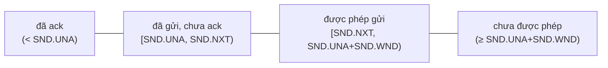

# P6 · Chương 05 — TCP: tin cậy và flow control

## Bạn sẽ hiểu được gì

Sau chương này bạn trả lời được:

1. **Q1.** TCP đánh số byte thế nào, và vì sao một con số trong trường ACK đủ để báo "đã nhận mọi thứ trước đó"? → mục 2
2. **Q2.** RTO được tính từ đâu, vì sao mỗi lần gửi lại đợi gấp đôi lần trước, và Karn's algorithm giải quyết mơ hồ gì? → mục 3
3. **Q3.** Duplicate ACK và SACK cho sender biết thêm điều gì so với cumulative ACK? → mục 4
4. **Q4.** Receive window, zero window, window probe và window scaling phối hợp thế nào để receiver chậm kìm được sender nhanh? → mục 5
5. **Q5.** Silly window syndrome là gì và TCP chặn nó ra sao? → mục 6
6. **Q6.** Vì sao hai `write` nhỏ liên tiếp có thể chậm thêm ~40 ms (Nagle × delayed ACK), và `TCP_NODELAY` đổi cái gì? → mục 7
7. **Q7.** Keepalive khác retransmission ở đâu? → mục 8
8. **Q8.** Head-of-line blocking của TCP xảy ra ở đâu? → mục 9

## Kiến thức cần trước

- [Chương 04 — UDP và TCP cơ bản](./04-udp-va-tcp-co-ban.md): header TCP, bắt tay ba bước, máy trạng thái. Chương này giả định bạn đã biết một segment TCP là gì.
- Chương này **không** bàn congestion control (`cwnd`, slow start, fast recovery): xem [Chương 06](./06-congestion-control.md). Socket buffer và `SO_SNDBUF`/`SO_RCVBUF` nằm ở [Chương 07](./07-socket-va-kernel.md).

Các thí nghiệm do người soạn chạy trong container `./labs/linux.sh` (kernel 6.8.0, loopback `lo`, Python 3, rustc 1.95.0). Chúng là *quan sát một lần chạy*, không phải bảo đảm của tài liệu.

## 1. Bài toán: dựng kênh tin cậy trên IP không tin cậy

IP không có cơ chế nào để tăng cường độ tin cậy đầu-cuối, kiểm soát luồng hay đánh số thứ tự[^rfc791-unreliable]; TCP bù lại bằng dịch vụ byte stream tin cậy và đúng thứ tự cho ứng dụng[^rfc9293-reliable]. Chương này trả lời ba câu: sender biết byte nào đã tới (mục 2, 4), khi nào thôi chờ và gửi lại (mục 3, 4), được gửi nhanh đến mức nào so với *receiver* (mục 5, 6); cộng cách gửi gói nhỏ khỏi lãng phí (mục 7). Gửi nhanh đến mức nào so với *mạng* là congestion control, Chương 06.

## 2. Sequence number và cumulative ACK

> **Trả lời ngắn.** TCP gán một số cho từng byte của luồng dữ liệu. Trường ACK ghi số của byte kế tiếp mà receiver đang chờ, nên một con số đủ để nói rằng mọi byte trước đó đã nhận xong[^rfc9293-cumulative].

**Giải thích.** Hình dung đánh số trang một xấp giấy gửi qua bưu điện: người nhận chỉ cần nhắn "tôi đã có đến trang 1499, gửi tiếp từ trang 1500" (nhận xét của người soạn). Cơ chế dưới đây là đúng thứ đó, áp cho byte.

TCP không đánh số segment mà đánh số **từng byte** (octet). Trường Sequence Number trong header chứa số thứ tự của byte dữ liệu đầu tiên trong segment (trừ khi cờ SYN bật)[^rfc9293-seqfield]. Trường Acknowledgment Number, khi cờ ACK bật, chứa số thứ tự kế tiếp mà bên gửi segment đó đang chờ nhận[^rfc9293-ackfield]. Cơ chế xác nhận là *cumulative*: ACK mang số X nghĩa là mọi octet đến trước X (không gồm X) đã được nhận[^rfc9293-cumulative].

Ví dụ: sender gửi segment `seq=1000, len=500` (byte 1000–1499). Receiver trả `ack=1500`. Nếu sau đó segment `seq=1500, len=500` mất mà segment `seq=2000, len=500` đến, receiver **không** thể trả `ack=2500`; nó chỉ có thể lặp `ack=1500`, vì cumulative ACK chỉ nói về dãy liên tục từ đầu. Đây là gốc của duplicate ACK (mục 4).

<details><summary>Đi sâu: modulo 2^32, bốn vùng sequence và send window</summary>

Không gian sequence number là hữu hạn nên mọi phép tính trên chúng là số học modulo 2^32[^rfc9293-modulo]; ở tốc độ truyền rất cao, RFC 7323 mô tả cơ chế PAWS dùng option Timestamps để bảo vệ khỏi các bản trùng cũ của cùng kết nối[^rfc7323-ts].

Phía gửi, RFC 9293 chia không gian sequence thành bốn vùng: đã được ack, đã gửi chưa được ack, được phép gửi mới, và chưa được phép[^rfc9293-sndwnd]; các biên là `SND.UNA` (byte đầu tiên chưa được ack), `SND.NXT` (byte sẽ gửi tiếp) và `SND.UNA + SND.WND`.



Send window là vùng 3 trong sơ đồ của RFC, tức vùng được phép gửi dữ liệu mới[^rfc9293-sndwnd-def]. ACK mới làm `SND.UNA` nhích phải nên cửa sổ "trượt" — sliding window (nhận xét của người soạn).

</details>

**Quay lại Q1:** một số ACK nói về cả dãy liên tục từ đầu, nên "next byte expected" là đủ.

## 3. Retransmission và RTO

> **Trả lời ngắn.** Sender đặt đồng hồ chờ (RTO) dựa trên RTT đo được; hết giờ mà chưa có ACK thì gửi lại và nhân đôi thời gian chờ[^rfc6298-backoff]. Không lấy mẫu RTT từ segment đã gửi lại, vì không biết ACK trả lời bản nào[^rfc6298-karn].

**Giải thích.** Giống timeout của một HTTP client: đặt theo độ trễ thường thấy cộng đệm cho độ nhiễu, và mỗi lần retry thì chờ lâu hơn (nhận xét của người soạn). Các mục 3.1–3.4 đi qua từng bước.

### 3.1 Vấn đề

Sender chỉ biết ACK chưa về. Chờ quá ngắn thì gửi lại thừa (spurious retransmission) và làm nghẽn mạng; chờ quá dài thì stream đứng (nhận xét của người soạn). Vì RTT biến thiên, RFC 9293 nói RTO phải được xác định động[^rfc9293-rto].

### 3.2 Ước lượng SRTT, RTTVAR và RTO (RFC 6298)

Sender giữ hai biến: SRTT (smoothed RTT) và RTTVAR (độ biến thiên RTT), cùng một độ chia đồng hồ G.

1. Chưa có mẫu RTT nào: sender nên (SHOULD) đặt RTO = 1 giây[^rfc6298-init].
2. Mẫu đầu tiên R: bên gửi phải (MUST) đặt SRTT = R, RTTVAR = R/2, RTO = SRTT + max(G, K·RTTVAR) với K = 4[^rfc6298-first].
3. Mẫu tiếp theo R': `RTTVAR <- (1 - beta) * RTTVAR + beta * |SRTT - R'|`, rồi `SRTT <- (1 - alpha) * SRTT + alpha * R'`[^rfc6298-update]. RTTVAR phải (MUST) cập nhật trước SRTT: SRTT dùng để cập nhật RTTVAR là giá trị trước khi cập nhật[^rfc6298-order]; RFC nên (SHOULD) dùng alpha = 1/8, beta = 1/4[^rfc6298-ab].

**Ví dụ số.** Mẫu đầu R = 100 ms → SRTT = 100, RTTVAR = 50, RTO = 100 + 4·50 = 300 ms. Mẫu thứ hai R' = 140 ms → RTTVAR = 0,75·50 + 0,25·|100−140| = 47,5; SRTT = 0,875·100 + 0,125·140 = 105; RTO = 105 + 4·47,5 = 295 ms. (Phép tính của người soạn.) RTT càng nhiễu thì "đệm" 4·RTTVAR càng rộng.

Timer: mỗi lần gửi gói có dữ liệu mà timer chưa chạy thì khởi động nó[^rfc6298-51]; khi mọi dữ liệu đã được ack thì tắt[^rfc6298-52].

### 3.3 Karn's algorithm

Segment bị gửi lại rồi ACK về: ACK này trả lời bản gốc hay bản gửi lại? Karn's algorithm: không được (MUST NOT) lấy mẫu RTT từ các segment đã bị gửi lại[^rfc6298-karn]. Ngoại lệ: option Timestamps loại bỏ sự mơ hồ về việc bản nào của segment đã kích hoạt ACK[^rfc6298-karn-ts].

### 3.4 Exponential backoff

Khi timer hết hạn, sender gửi lại segment chưa ack sớm nhất[^rfc6298-54] và phải (MUST) đặt RTO = RTO · 2[^rfc6298-backoff]. RFC cho phép (MAY) đặt trần cho RTO miễn trần đó ít nhất 60 giây[^rfc6298-max], và trần này có thể dùng làm cận trên cho phép nhân đôi[^rfc6298-ub]. Sau nhiều lần backoff, RFC cho phép (MAY) xóa SRTT/RTTVAR vì chúng có khả năng đã sai; khi đã xóa, chúng được khởi tạo lại từ mẫu RTT kế tiếp như ở mẫu đầu tiên[^rfc6298-clear].

<details><summary>Đi sâu: RTO trên Linux, backoff đo được, retries2</summary>

### 3.5 Số liệu thật trên Linux

RFC khuyến nghị (SHOULD) làm tròn RTO nhỏ hơn 1 giây lên 1 giây[^rfc6298-min], với lý do nghiên cứu cho thấy cần một RTO tối thiểu lớn để giữ TCP thận trọng và tránh spurious retransmission[^rfc6298-minwhy]. **Linux không theo sàn 1 s đó**: header kernel v6.8 định nghĩa `TCP_RTO_MIN` = HZ/5, tức 200 ms[^linux-rto-min]; RTO ban đầu là 1 giây[^linux-rto-init] và trần là `TCP_RTO_MAX` = 120 giây[^linux-rto-max].

Còn công thức? Trong kernel v6.8, RTO được tính là `srtt + rttvar_us`[^linux-set-rto]. Ở mẫu RTT đầu tiên `rttvar_us` được khởi tạo bằng `max(mdev_us, tcp_rto_min_us(sk))`[^linux-rttvar-floor] (với `mdev_us = 2·R`), và ở các mẫu sau `mdev_max_us` cũng được đặt lại về `tcp_rto_min_us(sk)` mỗi cửa sổ — tức *thành phần phương sai* bị chặn dưới ở 200 ms, chứ không phải toàn bộ RTO (đọc từ source v6.8, chi tiết cài đặt có thể đổi). Thí nghiệm kiểm tra: thêm `tc qdisc add dev lo root netem delay 50ms` (RTT ≈ 100 ms), truyền vài request rồi chạy `ss -tin`:

```text
ESTAB ... cubic wscale:7,7 rto:310 rtt:106.201/14.695 ...
```

`rtt:106.2/14.7` là SRTT/mdev tính bằng ms. Theo công thức RFC, RTO = 106 + 4·14,7 ≈ 165 ms; kernel báo 310 ms ≈ 106 + 200 — khớp với phương sai bị chặn dưới 200 ms (suy luận từ source đã dẫn và số đo; đây là một lần chạy).

**Backoff quan sát được.** Người soạn thiết lập kết nối trên loopback, gắn `tc qdisc add dev lo ingress` kèm filter `u32` drop mọi gói tới cổng đích, gửi 100 byte và dùng `tcpdump` ghi thời điểm các lần gửi (s, từ lần đầu): 0,000 · 0,207 · 0,414 · 0,824 · 1,654 · 3,318 · 6,587 — các khoảng cách 0,207 · 0,207 · 0,410 · 0,830 · 1,664 · 3,269.

Từ khoảng thứ ba trở đi khoảng cách gần đúng 0,2 · 2^k giây. Cuối thí nghiệm `ss -tin` báo `rto:6432 backoff:5`. Hai khoảng đầu bằng nhau vì bản gửi lại đầu là *tail loss probe* (TLP), chưa phải RTO: kernel docs mô tả TLP biến các RTO do mất gói ở đuôi luồng thành fast recovery (RFC 8985)[^kdoc-tlp]. Chạy lại thí nghiệm (kernel 6.8.0; kernel docs bản mới nhất ghi giá trị mặc định của `tcp_early_retrans` là 3, tức TLP bật[^kdoc-tlp-default]) và đọc `nstat`: 5 lần gửi lại ứng với `TcpExtTCPLossProbes` = 1 và `TcpExtTCPTimeouts` = 4; khoảng cách lần đó 0,21 · 0,21 · 0,41 · 0,83 · 1,66 s. Container không cho đổi `tcp_early_retrans`, nên chưa có đối chứng với TLP tắt.

**Ý nghĩa với backend** (nhận xét của người soạn): mất gói liên tiếp làm độ trễ nhân đôi mỗi lần, nên timeout ứng dụng ngắn hơn chuỗi này sẽ báo lỗi khi TCP vẫn đang cố. Không đặt timeout thì thời gian TCP bỏ cuộc phụ thuộc `tcp_retries2`: mặc định 15, tương ứng khoảng 13 đến 30 phút tùy RTO[^tcp7-retries2]. Kernel docs cụ thể hơn: với RTO khởi điểm `TCP_RTO_MIN`, 15 cho một timeout giả định 924,6 giây, là cận dưới của timeout thực[^kdoc-retries2] — khớp phép tính của người soạn 0,2·(1+2+…+512) + 6·120 = 204,6 + 720 = 924,6 s (RTO bị chặn ở trần 120 s). RTO thực lớn hơn thì timeout dài hơn, nên tcp(7) nêu khoảng 13–30 phút tùy RTO. `TCP_USER_TIMEOUT` ép giới hạn: thời gian tối đa dữ liệu đã gửi chưa được ack, hoặc dữ liệu đã đệm chưa gửi được vì cửa sổ 0, trước khi đóng kết nối và trả `ETIMEDOUT`[^tcp7-usertimeout].

</details>

**Quay lại Q2:** RTO = ước lượng RTT cộng đệm phương sai, nhân đôi khi timeout, và Karn tránh lấy mẫu mơ hồ.

## 4. Duplicate ACK và SACK

> **Trả lời ngắn.** Duplicate ACK báo "tôi vẫn thiếu byte X"; ba cái liền nhau khiến sender gửi lại sớm, không đợi RTO[^rfc5681-fr]. SACK thêm danh sách các đoạn đã nhận phía sau chỗ hổng, nên sender chỉ gửi lại đúng đoạn thiếu[^rfc2018-selective].

**Giải thích.** Giống nhận bưu kiện thiếu số 3: dup-ACK chỉ gọi "thiếu số 3", còn SACK nói thêm "nhưng tôi đã có 5 đến 7" (nhận xét của người soạn).

### 4.1 Duplicate ACK và fast retransmit

Chờ cả RTO cho mỗi gói mất là chậm khi các gói sau vẫn đang tới. RFC 5681 nói receiver nên (SHOULD) gửi ngay một duplicate ACK khi có segment đến sai thứ tự, với mục đích báo cho sender biết có segment đến sai thứ tự và đang chờ số thứ tự nào[^rfc5681-dup-purpose].

Một ACK được tính là "duplicate" khi, cùng các điều kiện khác, nó không mang dữ liệu và số acknowledgment bằng số ACK lớn nhất đã nhận trên kết nối[^rfc5681-dupdef]. Dup-ACK có thể do mất gói, nhưng cũng do mạng đổi thứ tự gói: RFC nói rõ nó có thể do mạng sắp xếp lại các data segment[^rfc5681-reorder]. Vì vậy sender không phản ứng với một dup-ACK mà đợi ba: fast retransmit dùng việc nhận 3 duplicate ACK làm dấu hiệu một segment đã mất, rồi gửi lại ngay mà không đợi timer[^rfc5681-fr]. Việc `cwnd`/`ssthresh` thay đổi thế nào sau đó thuộc [Chương 06](./06-congestion-control.md).

Ví dụ: segment `1500..1999` mất, ba segment sau đó đến lần lượt; mỗi segment kích hoạt một ACK vẫn mang `ack 1500` (dup #1, #2, #3). Đến dup-ACK thứ ba sender gửi lại `1500..1999`; khi nó đến, receiver đã giữ sẵn dữ liệu phía sau nên ACK nhảy thẳng lên `3500` hoặc hơn.

### 4.2 Vì sao cumulative ACK chưa đủ: SACK (RFC 2018)

Dup-ACK chỉ nói "tôi vẫn thiếu byte 1500", không nói đã có gì phía sau. RFC 2018 mô tả hạn chế: với thông tin ít ỏi từ cumulative ACK, sender chỉ biết được một gói mất mỗi round trip time[^rfc2018-limit], và đề xuất selective acknowledgment kết hợp selective repeat[^rfc2018-selective].

Cách hoạt động:

- SACK phải được thỏa thuận: option "SACK-permitted" gửi trong SYN báo rằng option SACK có thể dùng sau khi kết nối được thiết lập[^rfc2018-permitted]. Linux bật mặc định: tcp(7) ghi `tcp_sack` là Boolean, mặc định enabled, bật SACK theo RFC 2018[^tcp7-sack].
- Option SACK mang các block, mỗi block gồm biên trái (số sequence đầu) và biên phải (số sequence ngay sau byte cuối) của một đoạn byte liên tục receiver đang giữ[^rfc2018-block].
- Block đầu tiên phải chứa segment vừa kích hoạt ACK này, trừ khi segment đó làm cumulative ACK tiến lên[^rfc2018-first], nhờ vậy ACK phản ánh thay đổi mới nhất.
- Vùng option của TCP có 40 byte nên tối đa 4 block; nếu có cả option Timestamps thì còn tối đa 3[^rfc2018-4blocks][^rfc2018-3blocks].
- SACK chỉ mang tính tư vấn (advisory): receiver được phép bỏ dữ liệu đã báo trong SACK[^rfc2018-advisory-def]; vì thế sender không được (MUST NOT) bỏ dữ liệu trước khi nó được xác nhận bằng trường Acknowledgment Number trong header TCP[^rfc2018-advisory].

<details><summary>Đi sâu: quan sát SACK trên tcpdump, RACK</summary>

**Quan sát.** Người soạn đặt MTU của `lo` về 1500, thêm `netem loss 8%` và gửi 1 MB; `tcpdump` thấy các ACK lặp `ack 386705` kèm block SACK tăng dần:

```text
ack 386705, win 5330, ... sack 1 {418561:433041}
ack 386705, win 6054, ... sack 2 {479377:525713}{418561:433041}
ack 386705, win 7502, ... sack 2 {479377:618385}{418561:433041}
ack 386705, win 8226, ... sack 2 {479377:664721}{418561:433041}
```

Đọc: receiver thiếu byte từ 386705 nhưng đã có `418561–433041` (14.480 byte = 10 segment 1448 byte) và đoạn thứ hai `479377–…` đang dài ra; block mới nhất đứng đầu, khớp quy tắc "block đầu chứa segment vừa kích hoạt ACK". Trong lần chạy này 15 trên 69 gói bắt được là ACK có SACK; `ss -tin` cuối báo `bytes_retrans:124528` trên `bytes_sent:1124528`. Chỉ 69 gói cho 1 MB vì `tcpdump` trên `lo` thấy gói gộp (GSO): chạy lại thì bắt được gói dài tới 65160 byte với MSS 1448.

Theo kernel docs (bản mới nhất, không ghim phiên bản), `tcp_recovery` bật RACK để phát hiện mất gói nhanh, kể cả retransmission bị mất và tail drop, và chịu được reordering; docs ghi hiện nay đặt bit này về 0 không có tác dụng vì RACK là thuật toán phát hiện mất gói duy nhất được hỗ trợ[^kdoc-rack]. Suy luận của người soạn: quy tắc "3 dup-ACK" ở trên là mô hình giáo khoa chứ không phải toàn bộ thuật toán của kernel.

</details>

**Quay lại Q3:** dup-ACK cho biết chỗ hổng ở đâu, SACK cho biết cái gì đã có sau chỗ hổng.

## 5. Flow control: sliding window và receive window

> **Trả lời ngắn.** Receiver quảng bá trong mỗi ACK lượng dữ liệu nó còn nhận được; sender chỉ gửi dữ liệu mới trong vùng cửa sổ đó[^rfc9293-window][^rfc9293-sndwnd-def]. Cửa sổ về 0 thì sender vẫn phải định kỳ thăm dò[^rfc9293-zwp-def]; window scaling nới giới hạn 65.535 byte của trường Window[^hpbn-winscale][^rfc7323-purpose].

**Giải thích.** Giống hàng đợi có giới hạn giữa producer và consumer: consumer chậm làm hàng đợi đầy và producer bị chặn (nhận xét của người soạn). Các mục 5.1–5.3 mô tả từng bước.

### 5.1 Vấn đề

Flow control bảo vệ *receiver*: đó là cơ chế ngăn sender làm ngập receiver bằng lượng dữ liệu nó có thể không xử lý nổi[^hpbn-flow]. Mỗi bên quảng bá receive window (rwnd), kích thước buffer còn trống[^hpbn-rwnd]. Trong header, trường Window là số octet, tính từ octet được chỉ ra trong trường acknowledgment, mà bên gửi segment này sẵn sàng nhận[^rfc9293-window]. Số sequence được phép gửi mới nằm trong send window, tức vùng giữa `SND.NXT` và `SND.UNA + SND.WND` ở mục 2[^rfc9293-sndwnd-def]; suy ra lượng dữ liệu chưa ack cộng dữ liệu mới không vượt quá cửa sổ nhận (suy luận của người soạn).

HPBN gọi *bandwidth-delay product* (BDP) là tích dung lượng liên kết với độ trễ đầu-cuối, tức lượng dữ liệu chưa ack tối đa có thể đang bay tại một thời điểm[^hpbn-bdp]. Cửa sổ nhỏ hơn BDP thì đường ống không bao giờ đầy (nhận xét của người soạn).

### 5.2 Window scaling (RFC 7323)

Trường Window rộng 16 bit nên chặn ở 65.535 byte[^hpbn-winscale]. RFC 7323 thêm option Window Scale để hỗ trợ cửa sổ nhận lớn hơn[^rfc7323-purpose]. Quy tắc:

- Option có thể (MAY) được gửi trong SYN đầu tiên; chỉ khi đã nhận option trong SYN đó thì mới có thể (MAY) gửi trong SYN-ACK; ở segment không có SYN, option phải (MUST) bị bỏ qua[^rfc7323-ignored].
- Trường Window của chính segment SYN **không** được scale (MUST NOT)[^rfc7323-syn] — nên cửa sổ khởi điểm vẫn ≤ 65.535 byte (suy luận của người soạn).
- Giá trị shift phải (MUST) được giới hạn ở 14, cho cửa sổ tối đa 2^30 = 1 GiB[^rfc7323-14].
- HPBN: option được thỏa thuận trong bắt tay ba bước và mang số bit dịch trái của trường window 16 bit[^hpbn-ws-shift]; các nút trung gian, router, firewall có thể ghi đè hoặc thậm chí gỡ hẳn option này[^hpbn-ws-strip].

Linux bật mặc định: tcp(7) ghi `tcp_window_scaling` là Boolean, mặc định enabled, cho phép dùng cửa sổ lớn hơn 64 kB trên một kết nối nếu đầu kia hỗ trợ[^tcp7-wscale].

<details><summary>Đi sâu: quan sát window scale trên tcpdump</summary>

**Quan sát từ `tcpdump`** (kết nối loopback, receiver đặt `SO_RCVBUF` nhỏ): SYN của client có `win 65495 ... wscale 7`, SYN-ACK của server `win 4096 ... wscale 0`; các segment sau của client mang `win 512`. Với shift 7, `512 << 7 = 65536`, đúng cửa sổ client quảng bá (suy luận của người soạn từ quy tắc dịch bit). `ss -tin` hiển thị `wscale:7,0` ở hai đầu theo hướng tương ứng.

</details>

### 5.3 Zero window và window probe

Receiver chậm đọc → buffer nhận đầy → quảng bá `win 0` → sender ngừng gửi dữ liệu. Đó là *backpressure* của TCP, và là lý do ứng dụng nhận chậm làm *sender* bị chặn trong `write` (nhận xét của người soạn; các điều kiện chặn `write` nằm ở [Chương 07](./07-socket-va-kernel.md), mục 4).

Nhưng ACK mở lại cửa sổ là ACK không dữ liệu, mà ACK loại này không được TCP truyền tin cậy[^rfc9293-ka-fail]; nếu nó mất thì hai bên có thể đợi nhau mãi (suy luận của người soạn). RFC 9293 nói sender phải (must) định kỳ gửi ít nhất một octet dữ liệu mới (nếu có), hoặc gửi lại, kể cả khi send window bằng 0[^rfc9293-zwp-def]; RFC giải thích việc gửi lại này là thiết yếu để việc mở lại cửa sổ được báo cáo tin cậy cho bên kia[^rfc9293-zwp-reopen] — *zero-window probing*, và việc hỗ trợ là bắt buộc (MUST-36)[^rfc9293-zwp-must]. Probe đầu tiên nên (SHOULD) gửi khi cửa sổ 0 đã kéo dài một RTO, và khoảng cách giữa các probe cũng nên (SHOULD) tăng theo cấp số nhân[^rfc9293-zwp]. Receiver được phép (MAY) giữ cửa sổ đóng vô hạn; miễn nó còn ACK các probe, sender phải (MUST) để kết nối mở[^rfc9293-zwp-open].

<details><summary>Đi sâu: quan sát zero window và probe</summary>

**Quan sát.** Server không gọi `recv`, client gửi liên tục. Mốc thời gian (s, từ gói đầu của `tcpdump`): lúc 0,091 server quảng bá `win 48`; 0,309 client gửi 48 byte cuối và server ack với `win 0`; probe 1 lúc 0,529 (ACK không dữ liệu từ client, server trả `ack 5097, win 0`), probe 2 lúc 0,961, probe 3 lúc 1,825, probe 4 lúc 3,553; lúc 6,325 server `recv` xả buffer và quảng bá `win 4096`, client gửi tiếp ngay.

Khoảng giữa các lần: 0,22 → 0,43 → 0,86 → 1,73 s, đúng cấp số nhân khởi từ RTO ≈ 200 ms, khớp khuyến nghị SHLD-29/SHLD-30. `ss` ở sender báo `rto:210 backoff:4` trong lúc cửa sổ đóng: timer dùng chung cơ chế backoff với mục 3.

</details>

**Quay lại Q4:** rwnd kìm sender, probe mở lại khi cửa sổ 0, scaling cho phép cửa sổ lớn.

## 6. Silly window syndrome

> **Trả lời ngắn.** Silly window syndrome là khi cửa sổ co thành những mẩu rất nhỏ nên mạng chở toàn gói vài byte[^rfc9293-sws]. TCP chặn bằng cách receiver không quảng bá cửa sổ nhỏ[^rfc9293-sws-recv] và sender chờ gom đủ dữ liệu.

**Giải thích.** Giống xe buýt chạy một chuyến cho mỗi hành khách: chở 1 người mà vẫn tốn nguyên chuyến (nhận xét của người soạn).

RFC 9293 gọi SWS là một khuôn mẫu ổn định gồm những dịch chuyển nhỏ của cửa sổ, làm hiệu năng TCP cực kỳ tệ[^rfc9293-sws]. Minh họa của người soạn: receiver đọc 1 byte, quảng bá cửa sổ 1 byte, sender gửi segment 1 byte kèm 40 byte header (cùng cách tính với RFC 896 ở mục 7.1). Cả hai đầu đều phải tự bảo vệ (MUST-38 cho sender, MUST-39 cho receiver)[^rfc9293-sws-sender-must][^rfc9293-sws-recv-must].

- **Receiver:** tránh nhích cạnh phải của cửa sổ `RCV.NXT+RCV.WND` theo từng bước nhỏ, kể cả khi dữ liệu từ mạng đến thành segment nhỏ[^rfc9293-sws-recv] — tức đừng quảng bá cửa sổ mới mỗi khi app đọc vài byte; đợi đến khi trống đủ lớn.
- **Sender:** không biết buffer thật của receiver, nên dùng `Max(SND.WND)` (cửa sổ lớn nhất từng thấy) làm ước lượng `RCV.BUFF`[^rfc9293-maxwnd]. RFC khuyến nghị bộ quy tắc: gửi khi gửi được một segment đầy; hoặc khi dữ liệu đã PUSH và gửi hết được hàng đợi; hoặc khi gửi được ít nhất một phần Fs của `Max(SND.WND)` (Fs khuyến nghị 1/2); hoặc khi hết một timeout ghi đè, nên nằm trong khoảng 0,1–1,0 giây[^rfc9293-fs]. Timeout này cần để tránh deadlock khi receiver giảm `RCV.BUFF`[^rfc9293-sws-deadlock].

<details><summary>Đi sâu: quan sát trong thí nghiệm zero window</summary>

**Quan sát.** Trong thí nghiệm mục 5.3, sau `win 48` lúc 0,091 client không gửi ngay mà đợi tới 0,309 mới gửi 48 byte đó, và server không gửi window update nhỏ trong khoảng ấy. [INFERENCE] phù hợp với receiver tránh nhích cửa sổ nhỏ và sender chờ timeout ghi đè; người soạn không đọc source kernel để xác nhận.

</details>

**Quay lại Q5:** hai đầu cùng gom lại để không trao đổi mẩu nhỏ.

## 7. Nagle, delayed ACK và vì sao có "40 ms"

> **Trả lời ngắn.** Nagle giữ write nhỏ thứ hai cho tới khi dữ liệu đã gửi được ACK[^rfc9293-nagle-desc], còn receiver có thể hoãn ACK để gộp; RFC 9293 thừa nhận có tương tác có vấn đề giữa hai cơ chế này[^rfc9293-nagle-delack] (cơ chế cụ thể ở mục 7.3 là suy luận của người soạn). Trên Linux độ hoãn tối thiểu là 40 ms[^linux-delack-min]. `TCP_NODELAY` tắt Nagle[^tcp7-nodelay].

**Giải thích.** Giống tài xế giao hàng không xuất phát khi chưa nhận được xác nhận gói trước, trong khi người nhận chờ có thêm hàng mới chịu xác nhận (nhận xét của người soạn).

### 7.1 Nagle (RFC 896)

Vấn đề *small-packet*: gõ từng ký tự tạo ra gói 41 byte (một byte dữ liệu, 40 byte header) cho mỗi byte hữu ích[^rfc896-small]. Lời giải của RFC 896: hoãn gửi dữ liệu mới nếu còn dữ liệu cũ chưa được ack[^rfc896-sol]. Mô tả hiện hành (RFC 9293 §3.7.4): nếu còn dữ liệu chưa ack, sender gom mọi dữ liệu người dùng cho tới khi dữ liệu đang bay được ack *hoặc* gom được một segment đầy (`Eff.snd.MSS` byte)[^rfc9293-nagle-desc]. Implementation nên (SHOULD) cài Nagle, nhưng phải (MUST) có cách để ứng dụng tắt Nagle trên từng kết nối[^rfc9293-nagle]. Trên Linux đó là `TCP_NODELAY`: segment luôn được gửi ngay khi có thể, dù chỉ có một lượng dữ liệu nhỏ[^tcp7-nodelay].

Linux còn có `TCP_CORK`: không gửi các frame chưa đầy cho tới khi cờ được bỏ[^tcp7-cork-def]; kernel đặt trần 200 ms cho thời gian cork[^tcp7-cork].

### 7.2 Delayed ACK (RFC 1122/9293)

Receiver gửi ít hơn một ACK trên mỗi data segment nhận được để tăng hiệu quả[^rfc9293-delack-def]. Implementation nên (SHOULD) có delayed ACK nhưng độ trễ phải (MUST) dưới 0,5 giây[^rfc9293-delack], và nên (SHOULD) ack ít nhất mỗi hai segment đầy đủ[^rfc9293-delack2]. Linux có `TCP_QUICKACK` để ack ngay[^tcp7-quickack]. Trong kernel v6.8, độ trễ nằm giữa `TCP_DELACK_MIN` = HZ/25 (40 ms)[^linux-delack-min] và `TCP_DELACK_MAX` = HZ/5 (200 ms)[^linux-delack-max].

### 7.3 Tương tác

RFC 9293 thừa nhận có những tương tác có vấn đề giữa thuật toán Nagle và delayed acknowledgment[^rfc9293-nagle-delack]. Ghép hai quy tắc trên (suy luận của người soạn): write #1 (5 byte) đi ngay vì chưa có gì chưa ack; write #2 (5 byte) bị Nagle giữ vì còn 5 byte chưa ack và chưa đủ một MSS; server nhận 5 byte, chưa đủ 10 byte để trả lời nên hoãn ACK; ≈ 40 ms sau timer delayed ACK hết hạn, ACK về, write #2 mới đi, rồi response mới được gửi.

**Cách xử lý (nhận xét của người soạn):** (1) *gộp thành một lần ghi* (`one_write`): hai write nhỏ vốn là một message logic, gộp loại bỏ cả tương tác lẫn một syscall[^std-bufwriter]; (2) `TCP_NODELAY` khi độ trễ từng gói quan trọng — cái giá là nhiều gói nhỏ hơn trên dây, đúng thứ Nagle sinh ra để ngăn, và nó chỉ che tác hại của việc ghi vụn; (3) `TCP_CORK` khi biết điểm kết thúc batch. Lưu ý: "40 ms" là delayed ACK, không phải RTT hay RTO.

<details><summary>Đi sâu: số đo Nagle × delayed ACK bằng Python và Rust</summary>

**Thí nghiệm chạy lại.** Client gửi hai `send` 5 byte rồi chờ 2 byte trả lời; server chỉ trả lời khi nhận đủ 10 byte. Sáu lượt trên một kết nối, Python (ms):

```text
Nagle bật  : 0.07  45.49  45.73  44.78  45.47  46.01
TCP_NODELAY: 0.10   0.06   0.05   0.05   0.05   0.05
```

Lượt đầu nhanh vì kết nối mới: chạy lại, `nstat` cho `TcpExtDelayedACKs` = 0 sau lượt đầu rồi tăng đúng 1 mỗi lượt chậm (1, 2, 3, 4), `ss -tin` báo `ato:40` — ở lượt đầu không có ACK nào bị hoãn. [INFERENCE] kernel đang ở quickack mode lúc kết nối mới (tcp(7): ở chế độ này ACK được gửi ngay thay vì bị hoãn[^tcp7-quickack]); chưa đọc source kernel nên chưa chốt cơ chế. Từ lượt hai mỗi request chậm ≈ 45 ms, gần `TCP_DELACK_MIN` 40 ms cộng overhead (quan sát một lần chạy, không phải bảo đảm). Bản Rust (mục 10), năm lượt mỗi chế độ (ms):

```text
two_writes         : 0.10 45.04 41.33 41.85 46.04
one_write          : 0.15  0.04  0.05  0.05  0.03
two_writes_nodelay : 0.06  0.08  0.17  0.03  0.04
```

Lần chạy thứ hai cho cùng hình.

</details>

**Quay lại Q6:** "40 ms" là delayed ACK; gộp write hoặc `TCP_NODELAY` gỡ nó.

## 8. Keepalive

> **Trả lời ngắn.** Retransmission chỉ chạy khi có dữ liệu chưa ack[^rfc6298-52], còn keepalive gửi probe để xác nhận một kết nối rảnh vẫn còn sống[^rfc9293-ka-idle]. Mặc định Linux rất chậm: 7200 giây idle trước probe đầu[^tcp7-keepalive].

**Giải thích.** Giống ping định kỳ vào một đường dây im lặng để biết bên kia còn nghe không (nhận xét của người soạn).

Retransmission chỉ chạy khi có dữ liệu chưa ack[^rfc6298-52]. Kết nối *idle* mà đầu kia sập (ví dụ của người soạn: mất điện, NAT hết hạn mapping) thì không có gì để gửi lại — không ai biết. Keepalive thăm dò kết nối rảnh[^rfc9293-ka-idle]. RFC 9293: nếu có keep-alive thì ứng dụng phải bật/tắt được theo từng kết nối và mặc định phải tắt (MUST-24, MUST-25)[^rfc9293-ka-off]; interval phải cấu hình được (MUST-27) và mặc định không được ngắn hơn hai giờ (MUST-28)[^rfc9293-ka-default]; vì ACK không dữ liệu không được truyền tin cậy, implementation không được (MUST NOT) coi việc không đáp lại một probe cụ thể là kết nối đã chết (MUST-29)[^rfc9293-ka-fail] — nên cần nhiều lần thử (suy luận của người soạn).

(Nhận xét của người soạn:) keepalive chỉ cho biết TCP stack đầu kia còn trả lời, không cho biết ứng dụng còn xử lý được; nó không thay heartbeat ứng dụng.

<details><summary>Đi sâu: tham số Linux và quan sát keepalive</summary>

Linux: `SO_KEEPALIVE` bật tính năng[^socket7-keepalive]. `tcp_keepalive_time` mặc định 7200 s idle trước probe đầu, chỉ khi `SO_KEEPALIVE` bật[^tcp7-keepalive]; `tcp_keepalive_intvl` mặc định 75 s, là số giây giữa các probe keep-alive[^tcp7-intvl]; `tcp_keepalive_probes` mặc định 9: số probe tối đa trước khi giết kết nối[^tcp7-probes]. Theo từng socket có `TCP_KEEPIDLE` (thời gian tính bằng giây kết nối phải rảnh trước khi TCP bắt đầu gửi probe keepalive)[^tcp7-keepidle], `TCP_KEEPINTVL` (thời gian tính bằng giây giữa các probe)[^tcp7-keepintvl], `TCP_KEEPCNT` (số probe tối đa TCP nên gửi trước khi bỏ kết nối)[^tcp7-keepcnt]. Mặc định: 7200 + 9·75 = 7875 s ≈ 2 giờ 11 phút mới phát hiện chết (cộng của người soạn). `TCP_USER_TIMEOUT` không đổi khi nào probe được gửi[^tcp7-usertimeout-ka], nhưng khi dùng cùng keepalive thì nó ghi đè để quyết định khi nào đóng kết nối do keepalive fail[^tcp7-usertimeout-override].

**Quan sát.** Đặt `TCP_KEEPIDLE=2`, `TCP_KEEPINTVL=1`, `TCP_KEEPCNT=3`; `ss -tno` hiện `timer:(keepalive,337ms,0)`. Peer trả lời probe đầu nên timer reset; sau đó người soạn drop gói tới peer. Probe kế tiếp cách 2,05 s, hai probe nữa mỗi ≈ 1 s (2,05 → 3,07 → 4,10 trong `tcpdump`), rồi `recv` trả `ETIMEDOUT` — ba probe không đáp, khớp `TCP_KEEPCNT=3`.

</details>

**Quay lại Q7:** keepalive chỉ cho biết TCP stack đầu kia còn đáp, và mặc định mất hơn hai giờ.

## 9. Head-of-line blocking của TCP

> **Trả lời ngắn.** Mọi byte sau chỗ gói bị mất phải nằm chờ trong buffer của receiver cho tới khi gói gửi lại tới, dù chúng đã đến nơi[^hpbn-hol]. Ứng dụng chỉ thấy `read` trả về trễ.

**Giải thích.** Giống hàng xe nối đuôi trên đường một làn: một xe hỏng thì mọi xe sau đều đứng (nhận xét của người soạn).

TCP giao dữ liệu đúng thứ tự: nếu một gói bị mất trên đường tới receiver, mọi gói sau đó phải nằm trong buffer TCP của receiver cho tới khi gói mất được gửi lại và tới nơi[^hpbn-hol]. Mọi byte sau chỗ hổng — kể cả đã tới nơi, kể cả thuộc một "message" khác của ứng dụng — nằm trong buffer chờ. SACK ở mục 4.2 giúp sender gửi lại đúng chỗ, nhưng không giúp *giao* sớm các byte sau chỗ hổng cho ứng dụng: TCP chỉ trả byte đúng thứ tự (suy luận của người soạn từ đặc tính giao đúng thứ tự).

<details><summary>Đi sâu: ứng dụng không thấy retransmission, jitter, HOL ở HTTP/1.1</summary>

Ứng dụng không nhìn thấy quá trình này: nó không thấy các lần retransmission của TCP hay các gói đang xếp hàng trong buffer[^hpbn-hol-invisible]; nó chỉ thấy `read` trả về trễ hơn. Cái giá của việc không phải tự sắp xếp lại là jitter, tức độ biến thiên khó đoán của thời gian gói đến[^hpbn-jitter].

Hai tầng HOL khác nhau: HOL ở TCP (gói mất chặn mọi byte sau trên cùng kết nối) và HOL ở HTTP/1.1 (response phải trả đúng thứ tự request; nguồn ở [Chương 08](./08-dns-http-tls.md), mục 5); cách HTTP/2, QUIC và HTTP/3 xử lý ở Chương 08, mục 5–6. Với connection pool (nhận xét của người soạn): mỗi kết nối TCP độc lập có buffer riêng, nên gói mất chỉ làm chậm các request trên *kết nối đó*.

</details>

**Quay lại Q8:** TCP đổi việc tự sắp xếp lại lấy việc một gói mất làm chậm cả kết nối.

## 10. Liên hệ với Rust

`std::net::TcpStream` chỉ phơi một phần nhỏ các núm vặn của chương này. Grep `keepalive`, `KEEPIDLE`, `USER_TIMEOUT` (không phân biệt hoa thường) trên `library/std/src/net`, `library/std/src/sys/net` và các file `net`/`tcp` dưới `library/std/src/os` ở tag 1.95.0 không ra kết quả: std không có API keepalive hay `TCP_USER_TIMEOUT`; cần crate như `socket2` hoặc `libc`. Trong các option của chương này, chỉ `TCP_QUICKACK` được phơi (Linux/Android) qua `std::os::linux::net::TcpStreamExt::set_quickack`; doc ghi cờ này khiến Linux gửi ACK ngay và có thể bị kernel đặt lại sau các thao tác tiếp theo[^std-quickack].

- **`set_nodelay(bool)` / `nodelay()`**: bật `TCP_NODELAY`; doc std: khi không bật, dữ liệu được đệm cho đến khi đủ lượng để gửi, nhờ đó tránh gửi gói nhỏ liên tục[^std-nodelay-off] — chính là Nagle ở mục 7.
- **`write_all`**: lặp `write` cho đến khi hết dữ liệu[^std-writeall]; nó không gộp các lần gọi khác nhau. Hai `write_all` nhỏ là hai system call và hai lần đưa dữ liệu cho Nagle quyết định. Muốn gộp ở user space dùng `BufWriter`: doc nói với `TcpStream` mỗi lần gọi write dẫn đến một system call[^std-bufwriter]; nhớ `flush()` trước khi đợi response.
- **`set_read_timeout`**: đặt `None` (không timeout) thì `read` chặn vô hạn[^std-readtimeout-none]; truyền `Duration` bằng 0 trả `Err`[^std-readtimeout-zero]; hết hạn thì Unix thường trả `WouldBlock`, Windows có thể trả `TimedOut`[^std-readtimeout]. Không đặt timeout thì `read` trên peer chết có thể chặn rất lâu (suy luận của người soạn: docs không nói rõ giá trị mặc định của socket mới).

Phần vòng đo của thí nghiệm ở mục 7.3 (chương trình đầy đủ gồm server thread dùng `read_exact` rồi `write_all(b"ok")`, đã biên dịch bằng `rustc -O` trong container và chạy hai lần):

```rust
// c: TcpStream tới server chỉ trả "ok" khi đã nhận đủ 10 byte
if mode == "one_write" {
    c.write_all(b"aaaaabbbbb").unwrap();
} else {
    c.write_all(b"aaaaa").unwrap(); // mode "two_writes_nodelay" gọi thêm c.set_nodelay(true)
    c.write_all(b"bbbbb").unwrap();
}
let mut r = [0u8; 2];
c.read_exact(&mut r).unwrap();
```

## Tóm tắt

- ACK là cumulative; chỗ hổng chỉ biểu diễn được bằng ACK lặp hoặc SACK (tối đa 4 block, 3 nếu có Timestamps; chỉ tư vấn).
- RTO = SRTT + max(G, 4·RTTVAR); Karn cấm lấy mẫu RTT từ segment đã gửi lại; mỗi lần hết hạn RTO nhân đôi. Linux: sàn 200 ms đặt trên thành phần phương sai (không phải sàn 1 s của RFC), trần 120 s.
- 3 duplicate ACK kích hoạt fast retransmit; dup-ACK cũng có thể do đổi thứ tự gói.
- Receive window là flow control; Window Scale (shift ≤ 14) chỉ thỏa thuận trong SYN; cửa sổ 0 được giữ sống bằng zero-window probe, khoảng cách giữa các probe nên giãn theo cấp số nhân; SWS bị chặn ở cả hai đầu.
- Nagle × delayed ACK cho ≈ 40–46 ms trên hai `write` nhỏ; ưu tiên gộp ghi, rồi mới `TCP_NODELAY`.
- Keepalive mặc định chậm (7200 s + 9×75 s); HOL của TCP là hệ quả của giao đúng thứ tự trên một byte stream.

## Câu hỏi tự kiểm tra

1. Receiver nhận byte 0–999 và 2000–2999. `ack` bằng bao nhiêu, và nếu có SACK thì block là gì?
<details><summary>Đáp án</summary>

`ack = 1000` (mọi octet trước X, không gồm X, đã nhận)[^rfc9293-cumulative]; block SACK `{2000:3000}`, biên phải là số ngay sau byte cuối[^rfc2018-block].

</details>

2. Mẫu RTT đầu là 80 ms. Tính SRTT, RTTVAR, RTO theo RFC 6298 (bỏ qua sàn). Linux khác thế nào?
<details><summary>Đáp án</summary>

SRTT = 80, RTTVAR = 40, RTO = 240 ms[^rfc6298-first]. Linux chặn phần phương sai ở tối thiểu 200 ms nên RTO ≈ 280 ms[^linux-rttvar-floor] (suy luận từ source v6.8).

</details>

3. Vì sao không lấy mẫu RTT từ segment đã gửi lại, và gói mất liên tục thì sender gửi lại ở khoảng nào (RTO khởi điểm 200 ms)?
<details><summary>Đáp án</summary>

ACK có thể thuộc bản gốc hoặc bản gửi lại (Karn)[^rfc6298-karn]; Timestamps loại bỏ mơ hồ[^rfc6298-karn-ts]. Mỗi lần hết hạn RTO nhân đôi[^rfc6298-backoff]: khoảng 0,2, 0,4, 0,8, 1,6, 3,2 s — khớp mục 3.5 (khoảng đầu tiên 0,2 s thực ra là TLP, sau đó RTO đầu tiên cũng cách ≈ 0,2 s).

</details>

4. Vì sao sender đợi 3 dup-ACK mới fast-retransmit, và SACK thêm gì?
<details><summary>Đáp án</summary>

Dup-ACK có thể do đổi thứ tự gói[^rfc5681-reorder]; 3 dup-ACK là dấu hiệu mất[^rfc5681-fr]. SACK báo đoạn đã tới nên sender chỉ gửi lại phần thiếu[^rfc2018-selective], nhưng chỉ tư vấn: chưa được giải phóng buffer tới khi Acknowledgment Number vượt qua[^rfc2018-advisory].

</details>

5. Liên kết 1 Gbit/s, RTT 40 ms, không có window scaling: thông lượng tối đa một kết nối?
<details><summary>Đáp án</summary>

Window ≤ 65.535 byte[^hpbn-winscale] ⇒ ≈ 65.535·8/0,04 ≈ 13 Mbit/s (phép tính của người soạn), dù BDP khoảng 5 MB[^hpbn-bdp]. Shift ≤ 14 nâng tới 1 GiB[^rfc7323-14].

</details>

6. Receiver quảng bá `win 0`: sender làm gì, và điều gì ngăn kết nối đứng vĩnh viễn nếu ACK mở cửa sổ bị mất?
<details><summary>Đáp án</summary>

Zero-window probe, khoảng cách giữa các probe nên tăng theo cấp số nhân[^rfc9293-zwp], việc hỗ trợ là bắt buộc[^rfc9293-zwp-must]; còn receiver ack probe thì kết nối giữ mở[^rfc9293-zwp-open].

</details>

7. Một service Rust gọi `write_all(header)` rồi `write_all(body)` (đều nhỏ), mỗi request thêm ≈ 40 ms. Nguyên nhân và hướng sửa?
<details><summary>Đáp án</summary>

Nagle giữ write thứ hai chờ ACK[^rfc9293-nagle-desc] trong khi peer hoãn ACK[^rfc9293-delack][^rfc9293-nagle-delack]. Gộp một lần ghi hoặc `BufWriter` + `flush`[^std-bufwriter]; hoặc `set_nodelay(true)`[^std-nodelay-off] (người soạn: ưu tiên gộp).

</details>

8. Peer idle bị rút điện: ở mặc định Linux TCP phát hiện sau bao lâu, và rút ngắn thế nào?
<details><summary>Đáp án</summary>

Retransmission không chạy (không có dữ liệu). Keepalive: idle 7200 s[^tcp7-keepalive] + tối đa 9 probe cách 75 s[^tcp7-intvl][^tcp7-probes] ≈ 2 giờ 11 phút, nếu `SO_KEEPALIVE` bật[^socket7-keepalive]. Rút ngắn bằng `TCP_KEEPIDLE`/`TCP_KEEPINTVL`/`TCP_KEEPCNT`[^tcp7-keepidle], `TCP_USER_TIMEOUT`[^tcp7-usertimeout], hoặc heartbeat/timeout ứng dụng.

</details>

## Đọc thêm

- RFC 6298 §2–§5 — công thức RTO, Karn, backoff: <https://www.rfc-editor.org/rfc/rfc6298.html>
- RFC 9293 §3.7.4, §3.8.1, §3.8.4, §3.8.6 — Nagle, RTO, keep-alive, window, SWS, delayed ACK: <https://www.rfc-editor.org/rfc/rfc9293.html>
- RFC 2018 — định dạng và quy tắc sinh block SACK: <https://www.rfc-editor.org/rfc/rfc2018.html>
- RFC 7323 §2 — Window Scale; §3–§4 Timestamps: <https://www.rfc-editor.org/rfc/rfc7323.html>
- HPBN "Building Blocks of TCP" — flow control, BDP, HOL blocking: <https://hpbn.co/building-blocks-of-tcp/>
- `tcp(7)` (Debian bookworm) — sysctl và socket option TCP của Linux: <https://manpages.debian.org/bookworm/manpages/tcp.7.en.html>
- Tiếp theo: [Chương 06 — Congestion control](./06-congestion-control.md).

[^rfc9293-seqfield]: RFC 9293, §3.1 Header Format (Sequence Number) — <https://www.rfc-editor.org/rfc/rfc9293.html> — "The sequence number of the first data octet in this segment (except when the SYN flag is set)."
[^rfc9293-ackfield]: RFC 9293, §3.1 Header Format (Acknowledgment Number) — <https://www.rfc-editor.org/rfc/rfc9293.html> — "this field contains the value of the next sequence number the sender of the segment is expecting to receive."
[^rfc791-unreliable]: RFC 791, §1.2 Scope — <https://www.rfc-editor.org/rfc/rfc791.html> — "There are no mechanisms to augment end-to-end data reliability, flow control, sequencing, or other services commonly found in host-to-host protocols."
[^rfc9293-reliable]: RFC 9293, §2.2 Key TCP Concepts — <https://www.rfc-editor.org/rfc/rfc9293.html> — "TCP provides a reliable, in-order, byte-stream service to applications."
[^rfc9293-cumulative]: RFC 9293, §3.4 Sequence Numbers — <https://www.rfc-editor.org/rfc/rfc9293.html> — "The acknowledgment mechanism employed is cumulative so that an acknowledgment of sequence number X indicates that all octets up to but not including X have been received."
[^rfc9293-modulo]: RFC 9293, §3.4 Sequence Numbers — <https://www.rfc-editor.org/rfc/rfc9293.html> — "Since the space is finite, all arithmetic dealing with sequence numbers must be performed modulo 232."
[^rfc7323-ts]: RFC 7323, §1.2 TCP Reliability — <https://www.rfc-editor.org/rfc/rfc7323.html> — "PAWS uses the TCP Timestamps option defined in Section 3.2 to protect against old duplicates from the same connection."
[^rfc9293-sndwnd]: RFC 9293, §3.3.1 Key Connection State Variables — <https://www.rfc-editor.org/rfc/rfc9293.html> — "1 - old sequence numbers that have been acknowledged 2 - sequence numbers of unacknowledged data 3 - sequence numbers allowed for new data transmission 4 - future sequence numbers that are not yet allowed"
[^rfc9293-sndwnd-def]: RFC 9293, §3.3.1 Key Connection State Variables — <https://www.rfc-editor.org/rfc/rfc9293.html> — "The send window is the portion of the sequence space labeled 3 in Figure 3."
[^rfc9293-rto]: RFC 9293, §3.8.1 Retransmission Timeout — <https://www.rfc-editor.org/rfc/rfc9293.html> — "the retransmission timeout (RTO) must be dynamically determined."
[^rfc6298-init]: RFC 6298, §2 Basic Algorithm — <https://www.rfc-editor.org/rfc/rfc6298.html> — "Until a round-trip time (RTT) measurement has been made for a segment sent between the sender and receiver, the sender SHOULD set RTO <- 1 second"
[^rfc6298-first]: RFC 6298, §2 Basic Algorithm — <https://www.rfc-editor.org/rfc/rfc6298.html> — "When the first RTT measurement R is made, the host MUST set SRTT <- R RTTVAR <- R/2 RTO <- SRTT + max (G, K*RTTVAR) where K = 4."
[^rfc6298-update]: RFC 6298, §2 Basic Algorithm — <https://www.rfc-editor.org/rfc/rfc6298.html> — "RTTVAR <- (1 - beta) * RTTVAR + beta * |SRTT - R'| SRTT <- (1 - alpha) * SRTT + alpha * R'"
[^rfc6298-ab]: RFC 6298, §2 Basic Algorithm — <https://www.rfc-editor.org/rfc/rfc6298.html> — "The above SHOULD be computed using alpha=1/8 and beta=1/4"
[^rfc6298-order]: RFC 6298, §2 Basic Algorithm — <https://www.rfc-editor.org/rfc/rfc6298.html> — "The value of SRTT used in the update to RTTVAR is its value before updating SRTT itself using the second assignment. That is, updating RTTVAR and SRTT MUST be computed in the above order."
[^rfc6298-51]: RFC 6298, §5 Managing the RTO Timer — <https://www.rfc-editor.org/rfc/rfc6298.html> — "Every time a packet containing data is sent (including a retransmission), if the timer is not running, start it running so that it will expire after RTO seconds"
[^rfc6298-52]: RFC 6298, §5 Managing the RTO Timer — <https://www.rfc-editor.org/rfc/rfc6298.html> — "When all outstanding data has been acknowledged, turn off the retransmission timer."
[^rfc6298-54]: RFC 6298, §5 Managing the RTO Timer — <https://www.rfc-editor.org/rfc/rfc6298.html> — "Retransmit the earliest segment that has not been acknowledged by the TCP receiver."
[^rfc6298-karn]: RFC 6298, §3 Taking RTT Samples — <https://www.rfc-editor.org/rfc/rfc6298.html> — "RTT samples MUST NOT be made using segments that were retransmitted (and thus for which it is ambiguous whether the reply was for the first instance of the packet or a later instance)."
[^rfc6298-karn-ts]: RFC 6298, §3 Taking RTT Samples — <https://www.rfc-editor.org/rfc/rfc6298.html> — "since the timestamp option removes the ambiguity regarding which instance of the data segment triggered the acknowledgment."
[^rfc6298-backoff]: RFC 6298, §5 Managing the RTO Timer — <https://www.rfc-editor.org/rfc/rfc6298.html> — "The host MUST set RTO <- RTO * 2"
[^rfc6298-ub]: RFC 6298, §5 Managing the RTO Timer — <https://www.rfc-editor.org/rfc/rfc6298.html> — "The maximum value discussed in (2.5) above may be used to provide an upper bound to this doubling operation."
[^rfc6298-max]: RFC 6298, §2 Basic Algorithm — <https://www.rfc-editor.org/rfc/rfc6298.html> — "A maximum value MAY be placed on RTO provided it is at least 60 seconds."
[^rfc6298-clear]: RFC 6298, §5 Managing the RTO Timer — <https://www.rfc-editor.org/rfc/rfc6298.html> — "Note that a TCP implementation MAY clear SRTT and RTTVAR after backing off the timer multiple times as it is likely that the current SRTT and RTTVAR are bogus in this situation. Once SRTT and RTTVAR are cleared, they should be initialized with the next RTT sample taken per (2.2) rather than using (2.3)."
[^rfc6298-min]: RFC 6298, §2 Basic Algorithm — <https://www.rfc-editor.org/rfc/rfc6298.html> — "Whenever RTO is computed, if it is less than 1 second, then the RTO SHOULD be rounded up to 1 second."
[^rfc6298-minwhy]: RFC 6298, §2 Basic Algorithm — <https://www.rfc-editor.org/rfc/rfc6298.html> — "Research suggests that a large minimum RTO is needed to keep TCP conservative and avoid spurious retransmissions"
[^kdoc-tlp-default]: Linux kernel docs, networking/ip-sysctl (bản mới nhất, không ghim phiên bản), tcp_early_retrans — <https://docs.kernel.org/networking/ip-sysctl.html> — "0 disables TLP 3 or 4 enables TLP Default: 3"
[^linux-rto-min]: Linux v6.8, include/net/tcp.h (TCP_RTO_MIN) — <https://raw.githubusercontent.com/torvalds/linux/v6.8/include/net/tcp.h> — "#define TCP_RTO_MIN ((unsigned)(HZ/5))"
[^linux-rto-init]: Linux v6.8, include/net/tcp.h (TCP_TIMEOUT_INIT) — <https://raw.githubusercontent.com/torvalds/linux/v6.8/include/net/tcp.h> — "#define TCP_TIMEOUT_INIT ((unsigned)(1*HZ)) /* RFC6298 2.1 initial RTO value */"
[^linux-rto-max]: Linux v6.8, include/net/tcp.h (TCP_RTO_MAX) — <https://raw.githubusercontent.com/torvalds/linux/v6.8/include/net/tcp.h> — "#define TCP_RTO_MAX ((unsigned)(120*HZ))"
[^linux-set-rto]: Linux v6.8, include/net/tcp.h (__tcp_set_rto) — <https://raw.githubusercontent.com/torvalds/linux/v6.8/include/net/tcp.h> — "return usecs_to_jiffies((tp->srtt_us >> 3) + tp->rttvar_us);"
[^linux-rttvar-floor]: Linux v6.8, net/ipv4/tcp_input.c (tcp_rtt_estimator) — <https://raw.githubusercontent.com/torvalds/linux/v6.8/net/ipv4/tcp_input.c> — "tp->rttvar_us = max(tp->mdev_us, tcp_rto_min_us(sk));"
[^kdoc-tlp]: Linux kernel docs, networking/ip-sysctl (bản mới nhất, không ghim phiên bản), tcp_early_retrans — <https://docs.kernel.org/networking/ip-sysctl.html> — "Tail loss probe (TLP) converts RTOs occurring due to tail losses into fast recovery (RFC8985)."
[^kdoc-retries2]: Linux kernel docs, networking/ip-sysctl (bản mới nhất, không ghim phiên bản), tcp_retries2 — <https://docs.kernel.org/networking/ip-sysctl.html> — "The default value of 15 yields a hypothetical timeout of 924.6 seconds and is a lower bound for the effective timeout."
[^tcp7-retries2]: tcp(7), Linux man-pages (Debian bookworm) — <https://manpages.debian.org/bookworm/manpages/tcp.7.en.html> — "The default value is 15, which corresponds to a duration of approximately between 13 to 30 minutes, depending on the retransmission timeout."
[^tcp7-usertimeout]: tcp(7), Linux man-pages (Debian bookworm) — <https://manpages.debian.org/bookworm/manpages/tcp.7.en.html> — "it specifies the maximum amount of time in milliseconds that transmitted data may remain unacknowledged, or buffered data may remain untransmitted (due to zero window size) before TCP will forcibly close the corresponding connection and return ETIMEDOUT to the application."
[^tcp7-usertimeout-ka]: tcp(7), Linux man-pages (Debian bookworm) — <https://manpages.debian.org/bookworm/manpages/tcp.7.en.html> — "The option has no effect on when TCP retransmits a packet, nor when a keepalive probe is sent."
[^tcp7-usertimeout-override]: tcp(7), Linux man-pages (Debian bookworm) — <https://manpages.debian.org/bookworm/manpages/tcp.7.en.html> — "when used with the TCP keepalive (SO_KEEPALIVE) option, TCP_USER_TIMEOUT will override keepalive to determine when to close a connection due to keepalive failure."
[^rfc5681-dup-purpose]: RFC 5681, §3.2 Fast Retransmit/Fast Recovery — <https://www.rfc-editor.org/rfc/rfc5681.html> — "A TCP receiver SHOULD send an immediate duplicate ACK when an out-of-order segment arrives. The purpose of this ACK is to inform the sender that a segment was received out-of-order and which sequence number is expected."
[^rfc5681-dupdef]: RFC 5681, §2 Definitions (DUPLICATE ACKNOWLEDGMENT) — <https://www.rfc-editor.org/rfc/rfc5681.html> — "(b) the incoming acknowledgment carries no data, (c) the SYN and FIN bits are both off, (d) the acknowledgment number is equal to the greatest acknowledgment received on the given connection"
[^rfc5681-reorder]: RFC 5681, §3.2 Fast Retransmit/Fast Recovery — <https://www.rfc-editor.org/rfc/rfc5681.html> — "Second, duplicate ACKs can be caused by the re-ordering of data segments by the network"
[^rfc5681-fr]: RFC 5681, §3.2 Fast Retransmit/Fast Recovery — <https://www.rfc-editor.org/rfc/rfc5681.html> — "The fast retransmit algorithm uses the arrival of 3 duplicate ACKs (as defined in section 2, without any intervening ACKs which move SND.UNA) as an indication that a segment has been lost. After receiving 3 duplicate ACKs, TCP performs a retransmission of what appears to be the missing segment, without waiting for the retransmission timer to expire."
[^rfc2018-limit]: RFC 2018, §1 Introduction — <https://www.rfc-editor.org/rfc/rfc2018.html> — "With the limited information available from cumulative acknowledgments, a TCP sender can only learn about a single lost packet per round trip time."
[^rfc2018-selective]: RFC 2018, §1 Introduction — <https://www.rfc-editor.org/rfc/rfc2018.html> — "A Selective Acknowledgment (SACK) mechanism, combined with a selective repeat retransmission policy, can help to overcome these limitations. The receiving TCP sends back SACK packets to the sender informing the sender of data that has been received. The sender can then retransmit only the missing data segments."
[^rfc2018-permitted]: RFC 2018, §1 Introduction — <https://www.rfc-editor.org/rfc/rfc2018.html> — "which may be sent in a SYN segment to indicate that the SACK option can be used once the connection is established."
[^tcp7-sack]: tcp(7), Linux man-pages (Debian bookworm) — <https://manpages.debian.org/bookworm/manpages/tcp.7.en.html> — "tcp_sack (Boolean; default: enabled; since Linux 2.2) Enable RFC 2018 TCP Selective Acknowledgements."
[^rfc2018-block]: RFC 2018, §3 Sack Option Format — <https://www.rfc-editor.org/rfc/rfc2018.html> — "Right Edge of Block This is the sequence number immediately following the last sequence number of this block."
[^rfc2018-first]: RFC 2018, §4 Generating Sack Options: Data Receiver Behavior — <https://www.rfc-editor.org/rfc/rfc2018.html> — "MUST specify the contiguous block of data containing the segment which triggered this ACK, unless that segment advanced the Acknowledgment Number field in the header."
[^rfc2018-4blocks]: RFC 2018, §3 Sack Option Format — <https://www.rfc-editor.org/rfc/rfc2018.html> — "so the 40 bytes available for TCP options can specify a maximum of 4 blocks."
[^rfc2018-3blocks]: RFC 2018, §3 Sack Option Format — <https://www.rfc-editor.org/rfc/rfc2018.html> — "thus a maximum of 3 SACK blocks will be allowed in this case."
[^rfc2018-advisory]: RFC 2018, §8 Data Receiver Reneging — <https://www.rfc-editor.org/rfc/rfc2018.html> — "the sender MUST NOT discard data before it is acknowledged by the Acknowledgment Number field in the TCP header."
[^rfc2018-advisory-def]: RFC 2018, §3 Sack Option Format — <https://www.rfc-editor.org/rfc/rfc2018.html> — "The SACK option is advisory, in that, while it notifies the data sender that the data receiver has received the indicated segments, the data receiver is permitted to later discard data which have been reported in a SACK option."
[^kdoc-rack]: Linux kernel docs, networking/ip-sysctl (bản mới nhất, không ghim phiên bản), tcp_recovery — <https://docs.kernel.org/networking/ip-sysctl.html> — "RACK: 0x1 enables RACK loss detection, for fast detection of lost retransmissions and tail drops, and resilience to reordering. currently, setting this bit to 0 has no effect, since RACK is the only supported loss detection algorithm."
[^hpbn-flow]: High Performance Browser Networking, Building Blocks of TCP (Flow Control) — <https://hpbn.co/building-blocks-of-tcp/> — "Flow control is a mechanism to prevent the sender from overwhelming the receiver with data it may not be able to process"
[^hpbn-rwnd]: High Performance Browser Networking, Building Blocks of TCP (Flow Control) — <https://hpbn.co/building-blocks-of-tcp/> — "each side of the TCP connection advertises (Figure 2-2) its own receive window (rwnd), which communicates the size of the available buffer space to hold the incoming data."
[^rfc9293-window]: RFC 9293, §3.1 Header Format (Window) — <https://www.rfc-editor.org/rfc/rfc9293.html> — "The number of data octets beginning with the one indicated in the acknowledgment field that the sender of this segment is willing to accept."
[^hpbn-bdp]: High Performance Browser Networking, Building Blocks of TCP (Bandwidth-Delay Product) — <https://hpbn.co/building-blocks-of-tcp/> — "capacity and its end-to-end delay. The result is the maximum amount of unacknowledged data that can be in flight at any point in time."
[^hpbn-winscale]: High Performance Browser Networking, Building Blocks of TCP (Window Scaling) — <https://hpbn.co/building-blocks-of-tcp/> — "which places a hard upper bound on the maximum value (216, or 65,535 bytes) that can be advertised by the sender and receiver."
[^rfc7323-purpose]: RFC 7323, Abstract — <https://www.rfc-editor.org/rfc/rfc7323.html> — "The Window Scale option is used to support larger receive windows"
[^rfc7323-ignored]: RFC 7323, §2.2 Window Scale Option — <https://www.rfc-editor.org/rfc/rfc7323.html> — "This option MAY be sent in an initial \<SYN> segment (i.e., a segment with the SYN bit on and the ACK bit off). If a Window Scale option was received in the initial \<SYN> segment, then this option MAY be sent in the \<SYN,ACK> segment. A Window Scale option in a segment without a SYN bit MUST be ignored."
[^rfc7323-syn]: RFC 7323, §2.2 Window Scale Option — <https://www.rfc-editor.org/rfc/rfc7323.html> — "The window field in a segment where the SYN bit is set (i.e., a \<SYN> or \<SYN,ACK>) MUST NOT be scaled."
[^rfc7323-14]: RFC 7323, §2.3 Using the Window Scale Option — <https://www.rfc-editor.org/rfc/rfc7323.html> — "Thus, the shift count MUST be limited to 14 (which allows windows of 2^30 = 1 GiB)."
[^hpbn-ws-strip]: High Performance Browser Networking, Building Blocks of TCP (Window Scaling) — <https://hpbn.co/building-blocks-of-tcp/> — "intermediate nodes, routers, and firewalls can rewrite or even strip this option entirely."
[^hpbn-ws-shift]: High Performance Browser Networking, Building Blocks of TCP (Window Scaling) — <https://hpbn.co/building-blocks-of-tcp/> — "The window scaling option is communicated during the three-way handshake and carries a value that represents the number of bits to left-shift the 16-bit window size field in future ACKs."
[^tcp7-wscale]: tcp(7), Linux man-pages (Debian bookworm) — <https://manpages.debian.org/bookworm/manpages/tcp.7.en.html> — "tcp_window_scaling (Boolean; default: enabled; since Linux 2.2) Enable RFC 1323 TCP window scaling. This feature allows the use of a large window (> 64 kB) on a TCP connection, should the other end support it."
[^rfc9293-zwp-def]: RFC 9293, §3.8.6.1 Zero-Window Probing — <https://www.rfc-editor.org/rfc/rfc9293.html> — "The sending TCP peer must regularly transmit at least one octet of new data (if available), or retransmit to the receiving TCP peer even if the send window is zero"
[^rfc9293-zwp-reopen]: RFC 9293, §3.8.6.1 Zero-Window Probing — <https://www.rfc-editor.org/rfc/rfc9293.html> — "This retransmission is essential to guarantee that when either TCP peer has a zero window the reopening of the window will be reliably reported to the other."
[^rfc9293-zwp-must]: RFC 9293, §3.8.6.1 Zero-Window Probing — <https://www.rfc-editor.org/rfc/rfc9293.html> — "Probing of zero (offered) windows MUST be supported (MUST-36)."
[^rfc9293-zwp]: RFC 9293, §3.8.6.1 Zero-Window Probing — <https://www.rfc-editor.org/rfc/rfc9293.html> — "The transmitting host SHOULD send the first zero-window probe when a zero window has existed for the retransmission timeout period (SHLD-29) (Section 3.8.1), and SHOULD increase exponentially the interval between successive probes (SHLD-30)."
[^rfc9293-zwp-open]: RFC 9293, §3.8.6.1 Zero-Window Probing — <https://www.rfc-editor.org/rfc/rfc9293.html> — "A TCP implementation MAY keep its offered receive window closed indefinitely (MAY-8). As long as the receiving TCP peer continues to send acknowledgments in response to the probe segments, the sending TCP peer MUST allow the connection to stay open (MUST-37)."
[^rfc9293-sws]: RFC 9293, §3.8.6.2 Silly Window Syndrome Avoidance — <https://www.rfc-editor.org/rfc/rfc9293.html> — "is a stable pattern of small incremental window movements resulting in extremely poor TCP performance."
[^rfc9293-sws-sender-must]: RFC 9293, §3.8.6.2.1 Sender's Algorithm — <https://www.rfc-editor.org/rfc/rfc9293.html> — "A TCP implementation MUST include a SWS avoidance algorithm in the sender (MUST-38)."
[^rfc9293-sws-recv-must]: RFC 9293, §3.8.6.2.2 Receiver's Algorithm — <https://www.rfc-editor.org/rfc/rfc9293.html> — "A TCP implementation MUST include a SWS avoidance algorithm in the receiver (MUST-39)."
[^rfc9293-sws-recv]: RFC 9293, §3.8.6.2.2 Receiver's Algorithm — <https://www.rfc-editor.org/rfc/rfc9293.html> — "The solution to receiver SWS is to avoid advancing the right window edge RCV.NXT+RCV.WND in small increments, even if data is received from the network in small segments."
[^rfc9293-maxwnd]: RFC 9293, §3.8.6.2.1 Sender's Algorithm — <https://www.rfc-editor.org/rfc/rfc9293.html> — "An approach that has been found to work well is for the sender to calculate Max(SND.WND), which is the maximum send window it has seen so far on the connection, and to use this value as an estimate of RCV.BUFF."
[^rfc9293-fs]: RFC 9293, §3.8.6.2.1 Sender's Algorithm — <https://www.rfc-editor.org/rfc/rfc9293.html> — "Here Fs is a fraction whose recommended value is 1/2. The override timeout should be in the range 0.1 - 1.0 seconds."
[^rfc9293-sws-deadlock]: RFC 9293, §3.8.6.2.1 Sender's Algorithm — <https://www.rfc-editor.org/rfc/rfc9293.html> — "To avoid a resulting deadlock, it is necessary to have a timeout to force transmission of data, overriding the SWS avoidance algorithm."
[^rfc896-small]: RFC 896, Introduction (the small-packet problem) — <https://www.rfc-editor.org/rfc/rfc896.html> — "the typical result is that 41 byte packets (one byte of data, 40 bytes of header) are transmitted for each byte of useful data."
[^rfc896-sol]: RFC 896, Solution to the small-packet problem — <https://www.rfc-editor.org/rfc/rfc896.html> — "The solution is to inhibit the sending of new TCP segments when new outgoing data arrives from the user if any previously transmitted data on the connection remains unacknowledged."
[^rfc9293-nagle-desc]: RFC 9293, §3.7.4 Nagle Algorithm — <https://www.rfc-editor.org/rfc/rfc9293.html> — "If there is unacknowledged data (i.e., SND.NXT > SND.UNA), then the sending TCP endpoint buffers all user data (regardless of the PSH bit) until the outstanding data has been acknowledged or until the TCP endpoint can send a full-sized segment (Eff.snd.MSS bytes)."
[^rfc9293-nagle]: RFC 9293, §3.7.4 Nagle Algorithm — <https://www.rfc-editor.org/rfc/rfc9293.html> — "A TCP implementation SHOULD implement the Nagle algorithm to coalesce short segments (SHLD-7). However, there MUST be a way for an application to disable the Nagle algorithm on an individual connection (MUST-17)."
[^tcp7-nodelay]: tcp(7), Linux man-pages (Debian bookworm) — <https://manpages.debian.org/bookworm/manpages/tcp.7.en.html> — "If set, disable the Nagle algorithm. This means that segments are always sent as soon as possible, even if there is only a small amount of data."
[^tcp7-cork]: tcp(7), Linux man-pages (Debian bookworm) — <https://manpages.debian.org/bookworm/manpages/tcp.7.en.html> — "As currently implemented, there is a 200 millisecond ceiling on the time for which output is corked by TCP_CORK."
[^tcp7-cork-def]: tcp(7), Linux man-pages (Debian bookworm) — <https://manpages.debian.org/bookworm/manpages/tcp.7.en.html> — "If set, don't send out partial frames. All queued partial frames are sent when the option is cleared again."
[^rfc9293-delack-def]: RFC 9293, §3.8.6.3 Delayed Acknowledgments — <https://www.rfc-editor.org/rfc/rfc9293.html> — "by sending fewer than one ACK (acknowledgment) segment per data segment received"
[^rfc9293-delack]: RFC 9293, §3.8.6.3 Delayed Acknowledgments — <https://www.rfc-editor.org/rfc/rfc9293.html> — "A TCP endpoint SHOULD implement a delayed ACK (SHLD-18), but an ACK should not be excessively delayed; in particular, the delay MUST be less than 0.5 seconds (MUST-40)."
[^rfc9293-delack2]: RFC 9293, §3.8.6.3 Delayed Acknowledgments — <https://www.rfc-editor.org/rfc/rfc9293.html> — "An ACK SHOULD be generated for at least every second full-sized segment or 2*RMSS bytes of new data"
[^tcp7-quickack]: tcp(7), Linux man-pages (Debian bookworm) — <https://manpages.debian.org/bookworm/manpages/tcp.7.en.html> — "In quickack mode, acks are sent immediately, rather than delayed if needed in accordance to normal TCP operation."
[^linux-delack-min]: Linux v6.8, include/net/tcp.h (TCP_DELACK_MIN) — <https://raw.githubusercontent.com/torvalds/linux/v6.8/include/net/tcp.h> — "#define TCP_DELACK_MIN ((unsigned)(HZ/25)) /* minimal time to delay before sending an ACK */"
[^linux-delack-max]: Linux v6.8, include/net/tcp.h (TCP_DELACK_MAX) — <https://raw.githubusercontent.com/torvalds/linux/v6.8/include/net/tcp.h> — "#define TCP_DELACK_MAX ((unsigned)(HZ/5)) /* maximal time to delay before sending an ACK */"
[^rfc9293-nagle-delack]: RFC 9293, §3.7.4 Nagle Algorithm — <https://www.rfc-editor.org/rfc/rfc9293.html> — "Since there can be problematic interactions between the Nagle algorithm and delayed acknowledgments, some implementations use minor variations of the Nagle algorithm"
[^rfc9293-ka-default]: RFC 9293, §3.8.4 TCP Keep-Alives — <https://www.rfc-editor.org/rfc/rfc9293.html> — "This interval MUST be configurable (MUST-27) and MUST default to no less than two hours (MUST-28)."
[^rfc9293-ka-idle]: RFC 9293, §3.8.4 TCP Keep-Alives — <https://www.rfc-editor.org/rfc/rfc9293.html> — "To confirm that an idle connection is still active, these implementations send a probe segment designed to elicit a response from the TCP peer."
[^rfc9293-ka-off]: RFC 9293, §3.8.4 TCP Keep-Alives — <https://www.rfc-editor.org/rfc/rfc9293.html> — "If keep-alives are included, the application MUST be able to turn them on or off for each TCP connection (MUST-24), and they MUST default to off (MUST-25)."
[^rfc9293-ka-fail]: RFC 9293, §3.8.4 TCP Keep-Alives — <https://www.rfc-editor.org/rfc/rfc9293.html> — "It is extremely important to remember that ACK segments that contain no data are not reliably transmitted by TCP. Consequently, if a keep-alive mechanism is implemented it MUST NOT interpret failure to respond to any specific probe as a dead connection (MUST-29)."
[^socket7-keepalive]: socket(7), Linux man-pages (Debian bookworm) — <https://manpages.debian.org/bookworm/manpages/socket.7.en.html> — "Enable sending of keep-alive messages on connection-oriented sockets."
[^tcp7-keepalive]: tcp(7), Linux man-pages (Debian bookworm) — <https://manpages.debian.org/bookworm/manpages/tcp.7.en.html> — "tcp_keepalive_time (integer; default: 7200; since Linux 2.2) The number of seconds a connection needs to be idle before TCP begins sending out keep-alive probes. Keep-alives are sent only when the SO_KEEPALIVE socket option is enabled."
[^tcp7-intvl]: tcp(7), Linux man-pages (Debian bookworm) — <https://manpages.debian.org/bookworm/manpages/tcp.7.en.html> — "tcp_keepalive_intvl (integer; default: 75; since Linux 2.4) The number of seconds between TCP keep-alive probes."
[^tcp7-probes]: tcp(7), Linux man-pages (Debian bookworm) — <https://manpages.debian.org/bookworm/manpages/tcp.7.en.html> — "tcp_keepalive_probes (integer; default: 9; since Linux 2.2) The maximum number of TCP keep-alive probes to send before giving up and killing the connection if no response is obtained from the other end."
[^tcp7-keepidle]: tcp(7), Linux man-pages (Debian bookworm) — <https://manpages.debian.org/bookworm/manpages/tcp.7.en.html> — "The time (in seconds) the connection needs to remain idle before TCP starts sending keepalive probes, if the socket option SO_KEEPALIVE has been set on this socket."
[^tcp7-keepintvl]: tcp(7), Linux man-pages (Debian bookworm) — <https://manpages.debian.org/bookworm/manpages/tcp.7.en.html> — "The time (in seconds) between individual keepalive probes."
[^tcp7-keepcnt]: tcp(7), Linux man-pages (Debian bookworm) — <https://manpages.debian.org/bookworm/manpages/tcp.7.en.html> — "The maximum number of keepalive probes TCP should send before dropping the connection."
[^hpbn-hol]: High Performance Browser Networking, Building Blocks of TCP (Head-of-Line Blocking) — <https://hpbn.co/building-blocks-of-tcp/> — "If one of the packets is lost en route to the receiver, then all subsequent packets must be held in the receiver's TCP buffer until the lost packet is retransmitted and arrives at the receiver."
[^hpbn-hol-invisible]: High Performance Browser Networking, Building Blocks of TCP (Head-of-Line Blocking) — <https://hpbn.co/building-blocks-of-tcp/> — "Because this work is done within the TCP layer, our application has no visibility into the TCP retransmissions or the queued packet buffers"
[^hpbn-jitter]: High Performance Browser Networking, Building Blocks of TCP (Head-of-Line Blocking) — <https://hpbn.co/building-blocks-of-tcp/> — "this is done at the cost of introducing unpredictable latency variation in the packet arrival times, commonly referred to as jitter"
[^std-nodelay-off]: Rust std 1.95.0 source, library/std/src/net/tcp.rs (TcpStream::set_nodelay) — <https://raw.githubusercontent.com/rust-lang/rust/1.95.0/library/std/src/net/tcp.rs> — "When not set, data is buffered until there is a sufficient amount to send out, thereby avoiding the frequent sending of small packets."
[^std-writeall]: Rust std 1.95.0 source, library/std/src/io/mod.rs (Write::write_all) — <https://raw.githubusercontent.com/rust-lang/rust/1.95.0/library/std/src/io/mod.rs> — "This method will continuously call [`write`] until there is no more data"
[^std-bufwriter]: Rust std 1.95.0 docs, std::io::BufWriter — <https://doc.rust-lang.org/1.95.0/std/io/struct.BufWriter.html> — "For example, every call to write on TcpStream results in a system call."
[^std-readtimeout-none]: Rust std 1.95.0 source, library/std/src/net/tcp.rs (TcpStream::set_read_timeout) — <https://raw.githubusercontent.com/rust-lang/rust/1.95.0/library/std/src/net/tcp.rs> — "then read calls will block indefinitely."
[^std-readtimeout-zero]: Rust std 1.95.0 source, library/std/src/net/tcp.rs (TcpStream::set_read_timeout) — <https://raw.githubusercontent.com/rust-lang/rust/1.95.0/library/std/src/net/tcp.rs> — "An Err is returned if the zero Duration is passed to this method"
[^std-readtimeout]: Rust std 1.95.0 source, library/std/src/net/tcp.rs (TcpStream::set_read_timeout) — <https://raw.githubusercontent.com/rust-lang/rust/1.95.0/library/std/src/net/tcp.rs> — "For example Unix typically returns an error of the kind WouldBlock, but Windows may return TimedOut."
[^std-quickack]: Rust std 1.95.0 source, library/std/src/os/net/linux_ext/tcp.rs (TcpStreamExt::set_quickack) — <https://raw.githubusercontent.com/rust-lang/rust/1.95.0/library/std/src/os/net/linux_ext/tcp.rs> — "This flag causes Linux to eagerly send ACKs rather than delaying them. Linux may reset this flag after further operations on the socket."
