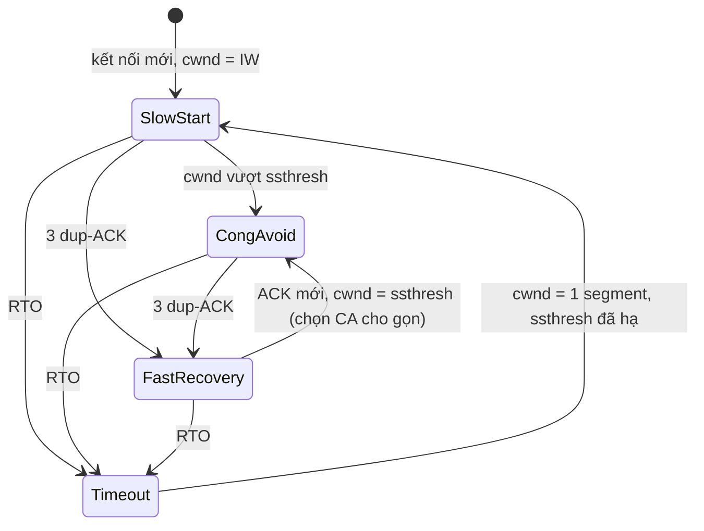

# P6 · Chương 06 — Congestion control

## Bạn sẽ hiểu được gì

1. **Q1.** Congestion collapse là gì, vì sao flow control (`rwnd`) không đủ để ngăn nó? → mục 1
2. **Q2.** `cwnd`, `rwnd`, `ssthresh`, `FlightSize` là biến nào, ai giữ; vì sao lượng gửi bị chặn bởi `min(cwnd, rwnd)`? → mục 2
3. **Q3.** Slow start và congestion avoidance (AIMD) tăng `cwnd` ra sao; chuyện gì xảy ra khi `cwnd == ssthresh`? → mục 3
4. **Q4.** Fast retransmit, fast recovery và timeout giảm `cwnd` thế nào; công thức `ssthresh = max(FlightSize/2, 2*SMSS)` áp dụng khi nào? → mục 4
5. **Q5.** Vì sao kết nối idle bị đưa `cwnd` về thấp (slow-start restart) và tham số Linux nào điều khiển? → mục 5
6. **Q6.** CUBIC và BBR khác Reno ở đâu; ECN và bufferbloat liên quan gì? → mục 6
7. **Q7.** Trên Linux đọc/đổi thuật toán ở đâu (`net.ipv4.tcp_congestion_control`, `TCP_CONGESTION`) và container lab chạy thuật toán nào? → mục 7
8. **Q8.** Hệ quả cho backend: vì sao kết nối mới "chậm", vì sao connection pool và keep-alive có giá trị về mặt mạng? → mục 8

## Kiến thức cần trước

- [Chương 04 — UDP và TCP cơ bản](./04-udp-va-tcp-co-ban.md): segment (mục 4), sequence/ack, handshake (mục 5).
- [Chương 05 — TCP reliability và flow control](./05-tcp-reliability-va-flow-control.md): retransmission và RTO (mục 3), duplicate ACK (mục 4), cửa sổ nhận `rwnd` (mục 5). Chương này giả định bạn đã biết `rwnd` do receiver quảng bá trong header.

Chương này chỉ nói về việc **sender tự hạn chế tốc độ để không làm quá tải mạng**. Socket buffer và hàng đợi kernel ở [Chương 07](./07-socket-va-kernel.md); HTTP/2, HTTP/3, QUIC và TLS ở [Chương 08](./08-dns-http-tls.md).

## 1. Vấn đề: congestion collapse (Q1)

> **Trả lời ngắn.** Flow control chỉ bảo vệ *receiver*: receiver báo còn chỗ bao nhiêu byte qua `rwnd`[^hpbn-flow]. Không có gì trong đó ngăn hai đầu làm quá tải *mạng* ở giữa[^hpbn-collapse]. Khi mạng nghẽn, RTT tăng[^rfc896-rtt]; nếu RTT vượt khoảng truyền lại tối đa của một host, host đó gửi thêm ngày càng nhiều bản sao của cùng dữ liệu, tải tăng đúng lúc mạng đang nghẽn[^rfc896-copies] — đó là congestion collapse, và trạng thái này ổn định: mạng tiếp tục hoạt động ở trạng thái suy giảm[^hpbn-nagle-stable].

**Giải thích.**

Hình dung (nhận xét của người soạn): một ngã tư kẹt xe. Mỗi tài xế chỉ hỏi "bãi đỗ ở đích còn chỗ không" (flow control) mà không nhìn đường; thấy chưa tới nơi, họ cử thêm xe đi cùng tuyến, làm đường kẹt hơn.

Giữa hai đầu là mạng với các router/gateway có hàng đợi hữu hạn và đường truyền có băng thông hữu hạn, mà cả hai đầu đều không biết. HPBN mô tả: flow control ngăn sender làm quá tải receiver, nhưng không có cơ chế nào ngăn một trong hai phía làm quá tải mạng bên dưới[^hpbn-collapse].

Hiện tượng này được John Nagle mô tả trong RFC 896 (1984), một memo nhằm khơi gợi suy nghĩ và thảo luận, tự nhận không đặt ra tiêu chuẩn nào[^rfc896-memo]. Kịch bản: trong mạng datagram thuần có truyền lại đầu-cuối, khi các nút chuyển mạch nghẽn thì thời gian đi vòng (RTT) qua mạng tăng lên[^rfc896-rtt]; nếu RTT vượt khoảng truyền lại tối đa của một host, host đó gửi thêm ngày càng nhiều bản sao của cùng datagram — thêm tải đúng lúc mạng đang nghẽn[^rfc896-copies]. Nagle gọi tình trạng đó là *congestion collapse*[^rfc896-name] và nhấn mạnh nó **ổn định**: khi đã bão hòa, mạng tiếp tục hoạt động ở trạng thái suy giảm[^hpbn-nagle-stable].

Đáp lại, TCP được bổ sung các cơ chế điều tiết tốc độ gửi — flow control, congestion control và congestion avoidance[^hpbn-mech]. RFC 5681 định nghĩa bốn thuật toán: slow start, congestion avoidance, fast retransmit và fast recovery[^rfc5681-abs]. RFC 9293 (đặc tả TCP hiện hành) không chép chúng vào mà dẫn sang các tài liệu bổ trợ[^rfc9293-congestion-ext].

<details><summary>Đi sâu: sự cố thật năm 1986</summary>

Đây không chỉ là lý thuyết. HPBN kể lại: năm 1986, khi số nút (5.000+) và sự đa dạng của chúng tăng, một loạt sự cố congestion collapse lan khắp mạng — có trường hợp dung lượng tụt tới 1.000 lần và mạng không dùng được[^hpbn-1986].

</details>

**Quay lại Q1:** flow control bảo vệ receiver, không bảo vệ mạng; thiếu cơ chế thứ hai thì truyền lại làm nghẽn nặng thêm và trạng thái suy giảm kéo dài.

## 2. Các biến trạng thái (Q2)

> **Trả lời ngắn.** `cwnd` là giới hạn phía sender về lượng dữ liệu được đẩy vào mạng trước khi nhận ACK; `rwnd` là giới hạn phía receiver. Lượng gửi bị chặn bởi cái nhỏ hơn trong hai[^rfc5681-vars]. `cwnd` chỉ nằm ở sender, không gửi cho peer[^hpbn-cwnd].

**Giải thích.**

Hình dung (nhận xét của người soạn): bạn gửi hàng bằng xe tải qua một cầu. Người nhận nói "kho tôi còn chứa được 50 thùng" (`rwnd`); còn bạn tự quyết "tôi chỉ dám cho 10 thùng lên cầu cùng lúc cho tới khi biết cầu chịu được" (`cwnd`). Bạn phải tuân theo con số nhỏ hơn.

RFC 5681 định nghĩa hai biến cho mỗi kết nối: congestion window `cwnd` là giới hạn phía sender về lượng dữ liệu được đẩy vào mạng trước khi nhận ACK, còn `rwnd` là giới hạn phía receiver; giá trị nhỏ hơn trong hai biến quyết định lượng dữ liệu được truyền[^rfc5681-vars]. Phát biểu chặt chẽ hơn: tại mọi thời điểm TCP không được gửi dữ liệu có sequence number cao hơn tổng của sequence number cao nhất đã được ack và `min(cwnd, rwnd)`[^rfc5681-defs].

| Biến | Ai giữ | Ai thấy | Ý nghĩa |
|---|---|---|---|
| `rwnd` | receiver tính | quảng bá trong header TCP | còn bao nhiêu chỗ ở receiver |
| `cwnd` | sender | **không** gửi cho peer[^hpbn-cwnd] | sender được phép có bao nhiêu byte "đang bay" |
| `ssthresh` | sender | không | ngưỡng chọn slow start hay congestion avoidance |
| `FlightSize` | sender | không | dữ liệu đã gửi nhưng chưa được cumulative-ack[^rfc5681-flight] |
| `SMSS` | sender | – | sender maximum segment size (kích thước payload tối đa một segment) |

**Effective window** = `min(cwnd, rwnd)` trừ đi phần đang bay. Hệ quả (suy luận của người soạn): tốc độ tối đa của một kết nối bị chặn bởi *cái nhỏ hơn* trong hai cửa sổ chia cho RTT. Một receiver rộng rãi (rwnd lớn) không giúp gì nếu `cwnd` còn nhỏ — ví dụ ngay sau khi kết nối mới mở. HPBN minh họa: dù receive window là 64 KB, thông lượng của kết nối mới ban đầu bị giới hạn bởi congestion window[^hpbn-ss-every-rwnd].

<details><summary>Đi sâu: bẫy dùng <code>cwnd</code> thay <code>FlightSize</code></summary>

RFC 5681 cảnh báo: dùng `cwnd` thay cho `FlightSize` khi tính `ssthresh` là lỗi dễ mắc, vì `cwnd` trong một số cài đặt có thể vô tình tăng vượt xa `rwnd`[^rfc5681-impnote]. `FlightSize` mới phản ánh lượng thực sự đang ở trong mạng.

</details>

**Quay lại Q2:** `cwnd` là biến riêng của sender, `rwnd` do receiver quảng bá; gửi được tối đa `min(cwnd, rwnd)` tính từ byte đã được ack.

## 3. Slow start và congestion avoidance (AIMD) (Q3)

> **Trả lời ngắn.** Kết nối mới bắt đầu từ cửa sổ nhỏ, tăng theo hàm mũ (slow start) tới `ssthresh`, rồi chỉ tăng khoảng 1 segment mỗi RTT (congestion avoidance)[^rfc5681-ss-inc][^rfc5681-ca]; mất gói thì cắt cửa sổ. Khi `cwnd == ssthresh`, RFC cho dùng một trong hai pha[^rfc5681-eq].

**Giải thích.**

Hình dung (nhận xét của người soạn): thử nước tắm — vặn vòi nhỏ trước, thấy ổn thì mở to dần nhanh, gần nóng thì nhích từng chút, bỏng thì giảm hẳn.

*Slow start.* Khi kết nối mới mở, hai đầu chưa biết băng thông khả dụng, nên bắt đầu gửi hết cỡ ngay là liều. Giải pháp: bắt đầu từ cửa sổ nhỏ (initial window, IW), tăng dần cho đến khi gặp tín hiệu nghẽn.

1. *Tăng.* Trong slow start, TCP tăng `cwnd` tối đa bằng SMSS byte cho mỗi ACK xác nhận dữ liệu mới theo kiểu cumulative[^rfc5681-ss-inc]. Mỗi ACK mới cộng tối đa 1 SMSS, nên số segment đang bay nhân đôi sau mỗi RTT — HPBN gọi là tăng theo hàm mũ[^hpbn-ss-double]. Với delayed ACK (hai segment mới ack một lần) số ACK ít hơn nên mức tăng mỗi RTT thấp hơn gấp đôi (suy luận của người soạn).
2. *Kết thúc.* Slow start dừng khi `cwnd` vượt `ssthresh` (hoặc, tùy chọn, khi chạm tới ngưỡng) hoặc khi quan sát được nghẽn[^rfc5681-ss-end].
3. *`ssthresh` ban đầu* nên được đặt rất cao (ví dụ bằng cửa sổ quảng bá lớn nhất có thể) và buộc phải hạ khi có nghẽn[^rfc5681-initssthresh]. RFC 5681 chỉ nêu hai điều kiện kết thúc slow start (điểm 2 ở trên); HPBN liệt kê ba điều kiện dừng: vượt `rwnd`, vượt `ssthresh` cấu hình, hoặc mất gói[^hpbn-ss-end]. Cài đặt thật có thể khác nhau (xem phần Đi sâu).

Với các kết nối HTTP ngắn, việc truyền dữ liệu có thể xong trước khi cửa sổ đạt cực đại, nên hiệu năng thường bị giới hạn bởi RTT giữa client và server chứ không phải băng thông[^hpbn-short].

*Congestion avoidance.* Khi `cwnd > ssthresh`, thuật toán chuyển sang congestion avoidance: `cwnd` tăng khoảng 1 segment đầy đủ mỗi round-trip time (RTT)[^rfc5681-ca].

*AIMD.* Vế còn lại của **AIMD** (additive increase, multiplicative decrease) là giảm: khi phát hiện mất, cửa sổ bị cắt theo tỉ lệ (về cơ bản một nửa, xem mục 4). HPBN nhấn mạnh tiền đề thiết kế: TCP được thiết kế riêng để dùng mất gói làm cơ chế phản hồi[^hpbn-loss] — mất gói không phải câu hỏi "có hay không" mà là "bao giờ". Giả định ngầm là mất gói = nghẽn[^hpbn-loss-assume]. Giả định này sai khi mất gói do lỗi ngẫu nhiên; BBR và ECN (mục 6) là hai hướng không dùng mất gói làm tín hiệu duy nhất (nhận xét của người soạn).

*Khi `cwnd == ssthresh`.* RFC 5681: slow start dùng khi `cwnd < ssthresh`, congestion avoidance khi `cwnd > ssthresh`, và khi hai giá trị bằng nhau thì sender được phép dùng slow start hoặc congestion avoidance[^rfc5681-eq]. Nhất quán với điều đó, slow start kết thúc khi `cwnd` vượt `ssthresh` *hoặc, tùy chọn, ngay khi chạm tới*[^rfc5681-ss-end]. Nghĩa là RFC **không** quy định một hành vi duy nhất tại điểm bằng nhau; hai cài đặt tuân thủ có thể khác nhau.

<details><summary>Đi sâu: IW, công thức tăng trong congestion avoidance, ví dụ HPBN, quan sát trong container</summary>

**Initial window.** RFC 5681 đặt cận trên: SMSS ≤ 1095 byte thì IW ≤ 4 segment; (1095, 2190] thì ≤ 3 segment; lớn hơn thì ≤ 2 segment[^rfc5681-iw]. RFC 6928 nâng cận trên lên `min(10*MSS, max(2*MSS, 14600))`[^rfc6928-iw] — 10 segment với MSS 1448 (tính của người soạn) — nhưng là tài liệu loại Experimental (đề xuất một thí nghiệm)[^rfc6928-exp]. HPBN nêu rằng trên Linux IW10 là mặc định mới cho mọi kernel mới hơn 2.6.39[^hpbn-iw10].

**Công thức tăng trong congestion avoidance.** RFC khuyến nghị đếm byte đã được ack và tăng tối đa 1 SMSS khi đủ `cwnd` byte[^rfc5681-bytecount]; công thức `cwnd += SMSS*SMSS/cwnd` trên mỗi ACK mới chỉ là lựa chọn "MAY"[^rfc5681-eq3], xấp xỉ "acceptable" của +1 segment/RTT[^rfc5681-eq3b]. Biểu thức này cho thấy vì sao tăng tuyến tính: khi `cwnd` chứa N segment, N ACK mỗi cái cộng `SMSS/N` byte → tổng +1 SMSS mỗi RTT (tính toán của người soạn). Cài đặt số nguyên có thể làm kết quả bằng 0 khi `cwnd > SMSS*SMSS`; RFC khuyến nghị (SHOULD) làm tròn lên 1 byte[^rfc5681-round].

**Ví dụ có số (HPBN).** Receive window 64 KB, IW = 10, RTT = 56 ms: để chạm 64 KB phải nới `cwnd` lên 45 segment, mất 168 ms — ba RTT[^hpbn-168]. Dù client và server có thể truyền ở tốc độ megabit mỗi giây trở lên, điều đó không có tác dụng ở đầu kết nối mới — HPBN gọi đó là slow-start[^hpbn-168-note].

**Quan sát thật: slow start trong container.** Kernel trong container lab là `6.8.0-117-generic`. Tôi làm chậm loopback bằng `tc netem` (25 ms mỗi chiều → RTT ≈ 50 ms), hạ MTU `lo` xuống 1500 (loopback mặc định có MSS rất lớn), cho server gửi 1,5 MB và lấy mẫu `ss -tinm` của socket gửi mỗi ~40 ms:

```bash
./labs/linux.sh bash -c '
  ip link set lo mtu 1500; tc qdisc add dev lo root netem delay 25ms
  # server python gửi 1500000 byte tới client; vòng lặp: ss -tin sport = :9099
'
```

Kết quả chạy lại khi review (`mss` = 1448, `rtt` ≈ 51 ms, mẫu cách nhau ~50 ms; `unacked` tính bằng segment, `snd_wnd` là cửa sổ receiver quảng bá, byte):

| mẫu | bytes_acked | cwnd | unacked | snd_wnd |
|---|---|---|---|---|
| 1 | 0 | 10 | 10 | 64.256 |
| 2 | 14.480 | 20 | 20 | 83.968 |
| 3 | 43.440 | 40 | 40 | 70.016 |
| 4 | 101.360 | 80 | 66 | 95.488 |
| 5 | 196.848 | 146 | 49 | 70.528 |
| 6 | 266.432 | 146 | 66 | 95.488 |
| 7 | 361.920 | 172 (`ssthresh:172`) | 136 | 195.712 |

Quan sát (hai lần chạy, chỉ minh họa): `cwnd` bắt đầu ở **10** (khớp IW10), rồi 10 → 20 → 40 → 80 → 146, dáng hàm mũ của slow start. (a) Ở `cwnd` = 146, `unacked` chỉ 49–66 segment, bằng `snd_wnd`/`mss` (70.528/1448 ≈ 49; 95.488/1448 ≈ 66), và `ss` báo `rwnd_limited` 36–47% thời gian (`tcpi_rwnd_limited` là thời gian, tính bằng micro giây, bị giới hạn bởi cửa sổ nhận[^tcp-h-rwnd]): ở các mẫu này lượng đang bay bị chặn bởi cửa sổ receiver, không phải `cwnd`. (b) `cwnd` **không** dừng ở 146: lần chạy lại tiếp tục 172 (kèm `ssthresh:172`), 180, …, 200, và `ss` không hiện trường truyền lại. Vậy "dừng ở 146" của lần chạy đầu không tái lập; tôi không giải thích vì sao `cwnd` ra 146 hay vì sao `ssthresh` xuất hiện (HyStart của CUBIC chỉ là giả thuyết chưa kiểm). `netem` và MTU đã khôi phục (`lo` mtu 65536, qdisc `noqueue`).

</details>

**Quay lại Q3:** slow start nhân đôi `cwnd` mỗi RTT tới `ssthresh`, congestion avoidance cộng ~1 segment mỗi RTT, mất gói thì cắt; tại `cwnd == ssthresh` RFC cho dùng pha nào cũng được.

## 4. Phát hiện mất: fast retransmit, fast recovery, timeout (Q4)

> **Trả lời ngắn.** Sender biết mất gói bằng 3 duplicate ACK liên tiếp (nhanh) hoặc hết RTO (chậm)[^rfc5681-fr]. Với 3 dup-ACK, `ssthresh = max(FlightSize/2, 2*SMSS)` rồi `cwnd = ssthresh + 3*SMSS`, và khi ACK mới đến thì `cwnd = ssthresh`[^rfc5681-ssthresh][^rfc5681-fr3][^rfc5681-deflate]. Với RTO, `cwnd` bị đưa về tối đa 1 segment và chạy lại slow start[^rfc5681-lw].

**Giải thích.**

Hình dung (nhận xét của người soạn): bạn gửi 20 thư đánh số; người nhận cứ báo "vẫn chưa thấy thư số 7" ba lần liền — bạn gửi lại ngay thư 7 mà không cần chờ hết giờ. Còn nếu im lặng hoàn toàn thì phải chờ hết hạn và thận trọng hơn nhiều.

Có hai cách sender phát hiện mất. Cách nhanh là **duplicate ACK**: khi một segment đến sai thứ tự, receiver nên (SHOULD) gửi ngay một ACK báo số thứ tự đang chờ[^rfc5681-dupack-recv]. RFC 5681 lưu ý dup-ACK có ba nguyên nhân: mất segment, đảo thứ tự (reordering) — RFC nói đây không phải chuyện hiếm trên một số đường truyền — và nhân bản segment/ACK trong mạng[^rfc5681-dupcauses]. Vì dup-ACK có thể do đảo thứ tự, sender không nên coi một dup-ACK đơn lẻ là mất gói (suy luận của người soạn); ngưỡng RFC dùng là **3** dup-ACK liên tiếp (không có ACK nào xen giữa làm `SND.UNA` tiến lên), coi đó là dấu hiệu một segment đã mất[^rfc5681-fr]. Cách chậm là hết **RTO** (retransmission timeout, chương 05, mục 3).

*Fast retransmit + fast recovery (3 dup-ACK).* Từng bước theo RFC 5681 §3.2:

1. Hai dup-ACK đầu: TCP nên (SHOULD) gửi một segment dữ liệu chưa gửi theo *limited transmit* (RFC 3042) nếu cửa sổ quảng bá cho phép và còn dữ liệu, nhưng không được (MUST NOT) đổi `cwnd` vì hai segment này[^rfc5681-lt].
2. **Dup-ACK thứ ba**: TCP bắt buộc (MUST) đặt `ssthresh` không quá giá trị của phương trình (4)[^rfc5681-fr-ssthresh], với `ssthresh = max(FlightSize / 2, 2*SMSS)`[^rfc5681-ssthresh]. Đây là phần "multiplicative decrease": một nửa lượng đang bay, nhưng không dưới 2 segment.
3. Retransmit segment ở `SND.UNA` và đặt `cwnd = ssthresh + 3*SMSS`[^rfc5681-fr3] — cộng 3 vì ba segment đã rời mạng và đang nằm trong buffer của receiver; RFC gọi việc này là làm "phồng" (inflate) cửa sổ một cách nhân tạo[^rfc5681-inflate].
4. Mỗi dup-ACK thêm sau đó: `cwnd += SMSS`, phản ánh thêm một segment đã rời mạng[^rfc5681-fr4]. Khi có dữ liệu chưa gửi và `cwnd` mới cùng cửa sổ quảng bá cho phép, TCP nên (SHOULD) gửi 1*SMSS byte dữ liệu mới[^rfc5681-fr5].
5. Khi ACK báo dữ liệu mới đến: `cwnd = ssthresh` (RFC gọi là thu nhỏ — deflate)[^rfc5681-deflate]. Lúc này `cwnd == ssthresh`, nên theo mục 3 RFC cho dùng slow start hoặc congestion avoidance; sơ đồ và bảng bên dưới chọn congestion avoidance cho gọn (đơn giản hóa của người soạn).

Điểm quan trọng: không quay lại slow start từ 1 segment. RFC giải thích: dup-ACK cho thấy nhiều khả năng segment đã rời mạng và đang nằm ở buffer của receiver (RFC lưu ý việc mạng nhân bản segment hàng loạt có thể làm kết luận này sai)[^rfc5681-whyfr], nên sender tiếp tục gửi — nhưng với `cwnd` đã giảm, vì mất gói là dấu hiệu nghẽn[^rfc5681-whyfr2].

*Mất qua timeout (RTO).* Timeout nặng hơn vì không còn dòng dup-ACK để tin rằng mạng còn chở được (suy luận của người soạn). Quy tắc:

- `ssthresh` cũng bị hạ theo cùng phương trình (4)[^rfc5681-ssthresh-rto]. Ngoại lệ: nếu segment bị mất *đã được retransmit bằng timer ít nhất một lần*, `ssthresh` được giữ nguyên, "held constant"[^rfc5681-held] (lý do — tránh hạ hai lần cho cùng một sự kiện — là suy luận của người soạn).
- `cwnd` tối đa bằng *loss window* LW = 1 full-sized segment, bất kể IW[^rfc5681-lw].
- Sau đó chạy lại slow start (`cwnd` tăng gấp đôi mỗi RTT) từ 1 segment lên `ssthresh` mới[^rfc5681-lw].



<details><summary>Đi sâu: ví dụ tính và kịch bản <code>cwnd</code> theo thời gian</summary>

**Ví dụ tính** (số liệu giả định). SMSS = 1460, `FlightSize` = 20 segment = 29.200 byte: `ssthresh = max(14.600, 2.920) = 14.600`; `cwnd = 14.600 + 4.380 = 18.980`; ACK mới → `cwnd = 14.600`. Nếu `FlightSize` chỉ 3 segment (4.380 byte): `4.380/2 = 2.190 < 2.920` nên `ssthresh = 2.920` — sàn 2·SMSS thắng.

**Cửa sổ theo thời gian — một kịch bản minh họa.** Bảng dưới là **tính toán minh họa của người soạn** (không phải đo): SMSS cố định, IW = 10, `ssthresh` ban đầu = 40 segment, receiver ack mọi segment (không delayed ACK), tăng chính xác theo quy tắc; sự kiện mất đặt thủ công.

| RTT | Sự kiện | `cwnd` (segment) | `ssthresh` | Pha |
|---|---|---|---|---|
| 0 | bắt đầu | 10 | 40 | slow start |
| 1 | – | 20 | 40 | slow start |
| 2 | – | 40 (= ssthresh) | 40 | RFC: dùng pha nào cũng được |
| 3–6 | – | 41, 42, 43, 44 | 40 | congestion avoidance |
| 6 | 3 dup-ACK, `FlightSize` = 44 | 22 + 3 = 25, rồi +1 mỗi dup-ACK | 22 | fast recovery |
| 7 | ACK mới | 22 | 22 | congestion avoidance |
| 8–9 | – | 23, 24 | 22 | congestion avoidance |
| 9 | RTO, `FlightSize` = 24 | 1 | 12 | slow start sau timeout |
| 10–13 | – | 2, 4, 8, 12 | 12 | slow start tới ssthresh |

Hình răng cưa: leo tuyến tính, rớt một nửa (fast recovery) hoặc về 1 (RTO), leo lại. Đơn giản hóa: ở `cwnd == ssthresh` (RTT 2) bảng chọn congestion avoidance (chọn slow start sẽ ra 80 ở RTT 3); ở RTT 13 `cwnd` thực sẽ vượt 12 (lên 16) rồi bị đưa về ngưỡng.

</details>

**Quay lại Q4:** 3 dup-ACK → cắt `ssthresh` về nửa `FlightSize` (tối thiểu 2·SMSS), không quay về 1 segment; RTO → về 1 segment và slow start lại.

## 5. Slow-start restart sau khi idle (Q5)

> **Trả lời ngắn.** Sau một khoảng im lặng, các ACK trong mạng đã cạn nên sender không còn nhịp để rải segment ra[^rfc5681-ackclock]. Vì vậy RFC 5681 nói TCP nên (SHOULD) đưa `cwnd` về không quá `min(IW, cwnd)` trước khi gửi tiếp nếu đã không gửi dữ liệu quá một RTO[^rfc5681-restart-should][^rfc5681-rw]. Trên Linux tham số điều khiển là `net.ipv4.tcp_slow_start_after_idle`, mặc định bật[^sysctl-ssai][^tcp7-ssai].

**Giải thích.**

Hình dung (nhận xét của người soạn): xe cộ đã tản hết khỏi đường; đừng tưởng đường vẫn thông như hôm qua mà đổ ngay cả đoàn xe lớn lên đó — tình trạng đường có thể đã đổi.

Sau một thời gian im lặng, ACK trong mạng đã cạn, sender mất "ACK clock" để rải segment ra theo nhịp: RFC 5681 §4.1 nói rằng sau khoảng idle, TCP không thể dùng ACK clock để nhịp việc đưa segment mới vào mạng vì mọi ACK đã cạn khỏi mạng[^rfc5681-ackclock]. Xả đầy `cwnd` cũ có thể gây một burst ở tốc độ đường truyền, và điều kiện mạng có thể đã đổi trong lúc idle khiến `cwnd` không còn phản ánh đúng dung lượng[^rfc5681-burst]; HPBN nêu lý do tương tự[^hpbn-ssr].

Quy tắc: RFC mô tả cơ chế đã được triển khai rộng rãi — khi TCP không nhận segment nào trong hơn một retransmission timeout, `cwnd` được giảm xuống restart window (RW) trước khi bắt đầu truyền[^rfc5681-restart], với `RW = min(IW, cwnd)`[^rfc5681-rw]. Điều kiện "không nhận" có điểm yếu ở HTTP persistent (xem phần Đi sâu), nên quy định của RFC (SHOULD) dùng điều kiện "không gửi dữ liệu quá một RTO"[^rfc5681-restart-should]. RW không làm *tăng* `cwnd` — nếu `cwnd` đang nhỏ hơn IW thì giữ nguyên (suy ra từ `min`).

Trên Linux: `net.ipv4.tcp_slow_start_after_idle` — nếu bật, kernel áp dụng hành vi RFC 2861 và cho cửa sổ congestion hết hạn sau một khoảng idle, trong đó khoảng idle được tính theo RTO hiện tại[^sysctl-ssai]; mặc định bật[^tcp7-ssai].

<details><summary>Đi sâu: HTTP persistent connection, RFC 2861 và lời khuyên tắt SSR</summary>

RFC cũng ghi nhận một điểm tinh tế: dùng "lần cuối nhận segment" để đo idle có thể không giảm `cwnd` đúng ở HTTP persistent connection — vì web server nhận request (một segment) trước khi gửi response, nên phép thử idle thất bại[^rfc5681-http]. Vì vậy RFC chuyển sang điều kiện "không gửi dữ liệu" nêu ở trên.

Kernel doc dẫn RFC 2861 (khác RFC 5681 §4.1), nên đừng giả định hai bên giống từng chi tiết. HPBN khuyến nghị tắt SSR trên server để cải thiện kết nối HTTP sống lâu[^hpbn-ssr-off]. Đó là lời khuyên của HPBN; đánh đổi (nhận xét của người soạn): tắt SSR có thể xả cửa sổ lớn vào đường đã đổi trạng thái, nên chỉ đổi khi đã đo.

</details>

**Quay lại Q5:** idle quá một RTO thì `cwnd` bị kéo về `min(IW, cwnd)`, và Linux điều khiển việc đó bằng `tcp_slow_start_after_idle`.

## 6. CUBIC, BBR, ECN và bufferbloat (Q6)

> **Trả lời ngắn.** CUBIC thay mức tăng +1 segment/RTT của Reno bằng hàm bậc ba nhưng vẫn dựa vào mất gói[^cubic-abs][^cubic-queue]. BBR dựng mô hình đường truyền từ các phép đo thay vì chỉ dựa vào mất gói, và hiện là Internet-Draft Experimental[^bbr-model][^bbr-status]. ECN cho router báo nghẽn không cần drop[^ecn-ce]; bufferbloat gắn với hàng đợi tồn tại lâu trong bộ đệm, chỉ làm tăng độ trễ[^bloat-delay].

**Giải thích.**

Hình dung (nhận xét của người soạn): Reno như người leo cầu thang mỗi bước một bậc dù cầu thang rất dài; CUBIC bước dài khi còn xa mức từng đạt, chậm lại khi tới gần mức cũ, rồi dò xem mức mới có cao hơn không.

*CUBIC (RFC 9438).* Reno (thuật toán RFC 5681) tăng +1 segment/RTT trong congestion avoidance (BDP là "bandwidth-delay product", lượng dữ liệu tối đa có thể đang bay[^hpbn-bdp]). CUBIC thay hàm tăng tuyến tính bằng hàm bậc ba, nhằm cải thiện khả năng mở rộng và độ ổn định trên mạng nhanh và đường dài[^cubic-abs] — tức là mức +1/RTT được coi là chưa đủ mở rộng trên các mạng đó (suy luận của người soạn). Nó đã là mặc định của Linux, Windows và Apple[^cubic-default]. CUBIC vẫn **dựa vào mất gói**, và RFC thừa nhận nó có thể làm đầy các drop-tail buffer lớn nhanh hơn Reno và làm tăng nguy cơ standing queue[^cubic-queue].

*BBR.* BBR là thuật toán dựa trên mô hình, khác hướng loss-based: **mô hình hóa đường truyền**. Ý tưởng: BBR dùng các phép đo gần đây về tốc độ chuyển giao, round-trip time và tỉ lệ mất gói của một kết nối để dựng mô hình tường minh của đường truyền, rồi dùng mô hình đó điều khiển cả *tốc độ gửi* lẫn *lượng tối đa đang bay*[^bbr-model]. Lợi ích draft nêu: so với thuật toán loss-based như Reno hay CUBIC, BBR cho thông lượng cao hơn đáng kể ở nút cổ chai có buffer nông hoặc mất gói ngẫu nhiên, và độ trễ hàng đợi thấp hơn đáng kể ở nút cổ chai có buffer sâu[^bbr-benefit]. Đây là tuyên bố của tác giả draft, không phải kết quả đo của tôi.

*ECN (RFC 3168).* Mất gói là tín hiệu nghẽn "đắt": sender phải đợi dup-ACK hay RTO, rồi truyền lại. ECN cho phép router báo nghẽn *mà không drop*: thay vì chỉ drop, router có thể đặt codepoint Congestion Experienced (CE) trong IP header của các gói từ transport hỗ trợ ECN[^ecn-ce]. Receiver gặp CE thì đặt cờ **ECE** (ECN-Echo) trong ACK kế tiếp; sender nhận ECE thì phản ứng như khi một gói bị drop[^ecn-seq], rồi đặt cờ **CWR** (Congestion Window Reduced) để báo đã giảm cửa sổ[^ecn-flags]; receiver dùng CWR để biết khi nào thôi đặt ECE[^ecn-stop]. RFC 3168 yêu cầu coi CE giống một gói bị mất: với TCP hỗ trợ ECN, TCP nguồn bắt buộc phải giảm một nửa cửa sổ congestion cho mọi cửa sổ dữ liệu có chứa gói bị drop hoặc dấu hiệu ECN[^ecn-halve] — và chỉ giảm một lần cho mỗi cửa sổ dữ liệu[^ecn-once]. Lợi ích: receiver vẫn nhận được gói, tránh được độ trễ quá mức do truyền lại sau khi mất gói[^ecn-benefit].

*Bufferbloat.* Router/modem có bộ đệm để hấp thụ burst. RFC 8289 mô tả: buffer mạng tồn tại để hấp thụ các burst gói xảy ra tự nhiên trong mạng ghép kênh thống kê[^bloat-buffers]. Mối quan hệ với congestion control (suy luận của người soạn từ cơ chế loss-based): thuật toán loss-based chỉ phát hiện nghẽn khi bộ đệm *đầy và drop*, nên với bộ đệm sâu, sender cứ tăng `cwnd` đến khi đệm đầy. RFC 8289 định nghĩa *standing queue* là hàng đợi tồn tại lâu, cỡ RTT dài[^bloat-standing]. Trong ví dụ cửa sổ 25 gói qua đường có BDP 20 gói, RFC chỉ ra hàng đợi đứng hình thành do chênh lệch giữa kích thước cửa sổ và kích thước "pipe", không liên quan tới tốc độ gửi[^bloat-pipe], và mọi hàng đợi ngoài burst thoáng qua chỉ tạo thêm độ trễ[^bloat-delay]. Biện pháp ở phía mạng: AQM như CoDel — RFC 8289 mô tả nó như một framework kiểm soát độ trễ dư do bufferbloat[^codel-abs]; IETF cũng có khuyến nghị riêng về AQM (RFC 7567)[^rfc7567]. ECN cho AQM một cách báo nghẽn không cần drop (nhận xét của người soạn).

<details><summary>Đi sâu: cơ chế CUBIC, trạng thái BBR draft, các bước ECN, <code>tcp_ecn</code> trên Linux, bối cảnh bufferbloat</summary>

**Cơ chế CUBIC (RFC 9438 §4).**

- Ghi nhớ `Wmax` — kích thước `cwnd` ngay trước lần giảm gần nhất (khi tắt fast convergence)[^cubic-wmax].
- Khi nhận ACK trong congestion avoidance, tính cả `Wcubic(t)` (hàm bậc ba theo thời gian từ lần giảm cuối) lẫn `West` (ước lượng Reno) và lấy giá trị lớn hơn[^cubic-max].
- Ba vùng: *Reno-friendly* (bảo đảm không thua Reno)[^cubic-friendly]; *concave* khi `cwnd < Wmax`[^cubic-concave] — tiến tới `Wmax` rồi chững lại (plateau)[^cubic-plateau]; *convex* khi `cwnd > Wmax`[^cubic-convex] — dò tìm `Wmax` mới: tăng rất chậm quanh `Wmax` rồi nhanh dần[^cubic-probe].
- Khi mất, giảm nhân với `βcubic`, RFC khuyến nghị (SHOULD) đặt bằng 0,7, khác hệ số giảm của RFC 5681 (và RFC 6675) trong fast recovery[^cubic-beta]. Nghĩa là CUBIC cắt ít hơn Reno (giữ 70% thay vì 50%) (suy luận của người soạn).

**Trạng thái tài liệu BBR.** Đặc tả là Internet-Draft `draft-ietf-ccwg-bbr`; bản tôi đọc là `-04` (20/10/2025), **Intended Status: Experimental**[^bbr-status]. Khi review (10/2026) datatracker đã có `-06` (6/7/2026), vẫn Experimental[^bbr-06], nên chi tiết dưới đây có thể đã đổi. Một Internet-Draft chỉ là tài liệu nháp có thể bị cập nhật, thay thế hoặc bị tài liệu khác làm lỗi thời bất kỳ lúc nào[^bbr-draft]; nội dung gắn với `-04`, tức đặc tả phiên bản 3 của BBR (BBRv3)[^bbr-v3]. Ước lượng BDP trong draft: `BBR.bdp = BBR.bw * BBR.min_rtt`[^bbr-bdp] — băng thông ước lượng nhân RTT nhỏ nhất quan sát được.

**Các bước ECN.**

1. Hai đầu thương lượng ECN khi thiết lập kết nối[^ecn-negotiate]; sau đó sender đánh dấu gói bằng codepoint ECT(0) hoặc ECT(1) trong IP header — các codepoint ECT '10' và '01' do bên gửi dữ liệu đặt để báo hai đầu transport hỗ trợ ECN[^ecn-ect].
2. Router hỗ trợ ECN, khi phát hiện nghẽn sắp xảy ra và thấy gói sắp bị drop mang codepoint ECT, đặt CE thay vì drop[^ecn-router].
3. Receiver echo bằng ECE, sender đặt CWR[^ecn-flags].
4. Sender giảm cửa sổ một lần mỗi cửa sổ dữ liệu: cửa sổ congestion của TCP sender chỉ nên (should) giảm một lần để đáp ứng một chuỗi gói bị drop và/hoặc gói CE trong cùng một cửa sổ dữ liệu[^ecn-once].

**ECN trên Linux.** `net.ipv4.tcp_ecn`: ECN chỉ được dùng khi cả hai đầu kết nối TCP cùng báo hỗ trợ[^sysctl-ecn]. Giá trị 2 (bật khi đầu kia yêu cầu, không yêu cầu ở kết nối đi ra) là mặc định từ Linux 2.6.31, và tcp(7) cảnh báo ECN có thể ảnh hưởng kết nối tới một số đích vì middlebox cũ hỏng[^tcp7-ecn]. Container lab đọc được `tcp_ecn=2`.

**Bối cảnh bufferbloat.** RFC 8289 nói bài toán bộ đệm luôn đầy ngày càng tệ hơn khi mật độ bộ nhớ theo Định luật Moore khiến kích thước buffer pool tăng theo hàm mũ[^bloat-rfc8289]. RFC 9438 xác nhận rủi ro với CUBIC (đã nêu ở trên); BBR draft quảng cáo độ trễ hàng đợi thấp hơn đáng kể ở nút cổ chai có buffer sâu[^bbr-benefit].

</details>

**Quay lại Q6:** CUBIC tăng bằng hàm bậc ba nhưng vẫn loss-based, BBR mô hình hóa đường truyền (còn là draft Experimental), ECN báo nghẽn không cần drop, và bufferbloat là cái giá của hàng đợi sâu với thuật toán loss-based.

## 7. Congestion control trên Linux (Q7)

> **Trả lời ngắn.** Thuật toán mặc định cho kết nối mới đặt bằng sysctl `net.ipv4.tcp_congestion_control`[^sysctl-cc]; từng socket đổi được bằng option `TCP_CONGESTION`[^tcp7-opt]. Container lab đọc được mặc định là `cubic`, trong danh sách `reno cubic`.

**Giải thích.**

Hình dung (nhận xét của người soạn): sysctl như cấu hình mặc định của cả cluster, `TCP_CONGESTION` như override trên từng pod.

**Chọn thuật toán toàn hệ thống.** `net.ipv4.tcp_congestion_control` đặt thuật toán dùng cho kết nối mới; mặc định do cấu hình kernel quyết định; với kết nối passive, lựa chọn của listener được thừa hưởng[^sysctl-cc]. tcp(7) nói thêm: thuật toán khả dụng ngoài reno phụ thuộc cấu hình kernel[^tcp7-cc].

**Danh sách.** `tcp_available_congestion_control` (chỉ đọc) liệt kê các thuật toán đã đăng ký; có thể còn thuật toán khác ở dạng module chưa nạp[^sysctl-avail]. `tcp_allowed_congestion_control` là tập con dành cho process không đặc quyền[^sysctl-allowed].

**Theo từng socket.** Option `TCP_CONGESTION` cho phép đặt thuật toán theo từng socket; process không đặc quyền chỉ chọn trong `tcp_allowed_congestion_control`, còn `CAP_NET_ADMIN` chọn được bất kỳ thuật toán sẵn có nào[^tcp7-opt].

<details><summary>Đi sâu: giá trị đọc trong container lab</summary>

Đọc thật qua `./labs/linux.sh`, kernel 6.8.0-117-generic:

```text
tcp_congestion_control=cubic
tcp_available_congestion_control=reno cubic
tcp_allowed_congestion_control=reno cubic
tcp_slow_start_after_idle=1
tcp_ecn=2
```

Đọc: mặc định là CUBIC (khớp RFC 9438[^cubic-default]); chỉ `reno` và `cubic` được đăng ký, BBR không có trong danh sách. Đừng suy ra "kernel không có BBR": theo doc, thuật toán khác có thể là module chưa nạp, và container không có `/lib/modules` nên tôi không kiểm tra được. Máy của bạn có thể khác — dùng `sysctl net.ipv4.tcp_congestion_control net.ipv4.tcp_available_congestion_control` và `ss -ti`.

</details>

**Quay lại Q7:** sysctl chọn mặc định toàn hệ thống, `TCP_CONGESTION` chọn theo socket (bị giới hạn bởi `tcp_allowed_congestion_control` nếu không đặc quyền), và lab chạy `cubic`.

## 8. Hệ quả cho backend (Q8)

> **Trả lời ngắn.** Slow start áp dụng cho mọi kết nối mới[^hpbn-ss-every], nên những byte đầu luôn chậm. Dùng lại kết nối (keep-alive, pool) trả phí này một lần, trừ khi kết nối idle quá một RTO khi `tcp_slow_start_after_idle` bật[^sysctl-ssai] (kết luận của người soạn).

**Giải thích.**

Hình dung (nhận xét của người soạn): mở kết nối mới như khởi động xe nguội — chạy chậm ở quãng đầu; pool kết nối là giữ máy nóng, nhưng để xe nguội quá lâu thì phải khởi động lại.

1. **Kết nối mới chậm ở những byte đầu.** Request đầu tiên trên kết nối mới trả giá handshake TCP, (TLS), rồi vài RTT để `cwnd` lớn lên; với response ngắn, thời gian bị chi phối bởi RTT chứ không bởi băng thông (mục 3)[^hpbn-short].
2. **Connection reuse / keep-alive / pool trả phí này một lần.** `cwnd` là trạng thái của *kết nối*, nên request sau trên cùng kết nối thừa hưởng cửa sổ đã được nới; vì vậy keep-alive và pool kết nối tới DB/HTTP downstream giảm latency (nhận xét của người soạn, suy ra từ HPBN). Nhưng **chỉ khi kết nối không idle quá lâu**: idle quá một RTO với `tcp_slow_start_after_idle=1` thì `cwnd` bị kéo về `min(IW, cwnd)` (mục 5), nên pool giữ kết nối nhàn rỗi lâu có thể vẫn trả phí slow start lại.

<details><summary>Đi sâu: quan sát và chuyển sang HTTP/2, HTTP/3</summary>

`ss -ti` hiển thị `cwnd`, `rtt`, `mss` từng socket (mục 3, phần Đi sâu). HTTP/2 multiplex nhiều stream trên một kết nối TCP (mục 5) và HTTP/3 chạy trên QUIC (mục 6) — xem [Chương 08](./08-dns-http-tls.md).

</details>

**Quay lại Q8:** kết nối mới trả phí slow start; pool/keep-alive chỉ giúp khi kết nối không idle quá một RTO.

## Liên hệ với Rust

`std::net::TcpStream` phơi ra các option TCP cơ bản, ví dụ `set_nodelay` — đặt giá trị của option `TCP_NODELAY` trên socket[^std-nodelay]. Khi tôi tìm từ "congestion" trong trang docs `TcpStream` bản 1.95.0, không có kết quả, nên trang đó không có hàm đặt `TCP_CONGESTION` (kết luận từ việc không tìm thấy). Chọn thuật toán theo socket phải gọi `setsockopt` ở mức hệ điều hành (crate cụ thể chưa kiểm chứng). Đa số code backend Rust không cần: mặc định kernel (mục 7) và việc dùng lại kết nối quyết định hiệu năng.

## Tóm tắt

- Flow control bảo vệ receiver; congestion control bảo vệ mạng; thiếu cái sau → congestion collapse (RFC 896). Gửi bị chặn bởi `min(cwnd, rwnd)`.
- Slow start nhân đôi `cwnd` mỗi RTT; congestion avoidance +~1 segment/RTT; giảm nhân khi mất gói → AIMD; tại `cwnd == ssthresh` RFC cho dùng pha nào cũng được.
- 3 dup-ACK: `ssthresh = max(FlightSize/2, 2*SMSS)`, `cwnd = ssthresh + 3*SMSS`, ACK mới → `cwnd = ssthresh`. RTO: `cwnd` = 1 segment.
- Sau idle quá một RTO, RFC nói TCP nên đưa `cwnd` về không quá `min(IW, cwnd)`; Linux: `tcp_slow_start_after_idle`.
- CUBIC (loss-based; RFC 9438 ghi là mặc định ở Linux, Windows, Apple), BBR (Internet-Draft Experimental); ECN báo nghẽn không cần drop; bufferbloat là hàng đợi tồn tại lâu trong bộ đệm.
- Backend: kết nối mới chậm do slow start; connection reuse trả phí này một lần.

## Câu hỏi tự kiểm tra

1. Vì sao flow control không ngăn được congestion collapse? Congestion collapse theo RFC 896 diễn ra thế nào?
<details><summary>Đáp án</summary>

Flow control chỉ bảo vệ receiver, không có cơ chế ngăn quá tải mạng[^hpbn-collapse]. RTT tăng khi nút nghẽn[^rfc896-rtt]; nếu vượt khoảng truyền lại tối đa, host gửi thêm bản sao khiến tải tăng đúng lúc nghẽn[^rfc896-copies]; trạng thái đó ổn định[^hpbn-nagle-stable].

</details>

2. Ai giữ `cwnd`, nó có nằm trong header TCP không, và gửi bị chặn bởi gì?
<details><summary>Đáp án</summary>

Sender giữ, không quảng bá cho peer[^hpbn-cwnd]; lượng gửi bị chặn bởi `min(cwnd, rwnd)`[^rfc5681-vars][^rfc5681-defs].

</details>

3. Cho `FlightSize` = 3 segment, SMSS = 1460. `ssthresh` sau dup-ACK thứ ba là bao nhiêu?
<details><summary>Đáp án</summary>

`max(FlightSize/2, 2*SMSS)`[^rfc5681-ssthresh] = max(2.190, 2.920) = 2.920 byte (2 SMSS).

</details>

4. Trình tự `cwnd` trong fast recovery từ dup-ACK thứ ba đến ACK mới?
<details><summary>Đáp án</summary>

`ssthresh` theo phương trình (4)[^rfc5681-fr-ssthresh]; `cwnd = ssthresh + 3*SMSS`[^rfc5681-fr3]; mỗi dup-ACK thêm +SMSS[^rfc5681-fr4]; ACK mới → `cwnd = ssthresh`[^rfc5681-deflate].

</details>

5. RTO khác 3 dup-ACK ở điểm nào về `cwnd` và `ssthresh`?
<details><summary>Đáp án</summary>

RTO: `cwnd` ≤ 1 segment[^rfc5681-lw] rồi slow start; `ssthresh` cũng theo (4)[^rfc5681-ssthresh-rto], nhưng giữ nguyên nếu segment đã retransmit bằng timer trước đó[^rfc5681-held].

</details>

6. Slow-start restart là gì và tham số Linux nào điều khiển?
<details><summary>Đáp án</summary>

Nếu đã không gửi dữ liệu quá một RTO, TCP nên (SHOULD) đưa `cwnd` về không quá RW = `min(IW, cwnd)`[^rfc5681-restart-should][^rfc5681-rw]; Linux: `tcp_slow_start_after_idle`, mặc định bật[^sysctl-ssai][^tcp7-ssai].

</details>

7. ECN báo nghẽn bằng cách nào và sender phản ứng ra sao?
<details><summary>Đáp án</summary>

Router đặt CE[^ecn-ce]; receiver echo bằng ECE, sender đặt CWR[^ecn-flags]; sender giảm `cwnd` như với drop, một lần mỗi cửa sổ[^ecn-halve][^ecn-once].

</details>

8. Vì sao connection pool giúp về mặt congestion control, và khi nào lợi ích mất?
<details><summary>Đáp án</summary>

Slow start áp dụng cho mỗi kết nối mới[^hpbn-ss-every]; kết nối cũ giữ `cwnd` đã nới, trừ khi idle quá RTO và `tcp_slow_start_after_idle` bật[^sysctl-ssai]. Kết luận cho backend là nhận xét của người soạn.

</details>

## Đọc thêm

- RFC 5681 §3, §4.1 — <https://www.rfc-editor.org/rfc/rfc5681.html> — bốn thuật toán và slow-start restart.
- HPBN, "Building Blocks of TCP" — <https://hpbn.co/building-blocks-of-tcp/> — slow start, SSR, BDP có ví dụ số.
- RFC 9438 — <https://www.rfc-editor.org/rfc/rfc9438.html> — đặc tả CUBIC.
- RFC 3168 — <https://www.rfc-editor.org/rfc/rfc3168.html> — ECN.
- Kernel docs `ip-sysctl` — <https://docs.kernel.org/networking/ip-sysctl.html> — các `tcp_*` đã nhắc.

[^hpbn-flow]: High Performance Browser Networking, Building Blocks of TCP (Flow Control) — <https://hpbn.co/building-blocks-of-tcp/> — "each side of the TCP connection advertises (Figure 2-2) its own receive window (rwnd)"
[^hpbn-collapse]: High Performance Browser Networking, Building Blocks of TCP (Slow-Start) — <https://hpbn.co/building-blocks-of-tcp/> — "flow control prevented the sender from overwhelming the receiver, but there was no mechanism to prevent either side from overwhelming the underlying network"
[^rfc896-memo]: RFC 896, Abstract — <https://www.rfc-editor.org/rfc/rfc896.html> — "It is intended to stimulate thought and further discussion of this topic. While some specific suggestions are made for improved congestion control implementation, this memo does not specify any standards."
[^rfc896-rtt]: RFC 896, Congestion collapse — <https://www.rfc-editor.org/rfc/rfc896.html> — "In heavily loaded pure datagram networks with end to end retransmission, as switching nodes become congested, the round trip time through the net increases"
[^hpbn-nagle-stable]: High Performance Browser Networking, Building Blocks of TCP (quoting RFC 896) — <https://hpbn.co/building-blocks-of-tcp/> — "This condition is stable. Once the saturation point has been reached, if the algorithm for selecting packets to be dropped is fair, the network will continue to operate in a degraded condition."
[^hpbn-1986]: High Performance Browser Networking, Building Blocks of TCP — <https://hpbn.co/building-blocks-of-tcp/> — "a series of congestion collapse incidents swept throughout the network — in some cases the capacity dropped by a factor of 1,000 and the network became unusable."
[^hpbn-mech]: High Performance Browser Networking, Building Blocks of TCP — <https://hpbn.co/building-blocks-of-tcp/> — "multiple mechanisms were implemented in TCP to govern the rate with which the data can be sent in both directions: flow control, congestion control, and congestion avoidance."
[^rfc5681-abs]: RFC 5681, Abstract — <https://www.rfc-editor.org/rfc/rfc5681.html> — "This document defines TCP's four intertwined congestion control algorithms: slow start, congestion avoidance, fast retransmit, and fast recovery."
[^rfc9293-congestion-ext]: RFC 9293, §1 Purpose and Scope — <https://www.rfc-editor.org/rfc/rfc9293.html> — "Some companion documents are referenced for important algorithms that are used by TCP (e.g., for congestion control) but have not been completely included in this document."
[^rfc5681-vars]: RFC 5681, §3.1 Slow Start and Congestion Avoidance — <https://www.rfc-editor.org/rfc/rfc5681.html> — "The congestion window (cwnd) is a sender-side limit on the amount of data the sender can transmit into the network before receiving an acknowledgment (ACK), while the receiver's advertised window (rwnd) is a receiver-side limit on the amount of outstanding data. The minimum of cwnd and rwnd governs data transmission."
[^rfc5681-defs]: RFC 5681, §2 Definitions — <https://www.rfc-editor.org/rfc/rfc5681.html> — "At any given time, a TCP MUST NOT send data with a sequence number higher than the sum of the highest acknowledged sequence number and the minimum of cwnd and rwnd."
[^hpbn-cwnd]: High Performance Browser Networking, Building Blocks of TCP (Slow-Start) — <https://hpbn.co/building-blocks-of-tcp/> — "The cwnd variable is not advertised or exchanged between the sender and receiver — in this case, it will be a private variable maintained by the server in London."
[^rfc5681-flight]: RFC 5681, §2 Definitions — <https://www.rfc-editor.org/rfc/rfc5681.html> — "FLIGHT SIZE: The amount of data that has been sent but not yet cumulatively acknowledged."
[^hpbn-ss-every-rwnd]: High Performance Browser Networking, Building Blocks of TCP (Slow-Start) — <https://hpbn.co/building-blocks-of-tcp/> — "Despite the 64 KB receive window size, the throughput of a new TCP connection is initially limited by the size of the congestion window."
[^rfc5681-impnote]: RFC 5681, §3.1 Slow Start and Congestion Avoidance — <https://www.rfc-editor.org/rfc/rfc5681.html> — "An easy mistake to make is to simply use cwnd, rather than FlightSize, which in some implementations may incidentally increase well beyond rwnd."
[^rfc5681-iw]: RFC 5681, §3.1 Slow Start and Congestion Avoidance — <https://www.rfc-editor.org/rfc/rfc5681.html> — "If SMSS > 2190 bytes: IW = 2 * SMSS bytes and MUST NOT be more than 2 segments If (SMSS > 1095 bytes) and (SMSS <= 2190 bytes): IW = 3 * SMSS bytes and MUST NOT be more than 3 segments if SMSS <= 1095 bytes: IW = 4 * SMSS bytes and MUST NOT be more than 4 segments"
[^hpbn-iw10]: High Performance Browser Networking, Building Blocks of TCP (Slow-Start) — <https://hpbn.co/building-blocks-of-tcp/> — "For Linux, IW10 is the new default for all kernels above 2.6.39."
[^rfc5681-ss-inc]: RFC 5681, §3.1 Slow Start and Congestion Avoidance — <https://www.rfc-editor.org/rfc/rfc5681.html> — "During slow start, a TCP increments cwnd by at most SMSS bytes for each ACK received that cumulatively acknowledges new data."
[^hpbn-ss-double]: High Performance Browser Networking, Building Blocks of TCP — <https://hpbn.co/building-blocks-of-tcp/> — "Instead, we start with a small congestion window and double it for every roundtrip — i.e., exponential growth."
[^rfc5681-ss-end]: RFC 5681, §3.1 Slow Start and Congestion Avoidance — <https://www.rfc-editor.org/rfc/rfc5681.html> — "Slow start ends when cwnd exceeds ssthresh (or, optionally, when it reaches it, as noted above) or when congestion is observed."
[^rfc5681-initssthresh]: RFC 5681, §3.1 Slow Start and Congestion Avoidance — <https://www.rfc-editor.org/rfc/rfc5681.html> — "initial value of ssthresh SHOULD be set arbitrarily high (e.g., to the size of the largest possible advertised window), but ssthresh MUST be reduced in response to congestion."
[^hpbn-ss-end]: High Performance Browser Networking, Building Blocks of TCP (Congestion Avoidance) — <https://hpbn.co/building-blocks-of-tcp/> — "a system-configured congestion threshold (ssthresh) window, or until a packet is lost, at which point the congestion avoidance algorithm (Figure 2-3) takes over."
[^hpbn-168]: High Performance Browser Networking, Building Blocks of TCP (Slow-Start) — <https://hpbn.co/building-blocks-of-tcp/> — "to reach the 64 KB receive window limit, we will first need to grow the congestion window size to 45 segments, which will take 168 milliseconds"
[^hpbn-168-note]: High Performance Browser Networking, Building Blocks of TCP (Slow-Start) — <https://hpbn.co/building-blocks-of-tcp/> — "The fact that the client and server may be capable of transferring at Mbps+ data rates has no effect when a new connection is established"
[^rfc5681-ca]: RFC 5681, §3.1 Slow Start and Congestion Avoidance — <https://www.rfc-editor.org/rfc/rfc5681.html> — "During congestion avoidance, cwnd is incremented by roughly 1 full-sized segment per round-trip time (RTT)."
[^rfc5681-eq3]: RFC 5681, §3.1 Slow Start and Congestion Avoidance — <https://www.rfc-editor.org/rfc/rfc5681.html> — "Another common formula that a TCP MAY use to update cwnd during congestion avoidance is given in equation (3): cwnd += SMSS*SMSS/cwnd (3) This adjustment is executed on every incoming ACK that acknowledges new data."
[^rfc5681-eq3b]: RFC 5681, §3.1 Slow Start and Congestion Avoidance — <https://www.rfc-editor.org/rfc/rfc5681.html> — "Equation (3) provides an acceptable approximation to the underlying principle of increasing cwnd by 1 full-sized segment per RTT."
[^rfc5681-round]: RFC 5681, §3.1 Slow Start and Congestion Avoidance — <https://www.rfc-editor.org/rfc/rfc5681.html> — "If the above formula yields 0, the result SHOULD be rounded up to 1 byte."
[^hpbn-loss]: High Performance Browser Networking, Building Blocks of TCP (Congestion Avoidance) — <https://hpbn.co/building-blocks-of-tcp/> — "TCP is specifically designed to use packet loss as a feedback mechanism to help regulate its performance."
[^hpbn-loss-assume]: High Performance Browser Networking, Building Blocks of TCP (Congestion Avoidance) — <https://hpbn.co/building-blocks-of-tcp/> — "The implicit assumption in congestion avoidance is that packet loss is indicative of network congestion"
[^rfc5681-dupcauses]: RFC 5681, §3.2 Fast Retransmit/Fast Recovery — <https://www.rfc-editor.org/rfc/rfc5681.html> — "Second, duplicate ACKs can be caused by the re-ordering of data segments by the network (not a rare event along some network paths [Pax97])."
[^rfc5681-fr]: RFC 5681, §3.2 Fast Retransmit/Fast Recovery — <https://www.rfc-editor.org/rfc/rfc5681.html> — "The fast retransmit algorithm uses the arrival of 3 duplicate ACKs (as defined in section 2, without any intervening ACKs which move SND.UNA) as an indication that a segment has been lost."
[^rfc5681-fr-ssthresh]: RFC 5681, §3.2 Fast Retransmit/Fast Recovery — <https://www.rfc-editor.org/rfc/rfc5681.html> — "When the third duplicate ACK is received, a TCP MUST set ssthresh to no more than the value given in equation (4)."
[^rfc5681-ssthresh]: RFC 5681, §3.1 Slow Start and Congestion Avoidance — <https://www.rfc-editor.org/rfc/rfc5681.html> — "the value of ssthresh MUST be set to no more than the value given in equation (4): ssthresh = max (FlightSize / 2, 2*SMSS) (4)"
[^rfc5681-fr3]: RFC 5681, §3.2 Fast Retransmit/Fast Recovery — <https://www.rfc-editor.org/rfc/rfc5681.html> — "The lost segment starting at SND.UNA MUST be retransmitted and cwnd set to ssthresh plus 3*SMSS."
[^rfc5681-fr4]: RFC 5681, §3.2 Fast Retransmit/Fast Recovery — <https://www.rfc-editor.org/rfc/rfc5681.html> — "For each additional duplicate ACK received (after the third), cwnd MUST be incremented by SMSS."
[^rfc5681-deflate]: RFC 5681, §3.2 Fast Retransmit/Fast Recovery — <https://www.rfc-editor.org/rfc/rfc5681.html> — "When the next ACK arrives that acknowledges previously unacknowledged data, a TCP MUST set cwnd to ssthresh (the value set in step 2)."
[^rfc5681-ssthresh-rto]: RFC 5681, §3.1 Slow Start and Congestion Avoidance — <https://www.rfc-editor.org/rfc/rfc5681.html> — "when a TCP sender detects segment loss using the retransmission timer and the given segment has not yet been resent by way of the retransmission timer, the value of ssthresh MUST be set to no more than the value given in equation (4)"
[^rfc5681-held]: RFC 5681, §3.1 Slow Start and Congestion Avoidance — <https://www.rfc-editor.org/rfc/rfc5681.html> — "the given segment has already been retransmitted by way of the retransmission timer at least once, the value of ssthresh is held constant."
[^rfc5681-lw]: RFC 5681, §3.1 Slow Start and Congestion Avoidance — <https://www.rfc-editor.org/rfc/rfc5681.html> — "upon a timeout (as specified in [RFC2988]) cwnd MUST be set to no more than the loss window, LW, which equals 1 full-sized segment (regardless of the value of IW). Therefore, after retransmitting the dropped segment the TCP sender uses the slow start algorithm to increase the window from 1 full-sized segment to the new value of ssthresh"
[^rfc5681-eq]: RFC 5681, §3.1 Slow Start and Congestion Avoidance — <https://www.rfc-editor.org/rfc/rfc5681.html> — "The slow start algorithm is used when cwnd < ssthresh, while the congestion avoidance algorithm is used when cwnd > ssthresh. When cwnd and ssthresh are equal, the sender may use either slow start or congestion avoidance."
[^rfc5681-ackclock]: RFC 5681, §4.1 Restarting Idle Connections — <https://www.rfc-editor.org/rfc/rfc5681.html> — "After an idle period, TCP cannot use the ACK clock to strobe new segments into the network, as all the ACKs have drained from the network."
[^hpbn-ssr]: High Performance Browser Networking, Building Blocks of TCP (Slow-Start Restart) — <https://hpbn.co/building-blocks-of-tcp/> — "TCP also implements a slow-start restart (SSR) mechanism, which resets the congestion window of a connection after it has been idle for a defined period of time. The rationale is simple: the network conditions may have changed while the connection has been idle, and to avoid congestion, the window is reset to a "safe" default."
[^rfc5681-restart]: RFC 5681, §4.1 Restarting Idle Connections — <https://www.rfc-editor.org/rfc/rfc5681.html> — "When TCP has not received a segment for more than one retransmission timeout, cwnd is reduced to the value of the restart window (RW) before transmission begins."
[^rfc5681-rw]: RFC 5681, §4.1 Restarting Idle Connections — <https://www.rfc-editor.org/rfc/rfc5681.html> — "For the purposes of this standard, we define RW = min(IW,cwnd)."
[^rfc5681-http]: RFC 5681, §4.1 Restarting Idle Connections — <https://www.rfc-editor.org/rfc/rfc5681.html> — "Using the last time a segment was received to determine whether or not to decrease cwnd can fail to deflate cwnd in the common case of persistent HTTP connections [HTH98]."
[^sysctl-ssai]: Linux kernel docs, networking/ip-sysctl (tcp_slow_start_after_idle) — <https://docs.kernel.org/networking/ip-sysctl.html> — "If enabled, provide RFC2861 behavior and time out the congestion window after an idle period. An idle period is defined at the current RTO."
[^tcp7-ssai]: tcp(7), Debian bookworm (tcp_slow_start_after_idle) — <https://manpages.debian.org/bookworm/manpages/tcp.7.en.html> — "tcp_slow_start_after_idle (Boolean; default: enabled; since Linux 2.6.18)"
[^hpbn-ssr-off]: High Performance Browser Networking, Building Blocks of TCP (Slow-Start Restart) — <https://hpbn.co/building-blocks-of-tcp/> — "it is generally recommended to disable SSR on the server to help improve performance of long-lived HTTP connections."
[^hpbn-bdp]: High Performance Browser Networking, Building Blocks of TCP (Bandwidth-Delay Product) — <https://hpbn.co/building-blocks-of-tcp/> — "The result is the maximum amount of unacknowledged data that can be in flight at any point in time."
[^cubic-abs]: RFC 9438, Abstract — <https://www.rfc-editor.org/rfc/rfc9438.html> — "CUBIC is a standard TCP congestion control algorithm that uses a cubic function instead of a linear congestion window increase function to improve scalability and stability over fast and long-distance networks."
[^cubic-default]: RFC 9438, Abstract — <https://www.rfc-editor.org/rfc/rfc9438.html> — "CUBIC has been adopted as the default TCP congestion control algorithm by the Linux, Windows, and Apple stacks."
[^cubic-wmax]: RFC 9438, §4.1.2 Variables of Interest — <https://www.rfc-editor.org/rfc/rfc9438.html> — "Wmax: Size of cwnd in segments just before cwnd was reduced in the last congestion event when fast convergence is disabled"
[^cubic-max]: RFC 9438, §4.2 Window Increase Function — <https://www.rfc-editor.org/rfc/rfc9438.html> — "CUBIC computes both Wcubic(t) and West (see Section 4.3) on receiving a new ACK in congestion avoidance and chooses the larger of the two values."
[^cubic-friendly]: RFC 9438, §4.2 Window Increase Function — <https://www.rfc-editor.org/rfc/rfc9438.html> — "The Reno-friendly region, which ensures that CUBIC achieves at least the same throughput as Reno."
[^cubic-concave]: RFC 9438, §4.2 Window Increase Function — <https://www.rfc-editor.org/rfc/rfc9438.html> — "The concave region, if CUBIC is not in the Reno-friendly region and cwnd is less than Wmax."
[^cubic-convex]: RFC 9438, §4.2 Window Increase Function — <https://www.rfc-editor.org/rfc/rfc9438.html> — "The convex region, if CUBIC is not in the Reno-friendly region and cwnd is greater than Wmax."
[^cubic-beta]: RFC 9438, §4.6 Multiplicative Decrease — <https://www.rfc-editor.org/rfc/rfc9438.html> — "SHOULD be set to 0.7, which is different from the multiplicative decrease factor used in [RFC5681] (and [RFC6675]) during fast recovery."
[^cubic-queue]: RFC 9438, Discussion (Section 5) — <https://www.rfc-editor.org/rfc/rfc9438.html> — "Same as Reno, CUBIC is a loss-based congestion control algorithm. Because CUBIC is designed to be more aggressive (due to a faster window increase function and bigger multiplicative decrease factor) than Reno in fast and long-distance networks, it can fill large drop-tail buffers more quickly than Reno and increases the risk of a standing queue"
[^bbr-status]: IETF draft-ietf-ccwg-bbr-04 (BBR Congestion Control), header — <https://datatracker.ietf.org/doc/html/draft-ietf-ccwg-bbr-04> — "Published: 20 October 2025 Intended Status: Experimental Expires: 23 April 2026"
[^bbr-draft]: IETF draft-ietf-ccwg-bbr-04, Status of This Memo — <https://datatracker.ietf.org/doc/html/draft-ietf-ccwg-bbr-04> — "Internet-Drafts are draft documents valid for a maximum of six months and may be updated, replaced, or obsoleted by other documents at any time."
[^bbr-v3]: IETF draft-ietf-ccwg-bbr-04, Abstract — <https://datatracker.ietf.org/doc/html/draft-ietf-ccwg-bbr-04> — "This document specifies version 3 of the BBR algorithm, BBRv3."
[^bbr-model]: IETF draft-ietf-ccwg-bbr-04, Abstract — <https://datatracker.ietf.org/doc/html/draft-ietf-ccwg-bbr-04> — "BBR ("Bottleneck Bandwidth and Round-trip propagation time") uses recent measurements of a transport connection's delivery rate, round-trip time, and packet loss rate to build an explicit model of the network path. BBR then uses this model to control both how fast it sends data and the maximum volume of data it allows in flight in the network at any time."
[^bbr-bdp]: IETF draft-ietf-ccwg-bbr-04, Terminology — <https://datatracker.ietf.org/doc/html/draft-ietf-ccwg-bbr-04> — "BBR.bdp: The estimate of the network path's BDP (Bandwidth-Delay Product), computed as: BBR.bdp = BBR.bw * BBR.min_rtt."
[^bbr-benefit]: IETF draft-ietf-ccwg-bbr-04, Abstract — <https://datatracker.ietf.org/doc/html/draft-ietf-ccwg-bbr-04> — "BBR offers substantially higher throughput for bottlenecks with shallow buffers or random losses, and substantially lower queueing delays for bottlenecks with deep buffers"
[^ecn-ce]: RFC 3168, Abstract — <https://www.rfc-editor.org/rfc/rfc3168.html> — "Routers can instead set the Congestion Experienced (CE) codepoint in the IP header of packets from ECN-capable transports."
[^ecn-ect]: RFC 3168, §5 Explicit Congestion Notification in IP — <https://www.rfc-editor.org/rfc/rfc3168.html> — "The ECN-Capable Transport (ECT) codepoints '10' and '01' are set by the data sender to indicate that the end-points of the transport protocol are ECN-capable"
[^ecn-flags]: RFC 3168, §6 Support from the Transport Protocol — <https://www.rfc-editor.org/rfc/rfc3168.html> — "an ECN-Echo (ECE) flag in the TCP header so that the data receiver can inform the data sender when a CE packet has been received; and a Congestion Window Reduced (CWR) flag in the TCP header so that the data sender can inform the data receiver that the congestion window has been reduced."
[^ecn-halve]: RFC 3168, §5 Explicit Congestion Notification in IP — <https://www.rfc-editor.org/rfc/rfc3168.html> — "Upon the receipt by an ECN-Capable transport of a single CE packet, the congestion control algorithms followed at the end-systems MUST be essentially the same as the congestion control response to a *single* dropped packet. For example, for ECN-Capable TCP the source TCP is required to halve its congestion window for any window of data containing either a packet drop or an ECN indication."
[^ecn-once]: RFC 3168, §6.1.2 The TCP Sender — <https://www.rfc-editor.org/rfc/rfc3168.html> — "That is, the TCP sender's congestion window should be reduced only once in response to a series of dropped and/or CE packets from a single window of data."
[^ecn-benefit]: RFC 3168, §4 — <https://www.rfc-editor.org/rfc/rfc3168.html> — "The use of the CE codepoint with ECN allows the receiver(s) to receive the packet, avoiding the potential for excessive delays due to retransmissions after packet losses."
[^sysctl-ecn]: Linux kernel docs, networking/ip-sysctl (tcp_ecn) — <https://docs.kernel.org/networking/ip-sysctl.html> — "ECN is used only when both ends of the TCP connection indicate support for it."
[^tcp7-ecn]: tcp(7), Debian bookworm (tcp_ecn) — <https://manpages.debian.org/bookworm/manpages/tcp.7.en.html> — "2 Enable ECN when requested by incoming connections, but do not request ECN on outgoing connections. This value is supported, and is the default, since Linux 2.6.31."
[^bloat-buffers]: RFC 8289, §1 Introduction — <https://www.rfc-editor.org/rfc/rfc8289.html> — "Network buffers exist to absorb the packet bursts that occur naturally in statistically multiplexed networks."
[^bloat-rfc8289]: RFC 8289, §1 Introduction — <https://www.rfc-editor.org/rfc/rfc8289.html> — "the problem has only gotten worse as growth in memory density per Moore's Law fueled an exponential increase in buffer pool size."
[^bloat-standing]: RFC 8289, §2 Conventions and Terms Used in This Document — <https://www.rfc-editor.org/rfc/rfc8289.html> — "standing queue: a queue (in packets, bytes, or time delay) in a buffer that persists for a "long" time, where "long" is on the order of the longer round-trip times through the buffer"
[^codel-abs]: RFC 8289, Abstract — <https://www.rfc-editor.org/rfc/rfc8289.html> — "a general framework that controls bufferbloat-generated excess delay in modern networking environments."
[^sysctl-cc]: Linux kernel docs, networking/ip-sysctl (tcp_congestion_control) — <https://docs.kernel.org/networking/ip-sysctl.html> — "Set the congestion control algorithm to be used for new connections. The algorithm "reno" is always available, but additional choices may be available based on kernel configuration. Default is set as part of kernel configuration. For passive connections, the listener congestion control choice is inherited."
[^tcp7-cc]: tcp(7), Debian bookworm (tcp_congestion_control) — <https://manpages.debian.org/bookworm/manpages/tcp.7.en.html> — "additional choices may be available depending on kernel configuration."
[^sysctl-avail]: Linux kernel docs, networking/ip-sysctl (tcp_available_congestion_control) — <https://docs.kernel.org/networking/ip-sysctl.html> — "Shows the available congestion control choices that are registered. More congestion control algorithms may be available as modules, but not loaded."
[^sysctl-allowed]: Linux kernel docs, networking/ip-sysctl (tcp_allowed_congestion_control) — <https://docs.kernel.org/networking/ip-sysctl.html> — "Show/set the congestion control choices available to non-privileged processes. The list is a subset of those listed in tcp_available_congestion_control."
[^tcp7-opt]: tcp(7), Debian bookworm (TCP_CONGESTION) — <https://manpages.debian.org/bookworm/manpages/tcp.7.en.html> — "This option allows the caller to set the TCP congestion control algorithm to be used, on a per-socket basis. Unprivileged processes are restricted to choosing one of the algorithms in tcp_allowed_congestion_control (described above). Privileged processes (CAP_NET_ADMIN) can choose from any of the available congestion-control algorithms"
[^hpbn-ss-every]: High Performance Browser Networking, Building Blocks of TCP (Optimizing for TCP) — <https://hpbn.co/building-blocks-of-tcp/> — "TCP slow-start is applied to every new connection."
[^std-nodelay]: Rust std 1.95.0, net::TcpStream::set_nodelay — <https://doc.rust-lang.org/1.95.0/std/net/struct.TcpStream.html> — "Sets the value of the TCP_NODELAY option on this socket."
[^rfc6928-iw]: RFC 6928, §2 TCP Modification — <https://www.rfc-editor.org/rfc/rfc6928.html> — "More precisely, the upper bound for the initial window will be min (10*MSS, max (2*MSS, 14600))"
[^rfc6928-exp]: RFC 6928, Abstract — <https://www.rfc-editor.org/rfc/rfc6928.html> — "This document proposes an experiment to increase the permitted TCP initial window (IW) from between 2 and 4 segments, as specified in RFC 3390, to 10 segments with a fallback to the existing recommendation when performance issues are detected."
[^rfc5681-bytecount]: RFC 5681, §3.1 Slow Start and Congestion Avoidance — <https://www.rfc-editor.org/rfc/rfc5681.html> — "The RECOMMENDED way to increase cwnd during congestion avoidance is to count the number of bytes that have been acknowledged by ACKs for new data. (A drawback of this implementation is that it requires maintaining an additional state variable.) When the number of bytes acknowledged reaches cwnd, then cwnd can be incremented by up to SMSS bytes."
[^rfc5681-lt]: RFC 5681, §3.2 Fast Retransmit/Fast Recovery — <https://www.rfc-editor.org/rfc/rfc5681.html> — "On the first and second duplicate ACKs received at a sender, a TCP SHOULD send a segment of previously unsent data per [RFC3042] provided that the receiver's advertised window allows, the total FlightSize would remain less than or equal to cwnd plus 2*SMSS, and that new data is available for transmission. Further, the TCP sender MUST NOT change cwnd to reflect these two segments [RFC3042]."
[^rfc5681-whyfr]: RFC 5681, §3.2 Fast Retransmit/Fast Recovery — <https://www.rfc-editor.org/rfc/rfc5681.html> — "The reason for not performing slow start is that the receipt of the duplicate ACKs not only indicates that a segment has been lost, but also that segments are most likely leaving the network (although a massive segment duplication by the network can invalidate this conclusion). In other words, since the receiver can only generate a duplicate ACK when a segment has arrived, that segment has left the network and is in the receiver's buffer"
[^rfc5681-whyfr2]: RFC 5681, §3.2 Fast Retransmit/Fast Recovery — <https://www.rfc-editor.org/rfc/rfc5681.html> — "although transmission must continue using a reduced cwnd, since loss is an indication of congestion"
[^cubic-plateau]: RFC 9438, §3.1 Principle 1 for the CUBIC Increase Function — <https://www.rfc-editor.org/rfc/rfc9438.html> — "The cubic function is set to have its plateau at the remembered congestion window size, so that the concave window increase continues until then."
[^cubic-probe]: RFC 9438, §4.5 Convex Region — <https://www.rfc-editor.org/rfc/rfc9438.html> — "The convex profile aims to increase the window very slowly at the beginning when cwnd is around Wmax and then gradually increases its rate of increase."
[^bbr-06]: IETF draft-ietf-ccwg-bbr-06 (BBR Congestion Control), header — <https://datatracker.ietf.org/doc/html/draft-ietf-ccwg-bbr-06> — "Internet-Draft: draft-ietf-ccwg-bbr-06 Published: 6 July 2026 Intended Status: Experimental Expires: 7 January 2027"
[^tcp-h-rwnd]: Linux v6.8, include/uapi/linux/tcp.h (struct tcp_info) — <https://raw.githubusercontent.com/torvalds/linux/v6.8/include/uapi/linux/tcp.h> — "Time (usec) limited by receive window"
[^bloat-delay]: RFC 8289, §3 Understanding the Building Blocks of Queue Management — <https://www.rfc-editor.org/rfc/rfc8289.html> — "any queue other than transient bursts only creates delays in the network."
[^rfc7567]: RFC 7567, Abstract — <https://www.rfc-editor.org/rfc/rfc7567.html> — "It presents a strong recommendation for testing, standardization, and widespread deployment of active queue management (AQM) in network devices to improve the performance of today's Internet."
[^rfc896-copies]: RFC 896, Congestion collapse — <https://www.rfc-editor.org/rfc/rfc896.html> — "Should the round-trip time exceed the maximum retransmission interval for any host, that host will begin to introduce more and more copies of the same datagrams into the net."
[^rfc896-name]: RFC 896, Congestion collapse — <https://www.rfc-editor.org/rfc/rfc896.html> — "Hosts are sending each packet several times, and eventually some copy of each packet arrives at its destination. This is congestion collapse."
[^hpbn-short]: High Performance Browser Networking, Building Blocks of TCP (Slow-Start) — <https://hpbn.co/building-blocks-of-tcp/> — "However, for many HTTP connections, which are often short and bursty, it is not unusual for the data transfer to finish before the maximum window size is reached. As a result, the performance of many web applications is often limited by the roundtrip time between server and client"
[^rfc5681-dupack-recv]: RFC 5681, §3.2 Fast Retransmit/Fast Recovery — <https://www.rfc-editor.org/rfc/rfc5681.html> — "A TCP receiver SHOULD send an immediate duplicate ACK when an out-of-order segment arrives. The purpose of this ACK is to inform the sender that a segment was received out-of-order and which sequence number is expected."
[^rfc5681-inflate]: RFC 5681, §3.2 Fast Retransmit/Fast Recovery — <https://www.rfc-editor.org/rfc/rfc5681.html> — "This artificially "inflates" the congestion window by the number of segments (three) that have left the network and which the receiver has buffered."
[^rfc5681-fr5]: RFC 5681, §3.2 Fast Retransmit/Fast Recovery — <https://www.rfc-editor.org/rfc/rfc5681.html> — "When previously unsent data is available and the new value of cwnd and the receiver's advertised window allow, a TCP SHOULD send 1*SMSS bytes of previously unsent data."
[^rfc5681-restart-should]: RFC 5681, §4.1 Restarting Idle Connections — <https://www.rfc-editor.org/rfc/rfc5681.html> — "Therefore, a TCP SHOULD set cwnd to no more than RW before beginning transmission if the TCP has not sent data in an interval exceeding the retransmission timeout."
[^rfc5681-burst]: RFC 5681, §4.1 Restarting Idle Connections — <https://www.rfc-editor.org/rfc/rfc5681.html> — "Therefore, as specified above, TCP can potentially send a cwnd-size line-rate burst into the network after an idle period. In addition, changing network conditions may have rendered TCP's notion of the available end-to-end network capacity between two endpoints, as estimated by cwnd, inaccurate during the course of a long idle period."
[^ecn-negotiate]: RFC 3168, §6.1.1 TCP Initialization — <https://www.rfc-editor.org/rfc/rfc3168.html> — "In the TCP connection setup phase, the source and destination TCPs exchange information about their willingness to use ECN."
[^ecn-seq]: RFC 3168, §6.1 TCP — <https://www.rfc-editor.org/rfc/rfc3168.html> — "The receiver receives the packet with the CE codepoint set, and sets the ECN-Echo flag in its next TCP ACK sent to the sender. The sender receives the TCP ACK with ECN-Echo set, and reacts to the congestion as if a packet had been dropped."
[^ecn-router]: RFC 3168, §6.1 TCP — <https://www.rfc-editor.org/rfc/rfc3168.html> — "An ECN-capable router detects impending congestion and detects that an ECT codepoint is set in the packet it is about to drop. Instead of dropping the packet, the router chooses to set the CE codepoint in the IP header and forwards the packet."
[^ecn-stop]: RFC 3168, §6.1.3 The TCP Receiver — <https://www.rfc-editor.org/rfc/rfc3168.html> — "The TCP receiver uses the CWR flag received from the TCP sender to determine when to stop setting the ECN-Echo flag."
[^bloat-pipe]: RFC 8289, §3 Understanding the Building Blocks of Queue Management — <https://www.rfc-editor.org/rfc/rfc8289.html> — "consider a long-lived TCP connection with a 25-packet window sending through a connection with a bandwidth-delay product of 20 packets. After an initial burst of packets, the connection will settle into a 5-packet (+/-1) standing queue; this standing queue size is determined by the mismatch between the window size and the pipe size and is unrelated to the connection's sending rate."
