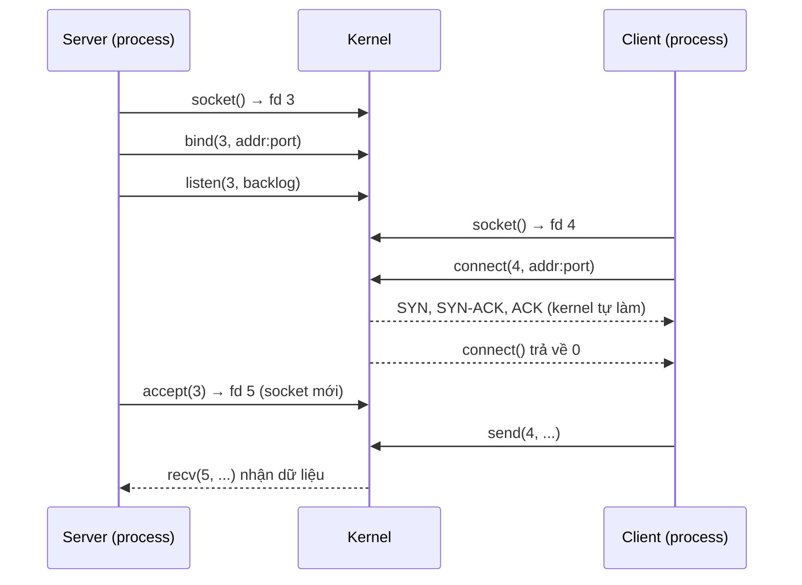
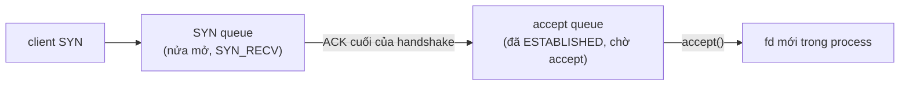

# P6 · Chương 07 — Socket API, phía kernel và `std::net`

## Bạn sẽ hiểu được gì

- **Q1.** Socket là gì so với file descriptor, và chuỗi `socket → bind → listen → accept` / `socket → connect` làm gì ở kernel? → mục 1
- **Q2.** Khi `connect()` đã thành công mà server chưa `accept()`, kết nối nằm ở đâu? SYN queue và accept queue khác nhau thế nào, `backlog`, `somaxconn`, `tcp_max_syn_backlog` và SYN cookies điều khiển cái gì? → mục 2
- **Q3.** Cột `Recv-Q`/`Send-Q` của `ss` nghĩa gì với socket `LISTEN` và socket `ESTAB`? → mục 3
- **Q4.** Socket buffer (`SO_RCVBUF`/`SO_SNDBUF`, `tcp_rmem`/`tcp_wmem`, autotuning) quyết định gì, `setsockopt` với `SO_RCVBUF` ảnh hưởng thế nào tới autotuning, và timeout/keep-alive/linger ở mức socket là gì? → mục 4
- **Q5.** Ephemeral port đến từ đâu; `SO_REUSEADDR` và `SO_REUSEPORT` khác nhau thế nào? → mục 5
- **Q6.** Vì sao ghi vào socket đã đóng có thể giết process (`SIGPIPE`), và `MSG_NOSIGNAL` giải quyết ra sao? → mục 6
- **Q7.** Mỗi kiểu của `std::net` (`TcpListener`, `TcpStream`, `UdpSocket`, `SocketAddr`, `ToSocketAddrs`) gọi những syscall nào; vì sao API Rust thiết kế như vậy; std thiếu gì? → mục 7

## Kiến thức cần trước

- [File descriptor và VFS](../01-linux/04-file-descriptor-va-vfs.md): fd là số nguyên chỉ vào một đối tượng kernel; socket dùng cùng cơ chế.
- [Signal](../01-linux/05-signal.md): `SIGPIPE` là một signal.
- Bắt tay ba bước và các trạng thái TCP: [UDP và TCP cơ bản](04-udp-va-tcp-co-ban.md); cửa sổ nhận/gửi: [TCP reliability và flow control](05-tcp-reliability-va-flow-control.md). Chương này không lặp lại chúng, chỉ chỉ ra chúng nằm ở đâu trong kernel.

Xuyên suốt chương ta bám theo một service giả định tên `checkout`, giới thiệu ở đầu mục 1. Code ví dụ bằng Rust; chỉ cần đọc được `std::net`.

## 1. Socket: một cửa vào, là file descriptor (Q1)

> **Trả lời ngắn.** Socket là một file descriptor: một con số mà process cầm để chỉ vào một đối tượng trong kernel, nơi giữ toàn bộ trạng thái kết nối[^socket2-create]. Server gọi `socket → bind → listen → accept`, client gọi `socket → connect`; `accept` lấy ra một kết nối đã hoàn tất từ hàng đợi của socket nghe[^accept2].

**Giải thích.**

*Với service `checkout`.* Hãy hình dung `checkout`, một service viết bằng Rust, chạy trên Linux và nghe ở cổng 8080 sau một load balancer. Một thread lo `accept`, mỗi kết nối được giao cho một handler thread, và để trả lời thì handler gọi tiếp service `inventory` qua một kết nối TCP khác (nhận xét của người soạn: đây là ví dụ giả định, không phải code trong repo). Trong code Rust, toàn bộ chuyện mạng này chỉ là vài giá trị `TcpListener` và `TcpStream`. Mục này cho thấy bên dưới chúng là gì, và kernel làm gì từ lúc `checkout` bắt đầu nghe cho tới khi nhận kết nối đầu tiên.

### 1.1 Socket là một file descriptor

Ứng dụng cần một giao diện thống nhất tới TCP và UDP, và Unix giải bài đó bằng cách quen thuộc: `socket()` tạo một endpoint để giao tiếp rồi trả về một file descriptor trỏ tới endpoint ấy[^socket2-create]. Vì là fd nên mọi thứ bạn biết ở chương fd vẫn đúng: `read`/`write`/`close`, fd bị thừa kế qua `fork`, giới hạn số fd của mỗi process, cờ `CLOEXEC`. Điều cần nhớ nhất là trạng thái của kết nối (số tuần tự, cửa sổ, bộ đệm) không nằm trong process `checkout` mà nằm trong struct socket của kernel. Fd chỉ là tay cầm để `checkout` gọi tới nó.

### 1.2 Kiểu socket quyết định ngữ nghĩa

`SOCK_STREAM` là các byte stream full-duplex và không bảo toàn ranh giới bản ghi[^socket2-stream]. `SOCK_DGRAM` là datagram không kết nối, không tin cậy[^socket2-dgram]. Với `checkout` chạy trên TCP, hệ quả cụ thể là một lần client `write` không ứng với một lần handler `read`: handler có thể nhận nửa request, hoặc hai request dính nhau. Vì vậy giao thức tầng ứng dụng phải tự đóng khung, như HTTP (xem [DNS, HTTP, TLS](08-dns-http-tls.md), mục 5).

### 1.3 Một cổng, nhiều kết nối

Một kết nối TCP được định danh bằng một cặp socket[^rfc9293-pair]. Mỗi socket ở đây là sự ghép của một địa chỉ Internet với một TCP port[^rfc9293-socket]. Từ định nghĩa đó suy ra (suy luận của người soạn) rằng `checkout` chỉ cần nghe ở một cổng 8080 mà vẫn phục vụ được nhiều client, vì mỗi kết nối khác nhau ở địa chỉ và port phía client.

### 1.4 Trình tự gọi

Phía `checkout` đi `socket → bind → listen → accept`; phía client đi `socket → connect`. Sơ đồ dưới cho thấy hai phía gặp nhau ở đâu:



(Sơ đồ là tổng hợp của người soạn từ các man page bên dưới. Điểm cần chú ý: bắt tay ba bước diễn ra trong kernel, không cần `accept` đã được gọi.)

<details><summary>Đi sâu: từng syscall của trình tự gọi</summary>

- `bind()` gán địa chỉ chỉ định trong `addr` cho socket mà `sockfd` tham chiếu[^bind2]. `INADDR_ANY` nghĩa là gắn vào mọi interface cục bộ[^ip7-inaddr]. Mỗi cặp (địa chỉ, port) cục bộ chỉ có một socket IP[^ip7-unique]. Port dưới 1024 là *privileged*[^ip7-priv].
- Quy trình gồm hai bước: `listen()` trước, rồi `accept()`[^beej-listen-accept].
- `accept()` lấy yêu cầu kết nối đầu tiên trong hàng đợi các kết nối đang chờ của socket đang nghe[^accept2] và trả về **fd mới**. Socket nghe không bị ảnh hưởng: socket mới tạo không ở trạng thái listening, còn socket gốc `sockfd` không bị lời gọi này tác động[^accept2-newfd]. Nếu hàng đợi rỗng và socket không nonblocking thì `accept` block[^accept2-block]. Nonblocking phải được bật riêng, nên blocking là trạng thái mặc định (suy luận của người soạn từ câu trên).
- `recv` cũng chờ message trừ khi socket nonblocking[^recv2-block]. Trên stream socket, giá trị trả về `0` nghĩa là peer đã `shutdown` có trật tự, tức EOF[^recv2-eof].
- `shutdown()` ngắt toàn bộ hoặc một phần của kết nối full-duplex[^shutdown2]. `SHUT_WR` nghĩa là các lần truyền tiếp theo bị cấm[^shutdown2-wr]. Khác với `close`: `close` chỉ giải phóng tài nguyên khi đó là fd cuối cùng cùng trỏ vào open file description[^close2-last]. `shutdown` thì tác động lên chính kết nối của socket, không phụ thuộc số fd đang trỏ vào nó (suy luận của người soạn từ mô tả `shutdown(2)`; ví dụ sau `dup`/`fork`/`try_clone`).

</details>

**Quay lại Q1:** socket chỉ là fd trỏ tới trạng thái trong kernel, và bắt tay ba bước xong trước khi `accept` được gọi; với `checkout`, `TcpListener` và `TcpStream` chỉ là tay cầm cho trạng thái đó.

## 2. Hai hàng đợi của socket nghe (Q2)

> **Trả lời ngắn.** Kernel giữ hai hàng đợi cho socket đang nghe: một cho kết nối nửa mở (đã nhận SYN, chờ ACK cuối) và một cho kết nối đã bắt tay xong đang chờ `accept`. `backlog` của `listen` quyết định độ dài hàng thứ hai[^listen2-semantic]. Nếu `backlog` lớn hơn `somaxconn` thì nó bị cắt xuống bằng `somaxconn`[^listen2-somaxconn]. Khi hàng nửa mở tràn, SYN cookies là cơ chế dự phòng[^kdoc-syncookies].

**Giải thích.**

*Với service `checkout`.* Giả sử traffic dồn tới: các handler thread của `checkout` đang kẹt chờ `inventory`, nên thread accept quay lại gọi `accept` chậm hơn tốc độ kết nối đến. Load balancer vẫn mở thêm kết nối mới. Những kết nối ấy đang nằm ở đâu, và tới mức nào thì kernel bắt đầu bỏ chúng? Hai hàng đợi trong kernel trả lời cả hai câu hỏi.

### 2.1 Vì sao có hai hàng

Bắt tay ba bước do kernel hoàn tất, không chờ ứng dụng. Khi SYN tới một socket đang `LISTEN`, kernel phải *nhớ* kết nối đang dở dang. Khi ACK cuối tới thì kết nối đã xong, nhưng `checkout` chưa chắc đã gọi `accept`, nên kernel phải *giữ* nó ở đâu đó. Đó là hai hàng đợi:



(Sơ đồ của người soạn. Tên "SYN queue / accept queue" là cách gọi thông dụng; man page dùng "incomplete sockets" và "queue of pending connections".)

### 2.2 Ba con số điều khiển hai hàng

Từ Linux 2.2, `backlog` của `listen` xác định độ dài hàng đợi cho các socket đã thiết lập hoàn chỉnh đang chờ được accept, thay vì số yêu cầu kết nối chưa hoàn tất[^listen2-semantic]. Man page nói `backlog` là độ dài tối đa mà hàng đợi kết nối pending có thể dài tới[^listen2-def]. Hàng nửa mở thì chỉnh bằng `tcp_max_syn_backlog`; khi syncookies bật, hàng này không có độ dài tối đa logic và thiết lập đó bị bỏ qua[^listen2-synbacklog]. Tóm lại có ba con số:

- **`backlog`**, đối số của `listen`: độ dài accept queue của chính socket đó.
- **`net.core.somaxconn`**: trần của `backlog`. Giá trị lớn hơn bị cắt xuống âm thầm[^listen2-somaxconn]. Mặc định là 4096, còn trước Linux 5.4 là 128[^kdoc-somaxconn].
- **`net.ipv4.tcp_max_syn_backlog`**: số request nửa mở (SYN_RECV) nhớ được, tính *mỗi listener*[^kdoc-syn-backlog]. Cách v6.8 thực sự dùng nó nằm ở phần Đi sâu bên dưới.

Source kernel v6.8 xác nhận phép cắt. Trong `listen` của lớp socket có `somaxconn = READ_ONCE(sock_net(sock->sk)->core.sysctl_somaxconn); if ((unsigned int)backlog > somaxconn) backlog = somaxconn;`[^linux-listen-cap]. Hằng `SOMAXCONN` là 4096 ở v6.8[^linux-somaxconn-const] (chi tiết cài đặt, có thể đổi).

Có một hệ quả thực tế cho `checkout` (nhận xét của người soạn). `TcpListener::bind` của std gọi `listen` với backlog 128[^std-backlog]. Nghĩa là trên Linux, dù `somaxconn` là 4096, accept queue của `checkout` vẫn chỉ cỡ 128 (chứa tối đa 129 mục, xem phần Đi sâu bên dưới).

Khi `checkout` không `accept` kịp, kết nối nằm im trong accept queue: client thấy `connect` thành công và có thể đã gửi request, còn ứng dụng thì chưa thấy gì. Vì vậy với triệu chứng "p99 tăng nhưng CPU server thấp, log không có request", nên kiểm tra `ss -ltn` (mục 3) trước khi đổ lỗi cho mạng (nhận xét của người soạn).

<details><summary>Đi sâu: "backlog + 1" (đo và source), SYN queue đầy, SYN cookies</summary>

**"backlog + 1": đo được và đọc từ source.**

Man page không nói chính xác hàng đợi chứa bao nhiêu mục. Source Linux v6.8 định nghĩa:

`return READ_ONCE(sk->sk_ack_backlog) > READ_ONCE(sk->sk_max_ack_backlog);`[^linux-acceptq-full]

Đó là dấu `>` chứ không phải `>=`, kèm chú thích dặn đừng đổi. Vì vậy hàng đợi chỉ "đầy" khi số mục *vượt* `backlog`, tức chứa được `backlog + 1` mục. Đây là chi tiết cài đặt ở v6.8, không phải bảo đảm của man page.

Thí nghiệm trong container lab (kernel 6.8.0, quan sát một lần chạy): server `listen(backlog)` rồi **không bao giờ** `accept`; 10 client nonblocking `connect` cùng lúc tới `127.0.0.1`.

| `backlog` | `ss -ltn`: Recv-Q / Send-Q | client ở ESTAB | client còn SYN-SENT |
|---|---|---|---|
| 0 | 1 / 0 | 1 | 9 |
| 1 | 2 / 1 | 2 | 8 |
| 2 | 3 / 2 | 3 | 7 |
| 5 | 6 / 5 | 6 | 4 |

Kết quả khớp `backlog + 1`. Các client còn lại kẹt ở SYN-SENT. Ở nhánh nhận SYN, source có `if (sk_acceptq_is_full(sk)) { NET_INC_STATS(sock_net(sk), LINUX_MIB_LISTENOVERFLOWS); goto drop; }`[^linux-syn-drop], nghĩa là SYN bị bỏ. Điều này đúng như `listen(2)` mô tả: yêu cầu có thể bị bỏ qua để lần thử kết nối lại sau đó thành công[^listen2-full]. Sau thí nghiệm, counter `TcpExtListenOverflows` quan sát được tăng.

Khi ACK cuối của handshake tới mà hàng đã đầy, `tcp_v4_syn_recv_sock` cũng kiểm tra `sk_acceptq_is_full` và nhảy tới nhãn `exit_overflow`[^linux-ack-overflow]. Nếu muốn client nhận RST thay vì chờ retransmit, có `tcp_abort_on_overflow`: nếu dịch vụ đang nghe quá chậm để accept kết nối mới thì reset chúng, mặc định FALSE[^kdoc-abort-overflow]. Tài liệu kernel cảnh báo bật nó có thể gây hại cho client của server[^s2-kdoc-abort-harm].

**SYN queue đầy và SYN cookies.**

Với hàng nửa mở, kernel không từ chối ngay mà dùng SYN cookies: `tcp_syncookies` mặc định 1, gửi syncookie khi hàng syn backlog của một socket tràn[^kdoc-syncookies]. RFC 4987 mô tả cookie là không cấp phát state nào cho kết nối ở SYN-RECEIVED, mà mã hóa phần lớn state vào số tuần tự của SYN-ACK[^rfc4987-cookie].

Cái giá có bốn mặt:

- Các cơ chế sinh cookie đang dùng phổ biến không tương thích với một số TCP option nếu chúng không tính đến option đó[^rfc4987-opts].
- Kernel docs coi syncookies là cơ chế dự phòng, không được dùng để giúp server tải cao chịu tốc độ kết nối hợp lệ[^kdoc-syncookies-fallback].
- `tcp(7)` nói nên dùng nó như phương án cuối cùng, nếu có, và gọi nó là sự vi phạm giao thức TCP[^tcp7-syncookies].
- `connect(2)` ghi rằng với syncookies bật, timeout phía client có thể rất dài[^connect2-etimedout].

**`tcp_max_syn_backlog` ở v6.8.** Phần này đọc từ source v6.8, là chi tiết cài đặt có thể đổi. Trong `tcp_conn_request`, SYN được coi là gặp "hàng nửa mở đầy" khi `inet_csk_reqsk_queue_is_full(sk)` đúng, hoặc khi `tcp_syncookies` bằng 2[^linux-conn-request-full]. Hàm đó so `inet_csk_reqsk_queue_len(sk) >= sk->sk_max_ack_backlog`[^linux-reqsk-full]. Nghĩa là giới hạn bằng chính `backlog` hiệu lực của `listen` (sau khi bị cắt bởi `somaxconn`), chứ không phải `tcp_max_syn_backlog`. Sysctl này trong `tcp_conn_request` chỉ xuất hiện ở nhánh không dùng cookie: `int max_syn_backlog = READ_ONCE(net->ipv4.sysctl_max_syn_backlog);`[^linux-synbacklog-use]. Vì thế mô tả của kernel docs[^kdoc-syn-backlog] chưa phải toàn bộ cách v6.8 hoạt động. Muốn nới hàng nửa mở thì `backlog` của `listen` và `somaxconn` cũng phải tăng (suy luận của người soạn từ source, chưa đo).

</details>

**Quay lại Q2:** hàng nửa mở giữ request dở dang, accept queue giữ kết nối đã xong chờ `accept`; `backlog` (bị cắt bởi `somaxconn`) và SYN cookies điều khiển hai hàng đó, và với `checkout` thì `TcpListener::bind` đặt sẵn `backlog` là 128.

## 3. Đọc `Recv-Q` / `Send-Q` của `ss` (Q3)

> **Trả lời ngắn.** Với socket `LISTEN`, `Recv-Q` là số kết nối đang chờ `accept` và `Send-Q` là độ dài tối đa của hàng chờ đó[^linux-diag-listen]. Với socket `ESTAB`, `Recv-Q` là số byte đã về kernel mà ứng dụng chưa đọc, còn `Send-Q` là số byte đã ghi mà peer chưa ACK[^linux-diag-estab].

**Giải thích.**

*Với service `checkout`.* Khi nghi `checkout` nghẽn, `ss` cho bạn nhìn vào hai chỗ: accept queue của listener 8080 và bộ đệm của từng kết nối. Cùng hai cột `Recv-Q`/`Send-Q` nhưng ý nghĩa đổi theo trạng thái socket, nên đọc nhầm rất dễ. Trang `ss(8)` (Debian bookworm) không mô tả hai cột này (người soạn đã tìm trong trang đó, không thấy), nên câu trả lời lấy từ source kernel v6.8, ở hàm điền thông tin cho TCP trong `net/ipv4/tcp_diag.c` (trích ở phần Đi sâu bên dưới).

| Trạng thái | `Recv-Q` | `Send-Q` |
|---|---|---|
| `LISTEN` | số kết nối đã hoàn tất đang nằm trong accept queue (`sk_ack_backlog`) | `backlog` hiệu lực (`sk_max_ack_backlog`) |
| `ESTAB` | `rcv_nxt − copied_seq`: byte đã nhận về kernel nhưng ứng dụng chưa `read` | `write_seq − snd_una`: byte ứng dụng đã ghi mà peer chưa ACK |

Đọc bảng cho `checkout` (suy luận của người soạn từ định nghĩa hai cột):

- Ở dòng `LISTEN` của cổng 8080, `Recv-Q` tiến gần tới `Send-Q` nghĩa là accept queue sắp đầy, tức thread accept không theo kịp (mục 2).
- Ở một dòng `ESTAB`, `Recv-Q` lớn kéo dài nghĩa là **ứng dụng** đọc chậm: dữ liệu đã về kernel mà handler chưa lấy.
- Cũng ở dòng `ESTAB`, `Send-Q` lớn nghĩa là **peer hoặc mạng** không ACK kịp (rwnd đóng, hoặc mất gói hay cwnd). Cơ chế của chúng ở [chương 05](05-tcp-reliability-va-flow-control.md) và [chương 06](06-congestion-control.md).

<details><summary>Đi sâu: source <code>tcp_diag.c</code> và thí nghiệm ESTAB</summary>

```c
if (inet_sk_state_load(sk) == TCP_LISTEN) {
    r->idiag_rqueue = READ_ONCE(sk->sk_ack_backlog);
    r->idiag_wqueue = READ_ONCE(sk->sk_max_ack_backlog);
} else if (sk->sk_type == SOCK_STREAM) {
    r->idiag_rqueue = max_t(int, READ_ONCE(tp->rcv_nxt) - READ_ONCE(tp->copied_seq), 0);
    r->idiag_wqueue = READ_ONCE(tp->write_seq) - tp->snd_una;
}
```

Đoạn trên là trích gọn từ `tcp_diag_get_info`. Nhánh `LISTEN` đọc hai trường của hàng chờ accept[^linux-diag-listen]. Nhánh còn lại đọc số byte chưa đọc và số byte chưa được ACK[^linux-diag-estab]; nó áp dụng cho mọi socket stream không ở `LISTEN`, còn bảng trên ghi `ESTAB` cho gọn. Việc `ss` hiển thị `idiag_rqueue`/`idiag_wqueue` thành cột `Recv-Q`/`Send-Q` là suy luận của người soạn. Thí nghiệm ở phần Đi sâu của mục 2 xác nhận suy luận đó, vì số trên `ss` khớp số mục đã đếm.

Thí nghiệm ESTAB (container, cùng kernel): client gửi 100 byte, server không `read`, và dòng của server có `Recv-Q = 100`. Sau đó client `send` liên tục ở chế độ nonblocking tới khi `EAGAIN`. Vòng lặp gửi được thêm 2.659.776 byte trước khi dừng (tổng cộng 2.659.876 byte kể cả 100 byte đầu), và `ss` hiện server `Recv-Q = 128164`, client `Send-Q = 2531712`. Hai số cộng lại, 128164 + 2531712 = 2.659.876, đúng bằng tổng đã ghi, và chạy lại cho cùng số.

</details>

**Quay lại Q3:** ở `LISTEN` hai cột đếm hàng chờ accept và trần của nó; ở `ESTAB` chúng đo byte chưa đọc và byte chưa được ACK.

## 4. Socket buffer, timeout, keep-alive, linger (Q4)

> **Trả lời ngắn.** Mỗi socket có bộ đệm gửi và bộ đệm nhận trong kernel. `SO_SNDBUF` và `SO_RCVBUF` đặt trần kích thước cho từng socket[^socket7-sndbuf]. Sysctl `tcp_wmem` cho khoảng mà TCP tự điều chỉnh bộ đệm gửi[^tcp7-wmem]. Kernel tự điều chỉnh bộ đệm nhận, nhưng gọi `setsockopt` với `SO_RCVBUF` thì tắt autotuning của socket đó[^kdoc-rmem-lock]. Timeout, keep-alive và linger là ba tùy chọn riêng ở mức socket, nằm ở cuối mục.

**Giải thích.**

*Với service `checkout`.* Một handler của `checkout` đang `write` response cho client mạng chậm thì thread dừng ở đó; một handler khác dừng ở `read` vì `inventory` chưa trả lời. Từ code Rust hai tình huống trông giống nhau, nhưng nguyên nhân nằm ở hai đầu khác nhau. Muốn phân biệt, bạn cần biết bộ đệm của socket hoạt động ra sao.

### 4.1 Kích thước bộ đệm

`SO_SNDBUF` đặt hoặc đọc trần kích thước bộ đệm gửi của socket, tính bằng byte. Khi `setsockopt`, kernel *nhân đôi* giá trị để dành chỗ cho bookkeeping, và `getsockopt` trả về giá trị đã nhân đôi[^socket7-sndbuf]. `SO_RCVBUF` cũng hoạt động như vậy[^socket7-rcvbuf]. Với TCP, bộ đệm gửi tự điều chỉnh trong khoảng `tcp_wmem`[^tcp7-wmem]. Bộ đệm nhận thì có autotuning và không vượt `tcp_rmem[2]`[^tcp7-rmem-auto].

### 4.2 Cái bẫy `SO_RCVBUF`

Kernel docs ghi rằng gọi `setsockopt()` với `SO_RCVBUF` sẽ tắt autotuning kích thước receive buffer của socket đó, và khi ấy giá trị `tcp_rmem[2]` bị bỏ qua[^kdoc-rmem-lock]. Nói cách khác, đặt `SO_RCVBUF` thủ công là *tắt* autotuning cho socket đó. Suy luận của người soạn: nếu đặt một số nhỏ cho đường truyền có băng thông × độ trễ lớn (chẳng hạn kết nối từ `checkout` sang một `inventory` ở region khác), socket sẽ bị khóa ở cửa sổ nhỏ mà không còn autotuning để nới ra.

### 4.3 Backpressure: nhìn `Send-Q` của cả hai đầu

Đây là nhận xét của người soạn. `write` blocking trên TCP chỉ block khi buffer gửi đầy. Buffer đầy khi peer đọc chậm (rwnd đóng), *hoặc* khi mạng ACK chậm hay mất gói. Cho nên một handler của `checkout` bị block ở `write` chưa tự chứng minh rằng client chậm; hãy nhìn `Send-Q` của hai đầu (mục 3).

### 4.4 Timeout, keep-alive, linger

Ba tùy chọn này đặt ở mức socket:

- **`SO_RCVTIMEO`/`SO_SNDTIMEO`**: nếu một hàm vào/ra bị block đủ lâu mà đã chuyển được dữ liệu, nó trả về số byte đã chuyển[^socket7-timeo].
- **`SO_KEEPALIVE`** bật việc gửi keep-alive[^socket7-keepalive]. `tcp_keepalive_time` mặc định 7200 giây idle trước khi thăm dò, và chỉ có tác dụng khi `SO_KEEPALIVE` bật[^tcp7-keepalive]. Mặc định 2 giờ là lý do kết nối "chết lặng" qua NAT hoặc load balancer cần keep-alive riêng (nhận xét của người soạn).
- **`SO_LINGER`**: khi bật, `close`/`shutdown` không trả về cho tới khi mọi message trong hàng đợi của socket đã gửi thành công hoặc hết linger timeout[^socket7-linger].

<details><summary>Đi sâu: mặc định đo trong container</summary>

Quan sát trong container: socket TCP mới tạo (chưa kết nối) có `SO_RCVBUF = 131072` và `SO_SNDBUF = 16384`. Hai số này khớp mặc định `tcp_rmem` (4096 131072 6291456) và `tcp_wmem` (4096 16384 4194304) đọc từ `sysctl` của chính container; kernel docs ghi default của `tcp_rmem` là 131072[^kdoc-rmem]. Gọi `setsockopt(SO_RCVBUF, 65536)` rồi `getsockopt` trả `131072`, đúng cơ chế nhân đôi.

</details>

**Quay lại Q4:** kernel nhân đôi giá trị `SO_*BUF` bạn đặt, và đặt `SO_RCVBUF` thủ công tắt autotuning của socket đó.

## 5. Port: ephemeral, `SO_REUSEADDR`, `SO_REUSEPORT` (Q5)

> **Trả lời ngắn.** Client không `bind` thì kernel chọn cổng nguồn trong dải `ip_local_port_range`[^ip7-ephemeral]. `SO_REUSEADDR` cho phép bind lại một địa chỉ đang bị giữ sau khi đóng, ví dụ qua TIME_WAIT[^ip7-bound-reuse]. `SO_REUSEPORT` thì cho nhiều socket bind cùng địa chỉ để chia tải `accept`[^socket7-reuseport-tcp].

**Giải thích.**

*Với service `checkout`.* `checkout` dính hai chuyện về port. Thứ nhất, mỗi lần gọi `inventory` nó là client, và cổng nguồn của kết nối đó là cổng nó không tự chọn. Thứ hai, khi deploy bản mới, process mới phải bind lại cổng 8080 ngay sau khi process cũ vừa đóng. Mục này giải thích cả hai, rồi nói về `SO_REUSEPORT` cho trường hợp nhiều listener cùng dùng một cổng.

### 5.1 Ephemeral port

Client không `bind` thì kernel chọn cổng nguồn lúc `connect`, trong `ip_local_port_range`. Đó là dải cổng cục bộ mặc định cấp cho các socket không bind tường minh vào một số cổng[^ip7-ephemeral]. TCP và UDP dùng dải này để chọn cổng cục bộ[^kdoc-port-range-def]. Giá trị mặc định là 32768 và 60999[^kdoc-port-range]. Container lab đo đúng `32768 60999`, tức 28.232 cổng. `ip_local_reserved_ports` loại các cổng khỏi việc cấp tự động, kể cả `bind` với port 0[^kdoc-reserved]. Gọi `connect` 3 lần tới cùng một listener được cổng nguồn 54992, 55000, 55016: thứ tự không tuần tự, nên đừng giả định thuật toán chọn.

Hệ quả (suy luận từ "kết nối = cặp socket" ở mục 1): số kết nối đồng thời từ *một IP nguồn* tới *một* (IP đích, port đích) bị chặn bởi kích thước dải này. Với `checkout`, nếu mỗi request mở một kết nối mới tới `inventory` thì đây là nguồn của lỗi "cạn ephemeral port". Lỗi này cũng hay gặp ở proxy hoặc API gateway chỉ nói chuyện với một upstream. Cách giải là thêm IP nguồn hoặc IP đích, hoặc dùng lại kết nối bằng connection pool (nhận xét của người soạn).

### 5.2 `SO_REUSEADDR`: restart qua TIME_WAIT

Khi process cũ của `checkout` đóng kết nối trước, kết nối đó ở lại TIME_WAIT và cặp (địa chỉ, port) bị giữ. Đây là quan sát từ thí nghiệm bên dưới cùng kiến thức TCP ở [chương 04](04-udp-va-tcp-co-ban.md), mục 7; `ip(7)` không nêu TIME_WAIT. Điều tài liệu ghi là một địa chỉ socket TCP cục bộ đã bind sẽ không dùng được một thời gian sau khi đóng, trừ khi đặt cờ `SO_REUSEADDR`[^ip7-bound-reuse]. Với `AF_INET`, cờ này cho phép bind trừ khi có một socket đang listen đã bind vào địa chỉ đó[^socket7-reuseaddr].

Thí nghiệm: server đóng kết nối trước (TIME_WAIT bên server). `bind` lại cùng cổng mà **không** đặt `SO_REUSEADDR` thì ra `EADDRINUSE`; có đặt thì thành công. Hai socket cùng `listen` trên một địa chỉ với chỉ `SO_REUSEADDR` thì socket thứ hai vẫn lỗi `EADDRINUSE` (đo được).

Std Rust tự đặt `SO_REUSEADDR` trong `TcpListener::bind` (trừ Windows, nơi source ghi rõ là cố ý không đặt)[^std-reuseaddr], nên `checkout` trên Linux restart được ngay. Đừng nhầm cờ này với `tcp_tw_reuse`, một sysctl khác về việc tái dùng socket TIME_WAIT cho kết nối mới; `tcp(7)` dặn không nên đổi nó khi chưa có lời khuyên hay yêu cầu của chuyên gia kỹ thuật[^tcp7-tw-reuse].

### 5.3 `SO_REUSEPORT`: nhiều listener, một cổng

`SO_REUSEPORT` cho phép nhiều socket `AF_INET` hoặc `AF_INET6` bind vào cùng một địa chỉ socket. Option này phải được đặt trên mỗi socket, kể cả socket đầu tiên, trước khi gọi `bind(2)`[^socket7-reuseport]. Để chống chiếm cổng, mọi process bind cùng địa chỉ phải cùng effective UID[^socket7-reuseport-uid]. Với TCP, mục đích là cải thiện việc phân phối `accept` trong server nhiều thread, bằng một listener riêng cho mỗi thread[^socket7-reuseport-tcp]. Nếu `checkout` có nhiều thread accept thì đây là cách để chúng khỏi tranh nhau một listener (nhận xét của người soạn).

| | `SO_REUSEADDR` | `SO_REUSEPORT` |
|---|---|---|
| Hai listener cùng địa chỉ:port | không (đo: `EADDRINUSE`) | có, nếu đặt trên *mọi* socket trước `bind` |
| Dùng để | restart server qua TIME_WAIT | chia tải `accept` giữa nhiều thread/process |
| Bảo mật | — | cùng effective UID |

<details><summary>Đi sâu: thí nghiệm phân phối <code>SO_REUSEPORT</code></summary>

Thí nghiệm: 3 listener `SO_REUSEPORT` cùng một cổng, 30 client kết nối; kết quả phân phối vào 3 listener là 8/8/14. Kernel chia tải nhưng không đều. Đây là một lần chạy với mẫu nhỏ 30 kết nối, không phải bảo đảm. Thí nghiệm 4 listener × 400 kết nối × 5 lần ở [P7 · Chương 04, mục 6](../07-io-async/04-kien-truc-event-loop.md) cho mỗi listener trong khoảng 82–116, nên độ lệch ở đây nhiều khả năng do mẫu nhỏ (nhận xét của người soạn). Còn với `SO_REUSEPORT` thì socket thứ hai `bind`+`listen` cùng địa chỉ thành công, khác với `SO_REUSEADDR` ở trên. Dùng `SO_REUSEPORT` cho mô hình một event loop mỗi core (cùng với thread accept riêng và `EPOLLEXCLUSIVE`): [P7 · Chương 04, mục 6](../07-io-async/04-kien-truc-event-loop.md).

</details>

**Quay lại Q5:** ephemeral port do kernel cấp từ một dải hữu hạn; `SO_REUSEADDR` để bind lại qua TIME_WAIT, `SO_REUSEPORT` để nhiều listener chia cùng một cổng.

## 6. `SIGPIPE` và `MSG_NOSIGNAL` (Q6)

> **Trả lời ngắn.** Ghi vào socket stream khi đầu cục bộ đã bị `shutdown` thì kernel trả lỗi `EPIPE` và gửi tín hiệu `SIGPIPE`[^send2-epipe]. Hành động mặc định của `SIGPIPE` là kết thúc process[^signal7-sigpipe]. Cờ `MSG_NOSIGNAL` ở mỗi lần `send` tắt tín hiệu này (man page nói cả trường hợp peer đã đóng kết nối), chỉ còn lỗi `EPIPE` trả về[^send2-nosignal].

**Giải thích.**

*Với service `checkout`.* Giả sử client (hay load balancer) đóng kết nối ngay giữa lúc một handler của `checkout` đang ghi response. Nếu process không chuẩn bị gì thì lần `send` kế tiếp vào kết nối đó không chỉ trả lỗi mà còn giết cả process, tức là mọi request khác đang chạy cũng mất theo. Mục này nói vì sao, và hai cách tránh.

Ghi vào kết nối mà phía mình đã `shutdown` thì trả `EPIPE`, và process cũng nhận `SIGPIPE` trừ khi đặt `MSG_NOSIGNAL`[^send2-epipe]. Hành động mặc định của `SIGPIPE` là kết thúc process: đó là cột `Term` trong `signal(7)`[^signal7-sigpipe]. `MSG_NOSIGNAL` làm kernel không sinh signal `SIGPIPE` khi peer của stream-oriented socket đã đóng kết nối, và lỗi `EPIPE` vẫn được trả về[^send2-nosignal]. So với việc đặt `sigaction` ignore, `MSG_NOSIGNAL` là cờ **mỗi lời gọi**, còn ignore là thuộc tính của cả process (nhận xét của người soạn).

<details><summary>Đi sâu: thí nghiệm <code>SIGPIPE</code> bằng C</summary>

Thí nghiệm (C, container): server `accept` rồi `close`; client `send` 1 byte hai lần cách nhau 100 ms. Không cờ: lần 1 trả 1 (RST về sau), lần 2 làm process bị giết, exit status 141 (= 128 + 13, `SIGPIPE`). Với `MSG_NOSIGNAL`: lần 1 trả 1, lần 2 trả `-1` với `Broken pipe` và process sống. Lưu ý (quan sát): lần ghi đầu thường *thành công*, vì kẻ đã đóng chỉ báo qua RST sau đó; chỗ này liên hệ [chương 04](04-udp-va-tcp-co-ban.md), mục 7 (RST).

</details>

**Quay lại Q6:** không có `MSG_NOSIGNAL` hay ignore `SIGPIPE`, một lần ghi vào kết nối đã đóng giết process; có thì chỉ nhận `EPIPE`.

## 7. Liên hệ với Rust: `std::net` (Q7)

> **Trả lời ngắn.** `std::net` là lớp mỏng bọc sockets API[^std-net-mod]. Trên Linux, `TcpListener::bind` là socket + `SO_REUSEADDR` + bind + `listen(128)`[^std-backlog]. `accept` là `accept4`[^std-accept4]. `write` gọi `send` với `MSG_NOSIGNAL`[^std-send]. Runtime Rust mặc định ignore `SIGPIPE`[^std-sigpipe]. API thì blocking mặc định, nonblocking là lựa chọn[^std-nonblocking].

**Giải thích.**

*Với service `checkout`.* Trong code của `checkout` bạn không bao giờ thấy `bind` hay `accept4`, chỉ thấy `TcpListener::bind`, `accept` và `TcpStream`. Mỗi lời gọi Rust ấy đều ứng với vài syscall bạn đã gặp ở mục 1–6, và biết chúng giúp bạn hiểu `checkout` hành xử ra sao khi hàng đợi đầy, khi client reset, hay khi restart. Mục này đọc `std::net` theo hướng đó.

### 7.1 Mỗi API gọi syscall nào

Bảng dưới là quan sát bằng strace; chương trình và đầu ra đầy đủ ở phần Đi sâu cuối mục.

| API Rust | Syscall quan sát |
|---|---|
| `TcpListener::bind` | `socket(SOCK_CLOEXEC)` → `setsockopt(SO_REUSEADDR)` → `bind` → `listen(fd, 128)` |
| `accept()` / `incoming()` | `accept4(..., SOCK_CLOEXEC)` |
| `TcpStream::connect` | `socket` + `connect` |
| `Read::read` | `recvfrom(fd, buf, n, 0, NULL, NULL)` |
| `Write::write` | `sendto(fd, ..., MSG_NOSIGNAL, NULL, 0)` |
| `set_nodelay(true)` | `setsockopt(SOL_TCP, TCP_NODELAY)` |
| `set_nonblocking(true)` | `ioctl(fd, FIONBIO, [1])` |
| `try_clone()` | `fcntl(fd, F_DUPFD_CLOEXEC, 3)` |
| `set_read_timeout(Some(d))` | `setsockopt(SOL_SOCKET, SO_RCVTIMEO_OLD, timeval)` |
| `shutdown(Write)` | `shutdown(fd, SHUT_WR)` |
| drop `TcpStream`/`TcpListener` | `close(fd)` |

Đọc theo nhóm, từ source và docs của std:

**Nghe và nhận kết nối.** `TcpListener::bind` đặt `SO_REUSEADDR` (trừ Windows)[^std-reuseaddr], đúng điều giúp `checkout` restart được ngay ở mục 5. Backlog mặc định là 128 cho mọi nền tảng khác ngoài hai ngoại lệ riêng trong source (horizon 20, haiku 32)[^std-backlog]. Cuối cùng std gọi `listen`[^std-listen]. Với `accept`, std dùng `accept4` vì đó là cách duy nhất std biết để vừa accept vừa đặt CLOEXEC một cách nguyên tử[^std-accept4]. `accept4` nhận cờ `SOCK_CLOEXEC`[^accept2-cloexec]. Còn `incoming()` tương đương `accept` trong vòng lặp và không bao giờ trả `None`[^std-incoming].

**Kết nối và truyền dữ liệu.** `TcpStream::connect` thử từng địa chỉ cho tới khi một cái thành công[^std-connect-multi]. `read` gọi `libc::recv`[^std-recv]. `write` gọi `send` với `MSG_NOSIGNAL`[^std-send]. Doc std cũng nói điều này cho `SOCK_STREAM` trên Unix[^std-tcp-nosignal].

**Option, clone và đóng.** `set_nodelay(true)` tắt thuật toán Nagle[^std-nodelay]. `set_nonblocking` trên Unix gọi `libc::ioctl(self.as_raw_fd(), libc::FIONBIO, &mut nonblocking)`[^std-nonblock-ioctl]. `try_clone` muốn nhân đôi file descriptor một cách nguyên tử và đặt cờ CLOEXEC, và hiện thực hiện điều đó qua `F_DUPFD_CLOEXEC`[^std-dupfd]. Với `set_read_timeout`, strace chỉ thấy một `setsockopt`, nên (suy luận) việc hết hạn do kernel xử lý theo mục 4. `shutdown(Write)` làm phần ghi của `TcpStream` bị shutdown[^std-shutdown-write]. Cuối cùng, kết nối được đóng khi `TcpStream` bị drop[^std-stream-drop]. Listener cũng vậy[^std-listener-drop].

### 7.2 Vì sao API trông như vậy

- **Blocking mặc định, nonblocking là lựa chọn.** `set_nonblocking(true)` làm các thao tác thành nonblocking, tức trả về ngay khỏi lời gọi[^std-nonblocking]. Khi đó "chưa sẵn sàng" hiện là `ErrorKind::WouldBlock`[^std-wouldblock]. Ở mức syscall nó là `EAGAIN`/`EWOULDBLOCK`[^recv2-block]. Việc chờ nhiều socket thuộc [P7 — I/O async](../07-io-async/00-tong-quan.md).
- **`read` trả `io::Result<usize>`** vì TCP là byte stream, nên có thể đọc ít hơn buffer[^socket2-stream]. `Ok(0)` là EOF: doc std nói trên Linux đó là `recv` trả 0, nghĩa là kết nối đã được shutdown đúng cách[^std-read-eof]. Điều này khớp `recv(2)`[^recv2-eof]. Hãy phân biệt `Ok(0)` (peer đã shutdown có trật tự) với `Err` như `ECONNRESET`.
- **`write` có thể ghi một phần** vì buffer gửi hữu hạn: một lời gọi `write` chỉ là một lần thử ghi[^std-write-one]. `write_all` gọi `write` liên tục cho tới khi hết dữ liệu cần ghi hoặc gặp lỗi không thuộc loại `ErrorKind::Interrupted`[^std-writeall].
- **`Drop` đóng socket** (RAII), nên không có `close()` riêng để quên gọi. Vì vậy kết nối "rò" (CLOSE_WAIT chất đống) thường nghĩa là *giá trị còn sống ở đâu đó*, không phải quên đóng (suy luận từ Drop; nhận xét của người soạn).
- **Hai nửa dùng chung một socket.** `impl Read for &TcpStream` cho phép đọc qua tham chiếu chung[^std-read-ref]. `try_clone` cho handle thứ hai; cả hai handle đọc/ghi cùng một luồng dữ liệu, và option đặt trên một stream được lan sang stream kia[^std-tryclone]. Cơ chế (strace) là hai fd cùng trỏ một socket kernel; trạng thái không nằm trong giá trị `TcpStream`. Lưu ý đã nêu ở mục 1: `close` một fd không đóng kết nối khi còn fd khác, và muốn kết thúc chiều gửi thì dùng `shutdown`.
- **`SIGPIPE`.** Runtime Rust mặc định đặt `SIGPIPE` thành ignore lúc khởi động để tránh bị kill khi ghi vào kết nối đã đóng; source ghi `-Zon-broken-pipe=...` đổi được hành vi này[^std-sigpipe]. Cộng với `MSG_NOSIGNAL` ở mỗi `send`, lỗi hiện ra là `io::Error` (`BrokenPipe`) thay vì giết process, nên handler của `checkout` chỉ mất đúng kết nối đó. Code gọi `libc::send` tự viết hoặc trong thư viện C thì cần tự xử lý.
- **Timeout là lựa chọn.** Mặc định không có: với `None`, các lời gọi read sẽ block vô thời hạn[^std-readtimeout-none]. `set_read_timeout(Some(0))` là lỗi[^std-readtimeout-zero]. Khi hết hạn, Unix thường trả `WouldBlock` còn Windows có thể trả `TimedOut`[^std-readtimeout]. `connect_timeout(&SocketAddr, Duration)` nhận *một* địa chỉ vì timeout áp cho từng địa chỉ; nó không ứng với một syscall mà gọi `connect` ở chế độ nonblocking rồi chờ[^std-connect-timeout].
- **`set_nodelay` đánh đổi Nagle.** Doc nói khi không đặt option này, dữ liệu được đệm cho tới khi đủ lượng để gửi, nhờ đó tránh gửi thường xuyên các gói nhỏ[^std-nodelay-off]. Bật nó đổi độ trễ thấp lấy nhiều gói nhỏ hơn, và gộp dữ liệu thành một `write_all` thường tốt hơn (nhận xét của người soạn). Cơ chế Nagle ở [chương 05, mục 7](05-tcp-reliability-va-flow-control.md).

### 7.3 Địa chỉ và UDP

`SocketAddr` gồm một địa chỉ IP, một số port 16-bit, và có thể thêm một số thông tin phụ thuộc phiên bản[^std-socketaddr]. `bind` với port 0 xin OS cấp cổng, và bạn lấy lại nó qua `local_addr`[^std-bind0]. Đó chính là ephemeral port ở mục 5 (strace: `bind(... htons(0) ...)` rồi `getsockname` ra 38189).

`ToSocketAddrs` là trait cho các đối tượng có thể chuyển đổi hoặc phân giải thành một hay nhiều giá trị `SocketAddr`[^std-tosa]. Nó trả về **iterator** vì một hostname có thể ra nhiều địa chỉ[^getaddrinfo3]. `connect` thì thử lần lượt từng cái[^std-connect-multi]. Lý do thiết kế này là suy luận của người soạn; ví dụ thường gặp là `localhost` ra cả `::1` lẫn `127.0.0.1`. Với hostname, std gọi `getaddrinfo` của libc[^std-getaddrinfo]. Doc cảnh báo hàm này có thể block thread hiện tại trong khi phân giải[^std-tosa-block]. Với `checkout`, nghĩa là DNS lookup chặn đúng thread gọi `connect` tới `inventory` (xem [DNS](08-dns-http-tls.md), mục 4).

`UdpSocket::connect` cho phép dùng các syscall `send` và `recv`, và lọc để chỉ nhận từ địa chỉ đã chỉ định[^std-udp-connect]. UDP vẫn không kết nối, `connect` chỉ đặt địa chỉ mặc định[^std-udp-connected]. Điều này khớp `connect(2)` cho `SOCK_DGRAM`[^connect2-dgram]. Trong strace, `UdpSocket::send_to` là `sendto(..., MSG_NOSIGNAL, {addr}, 16)` và `recv_from` là `recvfrom` có trả địa chỉ (quan sát). Buffer nhỏ hơn datagram thì phần thừa bị cắt bỏ[^std-udp-trunc]. Sau `connect` UDP, một lần gửi/nhận về sau có thể trả `ECONNREFUSED` khi không có receiver gắn với địa chỉ đích, và `udp(7)` nói lỗi này có thể do một gói đã gửi trước đó[^udp7-refused]. Vì vậy `connect` thành công không chứng minh có ai đang nghe (suy luận của người soạn).

### 7.4 Những gì std không có

`TcpStream::set_linger`/`linger` có trong std 1.95.0 nhưng unstable: `#[unstable(feature = "tcp_linger", issue = "88494")]`[^std-linger-unstable]. Chạy lại bằng rustc 1.95.0 ổn định, gọi `c.set_linger(None)` cho ``error[E0658]: use of unstable library feature `tcp_linger` `` (quan sát).

`SO_KEEPALIVE`, `SO_RCVBUF`, `SO_SNDBUF` không có trong `library/std/src/net/tcp.rs` của tag 1.95.0. Kiểm lại bằng `grep -riE "KEEPALIVE|RCVBUF|SNDBUF"` trên toàn bộ `library/std/src/net/` và `library/std/src/sys/net/` ở tag 1.95.0 không ra kết quả nào, chỉ có `SO_LINGER`, `SO_RCVTIMEO`/`SO_SNDTIMEO`… Nên muốn đặt keep-alive hay bộ đệm cho `checkout`, bạn phải đi qua `setsockopt` bằng `libc` hoặc một crate như `socket2` (nhận xét của người soạn).

Std cũng không có API riêng cho ARP, ICMP, TLS hay HTTP (suy luận từ phạm vi `std::net` mà doc module mô tả[^std-net-mod]). Phân giải tên thì std làm qua `getaddrinfo`, như đã nêu ở trên.

<details><summary>Đi sâu: chương trình <code>strace</code> và đầu ra đầy đủ</summary>

Syscall dưới đây quan sát bằng `strace` trên chương trình Rust 1.95.0 (kernel 6.8.0 trong container; chương trình: `bind("127.0.0.1:0")` → `connect` → `accept` → `set_nodelay` → `set_read_timeout` → `set_nonblocking` → `try_clone` → `write_all` → `read` → `shutdown(Write)` → drop; thêm một `UdpSocket`):

```
socket(AF_INET, SOCK_STREAM|SOCK_CLOEXEC, IPPROTO_IP) = 3
setsockopt(3, SOL_SOCKET, SO_REUSEADDR, [1], 4) = 0
bind(3, {sa_family=AF_INET, sin_port=htons(0), sin_addr=inet_addr("127.0.0.1")}, 16) = 0
listen(3, 128)                          = 0
getsockname(3, {... sin_port=htons(38189) ...}) = 0
socket(AF_INET, SOCK_STREAM|SOCK_CLOEXEC, IPPROTO_IP) = 4
connect(4, {... sin_port=htons(38189) ...}, 16) = 0
accept4(3, {... sin_port=htons(41274) ...}, [128 => 16], SOCK_CLOEXEC) = 5
setsockopt(4, SOL_TCP, TCP_NODELAY, [1], 4) = 0
setsockopt(4, SOL_SOCKET, SO_RCVTIMEO_OLD, "\0\0\0\0\0\0\0\0P\303\0\0\0\0\0\0", 16) = 0
ioctl(4, FIONBIO, [1])                  = 0
fcntl(4, F_DUPFD_CLOEXEC, 3)            = 6
sendto(4, "hi", 2, MSG_NOSIGNAL, NULL, 0) = 2
recvfrom(5, "hi", 8, 0, NULL, NULL)     = 2
shutdown(4, SHUT_WR)                    = 0
recvfrom(5, "", 8, 0, NULL, NULL)       = 0
```

(cắt gọn; kết thúc bằng các `close`.) Hai điểm đáng nhìn: `connect` ở fd 4 trả về `0` **trước** `accept4`. Client và server chạy trong cùng một thread, nên `connect` thành công nhờ accept queue (mục 2) mà không cần ai gọi `accept`. Và `listen(3, 128)` đúng con số backlog của std.

</details>

**Quay lại Q7:** mỗi API của `std::net` ứng với một vài syscall quen thuộc, và các quyết định thiết kế (blocking mặc định, `Drop` đóng socket, `MSG_NOSIGNAL`, iterator địa chỉ) đều bắt nguồn từ cách socket hoạt động ở kernel.

## Tóm tắt

- Socket là fd[^socket2-create]. `accept` trả fd mới, còn socket nghe giữ nguyên[^accept2-newfd].
- Handshake xong trong kernel trước `accept`: kết nối ESTABLISHED chờ ở accept queue, còn request nửa mở ở SYN queue[^listen2-semantic].
- `backlog` bị cắt bởi `somaxconn`[^listen2-somaxconn]. `somaxconn` mặc định 4096 từ Linux 5.4[^kdoc-somaxconn]. v6.8 cho phép `backlog + 1` mục (đo và đọc source)[^linux-acceptq-full]. Accept queue đầy thì SYN bị bỏ, client kẹt ở SYN-SENT và retry[^linux-syn-drop].
- SYN cookies là dự phòng khi hàng nửa mở đầy, không phải công cụ chịu tải hợp lệ[^kdoc-syncookies-fallback]. Ở v6.8 phép thử "đầy" dùng `backlog` hiệu lực chứ không dùng `tcp_max_syn_backlog` (mục 2, phần Đi sâu)[^linux-reqsk-full].
- `ss` với `LISTEN`: `Recv-Q` là số kết nối chờ accept, `Send-Q` là backlog[^linux-diag-listen]. Với `ESTAB`: `Recv-Q` là byte chưa đọc, `Send-Q` là byte chưa được ACK[^linux-diag-estab].
- `SO_RCVBUF` tăng gấp đôi khi set[^socket7-rcvbuf]. Đặt nó còn tắt autotuning của socket[^kdoc-rmem-lock]. Ephemeral port nằm trong `ip_local_port_range`, mặc định 32768–60999[^kdoc-port-range].
- `SO_REUSEADDR` để bind lại qua TIME_WAIT[^ip7-bound-reuse]. `SO_REUSEPORT` cho nhiều listener cùng cổng[^socket7-reuseport].
- Không có `MSG_NOSIGNAL` hay ignore `SIGPIPE` thì lần `send` vào kết nối đã đóng giết process[^send2-epipe]. Std Rust làm cả hai[^std-sigpipe].
- Rust: `bind` là socket + `SO_REUSEADDR` + bind + `listen(128)`[^std-backlog]. `accept` là `accept4(CLOEXEC)`[^std-accept4]. `set_nonblocking` là `ioctl(FIONBIO)`[^std-nonblock-ioctl]. `try_clone` là `F_DUPFD_CLOEXEC`[^std-dupfd]. `write` là `sendto(MSG_NOSIGNAL)`[^std-send].
- `set_linger` còn unstable[^std-linger-unstable]. Std không có `SO_KEEPALIVE`/`SO_RCVBUF`/`SO_SNDBUF` (kiểm bằng grep trên tag 1.95.0, mục 7.4).

## Câu hỏi tự kiểm tra

1. `connect()` của client trả về 0 nhưng `checkout` chưa gọi `accept()`. Kết nối ở đâu và ai đã hoàn tất bắt tay?
<details><summary>Đáp án</summary>

Kernel hoàn tất bắt tay. Kết nối ESTABLISHED nằm trong accept queue, tức hàng đợi các kết nối đang chờ `accept`[^accept2]. Đó là hàng đợi của các socket đã thiết lập hoàn chỉnh đang chờ được accept[^listen2-semantic]. strace ở mục 7 cho thấy `connect` trả 0 trước `accept4` trong cùng một thread.

</details>

2. `listen(fd, 1000)` trên máy có `somaxconn = 128` thì độ dài hàng đợi hiệu lực là bao nhiêu, và hàng đó chứa tối đa bao nhiêu mục theo source v6.8?
<details><summary>Đáp án</summary>

Bị cắt âm thầm về 128[^listen2-somaxconn]. Source v6.8 làm đúng như vậy[^linux-listen-cap]. Vì `sk_acceptq_is_full` dùng `>` nên hàng chứa được 129 mục[^linux-acceptq-full]. Đây là chi tiết cài đặt ở v6.8; thí nghiệm mục 2 cho `backlog + 1`.

</details>

3. Cột `Send-Q` của một dòng `LISTEN` trong `ss -ltn` là gì?
<details><summary>Đáp án</summary>

`sk_max_ack_backlog`, tức backlog hiệu lực của listener[^linux-diag-listen]. `Recv-Q` là số kết nối đang chờ accept.

</details>

4. Một dòng `ESTAB` có `Recv-Q = 120000` kéo dài. Phía nào chậm?
<details><summary>Đáp án</summary>

Ứng dụng nhận. `Recv-Q = rcv_nxt − copied_seq` là byte đã về kernel mà ứng dụng chưa đọc[^linux-diag-estab].

</details>

5. Vì sao đặt `SO_RCVBUF` thủ công có thể phản tác dụng?
<details><summary>Đáp án</summary>

Nó tắt autotuning của socket đó[^kdoc-rmem-lock]. Giá trị cũng bị nhân đôi khi đặt[^socket7-rcvbuf]. Nếu đặt thì phải đủ lớn cho tích băng thông × độ trễ (nhận xét của người soạn).

</details>

6. Khi SYN queue tràn, `tcp_syncookies = 1` làm gì và cái giá là gì?
<details><summary>Đáp án</summary>

Gửi syncookie thay vì giữ state[^kdoc-syncookies]. Cookie mã hóa phần lớn state vào số tuần tự của SYN-ACK[^rfc4987-cookie]. Cái giá là không dùng được một số TCP option[^rfc4987-opts]. Kernel docs còn gọi nó là fallback[^kdoc-syncookies-fallback].

</details>

7. Server restart báo `EADDRINUSE` dù không process nào còn chạy. Nguyên nhân và cách xử lý?
<details><summary>Đáp án</summary>

Kết nối cũ ở TIME_WAIT giữ cặp địa chỉ[^ip7-bound-reuse]. Cách xử lý là đặt `SO_REUSEADDR` trước `bind`[^socket7-reuseaddr]. Std làm sẵn điều đó[^std-reuseaddr].

</details>

8. `SO_REUSEPORT` khác `SO_REUSEADDR` thế nào, và ràng buộc bảo mật?
<details><summary>Đáp án</summary>

`SO_REUSEPORT` cho phép nhiều socket bind cùng địa chỉ[^socket7-reuseport]. Mục đích là chia tải accept[^socket7-reuseport-tcp]. Nó phải được đặt trên mọi socket trước `bind`, và các process phải cùng effective UID[^socket7-reuseport-uid].

</details>

9. Vì sao ghi vào socket đã đóng có thể giết process, và cách ngăn?
<details><summary>Đáp án</summary>

Kernel trả `EPIPE` kèm `SIGPIPE` trừ khi có `MSG_NOSIGNAL`[^send2-epipe]. Hành động mặc định của `SIGPIPE` là kết thúc process[^signal7-sigpipe]. Std ignore `SIGPIPE`[^std-sigpipe]. Std cũng dùng `MSG_NOSIGNAL`[^std-send].

</details>

10. `TcpStream::set_nonblocking` và `try_clone` gọi syscall nào?
<details><summary>Đáp án</summary>

`set_nonblocking` gọi `ioctl(FIONBIO)`[^std-nonblock-ioctl]. `try_clone` gọi `fcntl(F_DUPFD_CLOEXEC)`[^std-dupfd]. Cả hai thấy trong strace ở mục 7.

</details>

11. Vì sao `ToSocketAddrs` trả iterator, và nó có thể làm gì xấu trong server async?
<details><summary>Đáp án</summary>

Một hostname ra nhiều địa chỉ[^getaddrinfo3]. `connect` thử lần lượt từng cái[^std-connect-multi]. Việc phân giải thì chặn thread[^std-tosa-block].

</details>

12. Có thể đặt `SO_LINGER` bằng API ổn định của std 1.95.0 không?
<details><summary>Đáp án</summary>

Không: `set_linger` unstable (`tcp_linger`)[^std-linger-unstable]; thử biên dịch cho `E0658`.

</details>

## Đọc thêm

- `listen(2)`, `accept(2)`, `send(2)`, `shutdown(2)` (Debian bookworm) — ngữ nghĩa chính xác: <https://manpages.debian.org/bookworm/manpages-dev/listen.2.en.html>
- `socket(7)` và `tcp(7)` — các option `SO_*`, sysctl TCP: <https://manpages.debian.org/bookworm/manpages/socket.7.en.html>
- Kernel docs `networking/ip-sysctl` — `somaxconn`, `tcp_max_syn_backlog`, `tcp_syncookies`, `tcp_rmem`, `ip_local_port_range`: <https://docs.kernel.org/networking/ip-sysctl.html> (bản mới nhất, không ghim phiên bản)
- RFC 4987 §3.6 và Phụ lục A — SYN cookies: <https://www.rfc-editor.org/rfc/rfc4987.html>
- Beej, "System Calls or Bust" — thứ tự các lời gọi: <https://beej.us/guide/bgnet/html/split/system-calls-or-bust.html>
- Rust std 1.95.0 `std::net`: <https://doc.rust-lang.org/1.95.0/std/net/index.html>
- Chương kế tiếp: [DNS, HTTP, TLS](08-dns-http-tls.md); I/O không chặn: [P7](../07-io-async/00-tong-quan.md).

[^accept2]: accept(2), Linux man-pages (Debian bookworm) — <https://manpages.debian.org/bookworm/manpages-dev/accept.2.en.html> — "It extracts the first connection request on the queue of pending connections for the listening socket"
[^accept2-block]: accept(2), Linux man-pages (Debian bookworm) — <https://manpages.debian.org/bookworm/manpages-dev/accept.2.en.html> — "If no pending connections are present on the queue, and the socket is not marked as nonblocking, accept() blocks the caller until a connection is present."
[^accept2-cloexec]: accept(2), Linux man-pages (Debian bookworm) — <https://manpages.debian.org/bookworm/manpages-dev/accept.2.en.html> — "Set the close-on-exec (FD_CLOEXEC) flag on the new file descriptor."
[^accept2-newfd]: accept(2), Linux man-pages (Debian bookworm) — <https://manpages.debian.org/bookworm/manpages-dev/accept.2.en.html> — "The newly created socket is not in the listening state. The original socket sockfd is unaffected by this call."
[^beej-listen-accept]: Beej's Guide to Network Programming, System Calls or Bust (listen) — <https://beej.us/guide/bgnet/html/split/system-calls-or-bust.html> — "The process is two step: first you listen(), then you accept()"
[^bind2]: bind(2), Linux man-pages (Debian bookworm) — <https://manpages.debian.org/bookworm/manpages-dev/bind.2.en.html> — "bind() assigns the address specified by addr to the socket referred to by the file descriptor sockfd."
[^close2-last]: close(2), Linux man-pages (Debian bookworm) — <https://manpages.debian.org/bookworm/manpages-dev/close.2.en.html> — "If fd is the last file descriptor referring to the underlying open file description (see open(2)), the resources associated with the open file description are freed"
[^connect2-dgram]: connect(2), Linux man-pages (Debian bookworm) — <https://manpages.debian.org/bookworm/manpages-dev/connect.2.en.html> — "If the socket sockfd is of type SOCK_DGRAM, then addr is the address to which datagrams are sent by default, and the only address from which datagrams are received."
[^connect2-etimedout]: connect(2), Linux man-pages (Debian bookworm) — <https://manpages.debian.org/bookworm/manpages-dev/connect.2.en.html> — "Note that for IP sockets the timeout may be very long when syncookies are enabled on the server."
[^getaddrinfo3]: getaddrinfo(3), Linux man-pages (Debian bookworm) — <https://manpages.debian.org/bookworm/manpages-dev/getaddrinfo.3.en.html> — "Given node and service, which identify an Internet host and a service, getaddrinfo() returns one or more addrinfo structures, each of which contains an Internet address that can be specified in a call to bind(2) or connect(2)."
[^ip7-bound-reuse]: ip(7), Linux man-pages (Debian bookworm) — <https://manpages.debian.org/bookworm/manpages/ip.7.en.html> — "A TCP local socket address that has been bound is unavailable for some time after closing, unless the SO_REUSEADDR flag has been set."
[^ip7-ephemeral]: ip(7), Linux man-pages (Debian bookworm) — <https://manpages.debian.org/bookworm/manpages/ip.7.en.html> — "This file contains two integers that define the default local port range allocated to sockets that are not explicitly bound to a port number—that is, the range used for ephemeral ports."
[^ip7-inaddr]: ip(7), Linux man-pages (Debian bookworm) — <https://manpages.debian.org/bookworm/manpages/ip.7.en.html> — "When INADDR_ANY is specified in the bind call, the socket will be bound to all local interfaces."
[^ip7-priv]: ip(7), Linux man-pages (Debian bookworm) — <https://manpages.debian.org/bookworm/manpages/ip.7.en.html> — "The port numbers below 1024 are called privileged ports (or sometimes: reserved ports)."
[^ip7-unique]: ip(7), Linux man-pages (Debian bookworm) — <https://manpages.debian.org/bookworm/manpages/ip.7.en.html> — "In this case, only one IP socket may be bound to any given local (address, port) pair."
[^kdoc-abort-overflow]: Linux kernel docs, networking/ip-sysctl (bản mới nhất), tcp_abort_on_overflow — <https://docs.kernel.org/networking/ip-sysctl.html> — "If listening service is too slow to accept new connections, reset them. Default state is FALSE."
[^s2-kdoc-abort-harm]: Linux kernel docs, networking/ip-sysctl (bản mới nhất), tcp_abort_on_overflow — <https://docs.kernel.org/networking/ip-sysctl.html> — "Enabling this option can harm clients of your server."
[^kdoc-port-range]: Linux kernel docs, networking/ip-sysctl (bản mới nhất, không ghim phiên bản), ip_local_port_range — <https://docs.kernel.org/networking/ip-sysctl.html> — "The default values are 32768 and 60999 respectively."
[^kdoc-port-range-def]: Linux kernel docs, networking/ip-sysctl (bản mới nhất), ip_local_port_range — <https://docs.kernel.org/networking/ip-sysctl.html> — "Defines the local port range that is used by TCP and UDP to choose the local port."
[^kdoc-reserved]: Linux kernel docs, networking/ip-sysctl (bản mới nhất), ip_local_reserved_ports — <https://docs.kernel.org/networking/ip-sysctl.html> — "These ports will not be used by automatic port assignments (e.g. when calling connect() or bind() with port number 0)."
[^kdoc-rmem]: Linux kernel docs, networking/ip-sysctl (bản mới nhất), tcp_rmem — <https://docs.kernel.org/networking/ip-sysctl.html> — "default: initial size of receive buffer used by TCP sockets. This value overrides net.core.rmem_default used by other protocols. Default: 131072 bytes."
[^kdoc-rmem-lock]: Linux kernel docs, networking/ip-sysctl (bản mới nhất), tcp_rmem — <https://docs.kernel.org/networking/ip-sysctl.html> — "Calling setsockopt() with SO_RCVBUF disables automatic tuning of that socket’s receive buffer size, in which case this value is ignored."
[^kdoc-somaxconn]: Linux kernel docs, networking/ip-sysctl (bản mới nhất, không ghim phiên bản), somaxconn — <https://docs.kernel.org/networking/ip-sysctl.html> — "Limit of socket listen() backlog, known in userspace as SOMAXCONN. Defaults to 4096. (Was 128 before linux-5.4)"
[^kdoc-syn-backlog]: Linux kernel docs, networking/ip-sysctl (bản mới nhất), tcp_max_syn_backlog — <https://docs.kernel.org/networking/ip-sysctl.html> — "Maximal number of remembered connection requests (SYN_RECV), which have not received an acknowledgment from connecting client. This is a per-listener limit."
[^kdoc-syncookies]: Linux kernel docs, networking/ip-sysctl (bản mới nhất), tcp_syncookies — <https://docs.kernel.org/networking/ip-sysctl.html> — "Send out syncookies when the syn backlog queue of a socket overflows."
[^kdoc-syncookies-fallback]: Linux kernel docs, networking/ip-sysctl (bản mới nhất), tcp_syncookies — <https://docs.kernel.org/networking/ip-sysctl.html> — "It MUST NOT be used to help highly loaded servers to stand against legal connection rate."
[^linux-acceptq-full]: torvalds/linux tag v6.8, include/net/sock.h (sk_acceptq_is_full) — <https://raw.githubusercontent.com/torvalds/linux/v6.8/include/net/sock.h> — "return READ_ONCE(sk->sk_ack_backlog) > READ_ONCE(sk->sk_max_ack_backlog);"
[^linux-ack-overflow]: torvalds/linux tag v6.8, net/ipv4/tcp_ipv4.c (tcp_v4_syn_recv_sock) — <https://raw.githubusercontent.com/torvalds/linux/v6.8/net/ipv4/tcp_ipv4.c> — "if (sk_acceptq_is_full(sk)) goto exit_overflow;"
[^linux-conn-request-full]: torvalds/linux tag v6.8, net/ipv4/tcp_input.c (tcp_conn_request) — <https://raw.githubusercontent.com/torvalds/linux/v6.8/net/ipv4/tcp_input.c> — "if ((syncookies == 2 || inet_csk_reqsk_queue_is_full(sk)) && !isn) {"
[^linux-diag-estab]: torvalds/linux tag v6.8, net/ipv4/tcp_diag.c (tcp_diag_get_info) — <https://raw.githubusercontent.com/torvalds/linux/v6.8/net/ipv4/tcp_diag.c> — "r->idiag_rqueue = max_t(int, READ_ONCE(tp->rcv_nxt) - READ_ONCE(tp->copied_seq), 0); r->idiag_wqueue = READ_ONCE(tp->write_seq) - tp->snd_una;"
[^linux-diag-listen]: torvalds/linux tag v6.8, net/ipv4/tcp_diag.c (tcp_diag_get_info) — <https://raw.githubusercontent.com/torvalds/linux/v6.8/net/ipv4/tcp_diag.c> — "r->idiag_rqueue = READ_ONCE(sk->sk_ack_backlog); r->idiag_wqueue = READ_ONCE(sk->sk_max_ack_backlog);"
[^linux-listen-cap]: torvalds/linux tag v6.8, net/socket.c (__sys_listen) — <https://raw.githubusercontent.com/torvalds/linux/v6.8/net/socket.c> — "if ((unsigned int)backlog > somaxconn) backlog = somaxconn;"
[^linux-somaxconn-const]: torvalds/linux tag v6.8, include/linux/socket.h — <https://raw.githubusercontent.com/torvalds/linux/v6.8/include/linux/socket.h> — "Maximum queue length specifiable by listen. */ #define SOMAXCONN 4096"
[^linux-reqsk-full]: torvalds/linux tag v6.8, include/net/inet_connection_sock.h (inet_csk_reqsk_queue_is_full) — <https://raw.githubusercontent.com/torvalds/linux/v6.8/include/net/inet_connection_sock.h> — "return inet_csk_reqsk_queue_len(sk) >= sk->sk_max_ack_backlog;"
[^linux-synbacklog-use]: torvalds/linux tag v6.8, net/ipv4/tcp_input.c (tcp_conn_request) — <https://raw.githubusercontent.com/torvalds/linux/v6.8/net/ipv4/tcp_input.c> — "int max_syn_backlog = READ_ONCE(net->ipv4.sysctl_max_syn_backlog);"
[^linux-syn-drop]: torvalds/linux tag v6.8, net/ipv4/tcp_input.c (tcp_conn_request) — <https://raw.githubusercontent.com/torvalds/linux/v6.8/net/ipv4/tcp_input.c> — "if (sk_acceptq_is_full(sk)) { NET_INC_STATS(sock_net(sk), LINUX_MIB_LISTENOVERFLOWS); goto drop; }"
[^listen2-def]: listen(2), Linux man-pages (Debian bookworm) — <https://manpages.debian.org/bookworm/manpages-dev/listen.2.en.html> — "The backlog argument defines the maximum length to which the queue of pending connections for sockfd may grow."
[^listen2-full]: listen(2), Linux man-pages (Debian bookworm) — <https://manpages.debian.org/bookworm/manpages-dev/listen.2.en.html> — "If a connection request arrives when the queue is full, the client may receive an error with an indication of ECONNREFUSED or, if the underlying protocol supports retransmission, the request may be ignored so that a later reattempt at connection succeeds."
[^listen2-semantic]: listen(2), Linux man-pages (Debian bookworm) — <https://manpages.debian.org/bookworm/manpages-dev/listen.2.en.html> — "Now it specifies the queue length for completely established sockets waiting to be accepted, instead of the number of incomplete connection requests."
[^listen2-somaxconn]: listen(2), Linux man-pages (Debian bookworm) — <https://manpages.debian.org/bookworm/manpages-dev/listen.2.en.html> — "If the backlog argument is greater than the value in /proc/sys/net/core/somaxconn, then it is silently capped to that value."
[^listen2-synbacklog]: listen(2), Linux man-pages (Debian bookworm) — <https://manpages.debian.org/bookworm/manpages-dev/listen.2.en.html> — "When syncookies are enabled there is no logical maximum length and this setting is ignored."
[^recv2-block]: recv(2), Linux man-pages (Debian bookworm) — <https://manpages.debian.org/bookworm/manpages-dev/recv.2.en.html> — "If no messages are available at the socket, the receive calls wait for a message to arrive, unless the socket is nonblocking"
[^recv2-eof]: recv(2), Linux man-pages (Debian bookworm) — <https://manpages.debian.org/bookworm/manpages-dev/recv.2.en.html> — "When a stream socket peer has performed an orderly shutdown, the return value will be 0 (the traditional \"end-of-file\" return)."
[^rfc4987-cookie]: RFC 4987, §3.6 SYN Cookies — <https://www.rfc-editor.org/rfc/rfc4987.html> — "SYN cookies go a step further and allocate no state at all for connections in SYN-RECEIVED."
[^rfc4987-opts]: RFC 4987, §3.6 SYN Cookies — <https://www.rfc-editor.org/rfc/rfc4987.html> — "The problem with SYN cookies is that commonly implemented schemes are incompatible with some TCP options"
[^rfc9293-pair]: RFC 9293, §3.4.1 Initial Sequence Number Selection — <https://www.rfc-editor.org/rfc/rfc9293.html> — "A connection is defined by a pair of sockets."
[^rfc9293-socket]: RFC 9293, §2.2 Terminology (Glossary) — <https://www.rfc-editor.org/rfc/rfc9293.html> — "An address that specifically includes a port identifier, that is, the concatenation of an Internet Address with a TCP port."
[^send2-epipe]: send(2), Linux man-pages (Debian bookworm) — <https://manpages.debian.org/bookworm/manpages-dev/send.2.en.html> — "The local end has been shut down on a connection oriented socket. In this case, the process will also receive a SIGPIPE unless MSG_NOSIGNAL is set."
[^send2-nosignal]: send(2), Linux man-pages (Debian bookworm) — <https://manpages.debian.org/bookworm/manpages-dev/send.2.en.html> — "Don't generate a SIGPIPE signal if the peer on a stream-oriented socket has closed the connection. The EPIPE error is still returned."
[^shutdown2]: shutdown(2), Linux man-pages (Debian bookworm) — <https://manpages.debian.org/bookworm/manpages-dev/shutdown.2.en.html> — "The shutdown() call causes all or part of a full-duplex connection on the socket associated with sockfd to be shut down."
[^shutdown2-wr]: shutdown(2), Linux man-pages (Debian bookworm) — <https://manpages.debian.org/bookworm/manpages-dev/shutdown.2.en.html> — "If how is SHUT_WR, further transmissions will be disallowed."
[^signal7-sigpipe]: signal(7), Linux man-pages (Debian bookworm) — <https://manpages.debian.org/bookworm/manpages/signal.7.en.html> — "SIGPIPE P1990 Term Broken pipe: write to pipe with no readers; see pipe(7)"
[^socket2-create]: socket(2), Linux man-pages (Debian bookworm) — <https://manpages.debian.org/bookworm/manpages-dev/socket.2.en.html> — "socket() creates an endpoint for communication and returns a file descriptor that refers to that endpoint."
[^socket2-dgram]: socket(2), Linux man-pages (Debian bookworm) — <https://manpages.debian.org/bookworm/manpages-dev/socket.2.en.html> — "SOCK_DGRAM Supports datagrams (connectionless, unreliable messages of a fixed maximum length)."
[^socket2-stream]: socket(2), Linux man-pages (Debian bookworm) — <https://manpages.debian.org/bookworm/manpages-dev/socket.2.en.html> — "Sockets of type SOCK_STREAM are full-duplex byte streams. They do not preserve record boundaries."
[^socket7-keepalive]: socket(7), Linux man-pages (Debian bookworm) — <https://manpages.debian.org/bookworm/manpages/socket.7.en.html> — "Enable sending of keep-alive messages on connection-oriented sockets."
[^socket7-linger]: socket(7), Linux man-pages (Debian bookworm) — <https://manpages.debian.org/bookworm/manpages/socket.7.en.html> — "When enabled, a close(2) or shutdown(2) will not return until all queued messages for the socket have been successfully sent or the linger timeout has been reached."
[^socket7-rcvbuf]: socket(7), Linux man-pages (Debian bookworm) — <https://manpages.debian.org/bookworm/manpages/socket.7.en.html> — "The kernel doubles this value (to allow space for bookkeeping overhead) when it is set using setsockopt(2), and this doubled value is returned by getsockopt(2)."
[^socket7-reuseaddr]: socket(7), Linux man-pages (Debian bookworm) — <https://manpages.debian.org/bookworm/manpages/socket.7.en.html> — "For AF_INET sockets this means that a socket may bind, except when there is an active listening socket bound to the address."
[^socket7-reuseport]: socket(7), Linux man-pages (Debian bookworm) — <https://manpages.debian.org/bookworm/manpages/socket.7.en.html> — "Permits multiple AF_INET or AF_INET6 sockets to be bound to an identical socket address. This option must be set on each socket (including the first socket) prior to calling bind(2) on the socket."
[^socket7-reuseport-tcp]: socket(7), Linux man-pages (Debian bookworm) — <https://manpages.debian.org/bookworm/manpages/socket.7.en.html> — "For TCP sockets, this option allows accept(2) load distribution in a multi-threaded server to be improved by using a distinct listener socket for each thread."
[^socket7-reuseport-uid]: socket(7), Linux man-pages (Debian bookworm) — <https://manpages.debian.org/bookworm/manpages/socket.7.en.html> — "To prevent port hijacking, all of the processes binding to the same address must have the same effective UID."
[^socket7-sndbuf]: socket(7), Linux man-pages (Debian bookworm) — <https://manpages.debian.org/bookworm/manpages/socket.7.en.html> — "Sets or gets the maximum socket send buffer in bytes. The kernel doubles this value (to allow space for bookkeeping overhead) when it is set using setsockopt(2), and this doubled value is returned by getsockopt(2)."
[^socket7-timeo]: socket(7), Linux man-pages (Debian bookworm) — <https://manpages.debian.org/bookworm/manpages/socket.7.en.html> — "If an input or output function blocks for this period of time, and data has been sent or received, the return value of that function will be the amount of data transferred"
[^std-accept4]: rust-lang/rust tag 1.95.0, library/std/src/sys/net/connection/socket/unix.rs (Socket::accept) — <https://raw.githubusercontent.com/rust-lang/rust/1.95.0/library/std/src/sys/net/connection/socket/unix.rs> — "Unfortunately the only known way right now to accept a socket and atomically set the CLOEXEC flag is to use the `accept4` syscall on platforms that support it."
[^std-backlog]: rust-lang/rust tag 1.95.0, library/std/src/sys/net/connection/socket/mod.rs (TcpListener::bind) — <https://raw.githubusercontent.com/rust-lang/rust/1.95.0/library/std/src/sys/net/connection/socket/mod.rs> — "The default for all other platforms 128"
[^std-bind0]: Rust std 1.95.0 source, library/std/src/net/tcp.rs (TcpListener::bind) — <https://raw.githubusercontent.com/rust-lang/rust/1.95.0/library/std/src/net/tcp.rs> — "Binding with a port number of 0 will request that the OS assigns a port to this listener."
[^std-connect-multi]: Rust std 1.95.0 source, library/std/src/net/tcp.rs (TcpStream::connect) — <https://raw.githubusercontent.com/rust-lang/rust/1.95.0/library/std/src/net/tcp.rs> — "If `addr` yields multiple addresses, `connect` will be attempted with each of the addresses until a connection is successful."
[^std-connect-timeout]: Rust std 1.95.0 source, library/std/src/net/tcp.rs (TcpStream::connect_timeout) — <https://raw.githubusercontent.com/rust-lang/rust/1.95.0/library/std/src/net/tcp.rs> — "takes a single SocketAddr since timeout must be applied to individual addresses. It is an error to pass a zero Duration to this function. Unlike other methods on TcpStream, this does not correspond to a single system call. It instead calls connect in nonblocking mode and then uses an OS-specific mechanism to await the completion of the connection request."
[^std-dupfd]: rust-lang/rust tag 1.95.0, library/std/src/os/fd/owned.rs (try_clone_to_owned) — <https://raw.githubusercontent.com/rust-lang/rust/1.95.0/library/std/src/os/fd/owned.rs> — "We want to atomically duplicate this file descriptor and set the CLOEXEC flag, and currently that's done via F_DUPFD_CLOEXEC."
[^std-getaddrinfo]: rust-lang/rust tag 1.95.0, library/std/src/sys/net/connection/socket/mod.rs (lookup_host) — <https://raw.githubusercontent.com/rust-lang/rust/1.95.0/library/std/src/sys/net/connection/socket/mod.rs> — "cvt_gai(c::getaddrinfo(c_host.as_ptr(), ptr::null(), &hints, &mut res))"
[^std-incoming]: Rust std 1.95.0 source, library/std/src/net/tcp.rs (TcpListener::incoming) — <https://raw.githubusercontent.com/rust-lang/rust/1.95.0/library/std/src/net/tcp.rs> — "The returned iterator will never return None and will also not yield the peer's SocketAddr structure. Iterating over it is equivalent to calling TcpListener::accept in a loop."
[^std-linger-unstable]: Rust std 1.95.0 source, library/std/src/net/tcp.rs (TcpStream::set_linger) — <https://raw.githubusercontent.com/rust-lang/rust/1.95.0/library/std/src/net/tcp.rs> — "#[unstable(feature = \"tcp_linger\", issue = \"88494\")]"
[^std-listen]: rust-lang/rust tag 1.95.0, library/std/src/sys/net/connection/socket/mod.rs (TcpListener::bind) — <https://raw.githubusercontent.com/rust-lang/rust/1.95.0/library/std/src/sys/net/connection/socket/mod.rs> — "cvt(unsafe { c::listen(sock.as_raw(), backlog) })?;"
[^std-listener-drop]: Rust std 1.95.0 source, library/std/src/net/tcp.rs (TcpListener) — <https://raw.githubusercontent.com/rust-lang/rust/1.95.0/library/std/src/net/tcp.rs> — "The socket will be closed when the value is dropped."
[^std-net-mod]: Rust std 1.95.0 source, library/std/src/net/mod.rs — <https://raw.githubusercontent.com/rust-lang/rust/1.95.0/library/std/src/net/mod.rs> — "This module provides networking functionality for the Transmission Control and User Datagram Protocols, as well as types for IP and socket addresses and functions related to network properties."
[^std-nodelay]: Rust std 1.95.0 source, library/std/src/net/tcp.rs (TcpStream::set_nodelay) — <https://raw.githubusercontent.com/rust-lang/rust/1.95.0/library/std/src/net/tcp.rs> — "If set, this option disables the Nagle algorithm. This means that segments are always sent as soon as possible, even if there is only a small amount of data."
[^std-nodelay-off]: Rust std 1.95.0 source, library/std/src/net/tcp.rs (TcpStream::set_nodelay) — <https://raw.githubusercontent.com/rust-lang/rust/1.95.0/library/std/src/net/tcp.rs> — "When not set, data is buffered until there is a sufficient amount to send out, thereby avoiding the frequent sending of small packets."
[^std-nonblock-ioctl]: rust-lang/rust tag 1.95.0, library/std/src/sys/net/connection/socket/unix.rs (Socket::set_nonblocking) — <https://raw.githubusercontent.com/rust-lang/rust/1.95.0/library/std/src/sys/net/connection/socket/unix.rs> — "libc::ioctl(self.as_raw_fd(), libc::FIONBIO, &mut nonblocking)"
[^std-nonblocking]: Rust std 1.95.0 source, library/std/src/net/tcp.rs (TcpStream::set_nonblocking) — <https://raw.githubusercontent.com/rust-lang/rust/1.95.0/library/std/src/net/tcp.rs> — "This will result in `read`, `write`, `recv` and `send` system operations becoming nonblocking, i.e., immediately returning from their calls."
[^std-read-eof]: Rust std 1.95.0 source, library/std/src/io/mod.rs (Read::read) — <https://raw.githubusercontent.com/rust-lang/rust/1.95.0/library/std/src/io/mod.rs> — "on Linux, this method will call the `recv` syscall for a TcpStream, where returning zero indicates the connection was shut down correctly."
[^std-read-ref]: Rust std 1.95.0 source, library/std/src/net/tcp.rs (impl Read for &TcpStream) — <https://raw.githubusercontent.com/rust-lang/rust/1.95.0/library/std/src/net/tcp.rs> — "impl Read for &TcpStream { fn read(&mut self, buf: &mut [u8]) -> io::Result\<usize> {"
[^std-readtimeout]: Rust std 1.95.0 source, library/std/src/net/tcp.rs (TcpStream::set_read_timeout) — <https://raw.githubusercontent.com/rust-lang/rust/1.95.0/library/std/src/net/tcp.rs> — "For example Unix typically returns an error of the kind WouldBlock, but Windows may return TimedOut."
[^std-readtimeout-none]: Rust std 1.95.0 source, library/std/src/net/tcp.rs (TcpStream::read_timeout) — <https://raw.githubusercontent.com/rust-lang/rust/1.95.0/library/std/src/net/tcp.rs> — "then read calls will block indefinitely."
[^std-readtimeout-zero]: Rust std 1.95.0 source, library/std/src/net/tcp.rs (TcpStream::set_read_timeout) — <https://raw.githubusercontent.com/rust-lang/rust/1.95.0/library/std/src/net/tcp.rs> — "An Err is returned if the zero Duration is passed to this method"
[^std-recv]: rust-lang/rust tag 1.95.0, library/std/src/sys/net/connection/socket/unix.rs (Socket::recv_with_flags) — <https://raw.githubusercontent.com/rust-lang/rust/1.95.0/library/std/src/sys/net/connection/socket/unix.rs> — "let ret = cvt(unsafe { libc::recv( self.as_raw_fd(), buf.as_mut().as_mut_ptr() as *mut c_void, buf.capacity(), flags, ) })?;"
[^std-reuseaddr]: rust-lang/rust tag 1.95.0, library/std/src/sys/net/connection/socket/mod.rs (TcpListener::bind) — <https://raw.githubusercontent.com/rust-lang/rust/1.95.0/library/std/src/sys/net/connection/socket/mod.rs> — "unsafe { setsockopt(&sock, c::SOL_SOCKET, c::SO_REUSEADDR, 1 as c_int)? };"
[^std-send]: rust-lang/rust tag 1.95.0, library/std/src/sys/net/connection/socket/mod.rs (TcpStream::write) — <https://raw.githubusercontent.com/rust-lang/rust/1.95.0/library/std/src/sys/net/connection/socket/mod.rs> — "let ret = cvt(unsafe { c::send(self.inner.as_raw(), buf.as_ptr() as *const c_void, len, MSG_NOSIGNAL) })?;"
[^std-shutdown-write]: Rust std 1.95.0 source, library/std/src/net/mod.rs (enum Shutdown) — <https://raw.githubusercontent.com/rust-lang/rust/1.95.0/library/std/src/net/mod.rs> — "The writing portion of the TcpStream should be shut down."
[^std-sigpipe]: rust-lang/rust tag 1.95.0, library/std/src/sys/pal/unix/mod.rs (init) — <https://raw.githubusercontent.com/rust-lang/rust/1.95.0/library/std/src/sys/pal/unix/mod.rs> — "Hence, we set SIGPIPE to ignore when the program starts up in order to prevent this problem."
[^std-socketaddr]: Rust core 1.95.0 source, library/core/src/net/socket_addr.rs (SocketAddr) — <https://raw.githubusercontent.com/rust-lang/rust/1.95.0/library/core/src/net/socket_addr.rs> — "Internet socket addresses consist of an IP address, a 16-bit port number, as well as possibly some version-dependent additional information."
[^std-stream-drop]: Rust std 1.95.0 source, library/std/src/net/tcp.rs (TcpStream) — <https://raw.githubusercontent.com/rust-lang/rust/1.95.0/library/std/src/net/tcp.rs> — "The connection will be closed when the value is dropped."
[^std-tcp-nosignal]: Rust std 1.95.0 source, library/std/src/net/tcp.rs (TcpStream) — <https://raw.githubusercontent.com/rust-lang/rust/1.95.0/library/std/src/net/tcp.rs> — "On Unix, writes to the underlying socket in `SOCK_STREAM` mode are made with `MSG_NOSIGNAL` flag."
[^std-tosa]: Rust std 1.95.0 source, library/std/src/net/socket_addr.rs (ToSocketAddrs) — <https://raw.githubusercontent.com/rust-lang/rust/1.95.0/library/std/src/net/socket_addr.rs> — "A trait for objects which can be converted or resolved to one or more SocketAddr values."
[^std-tosa-block]: Rust std 1.95.0 source, library/std/src/net/socket_addr.rs (ToSocketAddrs::to_socket_addrs) — <https://raw.githubusercontent.com/rust-lang/rust/1.95.0/library/std/src/net/socket_addr.rs> — "Note that this function may block the current thread while resolution is performed."
[^std-tryclone]: Rust std 1.95.0 source, library/std/src/net/tcp.rs (TcpStream::try_clone) — <https://raw.githubusercontent.com/rust-lang/rust/1.95.0/library/std/src/net/tcp.rs> — "Both handles will read and write the same stream of data, and options set on one stream will be propagated to the other stream."
[^std-udp-connect]: Rust std 1.95.0 source, library/std/src/net/udp.rs (UdpSocket::connect) — <https://raw.githubusercontent.com/rust-lang/rust/1.95.0/library/std/src/net/udp.rs> — "Connects this UDP socket to a remote address, allowing the `send` and `recv` syscalls to be used to send data and also applies filters to only receive data from the specified address."
[^std-udp-connected]: Rust std 1.95.0 source, library/std/src/net/udp.rs (UdpSocket) — <https://raw.githubusercontent.com/rust-lang/rust/1.95.0/library/std/src/net/udp.rs> — "Although UDP is a connectionless protocol, this implementation provides an interface to set an address where data should be sent and received from."
[^std-udp-trunc]: Rust std 1.95.0 source, library/std/src/net/udp.rs (UdpSocket::recv_from example) — <https://raw.githubusercontent.com/rust-lang/rust/1.95.0/library/std/src/net/udp.rs> — "If `buf` is too small to hold the message, it will be cut off."
[^std-wouldblock]: Rust std 1.95.0 source, library/std/src/io/error.rs (ErrorKind::WouldBlock) — <https://raw.githubusercontent.com/rust-lang/rust/1.95.0/library/std/src/io/error.rs> — "The operation needs to block to complete, but the blocking operation was requested to not occur."
[^std-write-one]: Rust std 1.95.0 source, library/std/src/io/mod.rs (Write::write) — <https://raw.githubusercontent.com/rust-lang/rust/1.95.0/library/std/src/io/mod.rs> — "Typically, a call to `write` represents one attempt to write to any wrapped object."
[^std-writeall]: Rust std 1.95.0 source, library/std/src/io/mod.rs (Write::write_all) — <https://raw.githubusercontent.com/rust-lang/rust/1.95.0/library/std/src/io/mod.rs> — "This method will continuously call write until there is no more data to be written or an error of non-ErrorKind::Interrupted kind is returned."
[^tcp7-keepalive]: tcp(7), Linux man-pages (Debian bookworm) — <https://manpages.debian.org/bookworm/manpages/tcp.7.en.html> — "The number of seconds a connection needs to be idle before TCP begins sending out keep-alive probes. Keep-alives are sent only when the SO_KEEPALIVE socket option is enabled."
[^tcp7-rmem-auto]: tcp(7), Linux man-pages (Debian bookworm) — <https://manpages.debian.org/bookworm/manpages/tcp.7.en.html> — "If enabled, TCP performs receive buffer auto-tuning, attempting to automatically size the buffer (no greater than tcp_rmem[2]) to match the size required by the path for full throughput."
[^tcp7-syncookies]: tcp(7), Linux man-pages (Debian bookworm) — <https://manpages.debian.org/bookworm/manpages/tcp.7.en.html> — "The syncookies feature attempts to protect a socket from a SYN flood attack. This should be used as a last resort, if at all. This is a violation of the TCP protocol, and conflicts with other areas of TCP such as TCP extensions."
[^tcp7-tw-reuse]: tcp(7), Linux man-pages (Debian bookworm) — <https://manpages.debian.org/bookworm/manpages/tcp.7.en.html> — "Allow to reuse TIME_WAIT sockets for new connections when it is safe from protocol viewpoint. It should not be changed without advice/request of technical experts."
[^tcp7-wmem]: tcp(7), Linux man-pages (Debian bookworm) — <https://manpages.debian.org/bookworm/manpages/tcp.7.en.html> — "TCP dynamically adjusts the size of the send buffer from the default values listed below, in the range of these values, depending on memory available."
[^udp7-refused]: udp(7), Linux man-pages (Debian bookworm) — <https://manpages.debian.org/bookworm/manpages/udp.7.en.html> — "ECONNREFUSED No receiver was associated with the destination address. This might be caused by a previous packet sent over the socket."

