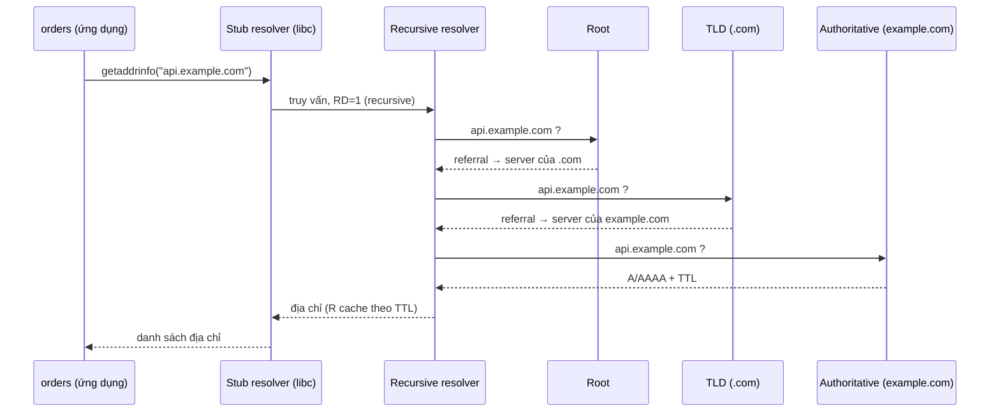
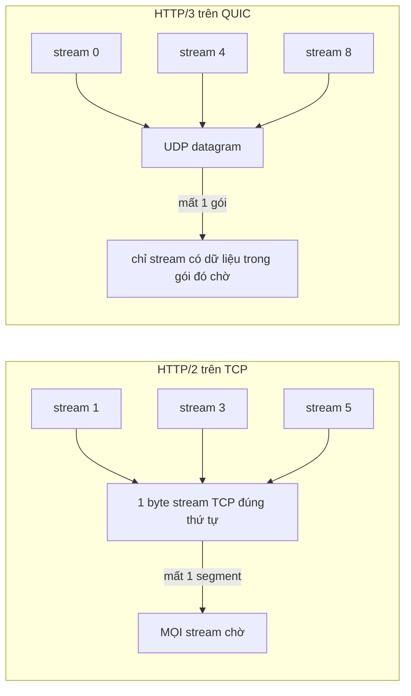
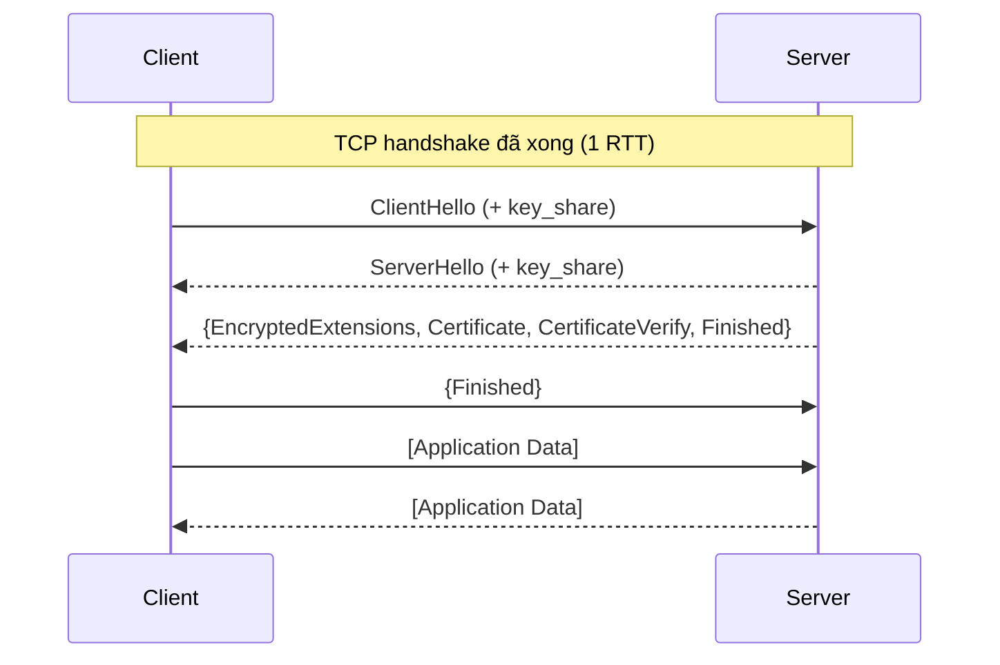

# P6 · Chương 08 — DNS, HTTP và TLS

Chương này đi theo một request HTTPS từ lúc ta chỉ có **tên** (`api.example.com`) cho tới lúc nhận được response. DNS đổi tên thành IP, TCP (hoặc QUIC) mở đường, TLS mã hóa, rồi HTTP chạy trên cùng. Mỗi lớp tốn thời gian theo RTT (round-trip time: thời gian một gói đi tới đích rồi phản hồi quay về). Cuối chương ta cộng các RTT lại thành *latency budget* và đo thử trong container.

Ví dụ chạy xuyên chương là `orders`, một service viết bằng Rust. Mỗi khi khách thanh toán, `orders` gọi `POST https://api.example.com/v1/charges` tới nhà cung cấp thanh toán (nhận xét của người soạn: ví dụ giả định, không phải code trong repo). Mỗi mục mở đầu bằng cùng một câu hỏi: lớp này làm gì cho lần gọi đó, và nó tốn của `orders` những gì?

## Bạn sẽ hiểu được gì

1. **Q1.** Khi `orders` chỉ có tên `api.example.com`, ai biết IP của nó? Zone, root, TLD, authoritative khác nhau thế nào; stub resolver khác recursive resolver ra sao; "iterative" khác "recursive" ở đâu? → mục 1
2. **Q2.** Các loại record `A`, `AAAA`, `CNAME`, `MX`, `NS`, `TXT` để làm gì; TTL điều khiển cache thế nào, và vì sao nhà cung cấp đổi IP rồi mà `orders` vẫn có thể gọi IP cũ một lúc? → mục 2
3. **Q3.** Vì sao DNS/UDP truyền thống giới hạn 512 byte, và bit TC cùng EDNS(0) giải quyết chuyện gì? → mục 3
4. **Q4.** Từ chuỗi `"api.example.com:443"`, chương trình của bạn đi tới địa chỉ IP qua đường nào (`getaddrinfo`, `nsswitch.conf`, `/etc/hosts`, RFC 6724)? Vì sao `dig` ra IP đúng mà ứng dụng vẫn nối sang IP khác? → mục 4
5. **Q5.** Khi `orders` gửi nhiều request tới cùng một server, HTTP/1.1 đóng khung message và tái dùng kết nối ra sao; head-of-line blocking nằm ở đâu qua HTTP/1.1 và HTTP/2? → mục 5
6. **Q6.** Vì sao HTTP/3 rời TCP, và QUIC khác TCP thế nào (UDP, stream độc lập, connection ID, migration)? → mục 6
7. **Q7.** TLS 1.3 handshake gồm những bước nào, vì sao chỉ cần 1-RTT, và 0-RTT đổi lấy gì (replay)? → mục 7
8. **Q8.** Một request HTTPS mới tốn bao nhiêu RTT cho DNS, TCP, TLS; kết nối tái dùng tiết kiệm gì (số đo cho kết nối mới; phần tái dùng là suy luận từ mô hình)? → mục 8

## Kiến thức cần trước

- Tầng UDP/TCP, handshake 3 bước, slow start: [04 — UDP và TCP cơ bản](04-udp-va-tcp-co-ban.md), [05 — TCP reliability](05-tcp-reliability-va-flow-control.md), [06 — Congestion control](06-congestion-control.md).
- Socket API, `connect`, `accept`, hàng đợi kernel: [07 — Socket và kernel](07-socket-va-kernel.md).

## 1. Zone, root, TLD, authoritative, stub và recursive resolver (Q1)

> **Trả lời ngắn.** DNS là một cây tên phân cấp, và không server nào giữ cả cây. Mỗi server chỉ có thẩm quyền (authoritative) với một phần cây gọi là zone[^rfc1034-auth]. Chương trình của bạn thường không tự đi hỏi mà đẩy việc cho một stub resolver, và stub này nhờ recursive resolver làm hộ[^rfc1034-stub]. Recursive resolver mới là bên lần lượt hỏi root, TLD rồi authoritative, đi theo referral từ server này sang server khác[^rfc1034-resolver-def] (chuỗi root → TLD → authoritative là cách mô tả thông dụng của người soạn). Giao thức bắt buộc server phải hỗ trợ kiểu iterative, còn recursive chỉ là tùy chọn[^rfc1034-iter-req].

**Giải thích.**

*Với service `orders`.* Để gọi `https://api.example.com/v1/charges`, `orders` cần một địa chỉ IP, vì socket chỉ nối được tới địa chỉ chứ không nối được tới tên. Vậy ai đổi `api.example.com` thành IP, và vì sao việc đó không nằm trong một file hay một server duy nhất? Mục này trả lời cả hai câu.

### 1.1 Vì sao cần một cây tên

Con người nhớ tên, còn IP thì hay đổi. Cơ sở dữ liệu tên–địa chỉ của cả Internet lại quá lớn và cập nhật quá thường xuyên để nằm ở một chỗ, nên RFC 1034 kết luận phải duy trì nó phân tán, kèm cache cục bộ cho nhanh[^rfc1034-dist]. Cách tổ chức là một **cây** tên[^rfc1034-tree]. Mỗi node có một *label* dài 0–63 octet[^rfc1034-label]. Label rỗng (độ dài 0) là label duy nhất được dành riêng, dùng cho root[^rfc1034-nulllabel]. Tên miền của một node là danh sách label đi từ node đó lên root[^rfc1034-name]; vì vậy `api.example.com` gồm các label `api`, `example`, `com`, rồi tới root.

DNS có ba thành phần. Thành phần đầu là không gian tên cùng các resource record (RR) gắn với từng tên[^rfc1034-comp]. Hai thành phần còn lại là name server (giữ dữ liệu) và resolver (đi hỏi).

### 1.2 Zone và authoritative

Name server không giữ cả cây. Nó là **authority** cho những phần cây mà nó có thông tin đầy đủ. Thông tin có thẩm quyền được gom thành các **zone**, và zone có thể sao chép sang nhiều name server để dự phòng[^rfc1034-auth]. Một zone bắt đầu bằng record `SOA`[^rfc1035-cname-soa]. Record `NS` thì ghi tên một name server có thẩm quyền[^rfc1035-a-ns].

Theo cách gọi thông dụng (nhận xét của người soạn), **root** ở đỉnh cây, **TLD** là tầng dưới (như `.com`), và **authoritative** là server của zone cần tra, ở đây là `example.com`. Root server rốt cuộc dẫn tới mọi phần của không gian tên[^rfc1034-roots], nên resolver bắt đầu từ root rồi đi xuống bằng các *referral*, tức những câu trả lời kiểu "không phải tôi, hãy hỏi server này".

### 1.3 Ai đi hỏi: stub và recursive resolver

`orders` không tự đi hỏi root. Nó dùng một **resolver**, tức chương trình nối ứng dụng với name server[^rfc1034-resolver]. Resolver phải truy cập được ít nhất một name server, rồi dùng thông tin của server đó để trả lời thẳng hoặc đi theo referral sang server khác[^rfc1034-resolver-def]. Hai kiểu truy vấn khác nhau ở chỗ ai đi tiếp khi server đầu tiên chưa biết câu trả lời:

- **Recursive**: server đầu tiên đuổi theo truy vấn thay client ở các server khác[^rfc1034-recursive].
- **Iterative**: server chỉ trả referral và để client tự đi tiếp[^rfc1034-iterative].

**Stub resolver** là kiểu resolver tối giản: nó đẩy toàn bộ việc giải quyết sang một name server hỗ trợ recursive[^rfc1034-stub]. Với `orders`, `libc` trên máy chính là một stub (nhận xét của người soạn; mục 4 kể cách `libc` làm). Nó hỏi các `nameserver` ghi trong `/etc/resolv.conf`[^resolv-ns] (việc `libc` đặt bit RD=1 là suy luận của người soạn, chưa kiểm bằng bắt gói). Server nhận câu hỏi, của ISP, công ty hay một dịch vụ công cộng, là **recursive resolver**. Chính nó đi hỏi root → TLD → authoritative theo kiểu iterative, và giữ cache dùng chung cho nhiều client (cách gọi và mô tả thông dụng, nhận xét của người soạn).



(Minh họa của người soạn; cache hit thì recursive resolver trả ngay.)

<details><summary>Đi sâu: bit RD/RA, nhiều zone trên một server</summary>

Trong header của message DNS, bit **RD** (Recursion Desired) trong query nhờ server đi tìm hộ[^rfc1035-rd]. Bit **RA** trong response cho biết server có hỗ trợ việc đó không[^rfc1035-ra]. Một server có thể giữ nhiều zone, liền kề hoặc rời nhau[^rfc1034-zones].

</details>

**Quay lại Q1:** zone chia quyền quản lý, authoritative trả lời chính thức, còn đường đi của câu hỏi "IP của `api.example.com` là gì" là stub trong `libc` → recursive resolver → root, TLD, authoritative.

## 2. Các loại record, TTL và cache (Q2)

> **Trả lời ngắn.** Mỗi record có một TYPE: `A`/`AAAA` cho địa chỉ IPv4/IPv6, `CNAME` cho bí danh, `NS` cho server có thẩm quyền, `MX` cho mail, `TXT` cho văn bản. Mỗi record mang một TTL tính bằng giây, cho biết nó được cache bao lâu[^rfc1035-ttl-sec]. Vì vậy khi IP đổi, cache vẫn có thể giữ bản cũ tới hết TTL; nếu biết trước thay đổi thì có thể hạ TTL trước khi đổi[^rfc1034-ttl-change].

**Giải thích.**

*Với service `orders`.* Giả sử nhà cung cấp chuyển `api.example.com` sang IP mới lúc 10:00. Một lúc sau `orders` vẫn có thể gọi IP cũ, dù bạn không đổi dòng code nào. Lý do nằm ở TTL của record `A`, và để hiểu nó ta cần biết record là gì.

### 2.1 Các loại record

Resource record (RR) mà mục 1 nhắc tới có nhiều TYPE khác nhau. Bảng dưới là các TYPE RFC 1035 liệt kê:

| Type | Ý nghĩa | Ghi chú |
|---|---|---|
| `A` | địa chỉ host (IPv4)[^rfc1035-a-ns] | RDATA là một địa chỉ Internet 32 bit[^rfc1035-arec] |
| `AAAA` | địa chỉ IPv6 | RFC 3596: loại record này lưu một địa chỉ IPv6 128 bit[^rfc3596-aaaa]. Host có nhiều địa chỉ IPv6 thì có nhiều record[^rfc3596-multi] |
| `CNAME` | tên chính (canonical) của một alias[^rfc1035-cname-soa] | tên này là bí danh của tên kia |
| `NS` | name server có thẩm quyền[^rfc1035-a-ns] | ghi tên một name server có thẩm quyền (xem mục 1) |
| `MX` | mail exchange[^rfc1035-mx-txt] | |
| `TXT` | chuỗi văn bản[^rfc1035-mx-txt] | |
| `SOA` | đánh dấu đầu một zone[^rfc1035-cname-soa] | |

### 2.2 TTL: record được cache bao lâu

Mỗi RR mang một TTL, là số nguyên 32 bit không dấu, đơn vị **giây**. Nó cho biết RR được phép cache bao lâu trước khi phải bỏ[^rfc1035-ttl-sec]. Nói cách khác, TTL là giới hạn thời gian một RR được giữ trong cache[^rfc1034-ttl-cache]. Quản trị viên của zone nơi dữ liệu xuất phát là người đặt TTL[^rfc1034-ttl]. TTL bằng 0 nghĩa là cấm cache[^rfc1034-zero].

Quay lại ví dụ ở đầu mục: cache chỉ biết giữ bản cũ tới hết TTL, nên sau khi IP đổi, cache nào vừa lấy bản cũ vẫn trả bản đó cho tới hạn (suy luận của người soạn từ định nghĩa TTL). RFC 1034 nêu cách giảm nhẹ chuyện này. Nếu lường trước được thay đổi thì hạ TTL trước khi đổi để giảm bất nhất, rồi nâng lại giá trị cũ sau đó[^rfc1034-ttl-change].

<details><summary>Đi sâu: tra ngược IPv6 và quan sát TTL giảm dần</summary>

Tra ngược (IP → tên) cho IPv6 dùng miền đặc biệt `IP6.ARPA`[^rfc3596-arpa].

**Quan sát (container, một lần chạy).** Hai dnsmasq: server gốc (`:5353`, `--local-ttl=30`, `app.lab.test` có `A 10.0.0.7` và `AAAA fd00::7`) và một resolver cache (`:53`) chuyển tiếp tới nó. `dig app.lab.test` qua resolver cache ra TTL 30, sau `sleep 3` ra TTL **27**: bản cache bị trừ dần.

</details>

**Quay lại Q2:** TTL là hạn cache do chủ zone đặt, nên khi nhà cung cấp đổi IP của `api.example.com`, `orders` chỉ chắc chắn thấy IP mới sau tối đa khoảng một TTL (suy luận của người soạn, giả sử cache tuân thủ TTL).

## 3. UDP 512 byte, bit TC và EDNS(0) (Q3)

> **Trả lời ngắn.** Message DNS qua UDP truyền thống bị giới hạn 512 byte; dài hơn thì bị cắt và server đặt bit TC trong header[^rfc1035-udp]. Client thấy TC thì thử lại bằng TCP[^rfc7766-tc]. EDNS(0) cho bên hỏi báo kích thước UDP payload lớn nhất mà nó nhận được[^rfc6891-size], nhờ đó server có thể trả message lớn hơn 512 byte mà không cần cắt (suy luận của người soạn từ giới hạn 512).

**Giải thích.**

*Với service `orders`.* Truy vấn DNS chuẩn thường đi qua UDP, vì RFC 1035 khuyến nghị cách đó[^rfc1035-udp2]. Một datagram UDP thì có hạn, trong khi một tên có thể có rất nhiều record. Vậy khi câu trả lời cho tên mà `orders` cần tra không vừa trong một datagram thì chuyện gì xảy ra? DNS truyền thống và DNS có EDNS(0) xử lý theo hai cách khác nhau.

### 3.1 DNS truyền thống: cắt và đặt TC

Giới hạn 512 byte không tính header IP và UDP. Message dài hơn bị cắt, và server đặt bit TC trong header[^rfc1035-udp]. Client nhận response mang TC thì coi đó là dấu hiệu nên thử lại bằng TCP[^rfc7766-tc].

### 3.2 EDNS(0): báo trước kích thước nhận được

Trần 512 octet là của DNS truyền thống qua UDP[^rfc6891-512]; EDNS(0) (RFC 6891) là cách nới nó. Bên gửi truy vấn (requestor) có thể thêm một pseudo-RR **OPT** vào phần additional của request[^rfc6891-opt]. Trường CLASS của OPT mang *UDP payload size*, là số octet lớn nhất của UDP payload mà requestor ghép lại và nhận được[^rfc6891-size]. Biết con số đó, server trả được message lớn hơn 512 byte mà không cần cắt (suy luận của người soạn).

<details><summary>Đi sâu: path MTU, giá trị dưới 512, số đo trong container</summary>

Kích thước payload có thể lớn hơn path MTU[^rfc6891-mtu]. Giá trị dưới 512 được coi như 512[^rfc6891-512min].

**Quan sát (container).** Server gốc có `big.lab.test` với 6 bản ghi TXT, mỗi bản 200 ký tự:

| Lệnh | Kết quả đo |
|---|---|
| `dig +noedns +ignore` (UDP, không OPT) | flags `qr aa tc rd ra`, chỉ 2 answer, `MSG SIZE rcvd: 456` (≤ 512, bị cắt) |
| `dig +bufsize=4096` (UDP + OPT) | không có `tc`, 6 answer, `MSG SIZE 1319`; OPT của server ghi `udp: 1232` |
| `dig +noedns +tcp` | không có `tc`, 6 answer, `MSG SIZE 1308` |

(`udp: 1232` do dnsmasq tự quảng bá, không phải hằng số giao thức.)

</details>

**Quay lại Q3:** 512 byte là trần UDP truyền thống; với câu trả lời lớn, TC đẩy stub resolver của `orders` sang TCP, còn OPT của EDNS(0) nâng trần ngay trên UDP.

## 4. Từ tên đến địa chỉ trên máy bạn: getaddrinfo, nsswitch, hosts, resolv.conf (Q4)

> **Trả lời ngắn.** Ứng dụng gọi `getaddrinfo(3)`. Hàm này đọc `/etc/nsswitch.conf` để biết nguồn nào được tra trước (thường `files` rồi `dns`), nên `/etc/hosts` có thể thắng DNS. `dig` thì nói chuyện DNS thẳng, không qua nsswitch, nên `dig` ra IP đúng chưa chứng minh ứng dụng thấy IP đó (nhận xét của người soạn). Khi có nhiều địa chỉ, thứ tự do hàm sắp xếp trong glibc quyết định, và bạn chỉnh được bằng `/etc/gai.conf`[^getaddrinfo3-sort]. Man page ghi hàm sắp xếp theo RFC 3484, nhưng RFC này đã bị RFC 6724 thay thế[^rfc6724-obs].

**Giải thích.**

*Với service `orders`.* Giả sử bạn gõ `dig api.example.com` trên máy chạy `orders` và thấy IP mới, vậy mà `orders` vẫn nối sang IP khác. Chuyện này xảy ra được vì `orders` không hỏi DNS theo cách `dig` hỏi. Mục này đi theo đường mà chuỗi `"api.example.com:443"` thực sự đi qua `libc`.

### 4.1 Đường đi của một lần tra tên

Ứng dụng hiếm khi nói DNS trực tiếp. Chúng gọi `getaddrinfo(3)`, hàm trả về một hoặc nhiều cấu trúc addrinfo, mỗi cấu trúc chứa một địa chỉ Internet dùng được trong `bind(2)` hay `connect(2)`[^getaddrinfo3]. Để chọn nguồn và tra tên, hàm dựa vào ba thứ:

1. **`/etc/nsswitch.conf`** quyết định hỏi *nguồn* nào. Dòng `hosts:` liệt kê các dịch vụ, và thứ tự trên dòng là thứ tự được hỏi, lần lượt, cho tới khi có kết quả[^nsswitch-order]. Cơ sở dữ liệu `hosts` dành cho tên và địa chỉ host, do `gethostbyname(3)` và các hàm liên quan dùng[^nsswitch-hosts]. Debian mặc định ghi `hosts: files dns` (đọc từ file `/etc/nsswitch.conf` của container bookworm).
2. **`files`** là `/etc/hosts`, một file văn bản liên kết địa chỉ IP với hostname, mỗi địa chỉ một dòng[^hosts5].
3. **`dns`** là stub resolver của mục 1. Nó đọc `/etc/resolv.conf`, trong đó các dòng `nameserver` (tối đa MAXNS, hiện là 3) được hỏi theo thứ tự liệt kê[^resolv-ns]. Tham số `ndots` (mặc định 1) quyết định cách thử tên: tên có ít nhất chừng đó dấu chấm thì được thử như tên tuyệt đối trước khi ghép các miền trong `search`[^resolv-ndots].

Với `hosts: files dns`, tên nào có trong `/etc/hosts` sẽ được trả lời ngay từ file mà không hỏi DNS. Còn `dig` chỉ nói DNS, tức chỉ phản ánh nhánh thứ ba (quan sát ở phần Đi sâu).

Khi một tên có nhiều địa chỉ, `getaddrinfo` còn phải sắp xếp chúng. Man page nói hàm sắp xếp được định nghĩa ở RFC 3484 và chỉnh được qua `/etc/gai.conf`[^getaddrinfo3-sort]. RFC 3484 đã bị RFC 6724 thay thế[^rfc6724-obs]. Rust truyền hints với `ai_flags = 0` (mục 9), nên không đi qua đường lọc `AI_ADDRCONFIG` của `hints = NULL`.

<details><summary>Đi sâu: quan sát strace, thứ tự RFC 6724 từng luật, AI_ADDRCONFIG</summary>

**Quan sát (container, glibc Debian bookworm).** `strace -f` một chương trình Rust tra tên cho thấy `openat` lần lượt `/etc/nsswitch.conf`, `/etc/resolv.conf`, `/etc/hosts`. Thêm `192.0.2.50 app.lab.test` vào `/etc/hosts` trong khi DNS trả `::1` và `127.0.0.1` cho cùng tên: `hosts: files dns` cho `192.0.2.50`; `hosts: dns files` cho `::1` và `127.0.0.1`. `dig +short` cho tên chỉ có trong `/etc/hosts` không ra gì — **`dig` nói DNS thẳng, không qua nsswitch**.

**Thứ tự địa chỉ.** Quan sát (container, glibc 2.36): `/etc/gai.conf` vẫn viết "RFC 3484 governs the sorting" và ghi precedence mặc định của `::ffff:0:0/96` là **10**, không phải 35 như RFC 6724, nên bảng glibc thực dùng phải đọc từ file đó. Phần dưới dùng luật RFC 6724 (bản hiện hành). RFC 6724 so từng cặp địa chỉ đích theo một chuỗi luật. Bốn luật đáng chú ý:

- Rule 1 tránh đích không dùng được[^rfc6724-r1].
- Rule 5 ưu tiên đích có label trùng label nguồn[^rfc6724-r5].
- Rule 6 ưu tiên precedence cao hơn[^rfc6724-r6].
- Rule 9 ưu tiên tiền tố chung dài nhất khi hai đích cùng họ địa chỉ[^rfc6724-r9].

Bảng policy mặc định của RFC 6724 gán `::1/128` precedence 50, `::/0` 40, `::ffff:0:0/96` (IPv4) 35[^rfc6724-table]. Hệ quả là ứng dụng dùng IPv6 trước IPv4 khi hai bên phù hợp như nhau[^rfc6724-v6first].

**Vì sao `::1` đứng trước `127.0.0.1`** (suy luận của người soạn từ các luật trên, đã đối chiếu với quan sát `[::1]:80` ra trước). IPv4 phải được tra bảng dưới dạng địa chỉ IPv4-mapped (`::ffff:127.0.0.1`)[^rfc6724-v4mapped]. Loopback IPv6 `::1` có scope link-local[^rfc6724-lo6]. Dải `127/8` của IPv4 cũng được gán scope link-local[^rfc6724-lo4]. Vì vậy Rule 2 hòa. Giả sử mỗi đích chọn nguồn loopback cùng họ, Rule 5 cũng hòa (label 0/0 và 4/4). Đến Rule 6 thì 50 > 35 (và > 10 ở bảng glibc), nên `::1` thắng ở cả hai bảng, miễn cả hai đều dùng được (Rule 1).

Với `hints = NULL`, glibc dùng `AI_V4MAPPED | AI_ADDRCONFIG`[^gai-null]. Riêng `AI_ADDRCONFIG` chỉ trả họ địa chỉ mà máy có cấu hình (loopback không tính)[^gai-addrconfig].

</details>

**Quay lại Q4:** `orders` đi qua `getaddrinfo` → nsswitch → hosts/DNS → sắp xếp theo RFC 6724, còn `dig` chỉ phản ánh nhánh DNS, nên hai bên có thể thấy hai IP khác nhau.

## 5. HTTP/1.1 và HTTP/2: framing, kết nối tái dùng, head-of-line (Q5)

> **Trả lời ngắn.** HTTP/1.1 là giao thức văn bản có khuôn cố định. TCP không có ranh giới message, nên HTTP phải tự nói body dài bao nhiêu[^rfc9112-cl]. Kết nối mặc định được tái dùng cho nhiều request[^rfc9112-persist]. Nhưng nếu client gửi pipeline thì response phải trả đúng thứ tự request[^rfc9112-pipeline]. Vì thế một response chậm chặn mọi response sau nó[^hpbn-h1-hol]. HTTP/2 multiplex nhiều stream trên một kết nối TCP, nhưng vẫn dính head-of-line (HOL) blocking của chính TCP[^rfc9113-tcphol].

**Giải thích.**

*Với service `orders`.* Giả sử mỗi giây `orders` gọi `api.example.com` hàng chục lần. Mỗi lần gọi có phải mở một kết nối TCP và TLS mới không? Nếu các lần gọi dùng chung kết nối, một response chậm có chặn các request sau nó không? Câu trả lời khác nhau giữa HTTP/1.1 và HTTP/2, và mục này đi từng bước.

### 5.1 Ngữ nghĩa và cách ghi lên dây

RFC tách HTTP làm hai tầng. Ngữ nghĩa nằm ở RFC 9110: HTTP là giao thức request/response không trạng thái[^rfc9110-stateless]. `GET` yêu cầu truyền biểu diễn hiện tại của resource đích[^rfc9110-get]. Mã `2xx` nghĩa là request đã được nhận, hiểu và chấp nhận[^rfc9110-2xx]. Còn cách ghi message HTTP/1.1 lên dây nằm ở RFC 9112.

### 5.2 Định dạng message

Một message HTTP/1.1 gồm start-line kết thúc bằng CRLF, các dòng header, một dòng trống, rồi body tùy chọn[^rfc9112-msg]. Request-line có dạng `method SP request-target SP HTTP-version`[^rfc9112-reqline], chẳng hạn `POST /v1/charges HTTP/1.1` trong request của `orders` (ví dụ của người soạn theo cú pháp đó). Status-line có dạng `HTTP-version SP status-code SP [reason-phrase]`[^rfc9112-statusline].

Header `Host` là bắt buộc. Client phải gửi `Host` trong mọi request HTTP/1.1[^rfc9112-host-client]. Server phải trả 400 cho request HTTP/1.1 thiếu `Host`[^rfc9112-host]. Lý do là `Host` giúp origin server phân biệt resource khi một server phục vụ nhiều tên miền[^rfc9110-host].

### 5.3 Đóng khung body

TCP là byte stream và không có ranh giới giữa các message, nên chính HTTP phải báo body dài đến đâu. Có ba cách:

- `Content-Length` hợp lệ và không có `Transfer-Encoding`: giá trị thập phân của nó là độ dài body tính bằng octet[^rfc9112-cl].
- Chunked coding: nội dung được bọc thành chuỗi chunk, mỗi chunk có chỉ báo kích thước riêng, nên stream được cả nội dung có độ dài chưa biết trước[^rfc9112-chunked].
- Response không khai báo độ dài: body kéo dài tới khi server đóng kết nối[^rfc9112-closebody]. Cách này có rủi ro, vì không phân biệt được response hoàn chỉnh với response bị mạng cắt giữa chừng, nên server nên dùng framing theo độ dài khi có thể[^rfc9112-closerisk].

Với `Content-Length`, hệ quả là parser phải đọc lặp tới `\r\n\r\n` rồi đọc đúng số byte body (suy luận của người soạn).

### 5.4 Tái dùng kết nối và head-of-line ở tầng HTTP

HTTP/1.1 mặc định dùng lại một kết nối cho nhiều request (*persistent connection*, hay keep-alive)[^rfc9112-persist]. Server không hỗ trợ thì phải gửi option `close` trong mọi response trừ 1xx[^rfc9112-close]. Keepalive là một trong những cải tiến hiệu năng chính của HTTP/1.1[^hpbn-keepalive]. Với `orders`, dùng lại kết nối nghĩa là các lần gọi sau khỏi trả lại chi phí TCP và TLS (mục 8 sẽ đếm).

Nhưng dùng lại kết nối kéo theo một vấn đề. Khi client pipeline, tức gửi nhiều request mà không chờ response, server phải trả response đúng thứ tự nhận request[^rfc9112-pipeline]. Hậu quả là một response chậm chặn mọi request sau nó[^hpbn-h1-hol]. Client HTTP/1.x vì thế mở nhiều kết nối song song để gửi request đồng thời[^rfc9113-multiconn]. Mức song song tối đa khoảng sáu request mỗi origin[^hpbn-six]. Nhận xét của người soạn: đây cũng là lý do HTTP client trong backend có connection pool, và mỗi kết nối trong pool mang theo chi phí TCP/TLS riêng.

### 5.5 HTTP/2: một kết nối, nhiều stream

HTTP/1.1 buộc phải chọn giữa hai cái giá: xếp request nối đuôi nhau trên một kết nối (HOL), hoặc mở nhiều kết nối (tốn handshake) (nhận xét của người soạn). HTTP/2 giữ nguyên ngữ nghĩa HTTP nhưng đổi cách ghi lên dây. Nó chạy trên một kết nối TCP, và đơn vị cơ bản của giao thức là **frame**[^rfc9113-overview]. Mỗi cặp request/response gắn với một **stream** riêng; đó là cách HTTP/2 multiplex[^rfc9113-mux]. Các stream phần lớn độc lập, nên một request/response bị chặn hoặc chậm không cản các stream khác[^rfc9113-streams]. Với `orders`, hàng chục lần gọi đồng thời có thể cùng đi trên một kết nối.

Nhưng HOL của TCP thì còn nguyên. RFC ghi thẳng rằng HTTP/2 không giải quyết HOL blocking của TCP[^rfc9113-tcphol]. Lý do (suy luận từ tính đúng thứ tự của TCP): mọi stream chung **một** byte stream đúng thứ tự, nên khi mất một segment, dữ liệu sau nó chưa giao cho ứng dụng cho tới khi segment được truyền lại, và mọi stream phải chờ. Sách *High Performance Browser Networking* cũng nêu đúng điều này[^hpbn-h2-tcp].

<details><summary>Đi sâu: frame 9 octet, stream ID, HPACK, ALPN, quan sát nc/curl</summary>

Gõ tay qua `nc` tới server Python trong container (`GET /index.html HTTP/1.1`, `Host: x`, `Connection: close`, dòng trống) nhận `HTTP/1.0 200 OK`, header (`Content-Length: 6`...), dòng trống, rồi body `hello` — đúng khuôn trên.

Quan sát: `curl` gọi hai URL liên tiếp tới server Python (`protocol_version = 'HTTP/1.1'`) in `Connected` một lần rồi `Re-using existing connection`.

**Frame, stream.** Mọi frame bắt đầu bằng header cố định 9 octet[^rfc9113-frame9]. Stream định danh bằng số nguyên 31 bit; client mở stream với số lẻ, server với số chẵn[^rfc9113-sid]. Mỗi bên có thể giới hạn số stream mở đồng thời của bên kia bằng tham số `SETTINGS_MAX_CONCURRENT_STREAMS`[^rfc9113-maxconc].

**Nén header: HPACK.** Header lặp lại nhiều giữa các request, nên HTTP/2 nén các frame mang chúng[^rfc9113-redundant]. Định dạng nén là **HPACK** (RFC 7541), thiết kế để biểu diễn header field hiệu quả[^rfc7541-abs]. Nén có **trạng thái**: mỗi endpoint giữ một encoder context và một decoder context cho mọi field block trên kết nối[^rfc9113-hpack-state]. Nhờ trạng thái chung đó, request sau có thể tham chiếu lại header đã gửi (suy luận của người soạn).

**ALPN.** Chuỗi `h2` định danh HTTP/2 trên TLS và đi trong extension ALPN của TLS[^rfc9113-alpn]. ALPN thương lượng giao thức ngay trong handshake TLS mà không thêm round-trip[^rfc7301-norrt]. Quan sát: `curl --http2-prior-knowledge` tới `nghttpd --no-tls` in `HTTP/2 200`, `Using Stream ID: 1`, và `Re-using existing connection` cho URL thứ hai.

</details>

**Quay lại Q5:** HTTP/1.1 buộc response trả theo thứ tự nên một response chậm chặn các response sau; HTTP/2 gỡ chặn ở tầng HTTP, nhưng các stream chung một byte stream TCP nên mất gói vẫn chặn tất cả.

## 6. HTTP/3 và QUIC (Q6)

> **Trả lời ngắn.** HTTP/3 chạy trên QUIC thay vì TCP; QUIC là transport an toàn, đa dụng, hướng kết nối[^rfc9000-quic]. Một lợi ích QUIC nêu rõ là tránh head-of-line blocking giữa các stream: mất gói thì chỉ những stream có dữ liệu trong gói đó bị chặn[^rfc9000-hol]. Ngoài ra QUIC dùng connection ID, nên kết nối sống sót khi IP hoặc port đổi[^rfc9000-migration].

**Giải thích.**

*Với service `orders`.* Nếu `api.example.com` bật HTTP/3, hàng chục lần gọi đồng thời của `orders` đi trên QUIC thay vì trên một kết nối TCP. Vậy mất một gói giữa chừng thì ai phải chờ? Còn ở chiều ngược lại, giả sử app di động của khách gọi `orders` bằng HTTP/3 và máy chuyển từ Wi-Fi sang 4G giữa lúc đang gọi (ví dụ giả định của người soạn), thì kết nối có đứt không? Hai câu hỏi này dẫn tới hai cơ chế của QUIC.

### 6.1 QUIC và HTTP/3

**QUIC** (RFC 9000) là transport an toàn, đa dụng, hướng kết nối[^rfc9000-quic]. HTTP/3 (RFC 9114) chạy ngữ nghĩa HTTP trên QUIC, với một lớp framing nội bộ tương tự HTTP/2[^rfc9114-quic].

### 6.2 Chạy trên UDP

Gói QUIC nằm trong UDP datagram để dễ triển khai trên hệ thống và mạng hiện có[^rfc9000-udp] (suy luận của người soạn: hạ tầng hiện có đã chuyển được UDP). UDP không cho độ tin cậy hay thứ tự (chương [04](04-udp-va-tcp-co-ban.md)), nên phần đó QUIC phải tự lo (suy luận của người soạn).

### 6.3 Stream độc lập

Stream trong QUIC là một byte-stream có thứ tự và nhẹ[^rfc9000-streams]. Nhưng giữa các stream khác nhau thì QUIC không có cách nào bảo đảm thứ tự các byte[^rfc9000-orderless]. Vì vậy khi mất gói, chỉ những stream có dữ liệu trong gói đó phải chờ truyền lại, còn các stream khác vẫn tiến lên[^rfc9000-hol]. Trong HTTP/3, mỗi request đi trên một request stream, là bidirectional stream do client khởi tạo[^rfc9114-reqstream]. HTTP cũng không cần tự multiplex nữa, vì QUIC đã lo việc đó[^rfc9114-nomux].



(Minh họa của người soạn; số stream chỉ là ví dụ.)

### 6.4 Connection ID và migration

QUIC dùng **connection ID**. Mỗi endpoint tự chọn connection ID, và với bên kia nó là một giá trị mờ đục[^rfc9000-cid-def]. Nhờ connection ID, kết nối sống sót khi IP hoặc port đổi, ví dụ khi máy chuyển sang mạng khác[^rfc9000-migration]. Với app di động ở trên, đó là lý do kết nối tới `orders` không phải dựng lại.

<details><summary>Đi sâu: hệ quả của migration và TLS trong QUIC</summary>

Code dùng IP client để log hay kiểm soát truy cập phải chủ động lấy địa chỉ hiện tại của client khi cần, hoặc chấp nhận rằng địa chỉ ban đầu có thể đổi[^rfc9114-migr]. Còn handshake QUIC thì tích hợp sẵn handshake TLS[^rfc9000-tls].

</details>

**Quay lại Q6:** QUIC đưa stream xuống tầng transport nên mất gói chỉ chặn đúng stream liên quan, và connection ID giữ kết nối qua đổi mạng.

## 7. TLS 1.3: handshake, 1-RTT, 0-RTT và replay (Q7)

> **Trả lời ngắn.** TLS tạo một kênh an toàn trên một data stream tin cậy, đúng thứ tự[^rfc8446-goal]. Client gửi sẵn phần Diffie-Hellman key share (extension `key_share`) ngay trong ClientHello[^rfc8446-keyshare]. Nhờ vậy chỉ cần một vòng là hai bên có khóa để gửi dữ liệu ứng dụng (1-RTT; suy luận của người soạn từ Figure 1). 0-RTT bớt thêm một vòng cho phiên nối lại, nhưng đổi lại mất một số tính chất bảo mật[^rfc8446-0rtt-add]. Một trong số đó là bảo đảm chống replay[^rfc8446-0rtt].

**Giải thích.**

*Với service `orders`.* Trước khi gửi `POST /v1/charges`, `orders` phải bắt tay TLS với `api.example.com`, và handshake mất mấy vòng thì khách chờ bấy nhiêu RTT. 0-RTT nghe hấp dẫn vì cho gửi dữ liệu ngay lượt đầu. Nhưng nếu dữ liệu đó là lệnh charge thì có thể có hai lệnh charge đến server thay vì một (nhận xét của người soạn). Mục này giải thích handshake chạy thế nào và cái giá của 0-RTT nằm ở đâu.

### 7.1 Mục tiêu của TLS

TLS tạo kênh an toàn giữa hai peer, và yêu cầu duy nhất với transport bên dưới là một data stream tin cậy, đúng thứ tự[^rfc8446-goal]. Vì vậy TLS thường chạy trên TCP (suy luận của người soạn). Với HTTP/3, QUIC tự tích hợp TLS handshake (mục 6). Kênh này bảo đảm ba thứ:

- Xác thực: server luôn phải xác thực, client thì tùy chọn[^rfc8446-auth].
- Bí mật: dữ liệu gửi qua kênh sau khi thiết lập chỉ hai đầu nhìn thấy[^rfc8446-conf].
- Toàn vẹn: kẻ tấn công không sửa được dữ liệu mà không bị phát hiện[^rfc8446-integrity].

### 7.2 Ba pha của handshake và vì sao chỉ một vòng

Hai pha đầu là Key Exchange (thiết lập khóa chung, chọn tham số mật mã; mọi thứ sau pha này được mã hóa) và Server Parameters (các tham số handshake khác, như client có được xác thực không)[^rfc8446-phases]. Pha thứ ba, Authentication, xác thực server (tùy chọn cả client), kèm xác nhận khóa và toàn vẹn handshake[^rfc8446-authphase]. So với TLS 1.2, mọi handshake message sau ServerHello đều được mã hóa[^rfc8446-enc].



(Rút gọn Figure 1 RFC 8446: `{}` mã hóa bằng handshake key, `[]` bằng application key.)

Điểm mấu chốt nằm ở dòng đầu: ClientHello đã mang sẵn Diffie-Hellman key share[^rfc8446-keyshare]. Vì vậy sau **một** vòng (ClientHello → ServerHello…Finished), client đã đủ khóa để gửi dữ liệu ứng dụng cùng với Finished của mình (suy luận của người soạn từ Figure 1). So sánh: TLS 1.2 cần hai roundtrip cho full handshake[^hpbn-tls12]. Mục tiêu của TLS 1.3 là 1-RTT cho kết nối mới và 0-RTT cho phiên nối lại[^hpbn-tls13].

### 7.3 0-RTT và replay

Khi hai bên đã có PSK dùng chung (lấy ngoài băng hoặc từ handshake trước), TLS 1.3 cho client gửi dữ liệu ngay trong first flight, gọi là early data[^rfc8446-psk]. Client dùng PSK để xác thực server và mã hóa early data[^rfc8446-early]. Lợi ích là tiết kiệm một round trip khi thiết lập kết nối, với cái giá là mất một số tính chất bảo mật[^rfc8446-0rtt-add]. Cụ thể, dữ liệu 0-RTT không forward secret, và **không có bảo đảm non-replay giữa các kết nối**[^rfc8446-0rtt]. Replay ở đây nghĩa là server có thể nhận nhiều bản của cùng một message ứng dụng (chi tiết ở phần Đi sâu).

Từ đó có hai quy tắc. Client không được gửi trong early data những message không an toàn khi bị phát lại[^rfc8446-safe]. Ứng dụng cũng không được dùng 0-RTT khi chưa có *profile* xác định cách dùng nó[^rfc8446-profile]. Với `orders`, một lệnh charge mà bị phát lại là charge hai lần, nên `POST /v1/charges` không phải loại message nên gửi trong early data (nhận xét của người soạn).

<details><summary>Đi sâu: quan sát openssl s_server, vì sao replay xảy ra</summary>

**Quan sát (container).** `curl -v --tlsv1.3` tới `openssl s_server` (chứng chỉ tự ký, nên `-k`) in `Client hello` → `Server hello` → `Encrypted Extensions` → `Certificate` → `CERT verify` → `Finished` (vào) → `Finished` (ra), khớp sơ đồ.

0-RTT chỉ là phần dữ liệu thêm vào handshake 1-RTT trong first flight[^rfc8446-fig4].

Vì sao replay xảy ra? Với dữ liệu 1-RTT thường, chống replay đến từ giá trị Random của server. 0-RTT không phụ thuộc ServerHello nên bảo đảm yếu hơn[^rfc8446-replay-1rtt]. RFC chỉ ra hai mối đe dọa. Một là kẻ tấn công trên mạng nhân đôi nguyên một flight 0-RTT[^rfc8446-threat1]. Hai là kẻ tấn công lợi dụng hành vi retry của client để server nhận nhiều bản của cùng một message ứng dụng[^rfc8446-threat2].

</details>

**Quay lại Q7:** `key_share` đi kèm ClientHello nên chỉ cần 1-RTT; 0-RTT bớt thêm một vòng nhưng không chống replay, nên `orders` chỉ nên dùng nó cho message an toàn khi bị phát lại.

## 8. Latency budget của một request HTTPS mới (Q8)

> **Trả lời ngắn.** Kết nối mới tiêu RTT theo từng lớp: DNS ≥ 1, TCP 1, TLS 1.3 thêm 1 (TLS 1.2: thêm 2), request/response 1. Tổng là 4 RTT (TLS 1.2: 5) trước byte đầu của response. Kết nối tái dùng bỏ được DNS, TCP và TLS nên chỉ còn khoảng 1 RTT (suy luận từ mô hình, chưa đo).

**Giải thích.**

*Với service `orders`.* Nếu `orders` mở kết nối mới cho mỗi lần gọi `api.example.com`, nó phải trả đủ các lớp ở các mục trước trước khi nhận byte đầu của response, và mỗi RTT là thêm một lượt khách phải chờ. Mục này cộng các lớp lại và đo thử trong container.

Latency tổng là tổng các thành phần: propagation, transmission, processing, queuing[^hpbn-latency-sum]. Với kết nối *mới*, RTT được tiêu theo từng lớp, vì mỗi lớp cần ít nhất một vòng trước khi lớp trên có dữ liệu:

| Bước | Chi phí (theo RTT) | Nguồn |
|---|---|---|
| DNS (cache miss) | ≥ 1 RTT tới resolver: mỗi lần phân giải hostname cần một roundtrip và chặn request[^hpbn-dns] | mục 1 |
| TCP handshake | 1 RTT trước khi có dữ liệu ứng dụng[^hpbn-hs-rtt] | chương 04 |
| TLS 1.3 | +1 RTT[^hpbn-tls13]. TLS 1.2: +2[^hpbn-tls12] | mục 7 |
| HTTP request/response | +1 RTT cho byte đầu tiên (TTFB) (suy ra từ request → response) | — |
| Slow start | `cwnd` ban đầu giới hạn lượng byte đầu[^hpbn-ss-every] | chương 06 |

Cộng DNS 1 + TCP 1 + TLS 1.3 1 + request 1 = **4 RTT** trước byte đầu của response. TLS 1.2 là 5 RTT. Các con số này cộng dồn từ các mục trên, chưa tính thời gian xử lý và slow start.

<details><summary>Đi sâu: ví dụ HPBN và số đo netem trong container</summary>

Ví dụ trong HPBN: client New York, server London qua cáp quang, handshake 3 bước tốn tối thiểu 56 ms[^hpbn-ny].

**Đo thật (container, một lần chạy, không phụ thuộc Internet).** Dựng dnsmasq làm resolver cục bộ, server HTTP (Python, `HTTP/1.1`), và hai `openssl s_server` (TLS 1.3 và TLS 1.2). Gắn `tc qdisc add dev lo root netem delay 50ms` — mỗi gói trên loopback chậm 50 ms mỗi chiều, nên RTT ≈ 100 ms (kể cả khi `curl` hỏi dnsmasq qua `lo`). Thời gian tích lũy do `curl -w` báo (giây):

| Kịch bản | `time_namelookup` | `time_connect` | `time_appconnect` | `time_starttransfer` |
|---|---|---|---|---|
| HTTP (plain) | 0.107 | 0.210 | — | 0.314 |
| HTTPS, TLS 1.3 | 0.102 | 0.205 | 0.313 | 0.419 |
| HTTPS, TLS 1.2 | 0.102 | 0.208 | 0.419 | 0.526 |

Đọc bằng *hiệu* các cột: DNS ≈ 0.10 (1 RTT); TCP thêm ≈ 0.10; TLS 1.3 thêm ≈ 0.108 (1 RTT), TLS 1.2 thêm ≈ 0.211 (2 RTT); request thêm ≈ 0.10–0.11. Khớp mô hình: TLS 1.3 → 4 RTT ≈ 0.42 s, TLS 1.2 → 5 RTT ≈ 0.53 s. Mỗi số là một lần chạy trên loopback có độ trễ nhân tạo, không mất gói.

**Tái dùng kết nối.** `curl` với hai URL liên tiếp: lần hai `time_namelookup` ≈ 0.000007 (cache DNS trong process) nhưng `time_connect` ≈ 0.10 vì `openssl s_server -www` không giữ kết nối: chạy lại (OpenSSL 3.0.20, curl 7.88.1): `s_server -www` trả `HTTP/1.0 200 ok`, `curl` in `Closing connection 0` rồi mở kết nối mới `#1`. Với server giữ kết nối, mô hình dự đoán lần hai chỉ còn ≈ 1 RTT (suy luận của người soạn, chưa đo): đó là lợi ích của keep-alive và HTTP/2 (mục 5).

</details>

**Quay lại Q8:** mỗi kết nối HTTPS mới của `orders` tốn 4 RTT (TLS 1.3) hoặc 5 (TLS 1.2) trước byte đầu, và số đo trong container khớp mô hình; theo mô hình, tái dùng kết nối cắt gần hết chi phí đó (suy luận, chưa đo).

## 9. Liên hệ với Rust

Với `orders` viết bằng Rust, mọi chuyện ở mục 4 bắt đầu từ một dòng như `TcpStream::connect("api.example.com:443")`. Phần này chỉ ra dòng đó gọi xuống resolver bằng đường nào.

`std::net` không có DNS client riêng. Thứ gọi resolver là trait **`ToSocketAddrs`**, dùng để chuyển hoặc phân giải một đối tượng thành một hay nhiều giá trị `SocketAddr`[^std-tosa].

- Với `&str` dạng `"host:port"` (như `"api.example.com:443"`), Rust thử parse thẳng thành `SocketAddr` trước[^std-str-impl]. Không được thì nó tách tại dấu `:` cuối cùng, parse port thành `u16`, rồi gọi `lookup_host`[^std-str-rsplit].
- Với `(&str, u16)`, Rust thử parse host thành `IpAddr` trước. Nếu không phải IP thì nhờ hệ thống tra[^std-tuple-impl].
- `lookup_host` gọi **`getaddrinfo` của libc**, vì `std` không có DNS client[^std-getaddrinfo]. Hints chỉ đặt `ai_socktype = SOCK_STREAM`, phần còn lại zeroed, tức `ai_flags = 0`[^std-hints]. Vì vậy mọi thứ ở mục 4 (`nsswitch.conf`, `/etc/hosts`, `resolv.conf`, thứ tự RFC 6724) áp dụng nguyên vẹn cho `TcpStream::connect("host:port")`. Riêng `AI_ADDRCONFIG` mà man page gán cho `hints = NULL` ở mục 4 thì không áp dụng, vì Rust truyền hints khác NULL.
- Hàm có thể **chặn thread** trong lúc phân giải[^std-tosa-block]. Nếu gọi từ task async thì nó chặn executor thread (nhận xét của người soạn).
- `TcpStream::connect` với nhiều địa chỉ thì thử lần lượt từng cái cho tới khi thành công[^std-connect-multi]. Cách này khớp với khuyến nghị của man page: thử các địa chỉ theo thứ tự `getaddrinfo` trả về[^getaddrinfo3-order].

**Chạy thật** (rustc 1.95.0 trong container, resolver cục bộ như mục 1–2):

```rust
use std::net::ToSocketAddrs;
fn main() {
    for h in std::env::args().skip(1) {
        match h.to_socket_addrs() {
            Ok(it) => println!("{h} -> {:?}", it.collect::<Vec<_>>()),
            Err(e) => println!("{h} -> error: {e}"),
        }
    }
}
```

Quan sát: `app.lab.test:80` (DNS: `::1` + `127.0.0.1`) ra `[[::1]:80, 127.0.0.1:80]`; `127.0.0.1:80` ra một địa chỉ mà không qua resolver; tên không tồn tại ra `failed to lookup address information: Temporary failure in name resolution` (resolver lab không có upstream); thiếu port ra `invalid socket address`, port sai ra `invalid port value`. Với `192.0.2.50 app.lab.test` trong `/etc/hosts`: `hosts: files dns` → `[192.0.2.50:80]`.

## Tóm tắt

- DNS là cây tên phân cấp. Quyền quản lý chia theo **zone**, mỗi zone có server **authoritative**; root và TLD chỉ trả referral.
- `orders` dùng **stub resolver** (libc); stub hỏi **recursive resolver**, và bên này đi hỏi theo kiểu **iterative** từ root.
- TTL tính bằng giây, nên đổi IP lan chậm; nếu biết trước thì hạ TTL trước khi đổi. `dig` không đi qua nsswitch, nên chưa chứng minh được ứng dụng thấy IP nào.
- DNS/UDP truyền thống ≤ 512 byte, vượt thì server cắt và đặt TC; EDNS(0) cho payload lớn hơn (đo trong container: 456 byte kèm `tc` so với 1319 byte).
- Trong Rust, `ToSocketAddrs` gọi `getaddrinfo` của libc và có thể chặn thread.
- HTTP/1.1 tự đóng khung body và tái dùng kết nối, nhưng response phải trả đúng thứ tự nên bị HOL. HTTP/2 multiplex nhiều stream trên một TCP nhưng vẫn dính HOL của TCP. HTTP/3 trên QUIC có stream độc lập và connection ID.
- TLS 1.3 cần 1-RTT; 0-RTT bớt thêm một vòng nhưng không chống replay, nên không hợp với request như `POST /v1/charges` (nhận xét của người soạn).
- Một request HTTPS mới tốn 4 RTT (đo ≈ 0.42 s với RTT 100 ms); theo mô hình, kết nối tái dùng cắt phần lớn (chưa đo).

## Câu hỏi tự kiểm tra

1. Phân biệt zone và domain. Ai là authority cho `www.example.com`, và root server đóng vai trò gì?

<details><summary>Đáp án</summary>

Domain là phần của cây tên nằm ở hoặc dưới một tên cho trước[^rfc1034-domain]. Zone là đơn vị thông tin có thẩm quyền mà name server giữ[^rfc1034-auth]. Authority của `www.example.com` là name server mà record `NS` của zone chứa tên đó nêu ra[^rfc1035-a-ns]. Root không trả lời thay mà chỉ dẫn xuống qua referral[^rfc1034-roots].

</details>

2. Stub resolver khác recursive resolver ở đâu? Bit RD/RA nằm ở đâu?

<details><summary>Đáp án</summary>

Stub đẩy cả việc giải quyết sang server hỗ trợ recursive[^rfc1034-stub]; recursive resolver mới là bên đi hỏi theo referral. RD đặt trong query, RA trong response[^rfc1035-rd].

</details>

3. Bạn đổi A record của `api.example.com` lúc 10:00 với TTL 3600. Tới khi nào client chắc chắn thấy IP mới, và nên làm gì trước đó?

<details><summary>Đáp án</summary>

Cache có thể giữ bản cũ tối đa TTL giây tính từ lúc nó lấy bản đó[^rfc1035-ttl-sec]. Vì vậy cache vừa lấy ngay trước 10:00 có thể sống tới khoảng 11:00; sau mốc đó, nếu cache tuân thủ TTL, client thấy IP mới (suy từ định nghĩa TTL). Nếu biết trước thay đổi thì hạ TTL trước khi đổi rồi nâng lại[^rfc1034-ttl-change].

</details>

4. `dig api.example.com` ra IP đúng nhưng `orders` kết nối tới IP khác. Nêu hai nguyên nhân khả dĩ theo chương này.

<details><summary>Đáp án</summary>

Nguyên nhân thứ nhất: `/etc/hosts` đứng trước `dns` trong `nsswitch.conf`[^nsswitch-order]. File đó có thể chứa dòng cho tên này[^hosts5]. Nguyên nhân thứ hai: khi tên có nhiều địa chỉ, thứ tự do RFC 6724 và `gai.conf` quyết định[^getaddrinfo3-sort]. Trong thí nghiệm của chương, `dig` không đọc `/etc/hosts`.

</details>

5. Vì sao HTTP/2 vẫn bị head-of-line blocking dù đã multiplex?

<details><summary>Đáp án</summary>

Mọi stream chung một byte stream đúng thứ tự của TCP. RFC ghi rõ HTTP/2 không giải quyết TCP HOL[^rfc9113-tcphol]. HPBN cũng viết như vậy[^hpbn-h2-tcp].

</details>

6. QUIC giải quyết HOL và đổi mạng bằng cơ chế nào?

<details><summary>Đáp án</summary>

Stream độc lập: QUIC không bảo đảm thứ tự giữa các stream[^rfc9000-orderless]. Nhờ vậy mất gói chỉ chặn stream liên quan[^rfc9000-hol]. Còn connection ID cho phép kết nối sống qua thay đổi IP/port[^rfc9000-migration].

</details>

7. Vì sao TLS 1.3 chỉ cần 1-RTT cho kết nối mới, trong khi TLS 1.2 cần 2?

<details><summary>Đáp án</summary>

TLS 1.2 cần hai roundtrip cho kết nối mới[^hpbn-tls12]. TLS 1.3 đặt mục tiêu 1-RTT[^hpbn-tls13]. Cơ chế (suy luận từ Figure 1 của RFC 8446): ClientHello đã mang key share[^rfc8446-keyshare], nên server trả luôn tham số khóa và xác thực trong cùng flight.

</details>

8. 0-RTT hứa gì và rủi ro gì? Khi nào ứng dụng được dùng nó?

<details><summary>Đáp án</summary>

Nó tiết kiệm một round trip[^rfc8446-0rtt-add]. Đổi lại, dữ liệu 0-RTT không forward secret và không có bảo đảm non-replay giữa các kết nối[^rfc8446-0rtt]. Client không được gửi trong early data message không an toàn khi bị phát lại[^rfc8446-safe]. Ứng dụng cũng không được dùng 0-RTT khi chưa có profile xác định cách dùng[^rfc8446-profile].

</details>

9. Tính latency tới byte đầu tiên của HTTPS mới, RTT = 80 ms, TLS 1.3, DNS miss một RTT tới resolver gần. Con số là bao nhiêu, và nếu kết nối keep-alive thì sao?

<details><summary>Đáp án</summary>

DNS cần một roundtrip tới resolver[^hpbn-dns]. TCP handshake thêm một RTT[^hpbn-hs-rtt]. TLS 1.3 thêm một RTT[^hpbn-tls13]. Request/response thêm một RTT nữa. Tổng là 4 RTT = 320 ms. Với kết nối tái dùng chỉ còn request, tức 1 RTT = 80 ms (suy luận từ mô hình).

</details>

## Đọc thêm

- [RFC 1034](https://www.rfc-editor.org/rfc/rfc1034.html) §3–§5 và [RFC 1035](https://www.rfc-editor.org/rfc/rfc1035.html) §4 — cây tên, zone, resolver, TTL, format message, UDP/TCP.
- [RFC 6891](https://www.rfc-editor.org/rfc/rfc6891.html) §6 và [RFC 6724](https://www.rfc-editor.org/rfc/rfc6724.html) §6 — EDNS(0)/OPT; luật sắp xếp địa chỉ đích.
- [getaddrinfo(3)](https://manpages.debian.org/bookworm/manpages-dev/getaddrinfo.3.en.html), [nsswitch.conf(5)](https://manpages.debian.org/bookworm/manpages/nsswitch.conf.5.en.html) — hành vi libc.
- [RFC 9112](https://www.rfc-editor.org/rfc/rfc9112.html) §6, §9; [RFC 9113](https://www.rfc-editor.org/rfc/rfc9113.html) §2, §4.3, §5 — framing, persistent connection, stream, HPACK.
- [RFC 9000](https://www.rfc-editor.org/rfc/rfc9000.html) §2, §5, §9 và [RFC 9114](https://www.rfc-editor.org/rfc/rfc9114.html) — QUIC (stream, connection ID, migration) và HTTP/3.
- [RFC 8446](https://www.rfc-editor.org/rfc/rfc8446.html) §2, §2.3, §8 — handshake, 0-RTT và anti-replay.
- [HPBN, Primer on Latency](https://hpbn.co/primer-on-latency-and-bandwidth/) và [HTTP/2](https://hpbn.co/http2/) — nền để tính latency budget.

[^rfc1034-dist]: RFC 1034, §2.2 Design goals — <https://www.rfc-editor.org/rfc/rfc1034.html> — "The sheer size of the database and frequency of updates suggest that it must be maintained in a distributed manner, with local caching to improve performance."
[^rfc1034-tree]: RFC 1034, §3.1 Name space specifications and terminology — <https://www.rfc-editor.org/rfc/rfc1034.html> — "domain name space is a tree structure. Each node and leaf on the tree corresponds to a resource set (which may be empty)."
[^rfc1034-label]: RFC 1034, §3.1 Name space specifications and terminology — <https://www.rfc-editor.org/rfc/rfc1034.html> — "Each node has a label, which is zero to 63 octets in length."
[^rfc1034-name]: RFC 1034, §3.1 Name space specifications and terminology — <https://www.rfc-editor.org/rfc/rfc1034.html> — "The domain name of a node is the list of the labels on the path from the node to the root of the tree."
[^rfc1034-comp]: RFC 1034, §2.4 Elements of the DNS — <https://www.rfc-editor.org/rfc/rfc1034.html> — "The DOMAIN NAME SPACE and RESOURCE RECORDS, which are specifications for a tree structured name space and data associated with the names."
[^rfc1034-auth]: RFC 1034, §2.4 Elements of the DNS — <https://www.rfc-editor.org/rfc/rfc1034.html> — "Authoritative information is organized into units called ZONEs, and these zones can be automatically distributed to the name servers which provide redundant service for the data in a zone."
[^rfc1034-zones]: RFC 1034, §6 A Scenario — <https://www.rfc-editor.org/rfc/rfc1034.html> — "Note that servers may have zones which are contiguous or disjoint."
[^rfc1034-roots]: RFC 1034, §5.3.3 Algorithm — <https://www.rfc-editor.org/rfc/rfc1034.html> — "The root servers will provide eventual access to all of the domain space."
[^rfc1034-resolver]: RFC 1034, §5.1 Resolvers, Introduction — <https://www.rfc-editor.org/rfc/rfc1034.html> — "Resolvers are programs that interface user programs to domain name servers."
[^rfc1034-resolver-def]: RFC 1034, §2.4 Elements of the DNS — <https://www.rfc-editor.org/rfc/rfc1034.html> — "Resolvers must be able to access at least one name server and use that name server's information to answer a query directly, or pursue the query using referrals to other name servers."
[^rfc1034-recursive]: RFC 1034, §2.3 Assumptions about usage — <https://www.rfc-editor.org/rfc/rfc1034.html> — "in which the first server pursues the query for the client at another server"
[^rfc1034-iterative]: RFC 1034, §2.3 Assumptions about usage — <https://www.rfc-editor.org/rfc/rfc1034.html> — "in which the server refers the client to another server and lets the client pursue the query."
[^rfc1034-iter-req]: RFC 1034, §2.3 Assumptions about usage — <https://www.rfc-editor.org/rfc/rfc1034.html> — "The domain system requires implementation of the iterative approach, but allows the recursive approach as an option."
[^rfc1034-stub]: RFC 1034, §5.3.1 Stub resolvers — <https://www.rfc-editor.org/rfc/rfc1034.html> — "One option for implementing a resolver is to move the resolution function out of the local machine and into a name server which supports recursive queries."
[^rfc1034-ttl-cache]: RFC 1034, §3.6 Resource Records — <https://www.rfc-editor.org/rfc/rfc1034.html> — "The meaning of the TTL field is a time limit on how long an RR can be kept in a cache."
[^rfc1034-ttl]: RFC 1034, §3.6 Resource Records — <https://www.rfc-editor.org/rfc/rfc1034.html> — "The TTL is assigned by the administrator for the zone where the data originates."
[^rfc1034-zero]: RFC 1034, §3.6 Resource Records — <https://www.rfc-editor.org/rfc/rfc1034.html> — "While short TTLs can be used to minimize caching, and a zero TTL prohibits caching"
[^rfc1034-ttl-change]: RFC 1034, §3.6 Resource Records — <https://www.rfc-editor.org/rfc/rfc1034.html> — "If a change can be anticipated, the TTL can be reduced prior to the change to minimize inconsistency during the change, and then increased back to its former value following the change."
[^rfc1035-a-ns]: RFC 1035, §3.2.2 TYPE values — <https://www.rfc-editor.org/rfc/rfc1035.html> — "A 1 a host address NS 2 an authoritative name server"
[^rfc1035-cname-soa]: RFC 1035, §3.2.2 TYPE values — <https://www.rfc-editor.org/rfc/rfc1035.html> — "CNAME 5 the canonical name for an alias SOA 6 marks the start of a zone of authority"
[^rfc1035-mx-txt]: RFC 1035, §3.2.2 TYPE values — <https://www.rfc-editor.org/rfc/rfc1035.html> — "MX 15 mail exchange TXT 16 text strings"
[^rfc1035-rd]: RFC 1035, §4.1.1 Header section format — <https://www.rfc-editor.org/rfc/rfc1035.html> — "If RD is set, it directs the name server to pursue the query recursively. Recursive query support is optional."
[^rfc1035-ra]: RFC 1035, §4.1.1 Header section format — <https://www.rfc-editor.org/rfc/rfc1035.html> — "RA Recursion Available - this be is set or cleared in a response, and denotes whether recursive query support is available in the name server."
[^rfc1035-arec]: RFC 1035, §3.4.1 A RDATA format — <https://www.rfc-editor.org/rfc/rfc1035.html> — "ADDRESS A 32 bit Internet address."
[^rfc7766-tc]: RFC 7766, §4 Discussion — <https://www.rfc-editor.org/rfc/rfc7766.html> — "When the client receives such a response, it takes the TC flag as an indication that it should retry over TCP instead."
[^rfc1035-ttl-sec]: RFC 1035, §4.1.3 Resource record format — <https://www.rfc-editor.org/rfc/rfc1035.html> — "a 32 bit unsigned integer that specifies the time interval (in seconds) that the resource record may be cached before it should be discarded."
[^rfc1035-udp]: RFC 1035, §4.2.1 UDP usage — <https://www.rfc-editor.org/rfc/rfc1035.html> — "Messages carried by UDP are restricted to 512 bytes (not counting the IP or UDP headers). Longer messages are truncated and the TC bit is set in the header."
[^rfc1035-udp2]: RFC 1035, §4.2.1 UDP usage — <https://www.rfc-editor.org/rfc/rfc1035.html> — "UDP is not acceptable for zone transfers, but is the recommended method for standard queries in the Internet."
[^rfc3596-aaaa]: RFC 3596, §2.1 AAAA record type — <https://www.rfc-editor.org/rfc/rfc3596.html> — "The AAAA resource record type is a record specific to the Internet class that stores a single IPv6 address."
[^rfc3596-multi]: RFC 3596, §2 New resource record definition and domain — <https://www.rfc-editor.org/rfc/rfc3596.html> — "A host that has more than one IPv6 address must have more than one such record."
[^rfc3596-arpa]: RFC 3596, §2.5 IP6.ARPA Domain — <https://www.rfc-editor.org/rfc/rfc3596.html> — "A special domain is defined to look up a record given an IPv6 address. The intent of this domain is to provide a way of mapping an IPv6 address to a host name, although it may be used for other purposes as well. The domain is rooted at IP6.ARPA."
[^rfc6891-512]: RFC 6891, §4.3 UDP Message Size — <https://www.rfc-editor.org/rfc/rfc6891.html> — "Traditional DNS messages are limited to 512 octets in size when sent over UDP."
[^rfc6891-opt]: RFC 6891, §6.1.1 Basic Elements — <https://www.rfc-editor.org/rfc/rfc6891.html> — "An OPT pseudo-RR (sometimes called a meta-RR) MAY be added to the additional data section of a request."
[^rfc6891-size]: RFC 6891, §6.2.3 Requestor's Payload Size — <https://www.rfc-editor.org/rfc/rfc6891.html> — "The requestor's UDP payload size (encoded in the RR CLASS field) is the number of octets of the largest UDP payload that can be reassembled and delivered in the requestor's network stack."
[^rfc6891-mtu]: RFC 6891, §6.2.3 Requestor's Payload Size — <https://www.rfc-editor.org/rfc/rfc6891.html> — "Note that path MTU, with or without fragmentation, could be smaller than this."
[^rfc6891-512min]: RFC 6891, §6.2.3 Requestor's Payload Size — <https://www.rfc-editor.org/rfc/rfc6891.html> — "Values lower than 512 MUST be treated as equal to 512."
[^getaddrinfo3]: getaddrinfo(3), Linux man-pages (Debian bookworm) — <https://manpages.debian.org/bookworm/manpages-dev/getaddrinfo.3.en.html> — "Given node and service, which identify an Internet host and a service, getaddrinfo() returns one or more addrinfo structures, each of which contains an Internet address that can be specified in a call to bind(2) or connect(2)."
[^getaddrinfo3-sort]: getaddrinfo(3), Linux man-pages (Debian bookworm) — <https://manpages.debian.org/bookworm/manpages-dev/getaddrinfo.3.en.html> — "The sorting function used within getaddrinfo() is defined in RFC 3484; the order can be tweaked for a particular system by editing /etc/gai.conf"
[^getaddrinfo3-order]: getaddrinfo(3), Linux man-pages (Debian bookworm) — <https://manpages.debian.org/bookworm/manpages-dev/getaddrinfo.3.en.html> — "Normally, the application should try using the addresses in the order in which they are returned."
[^gai-null]: getaddrinfo(3), Linux man-pages (Debian bookworm) — <https://manpages.debian.org/bookworm/manpages-dev/getaddrinfo.3.en.html> — "Specifying hints as NULL is equivalent to setting ai_socktype and ai_protocol to 0; ai_family to AF_UNSPEC; and ai_flags to (AI_V4MAPPED | AI_ADDRCONFIG)."
[^gai-addrconfig]: getaddrinfo(3), Linux man-pages (Debian bookworm) — <https://manpages.debian.org/bookworm/manpages-dev/getaddrinfo.3.en.html> — "IPv4 addresses are returned in the list pointed to by res only if the local system has at least one IPv4 address configured, and IPv6 addresses are returned only if the local system has at least one IPv6 address configured. The loopback address is not considered for this case as valid as a configured address."
[^nsswitch-order]: nsswitch.conf(5), Debian bookworm — <https://manpages.debian.org/bookworm/manpages/nsswitch.conf.5.en.html> — "The order of the services on the line determines the order in which those services will be queried, in turn, until a result is found."
[^nsswitch-hosts]: nsswitch.conf(5), Debian bookworm — <https://manpages.debian.org/bookworm/manpages/nsswitch.conf.5.en.html> — "hosts Host names and numbers, used by gethostbyname(3) and related functions."
[^hosts5]: hosts(5), Debian bookworm — <https://manpages.debian.org/bookworm/manpages/hosts.5.en.html> — "This file is a simple text file that associates IP addresses with hostnames, one line per IP address."
[^resolv-ns]: resolv.conf(5), Debian bookworm — <https://manpages.debian.org/bookworm/manpages/resolv.conf.5.en.html> — "Up to MAXNS (currently 3, see \<resolv.h>) name servers may be listed, one per keyword. If there are multiple servers, the resolver library queries them in the order listed."
[^resolv-ndots]: resolv.conf(5), Debian bookworm — <https://manpages.debian.org/bookworm/manpages/resolv.conf.5.en.html> — "The default for n is 1, meaning that if there are any dots in a name, the name will be tried first as an absolute name before any search list elements are appended to it."
[^rfc6724-obs]: RFC 6724, header — <https://www.rfc-editor.org/rfc/rfc6724.html> — "Obsoletes: 3484 R. Draves Category: Standards Track"
[^rfc6724-r1]: RFC 6724, §6 Destination Address Selection — <https://www.rfc-editor.org/rfc/rfc6724.html> — "If DB is known to be unreachable or if Source(DB) is undefined, then prefer DA."
[^rfc6724-r9]: RFC 6724, §6 Destination Address Selection — <https://www.rfc-editor.org/rfc/rfc6724.html> — "When DA and DB belong to the same address family (both are IPv6 or both are IPv4): If CommonPrefixLen(Source(DA), DA) > CommonPrefixLen(Source(DB), DB), then prefer DA."
[^rfc6724-table]: RFC 6724, §2.1 Policy Table — <https://www.rfc-editor.org/rfc/rfc6724.html> — "Prefix Precedence Label ::1/128 50 0 ::/0 40 1 ::ffff:0:0/96 35 4 2002::/16 30 2"
[^rfc6724-v6first]: RFC 6724, §10.3 Configuring Preference for IPv4 — <https://www.rfc-editor.org/rfc/rfc6724.html> — "This means that applications will use IPv6 in preference to IPv4 when the two are equally suitable."
[^rfc6724-r5]: RFC 6724, §6 Destination Address Selection — <https://www.rfc-editor.org/rfc/rfc6724.html> — "If Label(Source(DA)) = Label(DA) and Label(Source(DB)) <> Label(DB), then prefer DA."
[^rfc6724-r6]: RFC 6724, §6 Destination Address Selection — <https://www.rfc-editor.org/rfc/rfc6724.html> — "Rule 6: Prefer higher precedence. If Precedence(DA) > Precedence(DB), then prefer DA."
[^rfc6724-v4mapped]: RFC 6724, §3.2 IPv4 Addresses and IPv4-Mapped Addresses — <https://www.rfc-editor.org/rfc/rfc6724.html> — "For this purpose, IPv4 addresses MUST be represented as IPv4-mapped addresses [RFC4291]."
[^rfc6724-lo6]: RFC 6724, §3.4 IPv6 Loopback Address and Other Format Prefixes — <https://www.rfc-editor.org/rfc/rfc6724.html> — "The loopback address MUST be treated as having link-local scope"
[^rfc6724-lo4]: RFC 6724, §3.2 IPv4 Addresses and IPv4-Mapped Addresses — <https://www.rfc-editor.org/rfc/rfc6724.html> — "which have the prefix 127/8, are assigned link-local scope"
[^rfc9110-stateless]: RFC 9110, §3.4 Messages — <https://www.rfc-editor.org/rfc/rfc9110.html> — "HTTP is a stateless request/response protocol for exchanging"
[^rfc9110-get]: RFC 9110, §9.3.1 GET — <https://www.rfc-editor.org/rfc/rfc9110.html> — "The GET method requests transfer of a current selected representation for the target resource."
[^rfc9110-2xx]: RFC 9110, §15.3 Successful 2xx — <https://www.rfc-editor.org/rfc/rfc9110.html> — "The 2xx (Successful) class of status code indicates that the client's request was successfully received, understood, and accepted."
[^rfc9112-msg]: RFC 9112, §2.1 Message Format — <https://www.rfc-editor.org/rfc/rfc9112.html> — "An HTTP/1.1 message consists of a start-line followed by a CRLF and a sequence of octets in a format similar to the Internet Message Format"
[^rfc9112-reqline]: RFC 9112, §3 Request Line — <https://www.rfc-editor.org/rfc/rfc9112.html> — "request-line = method SP request-target SP HTTP-version"
[^rfc9112-statusline]: RFC 9112, §4 Status Line — <https://www.rfc-editor.org/rfc/rfc9112.html> — "status-line = HTTP-version SP status-code SP [ reason-phrase ]"
[^rfc9112-host]: RFC 9112, §3.2 Request Target — <https://www.rfc-editor.org/rfc/rfc9112.html> — "A server MUST respond with a 400 (Bad Request) status code to any HTTP/1.1 request message that lacks a Host header field"
[^rfc9112-cl]: RFC 9112, §6.3 Message Body Length — <https://www.rfc-editor.org/rfc/rfc9112.html> — "If a valid Content-Length header field is present without Transfer-Encoding, its decimal value defines the expected message body length in octets."
[^rfc9112-chunked]: RFC 9112, §7.1 Chunked Transfer Coding — <https://www.rfc-editor.org/rfc/rfc9112.html> — "chunked transfer coding wraps content in order to transfer it as a series of chunks, each with its own size indicator, followed by an OPTIONAL trailer section containing trailer fields."
[^rfc9112-closebody]: RFC 9112, §6.3 Message Body Length — <https://www.rfc-editor.org/rfc/rfc9112.html> — "Otherwise, this is a response message without a declared message body length, so the message body length is determined by the number of octets received prior to the server closing the connection."
[^rfc9112-closerisk]: RFC 9112, §6.3 Message Body Length — <https://www.rfc-editor.org/rfc/rfc9112.html> — "Since there is no way to distinguish a successfully completed, close-delimited response message from a partially received message interrupted by network failure, a server SHOULD generate encoding or length-delimited messages whenever possible."
[^rfc9112-persist]: RFC 9112, §9.3 Persistence — <https://www.rfc-editor.org/rfc/rfc9112.html> — "HTTP/1.1 defaults to the use of \"persistent connections\", allowing multiple requests and responses to be carried over a single connection."
[^rfc9112-close]: RFC 9112, §9.3 Persistence — <https://www.rfc-editor.org/rfc/rfc9112.html> — "A server that does not support persistent connections MUST send the \"close\" connection option in every response message that does not have a 1xx (Informational) status code."
[^hpbn-keepalive]: High Performance Browser Networking, HTTP/1.X — <https://hpbn.co/http1x/> — "One of the primary performance improvements of HTTP/1.1 was the introduction of persistent, or keepalive HTTP connections"
[^rfc9112-pipeline]: RFC 9112, §9.3.2 Pipelining — <https://www.rfc-editor.org/rfc/rfc9112.html> — "it MUST send the corresponding responses in the same order that the requests were received."
[^hpbn-h1-hol]: High Performance Browser Networking, HTTP/1.X — <https://hpbn.co/http1x/> — "due to lack of multiplexing, HTTP pipelining creates many subtle and undocumented implications for HTTP servers, intermediaries, and clients: A single slow response blocks all requests behind it."
[^rfc9113-multiconn]: RFC 9113, §1 Introduction — <https://www.rfc-editor.org/rfc/rfc9113.html> — "Therefore, HTTP/1.0 and HTTP/1.1 clients use multiple connections to a server to make concurrent requests."
[^hpbn-six]: High Performance Browser Networking, HTTP/2 — <https://hpbn.co/http2/> — "it must rely on the use of parallel connections, which enables limited parallelism of up to six requests per origin."
[^rfc9113-overview]: RFC 9113, §2 HTTP/2 Protocol Overview — <https://www.rfc-editor.org/rfc/rfc9113.html> — "HTTP/2 is a connection-oriented application-layer protocol that runs over a TCP connection ([TCP]). The client is the TCP connection initiator. The basic protocol unit in HTTP/2 is a frame (Section 4.1)."
[^rfc9113-frame9]: RFC 9113, §4.1 Frame Format — <https://www.rfc-editor.org/rfc/rfc9113.html> — "All frames begin with a fixed 9-octet header followed by a variable-length frame payload."
[^rfc9113-mux]: RFC 9113, §2 HTTP/2 Protocol Overview — <https://www.rfc-editor.org/rfc/rfc9113.html> — "Multiplexing of requests is achieved by having each HTTP request/response exchange associated with its own stream (Section 5)."
[^rfc9113-sid]: RFC 9113, §5.1.1 Stream Identifiers — <https://www.rfc-editor.org/rfc/rfc9113.html> — "Streams are identified by an unsigned 31-bit integer. Streams initiated by a client MUST use odd-numbered stream identifiers; those initiated by the server MUST use even-numbered stream identifiers."
[^rfc9113-streams]: RFC 9113, §2 HTTP/2 Protocol Overview — <https://www.rfc-editor.org/rfc/rfc9113.html> — "Streams are largely independent of each other, so a blocked or stalled request or response does not prevent progress on other streams."
[^rfc9113-maxconc]: RFC 9113, §5.1.2 Stream Concurrency — <https://www.rfc-editor.org/rfc/rfc9113.html> — "A peer can limit the number of concurrently active streams using the SETTINGS_MAX_CONCURRENT_STREAMS parameter"
[^rfc9113-redundant]: RFC 9113, §2 HTTP/2 Protocol Overview — <https://www.rfc-editor.org/rfc/rfc9113.html> — "Because HTTP fields used in a connection can contain large amounts of redundant data, frames that contain them are compressed (Section 4.3)."
[^rfc7541-abs]: RFC 7541, Abstract — <https://www.rfc-editor.org/rfc/rfc7541.html> — "This specification defines HPACK, a compression format for efficiently representing HTTP header fields, to be used in HTTP/2."
[^rfc9113-hpack-state]: RFC 9113, §4.3.1 Compression State — <https://www.rfc-editor.org/rfc/rfc9113.html> — "Field compression is stateful. Each endpoint has an HPACK encoder context and an HPACK decoder context that are used for encoding and decoding all field blocks on a connection."
[^rfc9113-alpn]: RFC 9113, §3.1 HTTP/2 Version Identification — <https://www.rfc-editor.org/rfc/rfc9113.html> — "This identifier is used in the TLS Application-Layer Protocol Negotiation (ALPN) extension [TLS-ALPN] field and in any place where HTTP/2 over TLS is identified."
[^rfc7301-norrt]: RFC 7301, §1 Introduction — <https://www.rfc-editor.org/rfc/rfc7301.html> — "The application protocol negotiation can thus be accomplished within the TLS handshake, without adding network round-trips"
[^rfc9113-tcphol]: RFC 9113, §1 Introduction — <https://www.rfc-editor.org/rfc/rfc9113.html> — "Note, however, that TCP head-of-line blocking is not addressed by this protocol."
[^hpbn-h2-tcp]: High Performance Browser Networking, HTTP/2 — <https://hpbn.co/http2/> — "We have eliminated head-of-line blocking from HTTP, but there is still head-of-line blocking at the TCP level"
[^rfc9000-quic]: RFC 9000, §1 Overview — <https://www.rfc-editor.org/rfc/rfc9000.html> — "QUIC is a secure general-purpose transport protocol. This document defines version 1 of QUIC, which conforms to the version-independent properties of QUIC defined in [QUIC-INVARIANTS]. QUIC is a connection-oriented protocol that creates a stateful interaction between a client and server."
[^rfc9114-quic]: RFC 9114, §2 HTTP/3 Protocol Overview — <https://www.rfc-editor.org/rfc/rfc9114.html> — "HTTP/3 provides a transport for HTTP semantics using the QUIC transport protocol and an internal framing layer similar to HTTP/2."
[^rfc9000-udp]: RFC 9000, §1 Overview — <https://www.rfc-editor.org/rfc/rfc9000.html> — "QUIC packets are carried in UDP datagrams [UDP] to better facilitate deployment in existing systems and networks."
[^rfc9000-streams]: RFC 9000, §2 Streams — <https://www.rfc-editor.org/rfc/rfc9000.html> — "Streams in QUIC provide a lightweight, ordered byte-stream abstraction to an application."
[^rfc9000-orderless]: RFC 9000, §2 Streams — <https://www.rfc-editor.org/rfc/rfc9000.html> — "QUIC does not provide any means of ensuring ordering between bytes on different streams."
[^rfc9000-hol]: RFC 9000, §13 Packetization and Reliability — <https://www.rfc-editor.org/rfc/rfc9000.html> — "One of the benefits of QUIC is avoidance of head-of-line blocking across multiple streams. When a packet loss occurs, only streams with data in that packet are blocked waiting for a retransmission to be received, while other streams can continue making progress."
[^rfc9114-reqstream]: RFC 9114, §4.1 HTTP Message Framing — <https://www.rfc-editor.org/rfc/rfc9114.html> — "A client sends an HTTP request on a request stream, which is a client-initiated bidirectional QUIC stream"
[^rfc9114-nomux]: RFC 9114, §6 Stream Mapping and Usage — <https://www.rfc-editor.org/rfc/rfc9114.html> — "HTTP does not need to do any separate multiplexing when using QUIC"
[^rfc9000-cid-def]: RFC 9000, §1.2 Terms and Definitions — <https://www.rfc-editor.org/rfc/rfc9000.html> — "Connection ID: An identifier that is used to identify a QUIC connection at an endpoint. Each endpoint selects one or more connection IDs for its peer to include in packets sent towards the endpoint. This value is opaque to the peer."
[^rfc9000-migration]: RFC 9000, §9 Connection Migration — <https://www.rfc-editor.org/rfc/rfc9000.html> — "The use of a connection ID allows connections to survive changes to endpoint addresses (IP address and port), such as those caused by an endpoint migrating to a new network."
[^rfc9114-migr]: RFC 9114, §10.10 Migration — <https://www.rfc-editor.org/rfc/rfc9114.html> — "Certain HTTP implementations use the client address for logging or access-control purposes. Since a QUIC client's address might change during a connection (and future versions might support simultaneous use of multiple addresses), such implementations will need to either actively retrieve the client's current address or addresses when they are relevant or explicitly accept that the original address might change."
[^rfc9000-tls]: RFC 9000, §1 Overview — <https://www.rfc-editor.org/rfc/rfc9000.html> — "The QUIC handshake combines negotiation of cryptographic and transport parameters. QUIC integrates the TLS handshake"
[^rfc8446-goal]: RFC 8446, §1 Introduction — <https://www.rfc-editor.org/rfc/rfc8446.html> — "The primary goal of TLS is to provide a secure channel between two communicating peers; the only requirement from the underlying transport is a reliable, in-order data stream."
[^rfc8446-auth]: RFC 8446, §1 Introduction — <https://www.rfc-editor.org/rfc/rfc8446.html> — "Authentication: The server side of the channel is always authenticated; the client side is optionally authenticated."
[^rfc8446-conf]: RFC 8446, §1 Introduction — <https://www.rfc-editor.org/rfc/rfc8446.html> — "Data sent over the channel after establishment is only visible to the endpoints."
[^rfc8446-integrity]: RFC 8446, §1 Introduction — <https://www.rfc-editor.org/rfc/rfc8446.html> — "Data sent over the channel after establishment cannot be modified by attackers without detection."
[^rfc8446-phases]: RFC 8446, §2 Protocol Overview — <https://www.rfc-editor.org/rfc/rfc8446.html> — "Key Exchange: Establish shared keying material and select the cryptographic parameters. Everything after this phase is encrypted. Server Parameters: Establish other handshake parameters (whether the client is authenticated, application-layer protocol support, etc.)."
[^rfc8446-authphase]: RFC 8446, §2 Protocol Overview — <https://www.rfc-editor.org/rfc/rfc8446.html> — "Authentication: Authenticate the server (and, optionally, the client) and provide key confirmation and handshake integrity."
[^rfc8446-enc]: RFC 8446, §1.2 Major Differences from TLS 1.2 — <https://www.rfc-editor.org/rfc/rfc8446.html> — "All handshake messages after the ServerHello are now encrypted."
[^hpbn-tls12]: High Performance Browser Networking, Transport Layer Security (TLS) — <https://hpbn.co/transport-layer-security-tls/> — "new TLS connections require two roundtrips for a"
[^hpbn-tls13]: High Performance Browser Networking, Transport Layer Security (TLS) — <https://hpbn.co/transport-layer-security-tls/> — "One of the design goals for TLS 1.3 is to reduce the latency overhead for setting up the secure connection: 1-RTT for new, and 0-RTT for resumed sessions!"
[^rfc8446-early]: RFC 8446, §2.3 0-RTT Data — <https://www.rfc-editor.org/rfc/rfc8446.html> — "The client uses the PSK to authenticate the server and to encrypt the early data."
[^rfc8446-fig4]: RFC 8446, §2.3 0-RTT Data — <https://www.rfc-editor.org/rfc/rfc8446.html> — "As shown in Figure 4, the 0-RTT data is just added to the 1-RTT handshake in the first flight."
[^rfc8446-0rtt-add]: RFC 8446, §1.2 Major Differences from TLS 1.2 — <https://www.rfc-editor.org/rfc/rfc8446.html> — "A zero round-trip time (0-RTT) mode was added, saving a round trip at connection setup for some application data, at the cost of certain security properties."
[^rfc8446-0rtt]: RFC 8446, §2.3 0-RTT Data — <https://www.rfc-editor.org/rfc/rfc8446.html> — "This data is not forward secret, as it is encrypted solely under keys derived using the offered PSK. 2. There are no guarantees of non-replay between connections."
[^rfc8446-replay-1rtt]: RFC 8446, §2.3 0-RTT Data — <https://www.rfc-editor.org/rfc/rfc8446.html> — "Protection against replay for ordinary TLS 1.3 1-RTT data is provided via the server's Random value, but 0-RTT data does not depend on the ServerHello and therefore has weaker guarantees."
[^rfc8446-threat1]: RFC 8446, §8 0-RTT and Anti-Replay — <https://www.rfc-editor.org/rfc/rfc8446.html> — "Network attackers who mount a replay attack by simply duplicating a flight of 0-RTT data."
[^rfc8446-threat2]: RFC 8446, §8 0-RTT and Anti-Replay — <https://www.rfc-editor.org/rfc/rfc8446.html> — "Network attackers who take advantage of client retry behavior to arrange for the server to receive multiple copies of an application message."
[^rfc8446-safe]: RFC 8446, §8 0-RTT and Anti-Replay — <https://www.rfc-editor.org/rfc/rfc8446.html> — "they MUST NOT send messages in early data which are not safe to have replayed and which they would not be willing to retry across multiple 1-RTT connections."
[^rfc8446-profile]: RFC 8446, §8 0-RTT and Anti-Replay — <https://www.rfc-editor.org/rfc/rfc8446.html> — "Application protocols MUST NOT use 0-RTT data without a profile that defines its use."
[^hpbn-latency-sum]: High Performance Browser Networking, Primer on Latency and Bandwidth — <https://hpbn.co/primer-on-latency-and-bandwidth/> — "The total latency between the client and the server is the sum of all the delays just listed."
[^hpbn-dns]: High Performance Browser Networking, Optimizing Application Delivery — <https://hpbn.co/optimizing-application-delivery/> — "Every hostname resolution requires a network roundtrip, imposing latency on the request and blocking the request while the lookup is in progress."
[^hpbn-hs-rtt]: High Performance Browser Networking, Building Blocks of TCP — <https://hpbn.co/building-blocks-of-tcp/> — "each new connection will have a full roundtrip of latency before any application data can be transferred."
[^hpbn-ny]: High Performance Browser Networking, Building Blocks of TCP — <https://hpbn.co/building-blocks-of-tcp/> — "then the three-way handshake will take a minimum of 56 milliseconds (Table 1-1): 28 milliseconds to propagate the packet in one direction, after which it must return back to New York."
[^hpbn-ss-every]: High Performance Browser Networking, Building Blocks of TCP (Optimizing for TCP) — <https://hpbn.co/building-blocks-of-tcp/> — "TCP slow-start is applied to every new connection. TCP flow and congestion control regulate throughput of all connections. TCP throughput is regulated by current congestion window size."
[^std-tosa]: Rust std 1.95.0 source, library/std/src/net/socket_addr.rs (ToSocketAddrs) — <https://raw.githubusercontent.com/rust-lang/rust/1.95.0/library/std/src/net/socket_addr.rs> — "A trait for objects which can be converted or resolved to one or more SocketAddr values."
[^std-str-impl]: Rust std 1.95.0 source, library/std/src/net/socket_addr.rs (impl ToSocketAddrs for str) — <https://raw.githubusercontent.com/rust-lang/rust/1.95.0/library/std/src/net/socket_addr.rs> — "Try to parse as a regular SocketAddr first"
[^std-str-rsplit]: Rust std 1.95.0 source, library/std/src/net/socket_addr.rs (impl ToSocketAddrs for str) — <https://raw.githubusercontent.com/rust-lang/rust/1.95.0/library/std/src/net/socket_addr.rs> — "let Some((host, port_str)) = self.rsplit_once(':') else {"
[^std-tuple-impl]: Rust std 1.95.0 source, library/std/src/net/socket_addr.rs (impl ToSocketAddrs for (&str, u16)) — <https://raw.githubusercontent.com/rust-lang/rust/1.95.0/library/std/src/net/socket_addr.rs> — "Otherwise, make the system look it up."
[^std-getaddrinfo]: rust-lang/rust tag 1.95.0, library/std/src/sys/net/connection/socket/mod.rs (lookup_host) — <https://raw.githubusercontent.com/rust-lang/rust/1.95.0/library/std/src/sys/net/connection/socket/mod.rs> — "cvt_gai(c::getaddrinfo(c_host.as_ptr(), ptr::null(), &hints, &mut res))"
[^std-hints]: rust-lang/rust tag 1.95.0, library/std/src/sys/net/connection/socket/mod.rs (lookup_host) — <https://raw.githubusercontent.com/rust-lang/rust/1.95.0/library/std/src/sys/net/connection/socket/mod.rs> — "let mut hints: c::addrinfo = unsafe { mem::zeroed() }; hints.ai_socktype = c::SOCK_STREAM;"
[^std-tosa-block]: Rust std 1.95.0 source, library/std/src/net/socket_addr.rs (ToSocketAddrs::to_socket_addrs) — <https://raw.githubusercontent.com/rust-lang/rust/1.95.0/library/std/src/net/socket_addr.rs> — "Note that this function may block the current thread while resolution is performed."
[^std-connect-multi]: Rust std 1.95.0 source, library/std/src/net/tcp.rs (TcpStream::connect) — <https://raw.githubusercontent.com/rust-lang/rust/1.95.0/library/std/src/net/tcp.rs> — "If `addr` yields multiple addresses, `connect` will be attempted with each of the addresses until a connection is successful."
[^rfc1034-nulllabel]: RFC 1034, §3.1 Name space specifications and terminology — <https://www.rfc-editor.org/rfc/rfc1034.html> — "One label is reserved, and that is the null (i.e., zero length) label used for the root."
[^rfc1034-domain]: RFC 1034, §3.1 Name space specifications and terminology — <https://www.rfc-editor.org/rfc/rfc1034.html> — "A domain is identified by a domain name, and consists of that part of the domain name space that is at or below the domain name which specifies the domain."
[^rfc9112-host-client]: RFC 9112, §3.2 Request Target — <https://www.rfc-editor.org/rfc/rfc9112.html> — "A client MUST send a Host header field (Section 7.2 of [HTTP]) in all HTTP/1.1 request messages."
[^rfc9110-host]: RFC 9110, §7.2 Host and :authority — <https://www.rfc-editor.org/rfc/rfc9110.html> — "enabling the origin server to distinguish among resources while servicing requests for multiple host names."
[^rfc8446-keyshare]: RFC 8446, §2 Protocol Overview — <https://www.rfc-editor.org/rfc/rfc8446.html> — "the client sends the ClientHello (Section 4.1.2) message, which contains a random nonce (ClientHello.random); its offered protocol versions; a list of symmetric cipher/HKDF hash pairs; either a set of Diffie-Hellman key shares"
[^rfc8446-psk]: RFC 8446, §2.3 0-RTT Data — <https://www.rfc-editor.org/rfc/rfc8446.html> — "When clients and servers share a PSK (either obtained externally or via a previous handshake), TLS 1.3 allows clients to send data on the first flight"
