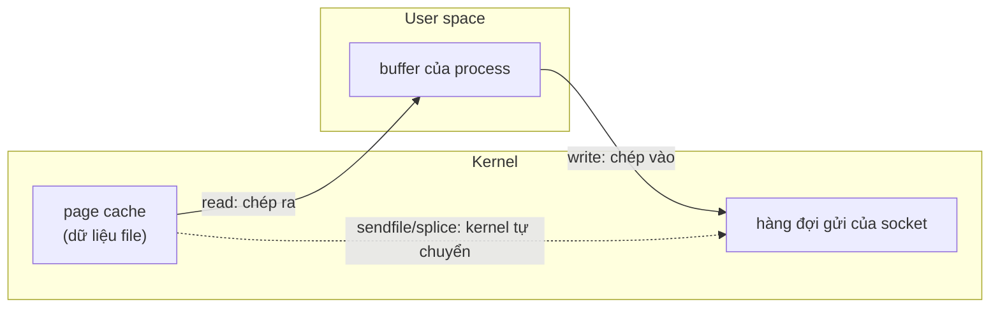
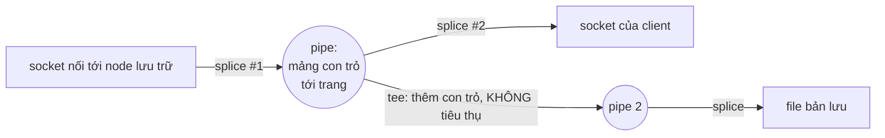
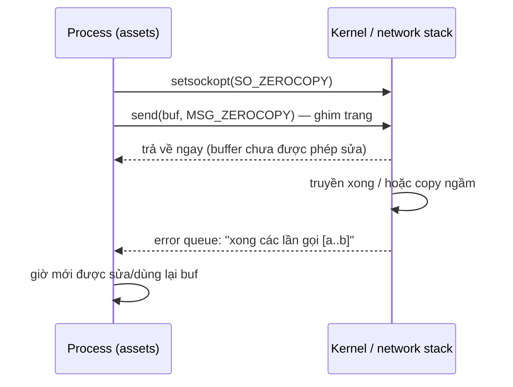

# P6 · Chương 09 — Zero-copy I/O: sendfile, splice, MSG_ZEROCOPY

> Mọi khẳng định về syscall/kernel là về **Linux** (man page Debian bookworm, kernel docs). Chương này **không có thí nghiệm**: không con số tốc độ nào ở đây do người soạn đo; chỗ nào có số thì số đó nằm trong câu trích của nguồn. Chi tiết cài đặt của `std` trích từ source tag 1.95.0 và có thể đổi ở bản sau. Các trang kernel docs về `MSG_ZEROCOPY` và kTLS là bản docs.kernel.org mới nhất lúc tải (đầu trang ghi 7.3.0-rc6), không ghim theo kernel của bản phân phối: một tùy chọn có trong docs chưa chắc có trên kernel cũ hơn (suy luận của người soạn).

## Bạn sẽ hiểu được gì

1. **Q1.** Vòng lặp `read` + `write` đưa dữ liệu từ file ra socket đi qua những chặng nào, và "zero-copy" muốn tránh cái gì? → mục 1
2. **Q2.** `sendfile(2)` làm được gì, điều kiện và bẫy (gửi thiếu, sửa file khi đang gửi)? → mục 2
3. **Q3.** `splice(2)`, `tee(2)`, `vmsplice(2)` là gì, và vì sao pipe là "buffer của kernel"? → mục 3
4. **Q4.** `copy_file_range(2)` khác `sendfile` chỗ nào (file → file, reflink, server-side copy)? → mục 4
5. **Q5.** `MSG_ZEROCOPY` hoạt động ra sao (opt-in, thông báo hoàn thành) và khi nào *không* có lợi? → mục 5
6. **Q6.** Dùng `mmap` để đọc/ghi file có tránh được copy không, và trả giá gì? → mục 6
7. **Q7.** kTLS (Kernel TLS) nằm ở đâu trong bức tranh zero-copy? → mục 7
8. **Q8.** `std::io::copy` và `tokio::io::copy` dùng các syscall này thế nào? → mục 8

## Kiến thức cần trước

- [Chương 07 — Socket API, phía kernel và `std::net`](07-socket-va-kernel.md): socket buffer, `send`/`recv`, `EAGAIN`.
- [Phase 5 · Chương 04 — Page cache, writeback và direct I/O](../05-storage/04-page-cache-va-direct-io.md): file nằm trong page cache; chương này dùng lại khái niệm đó.
- [Phase 1 · Chương 02 — System call](../01-linux/02-system-call.md) và [Chương 04 — fd và VFS](../01-linux/04-file-descriptor-va-vfs.md): mỗi syscall là một lần vào kernel; pipe là một loại fd.
- Liên hệ ngắn tới io_uring: [Phase 7 · Chương 03 — kqueue, io_uring](../07-io-async/03-kqueue-io-uring.md).

## 1. Đường đi của `read` + `write`, và zero-copy tránh cái gì (Q1)

> **Trả lời ngắn.** Nếu đưa dữ liệu từ file ra socket bằng vòng lặp `read` rồi `write`, mỗi mẩu dữ liệu bị kernel chép lên buffer của process, rồi lại bị chép xuống kernel khi `write`[^sf-more]. "Zero-copy" là nhóm syscall để kernel tự chuyển dữ liệu giữa hai fd mà không đưa nó lên user space[^sp-def]. Cách này còn gộp hai syscall thành một nên ít context switch hơn, theo chú thích trong source `std`[^rs-ctx].

**Giải thích.**

*Với service của bạn.* Hãy hình dung `assets`, một service viết bằng Rust chạy trên Linux, phục vụ file tải xuống: ảnh, bản xuất báo cáo PDF, có khi vài trăm MB mỗi file. Client mở một kết nối TCP, xin một file, `assets` đọc file từ đĩa rồi đổ vào kết nối. Ta sẽ bám theo `assets` suốt chương (nhận xét của người soạn: đây là ví dụ giả định, không phải code trong repo). Mỗi mục sau bắt đầu từ một việc `assets` phải làm, rồi xem syscall nào làm việc đó mà không kéo dữ liệu lên user space. Câu hỏi của mục này là câu nền: cách làm ngây thơ đã làm gì với từng byte, và zero-copy muốn bỏ chặng nào?

### 1.1 Vòng lặp `read` + `write`

Cách đơn giản nhất để `assets` gửi một file là đọc từng khúc vào một buffer, rồi ghi khúc đó ra socket. Code dưới đây chỉ để minh họa (của người soạn, không chạy, đã bỏ phần xử lý lỗi):

```rust
let mut buf = [0u8; 64 * 1024];
loop {
    let n = file.read(&mut buf)?;   // read(2): file -> buf
    if n == 0 { break; }
    conn.write_all(&buf[..n])?;     // write(2): buf -> socket
}
```

Mỗi vòng lặp có hai chặng, và dữ liệu băng qua ranh giới user/kernel hai lần. Ở chặng đầu, `read(2)` đọc tối đa `count` byte từ fd vào buffer bắt đầu tại `buf`[^rd-def]. Buffer đó là bộ nhớ của process, nên dữ liệu của file bị chép từ kernel sang user space (nếu file đã được đọc, dữ liệu đang nằm trong page cache; xem [P5·04](../05-storage/04-page-cache-va-direct-io.md)). Ở chặng sau, `write(2)` ghi tối đa `count` byte từ buffer bắt đầu tại `buf` vào fd[^wr-def]. Lần này dữ liệu đi ngược lại, từ user space xuống kernel, và với socket thì nó vào hàng đợi gửi (hàng đợi này nằm ở [chương 07](07-socket-va-kernel.md)). Man page `sendfile(2)` mô tả đúng tổ hợp này là việc chuyển dữ liệu "tới và từ user space"[^sf-more]. Mỗi vòng còn tốn hai syscall, một `read` và một `write`, tức hai lần vào kernel (suy luận của người soạn từ cấu trúc vòng lặp; xem [P1·02](../01-linux/02-system-call.md)).

Với `assets`, cái `buf` ở giữa chỉ là trạm trung chuyển: không dòng code nào đọc hay sửa byte trong đó. Vì vậy ta muốn bảo kernel "chuyển thẳng từ file sang socket" và bỏ trạm đó đi.



(Sơ đồ minh họa của người soạn: đường liền là vòng `read`+`write`, đường đứt là zero-copy; không thể hiện DMA/NIC.)

### 1.2 Bốn họ syscall cho việc đó

Chương này có bốn họ syscall, mỗi họ hợp với một việc khác nhau của `assets` (mục 6–7 bàn thêm `mmap` và kTLS, hai chủ đề đứng cạnh zero-copy). Cột "Việc của `assets`" là gợi ý của người soạn:

| Cơ chế | Chuyển dữ liệu giữa | Việc của `assets` | Mục |
|---|---|---|---|
| `sendfile` | file → fd bất kỳ (trước Linux 2.6.33: chỉ ra socket)[^sf-out] | trả một file cho client | 2 |
| `splice` / `tee` / `vmsplice` | fd ↔ pipe, pipe làm buffer kernel[^sp-def] | chuyển tiếp dữ liệu từ node khác, kèm một bản lưu | 3 |
| `copy_file_range` | file thường → file thường[^cfr-regular] | chép file vừa upload sang kho lưu trữ | 4 |
| `MSG_ZEROCOPY` | buffer của process → socket[^zc-others] | gửi blob đang nằm sẵn trong RAM | 5 |

<details><summary>Đi sâu: vì sao chương này không đếm số lần copy</summary>

- Chú thích đầu module `kernel_copy` trong source `std` (không phải trang docs.rs) kể ra lợi ích của các syscall offload: ít context switch hơn, vì read và write được gộp thành một syscall và mỗi syscall chuyển nhiều byte hơn[^rs-ctx]. Cũng đoạn đó nói `sendfile` và `splice` *có thể* zero-copy "trong một số hoàn cảnh"[^rs-zc]. Vế đối lập trong cùng đoạn là vòng lặp ngây thơ đưa mọi byte qua CPU[^s2-rs-naive]. Đó là lời hứa yếu ("có thể… trong một số hoàn cảnh"), không phải bảo đảm.
- Chương này **không** nêu số lần copy cụ thể (hai? bốn?) vì nguồn đã tải không đếm. Số lần phụ thuộc đường đi trong kernel và phần cứng (suy luận của người soạn). Mục 5 sẽ cho thấy ngay cả `MSG_ZEROCOPY` cũng có thể bị biến thành copy ở sâu trong stack, ví dụ khi thiết bị thiếu scatter-gather hoặc phải tính checksum[^zc-sg].
- `splice(2)` tự mô tả là chuyển dữ liệu giữa hai fd "mà không chép giữa không gian địa chỉ kernel và user"[^sp-def]. Câu đó chỉ cam kết việc *không băng qua ranh giới user/kernel*; nó không nói gì về chép nội bộ trong kernel (suy luận của người soạn từ câu chữ của man page).

</details>

**Quay lại Q1:** `read` kéo dữ liệu lên user space, `write` đẩy xuống lại: hai chặng chép và hai syscall mỗi vòng. Zero-copy là các syscall để kernel tự chuyển, bỏ chặng trung gian ở user space.

## 2. `sendfile(2)`: file → socket trong một syscall (Q2)

> **Trả lời ngắn.** `sendfile(out_fd, in_fd, offset, count)` bảo kernel chép `count` byte từ `in_fd` sang `out_fd` ngay trong kernel, nên hiệu quả hơn `read`+`write`[^sf-more]. `in_fd` phải là thứ "mmap được", tức không phải socket[^sf-in]. Còn `out_fd` từ Linux 2.6.33 có thể là file bất kỳ[^sf-out]. Có hai bẫy. Lần gọi có thể gửi *ít hơn* yêu cầu nên bạn phải tự gọi lại[^sf-partial]. Và nếu `out_fd` là socket hoặc pipe có zero-copy thì không được sửa phần file đã gửi cho tới khi bên nhận đọc xong[^sf-modify].

**Giải thích.**

*Với service `assets`.* Việc chính của `assets` gói được trong một câu: đổ file này vào kết nối kia. Nó không parse hay biến đổi nội dung, nên kéo dữ liệu lên buffer chỉ để đẩy xuống lại là thừa; `sendfile` sinh ra cho đúng kiểu việc đó. Dưới đây là cách gọi, rồi ba chỗ `assets` dễ vấp: offset dùng chung, gửi thiếu, và file bị sửa khi đang gửi.

### 2.1 Cách gọi và hai đầu của lời gọi

Chữ ký là `ssize_t sendfile(int out_fd, int in_fd, off_t *offset, size_t count)`, trong đó `in_fd` mở để đọc và `out_fd` mở để ghi[^sf-desc]. Với `assets`, `in_fd` là file cần gửi và `out_fd` là socket của client.

Hai đầu có điều kiện riêng. `in_fd` phải ứng với một file hỗ trợ thao tác kiểu `mmap(2)`, nên nó không thể là socket[^sf-in]. `out_fd` thì trước Linux 2.6.33 bắt buộc là socket, từ 2.6.33 mới có thể là file bất kỳ[^sf-out]. Nếu `out_fd` là file thường, kernel cập nhật file offset của nó tương ứng[^sf-out].

Điều kiện đầu có hệ quả cho `assets`: khi nguồn là một socket (chẳng hạn dữ liệu lấy từ node khác) thì `sendfile` không dùng được. Chỗ đó thuộc về `splice` ở mục 3 (nhận xét của người soạn).

### 2.2 `offset`: nhiều kết nối, một file

Giả sử mười client cùng tải một file ảnh và `assets` dùng chung một fd cho file đó (ví dụ giả định). Nếu `offset` là `NULL`, kernel đọc từ file offset hiện tại và cập nhật nó, nên mười kết nối sẽ giẫm lên một vị trí chung. Nếu `offset` khác `NULL`, `sendfile` giữ nguyên file offset của `in_fd`[^sf-offset]. Lúc đó `offset` trỏ tới biến giữ vị trí bắt đầu đọc, và khi `sendfile` trả về, biến này chỉ vào byte nằm sau byte cuối đã đọc. Vì vậy `assets` nên truyền một `offset` riêng cho mỗi kết nối (nhận xét của người soạn). File offset chung nằm ở open file description, xem [P1·04 mục 2](../01-linux/04-file-descriptor-va-vfs.md).

### 2.3 Gửi thiếu

Lời gọi thành công trả về số byte đã ghi vào `out_fd`, và số này có thể nhỏ hơn `count`; người gọi phải sẵn sàng gọi lại cho phần chưa gửi[^sf-partial]. Ngoài ra mỗi lần gọi chuyển tối đa `0x7ffff000` (2.147.479.552) byte, trên cả hệ 32 lẫn 64 bit[^sf-max]. Với `assets` (nhận xét của người soạn), file lớn hơn mức đó chắc chắn phải gọi nhiều lần, và file nhỏ hơn cũng không có gì bảo đảm gửi trọn trong một lần. `write(2)` có cùng tính chất: nó có thể ghi ít hơn yêu cầu, và khi đó người gọi gọi `write` lần nữa cho phần còn lại[^wr-partial]. Vậy nên luôn lặp theo giá trị trả về.

### 2.4 Header HTTP đi trước thân file

Response HTTP của `assets` có phần header đứng trước thân file. Muốn gửi một ít header trước nội dung file qua TCP, man page khuyên dùng tùy chọn `TCP_CORK` để giảm số gói và tinh chỉnh hiệu năng[^sf-cork].

### 2.5 Sửa file khi đang gửi

Bẫy này tinh tế hơn. Nếu `out_fd` là socket hoặc pipe có hỗ trợ zero-copy, người gọi phải bảo đảm các phần file đã chuyển *không bị sửa* cho tới khi bên đọc ở đầu kia của `out_fd` đã tiêu thụ xong dữ liệu[^sf-modify]. Lý do (suy luận của người soạn): kernel có thể giữ tham chiếu tới trang của file thay vì chép, cùng cơ chế "con trỏ tới trang" của pipe ở mục 3, nên nội dung đang bay có thể đổi theo file. Với `assets`, điều đó nghĩa là một job khác ghi đè file báo cáo đúng lúc nó đang được gửi thì dữ liệu đang bay có thể đổi theo (nhận xét của người soạn).

### 2.6 Không portable

`sendfile` không có trong POSIX; các Unix khác cài nó với ngữ nghĩa và prototype khác, nên không nên dùng trong chương trình cần portable[^sf-posix].

<details><summary>Đi sâu: lỗi, fallback và chuyện offset khi non-blocking</summary>

- Man page khuyên: khi `sendfile` lỗi với `EINVAL` hoặc `ENOSYS` thì ứng dụng có thể lùi về `read`+`write`[^sf-fallback].
- `EINVAL` xuất hiện khi mô tả không hợp lệ hoặc bị khóa, khi không có thao tác kiểu `mmap` cho `in_fd`, hoặc khi `count` âm[^sf-einval0]. Nó cũng xuất hiện khi `out_fd` có `O_APPEND`, thứ mà hiện `sendfile` chưa hỗ trợ[^sf-einval].
- `ESPIPE` xuất hiện khi `offset` khác `NULL` mà `in_fd` không seek được[^sf-espipe].
- Mục 8 (phần Đi sâu) cho thấy nhánh `sendfile`/`splice` trong `std` coi `EINVAL` là "fd này không hỗ trợ" rồi lùi về vòng lặp thường[^rs-einval]. Còn `ENOSYS` hoặc `EPERM` khiến nó đánh dấu syscall là không dùng được[^rs-enosys].
- Với fd non-blocking, `sendfile` trả `EAGAIN` khi đã chọn `O_NONBLOCK` và việc ghi sẽ bị chặn[^sf-eagain]. Hệ quả (nhận xét của người soạn): trong event loop, `sendfile` trả `EAGAIN` giống `write`, nên chờ epoll báo socket ghi được rồi gọi lại với phần còn lại.
- Man page `sendfile(2)` chỉ ra `splice(2)` là lựa chọn Linux-specific cho trường hợp tổng quát hơn: truyền giữa các fd bất kỳ miễn một (hoặc cả hai) là pipe[^sf-splice]. Chuyện này ở mục 3.
- Với kTLS, `sendfile` còn có nghĩa riêng: kernel mã hóa dữ liệu file thành TLS record. Chuyện này ở mục 7.

</details>

**Quay lại Q2:** `sendfile` là "đổ file vào fd" ngay trong kernel. Nhớ lặp theo giá trị trả về, truyền `offset` riêng khi nhiều kết nối dùng chung một fd, và đừng sửa file khi dữ liệu còn đang bay.

## 3. `splice`, `tee`, `vmsplice`: pipe làm buffer kernel (Q3)

> **Trả lời ngắn.** `splice(2)` chuyển dữ liệu giữa hai fd mà không qua user space, miễn có ít nhất một đầu là pipe[^sp-def]. Pipe ở đây đóng vai buffer trong kernel: thực chất nó là một tập con trỏ đếm tham chiếu tới trang bộ nhớ kernel, nên "chép" chỉ là chép con trỏ[^sp-refcount]. `tee(2)` nhân đôi dữ liệu giữa hai pipe mà không tiêu thụ nó[^tee-def]. Còn `vmsplice(2)` đưa vùng nhớ user vào pipe[^vm-def].

**Giải thích.**

*Với service `assets`.* Giả sử `assets` không giữ file trên đĩa local mà lấy từ một node lưu trữ khác. Khi client xin file, nó mở kết nối tới node đó, nhận byte về rồi chuyển tiếp cho client, và đồng thời muốn giữ một bản vào file để lần sau khỏi phải lấy lại (ví dụ giả định). Nguồn lúc này là một socket nên `sendfile` bó tay, vì `in_fd` không thể là socket (mục 2). Man page chỉ sang `splice(2)` cho trường hợp tổng quát hơn: truyền giữa các fd bất kỳ, miễn một trong hai là pipe[^sf-splice]. Để hiểu vì sao phải có pipe, ta cần biết pipe ở đây thực chất là gì.

### 3.1 Pipe là buffer của kernel

Man page gom ba syscall vào một mô hình. `splice()`, `vmsplice(2)` và `tee(2)` cho chương trình user toàn quyền điều khiển một buffer kernel bất kỳ, được cài bằng đúng loại buffer của pipe[^sp-notes]. Trong mô hình đó, `splice()` chuyển dữ liệu giữa buffer và fd bất kỳ (hoặc từ buffer này sang buffer khác), `tee(2)` "chép" từ buffer này sang buffer khác, còn `vmsplice(2)` "chép" từ user space vào buffer[^sp-notes].

Chữ "chép" bị đặt trong ngoặc kép vì thực tế hầu như không có chép thật. Pipe buffer được cài bằng một tập con trỏ đếm tham chiếu tới các trang bộ nhớ kernel. "Chép" một trang trong buffer chỉ tạo một con trỏ mới (cho buffer đầu ra) trỏ tới trang đó và tăng bộ đếm tham chiếu của trang: chỉ con trỏ được chép, trang thì không[^sp-refcount]. Nên cái pipe không phải đường ống chứa byte mà là danh sách các "tay cầm" tới trang.

Với `assets`, chuyển tiếp từ node lưu trữ ra client và giữ một bản lưu có thể trông như sau:



(Sơ đồ minh họa của người soạn từ mô tả ở trên. Man page nói pipe buffer trỏ tới trang bộ nhớ kernel; nó không nói trang đó của file nào hay đến từ đâu.)

### 3.2 `splice`: các luật

- Chuyển tối đa `len` byte từ `fd_in` sang `fd_out`, trong đó một trong hai phải là pipe[^sp-def].
- Nếu `fd_in` là pipe thì `off_in` phải là `NULL`[^sp-offs]. Nếu `fd_in` không phải pipe và `off_in` là `NULL` thì kernel đọc từ file offset hiện tại và cập nhật nó[^sp-offs2].
- Từ Linux 2.6.31, cả hai đối số có thể đều là pipe; trước đó đúng một cái phải là pipe[^sp-bothpipes].
- Trả về `0` nghĩa là hết đầu vào[^sp-ret0]. Vòng lặp chuyển tiếp của `assets` dùng giá trị này để biết node lưu trữ đã gửi hết (nhận xét của người soạn).
- Kết quả là `EINVAL` nếu hai fd đều không phải pipe[^sp-einval]. Nó cũng là `EINVAL` nếu filesystem đích không hỗ trợ splice[^sp-einval3].

Về cờ: `SPLICE_F_NONBLOCK` làm các thao tác trên pipe không chặn, nhưng `splice()` vẫn có thể chặn vì fd còn lại có thể chặn (trừ khi nó cũng đặt `O_NONBLOCK`)[^sp-nb]. `SPLICE_F_MORE` là gợi ý "còn dữ liệu đến ở lần splice sau", hữu ích khi `fd_out` là socket[^sp-more]. `SPLICE_F_MOVE` từ Linux 2.6.21 là no-op, dù vẫn được phép truyền vào[^sp-move].

### 3.3 `tee`: nhân đôi mà không tiêu thụ

`tee` nhân đôi tối đa `len` byte từ pipe `fd_in` sang pipe `fd_out` và **không tiêu thụ** dữ liệu ở `fd_in`, nên dữ liệu đó vẫn có thể được `splice` ở bước sau[^tee-def]. Thực chất không có chép dữ liệu: `tee()` chỉ giữ một tham chiếu tới đầu vào rồi gán cho đầu ra[^tee-noreal]. Cả hai fd bắt buộc là pipe, nếu không là `EINVAL`[^tee-einval].

Đó chính là thứ `assets` cần ở sơ đồ trên: nhân đôi con trỏ sang pipe thứ hai để ghi bản lưu, trong khi pipe đầu vẫn được `splice` ra socket của client. Cả hai việc xảy ra mà dữ liệu không lên user space (nhận xét của người soạn).

### 3.4 `vmsplice`: từ vùng nhớ user vào pipe

Nếu fd mở để ghi, `vmsplice` ánh xạ `nr_segs` vùng nhớ user (mô tả bằng mảng `iovec`) vào pipe; nếu fd mở để đọc, nó điền các vùng nhớ user từ pipe. fd phải là pipe[^vm-def]. Chỉ chiều user → pipe là splice thật; chiều ngược lại thực ra chỉ chép dữ liệu ra user space[^vm-read].

<details><summary>Đi sâu: sức chứa pipe, SPLICE_F_GIFT, các giới hạn khác</summary>

- Sức chứa pipe từ Linux 2.6.11 là 16 trang (65.536 byte nếu trang 4096 byte)[^pipe-cap]. Từ 2.6.35, mặc định vẫn là 16 trang nhưng có thể hỏi và đặt bằng `fcntl(2)` với `F_GETPIPE_SZ`/`F_SETPIPE_SZ`[^pipe-sz]. Man page dặn ứng dụng *không nên dựa vào một sức chứa cụ thể*[^pipe-norely]. Hệ quả (suy luận của người soạn): một lần `splice` vào pipe không thể nhét quá sức chứa của pipe, nên chương trình chuyển file lớn cần vòng lặp "splice vào pipe → splice ra khỏi pipe" và coi mỗi lần là một đợt.
- `SPLICE_F_GIFT` chỉ dành cho `vmsplice`: `splice(2)` ghi cờ này là không dùng[^sp-gift]. `tee(2)` cũng vậy[^tee-gift].
- Man page `vmsplice(2)` gọi trang user là "quà tặng cho kernel": ứng dụng *không bao giờ* được sửa vùng nhớ đó nữa, nếu không page cache và dữ liệu trên đĩa có thể lệch nhau. Tặng trang nghĩa là `splice(2)` + `SPLICE_F_MOVE` sau đó *có thể* chuyển trang thành công, còn nếu không tặng thì phải chép. Dữ liệu còn phải căn trang cả về địa chỉ lẫn độ dài[^vm-gift].
- Nhưng `SPLICE_F_MOVE` ở `splice(2)` hiện là no-op[^sp-move]. `vmsplice(2)` cũng ghi `SPLICE_F_MOVE` là không dùng[^vm-move], nên chỉ từ man page không suy ra được tác dụng thực tế của GIFT.
- Người soạn đọc thêm source kernel v6.1, chỉ hai file `fs/splice.c` và `fs/fuse/dev.c`, không duyệt toàn cây. Trong đó `vmsplice_to_pipe` đổi `SPLICE_F_GIFT` thành cờ `PIPE_BUF_FLAG_GIFT` trên buffer[^k-gift-set]. Thao tác lấy trang (`try_steal`) của buffer chứa trang user từ chối nếu không có cờ đó[^k-gift-steal]. Nơi gọi thao tác lấy trang trong hai file ấy là đường ghi của `/dev/fuse`[^k-fuse-steal]. Đường đó chỉ bật khi có `SPLICE_F_MOVE`[^k-fuse-move]. Suy luận của người soạn: trong hai file đã đọc, GIFT chỉ có tác dụng gắn với thao tác lấy trang kèm MOVE ở FUSE, không thấy đường `splice` ra file hay socket nào dùng nó. Các file khác và kernel khác chưa xác minh nên không khẳng định hơn.
- `vmsplice` giới hạn số segment bằng `IOV_MAX` (hiện là 1024)[^vm-iovmax]. Nó trả `EINVAL` nếu vượt giới hạn đó, hoặc nếu bộ nhớ không căn trang khi có `SPLICE_F_GIFT`[^vm-einval].
- Cả ba syscall là **Linux-specific**, tức đặc thù Linux[^sp-linux]. Chương này chỉ xét Linux, và (suy luận của người soạn từ chữ đó) đừng giả định chúng có trên macOS/BSD.
- `EINVAL` cũng xuất hiện khi mục tiêu mở append[^sp-append]. Nó còn xuất hiện khi hai đầu là *cùng một* pipe[^sp-einval2].

</details>

**Quay lại Q3:** pipe trong `splice` không phải ống chứa byte mà là mảng con trỏ đếm tham chiếu tới trang kernel. `splice` nối fd với pipe, `tee` nhân con trỏ, `vmsplice` đưa vùng nhớ user vào.

## 4. `copy_file_range(2)`: file → file (Q4)

> **Trả lời ngắn.** `copy_file_range` chép dữ liệu giữa hai fd *trong kernel*, không phải đi vòng qua user space rồi quay lại[^cfr-def]. Nó dành cho **file thường** ↔ file thường[^cfr-regular]. Man page nói syscall này cho filesystem cơ hội áp dụng kỹ thuật tăng tốc chép, như reflink (chia sẻ block copy-on-write) hoặc server-side copy của NFS[^cfr-accel].

**Giải thích.**

*Với service `assets`.* Khi một client upload xong báo cáo, `assets` phải chép file đó từ thư mục tạm sang kho lưu trữ (ví dụ giả định). Không có socket nào ở đây: cả hai đầu đều là file. Nếu chép bằng vòng `read`+`write`, từng khúc vẫn phải lên rồi xuống user space, trong khi kernel và filesystem thấy được cả hai đầu và có thể làm gọn hơn nhiều. `copy_file_range` là lời nhờ "kernel tự lo việc chép" đó (nhận xét của người soạn).

### 4.1 Ngữ nghĩa

`copy_file_range` chép tối đa `len` byte từ `fd_in` sang `fd_out`, **ghi đè** mọi dữ liệu có sẵn trong vùng đích tương ứng[^s2-cfr-copy]. Về offset, nếu `off_in` là `NULL` thì nó đọc từ file offset hiện tại và cập nhật file offset theo số byte đã chép[^s2-cfr-offnull]. Nếu `off_in` khác `NULL` thì nó chỉ vị trí bắt đầu đọc: file offset của `fd_in` không đổi còn `off_in` được cập nhật[^cfr-off]. `fd_in` và `fd_out` có thể là cùng một file, nhưng vùng nguồn và vùng đích không được chồng lấn[^cfr-overlap]. Tham số `flags` dành cho mở rộng tương lai và hiện phải bằng 0[^cfr-flags].

### 4.2 Giá trị trả về

Hàm trả về số byte đã chép, và số này **có thể ít hơn** yêu cầu. Nếu offset của `fd_in` ở cuối hoặc sau cuối file thì không chép gì và hàm trả về 0[^cfr-ret]. Cũng như `sendfile`, `assets` phải gọi lặp cho tới khi chép đủ (quan sát của người soạn: mã mẫu trong man page cũng lặp tới khi hết `len`).

### 4.3 Chỉ file thường

`EINVAL` nếu một trong hai fd không phải file thường[^cfr-regular]. Vì thế `copy_file_range` không phải công cụ cho socket; đó là việc của `sendfile` và `splice`.

### 4.4 Khác `sendfile` chỗ nào

`sendfile` hướng tới việc *truyền* dữ liệu, thường là ra socket. `copy_file_range` hướng tới *nhân bản dữ liệu file* và mở đường cho filesystem tăng tốc chép (copy acceleration)[^cfr-accel]. Nhờ đó nó có thể không chép byte nào, như với reflink; xem [P5·07](../05-storage/07-raid-va-copy-on-write-fs.md) về copy-on-write FS (nhận xét của người soạn).

<details><summary>Đi sâu: phiên bản, EXDEV, lỗi "báo thành công mà không chép", file thưa</summary>

- `copy_file_range` xuất hiện từ Linux 4.5, và glibc 2.27 có bản mô phỏng trong user space khi kernel chưa có[^cfr-ver]. Đây là phần mở rộng không chuẩn của Linux/GNU[^cfr-std].
- Kernel 5.3 viết lại đáng kể phần cài đặt: các chỗ chưa rõ trong API được làm rõ và kiểm tra giới hạn chặt hơn[^cfr-rework]. Ứng dụng nên nhắm hành vi của Linux 5.19, vốn đã được backport về một số bản stable cũ hơn[^cfr-target].
- Chép *khác filesystem*: trước Linux 5.3, hai file không cùng filesystem cho `EXDEV`[^cfr-xdev-old]. Từ 5.19, kernel có thể chép khi hai filesystem cùng loại và loại đó cài hỗ trợ; nếu khác loại hoặc không hỗ trợ thì vẫn `EXDEV`[^cfr-xdev]. `EOPNOTSUPP` (từ 5.19) xuất hiện khi filesystem không hỗ trợ thao tác[^cfr-eopnotsupp].
- **Lỗi nổi tiếng:** từ Linux 5.3 đến 5.18, khi filesystem không tự hỗ trợ chép khác filesystem thì kernel làm thay. Nhưng trên một số filesystem ảo, lời gọi không chép được gì mà vẫn báo thành công[^cfr-bug]. Vì thế (nhận xét của người soạn) code dùng `copy_file_range` nên kiểm tra kích thước kết quả khi chạy trên filesystem lạ. Mục 8 cho thấy `std` có đường lùi riêng cho trường hợp "trả 0 byte".
- File thưa: nếu `fd_in` là file thưa, `copy_file_range` có thể làm các lỗ thành vùng dữ liệu thật. Có thể gọi nó trong vòng lặp cùng `lseek(2)` với `SEEK_DATA`/`SEEK_HOLE` để tìm đoạn dữ liệu[^cfr-sparse].
- `EBADF` cũng xuất hiện khi `fd_out` có `O_APPEND`[^cfr-append].

</details>

**Quay lại Q4:** `copy_file_range` là bản "kernel tự lo" cho file → file. Vì chỉ nhận file thường và cho filesystem cơ hội reflink/server-side copy, nó khác hẳn `sendfile`, thứ dùng để đổ file ra socket.

## 5. `MSG_ZEROCOPY`: gửi thẳng buffer của process, và khi nào có lợi (Q5)

> **Trả lời ngắn.** `MSG_ZEROCOPY` là cờ cho các lệnh gửi trên socket (TCP, UDP, và VSOCK với transport virtio) để kernel *tránh chép* dữ liệu[^zc-intro]. Cách cài hiện tại là ghim (pin) trang của buffer thay vì chép. Đổi lại, nó thay chi phí chép từng byte bằng chi phí kế toán trang và thông báo hoàn thành, nên thường chỉ có lợi khi mỗi lần ghi lớn hơn khoảng 10 KB[^zc-notfree]. Và vì buffer được chia sẻ tạm thời với network stack, bạn không được ghi đè nó cho tới khi nhận thông báo "xong"[^zc-share].

**Giải thích.**

*Với service `assets`.* Giả sử `assets` giữ trong RAM bản cache của những file hay được tải, hoặc vừa render xong một bản PDF vào bộ nhớ (ví dụ giả định). Dữ liệu lúc này nằm trong buffer của process, không phải trong một file hay pipe, nên `sendfile` và `splice` không áp dụng. `MSG_ZEROCOPY` mở rộng cơ chế tránh chép của hai syscall đó sang các lệnh gửi thông thường của socket (`send`, `sendto`, `sendmsg`, `sendmmsg`), tức nguồn có thể là *buffer bất kỳ của process*[^zc-others]. Nhưng nó đổi hợp đồng: buffer không còn thuộc riêng `assets` cho tới khi kernel báo xong. Phần còn lại của mục là ba bước dùng, rồi điều kiện để nó đáng dùng.

### 5.1 Ba bước: opt-in, gửi, chờ thông báo

*Bước 1: opt-in.* Kernel khá dễ tính với cờ lạ: mặc định nó bỏ qua cờ không định nghĩa. Để tránh bật chế độ tránh chép cho các process cũ lỡ truyền cờ này, process phải báo ý định trước bằng `setsockopt(fd, SOL_SOCKET, SO_ZEROCOPY, …)`[^zc-optin].

*Bước 2: gửi.* Thay đổi ở lệnh gửi chỉ là truyền thêm cờ `MSG_ZEROCOPY`[^zc-send]. Chế độ này có một lỗi riêng: lệnh gửi trả `-1` với `errno = ENOBUFS` khi socket vượt giới hạn optmem hoặc người dùng vượt `ulimit` số trang bị khóa[^zc-enobufs]. Trộn lệnh có cờ và không cờ trên cùng socket là an toàn[^zc-mix].

*Bước 3: chờ thông báo hoàn thành.* Kernel phải báo khi nào *an toàn để dùng lại buffer*. Nó xếp thông báo vào **hàng đợi lỗi** (error queue) của socket, giống giao diện timestamp truyền[^zc-notif]. Mỗi socket giữ một bộ đếm 32 bit không dấu, tăng một đơn vị sau mỗi lệnh gửi `MSG_ZEROCOPY` thành công; bộ đếm này đếm số lần gọi syscall chứ không đếm byte, và quấn vòng sau `UINT_MAX`[^zc-counter]. Cách đọc đơn giản là sau mỗi `send` thì `poll` rồi `recvmsg` với `MSG_ERRQUEUE`: kernel luôn đặt `POLLERR` vô điều kiện, và đọc hàng đợi lỗi luôn không chặn[^zc-poll]. Trong thực tế, tài liệu nói hiệu quả hơn là không đợi, cứ vài lệnh gửi lại đọc không chặn một lần[^zc-poll2]. Thông báo mang mã lỗi 0 để không chặn các lệnh `send`/`recv` khác trên socket[^zc-errno0].

Với `assets`, quy tắc rút ra là: blob nào đã đưa cho kernel thì không được ghi đè, và không được trả về pool buffer, cho tới khi đọc được thông báo ứng với lần gửi đó (suy luận của người soạn từ yêu cầu ở trên).

### 5.2 Thông báo là một khoảng

Mỗi thông báo mang một **khoảng** `[ee_info, ee_data]`, đóng cả hai đầu[^zc-range], chứ không phải một giá trị đơn lẻ. Lý do là kernel gộp các thông báo liên tiếp khi một cái còn chờ được đọc[^zc-batch]. Với giao thức xác nhận theo thứ tự như TCP, nhiều nhất một thông báo treo tại một thời điểm[^zc-inorder]. Nhưng *thứ tự không được bảo đảm*: thông báo có thể đảo lộn khi retransmit và khi đóng socket[^zc-ooo]. Vì vậy `assets` không nên giả định thông báo đến đúng thứ tự gửi (suy luận của người soạn).



(Sơ đồ minh họa của người soạn, theo các bước nguồn mô tả ở trên.)

### 5.3 Khi nào đáng dùng

Tránh chép không phải bữa trưa miễn phí. Với cách cài hiện tại, `MSG_ZEROCOPY` ghim trang (page pinning, tức giữ trang của buffer cố định để kernel tham chiếu) và thay chi phí chép từng byte bằng chi phí kế toán trang cộng thông báo hoàn thành[^zc-notfree]. Vì thế nó thường chỉ hiệu quả với lần ghi trên khoảng 10 KB[^zc-notfree]. Với `assets` (nhận xét của người soạn), một response JSON vài KB không đáng, còn blob lớn hơn 10 KB nhiều lần thì đáng thử. Trang bị ghim còn tính vào giới hạn `ulimit` số trang bị khóa, như lỗi `ENOBUFS` ở trên gợi ý (suy luận của người soạn)[^zc-enobufs].

Ngoài chi phí, cờ này đổi ngữ nghĩa của syscall. Khác với chép, process không thể ghi đè buffer ngay sau khi syscall trả về mà không có nguy cơ sửa dữ liệu đang bay. Tính toàn vẹn của kernel không bị ảnh hưởng, nhưng một chương trình lỗi có thể tự làm hỏng luồng dữ liệu của chính nó[^zc-share]. Vì thế chuyển ứng dụng sang `MSG_ZEROCOPY` không đơn thuần là thêm cờ[^zc-notfree2].

### 5.4 Khi nào không có lợi, hoặc bị chép ngầm

Cờ chỉ là *gợi ý* kèm cam kết kernel sẽ xếp thông báo hoàn thành; nó **không** bảo đảm việc chép được loại bỏ[^zc-hint]. Có hai trường hợp không tránh được chép. Thứ nhất, thiết bị không hỗ trợ scatter-gather I/O (khả năng gửi một gói ghép từ nhiều mẩu bộ nhớ rời, như header ở một nơi và dữ liệu ở nơi khác; giải nghĩa của người soạn) thì không gửi được gói gồm header giao thức do kernel tạo cộng dữ liệu user zero-copy. Một gói cũng có thể phải đổi thành bản chép riêng ở sâu trong stack, ví dụ để tính checksum[^zc-sg].

Thứ hai là **loopback** (TCP/UDP). Mọi gói tạo bằng `MSG_ZEROCOPY` mà quay về một socket cục bộ đều bị *chép trì hoãn*, kể cả khi quay về socket packet (như tcpdump) hay thiết bị tun. Lý do là thời gian chờ thông báo không thể vô hạn trong khi bên nhận cục bộ có thể không bao giờ đọc[^zc-loop]. VSOCK là ngoại lệ: đường dữ liệu tới socket cục bộ giống với socket không cục bộ[^zc-vsock].

Điều này quan trọng với `assets` nếu client của nó nằm cùng máy. Container cùng host thường nối nhau qua cặp `veth` giữa các network namespace (suy luận của người soạn). Tài liệu kernel nói bài test chạy giữa một cặp process cục bộ, ví dụ qua cặp veth giữa các namespace, sẽ không cho thấy cải thiện[^zc-test]. Nên khi quyết định có dùng `MSG_ZEROCOPY` hay không, hãy đo trên cặp host thật chứ không đo trên máy dev (nhận xét của người soạn).

<details><summary>Đi sâu: bản chép trì hoãn, cờ SO_EE_CODE_ZEROCOPY_COPIED, định dạng thông báo, tài liệu</summary>

- Khi không thể tránh chép, kernel vẫn trả thông báo hoàn thành *khi nó thả tham chiếu tới trang chung*. Thông báo đó có thể đến *trước* khi dữ liệu (đã bị chép) được truyền hết, nên **thông báo hoàn thành zerocopy không phải thông báo hoàn thành truyền**[^zc-notxdone].
- Chép trì hoãn có thể đắt hơn chép ngay trong syscall nếu dữ liệu không còn "ấm" trong cache; process còn trả chi phí xử lý thông báo mà không được lợi gì[^zc-deferred]. Vì thế kernel báo "đã chép" bằng cờ `SO_EE_CODE_ZEROCOPY_COPIED` ở trường `ee_code`, và process có thể dùng tín hiệu đó để ngừng truyền `MSG_ZEROCOPY` cho các lệnh tiếp theo trên cùng socket[^zc-copied].
- Thông báo dùng định dạng lỗi chuẩn `sock_extended_err`[^zc-parse]. `cmsg_level`/`cmsg_type` theo họ giao thức: `IP_RECVERR`/`IPV6_RECVERR` cho TCP/UDP, `SOL_VSOCK`/`VSOCK_RECVERR` cho VSOCK[^zc-cmsg]. Nguồn lỗi là `SO_EE_ORIGIN_ZEROCOPY` và `ee_errno` bằng 0[^zc-parse2]. Các trường khác (trừ `ee_code`) phải coi là không xác định[^zc-undef].
- Mã mẫu thật nằm ở `tools/testing/selftests/net/msg_zerocopy.c` trong source kernel[^zc-test0].
- Bài báo gốc (netdev 2.1) và LWN là các tài liệu mà kernel docs trỏ tới để đọc sâu[^zc-more].
- io_uring: chương này không đi vào đường zero-copy gửi của io_uring vì chưa lấy được nguồn. Mô hình completion queue của io_uring nằm ở [P7·03](../07-io-async/03-kqueue-io-uring.md); xem phần "sở hữu buffer" ở mục 5 chương đó, nơi chủ đề "ai giữ buffer trong khi kernel dùng" cũng xuất hiện (nhận xét của người soạn: cùng bài toán).

</details>

**Quay lại Q5:** `MSG_ZEROCOPY` cần opt-in `SO_ZEROCOPY`, và gửi xong chưa được sửa buffer cho tới khi đọc thông báo từ error queue. Nó chỉ thường đáng khi mỗi lần ghi lớn (quanh 10 KB trở lên) và không đi qua loopback (với TCP/UDP).

## 6. `mmap` cho I/O: tránh một số chép, trả giá bằng fault và rủi ro (Q6)

> **Trả lời ngắn.** `mmap` ánh xạ file vào không gian địa chỉ của process, nên bạn đọc và ghi file bằng truy cập bộ nhớ thay vì `read`/`write`[^mm-map]. Về chuyện chép: tài liệu kernel nói `read`, `write` và `mmap` thông thường đều đi qua page cache[^pcg], nên (suy luận của người soạn) truy cập ánh xạ bỏ được bước chép từ page cache sang buffer riêng của process; nhưng man page `mmap(2)` không nêu số lần chép hay so sánh tốc độ. Cái giá gồm ba thứ. Lần chạm đầu có thể gây page fault[^mm-populate]. Chạm quá cuối file gây `SIGBUS`[^mm-sigbus]. Và ngữ nghĩa ghi/hiển thị đổi giữa `MAP_SHARED` và `MAP_PRIVATE`[^mm-shared].

**Giải thích.**

*Với service `assets`.* Ngoài việc đổ file ra socket, `assets` còn phải tra một file index lớn trên đĩa, một bảng từ tên file tới vị trí của nó trong kho, và tra đi tra lại theo kiểu truy cập ngẫu nhiên (ví dụ giả định). Việc này `sendfile` không giúp được, vì dữ liệu phải được chính process đọc thật. `mmap` là lựa chọn khác: ánh xạ file vào không gian địa chỉ rồi đọc như đọc bộ nhớ. Mục này xem nó bỏ được gì, và đổi lại `assets` phải gánh gì.

### 6.1 Cơ chế

`mmap()` tạo một ánh xạ mới trong không gian địa chỉ ảo của process[^mm-map]. Sau khi `mmap` trả về, có thể đóng ngay `fd` mà không làm mất ánh xạ[^mm-close]. Truy cập vùng ánh xạ là truy cập bộ nhớ thường, không cần syscall mỗi lần. Trang được nạp khi chạm lần đầu (demand paging; xem [P3·04, mục 2](../03-memory/04-page-fault-va-swapping.md), bố cục `mmap`/copy-on-write/`brk` ở [P3·05, mục 4](../03-memory/05-bo-nho-tien-trinh-linux.md), và page cache ở [P5·04](../05-storage/04-page-cache-va-direct-io.md)). Ứng dụng có thể hỏi trang nào của ánh xạ đang nằm trong page cache bằng `mincore(2)`[^mm-mincore].

### 6.2 Hai chế độ

`MAP_SHARED`: cập nhật vào vùng ánh xạ thấy được với các process khác cùng ánh xạ vùng đó, và (với file) được ghi xuống file. Muốn kiểm soát chính xác lúc cập nhật xuống file thì phải dùng `msync(2)`[^mm-shared]. `MAP_PRIVATE`: mỗi process có một bản sao copy-on-write riêng; cập nhật không thấy với người khác và không ghi xuống file. Nếu file bị đổi sau khi `mmap` thì thay đổi đó có hiện ra trong vùng ánh xạ hay không là **không xác định**[^mm-private].

### 6.3 Cái giá

*Một là `SIGBUS`.* Truy cập vượt quá cuối file ánh xạ cho `SIGBUS`[^mm-sigbus]. Hệ quả với `assets` (nhận xét của người soạn): nếu một process khác cắt ngắn file index trong lúc `assets` đang tra, cả process có thể chết bằng tín hiệu thay vì nhận một `Err` để xử lý, và mọi kết nối đang phục vụ đứt theo. Man page chỉ nói hiệu ứng của việc đổi kích thước file lên các trang thuộc vùng bị thêm hoặc bớt là *không xác định*[^mm-resize]. Trường hợp này đã được đo ở [P3·05, mục 4](../03-memory/05-bo-nho-tien-trinh-linux.md) (Đi sâu): `mmap` file 8 KiB `MAP_SHARED`, `ftruncate` xuống 0, ghi byte 5000 → `Bus error`, exit 135 = 128 + SIGBUS (một lần chạy trên lab).

*Hai là `SIGSEGV`.* Ghi vào vùng ánh xạ chỉ-đọc cho `SIGSEGV`[^mm-sigsegv].

*Ba là page fault.* Lần chạm trang đầu tiên có thể chặn do page fault. Cờ `MAP_POPULATE` prefault các bảng trang và với file nó gây read-ahead, giúp giảm chặn do fault về sau[^mm-populate].

### 6.4 So với zero-copy ở mục 2–5

Man page `mmap(2)` **không** nêu số lần chép hay so sánh tốc độ với `read`/`sendfile`, và chương này cũng không khẳng định. Điều có nguồn: `sendfile` đòi `in_fd` là thứ hỗ trợ thao tác kiểu `mmap`[^sf-in]. Ngược lại, `sendfile` được mô tả là hiệu quả hơn `read`+`write`[^sf-more]. Nhận xét của người soạn: `mmap` hợp khi bạn thực sự cần truy cập ngẫu nhiên, nhiều lần, vào dữ liệu ngay trong process, như file index của `assets`. Còn nếu chỉ chuyển byte từ file ra socket thì `sendfile`/`splice` diễn đạt đúng ý hơn, và code của bạn không gánh rủi ro `SIGBUS`.

<details><summary>Đi sâu: MAP_POPULATE và mmap trong Rust</summary>

- `MAP_POPULATE` không làm `mmap` thất bại nếu không điền được trang (ví dụ giới hạn huge page)[^mm-populate2]. Đây là *gợi ý prefault*, không phải bảo đảm toàn bộ file đã nằm trong RAM (suy luận của người soạn).
- Về Rust: danh sách mục của `std` 1.95.0 (`std/all.html`) không có tên nào chứa "mmap" (quan sát của người soạn khi tìm trong trang đó), nên đọc/ghi file kiểu mmap trong Rust phải dùng crate ngoài. Chương [P5·08 mục 8](../05-storage/08-rust-va-luu-tru.md) dùng `memmap2`.
- Docs `memmap2` giải thích vì sao mọi constructor ánh xạ file đều `unsafe`: có thể có Undefined Behavior khi dùng ánh xạ nếu file nền bị sửa sau đó, trong hay ngoài process[^mm-safety]. Cùng docs nói truy cập byte của buffer có thể gây page fault[^mm-pagefault].
- Nhận xét của người soạn: đây là mặt Rust của rủi ro "file đổi dưới chân" đã nêu ở trên, nhưng hai điều không đồng nhất. Man page `mmap(2)` nói về tín hiệu `SIGBUS`, còn docs `memmap2` nói về UB.

</details>

**Quay lại Q6:** `mmap` đổi `read`/`write` thành truy cập bộ nhớ, với page fault ở lần chạm đầu, đổi lại rủi ro `SIGBUS` và ngữ nghĩa chia sẻ. Nó không thay thế `sendfile`/`splice` khi chỉ cần chuyển byte từ file ra fd khác.

## 7. kTLS: mã hóa TLS ở kernel và `sendfile` (Q7)

> **Trả lời ngắn.** Bình thường tầng record của TLS nằm trong thư viện ở user space, và kernel TLS được mô tả là thứ thay thế đúng tầng đó[^tls-record]. Vì dữ liệu phải qua process mới mã hóa được, TLS làm mất ý nghĩa của `sendfile` (suy luận của người soạn). kTLS cho phép đẩy phần mã hóa đối xứng *của đường dữ liệu* xuống kernel sau khi handshake xong[^tls-sym]. Nhờ đó `sendfile` gửi được file qua TLS ngay trong kernel[^tls-sendfile]. Zero-copy thật sự, tới tận NIC, cần thêm thiết bị hỗ trợ và một tùy chọn riêng[^tls-ro].

**Giải thích.**

*Với service `assets`.* Trên thực tế `assets` phải phục vụ qua HTTPS. Nếu thư viện TLS ở user space mã hóa, mỗi byte của file phải lên buffer của process để được mã hóa rồi mới xuống socket, tức đúng cái vòng `read`+`write` mà `sendfile` định loại bỏ (suy luận của người soạn). Mục này xem kTLS gỡ mâu thuẫn đó thế nào, và còn gì ở lại user space.

### 7.1 Chia việc giữa user space và kernel

TLS ở đây là một ULP (Upper Layer Protocol, giao thức xếp trên socket TCP) chạy trên TCP[^tls-ulp]. Cách dựng theo đoạn mã mẫu trong tài liệu: tạo socket TCP, `connect`, đặt ULP `"tls"` bằng `setsockopt(…, TCP_ULP, "tls", …)`, rồi đặt khóa bằng `setsockopt(SOL_TLS, TLS_TX/TLS_RX, …)`[^tls-setup].

Hiện chỉ phần mã hóa *đối xứng* do kernel làm. Nên handshake vẫn nằm ở user space (suy luận của người soạn từ câu đó), và xong handshake thì ta có đủ tham số để chuyển đường dữ liệu xuống kernel[^tls-sym]. Truyền và nhận được chuyển riêng rẽ, mỗi chiều một socket option[^tls-sep]. Nói cách khác, kernel TLS ULP thay thế *record layer* của thư viện TLS ở user space[^tls-record]. Record layer là tầng cắt dữ liệu thành các record rồi mã hóa và xác thực từng record (giải nghĩa của người soạn; xem [chương 08](08-dns-http-tls.md)). Với `assets`, thư viện TLS vẫn lo handshake, rồi giao đường dữ liệu cho kernel.

### 7.2 Gửi

Sau khi đặt `TLS_TX`, mọi dữ liệu ứng dụng gửi qua socket được mã hóa bằng tham số đã cung cấp[^tls-tx]. Với `send()`, dữ liệu được mã hóa trực tiếp từ buffer user vào buffer gửi đã-mã-hóa của kernel nếu có thể[^tls-send]. Với `sendfile`, file được gửi thành các TLS record có độ dài tối đa 2^14[^tls-sendfile]. Đây là chỗ `assets` lấy lại được `sendfile` khi phục vụ HTTPS.

### 7.3 Nhận

Sau `TLS_RX`, các lệnh `recv` được giải mã, và phải nhận đủ một record thì mới giải mã được[^tls-rx]. Dữ liệu được giải mã thẳng vào buffer user nếu buffer đủ lớn và không cần cấp phát thêm. Nếu buffer user quá nhỏ, kernel giải mã trong kernel rồi mới chép ra user space[^tls-recv].

### 7.4 Zero-copy tới NIC

`TLS_TX_ZEROCOPY_RO` chỉ dành cho **device offload**, tức NIC (card mạng) đảm nhận việc mã hóa. Nó cho phép dữ liệu `sendfile()` truyền thẳng tới NIC mà không chép trong kernel; đó là zero-copy thật khi bật device offload[^tls-ro]. Điều kiện là ứng dụng phải đảm bảo dữ liệu không bị sửa giữa lúc nộp và lúc truyền xong[^s2-tls-mustnot]. Vì vậy nó hợp với dữ liệu chỉ-đọc như file báo cáo đã chốt của `assets` (nhận xét của người soạn). Nếu sửa dữ liệu, bản gửi lần đầu và bản retransmit có thể khác nhau[^tls-ro-warn]. Với bên nhận, chuyện đó trông như TLS record bị can thiệp và dẫn tới lỗi xác thực record[^s2-tls-tamper]. Các tối ưu như vậy cần opt-in vì không phải lúc nào cũng có lợi, hoặc có thể ảnh hưởng tính đúng đắn[^tls-optin].

<details><summary>Đi sâu: KeyUpdate, trách nhiệm của user space</summary>

- Nếu `send()` trả `-ENOMEM` thì dữ liệu `MSG_MORE` từ lần gọi trước vẫn nằm trong buffer socket. Kernel cấp buffer cho dữ liệu mã hóa ngay lúc `send()`, để lệnh hoặc thành công trọn vẹn hoặc trả `-ENOMEM` (hay chặn chờ bộ nhớ)[^tls-enomem]. Record được tạo sau mỗi `send()` trừ khi có `MSG_MORE`[^tls-more].
- Control message (alert loại 21, handshake loại 22…) gửi qua `sendmsg` kèm `cmsg` mang loại record[^tls-ctrl]. Dữ liệu control được cung cấp *chưa mã hóa* và kernel mã hóa nó[^tls-ctrl2]. `recv` không bao giờ trả dữ liệu lẫn nhiều loại record[^tls-mixed].
- TLS 1.3 KeyUpdate: thư viện user space đưa khóa mới qua `TLS_TX`/`TLS_RX`[^tls-keyupd0]. Khi kernel nhận KeyUpdate, nó tạm dừng giải mã cho tới khi có khóa mới, và đọc trong khoảng đó lỗi `EKEYEXPIRED`; chiều truyền không có tạm dừng[^tls-keyupd]. Kernel **không kiểm tra tái sử dụng khóa/nonce**, nên việc đặt tham số đúng là của user space[^tls-noreuse].
- `TLS_RX_EXPECT_NO_PAD` (TLS 1.3): kỳ vọng bên gửi không đệm record, cho phép giải mã thẳng vào buffer user. Nó chỉ an toàn khi đầu kia đáng tin, vì nếu không thì nó là một vector tấn công làm gấp đôi chi phí TLS[^tls-nopad]. Nếu record hóa ra có đệm hoặc không phải data record thì kernel giải mã lại vào buffer kernel (thống kê `TlsDecryptRetry`)[^tls-nopad2].
- (Nhận xét của người soạn: rustls/OpenSSL dùng kTLS thế nào nằm ngoài chương này; đọc [chương 08 — DNS, HTTP, TLS](08-dns-http-tls.md) cho phần TLS ở user space.)

</details>

**Quay lại Q7:** kTLS chuyển bước mã hóa đối xứng xuống kernel để `sendfile` không phải đưa dữ liệu lên user space chỉ vì TLS. Zero-copy tới NIC còn cần device offload và opt-in `TLS_TX_ZEROCOPY_RO`.

## 8. Liên hệ với Rust: `std::io::copy` và `tokio::io::copy` (Q8)

> **Trả lời ngắn.** Trên Linux, `std::io::copy` tự dùng `copy_file_range`, `sendfile` hoặc `splice` để chuyển dữ liệu thẳng giữa các fd khi có thể[^rs-doc]. Nó chỉ làm vậy với các kiểu do chính `std` sở hữu, để code người dùng không quan sát được việc `Read`/`Write` không được gọi[^rs-wholly]. Nếu không syscall nào dùng được, nó lùi về vòng lặp đọc-ghi trong user space[^rs-fallback]. Đáng chú ý là source cố ý chặn cặp `File → socket` và `File → pipe` khỏi đường kernel[^rs-safe]. `tokio::io::copy` thì theo tài liệu là vòng lặp qua buffer heap 8 KB[^tk-doc], và file `copy.rs` của nó không gọi các syscall này (quan sát của người soạn).

**Giải thích.**

*Với service `assets`.* Trong `assets` viết bằng Rust, hai việc ở các mục trước đều có thể được viết bằng `std::io::copy`: chép file upload sang kho lưu trữ (file → file, mục 4) và trả file cho client (file → socket, mục 2). Câu hỏi là hàm này có dùng `copy_file_range` và `sendfile` cho ta không. Câu trả lời khác nhau cho hai việc: việc đầu thì có, việc sau thì không, vì source cố ý chặn nó. Phần dưới giải thích lý do, rồi nói chuyện bản async của Tokio.

### 8.1 `std::io::copy` chọn syscall thế nào

Hàm `io::copy` gọi `kernel_copy(reader, writer)`. Nếu kết quả là `Ended` thì xong. Nếu là `Fallback` thì nó tiếp tục bằng `generic_copy` và cộng số byte đã chép được ở bước trước[^rs-copy]. `generic_copy` là phiên bản vòng lặp đọc-ghi *ở user space*, dùng khi OS không có offload hoặc không áp dụng được[^rs-generic].

Module `kernel_copy` mô tả cách chọn như sau. Sau khi gỡ các wrapper (`Take`, `BufReader`…) và lấy được fd thật, nó thử `copy_file_range(2)`, `sendfile(2)`, `splice(2)` *lần lượt*, dẫn dắt bởi các gợi ý, vì yêu cầu của từng syscall không kiểm tra trước được. Nếu không cái nào chạy thì nó rơi về vòng lặp đọc-ghi tổng quát[^rs-fallback]. Một khi tìm được syscall dùng được cho cặp fd, nó gọi syscall đó trong vòng lặp tới khi xong[^rs-loop]. Trong mã, thứ tự thử là: cặp file thường → `copy_file_range`; nguồn có thể là nguồn `sendfile` và an toàn → `sendfile`; một đầu có thể là FIFO và an toàn → `splice`[^rs-order].

### 8.2 Lợi và hại, theo chính source

Về lợi: ít context switch hơn[^rs-ctx]. `copy_file_range` tạo reflink trên filesystem CoW nên chuyển ít dữ liệu hơn và dùng ít đĩa hơn[^rs-reflink]. `sendfile` và `splice` có thể zero-copy "trong một số hoàn cảnh"[^rs-zc]. Về hại: với thao tác nhỏ hơn buffer mặc định, đặc biệt trên kernel cũ, có thể tốn *nhiều* syscall hơn vòng lặp ngây thơ; source chọn syscall bằng "gợi ý" để giảm khả năng đó, nhưng gợi ý không hoàn hảo[^rs-drawback]. Hại thứ hai là tối ưu chỉ áp dụng cho kiểu của `std`, nên nếu `assets` bọc thêm wrapper tự viết (ví dụ để báo tiến độ tải) thì có thể rơi xuống "vách đá" hiệu năng[^rs-cliff].

### 8.3 Vì sao `File → socket` bị chặn

Source mô tả hàm `safe_kernel_copy` là phép kiểm tra: thay đổi ở nguồn sau lời gọi `sendfile`/`splice` có hiện ra ở đích hay không, hoặc nguồn đã chủ động chấp nhận hành vi đó. Hàm này chặn các tối ưu `File → Pipe` và `File → Socket` để giữ ngữ nghĩa `Read`/`Write` của `io::copy`[^rs-safe]. Lý do trong chú thích: vấn đề "thay đổi sau này có thể hiện ra" chỉ xảy ra với trang nằm trong buffer gửi hoặc pipe[^rs-safe-sink]. Đó chính là bẫy "sửa file khi đang gửi" của `sendfile` (mục 2), được xử lý ở tầng thư viện (suy luận của người soạn, nối chú thích này với man page `sendfile`[^sf-modify]). Ngược lại, dữ liệu từ socket được coi là an toàn vì bên gửi không sửa được buffer của socket nhận[^rs-safe-sock].

Hệ quả cho `assets` (suy luận của người soạn khi đọc mã): `std::io::copy(&mut file, &mut conn)` với `conn` là `TcpStream` không đi đường kernel mà rơi về vòng lặp đọc-ghi. Muốn có `sendfile` cho việc trả file, bạn phải tự gọi syscall, ví dụ qua FFI.

### 8.4 Tokio

`tokio::io::copy` là phiên bản bất đồng bộ của `std::io::copy`[^tk-async]. Nó tạo một buffer heap 8 KB để đưa dữ liệu từ reader sang writer[^tk-doc]. Trong source 1.53.2 của file `copy.rs`, vòng lặp đọc vào buffer bằng `poll_read` rồi ghi từ buffer bằng `poll_write`[^tk-src]. Ở nhánh ghi, nó gọi `poll_write` trên đoạn `me.buf[me.pos..me.cap]`[^tk-src2]. File đó chỉ import `AsyncRead`, `AsyncWrite`, `ReadBuf` từ `crate::io`[^tk-imp] và không chứa `sendfile` hay `splice` (quan sát của người soạn khi đọc source; chỉ nói về file `copy.rs`, không nói về toàn bộ tokio). Lý do (suy luận của người soạn): hàm chỉ biết hai trait `AsyncRead`/`AsyncWrite` nên không có fd để gọi syscall, còn `std` làm được vì chuyên biệt hóa trên các kiểu cụ thể.

`copy_bidirectional` cũng dùng buffer: docs ghi mặc định hai buffer 8 KB, mỗi hướng một cái[^tk-bidi]. Vì vậy một proxy viết bằng `tokio::io::copy`/`copy_bidirectional` có dữ liệu đi qua user space ở mỗi hướng (suy luận của người soạn; xem [P7·08 — tokio](../07-io-async/08-tokio.md)). Nếu `assets` chạy trên Tokio mà muốn `sendfile` với socket của nó, bạn tự gọi syscall trong closure của `TcpStream::try_io`/`async_io`. Docs bảo closure nên gọi trực tiếp syscall phù hợp, và trả `WouldBlock` khi socket chưa thật sự sẵn sàng để Tokio xóa cờ readiness[^tk-tryio].

<details><summary>Đi sâu: các chi tiết trong source <code>std</code> 1.95.0</summary>

- Vị trí source ở 1.95.0: `library/std/src/sys/io/kernel_copy/linux.rs` (module) và `library/std/src/io/copy.rs` (hàm `copy`).
- `std` chọn `sendfile` khi nguồn là file có độ dài > 0 hoặc block device. Chú thích trong mã lý giải: procfs báo độ dài 0 cho file không rỗng, nên không đáng thử khi `len == 0`[^rs-sf-src]. Một chú thích khác nói trên kernel hiện đại `sendfile` có thể chép từ mọi kiểu mmap-được tới fd ghi được bất kỳ, còn trên kernel cũ đầu ghi chỉ có thể là socket, nên cứ thử rồi lùi nếu cần[^rs-modern].
- `copy_file_range` được cache khả năng dùng trong một biến toàn cục để khỏi gọi lại khi kernel không hỗ trợ. Chú thích trong mã ghi "Kernel prior to 4.5 don't have copy_file_range"[^rs-45]. Điều này khớp với "first appeared in Linux 4.5" ở mục 4[^cfr-ver].
- Cắt khúc 1 GB để khỏi `EOVERFLOW` khi offset hiện tại khác 0 và `max_len` là `u64::MAX`[^rs-1gb]. `sendfile` cắt khúc ở `0x7ffff000`, với chú thích "theo man page đó là tối đa mỗi lời gọi"[^rs-chunk]. Con số này khớp mục 2[^sf-max].
- Trả `0` byte ở lần đầu của `copy_file_range` được coi là *bất thường* và `std` lùi về vòng lặp thường. Source ghi lý do là các lỗi kernel khi đọc file ảo procfs (trông như rỗng) và khi chép từ overlay filesystem trong Docker[^rs-ovl]. Nhận xét của người soạn: việc này liên quan đến lỗi "báo thành công mà không chép" ở mục 4[^cfr-bug].
- Điều kiện chọn syscall được suy ra từ các `if` trong `SpecCopy::copy` và `match` trong `safe_kernel_copy` (suy luận của người soạn khi đọc mã, không chạy thử). `copy_file_range` được chọn khi cả hai đầu là file thường và nguồn dài > 0[^rs-order]. `sendfile` được chọn khi nguồn là file dài > 0 hoặc block device và `safe_kernel_copy` đồng ý, tức đích không phải pipe/socket[^rs-safe-sink]. `splice` được chọn khi ít nhất một đầu có thể là FIFO và `safe_kernel_copy` đồng ý, ví dụ socket → pipe, pipe → socket, pipe → file; còn `File` → pipe thì bị chặn[^rs-safe]. Hệ quả: `File → TcpStream`, mẫu "phục vụ file tĩnh", không đi đường kernel mà rơi về vòng lặp đọc-ghi.
- `TcpStream` và `UnixStream` được coi là socket mà không cần `stat` ("fairly sure it's a socket")[^rs-tcp]; `File` thì gọi `metadata`.

</details>

**Quay lại Q8:** `std::io::copy` tự chọn `copy_file_range`/`sendfile`/`splice` trên Linux cho kiểu do `std` sở hữu (trừ cặp `File → socket/pipe`) và lùi về vòng lặp user space khi không được. `tokio::io::copy` không làm vậy, nên nhu cầu zero-copy trong async phải tự gọi syscall qua `try_io`/`async_io`.

## Bảng chọn nhanh (nhận xét của người soạn, tổng hợp các mục trên)

| Việc của `assets` | Cân nhắc | Điều cần nhớ | Bẫy chính |
|---|---|---|---|
| Đổ file tĩnh ra socket | `sendfile` | gửi thiếu phải lặp[^sf-partial] | đừng sửa file khi đang bay[^sf-modify] |
| Chuyển tiếp socket ↔ socket, thêm bản lưu | `splice` + pipe, `tee` | cần một đầu là pipe[^sp-def] | pipe có sức chứa hữu hạn[^pipe-cap] |
| Chép hoặc nhân bản file lớn | `copy_file_range` | chỉ file thường[^cfr-regular] | lỗi lịch sử trên Linux 5.3–5.18[^cfr-bug] |
| Gửi buffer lớn từ bộ nhớ process | `MSG_ZEROCOPY` | thường chỉ đáng khi ghi trên khoảng 10 KB[^zc-notfree] | loopback (TCP/UDP) bị chép[^zc-loop] |
| Truy cập ngẫu nhiên dữ liệu file | `mmap` | page fault ở lần chạm đầu[^mm-populate] | `SIGBUS` ngoài cuối file[^mm-sigbus] |
| Gửi file qua TLS | kTLS + `sendfile` | handshake vẫn ở user space[^tls-sym] | zero-copy tới NIC cần device offload[^tls-ro] |
| Viết code Rust chép file → file, hoặc socket/pipe → pipe | `std::io::copy` | chỉ áp cho kiểu của `std`[^rs-wholly] | `File` → socket bị loại khỏi đường kernel[^rs-safe] |

## Tóm tắt

- `read`+`write` đưa dữ liệu lên user space rồi xuống lại, hai syscall mỗi vòng (suy luận của người soạn). Zero-copy là các syscall để kernel tự chuyển giữa hai fd[^sp-def].
- `sendfile` đổ file (hoặc thứ mmap-được) vào fd khác trong kernel[^sf-more]. Nó có thể gửi thiếu và phải lặp[^sf-partial]. Trần mỗi lần gọi là `0x7ffff000` byte[^sf-max]. Và nó không portable[^sf-posix].
- `splice`/`tee`/`vmsplice` dựng trên pipe buffer, tức một tập con trỏ đếm tham chiếu tới trang; "chép" chỉ chép con trỏ[^sp-refcount]. `SPLICE_F_MOVE` là no-op từ 2.6.21[^sp-move].
- `copy_file_range` chỉ cho file thường và mở đường cho reflink/server-side copy[^cfr-accel]. Nó có lỗi lịch sử trên Linux 5.3–5.18[^cfr-bug].
- `MSG_ZEROCOPY` cần opt-in bằng `SO_ZEROCOPY`[^zc-optin]. Nó báo hoàn thành qua error queue[^zc-notif]. Nó chỉ là gợi ý, có thể bị chép[^zc-hint]. Nó thường chỉ hiệu quả khi ghi trên khoảng 10 KB[^zc-notfree]. Còn loopback TCP/UDP luôn bị chép[^zc-loop].
- `mmap` đổi chép bằng page fault và rủi ro `SIGBUS`[^mm-sigbus]. Ngữ nghĩa chia sẻ thì tùy `MAP_SHARED` hay `MAP_PRIVATE`[^mm-shared].
- kTLS chuyển mã hóa đối xứng xuống kernel để `sendfile` làm việc qua TLS[^tls-sym]. Zero-copy tới NIC cần device offload[^tls-ro].
- `std::io::copy` tự chuyên biệt hóa trên Linux cho kiểu của `std`[^rs-doc]. Cặp `File → socket/pipe` là ngoại lệ, bị chặn khỏi đường kernel[^rs-safe]. `tokio::io::copy` thì dùng buffer 8 KB[^tk-doc].

## Câu hỏi tự kiểm tra

1. Vòng `read`+`write` có mấy syscall mỗi lần lặp, và dữ liệu băng qua ranh giới user/kernel theo những chiều nào?
2. `sendfile` trả về nhỏ hơn `count` thì phải làm gì? Trần mỗi lần gọi là bao nhiêu?
3. Khi nào nên truyền `offset` khác `NULL` cho `sendfile`?
4. Vì sao không được sửa file đã `sendfile` ra socket cho tới khi bên nhận đọc xong?
5. Pipe buffer trong `splice` chứa gì, byte hay con trỏ? `tee` có tiêu thụ dữ liệu ở pipe nguồn không?
6. `copy_file_range` chấp nhận loại fd nào, và nó cho filesystem cơ hội gì mà `read`+`write` không có?
7. Nêu hai điều kiện/bước bắt buộc để dùng `MSG_ZEROCOPY` và cách biết khi nào được dùng lại buffer.
8. Vì sao thông báo `MSG_ZEROCOPY` hoàn thành không có nghĩa dữ liệu đã tới bên nhận? Khi nào kernel vẫn chép ngầm?
9. Với loopback hoặc `veth` giữa hai container cùng host, kỳ vọng gì về lợi ích `MSG_ZEROCOPY`?
10. `mmap` đọc file có thể giết process bằng tín hiệu nào, trong tình huống nào?
11. kTLS giải quyết mâu thuẫn nào giữa TLS và `sendfile`? `TLS_TX_ZEROCOPY_RO` dùng khi nào?
12. `std::io::copy` thử syscall nào, theo thứ tự nào, và vì sao bọc `Read` bằng struct tự viết có thể làm chậm đi?

<details><summary>Đáp án</summary>

1. Hai syscall, một `read` và một `write` (suy luận từ cấu trúc vòng lặp, mục 1). Về chiều: `read` đưa dữ liệu vào buffer của process[^rd-def]. Còn `write` lấy dữ liệu từ buffer đó[^wr-def]. Man page `sendfile` gọi cả tổ hợp là chuyển dữ liệu "tới và từ user space"[^sf-more].
2. Phải gọi lại với phần chưa gửi[^sf-partial]. Trần mỗi lần gọi là `0x7ffff000` byte (2.147.479.552)[^sf-max].
3. Khi nhiều lần gửi hoặc nhiều kết nối dùng chung một fd file mà bạn không muốn chạm vào file offset chung. Khi `offset` khác `NULL`, `sendfile` không đổi file offset của `in_fd`[^sf-offset].
4. Với socket/pipe có zero-copy, kernel có thể còn tham chiếu tới dữ liệu file. Man page yêu cầu giữ nguyên phần đã chuyển cho tới khi bên đọc tiêu thụ xong[^sf-modify]. `std` cũng chặn các tối ưu này khi nguồn có thể đổi[^rs-safe].
5. Pipe buffer chứa con trỏ đếm tham chiếu tới trang kernel, không chứa byte[^sp-refcount]. `tee` không tiêu thụ dữ liệu đã nhân đôi từ `fd_in`[^tee-def].
6. Chỉ file thường[^cfr-regular]. Nó cho filesystem cơ hội dùng reflink hoặc server-side copy của NFS[^cfr-accel].
7. Đặt `SO_ZEROCOPY` rồi truyền cờ `MSG_ZEROCOPY` khi gửi[^zc-optin]. Để biết khi nào dùng lại buffer, đọc thông báo từ error queue bằng `recvmsg` với `MSG_ERRQUEUE`[^zc-poll]. Mỗi thông báo là một khoảng số lần gọi đã hoàn thành[^zc-range].
8. Đó là thông báo thả tham chiếu trang, không phải thông báo hoàn thành truyền[^zc-notxdone]. Kernel vẫn chép ngầm khi thiết bị không hỗ trợ scatter-gather hoặc khi cần tính checksum ở sâu trong stack[^zc-sg]. Nó cũng chép ngầm với loopback[^zc-loop].
9. Không nên kỳ vọng cải thiện: gói quay về socket cục bộ (TCP/UDP) bị chép trì hoãn[^zc-loop]. Tài liệu kernel nói bài test chạy giữa một cặp process cục bộ, ví dụ qua cặp veth giữa các namespace, không cho thấy cải thiện[^zc-test].
10. `SIGBUS` khi truy cập trang vượt quá cuối file được ánh xạ[^mm-sigbus]. `SIGSEGV` khi ghi vào vùng ánh xạ chỉ-đọc[^mm-sigsegv].
11. TLS thông thường cần user space chạm vào dữ liệu để mã hóa. kTLS đưa mã hóa đối xứng xuống kernel sau handshake[^tls-sym]. Nên `sendfile` gửi được file thành TLS record ngay trong kernel[^tls-sendfile]. `TLS_TX_ZEROCOPY_RO` chỉ dùng cho device offload, khi dữ liệu `sendfile` là chỉ-đọc[^tls-ro].
12. Thứ tự trong mã: `copy_file_range` (file thường ↔ file thường), rồi `sendfile`, rồi `splice`[^rs-order]. Không cái nào dùng được thì nó rơi về vòng lặp tổng quát[^rs-fallback]. Tối ưu chỉ áp cho kiểu `std`, nên wrapper tự viết gây "vách đá hiệu năng"[^rs-cliff]. Thêm nữa, `File → TcpStream`/pipe bị `safe_kernel_copy` chặn[^rs-safe].

</details>

## Đọc thêm

- [Chương 07 — Socket API, phía kernel](07-socket-va-kernel.md): hàng đợi gửi/nhận, `SIGPIPE`/`MSG_NOSIGNAL`, nền để hiểu vì sao gửi có thể "thiếu" và `EAGAIN`.
- [P5·04 — Page cache và direct I/O](../05-storage/04-page-cache-va-direct-io.md): file nằm ở đâu khi `sendfile`/`mmap` đọc nó.
- [P5·07 — RAID và copy-on-write FS](../05-storage/07-raid-va-copy-on-write-fs.md): vì sao reflink của `copy_file_range` rẻ.
- [P7·03 — kqueue, io_uring](../07-io-async/03-kqueue-io-uring.md): mô hình completion và vấn đề sở hữu buffer, cùng bài toán "ai giữ buffer khi kernel dùng" như mục 5.
- Tài liệu kernel `MSG_ZEROCOPY`: <https://docs.kernel.org/networking/msg_zerocopy.html> — nguồn chính mục 5, kèm trỏ tới bài báo netdev 2.1 và LWN.
- Tài liệu kernel TLS: <https://docs.kernel.org/networking/tls.html> — giao diện `TCP_ULP`/`TLS_TX`/`TLS_RX` và các tối ưu opt-in.
- Man page `splice(2)`: <https://manpages.debian.org/bookworm/manpages-dev/splice.2.en.html> — phần NOTES giải thích mô hình pipe buffer.
- Source `std`: <https://raw.githubusercontent.com/rust-lang/rust/1.95.0/library/std/src/sys/io/kernel_copy/linux.rs> — đọc để thấy logic thử-và-lùi cho `io::copy`.

[^sf-more]: sendfile(2), DESCRIPTION — <https://manpages.debian.org/bookworm/manpages-dev/sendfile.2.en.html> — "sendfile() copies data between one file descriptor and another. Because this copying is done within the kernel, sendfile() is more efficient than the combination of read(2) and write(2), which would require transferring data to and from user space."
[^sf-in]: sendfile(2), DESCRIPTION — <https://manpages.debian.org/bookworm/manpages-dev/sendfile.2.en.html> — "The in_fd argument must correspond to a file which supports mmap(2)-like operations (i.e., it cannot be a socket)."
[^sf-out]: sendfile(2), DESCRIPTION — <https://manpages.debian.org/bookworm/manpages-dev/sendfile.2.en.html> — "Before Linux 2.6.33, out_fd must refer to a socket. Since Linux 2.6.33 it can be any file. If it is a regular file, then sendfile() changes the file offset appropriately."
[^sf-partial]: sendfile(2), RETURN VALUE — <https://manpages.debian.org/bookworm/manpages-dev/sendfile.2.en.html> — "a successful call to sendfile() may write fewer bytes than requested; the caller should be prepared to retry the call if there were unsent bytes."
[^sf-modify]: sendfile(2), NOTES — <https://manpages.debian.org/bookworm/manpages-dev/sendfile.2.en.html> — "If out_fd refers to a socket or pipe with zero-copy support, callers must ensure the transferred portions of the file referred to by in_fd remain unmodified until the reader on the other end of out_fd has consumed the transferred data."
[^sf-desc]: sendfile(2), DESCRIPTION — <https://manpages.debian.org/bookworm/manpages-dev/sendfile.2.en.html> — "in_fd should be a file descriptor opened for reading and out_fd should be a descriptor opened for writing."
[^sf-offset]: sendfile(2), DESCRIPTION — <https://manpages.debian.org/bookworm/manpages-dev/sendfile.2.en.html> — "When sendfile() returns, this variable will be set to the offset of the byte following the last byte that was read. If offset is not NULL, then sendfile() does not modify the file offset of in_fd; otherwise the file offset is adjusted to reflect the number of bytes read from in_fd."
[^sf-max]: sendfile(2), NOTES — <https://manpages.debian.org/bookworm/manpages-dev/sendfile.2.en.html> — "sendfile() will transfer at most 0x7ffff000 (2,147,479,552) bytes, returning the number of bytes actually transferred. (This is true on both 32-bit and 64-bit systems.)"
[^sf-cork]: sendfile(2), NOTES — <https://manpages.debian.org/bookworm/manpages-dev/sendfile.2.en.html> — "If you plan to use sendfile() for sending files to a TCP socket, but need to send some header data in front of the file contents, you will find it useful to employ the TCP_CORK option, described in tcp(7), to minimize the number of packets and to tune performance."
[^sf-posix]: sendfile(2), STANDARDS — <https://manpages.debian.org/bookworm/manpages-dev/sendfile.2.en.html> — "Not specified in POSIX.1-2001, nor in other standards. Other UNIX systems implement sendfile() with different semantics and prototypes. It should not be used in portable programs."
[^sf-fallback]: sendfile(2), NOTES — <https://manpages.debian.org/bookworm/manpages-dev/sendfile.2.en.html> — "Applications may wish to fall back to read(2) and write(2) in the case where sendfile() fails with EINVAL or ENOSYS."
[^sf-einval0]: sendfile(2), ERRORS — <https://manpages.debian.org/bookworm/manpages-dev/sendfile.2.en.html> — "Descriptor is not valid or locked, or an mmap(2)-like operation is not available for in_fd, or count is negative."
[^sf-einval]: sendfile(2), ERRORS — <https://manpages.debian.org/bookworm/manpages-dev/sendfile.2.en.html> — "out_fd has the O_APPEND flag set. This is not currently supported by sendfile()."
[^sf-espipe]: sendfile(2), ERRORS — <https://manpages.debian.org/bookworm/manpages-dev/sendfile.2.en.html> — "offset is not NULL but the input file is not seekable."
[^sf-eagain]: sendfile(2), ERRORS — <https://manpages.debian.org/bookworm/manpages-dev/sendfile.2.en.html> — "Nonblocking I/O has been selected using O_NONBLOCK and the write would block."
[^sf-splice]: sendfile(2), NOTES — <https://manpages.debian.org/bookworm/manpages-dev/sendfile.2.en.html> — "The Linux-specific splice(2) call supports transferring data between arbitrary file descriptors provided one (or both) of them is a pipe."
[^rd-def]: read(2), DESCRIPTION — <https://manpages.debian.org/bookworm/manpages-dev/read.2.en.html> — "read() attempts to read up to count bytes from file descriptor fd into the buffer starting at buf."
[^wr-def]: write(2), DESCRIPTION — <https://manpages.debian.org/bookworm/manpages-dev/write.2.en.html> — "write() writes up to count bytes from the buffer starting at buf to the file referred to by the file descriptor fd."
[^wr-partial]: write(2), RETURN VALUE — <https://manpages.debian.org/bookworm/manpages-dev/write.2.en.html> — "In the event of a partial write, the caller can make another write() call to transfer the remaining bytes."
[^sp-def]: splice(2), DESCRIPTION — <https://manpages.debian.org/bookworm/manpages-dev/splice.2.en.html> — "splice() moves data between two file descriptors without copying between kernel address space and user address space. It transfers up to len bytes of data from the file descriptor fd_in to the file descriptor fd_out, where one of the file descriptors must refer to a pipe."
[^sp-notes]: splice(2), NOTES — <https://manpages.debian.org/bookworm/manpages-dev/splice.2.en.html> — "The three system calls splice(), vmsplice(2), and tee(2), provide user-space programs with full control over an arbitrary kernel buffer, implemented within the kernel using the same type of buffer that is used for a pipe."
[^sp-refcount]: splice(2), NOTES — <https://manpages.debian.org/bookworm/manpages-dev/splice.2.en.html> — "Though we talk of copying, actual copies are generally avoided. The kernel does this by implementing a pipe buffer as a set of reference-counted pointers to pages of kernel memory. The kernel creates "copies" of pages in a buffer by creating new pointers (for the output buffer) referring to the pages, and increasing the reference counts for the pages: only pointers are copied, not the pages of the buffer."
[^sp-offs]: splice(2), DESCRIPTION — <https://manpages.debian.org/bookworm/manpages-dev/splice.2.en.html> — "If fd_in refers to a pipe, then off_in must be NULL."
[^sp-offs2]: splice(2), DESCRIPTION — <https://manpages.debian.org/bookworm/manpages-dev/splice.2.en.html> — "If fd_in does not refer to a pipe and off_in is NULL, then bytes are read from fd_in starting from the file offset, and the file offset is adjusted appropriately."
[^sp-bothpipes]: splice(2), NOTES — <https://manpages.debian.org/bookworm/manpages-dev/splice.2.en.html> — "In Linux 2.6.30 and earlier, exactly one of fd_in and fd_out was required to be a pipe. Since Linux 2.6.31, both arguments may refer to pipes."
[^sp-ret0]: splice(2), RETURN VALUE — <https://manpages.debian.org/bookworm/manpages-dev/splice.2.en.html> — "A return value of 0 means end of input."
[^sp-einval]: splice(2), ERRORS — <https://manpages.debian.org/bookworm/manpages-dev/splice.2.en.html> — "Neither of the file descriptors refers to a pipe."
[^sp-einval3]: splice(2), ERRORS — <https://manpages.debian.org/bookworm/manpages-dev/splice.2.en.html> — "The target filesystem doesn't support splicing."
[^sp-einval2]: splice(2), ERRORS — <https://manpages.debian.org/bookworm/manpages-dev/splice.2.en.html> — "fd_in and fd_out refer to the same pipe."
[^sp-append]: splice(2), ERRORS — <https://manpages.debian.org/bookworm/manpages-dev/splice.2.en.html> — "The target file is opened in append mode."
[^sp-gift]: splice(2), DESCRIPTION — <https://manpages.debian.org/bookworm/manpages-dev/splice.2.en.html> — "Unused for splice(); see vmsplice(2)."
[^sp-nb]: splice(2), DESCRIPTION — <https://manpages.debian.org/bookworm/manpages-dev/splice.2.en.html> — "Do not block on I/O. This makes the splice pipe operations nonblocking, but splice() may nevertheless block because the file descriptors that are spliced to/from may block (unless they have the O_NONBLOCK flag set)."
[^sp-more]: splice(2), DESCRIPTION — <https://manpages.debian.org/bookworm/manpages-dev/splice.2.en.html> — "More data will be coming in a subsequent splice. This is a helpful hint when the fd_out refers to a socket"
[^sp-move]: splice(2), DESCRIPTION — <https://manpages.debian.org/bookworm/manpages-dev/splice.2.en.html> — "The initial implementation of this flag was buggy: therefore starting in Linux 2.6.21 it is a no-op (but is still permitted in a splice() call); in the future, a correct implementation may be restored."
[^sp-linux]: splice(2), STANDARDS — <https://manpages.debian.org/bookworm/manpages-dev/splice.2.en.html> — "This system call is Linux-specific."
[^tee-def]: tee(2), DESCRIPTION — <https://manpages.debian.org/bookworm/manpages-dev/tee.2.en.html> — "tee() duplicates up to len bytes of data from the pipe referred to by the file descriptor fd_in to the pipe referred to by the file descriptor fd_out. It does not consume the data that is duplicated from fd_in; therefore, that data can be copied by a subsequent splice(2)."
[^tee-noreal]: tee(2), NOTES — <https://manpages.debian.org/bookworm/manpages-dev/tee.2.en.html> — "In reality no real data copying takes place though: under the covers, tee() assigns data to the output by merely grabbing a reference to the input."
[^tee-gift]: tee(2), DESCRIPTION — <https://manpages.debian.org/bookworm/manpages-dev/tee.2.en.html> — "Unused for tee(); see vmsplice(2)."
[^tee-einval]: tee(2), ERRORS — <https://manpages.debian.org/bookworm/manpages-dev/tee.2.en.html> — "fd_in or fd_out does not refer to a pipe; or fd_in and fd_out refer to the same pipe."
[^vm-def]: vmsplice(2), DESCRIPTION — <https://manpages.debian.org/bookworm/manpages-dev/vmsplice.2.en.html> — "If fd is opened for writing, the vmsplice() system call maps nr_segs ranges of user memory described by iov into a pipe. If fd is opened for reading, the vmsplice() system call fills nr_segs ranges of user memory described by iov from a pipe. The file descriptor fd must refer to a pipe."
[^vm-read]: vmsplice(2), NOTES — <https://manpages.debian.org/bookworm/manpages-dev/vmsplice.2.en.html> — "vmsplice() really supports true splicing only from user memory to a pipe. In the opposite direction, it actually just copies the data to user space."
[^vm-gift]: vmsplice(2), DESCRIPTION — <https://manpages.debian.org/bookworm/manpages-dev/vmsplice.2.en.html> — "The user pages are a gift to the kernel. The application may not modify this memory ever, otherwise the page cache and on-disk data may differ. Gifting pages to the kernel means that a subsequent splice(2) SPLICE_F_MOVE can successfully move the pages; if this flag is not specified, then a subsequent splice(2) SPLICE_F_MOVE must copy the pages. Data must also be properly page aligned, both in memory and length."
[^vm-move]: vmsplice(2), DESCRIPTION — <https://manpages.debian.org/bookworm/manpages-dev/vmsplice.2.en.html> — "Unused for vmsplice(); see splice(2)."
[^vm-iovmax]: vmsplice(2), NOTES — <https://manpages.debian.org/bookworm/manpages-dev/vmsplice.2.en.html> — "vmsplice() follows the other vectorized read/write type functions when it comes to limitations on the number of segments being passed in. This limit is IOV_MAX as defined in \<limits.h>. Currently, this limit is 1024."
[^vm-einval]: vmsplice(2), ERRORS — <https://manpages.debian.org/bookworm/manpages-dev/vmsplice.2.en.html> — "nr_segs is greater than IOV_MAX; or memory not aligned if SPLICE_F_GIFT set."
[^k-gift-set]: Linux v6.1, fs/splice.c, vmsplice_to_pipe — <https://raw.githubusercontent.com/torvalds/linux/v6.1/fs/splice.c> — "if (flags & SPLICE_F_GIFT) buf_flag = PIPE_BUF_FLAG_GIFT;"
[^k-gift-steal]: Linux v6.1, fs/splice.c, user_page_pipe_buf_try_steal — <https://raw.githubusercontent.com/torvalds/linux/v6.1/fs/splice.c> — "if (!(buf->flags & PIPE_BUF_FLAG_GIFT)) return false;"
[^k-fuse-move]: Linux v6.1, fs/fuse/dev.c, fuse_dev_splice_write — <https://raw.githubusercontent.com/torvalds/linux/v6.1/fs/fuse/dev.c> — "if (flags & SPLICE_F_MOVE) cs.move_pages = 1;"
[^k-fuse-steal]: Linux v6.1, fs/fuse/dev.c, fuse_try_move_page — <https://raw.githubusercontent.com/torvalds/linux/v6.1/fs/fuse/dev.c> — "if (!pipe_buf_try_steal(cs->pipe, buf)) goto out_fallback;"
[^pipe-cap]: pipe(7), Pipe capacity — <https://manpages.debian.org/bookworm/manpages/pipe.7.en.html> — "Since Linux 2.6.11, the pipe capacity is 16 pages (i.e., 65,536 bytes in a system with a page size of 4096 bytes)."
[^pipe-sz]: pipe(7), Pipe capacity — <https://manpages.debian.org/bookworm/manpages/pipe.7.en.html> — "Since Linux 2.6.35, the default pipe capacity is 16 pages, but the capacity can be queried and set using the fcntl(2) F_GETPIPE_SZ and F_SETPIPE_SZ operations."
[^pipe-norely]: pipe(7), Pipe capacity — <https://manpages.debian.org/bookworm/manpages/pipe.7.en.html> — "Applications should not rely on a particular capacity"
[^cfr-def]: copy_file_range(2), DESCRIPTION — <https://manpages.debian.org/bookworm/manpages-dev/copy_file_range.2.en.html> — "The copy_file_range() system call performs an in-kernel copy between two file descriptors without the additional cost of transferring data from the kernel to user space and then back into the kernel."
[^cfr-regular]: copy_file_range(2), ERRORS — <https://manpages.debian.org/bookworm/manpages-dev/copy_file_range.2.en.html> — "Either fd_in or fd_out is not a regular file."
[^cfr-accel]: copy_file_range(2), NOTES — <https://manpages.debian.org/bookworm/manpages-dev/copy_file_range.2.en.html> — "copy_file_range() gives filesystems an opportunity to implement "copy acceleration" techniques, such as the use of reflinks (i.e., two or more inodes that share pointers to the same copy-on-write disk blocks) or server-side-copy (in the case of NFS)."
[^cfr-off]: copy_file_range(2), DESCRIPTION — <https://manpages.debian.org/bookworm/manpages-dev/copy_file_range.2.en.html> — "The file offset of fd_in is not changed, but off_in is adjusted appropriately."
[^cfr-overlap]: copy_file_range(2), DESCRIPTION — <https://manpages.debian.org/bookworm/manpages-dev/copy_file_range.2.en.html> — "If they refer to the same file, then the source and target ranges are not allowed to overlap."
[^cfr-flags]: copy_file_range(2), DESCRIPTION — <https://manpages.debian.org/bookworm/manpages-dev/copy_file_range.2.en.html> — "The flags argument is provided to allow for future extensions and currently must be set to 0."
[^cfr-ret]: copy_file_range(2), RETURN VALUE — <https://manpages.debian.org/bookworm/manpages-dev/copy_file_range.2.en.html> — "This could be less than the length originally requested. If the file offset of fd_in is at or past the end of file, no bytes are copied, and copy_file_range() returns zero."
[^cfr-ver]: copy_file_range(2), VERSIONS — <https://manpages.debian.org/bookworm/manpages-dev/copy_file_range.2.en.html> — "The copy_file_range() system call first appeared in Linux 4.5, but glibc 2.27 provides a user-space emulation when it is not available."
[^cfr-std]: copy_file_range(2), STANDARDS — <https://manpages.debian.org/bookworm/manpages-dev/copy_file_range.2.en.html> — "The copy_file_range() system call is a nonstandard Linux and GNU extension."
[^cfr-rework]: copy_file_range(2), VERSIONS — <https://manpages.debian.org/bookworm/manpages-dev/copy_file_range.2.en.html> — "A major rework of the kernel implementation occurred in Linux 5.3. Areas of the API that weren't clearly defined were clarified and the API bounds are much more strictly checked than on earlier kernels."
[^cfr-target]: copy_file_range(2), VERSIONS — <https://manpages.debian.org/bookworm/manpages-dev/copy_file_range.2.en.html> — "Applications should target the behaviour and requirements of Linux 5.19, that was also backported to earlier stable kernels."
[^cfr-xdev-old]: copy_file_range(2), ERRORS — <https://manpages.debian.org/bookworm/manpages-dev/copy_file_range.2.en.html> — "EXDEV (before Linux 5.3) The files referred to by fd_in and fd_out are not on the same filesystem."
[^cfr-xdev]: copy_file_range(2), ERRORS — <https://manpages.debian.org/bookworm/manpages-dev/copy_file_range.2.en.html> — "The files referred to by fd_in and fd_out are not on the same filesystem, and the source and target filesystems are not of the same type, or do not support cross-filesystem copy."
[^cfr-eopnotsupp]: copy_file_range(2), ERRORS — <https://manpages.debian.org/bookworm/manpages-dev/copy_file_range.2.en.html> — "The filesystem does not support this operation."
[^cfr-bug]: copy_file_range(2), BUGS — <https://manpages.debian.org/bookworm/manpages-dev/copy_file_range.2.en.html> — "In Linux 5.3 to Linux 5.18, cross-filesystem copies were implemented by the kernel, if the operation was not supported by individual filesystems. However, on some virtual filesystems, the call failed to copy, while still reporting success."
[^cfr-sparse]: copy_file_range(2), NOTES — <https://manpages.debian.org/bookworm/manpages-dev/copy_file_range.2.en.html> — "If fd_in is a sparse file, then copy_file_range() may expand any holes existing in the requested range."
[^cfr-append]: copy_file_range(2), ERRORS — <https://manpages.debian.org/bookworm/manpages-dev/copy_file_range.2.en.html> — "The O_APPEND flag is set for the open file description (see open(2)) referred to by the file descriptor fd_out."
[^zc-intro]: MSG_ZEROCOPY, Intro — <https://docs.kernel.org/networking/msg_zerocopy.html> — "The MSG_ZEROCOPY flag enables copy avoidance for socket send calls. The feature is currently implemented for TCP, UDP and VSOCK (with virtio transport) sockets."
[^zc-others]: MSG_ZEROCOPY, Opportunity and Caveats — <https://docs.kernel.org/networking/msg_zerocopy.html> — "Linux supports various interfaces that eschew copying, such as sendfile and splice. The MSG_ZEROCOPY flag extends the underlying copy avoidance mechanism to common socket send calls."
[^zc-notfree]: MSG_ZEROCOPY, Opportunity and Caveats — <https://docs.kernel.org/networking/msg_zerocopy.html> — "As implemented, with page pinning, it replaces per byte copy cost with page accounting and completion notification overhead. As a result, MSG_ZEROCOPY is generally only effective at writes over around 10 KB."
[^zc-notfree2]: MSG_ZEROCOPY, Opportunity and Caveats — <https://docs.kernel.org/networking/msg_zerocopy.html> — "Converting an existing application to MSG_ZEROCOPY is not always as trivial as just passing the flag, then."
[^zc-share]: MSG_ZEROCOPY, Opportunity and Caveats — <https://docs.kernel.org/networking/msg_zerocopy.html> — "Unlike with copying, the process cannot immediately overwrite the buffer after system call return without possibly modifying the data in flight. Kernel integrity is not affected, but a buggy program can possibly corrupt its own data stream."
[^zc-optin]: MSG_ZEROCOPY, Socket Setup — <https://docs.kernel.org/networking/msg_zerocopy.html> — "The kernel is permissive when applications pass undefined flags to the send system call. By default it simply ignores these. To avoid enabling copy avoidance mode for legacy processes that accidentally already pass this flag, a process must first signal intent by setting a socket option:"
[^zc-send]: MSG_ZEROCOPY, Transmission — <https://docs.kernel.org/networking/msg_zerocopy.html> — "The change to send (or sendto, sendmsg, sendmmsg) itself is trivial. Pass the new flag."
[^zc-enobufs]: MSG_ZEROCOPY, Transmission — <https://docs.kernel.org/networking/msg_zerocopy.html> — "A zerocopy failure will return -1 with errno ENOBUFS. This happens if the socket exceeds its optmem limit or the user exceeds their ulimit on locked pages."
[^zc-mix]: MSG_ZEROCOPY, Mixing copy avoidance and copying — <https://docs.kernel.org/networking/msg_zerocopy.html> — "It is safe to mix calls with the flag with those without."
[^zc-notif]: MSG_ZEROCOPY, Notifications — <https://docs.kernel.org/networking/msg_zerocopy.html> — "The kernel has to notify the process when it is safe to reuse a previously passed buffer. It queues completion notifications on the socket error queue, akin to the transmit timestamping interface."
[^zc-counter]: MSG_ZEROCOPY, Notifications — <https://docs.kernel.org/networking/msg_zerocopy.html> — "Each socket maintains an internal unsigned 32-bit counter. Each send call with MSG_ZEROCOPY that successfully sends data increments the counter. The counter is not incremented on failure or if called with length zero. The counter counts system call invocations, not bytes. It wraps after UINT_MAX calls."
[^zc-poll]: MSG_ZEROCOPY, Notification Reception — <https://docs.kernel.org/networking/msg_zerocopy.html> — "In the simplest case, each send syscall is followed by a poll and recvmsg on the error queue. Reading from the error queue is always a non-blocking operation. The poll call is there to block until an error is outstanding. It will set POLLERR in its output flags. That flag does not have to be set in the events field. Errors are signaled unconditionally."
[^zc-poll2]: MSG_ZEROCOPY, Notification Reception — <https://docs.kernel.org/networking/msg_zerocopy.html> — "In practice, it is more efficient to not wait for notifications, but read without blocking every couple of send calls."
[^zc-errno0]: MSG_ZEROCOPY, Notification Reception — <https://docs.kernel.org/networking/msg_zerocopy.html> — "Zerocopy notifications have a zero error code, however, to not block send and recv calls."
[^zc-range]: MSG_ZEROCOPY, Notification Parsing — <https://docs.kernel.org/networking/msg_zerocopy.html> — "The 32-bit notification range is encoded as [ee_info, ee_data]. This range is inclusive."
[^zc-batch]: MSG_ZEROCOPY, Notification Batching — <https://docs.kernel.org/networking/msg_zerocopy.html> — "In each message the kernel returns not a single value, but a range. It coalesces consecutive notifications while one is outstanding for reception on the error queue."
[^zc-inorder]: MSG_ZEROCOPY, Notification Batching — <https://docs.kernel.org/networking/msg_zerocopy.html> — "For protocols that acknowledge data in-order, like TCP, each notification can be squashed into the previous one, so that no more than one notification is outstanding at any one point."
[^zc-ooo]: MSG_ZEROCOPY, Notification Batching — <https://docs.kernel.org/networking/msg_zerocopy.html> — "Ordered delivery is the common case, but not guaranteed. Notifications may arrive out of order on retransmission and socket teardown."
[^zc-hint]: MSG_ZEROCOPY, Deferred copies — <https://docs.kernel.org/networking/msg_zerocopy.html> — "Passing flag MSG_ZEROCOPY is a hint to the kernel to apply copy avoidance, and a contract that the kernel will queue a completion notification. It is not a guarantee that the copy is elided."
[^zc-sg]: MSG_ZEROCOPY, Deferred copies — <https://docs.kernel.org/networking/msg_zerocopy.html> — "Devices that do not support scatter-gather I/O cannot send packets made up of kernel generated protocol headers plus zerocopy user data. A packet may need to be converted to a private copy of data deep in the stack, say to compute a checksum."
[^zc-notxdone]: MSG_ZEROCOPY, Deferred copies — <https://docs.kernel.org/networking/msg_zerocopy.html> — "That notification may arrive before the (copied) data is fully transmitted. A zerocopy completion notification is not a transmit completion notification, therefore."
[^zc-deferred]: MSG_ZEROCOPY, Deferred copies — <https://docs.kernel.org/networking/msg_zerocopy.html> — "Deferred copies can be more expensive than a copy immediately in the system call, if the data is no longer warm in the cache."
[^zc-copied]: MSG_ZEROCOPY, Deferred copies — <https://docs.kernel.org/networking/msg_zerocopy.html> — "For this reason, the kernel signals if data was completed with a copy, by setting flag SO_EE_CODE_ZEROCOPY_COPIED in field ee_code on return. A process may use this signal to stop passing flag MSG_ZEROCOPY on subsequent requests on the same socket."
[^zc-loop]: MSG_ZEROCOPY, Implementation (Loopback) — <https://docs.kernel.org/networking/msg_zerocopy.html> — "Data sent to local sockets can be queued indefinitely if the receive process does not read its socket. Unbound notification latency is not acceptable. For this reason all packets generated with MSG_ZEROCOPY that are looped to a local socket will incur a deferred copy. This includes looping onto packet sockets (e.g., tcpdump) and tun devices."
[^zc-vsock]: MSG_ZEROCOPY, Implementation (Loopback, VSOCK) — <https://docs.kernel.org/networking/msg_zerocopy.html> — "Data path sent to local sockets is the same as for non-local sockets."
[^zc-parse]: MSG_ZEROCOPY, Notification Parsing — <https://docs.kernel.org/networking/msg_zerocopy.html> — "A notification is encoded in the standard error format, sock_extended_err."
[^zc-cmsg]: MSG_ZEROCOPY, Notification Parsing — <https://docs.kernel.org/networking/msg_zerocopy.html> — "The level and type fields in the control data are protocol family specific, IP_RECVERR or IPV6_RECVERR (for TCP or UDP socket). For VSOCK socket, cmsg_level will be SOL_VSOCK and cmsg_type will be VSOCK_RECVERR."
[^zc-parse2]: MSG_ZEROCOPY, Notification Parsing — <https://docs.kernel.org/networking/msg_zerocopy.html> — "Error origin is the new type SO_EE_ORIGIN_ZEROCOPY. ee_errno is zero, as explained before, to avoid blocking read and write system calls on the socket."
[^zc-undef]: MSG_ZEROCOPY, Notification Parsing — <https://docs.kernel.org/networking/msg_zerocopy.html> — "Other fields in the struct must be treated as undefined, bar for ee_code, as discussed below."
[^zc-test0]: MSG_ZEROCOPY, Testing — <https://docs.kernel.org/networking/msg_zerocopy.html> — "More realistic example code can be found in the kernel source under tools/testing/selftests/net/msg_zerocopy.c."
[^zc-test]: MSG_ZEROCOPY, Testing — <https://docs.kernel.org/networking/msg_zerocopy.html> — "if run between a local pair of processes, for instance when run with msg_zerocopy.sh between a veth pair across namespaces, the test will not show any improvement."
[^zc-more]: MSG_ZEROCOPY, More Info — <https://docs.kernel.org/networking/msg_zerocopy.html> — "Much of this document was derived from a longer paper presented at netdev 2.1. For more in-depth information see that paper and talk, the excellent reporting over at LWN.net or read the original code."
[^mm-map]: mmap(2), DESCRIPTION — <https://manpages.debian.org/bookworm/manpages-dev/mmap.2.en.html> — "mmap() creates a new mapping in the virtual address space of the calling process."
[^mm-close]: mmap(2), DESCRIPTION — <https://manpages.debian.org/bookworm/manpages-dev/mmap.2.en.html> — "After the mmap() call has returned, the file descriptor, fd, can be closed immediately without invalidating the mapping."
[^mm-mincore]: mmap(2), NOTES — <https://manpages.debian.org/bookworm/manpages-dev/mmap.2.en.html> — "An application can determine which pages of a mapping are currently resident in the buffer/page cache using mincore(2)."
[^mm-shared]: mmap(2), DESCRIPTION — <https://manpages.debian.org/bookworm/manpages-dev/mmap.2.en.html> — "Share this mapping. Updates to the mapping are visible to other processes mapping the same region, and (in the case of file-backed mappings) are carried through to the underlying file. (To precisely control when updates are carried through to the underlying file requires the use of msync(2).)"
[^mm-private]: mmap(2), DESCRIPTION — <https://manpages.debian.org/bookworm/manpages-dev/mmap.2.en.html> — "Create a private copy-on-write mapping. Updates to the mapping are not visible to other processes mapping the same file, and are not carried through to the underlying file. It is unspecified whether changes made to the file after the mmap() call are visible in the mapped region."
[^mm-sigbus]: mmap(2), RETURN VALUE — <https://manpages.debian.org/bookworm/manpages-dev/mmap.2.en.html> — "SIGBUS Attempted access to a page of the buffer that lies beyond the end of the mapped file."
[^mm-sigsegv]: mmap(2), RETURN VALUE — <https://manpages.debian.org/bookworm/manpages-dev/mmap.2.en.html> — "SIGSEGV Attempted write into a region mapped as read-only."
[^mm-populate]: mmap(2), DESCRIPTION — <https://manpages.debian.org/bookworm/manpages-dev/mmap.2.en.html> — "Populate (prefault) page tables for a mapping. For a file mapping, this causes read-ahead on the file. This will help to reduce blocking on page faults later."
[^mm-populate2]: mmap(2), DESCRIPTION — <https://manpages.debian.org/bookworm/manpages-dev/mmap.2.en.html> — "The mmap() call doesn't fail if the mapping cannot be populated"
[^mm-resize]: mmap(2), NOTES — <https://manpages.debian.org/bookworm/manpages-dev/mmap.2.en.html> — "The effect of changing the size of the underlying file of a mapping on the pages that correspond to added or removed regions of the file is unspecified."
[^pcg]: Linux kernel docs, Page Cache — <https://docs.kernel.org/mm/page_cache.html> — "It can be bypassed (e.g. with O_DIRECT), but normal reads, writes and mmaps go through the page cache."
[^mm-safety]: memmap2 0.9.11, Mmap, Safety — <https://docs.rs/memmap2/0.9.11/memmap2/struct.Mmap.html> — "All file-backed memory map constructors are marked unsafe because of the potential for Undefined Behavior (UB) using the map if the underlying file is subsequently modified, in or out of process."
[^mm-pagefault]: memmap2 0.9.11, Mmap — <https://docs.rs/memmap2/0.9.11/memmap2/struct.Mmap.html> — "Dereferencing and accessing the bytes of the buffer may result in page faults (e.g. swapping the mapped pages into physical memory) though the details of this are platform specific."
[^tls-ulp]: Kernel TLS, Overview — <https://docs.kernel.org/networking/tls.html> — "Transport Layer Security (TLS) is a Upper Layer Protocol (ULP) that runs over TCP."
[^tls-setup]: Kernel TLS, Creating a TLS connection — <https://docs.kernel.org/networking/tls.html> — "First create a new TCP socket and once the connection is established set the TLS ULP."
[^tls-sym]: Kernel TLS, Creating a TLS connection — <https://docs.kernel.org/networking/tls.html> — "Currently only the symmetric encryption is handled in the kernel. After the TLS handshake is complete, we have all the parameters required to move the data-path to the kernel."
[^tls-sep]: Kernel TLS, Creating a TLS connection — <https://docs.kernel.org/networking/tls.html> — "There is a separate socket option for moving the transmit and the receive into the kernel."
[^tls-record]: Kernel TLS, Integrating in to userspace TLS library — <https://docs.kernel.org/networking/tls.html> — "At a high level, the kernel TLS ULP is a replacement for the record layer of a userspace TLS library."
[^tls-tx]: Kernel TLS, Sending TLS application data — <https://docs.kernel.org/networking/tls.html> — "After setting the TLS_TX socket option all application data sent over this socket is encrypted using TLS and the parameters provided in the socket option."
[^tls-send]: Kernel TLS, Sending TLS application data — <https://docs.kernel.org/networking/tls.html> — "send() data is directly encrypted from the userspace buffer provided to the encrypted kernel send buffer if possible."
[^tls-sendfile]: Kernel TLS, Sending TLS application data — <https://docs.kernel.org/networking/tls.html> — "The sendfile system call will send the file’s data over TLS records of maximum length (2^14)."
[^tls-more]: Kernel TLS, Sending TLS application data — <https://docs.kernel.org/networking/tls.html> — "TLS records are created and sent after each send() call, unless MSG_MORE is passed."
[^tls-enomem]: Kernel TLS, Sending TLS application data — <https://docs.kernel.org/networking/tls.html> — "This buffer is allocated at the time send() is called, such that either the entire send() call will return -ENOMEM (or block waiting for memory), or the encryption will always succeed. If send() returns -ENOMEM and some data was left on the socket buffer from a previous call using MSG_MORE, the MSG_MORE data is left on the socket buffer."
[^tls-rx]: Kernel TLS, Receiving TLS application data — <https://docs.kernel.org/networking/tls.html> — "After setting the TLS_RX socket option, all recv family socket calls are decrypted using TLS parameters provided. A full TLS record must be received before decryption can happen."
[^tls-recv]: Kernel TLS, Receiving TLS application data — <https://docs.kernel.org/networking/tls.html> — "Received data is decrypted directly in to the user buffer if it is large enough, and no additional allocations occur. If the userspace buffer is too small, data is decrypted in the kernel and copied to userspace."
[^tls-ctrl]: Kernel TLS, Send TLS control messages — <https://docs.kernel.org/networking/tls.html> — "Other than application data, TLS has control messages such as alert messages (record type 21) and handshake messages (record type 22), etc. These messages can be sent over the socket by providing the TLS record type via a CMSG."
[^tls-ctrl2]: Kernel TLS, Send TLS control messages — <https://docs.kernel.org/networking/tls.html> — "Control message data should be provided unencrypted, and will be encrypted by the kernel."
[^tls-mixed]: Kernel TLS, Receiving TLS control messages — <https://docs.kernel.org/networking/tls.html> — "recv will never return data from mixed types of TLS records."
[^tls-keyupd]: Kernel TLS, TLS 1.3 Key Updates — <https://docs.kernel.org/networking/tls.html> — "decryption will be paused when a KeyUpdate message is received by the kernel, until the new key has been provided using the TLS_RX socket option. Any read occurring after the KeyUpdate has been read and before the new key is provided will fail with EKEYEXPIRED. poll() will not report any read events from the socket until the new key is provided. There is no pausing on the transmit side."
[^tls-keyupd0]: Kernel TLS, TLS 1.3 Key Updates — <https://docs.kernel.org/networking/tls.html> — "The userspace library can pass the new key to the kernel using the TLS_TX and TLS_RX socket options, as for the initial keys."
[^tls-noreuse]: Kernel TLS, TLS 1.3 Key Updates — <https://docs.kernel.org/networking/tls.html> — "In particular, the kernel will not check for key/nonce reuse."
[^tls-optin]: Kernel TLS, Optional optimizations — <https://docs.kernel.org/networking/tls.html> — "Those optimizations are either not universally beneficial or may impact correctness, hence they require an opt-in."
[^tls-ro]: Kernel TLS, TLS_TX_ZEROCOPY_RO — <https://docs.kernel.org/networking/tls.html> — "For device offload only. Allow sendfile() data to be transmitted directly to the NIC without making an in-kernel copy. This allows true zero-copy behavior when device offload is enabled."
[^tls-ro-warn]: Kernel TLS, TLS_TX_ZEROCOPY_RO — <https://docs.kernel.org/networking/tls.html> — "Modifying the data may result in different versions of the data being used for the original TCP transmission and TCP retransmissions."
[^tls-nopad]: Kernel TLS, TLS_RX_EXPECT_NO_PAD — <https://docs.kernel.org/networking/tls.html> — "TLS 1.3 only. Expect the sender to not pad records. This allows the data to be decrypted directly into user space buffers with TLS 1.3. This optimization is safe to enable only if the remote end is trusted, otherwise it is an attack vector to doubling the TLS processing cost."
[^tls-nopad2]: Kernel TLS, TLS_RX_EXPECT_NO_PAD — <https://docs.kernel.org/networking/tls.html> — "If the record decrypted turns out to had been padded or is not a data record it will be decrypted again into a kernel buffer without zero copy. Such events are counted in the TlsDecryptRetry statistic."
[^rs-doc]: Rust std 1.95.0, std::io::copy, Platform-specific behavior — <https://doc.rust-lang.org/1.95.0/std/io/fn.copy.html> — "On Linux (including Android), this function uses copy_file_range(2), sendfile(2) or splice(2) syscalls to move data directly between file descriptors if possible."
[^rs-wholly]: rust-lang/rust tag 1.95.0, library/std/src/sys/io/kernel_copy/linux.rs — <https://raw.githubusercontent.com/rust-lang/rust/1.95.0/library/std/src/sys/io/kernel_copy/linux.rs> — "//! Specialization is only applied to wholly std-owned types so that user code can't observe"
[^rs-fallback]: rust-lang/rust tag 1.95.0, library/std/src/sys/io/kernel_copy/linux.rs — <https://raw.githubusercontent.com/rust-lang/rust/1.95.0/library/std/src/sys/io/kernel_copy/linux.rs> — "//! brought any wrapper types into a state where they can be safely bypassed it will attempt to use the `copy_file_range(2)`, `sendfile(2)` or `splice(2)` syscalls to move data directly between file descriptors. //! Since those syscalls have requirements that cannot be fully checked in advance it attempts to use them one after another (guided by hints) to figure out which one works and falls back to the generic read-write copy loop if none of them does."
[^rs-loop]: rust-lang/rust tag 1.95.0, library/std/src/sys/io/kernel_copy/linux.rs — <https://raw.githubusercontent.com/rust-lang/rust/1.95.0/library/std/src/sys/io/kernel_copy/linux.rs> — "//! Once a working syscall is found for a pair of file descriptors it will be called in a loop"
[^rs-ctx]: rust-lang/rust tag 1.95.0, library/std/src/sys/io/kernel_copy/linux.rs — <https://raw.githubusercontent.com/rust-lang/rust/1.95.0/library/std/src/sys/io/kernel_copy/linux.rs> — "//! * fewer context switches since reads and writes are coalesced into a single syscall"
[^rs-reflink]: rust-lang/rust tag 1.95.0, library/std/src/sys/io/kernel_copy/linux.rs — <https://raw.githubusercontent.com/rust-lang/rust/1.95.0/library/std/src/sys/io/kernel_copy/linux.rs> — "//! * `copy_file_range` creates reflink copies on CoW filesystems, thus moving less data and"
[^rs-zc]: rust-lang/rust tag 1.95.0, library/std/src/sys/io/kernel_copy/linux.rs — <https://raw.githubusercontent.com/rust-lang/rust/1.95.0/library/std/src/sys/io/kernel_copy/linux.rs> — "//! * `sendfile` and `splice` can perform zero-copy IO under some circumstances while"
[^rs-drawback]: rust-lang/rust tag 1.95.0, library/std/src/sys/io/kernel_copy/linux.rs — <https://raw.githubusercontent.com/rust-lang/rust/1.95.0/library/std/src/sys/io/kernel_copy/linux.rs> — "//! * copy operations smaller than the default buffer size can under some circumstances, especially"
[^rs-cliff]: rust-lang/rust tag 1.95.0, library/std/src/sys/io/kernel_copy/linux.rs — <https://raw.githubusercontent.com/rust-lang/rust/1.95.0/library/std/src/sys/io/kernel_copy/linux.rs> — "//! * optimizations only apply to std types. If a user adds a custom wrapper type, e.g. to report"
[^rs-safe]: rust-lang/rust tag 1.95.0, library/std/src/sys/io/kernel_copy/linux.rs — <https://raw.githubusercontent.com/rust-lang/rust/1.95.0/library/std/src/sys/io/kernel_copy/linux.rs> — "/// Returns true either if changes made to the source after a sendfile/splice call won't become visible in the sink or the source has explicitly opted into such behavior (e.g. by splicing a file into a pipe, the pipe being the source in this case). /// This will prevent File -> Pipe and File -> Socket splicing/sendfile optimizations to uphold the Read/Write API semantics of io::copy."
[^rs-safe-sink]: rust-lang/rust tag 1.95.0, library/std/src/sys/io/kernel_copy/linux.rs — <https://raw.githubusercontent.com/rust-lang/rust/1.95.0/library/std/src/sys/io/kernel_copy/linux.rs> — "// Data going into non-pipes/non-sockets is safe because the "later changes may become visible" issue only happens for pages sitting in send buffers or pipes."
[^rs-safe-sock]: rust-lang/rust tag 1.95.0, library/std/src/sys/io/kernel_copy/linux.rs — <https://raw.githubusercontent.com/rust-lang/rust/1.95.0/library/std/src/sys/io/kernel_copy/linux.rs> — "// Data arriving from a socket is safe because the sender can't modify the socket buffer."
[^rs-modern]: rust-lang/rust tag 1.95.0, library/std/src/sys/io/kernel_copy/linux.rs — <https://raw.githubusercontent.com/rust-lang/rust/1.95.0/library/std/src/sys/io/kernel_copy/linux.rs> — "// on modern kernels sendfile can copy from any mmapable type (some but not all regular files and block devices)"
[^rs-sf-src]: rust-lang/rust tag 1.95.0, library/std/src/sys/io/kernel_copy/linux.rs — <https://raw.githubusercontent.com/rust-lang/rust/1.95.0/library/std/src/sys/io/kernel_copy/linux.rs> — "// procfs erroneously shows 0 length on non-empty readable files."
[^rs-45]: rust-lang/rust tag 1.95.0, library/std/src/sys/io/kernel_copy/linux.rs — <https://raw.githubusercontent.com/rust-lang/rust/1.95.0/library/std/src/sys/io/kernel_copy/linux.rs> — "// Kernel prior to 4.5 don't have copy_file_range // We store the availability in a global to avoid unnecessary syscalls"
[^rs-1gb]: rust-lang/rust tag 1.95.0, library/std/src/sys/io/kernel_copy/linux.rs — <https://raw.githubusercontent.com/rust-lang/rust/1.95.0/library/std/src/sys/io/kernel_copy/linux.rs> — "// cap to 1GB chunks in case u64::MAX is passed as max_len and the file has a non-zero seek position"
[^rs-chunk]: rust-lang/rust tag 1.95.0, library/std/src/sys/io/kernel_copy/linux.rs — <https://raw.githubusercontent.com/rust-lang/rust/1.95.0/library/std/src/sys/io/kernel_copy/linux.rs> — "// according to its manpage that's the maximum size sendfile() will copy per invocation"
[^rs-ovl]: rust-lang/rust tag 1.95.0, library/std/src/sys/io/kernel_copy/linux.rs — <https://raw.githubusercontent.com/rust-lang/rust/1.95.0/library/std/src/sys/io/kernel_copy/linux.rs> — "// - copying from an overlay filesystem in docker. reported to occur on fedora 32."
[^rs-tcp]: rust-lang/rust tag 1.95.0, library/std/src/sys/io/kernel_copy/linux.rs — <https://raw.githubusercontent.com/rust-lang/rust/1.95.0/library/std/src/sys/io/kernel_copy/linux.rs> — "// avoid the stat syscall since we can be fairly sure it's a socket"
[^rs-order]: rust-lang/rust tag 1.95.0, library/std/src/sys/io/kernel_copy/linux.rs — <https://raw.githubusercontent.com/rust-lang/rust/1.95.0/library/std/src/sys/io/kernel_copy/linux.rs> — "if (input_meta.maybe_fifo() || output_meta.maybe_fifo())"
[^rs-enosys]: rust-lang/rust tag 1.95.0, library/std/src/sys/io/kernel_copy/linux.rs — <https://raw.githubusercontent.com/rust-lang/rust/1.95.0/library/std/src/sys/io/kernel_copy/linux.rs> — "// syscall not supported (ENOSYS) // syscall is disallowed, e.g. by seccomp (EPERM)"
[^rs-einval]: rust-lang/rust tag 1.95.0, library/std/src/sys/io/kernel_copy/linux.rs — <https://raw.githubusercontent.com/rust-lang/rust/1.95.0/library/std/src/sys/io/kernel_copy/linux.rs> — "// splice/sendfile do not support this particular file descriptor (EINVAL)"
[^rs-copy]: rust-lang/rust tag 1.95.0, library/std/src/io/copy.rs — <https://raw.githubusercontent.com/rust-lang/rust/1.95.0/library/std/src/io/copy.rs> — "match kernel_copy(reader, writer)? {"
[^rs-generic]: rust-lang/rust tag 1.95.0, library/std/src/io/copy.rs — <https://raw.githubusercontent.com/rust-lang/rust/1.95.0/library/std/src/io/copy.rs> — "/// The userspace read-write-loop implementation of `io::copy` that is used when"
[^tk-async]: tokio 1.53.2, tokio::io::copy — <https://docs.rs/tokio/1.53.2/tokio/io/fn.copy.html> — "This is an asynchronous version of std::io::copy."
[^tk-doc]: tokio 1.53.2, tokio::io::copy — <https://docs.rs/tokio/1.53.2/tokio/io/fn.copy.html> — "A heap-allocated copy buffer with 8 KB is created to take data from the reader to the writer"
[^tk-src]: tokio 1.53.2, src/io/util/copy.rs — <https://docs.rs/tokio/1.53.2/src/tokio/io/util/copy.rs.html> — "let res = reader.poll_read(cx, &mut buf);"
[^tk-src2]: tokio 1.53.2, src/io/util/copy.rs — <https://docs.rs/tokio/1.53.2/src/tokio/io/util/copy.rs.html> — "match writer.as_mut().poll_write(cx, &me.buf[me.pos..me.cap]) {"
[^tk-imp]: tokio 1.53.2, src/io/util/copy.rs — <https://docs.rs/tokio/1.53.2/src/tokio/io/util/copy.rs.html> — "crate::io::{AsyncRead, AsyncWrite, ReadBuf};"
[^tk-bidi]: tokio 1.53.2, tokio::io::copy_bidirectional — <https://docs.rs/tokio/1.53.2/tokio/io/fn.copy_bidirectional.html> — "It uses two 8 KB buffers for transferring bytes between a and b by default."
[^tk-tryio]: tokio 1.53.2, TcpStream::try_io — <https://docs.rs/tokio/1.53.2/tokio/net/struct.TcpStream.html> — "The closure should attempt to perform IO operation on the socket by manually calling the appropriate syscall. If the operation fails because the socket is not actually ready, then the closure should return a WouldBlock error and the readiness flag is cleared."
[^s2-rs-naive]: rust-lang/rust tag 1.95.0, library/std/src/sys/io/kernel_copy/linux.rs — <https://raw.githubusercontent.com/rust-lang/rust/1.95.0/library/std/src/sys/io/kernel_copy/linux.rs> — "a naive copy loop would move every byte through the CPU."
[^s2-cfr-copy]: copy_file_range(2), DESCRIPTION — <https://manpages.debian.org/bookworm/manpages-dev/copy_file_range.2.en.html> — "It copies up to len bytes of data from the source file descriptor fd_in to the target file descriptor fd_out, overwriting any data that exists within the requested range of the target file."
[^s2-cfr-offnull]: copy_file_range(2), DESCRIPTION — <https://manpages.debian.org/bookworm/manpages-dev/copy_file_range.2.en.html> — "If off_in is NULL, then bytes are read from fd_in starting from the file offset, and the file offset is adjusted by the number of bytes copied."
[^s2-tls-mustnot]: Kernel TLS, TLS_TX_ZEROCOPY_RO — <https://docs.kernel.org/networking/tls.html> — "The application must make sure that the data is not modified between being submitted and transmission completing."
[^s2-tls-tamper]: Kernel TLS, TLS_TX_ZEROCOPY_RO — <https://docs.kernel.org/networking/tls.html> — "To the receiver this will look like TLS records had been tampered with and will result in record authentication failures."
