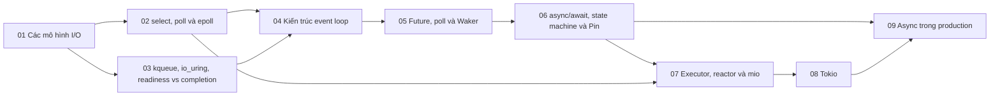

# P7 · Tổng quan — I/O models và async

> Trang này chỉ điều hướng: mục tiêu, bản đồ chương, thứ tự đọc, sách gốc và câu hỏi tổng hợp. Mọi khẳng định kỹ thuật có chú thích nằm trong từng chương; các lời khuyên về thứ tự đọc là của người soạn.

## Mục tiêu của phase

Phase này giải thích cách một server phục vụ nhiều kết nối: các mô hình I/O, `select`/`poll`/`epoll`, `kqueue`/`io_uring`, kiến trúc event loop; rồi nối lên `Future`, `Waker`, `async`/`await`, `Pin`, executor, `mio` và Tokio. Học xong, bạn kể lại được đường đi của một lần `read` async từ `poll` đến `epoll_wait` và ngược lại. Đây là phase nối trực tiếp P1, P4 và P6.

## Bản đồ chương

Mũi tên nghĩa là chương đích dùng khái niệm của chương nguồn (nhận xét của người soạn về thứ tự học).

## Các chương

| Chương | Nội dung chính |
|---|---|
| [01 — Các mô hình I/O](01-mo-hinh-io.md) | Các hướng xử lý `read()` khi dữ liệu chưa đến; `O_NONBLOCK`, `EAGAIN` và busy-polling; I/O multiplexing và readiness; thread-per-connection vs event loop; signal-driven I/O, POSIX AIO; năm mô hình cạnh nhau, readiness vs completion; `std` I/O và `WouldBlock`. |
| [02 — select, poll và epoll](02-select-poll-epoll.md) | `select` và giới hạn 1024; `poll` và `revents`; interest list/ready list của epoll; level vs edge-triggered; `close(fd)` và event cache, `EPERM` với file thường; `EPOLLONESHOT`/`EPOLLEXCLUSIVE`; vì sao mio dùng `EPOLLET`. |
| [03 — kqueue, io_uring, readiness vs completion](03-kqueue-io-uring.md) | `kqueue` và `kevent()`; filter và cờ; `io_uring`: SQ/CQ/SQE/CQE, `io_uring_enter`, `user_data`; readiness vs completion, reactor vs proactor; chuyển buffer cho kernel và hủy bằng `drop`; `mio`, Tokio, `tokio-uring`. |
| [04 — Kiến trúc event loop](04-kien-truc-event-loop.md) | C10K; thread-per-connection đánh đổi gì; các bước của event loop và vì sao handler không được block; manual stack management; reactor pattern ánh xạ vào `epoll`; nhiều core, `SO_REUSEPORT`; timer và việc nặng CPU; liên hệ `async`/`await`. |
| [05 — Future, poll và Waker](05-future-poll-waker.md) | `Future::poll`, `Poll`, vì sao future "lười"; trách nhiệm khi trả `Pending`; `Context` và `Waker`, `wake` vs `wake_by_ref`; `RawWaker` và trait `Wake`; tự viết future timer và `block_on`; `IntoFuture`; so với Promise. |
| [06 — async/await, state machine và Pin](06-async-await-pin.md) | Gọi `async fn` làm gì; `.await` khi future con `Pending`; state machine và kích thước future; vì sao move nguy hiểm; `Pin`, `Unpin`, `pin!` vs `Box::pin`; async closure; `async fn` trong trait; hủy future bằng `drop`. |
| [07 — Executor, reactor và mio](07-executor-va-mio.md) | Executor vs reactor; task vs future; một lần `read` async từ `poll` đến `epoll_wait` và `wake`; các kiểu của `mio`; `mio::Waker` vs `std::task::Waker`; draining readiness; executor single-thread tối giản; timer. |
| [08 — Tokio](08-tokio.md) | Thành phần runtime, `#[tokio::main]`; multi-thread (work-stealing) vs current-thread; `spawn` đòi `Send + 'static`, `LocalSet`; `spawn_blocking`, `block_in_place`, coop budget; hủy và `select!`; mutex, `mpsc`, `oneshot`, `Semaphore`, `Notify`; `tokio::time`/`tokio::fs`; graceful shutdown. |
| [09 — Async Rust trong production: cancellation, backpressure, blocking](09-async-trong-production.md) | Hủy là drop future và cancellation safety; `timeout` làm và không làm gì; backpressure với channel bounded/unbounded, `Semaphore`, `poll_ready` của tower; `JoinSet`, `AbortHandle`, `TaskTracker` chống rò task; các kiểu chặn trong async và cách phát hiện; graceful shutdown với `CancellationToken`, `TaskTracker`, hạn chót; future `Send` bị phá khi giữ `MutexGuard` qua `.await`. |

## Thứ tự đọc

Đọc 01 → 09 theo số. Hai nửa của phase khá tách bạch: 01–04 là phía OS và kiến trúc, 05–08 là phía Rust. Nếu bạn đã quen epoll, có thể đọc 05 trước rồi quay lại 02 khi tới chương 07 (nhận xét của người soạn). Chương 09 (async trong production) đọc sau 08: nó dẫn lại `spawn`, `spawn_blocking`, `select!` và graceful shutdown bằng số mục của chương 08 chứ không giải thích lại.

## Lộ trình đọc sách gốc

Các nguồn dưới đây đều là nguồn mà chương của phase đã dùng; mở đọc song song với chương tương ứng. Không bắt buộc: chương đã tự chứa phần cần thiết.

- [OSTEP — Event-based Concurrency](https://pages.cs.wisc.edu/~remzi/OSTEP/threads-events.pdf) — chương 01, 04.
- [The Rust Book — Futures and the Async Syntax](https://doc.rust-lang.org/1.95.0/book/ch17-01-futures-and-syntax.html) — chương 05, 06.
- [The Rust Book — The Traits for Async](https://doc.rust-lang.org/1.95.0/book/ch17-05-traits-for-async.html) — chương 05, 06.
- [The Rust Book — Putting It All Together: Futures, Tasks, and Threads](https://doc.rust-lang.org/1.95.0/book/ch17-06-futures-tasks-threads.html) — chương 01, 04.
- [Tokio — runtime module docs](https://docs.rs/tokio/1.53.2/tokio/runtime/index.html) — chương 07, 08.
- [Tokio — Graceful Shutdown](https://tokio.rs/tokio/topics/shutdown) — chương 08.
- [tokio-uring 0.5.0 docs](https://docs.rs/tokio-uring/0.5.0/tokio_uring/) — chương 03.
- [Asynchronous Programming in Rust (đang được viết lại, chỉ đọc bổ trợ)](https://rust-lang.github.io/async-book/) — chương 06.

## Câu hỏi tổng hợp xuyên chương

Không có đáp án ở đây; mỗi câu trỏ về chương cần đọc lại.

1. Một lần `read` async trên socket: kể lại đường `poll` → `WouldBlock` → đăng ký → `epoll_wait` → `wake` → `poll` lại, chỉ rõ ai giữ ready queue và ai gọi `wake`. ([chương 07](07-executor-va-mio.md), [chương 05](05-future-poll-waker.md), [chương 02](02-select-poll-epoll.md)).
2. Vì sao mio đặt edge-triggered cho mọi fd, và điều đó buộc code của bạn phải "đọc tới `WouldBlock`" ra sao? ([chương 02](02-select-poll-epoll.md), [chương 07](07-executor-va-mio.md)).
3. Vì sao I/O kiểu completion của `io_uring` khó ghép với việc hủy future bằng `drop`? ([chương 03](03-kqueue-io-uring.md), [chương 06](06-async-await-pin.md)).
4. Kích thước của một future và việc tự tham chiếu giải thích thế nào vì sao cần `Pin`? ([chương 06](06-async-await-pin.md)).
5. `tokio::spawn` đòi `Send + 'static` còn chặn thread trong task async gây hại ra sao; `spawn_blocking` giải quyết gì? ([chương 08](08-tokio.md), [chương 04](04-kien-truc-event-loop.md)).
6. Thread-per-connection và event loop đánh đổi gì, và những con số nào bạn được phép khẳng định? ([chương 01](01-mo-hinh-io.md), [chương 04](04-kien-truc-event-loop.md)).
7. Graceful shutdown của service Tokio dựa trên signal và hủy task như thế nào? ([chương 08](08-tokio.md); phase P1 [chương 05](../01-linux/05-signal.md)).
8. Timer của event loop sống ở đâu và `tokio::time` dựa trên gì? ([chương 04](04-kien-truc-event-loop.md), [chương 07](07-executor-va-mio.md), [chương 08](08-tokio.md)).

## Lab

Làm sau khi đã đọc lý thuyết:

- [Lab 07 — I/O models và async](../labs/07-io-async-lab.md)
- [Capstone — HTTP server trên epoll rồi mini async runtime (làm sau cùng)](../labs/capstone.md)
