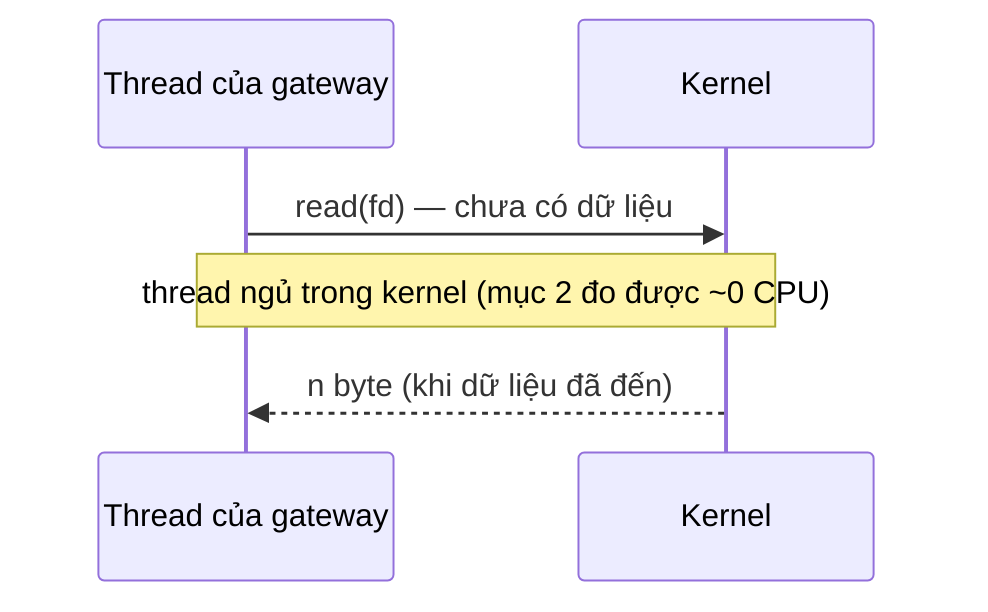
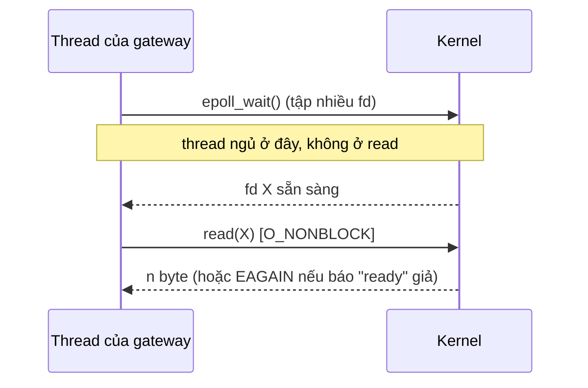

# P7 · Chương 01 — Các mô hình I/O

## Bạn sẽ hiểu được gì

1. **Q1.** Một `read()` mà dữ liệu chưa đến có những hướng xử lý nào, và với blocking I/O (mô hình 1) thread làm gì? → mục 1
2. **Q2.** `O_NONBLOCK` được bật bằng `open(2)` hoặc `fcntl(2)` thế nào; `EAGAIN`/`EWOULDBLOCK` nói gì; vì sao riêng `O_NONBLOCK` dẫn tới busy-polling (kèm số đo thật)? → mục 2
3. **Q3.** I/O multiplexing (mô hình 3) hỏi kernel điều gì, và "readiness" nghĩa là gì? → mục 3
4. **Q4.** Mô hình "mỗi kết nối một thread" tốn gì và nguồn nào nói vậy; event loop giải quyết gì và đánh đổi gì (state management, blocking call, page fault)? → mục 4
5. **Q5.** Signal-driven I/O (`F_SETOWN` + `O_ASYNC`) và POSIX AIO (`aio(7)`) là gì, vì sao hiếm dùng cho server? → mục 5
6. **Q6.** Đặt cạnh nhau, năm mô hình khác nhau ở đâu; "readiness" khác "completion" thế nào (chỉ giới thiệu; chi tiết ở chương 02 và 03)? → mục 6
7. **Q7.** Trong Rust, `std` I/O mặc định chặn hay không; `set_nonblocking` và `ErrorKind::WouldBlock` ánh xạ với `EAGAIN` ra sao? → mục 7

## Kiến thức cần trước

- File descriptor và open file description: [P1 · Chương 04](../01-linux/04-file-descriptor-va-vfs.md) (mục 1 về ba tầng fd → open file description → inode; mục 2 về cờ trạng thái như `O_NONBLOCK`).
- System call và quy ước lỗi `errno`: [P1 · Chương 02](../01-linux/02-system-call.md) (mục 3).
- Signal (vì `SIGIO` là một signal): [P1 · Chương 05](../01-linux/05-signal.md) (mục 2 và 3).
- Thread và chi phí của nó: [P4 · Chương 01](../04-concurrency/01-thread.md) (mục 7). Socket và buffer trong kernel: [P6 · Chương 07](../06-networking/07-socket-va-kernel.md) (mục 1 và 4).

## 1. Một `read()` mà dữ liệu chưa đến, và blocking I/O (Q1)

> **Trả lời ngắn.** Socket chưa có dữ liệu thì `read()` không có gì để trả, nên chỉ còn ba hướng (cách phân loại của người soạn): thread đứng đợi ngay trong lời gọi, lời gọi trả về ngay kết quả "chưa có", hoặc thread đăng ký trước để được báo rồi đi làm việc khác. Mặc định socket là blocking, tức lời gọi đọc chờ đến khi có dữ liệu.[^man-recv-wait] Thread gọi bị treo trong lúc chờ, còn các thread khác vẫn chạy bình thường.[^ostep-thread-natural] Các mục sau lần lượt đi qua năm mô hình I/O sinh ra từ ba hướng này.

**Giải thích.**

*Với service `gateway`.* Hãy hình dung `gateway`, một service viết bằng Rust giữ kết nối TCP với hàng chục nghìn client (app di động, trình duyệt). Phần lớn kết nối nằm rảnh; thỉnh thoảng một client gửi một dòng lệnh, `gateway` đọc dòng đó rồi chuyển cho backend phía sau. Ta sẽ bám theo `gateway` suốt chương (nhận xét của người soạn: đây là ví dụ giả định, không phải code trong repo). Câu hỏi của mục này rất cụ thể: client vừa nối vào mà chưa gửi byte nào, thread của `gateway` gọi `read` trên socket đó thì chuyện gì xảy ra?

### 1.1 Ba hướng xử lý

Thread của `gateway` gọi `read(fd, buf, n)` trên một socket đã kết nối, nhưng đối tác chưa gửi gì. Lời gọi không có dữ liệu để trả, nên chỉ còn ba hướng:

- thread **đứng đợi** trong lời gọi cho đến khi có dữ liệu;
- lời gọi **trả về ngay** với một kết quả "chưa có";
- thread **đăng ký trước** để được báo, rồi làm việc khác.

Năm mô hình I/O trong chương là các cách tổ hợp ba hướng này (cách chia của người soạn; mục 6 đối chiếu với ba chiến lược nền mà Kegel liệt kê).

### 1.2 Cẩn thận với tên gọi

Trước khi đi tiếp cần gỡ một chỗ rất dễ nhầm: chữ "asynchronous". OSTEP gọi interface *blocking* là đồng bộ, vì nó làm hết việc rồi mới trả về. Interface bắt đầu việc rồi trả về ngay (non-blocking) thì OSTEP gọi là bất đồng bộ.[^ostep-block] Trong khi đó "asynchronous I/O" của POSIX (`aio(7)`) và của `io_uring` là một mô hình khác hẳn, mục 5 sẽ nói. Gặp chữ "asynchronous" ở đâu, cách chắc ăn là tự hỏi hai câu: thread làm gì khi dữ liệu chưa đến, và ai là người lấy dữ liệu về (nhận xét của người soạn).

### 1.3 Mô hình 1: blocking I/O

Trong mô hình này `gateway` cho mỗi socket một thread, và thread gọi `read` rồi ngủ luôn ở đó. Cách làm này là mặc định: khi socket chưa có message thì các lời gọi nhận chờ message đến, trừ khi socket được đặt nonblocking.[^man-recv-wait] Phía kernel, thread gọi được đưa vào trạng thái **ngủ** cho đến khi có dữ liệu, EOF hoặc lỗi (nhận xét của người soạn; số đo ở mục 2 cho thấy ~0 CPU khi chờ kiểu này). Thread ngủ thì không tốn CPU, còn các thread khác của `gateway` vẫn chạy, và việc I/O của thread này chồng lên tính toán của thread kia là chuyện rất tự nhiên với lập trình thread.[^ostep-thread-natural]



Ưu điểm lớn nhất là code tuần tự: trạng thái của kết nối nằm ngay trên stack của thread.[^ostep-msm] Cái giá là một thread chỉ phục vụ được một thứ tại một thời điểm, nên với hàng chục nghìn client rảnh, `gateway` cần hàng chục nghìn thread đang ngủ (suy luận của người soạn; mục 4 nói tiếp chuyện này).

<details><summary>Đi sâu: <code>read</code> trả 0 là EOF; trả ít hơn yêu cầu không phải lỗi</summary>

`read` trả về 0 nghĩa là hết dữ liệu (EOF), chứ không phải "chưa có".[^man-read-eof] Ngược lại, `read` trả ít byte hơn bạn yêu cầu thì không phải lỗi: man page nêu ví dụ là hiện chỉ có chừng đó byte.[^man-read-short] Vì vậy vòng đọc của `gateway` phải phân biệt ba kết quả: `0` (EOF), `n > 0` (có thể ít hơn buffer), và `-1` kèm `errno` (lỗi, trong đó có `EAGAIN` ở mục 2). Đây là suy luận của người soạn từ hai nguồn trên.

</details>

**Quay lại Q1:** `read()` chưa có dữ liệu thì chỉ có ba hướng (đợi, trả ngay, đăng ký trước); blocking là hướng "đợi", và thread của `gateway` ngủ trong kernel đến khi client gửi.

## 2. Non-blocking I/O, `EAGAIN` và busy-polling (Q2)

> **Trả lời ngắn.** Cờ `O_NONBLOCK` có thể bật ngay lúc `open(2)`.[^man-open-nb] Sau đó vẫn bật được bằng `fcntl(2)` với `F_SETFL`.[^man-fcntl] Khi cờ bật, `read` mà lẽ ra phải chờ sẽ trả `-1` với `errno` là `EAGAIN` (hoặc `EWOULDBLOCK` trên socket), nghĩa là "chưa có, thử lại sau".[^man-read-eagain] Cờ này không cho biết khi nào nên thử lại, vì nó không ảnh hưởng đến `poll`/`select`/`epoll`.[^man-open-poll] Nếu chỉ có nó thì thread phải gọi `read` liên tục (busy-polling; suy luận của người soạn), và số đo một lần chạy ở phần Đi sâu cho thấy vòng lặp như vậy dùng gần 100% một core (quan sát, không phải bảo đảm).

**Giải thích.**

*Với service `gateway`.* Giả sử `gateway` không muốn thread của mình ngủ chết ở một socket rảnh. Bật `O_NONBLOCK` là cách đầu tiên ai cũng nghĩ tới: `read` trả ngay thay vì chờ. Nhưng từ lúc đó thread phải tự quyết khi nào hỏi lại, và với hàng chục nghìn socket rảnh thì chuyện này dẫn tới đâu chính là câu hỏi của mục này.

### 2.1 Bật cờ

`open(2)` mô tả `O_NONBLOCK` như sau: khi có thể, file được mở ở chế độ nonblocking, và cả `open()` lẫn mọi I/O sau đó trên fd không bắt tiến trình gọi phải chờ.[^man-open-nb] Không nhất thiết phải bật lúc `open`. `fcntl(2)` với `F_SETFL` đổi *file status flags*, tức các cờ trạng thái của open file description mà fd trỏ tới, và trên Linux nó chỉ đổi được năm cờ `O_APPEND`, `O_ASYNC`, `O_DIRECT`, `O_NOATIME`, `O_NONBLOCK`.[^man-fcntl] Vì đó là cờ của open file description, các fd nhân bản bằng `dup` hoặc `fork` cùng thấy chế độ này (xem [P1 · Chương 04](../01-linux/04-file-descriptor-va-vfs.md) mục 2).[^man-fcntl-share]

Cách làm thường gặp trong C là `F_GETFL`, OR thêm `O_NONBLOCK`, rồi `F_SETFL` (nhận xét của người soạn). Đó là chuỗi mà `nonblocking_pipe` ở phần Đi sâu của mục 7 gọi bằng `libc::fcntl`. Chương trình đo ở mục này thì dùng `set_nonblocking` của `std`, thực chất là `ioctl(FIONBIO)`, như mục 7 giải thích.

### 2.2 `read` làm gì khi không có dữ liệu

Với fd non-blocking, `read` mà lẽ ra phải chờ sẽ trả `-1` và đặt `errno`. Nếu fd không phải socket, lỗi là `EAGAIN`.[^man-read-eagain-file] Nếu fd là socket, lỗi là `EAGAIN` **hoặc** `EWOULDBLOCK`: POSIX.1-2001 cho phép trả một trong hai và không bắt hai hằng số có cùng giá trị.[^man-read-eagain] Hệ quả là code C portable phải kiểm tra cả hai. `errno(3)` mô tả `EAGAIN` là "Resource temporarily unavailable" và ghi rằng nó có thể cùng giá trị với `EWOULDBLOCK`.[^man-errno-eagain] Nói cách khác, đây là "thử lại sau" chứ không phải fd bị hỏng (nhận xét của người soạn).

### 2.3 Hai giới hạn của `O_NONBLOCK`

Giới hạn thứ nhất: **file thường và block device không bị ảnh hưởng.** `open(2)` nói rõ cờ này không có tác dụng với regular file và block device; I/O trên chúng vẫn chặn (ngắn hạn) khi cần truy cập thiết bị, bất kể `O_NONBLOCK`.[^man-open-reg] Vì vậy, nếu `gateway` đọc file cấu hình từ đĩa, `O_NONBLOCK` không biến việc đó thành bất đồng bộ (suy luận của người soạn từ câu trên). Kegel cũng ghi rằng chiến lược "non-blocking call kèm readiness notification" thường chỉ dùng được cho network I/O, không cho disk I/O.[^c10k-readiness]

Giới hạn thứ hai: **`O_NONBLOCK` không tự mang kênh thông báo nào.** `open(2)` viết rằng cờ này không ảnh hưởng đến `poll(2)`, `select(2)`, `epoll(7)`, vì các interface đó chỉ báo fd đang "ready", nghĩa là một I/O trên fd *khi cờ tắt* sẽ không bị chặn.[^man-open-poll] Nói gọn, `O_NONBLOCK` mới giải quyết nửa đầu ("đừng ngủ"), còn nửa sau ("khi nào có dữ liệu") thuộc về cơ chế khác (suy luận của người soạn).

### 2.4 Vì sao `O_NONBLOCK` một mình dẫn tới busy-polling

Từ hai giới hạn trên suy ra: nếu chỉ có `O_NONBLOCK`, cách duy nhất để biết dữ liệu đã đến là gọi `read` lặp đi lặp lại cho đến khi nó thành công (suy luận của người soạn). Vòng lặp đó không bao giờ ngủ, nên với một fd rảnh nó có thể chiếm gần trọn một core. Với N socket thì mỗi vòng phải thử `read` cả N lần, và hầu hết trả `EAGAIN` (cùng suy luận; số đo ở phần Đi sâu). Hàng chục nghìn client rảnh của `gateway` sẽ biến thành hàng chục nghìn lời gọi vô ích mỗi vòng.

Vậy non-blocking chỉ có ích khi đi cùng một cơ chế cho thread *ngủ cho đến khi có fd sẵn sàng*. Đó là mô hình 3 ở mục 3.

<details><summary>Đi sâu: đo busy-polling bằng một chương trình Rust (quan sát một lần chạy)</summary>

Để thấy bằng số, người soạn chạy chương trình dưới đây trên Linux aarch64 (container, rustc 1.95.0). Server thread chấp nhận kết nối, ngủ 300 ms rồi ghi `"ping"`; client chạy hai biến thể: blocking và non-blocking.

```rust
use std::io::{ErrorKind, Read, Write};
use std::net::{TcpListener, TcpStream};
use std::thread;
use std::time::{Duration, Instant};

fn main() {
    let listener = TcpListener::bind("127.0.0.1:0").unwrap();
    let addr = listener.local_addr().unwrap();
    let server = thread::spawn(move || {
        let (mut s, _) = listener.accept().unwrap();
        thread::sleep(Duration::from_millis(300));
        s.write_all(b"ping").unwrap();
    });
    let mut c = TcpStream::connect(addr).unwrap();
    c.set_nonblocking(true).unwrap();      // biến thể blocking: bỏ dòng này
    let mut buf = [0u8; 16];
    let (mut spins, t0) = (0u64, Instant::now());
    loop {
        match c.read(&mut buf) {
            Ok(n) => {
                println!("read {n} bytes {:?} after {} ms, WouldBlock returned {spins} times",
                    std::str::from_utf8(&buf[..n]).unwrap(), t0.elapsed().as_millis());
                break;
            }
            Err(e) if e.kind() == ErrorKind::WouldBlock => spins += 1,
            Err(e) => panic!("{e}"),
        }
    }
    server.join().unwrap();
}
```

Kết quả (`rustc --edition 2021 -O`, đo bằng `time` của bash; số cụ thể thay đổi giữa các lần chạy):

```text
NONBLOCK
read 4 bytes "ping" after 305 ms, WouldBlock returned 1451924 times
real 0m0.307s   user 0m0.062s   sys 0m0.245s
BLOCK
read 4 bytes "ping" after 305 ms, WouldBlock returned 0 times
real 0m0.307s   user 0m0.001s   sys 0m0.000s
```

Cùng 305 ms chờ, biến thể non-blocking gọi `read` thất bại ~1,45 triệu lần và đốt ~0,31 s CPU trong ~0,31 s thực, tức gần 100% một core. Biến thể blocking tốn ~0 CPU. Chạy dưới `strace -f` thấy đúng chuỗi `ioctl(4, FIONBIO, [1])` rồi hàng loạt `recvfrom(4, ..., 16, 0, NULL, NULL) = -1 EAGAIN (Resource temporarily unavailable)`. Đây là quan sát, không phải bảo đảm. Người review chạy lại trên Linux aarch64: 1.416.758 lần `WouldBlock` trong 300 ms (user 0,037 s + sys 0,261 s, real 0,301 s) cho non-blocking, 0 lần và ~0 CPU cho blocking, cùng bậc độ lớn.

Đọc số (suy luận của người soạn): phần lớn CPU của biến thể non-blocking là `sys` (0,245 s so với `user` 0,062 s). Điều này khớp với việc mỗi lần thử là một lời gọi hệ thống (`recvfrom` trong `strace`) đi vào kernel rồi trả `EAGAIN` ngay; chi phí vào kernel xem [P1 · Chương 02](../01-linux/02-system-call.md) mục 5. Biến thể blocking gần như không tốn CPU vì thread ngủ ở `read`, đúng như mô hình 1 ở mục 1.

</details>

**Quay lại Q2:** `O_NONBLOCK` chỉ giải quyết "đừng ngủ"; vì không có kênh báo, thread của `gateway` dùng một mình nó thì phải gọi lại liên tục và đốt CPU.

## 3. I/O multiplexing và readiness (Q3)

> **Trả lời ngắn.** Ở mô hình này một thread hỏi kernel "trong tập fd này, cái nào sẵn sàng?" bằng `select`/`poll`/`epoll`/`kqueue`, và chờ ngay ở lời gọi hỏi đó thay vì ở `read`. Ví dụ, man page `select(2)` mô tả đúng việc chờ đến khi một hay nhiều fd "ready".[^man-select-ready] Khi tỉnh dậy, thread gọi `read`/`write` non-blocking trên các fd được báo (nhận xét của người soạn). Kegel mô tả chiến lược này là dùng non-blocking call để bắt đầu I/O, và readiness notification để biết khi nào được bắt đầu I/O kế tiếp.[^c10k-readiness] Kernel chỉ báo "có thể làm", còn việc lấy dữ liệu vẫn là của ứng dụng; đó là *readiness*.

**Giải thích.**

*Với service `gateway`.* Thay vì cho mỗi client một thread, `gateway` dùng một thread hỏi kernel một câu duy nhất: trong vài chục nghìn socket này, socket nào đã có dữ liệu? Thread ngủ ở câu hỏi đó, không ngủ ở từng `read`. Khi có client gửi dòng lệnh, kernel đánh thức thread và chỉ ra socket nào, lúc ấy `gateway` mới `read` đúng socket đó. Mục này nói rõ ba bước ấy và cái mà kernel thật sự trao cho `gateway`.

### 3.1 Ba bước

Các bước sau là nhận xét của người soạn, tổng hợp từ các nguồn bên dưới:

1. Ứng dụng đặt nhiều fd non-blocking vào một tập rồi gọi một lời gọi hỏi/chờ (`select`/`poll`/`epoll_wait`/`kevent`); thread **ngủ ở lời gọi đó**, không phải ở `read`.
2. Khi ít nhất một fd sẵn sàng, lời gọi trả về và cho biết fd nào.
3. Ứng dụng gọi `read`/`write` non-blocking trên các fd được báo.

Về nguồn: `select()` và `poll()` là API cơ bản mà hầu hết hệ thống có sẵn để kiểm tra xem có I/O nào đến cần xử lý không.[^ostep-select] Còn "sẵn sàng" nghĩa là gì thì man page `select(2)` định nghĩa: fd là *ready* khi một I/O tương ứng (ví dụ `read(2)`) có thể thực hiện mà không chặn.[^man-select-ready]



### 3.2 Readiness là thông báo, chưa phải dữ liệu

Điểm mấu chốt: thứ kernel trao cho `gateway` chỉ là một thông báo "có thể làm"; chính `gateway` vẫn phải gọi `read` để lấy dữ liệu. Đó là bản chất của **readiness**. Cơ chế bên trong `select`/`poll`/`epoll` (cấu trúc dữ liệu, level- và edge-triggered) thuộc [Chương 02](02-select-poll-epoll.md); `kqueue` và `io_uring` thuộc [Chương 03](03-kqueue-io-uring.md).

<details><summary>Đi sâu: thông báo "ready" đôi khi sai</summary>

Trên Linux, `select(2)` ghi rằng một socket có thể được báo "ready for reading" mà `read` sau đó vẫn chặn. Ví dụ dữ liệu đến nhưng checksum sai nên bị bỏ. Man page còn nói có thể có những trường hợp khác cũng báo "ready" giả, và vì thế dùng `O_NONBLOCK` trên socket *có thể* an toàn hơn.[^select-spurious] Đó là lý do sơ đồ ở trên vẽ nhánh `EAGAIN` sau thông báo "ready", và vì sao multiplexing thường đi cùng fd non-blocking (nhận xét của người soạn; [Chương 02](02-select-poll-epoll.md) mục 2 nhắc lại điểm này).

</details>

**Quay lại Q3:** multiplexing là ngủ ở một lời gọi hỏi nhiều fd; kết quả là thông báo "có thể làm" (readiness), và `gateway` tự `read`.

## 4. Thread-per-connection và event loop (Q4)

> **Trả lời ngắn.** Cách đơn giản nhất để `gateway` phục vụ nhiều client là mỗi kết nối một thread với `read`/`write` blocking. Cái giá là mỗi client chiếm một stack, tốn bộ nhớ.[^c10k-stack] Event loop bỏ các thread đó, thay bằng một vòng lặp chờ sự kiện rồi xử lý từng phần việc nhỏ.[^ostep-loop] Đổi lại, handler không được gọi lời gọi blocking.[^ostep-noblock] Code còn phải tự giữ trạng thái của từng kết nối.[^ostep-msm] Page fault và multicore cũng làm mất một phần sự đơn giản.[^ostep-pagefault]

**Giải thích.**

*Với service `gateway`.* Mục 1 đã cho thấy mỗi client một thread thì `gateway` cần hàng chục nghìn thread đang ngủ; mục 3 cho thấy một thread có thể trông chừng cả đám socket. Hai hướng này đánh đổi khác nhau: thread-per-connection đổi bộ nhớ lấy code dễ viết, event loop làm ngược lại. Mục này đi qua cả hai, kèm nguồn cho từng cái giá.

### 4.1 Mỗi kết nối một thread

Đây là cách đơn giản nhất để phục vụ nhiều kết nối mà vẫn giữ `read` blocking. Kegel liệt kê chiến lược này là phục vụ một client bằng mỗi server thread và để `read()`, `write()` chặn.[^c10k-thread] Ưu điểm là khi một thread chờ I/O, các thread khác chạy tiếp. OSTEP gọi sự chồng lấn giữa I/O và tính toán này là điều làm lập trình thread khá tự nhiên và đơn giản.[^ostep-thread-natural]

Chi phí thì có nguồn nói rõ:

- **Một stack cho mỗi client.** Kegel viết rằng nhược điểm là phải dùng cả một stack frame cho mỗi client, tốn bộ nhớ.[^c10k-stack] Ông tính ví dụ stack 2 MB trên máy 32-bit có 1 GB virtual memory cho người dùng: hết *virtual memory* ở khoảng 512 thread.[^c10k-512] Đây là nguồn **lịch sử**, xem lưu ý trong phần Đi sâu bên dưới.
- Rust Book nhận xét rằng trên nhiều hệ điều hành, mỗi thread dùng khá nhiều bộ nhớ.[^book-thread-mem]
- Tokio so sánh: tạo, chạy, hủy số lượng lớn task là rẻ, "đặc biệt so với OS thread", và chuyển giữa các task không cần context switch.[^tokio-light]

Chương này không có nguồn cho con số chung kiểu "bao nhiêu thread thì sập". Hãy đo trên máy của bạn (số đo `VmSize`/`VmRSS` thật trên một máy nằm ở [Chương 04](04-kien-truc-event-loop.md) mục 2).

### 4.2 Event loop: ý tưởng

OSTEP đặt vấn đề từ phía thread: quản lý concurrency đúng trong chương trình multi-thread là việc khó (thiếu lock, deadlock...), và lập trình viên gần như không kiểm soát được thứ tự scheduling.[^ostep-two-fold] Phương án thay thế là **event-based concurrency**: một vòng lặp chờ sự kiện, xác định loại sự kiện, rồi làm một phần việc nhỏ. Pseudocode của nó:[^ostep-loop]

```text
while (1) {
    events = getEvents();
    for (e in events)
        processEvent(e);
}
```

Khi một handler đang xử lý một event, nó là hoạt động duy nhất trong hệ thống, nên việc chọn event nào xử lý tiếp tương đương với scheduling. OSTEP coi việc kiểm soát tường minh scheduling này là một lợi thế căn bản.[^ostep-sched] Với `gateway`, event loop khớp thẳng với mô hình 3: `getEvents()` chính là `select`/`poll`/`epoll_wait` (nhận xét của người soạn). OSTEP cũng đặt `select()`/`poll()` ngay sau vòng lặp này làm API để nhận event.[^ostep-select] Cách một server dùng chúng chi tiết ở [Chương 04](04-kien-truc-event-loop.md).

### 4.3 Ba nhóm vấn đề

Tổng hợp từ OSTEP, event loop vướng ba nhóm vấn đề.

1. **Blocking system call.** Nếu một handler gọi lời gọi có thể chặn thì cả server dừng theo, vì không còn thread nào khác để chạy, chỉ có main event loop. OSTEP lấy ví dụ `open()` và `read()` file, những lời gọi có thể phải xuống storage. Từ đó có một quy tắc phải tuân thủ: không được phép có blocking call.[^ostep-noblock] Hệ quả là non-blocking interface trở nên thiết yếu, vì lời gọi chặn dừng mọi tiến độ.[^ostep-essential] Với `gateway`, một lần đọc file cấu hình chậm trong handler là đủ làm đứng mọi client.
2. **State management.** Khi handler phát một I/O bất đồng bộ, nó phải đóng gói trạng thái chương trình cho handler kế tiếp. Chương trình thread không cần việc này vì trạng thái nằm sẵn trên stack của thread. Adya và cộng sự gọi việc đó là *manual stack management*, và nó là nền tảng của lập trình event-based.[^ostep-msm] OSTEP còn nêu thêm: nếu một routine đổi từ non-blocking sang blocking, handler gọi nó cũng phải đổi theo (tách thành hai nửa).[^ostep-api-change]
3. **Page fault và multicore.** Event-handler mà gặp page fault thì bị chặn, và server không tiến triển cho đến khi page fault xong; kiểu blocking ngầm này khó tránh.[^ostep-pagefault] Còn khi chuyển từ một CPU sang nhiều CPU, sự đơn giản của event-based mất đi một phần. Để dùng nhiều CPU, server phải chạy nhiều handler song song, và critical section cùng lock lại xuất hiện.[^ostep-multicpu]

OSTEP còn dẫn một phương án lai cho hệ thống không có AIO: dùng event để xử lý gói tin mạng, và một thread pool để quản lý các I/O đang chờ.[^ostep-hybrid]

### 4.4 Không phải lúc nào event loop cũng thắng

Rust Book phân biệt theo tính chất công việc. Nếu công việc có tính song song cao (CPU-bound) thì thread là lựa chọn tốt hơn.[^book-cpu] Nếu công việc có tính đồng thời cao (I/O-bound, nhiều nguồn tới với nhịp khác nhau) thì async tốt hơn.[^book-io] Và thread với task thường kết hợp tốt với nhau.[^book-both]

Liên hệ backend (nhận xét của người soạn): `gateway` giữ hàng chục nghìn kết nối phần lớn rảnh, như websocket, long-poll hay proxy, nên hợp event loop vì mỗi kết nối rảnh chỉ tốn một mục trong interest set thay vì một thread. Một service nặng CPU, hoặc phải gọi thư viện chỉ có API blocking, thì vẫn cần thread pool.

<details><summary>Đi sâu: số liệu C10K của Kegel là lịch sử; stack mặc định của thread Rust</summary>

- Trang C10K nhắc rằng năm 1999 một FTP site đã phục vụ 10.000 client đồng thời qua Gigabit Ethernet,[^c10k-1999] và nhắc mốc "5 October 2003", khi NPTL được merge vào cây glibc.[^c10k-nptl] Bản trang này mang dòng bản quyền 1999–2018,[^c10k-copyright] nhưng các con số trên (ví dụ 32-bit, stack 2 MB) là của thời phần cứng và kernel khoảng 2003 trở về trước (suy luận của người soạn từ hai mốc 1999/2003), nên không áp dụng nguyên xi cho Linux 64-bit ngày nay. Chính Kegel viết rằng khi thread support tiến bộ và 64-bit phổ biến thì có thể dùng một thread mỗi client cho cả 10.000 client, nhưng "hiện tại" ai thật sự cần số đó thì nên dùng paradigm khác.[^c10k-conclusion]
- **Stack Rust.** Stack mặc định của thread Rust phụ thuộc nền tảng và có thể đổi; hiện là 2 MiB trên mọi nền tảng Tier-1.[^std-stack] Đó là kích thước *dành sẵn* trong address space, không tự suy ra là RAM đã dùng (nhận xét của người soạn; xem [P3 · Chương 01](../03-memory/01-address-space.md) mục 2 và [P3 · Chương 04](../03-memory/04-page-fault-va-swapping.md) mục 2 về virtual memory và demand paging; số đo thật trên một máy ở [P7 · Chương 04](04-kien-truc-event-loop.md) mục 2).

</details>

**Quay lại Q4:** thread-per-connection đổi bộ nhớ (một stack mỗi kết nối) lấy code tuần tự; event loop đổi ngược lại, và `gateway` phải trả bằng non-blocking bắt buộc, tự quản lý state và các bẫy page fault/multicore.

## 5. Signal-driven I/O và POSIX AIO (Q5)

> **Trả lời ngắn.** Signal-driven I/O nhờ kernel gửi một `SIGIO` mỗi khi I/O trở nên khả thi trên fd (cần `F_SETOWN` để chọn người nhận và `O_ASYNC` để bật).[^man-fcntl-sigio] Nó vẫn chỉ báo "có thể làm". POSIX AIO thì nhờ hệ thống thực hiện thao tác chạy nền rồi báo khi xong.[^man-aio] Việc cả hai ít được dùng cho server là nhận xét của người soạn. Riêng AIO thì nguồn nêu lý do: bản AIO trên Linux là cài đặt user-space trong glibc với nhiều hạn chế,[^aio-glibc] và OSTEP nói AIO đĩa không tích hợp đơn giản với async network I/O.[^ostep-aio-uniform] Với signal-driven, các nguồn trong chương không nêu lý do riêng.

**Giải thích.**

*Với service `gateway`.* Hai mô hình cuối của chương trả lời hai nhu cầu khác nhau của `gateway`. Signal-driven I/O thay lời gọi `epoll_wait` bằng một signal: kernel gọi tới thay vì thread đi hỏi. AIO thì nhắm vào việc kiểu đọc file lớn từ đĩa: `gateway` nộp yêu cầu, làm việc khác, rồi được báo khi dữ liệu đã nằm trong buffer. Mục này xem chúng làm được gì và vì sao server hiếm khi chọn chúng.

### 5.1 Signal-driven I/O (mô hình 4): `F_SETOWN` + `O_ASYNC`

Thay vì ngủ ở một lời gọi chờ, thread nhờ kernel gửi signal. Với `fcntl(2)`, `F_SETOWN` đặt process hoặc process group nhận signal (thường là chính tiến trình gọi, `arg = getpid()`).[^man-fcntl-setown] Sau đó thread bật `O_ASYNC` bằng `F_SETFL`. Từ đó mỗi khi input hoặc output *trở nên khả thi* trên fd, một `SIGIO` được gửi tới.[^man-fcntl-sigio]

Signal chỉ được gửi khi I/O "trở nên khả thi", nghĩa là đây vẫn là thông báo kiểu *readiness*: kernel báo "có thể làm" chứ không làm hộ, và `gateway` vẫn phải tự `read`. Người soạn xếp mô hình 4 vào nhóm readiness, chỉ khác kênh thông báo là signal thay vì một lời gọi chờ (suy luận của người soạn từ các câu trích; không man page nào gán nhãn "readiness" cho `O_ASYNC`). Chi tiết kèm lưu ý nằm ở phần Đi sâu cuối mục.

### 5.2 Asynchronous I/O (mô hình 5): kernel làm hộ rồi báo xong

Ở mô hình 5, ứng dụng nhờ hệ thống *thực hiện* thao tác và báo khi *xong*. Các interface kiểu này cho phép phát một I/O request và trả quyền điều khiển ngay cho caller, trước khi I/O hoàn tất.[^ostep-aio] POSIX AIO (`aio(7)`) cho khởi tạo một hay nhiều thao tác I/O chạy nền, và ứng dụng chọn cách được báo xong: signal, tạo thread, hoặc không báo gì.[^man-aio] Muốn biết đã xong chưa, OSTEP mô tả hai cách. Cách thứ nhất là poll định kỳ bằng `aio_error()`, hàm trả `EINPROGRESS` nếu chưa xong.[^ostep-aio-poll] Cách thứ hai là dùng signal để khỏi phải hỏi lặp lại.[^ostep-aio-signal]

Khác biệt so với mô hình 2–3 nằm ở chỗ *ai chạm vào dữ liệu* (nhận xét của người soạn). Với readiness, `read` vẫn là việc của bạn. Với completion, bạn đưa sẵn buffer trong yêu cầu, và khi nhận thông báo xong thì buffer đã có dữ liệu. Với POSIX AIO, OSTEP mô tả cấu trúc `aiocb` chứa fd, offset, độ dài và vị trí buffer đích nhận kết quả.[^ostep-aio-struct]

### 5.3 Vì sao POSIX AIO ít được dùng cho server

"Ít được dùng" là nhận định của người soạn; ba nguồn dưới đây chỉ nói những gì họ nói.

- `aio(7)` ghi rằng bản cài đặt POSIX AIO hiện tại trên Linux nằm ở **user space trong glibc** và có nhiều hạn chế, nổi bật là việc duy trì nhiều thread để thực hiện I/O thì đắt và scale kém.[^aio-glibc] Man page còn nói việc làm lại hoàn toàn bằng kernel system call chưa đủ chín.
- OSTEP viết rằng asynchronous disk I/O có thể có trên hầu hết nền tảng nhưng mất rất lâu mới tới được đó, và nó không bao giờ tích hợp đơn giản, đồng nhất với async network I/O như người ta tưởng.[^ostep-aio-uniform] Thường phải kết hợp `select()` cho mạng và các lời gọi AIO cho đĩa, tức `gateway` sẽ phải nuôi hai kênh thông báo.
- Kegel (lịch sử) nói `aio` kiểu "asynchronous call kèm completion notification" tốt cho cả network lẫn disk I/O.[^c10k-async] Nhưng AIO của Ben LaHaise (merge vào kernel từ 2.5.32), tính đến 2.6.0-test2, chưa hỗ trợ socket.[^c10k-aio-socket]

Trên Linux còn có `io_uring`. Man page mô tả nó là API Linux-specific cho asynchronous I/O, cho nộp một hoặc nhiều request được xử lý bất đồng bộ mà không chặn tiến trình gọi.[^iou-desc] Cơ chế của nó, và vì sao nó thuộc họ completion, nằm ở [Chương 03](03-kqueue-io-uring.md) (mục 3 và 4).

<details><summary>Đi sâu: <code>F_SETSIG</code>/<code>si_fd</code>, cách dùng chữ "asynchronous", tính di động của <code>SIGIO</code></summary>

Chính `fcntl(2)` ghi thêm: khi dùng `F_SETSIG` mà handler không nhận được `si_fd` (không có `SI_SIGIO`), thì không có chỉ dấu fd nào đang pending. Lúc đó phải dùng các cơ chế thường lệ (`select`, `poll`, `read` với `O_NONBLOCK`) để xác định fd nào I/O được.[^man-fcntl-sigio-usual] Man page còn nói rằng với các cơ chế này (gồm `F_SETSIG` và real-time signal), một chương trình có thể cài đặt I/O "fully asynchronous" mà phần lớn thời gian không cần `select`/`poll`.[^man-fcntl-fully-async] Đó lại là một cách dùng chữ "asynchronous" khác với mục 1; về cơ chế đây vẫn là kênh báo readiness như đã nói ở trên (nhận xét của người soạn). Lưu ý về tính di động: man page ghi `O_ASYNC` chỉ có ở BSD và Linux, và POSIX không chỉ định signal `SIGIO`.[^fcntl-posix]

</details>

**Quay lại Q5:** signal-driven vẫn là readiness (chỉ đổi kênh báo thành signal); AIO mới là completion, nhưng bản POSIX AIO trên Linux nhiều hạn chế nên server ít dùng.

## 6. Năm mô hình cạnh nhau; readiness và completion (Q6)

> **Trả lời ngắn.** Năm mô hình khác nhau ở ba điểm: thread làm gì khi chưa có dữ liệu, ai gọi `read`, và kênh nào báo "có việc" (bảng bên dưới là tổng hợp của người soạn). Với *readiness*, kernel chỉ cho biết một I/O trên fd sẽ không chặn, còn việc đọc/ghi vẫn do bạn gọi.[^man-select-ready] Với *completion*, bạn nộp yêu cầu rồi được báo khi đã xong. OSTEP mô tả đó là phát một I/O request và trả quyền điều khiển ngay, trước khi I/O hoàn tất.[^ostep-aio]

**Giải thích.**

*Với service `gateway`.* Năm mô hình là năm câu trả lời cho cùng một tình huống: client chưa gửi gì, thread của `gateway` làm gì tiếp? Bảng dưới đặt chúng cạnh nhau, rồi mục này tách hai họ lớn là readiness và completion, vì chương 02 và 03 sẽ dựa vào sự khác biệt đó.

### 6.1 Bảng so sánh

| # | Mô hình | Thread làm gì khi chưa có dữ liệu | Ai gọi `read`/sao chép dữ liệu | Kênh báo "có việc" |
|---|---|---|---|---|
| 1 | Blocking | Ngủ trong chính `read` | Ứng dụng gọi `read`; trả khi có dữ liệu | Không cần — `read` trả về là thông báo |
| 2 | Non-blocking | Không ngủ; `read` trả `EAGAIN`/`EWOULDBLOCK` ngay | Ứng dụng, mỗi lần thử | **Không có** → phải thử lại (busy-poll) |
| 3 | I/O multiplexing | Ngủ ở `select`/`poll`/`epoll_wait`/`kevent` | Ứng dụng gọi `read` non-blocking sau khi được báo | Giá trị trả về của lời gọi chờ |
| 4 | Signal-driven | Làm việc khác | Ứng dụng gọi `read` sau khi nhận `SIGIO` | Signal |
| 5 | Asynchronous (completion) | Làm việc khác; yêu cầu đã nộp | Kernel/thư viện thực hiện, báo khi xong | Signal, thread, poll trạng thái, hoặc hàng đợi completion |

Bảng là tổng hợp của người soạn từ các nguồn đã trích ở trên. Ở hàng 5, cột kênh báo có nhắc "hàng đợi completion", mà [Chương 03](03-kqueue-io-uring.md) sẽ giải thích. Kegel liệt kê ba chiến lược nền cho việc phát nhiều I/O từ một thread, còn cách chia năm mô hình ở đây là của người soạn:

- blocking, có thể dùng nhiều thread hoặc process;[^c10k-strategies]
- non-blocking kèm readiness notification;[^c10k-readiness]
- asynchronous kèm completion notification.[^c10k-async]

### 6.2 Readiness và completion: lời giới thiệu

- **Readiness** (mô hình 3, 4): kernel nói "fd này *có thể* đọc/ghi mà không chặn".[^man-select-ready] Việc làm thật vẫn là của `gateway`, cần thêm một syscall sau thông báo (suy luận của người soạn từ định nghĩa đó). Theo Kegel, cách này thường chỉ dùng được cho network I/O, không cho disk I/O (mục 2).[^c10k-readiness]
- **Completion** (mô hình 5): `gateway` nộp một yêu cầu cụ thể kèm buffer đích,[^ostep-aio-struct] hệ thống (kernel hoặc thư viện, như POSIX AIO trong glibc ở mục 5) làm xong rồi nói "đã xong".

Chi tiết: `epoll` ở [Chương 02](02-select-poll-epoll.md); `kqueue`/`io_uring` và so sánh readiness với completion đầy đủ ở [Chương 03](03-kqueue-io-uring.md) (mục 4); reactor ở [Chương 04](04-kien-truc-event-loop.md).

<details><summary>Đi sâu: completion ở Windows (IOCP)</summary>

Mio ghi nhận chính sự khác biệt này ở Windows: IOCP dùng completion model thay vì readiness model, nên `Poll` phải bọc completion thành readiness.[^mio-iocp] Cái giá (buffer trung gian) và vì sao completion đòi buffer được trao từ lúc nộp yêu cầu: [Chương 03](03-kqueue-io-uring.md), mục 4 (IOCP) và mục 5 (sở hữu buffer).

</details>

**Quay lại Q6:** readiness = "có thể làm, `gateway` tự làm"; completion = "đã làm xong, kết quả nằm trong buffer `gateway` đưa".

## 7. Liên hệ với Rust: `std` I/O, `set_nonblocking` và `WouldBlock` (Q7)

> **Trả lời ngắn.** `std` I/O mặc định là blocking: ví dụ `TcpListener::accept` chặn thread gọi cho đến khi có kết nối.[^std-accept] `TcpStream::set_nonblocking(true)` làm `read`/`write`/`recv`/`send` trả ngay, và thao tác chưa hoàn thành thì trả lỗi có kind `ErrorKind::WouldBlock`.[^std-set-nb] Mã nguồn `std` ánh xạ cả `EAGAIN` lẫn `EWOULDBLOCK` về `WouldBlock`, nên code Rust không phải kiểm tra hai hằng số như code C.[^std-errno-map]

**Giải thích.**

*Với service `gateway`.* `gateway` viết bằng Rust sẽ dùng `std::net`, nên cần biết hai điều. Một là nếu không làm gì thêm, `accept` và `read` trên `TcpStream` chặn thread, tức là mô hình 1. Hai là sau `set_nonblocking(true)`, chuyện "chưa có dữ liệu" hiện ra trong Rust thế nào, và code của `gateway` phải xử lý nó ra sao.

### 7.1 `std` I/O mặc định là blocking

Docs `std` mô tả `TcpListener::accept` sẽ chặn thread gọi cho đến khi một kết nối TCP được thiết lập.[^std-accept] Với `read` trên `TcpStream` thì trait `Read` không hứa gì về chuyện có chặn hay không. Docs chỉ nói thêm rằng nếu một object cần chặn để đọc mà không thể, nó thường báo qua giá trị `Err`.[^std-read-block] Để biết `TcpStream` trên Unix thật sự làm gì, ta nhìn source `std` 1.95.0: `Socket::read` đi qua `recv_with_flags`, và hàm này gọi `libc::recv`.[^std-src-recv] Man page `recv(2)` ghi rằng khi chưa có message thì các lời gọi nhận chờ message đến, trừ khi socket là nonblocking.[^man-recv-wait] Ghép hai nguồn lại: nếu bạn *không* gọi `set_nonblocking`, `read` trên `TcpStream` là `recv(2)` blocking như mô hình 1 (suy luận của người soạn).

### 7.2 `set_nonblocking` và `ErrorKind::WouldBlock`

`TcpStream::set_nonblocking(true)` làm các thao tác `read`, `write`, `recv`, `send` trả ngay; nếu thao tác không hoàn thành và cần thử lại thì nó trả lỗi có kind `io::ErrorKind::WouldBlock`.[^std-set-nb] Docs còn ghi: trên Unix, gọi phương thức này tương ứng với gọi `fcntl FIONBIO`.[^std-set-nb-unix] Chi tiết cài đặt (syscall thật là `ioctl`) nằm ở phần Đi sâu cuối mục.

Docs định nghĩa `ErrorKind::WouldBlock` là: thao tác cần chặn để hoàn thành, nhưng thao tác chặn đã được yêu cầu không xảy ra.[^std-wouldblock] Việc ánh xạ từ `errno` về kind này nằm ở `decode_error_kind` trong `std` 1.95.0, nhánh `EAGAIN || EWOULDBLOCK => WouldBlock`. Nhánh này viết bằng guard `if` chứ không phải match clause, vì hai hằng có thể trùng giá trị ở hệ này và khác giá trị ở hệ khác (theo chú thích trong source).[^std-errno-map] Nhờ vậy phần kiểm tra hai hằng số mà code C phải làm (mục 2) đã nằm sẵn trong `std`.

`WouldBlock` **không phải lỗi thật** mà là tín hiệu "chưa sẵn sàng", nên xử lý nó như luồng điều khiển, đừng `?` ra ngoài (nhận xét của người soạn). Ví dụ trong docs của `set_nonblocking` có chú thích đúng ý đó: ở nhánh `WouldBlock`, phải chờ cho đến khi socket sẵn sàng, thường được cài đặt qua API riêng nền tảng như epoll hoặc IOCP.[^std-set-nb-example]

Một đoạn minh họa của người soạn (chưa chạy) cho vòng đọc của một kết nối trong `gateway`:

```rust
use std::io::{ErrorKind, Read};
use std::net::TcpStream;

fn on_readable(conn: &mut TcpStream, buf: &mut [u8]) -> std::io::Result<()> {
    match conn.read(buf) {
        Ok(0) => { /* client đã đóng kết nối (EOF) */ }
        Ok(n) => { /* xử lý n byte đầu của buf */ }
        Err(e) if e.kind() == ErrorKind::WouldBlock => { /* chưa có: quay lại chờ */ }
        Err(e) => return Err(e),
    }
    Ok(())
}
```

### 7.3 Lên trên đó

Phần này là nhận xét của người soạn; nguồn nằm ở các chương đích. `std::net` không có API kiểu "chờ nhiều fd sẵn sàng", nên cần một tầng khác làm việc đó: mio bọc epoll/kqueue ([Chương 07](07-executor-va-mio.md) mục 1 và 4). Vòng đời `WouldBlock` → `Pending` → `wake` → `poll` lại nằm ở [Chương 07](07-executor-va-mio.md) mục 3. Hợp đồng `Future::poll` trả `Pending` thay vì `EAGAIN` nằm ở [Chương 05](05-future-poll-waker.md) mục 2, và Tokio ghép các tầng đó lại ([Chương 08](08-tokio.md)).

<details><summary>Đi sâu: <code>FIONBIO</code> trong source, và chạy thật <code>nonblocking_pipe</code> trên Linux và macOS</summary>

Docs `std` nói trên Unix phương thức này tương ứng với `fcntl FIONBIO`, còn syscall thật quan sát được ở `strace` (mục 2) là `ioctl(4, FIONBIO, [1])`. Hai chi tiết đã chốt bằng source:

- `std` 1.95.0 trên Linux/macOS cài `set_nonblocking` của socket bằng `libc::ioctl(fd, libc::FIONBIO, &mut nonblocking)`.[^std-src-fionbio] Solaris/illumos là ngoại lệ có chú thích trong source: `FIONBIO` "không đủ" cho socket ở đó nên dùng phương pháp dựa trên `fcntl(F_[GS]ETFL)`.[^std-src-solaris]
- Trong kernel Linux v6.8, handler `ioctl_fionbio` bật hoặc tắt bit `O_NONBLOCK` trong `filp->f_flags`.[^linux-fionbio] `F_SETFL` đổi file status flags của open file description (mục 2),[^man-fcntl] nên `ioctl(FIONBIO)` và `fcntl(F_SETFL, O_NONBLOCK)` cùng dẫn tới một cờ trên open file description (suy luận của người soạn từ hai nguồn; chưa đọc source `fcntl` của kernel).

Đây là chi tiết cài đặt của Linux v6.8, không phải bảo đảm của man page (`ioctl(2)` bookworm không nhắc `FIONBIO`); với macOS không có nguồn tương ứng.

**Chạy thật: `nonblocking_pipe`.**

Lab của repo ([bài L0](../labs/07-io-async-lab.md) trong `docs/labs/07-io-async-lab.md`) có chương trình `nonblocking_pipe` dùng `libc::pipe`, `libc::fcntl` và `libc::read` để thấy cả chuỗi `fcntl(F_SETFL)` → `EAGAIN` → `ErrorKind::WouldBlock`. Vì đây là pipe chứ không phải socket, `read(2)` ghi lỗi tương ứng là `EAGAIN`.[^man-read-eagain-file] Người soạn chạy lại bằng `./labs/linux.sh cargo run -p lab-io-async --bin nonblocking_pipe` (Linux aarch64):

```text
blocking read   -> 5 bytes "hello" after 205 ms (the thread slept in read(2))
F_GETFL         -> 0o0 (O_NONBLOCK set: false)
F_SETFL         -> 0o4000 (O_NONBLOCK set: true)
non-block read  -> errno 11 (EAGAIN), ErrorKind::WouldBlock, after 1 us
EAGAIN = 11, EWOULDBLOCK = 11 on this OS
non-block read  -> 5 bytes "world"
non-block read  -> WouldBlock again: the pipe is drained
```

và trên macOS (cargo chạy trực tiếp, cùng binary nguồn):

```text
blocking read   -> 5 bytes "hello" after 205 ms (the thread slept in read(2))
F_GETFL         -> 0o0 (O_NONBLOCK set: false)
F_SETFL         -> 0o4 (O_NONBLOCK set: true)
non-block read  -> errno 35 (EAGAIN), ErrorKind::WouldBlock, after 1 us
EAGAIN = 35, EWOULDBLOCK = 35 on this OS
non-block read  -> 5 bytes "world"
non-block read  -> WouldBlock again: the pipe is drained
```

**Cách đọc.**

1. `read` đầu ngủ ~200 ms đến khi thread khác ghi: mô hình 1.
2. Sau `F_SETFL` + `O_NONBLOCK`, cùng lời gọi trên pipe rỗng trả lỗi sau ~1 µs: mô hình 2.
3. Số `errno` và giá trị bit `O_NONBLOCK` khác nhau theo hệ điều hành (Linux: 11 và `0o4000`; macOS: 35 và `0o4`), nhưng `std` trả cùng `ErrorKind::WouldBlock`; vì vậy nên so sánh qua tên hằng hoặc `ErrorKind`, không so số (nhận xét của người soạn). Chương trình không minh họa trường hợp `EAGAIN` ≠ `EWOULDBLOCK` mà `read(2)` cảnh báo: trên cả hai hệ điều hành này hai hằng trùng giá trị (dòng `EAGAIN = …, EWOULDBLOCK = …` trong output).
4. Giá trị `errno` và bit có nguồn đối chiếu. Header Linux v6.8 `asm-generic` định nghĩa `EAGAIN` là 11.[^linux-eagain] Cùng bộ header đó định nghĩa `EWOULDBLOCK` là `EAGAIN`.[^linux-ewouldblock] `O_NONBLOCK` là `00004000` (octal).[^linux-onblock] Header XNU (nhân macOS) định nghĩa `EAGAIN` là 35.[^xnu-eagain] `O_NONBLOCK` ở đó là `0x00000004`.[^xnu-onblock] Những giá trị Linux trên là của header `asm-generic`; header MIPS của cùng phiên bản định nghĩa `O_NONBLOCK` là `0x0080`,[^linux-mips-onblock] nên đây không phải giá trị chung cho mọi kiến trúc Linux.
5. Kết quả chương trình là quan sát từ hai lần chạy, không phải bảo đảm của docs.

</details>

**Quay lại Q7:** `std` mặc định chặn; `set_nonblocking(true)` biến "cần chờ" thành `ErrorKind::WouldBlock`, một tín hiệu "chưa sẵn sàng" chứ không phải lỗi thật, và code của `gateway` xử lý nó như một nhánh bình thường.

## Tóm tắt

- Một `read` mà dữ liệu chưa đến chỉ có ba hướng: ngủ trong lời gọi, trả "chưa có" ngay, hoặc đăng ký trước để được báo; năm mô hình I/O (cách chia của người soạn) là các tổ hợp của chúng.
- Thuật ngữ trượt giữa các nguồn: OSTEP gọi non-blocking là "asynchronous", còn "asynchronous I/O" của POSIX AIO/io_uring là mô hình completion khác hẳn.
- `O_NONBLOCK` (qua `open` hoặc `fcntl F_SETFL`) khiến `read` trả `EAGAIN`/`EWOULDBLOCK` thay vì ngủ; nó không có tác dụng với file thường và block device, và không cho biết khi nào nên thử lại.
- Riêng `O_NONBLOCK` dẫn tới busy-polling: ~1,4 triệu `WouldBlock`, gần 100% một core trong ~300 ms chờ, so với ~0 CPU khi blocking (quan sát một lần chạy).
- Thread-per-connection đơn giản nhưng tốn một stack mỗi kết nối; số liệu của Kegel là lịch sử (khoảng 2003, 32-bit).
- Event loop (OSTEP) cần non-blocking interface; vướng ba vấn đề: blocking syscall dừng cả server, manual stack management, và page fault/multicore.
- Signal-driven I/O (`F_SETOWN` + `O_ASYNC` → `SIGIO`) vẫn là readiness; POSIX AIO trên Linux là cài đặt user-space trong glibc với hạn chế được man page ghi rõ.
- Readiness = "có thể làm"; completion = "đã làm xong". Rust `std` mặc định blocking; `set_nonblocking(true)` làm `read` trả `ErrorKind::WouldBlock`, ánh xạ từ cả `EAGAIN` và `EWOULDBLOCK`.

## Câu hỏi tự kiểm tra

1. Nêu ba hướng xử lý một `read` khi dữ liệu chưa đến và gán chúng vào năm mô hình.
<details><summary>Đáp án</summary>

Đợi trong lời gọi = blocking (mục 1); trả ngay = non-blocking (mục 2); đăng ký trước để được báo = multiplexing/signal-driven (readiness, mục 3 và 5) hoặc asynchronous completion (mục 5). Cách gán này là phân loại của người soạn (bảng mục 6). Kegel liệt kê ba chiến lược nền tương ứng: blocking,[^c10k-strategies] non-blocking kèm readiness,[^c10k-readiness] asynchronous kèm completion.[^c10k-async]

</details>

2. OSTEP và POSIX AIO dùng chữ "asynchronous" khác nhau thế nào?
<details><summary>Đáp án</summary>

OSTEP gọi interface bắt đầu việc rồi trả về ngay là non-blocking/asynchronous.[^ostep-block] AIO của POSIX thì cho khởi tạo I/O chạy nền và báo xong qua signal/thread/không báo.[^man-aio]

</details>

3. Vì sao code C portable phải kiểm tra cả `EAGAIN` lẫn `EWOULDBLOCK`, còn code Rust thì không?
<details><summary>Đáp án</summary>

POSIX cho phép trả một trong hai và không buộc hai hằng bằng nhau.[^man-read-eagain] `std` ánh xạ cả hai về `ErrorKind::WouldBlock`.[^std-errno-map]

</details>

4. Giải thích bằng nguồn vì sao chỉ có `O_NONBLOCK` thì phải busy-poll, và số đo trong chương cho thấy gì.
<details><summary>Đáp án</summary>

`open(2)` ghi `O_NONBLOCK` không ảnh hưởng đến `poll`/`select`/`epoll`, những interface chỉ báo fd "ready".[^man-open-poll] Tức cờ này không tự mang kênh thông báo nào, nên nếu không có cơ chế khác thì chỉ còn gọi `read` lại (suy luận của người soạn). Số đo (quan sát một lần chạy, không phải nguồn man): ~1,45 triệu `WouldBlock` và user+sys ≈ thời gian thực (≈100% một core) so với ≈0 CPU khi blocking (mục 2, phần Đi sâu).

</details>

5. Nêu ba vấn đề OSTEP chỉ ra với event-based concurrency.
<details><summary>Đáp án</summary>

Blocking system call làm dừng cả server.[^ostep-noblock] State management (manual stack management).[^ostep-msm] Page fault chặn ngầm.[^ostep-pagefault] Và multicore đưa lại lock.[^ostep-multicpu]

</details>

6. Vì sao nên dùng số liệu của Kegel về thread-per-connection một cách thận trọng?
<details><summary>Đáp án</summary>

Đó là nguồn lịch sử. Trang nhắc năm 1999 một FTP site phục vụ 10.000 client.[^c10k-1999] Nó nhắc mốc 5/10/2003 của NPTL.[^c10k-nptl] Ví dụ thread-per-connection của nó là máy 32-bit, 1 GB, stack 2 MB, hết bộ nhớ ở 512 thread.[^c10k-512] Chính Kegel cũng viết rằng thread support và 64-bit đang cải thiện.[^c10k-conclusion]

</details>

7. `F_SETOWN` và `O_ASYNC` mỗi cái làm gì trong signal-driven I/O, và vì sao xếp nó vào readiness?
<details><summary>Đáp án</summary>

`F_SETOWN` chọn process/group nhận `SIGIO`.[^man-fcntl-setown] `O_ASYNC` (bật bằng `F_SETFL`) bật việc gửi `SIGIO` mỗi khi input/output trở nên khả thi trên fd.[^man-fcntl-sigio] Xếp vào readiness vì kernel chỉ báo khả năng, không làm hộ việc đọc/ghi (suy luận của người soạn từ câu trích đó).

</details>

8. `TcpStream::set_nonblocking(true)` trong docs Rust bảo đảm gì về `read`, và `ErrorKind::WouldBlock` nghĩa là gì?
<details><summary>Đáp án</summary>

`read/write/recv/send` trả ngay; nếu chưa hoàn thành cần thử lại thì trả `ErrorKind::WouldBlock`.[^std-set-nb] Nghĩa: thao tác cần chặn nhưng đã yêu cầu không chặn.[^std-wouldblock]

</details>

9. Readiness khác completion ở điểm nào?
<details><summary>Đáp án</summary>

Readiness: kernel báo fd "ready", I/O sau đó vẫn do ứng dụng làm.[^man-open-poll] Completion: ứng dụng nộp yêu cầu rồi được báo khi đã xong.[^ostep-aio] Ví dụ Windows IOCP dùng completion model.[^mio-iocp]

</details>

## Đọc thêm

- [Chương 02 — select, poll, epoll](02-select-poll-epoll.md): cách một thread hỏi nhiều fd cùng lúc và các bẫy level/edge-triggered.
- [Chương 03 — kqueue và io_uring](03-kqueue-io-uring.md): hai cơ chế còn lại, và readiness vs completion một cách đầy đủ.
- [Chương 04 — Kiến trúc event loop](04-kien-truc-event-loop.md): đặt event loop, reactor, thread pool cạnh nhau trong một server.
- [Chương 07 — Executor, reactor và mio](07-executor-va-mio.md) (mục 3): `WouldBlock` của mục 7 trở thành `Pending` rồi được đánh thức lại ra sao.
- OSTEP, chương 33 Event-based Concurrency (Advanced), <https://pages.cs.wisc.edu/~remzi/OSTEP/threads-events.pdf>: nguồn chính của mục 4, đọc đầy đủ phần ví dụ `select()` và state management.
- Dan Kegel, The C10K problem, <http://www.kegel.com/c10k.html>: bối cảnh lịch sử của các chiến lược I/O ở mục 4 (nhớ đọc theo năm).
- `open(2)`, `fcntl(2)`, `read(2)`, `aio(7)` trên manpages.debian.org (bookworm): đọc mục `O_NONBLOCK`, `F_SETFL`/`F_SETOWN`, ERRORS, và NOTES.

[^ostep-block]: OSTEP, chương 33 Event-based Concurrency, mục Blocking vs Non-Blocking Interfaces — <https://pages.cs.wisc.edu/~remzi/OSTEP/threads-events.pdf> — "Blocking (or synchronous) interfaces do all of their work before returning to the caller; non-blocking (or asynchronous) interfaces begin some work but return immediately"
[^ostep-thread-natural]: OSTEP, chương 33, mục A Problem: Blocking System Calls — <https://pages.cs.wisc.edu/~remzi/OSTEP/threads-events.pdf> — "this natural overlap of I/O and other computation is what makes thread-based programming quite natural and straightforward."
[^man-read-eof]: read(2), mục RETURN VALUE — <https://manpages.debian.org/bookworm/manpages-dev/read.2.en.html> — "On success, the number of bytes read is returned (zero indicates end of file)"
[^man-open-nb]: open(2), mục O_NONBLOCK — <https://manpages.debian.org/bookworm/manpages-dev/open.2.en.html> — "Neither the open() nor any subsequent I/O operations on the file descriptor which is returned will cause the calling process to wait."
[^man-fcntl]: fcntl(2), mục F_SETFL — <https://manpages.debian.org/bookworm/manpages-dev/fcntl.2.en.html> — "On Linux, this command can change only the O_APPEND, O_ASYNC, O_DIRECT, O_NOATIME, and O_NONBLOCK flags."
[^man-read-eagain-file]: read(2), mục ERRORS — <https://manpages.debian.org/bookworm/manpages-dev/read.2.en.html> — "The file descriptor fd refers to a file other than a socket and has been marked nonblocking (O_NONBLOCK), and the read would block."
[^man-read-eagain]: read(2), mục ERRORS — <https://manpages.debian.org/bookworm/manpages-dev/read.2.en.html> — "POSIX.1-2001 allows either error to be returned for this case, and does not require these constants to have the same value"
[^man-open-reg]: open(2), mục O_NONBLOCK — <https://manpages.debian.org/bookworm/manpages-dev/open.2.en.html> — "Note that this flag has no effect for regular files and block devices; that is, I/O operations will (briefly) block when device activity is required, regardless of whether O_NONBLOCK is set."
[^c10k-readiness]: Dan Kegel, The C10K problem, mục I/O Strategies — <http://www.kegel.com/c10k.html> — "and readiness notification (e.g. poll() or /dev/poll) to know when it's OK to start the next I/O on that channel. Generally only usable with network I/O, not disk I/O."
[^man-open-poll]: open(2), mục O_NONBLOCK — <https://manpages.debian.org/bookworm/manpages-dev/open.2.en.html> — "since those interfaces merely inform the caller about whether a file descriptor is ready, meaning that an I/O operation performed on the file descriptor with the O_NONBLOCK flag clear would not block"
[^ostep-select]: OSTEP, chương 33, mục An Important API: select() (or poll()) — <https://pages.cs.wisc.edu/~remzi/OSTEP/threads-events.pdf> — "In most systems, a basic API is available, via either the select() or poll() system calls."
[^c10k-thread]: Dan Kegel, The C10K problem, mục Serve one client with each server thread — <http://www.kegel.com/c10k.html> — "and let read() and write() block."
[^c10k-stack]: Dan Kegel, The C10K problem, mục Serve one client with each server thread — <http://www.kegel.com/c10k.html> — "Has the disadvantage of using a whole stack frame for each client, which costs memory."
[^c10k-512]: Dan Kegel, The C10K problem, mục Serve one client with each server thread — <http://www.kegel.com/c10k.html> — "you run out of *virtual memory* at (2^30 / 2^21) = 512 threads on a 32 bit machine with 1GB user-accessible VM"
[^c10k-1999]: Dan Kegel, The C10K problem — <http://www.kegel.com/c10k.html> — "In 1999 one of the busiest ftp sites, cdrom.com, actually handled 10000 clients simultaneously through a Gigabit Ethernet pipe."
[^c10k-nptl]: Dan Kegel, The C10K problem, mục NPTL — <http://www.kegel.com/c10k.html> — "As of 5 October 2003, NPTL is now merged into the glibc cvs tree as an add-on directory"
[^c10k-conclusion]: Dan Kegel, The C10K problem, mục Serve one client with each server thread — <http://www.kegel.com/c10k.html> — "Nevertheless, at the current time, if you actually want to support that many clients, you're probably better off using some other paradigm."
[^std-stack]: Rust std 1.95.0, module std::thread, mục Stack size — <https://doc.rust-lang.org/1.95.0/std/thread/index.html> — "The default stack size is platform-dependent and subject to change. Currently, it is 2 MiB on all Tier-1 platforms."
[^book-thread-mem]: The Rust Book 1.95.0, ch17.6 Futures, Tasks, and Threads — <https://doc.rust-lang.org/1.95.0/book/ch17-06-futures-tasks-threads.html> — "On many operating systems, they use a fair bit of memory for each thread."
[^tokio-light]: Tokio 1.53.2, module tokio::task — <https://docs.rs/tokio/1.53.2/tokio/task/index.html> — "creating new tasks or switching between tasks does not require a context switch and has fairly low overhead. Creating, running, and destroying large numbers of tasks is quite cheap, especially compared to OS threads."
[^ostep-two-fold]: OSTEP, chương 33, phần mở đầu — <https://pages.cs.wisc.edu/~remzi/OSTEP/threads-events.pdf> — "The first is that managing concurrency correctly in multi-threaded applications can be challenging"
[^ostep-loop]: OSTEP, chương 33, mục The Basic Idea: An Event Loop — <https://pages.cs.wisc.edu/~remzi/OSTEP/threads-events.pdf> — "Pseudocode for an event loop looks like this: while (1) { events = getEvents(); for (e in events) processEvent(e); }"
[^ostep-sched]: OSTEP, chương 33, mục The Basic Idea: An Event Loop — <https://pages.cs.wisc.edu/~remzi/OSTEP/threads-events.pdf> — "deciding which event to handle next is equivalent to scheduling."
[^ostep-noblock]: OSTEP, chương 33, mục A Problem: Blocking System Calls — <https://pages.cs.wisc.edu/~remzi/OSTEP/threads-events.pdf> — "We thus have a rule that must be obeyed in event-based systems: no blocking calls are allowed."
[^ostep-essential]: OSTEP, chương 33, mục Blocking vs Non-Blocking Interfaces — <https://pages.cs.wisc.edu/~remzi/OSTEP/threads-events.pdf> — "but are essential in the event-based approach, as a call that blocks will halt all progress."
[^ostep-msm]: OSTEP, chương 33, mục Another Problem: State Management — <https://pages.cs.wisc.edu/~remzi/OSTEP/threads-events.pdf> — "Adya et al. call this work manual stack management, and it is fundamental to event-based programming"
[^ostep-api-change]: OSTEP, chương 33, mục What Is Still Difficult With Events — <https://pages.cs.wisc.edu/~remzi/OSTEP/threads-events.pdf> — "if a routine changes from non-blocking to blocking, the event handler that calls that routine must also change to accommodate its new nature"
[^ostep-pagefault]: OSTEP, chương 33, mục What Is Still Difficult With Events — <https://pages.cs.wisc.edu/~remzi/OSTEP/threads-events.pdf> — "if an event-handler page faults, it will block, and thus the server will not make progress until the page fault completes."
[^ostep-multicpu]: OSTEP, chương 33, mục What Is Still Difficult With Events — <https://pages.cs.wisc.edu/~remzi/OSTEP/threads-events.pdf> — "Thus, on modern multicore systems, simple event handling without locks is no longer possible."
[^ostep-hybrid]: OSTEP, chương 33, mục A Solution: Asynchronous I/O — <https://pages.cs.wisc.edu/~remzi/OSTEP/threads-events.pdf> — "describe a hybrid approach in which events are used to process network packets, and a thread pool is used to manage outstanding I/Os"
[^book-cpu]: The Rust Book 1.95.0, ch17.6 Futures, Tasks, and Threads — <https://doc.rust-lang.org/1.95.0/book/ch17-06-futures-tasks-threads.html> — "If the work is very parallelizable (that is, CPU-bound), such as processing a bunch of data where each part can be processed separately, threads are a better choice."
[^book-io]: The Rust Book 1.95.0, ch17.6 Futures, Tasks, and Threads — <https://doc.rust-lang.org/1.95.0/book/ch17-06-futures-tasks-threads.html> — "If the work is very concurrent (that is, I/O-bound), such as handling messages from a bunch of different sources that may come in at different intervals or different rates, async is a better choice."
[^book-both]: The Rust Book 1.95.0, ch17.6 Futures, Tasks, and Threads — <https://doc.rust-lang.org/1.95.0/book/ch17-06-futures-tasks-threads.html> — "And it turns out that threads and tasks often work very well together"
[^man-fcntl-setown]: fcntl(2), mục F_SETOWN — <https://manpages.debian.org/bookworm/manpages-dev/fcntl.2.en.html> — "Set the process ID or process group ID that will receive SIGIO and SIGURG signals for events on the file descriptor fd."
[^man-fcntl-sigio]: fcntl(2), mục F_SETOWN — <https://manpages.debian.org/bookworm/manpages-dev/fcntl.2.en.html> — "Subsequently, a SIGIO signal is sent whenever input or output becomes possible on the file descriptor."
[^fcntl-posix]: fcntl(2), mục Managing signals (cuối phần F_SETSIG) — <https://manpages.debian.org/bookworm/manpages-dev/fcntl.2.en.html> — "The use of O_ASYNC is specific to BSD and Linux. The only use of F_GETOWN and F_SETOWN specified in POSIX.1 is in conjunction with the use of the SIGURG signal on sockets. (POSIX does not specify the SIGIO signal.)"
[^ostep-aio]: OSTEP, chương 33, mục A Solution: Asynchronous I/O — <https://pages.cs.wisc.edu/~remzi/OSTEP/threads-events.pdf> — "These interfaces enable an application to issue an I/O request and return control immediately to the caller, before the I/O has completed"
[^man-aio]: aio(7), mục DESCRIPTION — <https://manpages.debian.org/bookworm/manpages/aio.7.en.html> — "The application can elect to be notified of completion of the I/O operation in a variety of ways: by delivery of a signal, by instantiation of a thread, or no notification at all."
[^ostep-aio-poll]: OSTEP, chương 33, mục A Solution: Asynchronous I/O — <https://pages.cs.wisc.edu/~remzi/OSTEP/threads-events.pdf> — "if not, EINPROGRESS is returned. Thus, for every outstanding asynchronous I/O, an application can periodically poll the system"
[^ostep-aio-signal]: OSTEP, chương 33, mục A Solution: Asynchronous I/O — <https://pages.cs.wisc.edu/~remzi/OSTEP/threads-events.pdf> — "To remedy this issue, some systems provide an approach based on the interrupt."
[^ostep-aio-struct]: OSTEP, chương 33, mục A Solution: Asynchronous I/O — <https://pages.cs.wisc.edu/~remzi/OSTEP/threads-events.pdf> — "and finally the target memory location into which the results of the read should be copied"
[^aio-glibc]: aio(7), mục NOTES — <https://manpages.debian.org/bookworm/manpages/aio.7.en.html> — "The current Linux POSIX AIO implementation is provided in user space by glibc. This has a number of limitations, most notably that maintaining multiple threads to perform I/O operations is expensive and scales poorly."
[^ostep-aio-uniform]: OSTEP, chương 33, mục What Is Still Difficult With Events — <https://pages.cs.wisc.edu/~remzi/OSTEP/threads-events.pdf> — "it never quite integrates with asynchronous network I/O in as simple and uniform a manner as you might think"
[^c10k-async]: Dan Kegel, The C10K problem, mục I/O Strategies — <http://www.kegel.com/c10k.html> — "to know when the I/O finishes. Good for both network and disk I/O."
[^c10k-aio-socket]: Dan Kegel, The C10K problem, mục Asynchronous IO — <http://www.kegel.com/c10k.html> — "but (as of 2.6.0-test2) doesn't yet support sockets."
[^iou-desc]: io_uring(7), mục DESCRIPTION — <https://manpages.debian.org/bookworm/liburing-dev/io_uring.7.en.html> — "io_uring is a Linux-specific API for asynchronous I/O. It allows the user to submit one or more I/O requests, which are processed asynchronously without blocking the calling process."
[^c10k-strategies]: Dan Kegel, The C10K problem, mục I/O Strategies — <http://www.kegel.com/c10k.html> — "Don't; use blocking/synchronous calls throughout, and possibly use multiple threads or processes to achieve concurrency"
[^mio-iocp]: mio 1.2.4, struct Poll, mục Implementation notes — <https://docs.rs/mio/1.2.4/mio/struct.Poll.html> — "However, IOCP uses a completion model instead of a readiness model."
[^std-accept]: Rust std 1.95.0, TcpListener::accept — <https://doc.rust-lang.org/1.95.0/std/net/struct.TcpListener.html> — "This function will block the calling thread until a new TCP connection is established."
[^std-read-block]: Rust std 1.95.0, trait Read, method read — <https://doc.rust-lang.org/1.95.0/std/io/trait.Read.html> — "This function does not provide any guarantees about whether it blocks waiting for data, but if an object needs to block for a read and cannot, it will typically signal this via an Err return value."
[^std-set-nb]: Rust std 1.95.0, TcpStream::set_nonblocking — <https://doc.rust-lang.org/1.95.0/std/net/struct.TcpStream.html> — "If the IO operation could not be completed and needs to be retried, an error with kind io::ErrorKind::WouldBlock is returned."
[^std-set-nb-unix]: Rust std 1.95.0, TcpStream::set_nonblocking — <https://doc.rust-lang.org/1.95.0/std/net/struct.TcpStream.html> — "On Unix platforms, calling this method corresponds to calling fcntl FIONBIO."
[^std-wouldblock]: Rust std 1.95.0, enum io::ErrorKind, variant WouldBlock — <https://doc.rust-lang.org/1.95.0/std/io/enum.ErrorKind.html> — "The operation needs to block to complete, but the blocking operation was requested to not occur."
[^std-errno-map]: Rust 1.95.0, library/std/src/sys/io/error/unix.rs, decode_error_kind — <https://raw.githubusercontent.com/rust-lang/rust/1.95.0/library/std/src/sys/io/error/unix.rs> — "x if x == libc::EAGAIN || x == libc::EWOULDBLOCK => WouldBlock"
[^std-set-nb-example]: Rust std 1.95.0, TcpStream::set_nonblocking, ví dụ — <https://doc.rust-lang.org/1.95.0/std/net/struct.TcpStream.html> — "wait until network socket is ready, typically implemented via platform-specific APIs such as epoll or IOCP"
[^man-errno-eagain]: errno(3), mục EAGAIN — <https://manpages.debian.org/bookworm/manpages-dev/errno.3.en.html> — "Resource temporarily unavailable (may be the same value as EWOULDBLOCK) (POSIX.1-2001)."
[^man-fcntl-sigio-usual]: fcntl(2), mục F_SETSIG — <https://manpages.debian.org/bookworm/manpages-dev/fcntl.2.en.html> — "Otherwise, there is no indication which file descriptors are pending, and you should use the usual mechanisms (select(2), poll(2), read(2) with O_NONBLOCK set etc.) to determine which file descriptors are available for I/O."
[^man-fcntl-fully-async]: fcntl(2), mục F_SETSIG (cuối phần I/O availability signals) — <https://manpages.debian.org/bookworm/manpages-dev/fcntl.2.en.html> — "Using these mechanisms, a program can implement fully asynchronous I/O without using select(2) or poll(2) most of the time."
[^c10k-copyright]: Dan Kegel, The C10K problem, chân trang — <http://www.kegel.com/c10k.html> — "Copyright 1999-2018 Dan Kegel"
[^std-src-fionbio]: Rust 1.95.0, library/std/src/sys/net/connection/socket/unix.rs, Socket::set_nonblocking — <https://raw.githubusercontent.com/rust-lang/rust/1.95.0/library/std/src/sys/net/connection/socket/unix.rs> — "cvt(unsafe { libc::ioctl(self.as_raw_fd(), libc::FIONBIO, &mut nonblocking) }).map(drop)"
[^linux-fionbio]: Linux v6.8, fs/ioctl.c, ioctl_fionbio — <https://raw.githubusercontent.com/torvalds/linux/v6.8/fs/ioctl.c> — "if (on) filp->f_flags |= flag; else filp->f_flags &= ~flag;"
[^linux-eagain]: Linux v6.8, include/uapi/asm-generic/errno-base.h — <https://raw.githubusercontent.com/torvalds/linux/v6.8/include/uapi/asm-generic/errno-base.h> — "#define EAGAIN 11 /* Try again */"
[^linux-ewouldblock]: Linux v6.8, include/uapi/asm-generic/errno.h — <https://raw.githubusercontent.com/torvalds/linux/v6.8/include/uapi/asm-generic/errno.h> — "#define EWOULDBLOCK EAGAIN /* Operation would block */"
[^linux-onblock]: Linux v6.8, include/uapi/asm-generic/fcntl.h — <https://raw.githubusercontent.com/torvalds/linux/v6.8/include/uapi/asm-generic/fcntl.h> — "#ifndef O_NONBLOCK #define O_NONBLOCK 00004000"
[^xnu-eagain]: XNU xnu-10002.1.13, bsd/sys/errno.h — <https://raw.githubusercontent.com/apple-oss-distributions/xnu/xnu-10002.1.13/bsd/sys/errno.h> — "#define EAGAIN 35 /* Resource temporarily unavailable */"
[^xnu-onblock]: XNU xnu-10002.1.13, bsd/sys/fcntl.h — <https://raw.githubusercontent.com/apple-oss-distributions/xnu/xnu-10002.1.13/bsd/sys/fcntl.h> — "#define O_NONBLOCK 0x00000004 /* no delay */"
[^select-spurious]: select(2), mục BUGS — <https://manpages.debian.org/bookworm/manpages-dev/select.2.en.html> — "On Linux, select() may report a socket file descriptor as "ready for reading", while nevertheless a subsequent read blocks. This could for example happen when data has arrived but upon examination has the wrong checksum and is discarded. There may be other circumstances in which a file descriptor is spuriously reported as ready. Thus it may be safer to use O_NONBLOCK on sockets that should not block."
[^man-select-ready]: select(2), mục DESCRIPTION — <https://manpages.debian.org/bookworm/manpages-dev/select.2.en.html> — "select() allows a program to monitor multiple file descriptors, waiting until one or more of the file descriptors become "ready" for some class of I/O operation (e.g., input possible). A file descriptor is considered ready if it is possible to perform a corresponding I/O operation (e.g., read(2), or a sufficiently small write(2)) without blocking."
[^man-recv-wait]: recv(2), mục DESCRIPTION — <https://manpages.debian.org/bookworm/manpages-dev/recv.2.en.html> — "If no messages are available at the socket, the receive calls wait for a message to arrive, unless the socket is nonblocking (see fcntl(2)), in which case the value -1 is returned and errno is set to EAGAIN or EWOULDBLOCK."
[^man-read-short]: read(2), mục RETURN VALUE — <https://manpages.debian.org/bookworm/manpages-dev/read.2.en.html> — "It is not an error if this number is smaller than the number of bytes requested; this may happen for example because fewer bytes are actually available right now"
[^man-fcntl-share]: fcntl(2), mục File status flags — <https://manpages.debian.org/bookworm/manpages-dev/fcntl.2.en.html> — "Duplicated file descriptors (made with dup(2), fcntl(F_DUPFD), fork(2), etc.) refer to the same open file description, and thus share the same file status flags."
[^std-src-recv]: Rust 1.95.0, library/std/src/sys/net/connection/socket/unix.rs, Socket::recv_with_flags — <https://raw.githubusercontent.com/rust-lang/rust/1.95.0/library/std/src/sys/net/connection/socket/unix.rs> — "let ret = cvt(unsafe { libc::recv( self.as_raw_fd(), buf.as_mut().as_mut_ptr() as *mut c_void, buf.capacity(), flags, ) })?;"
[^std-src-solaris]: Rust 1.95.0, library/std/src/sys/net/connection/socket/unix.rs, Socket::set_nonblocking (cfg solaris/illumos) — <https://raw.githubusercontent.com/rust-lang/rust/1.95.0/library/std/src/sys/net/connection/socket/unix.rs> — "FIONBIO is inadequate for sockets on illumos/Solaris, so use the fcntl(F_[GS]ETFL)-based method provided by FileDesc instead."
[^linux-mips-onblock]: Linux v6.8, arch/mips/include/uapi/asm/fcntl.h — <https://raw.githubusercontent.com/torvalds/linux/v6.8/arch/mips/include/uapi/asm/fcntl.h> — "#define O_APPEND 0x0008 #define O_DSYNC 0x0010 /* used to be O_SYNC, see below */ #define O_NONBLOCK 0x0080"
