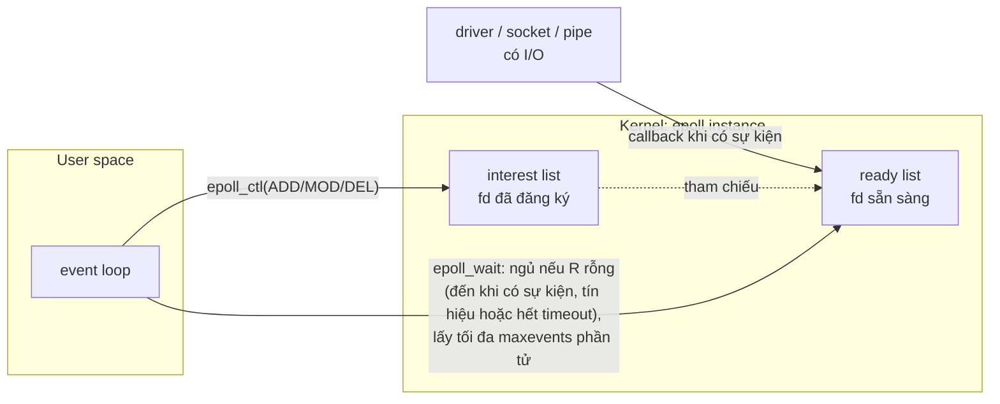
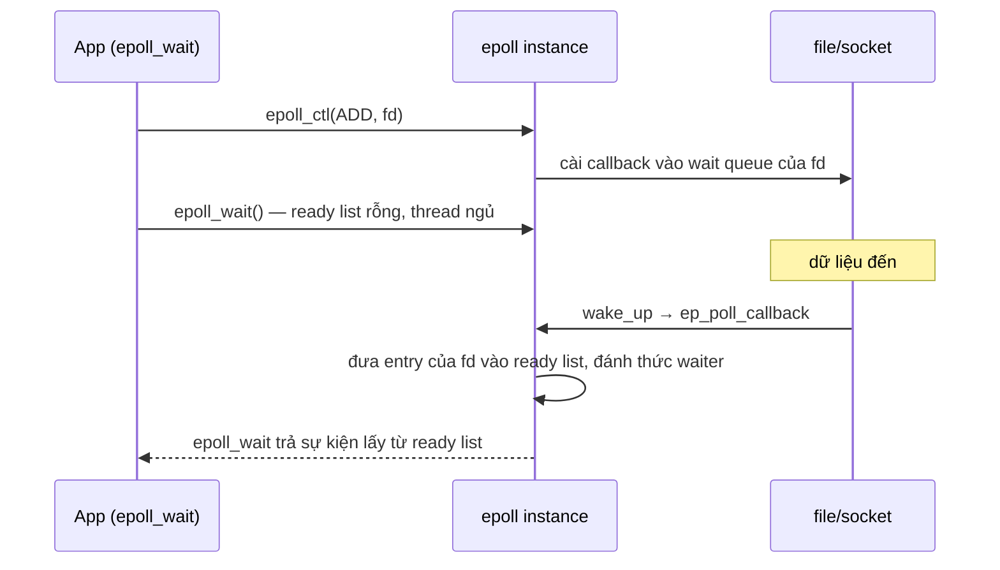
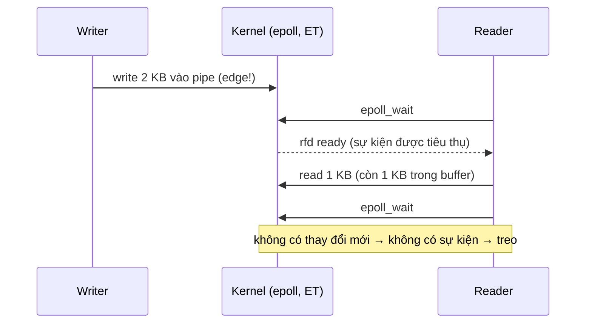
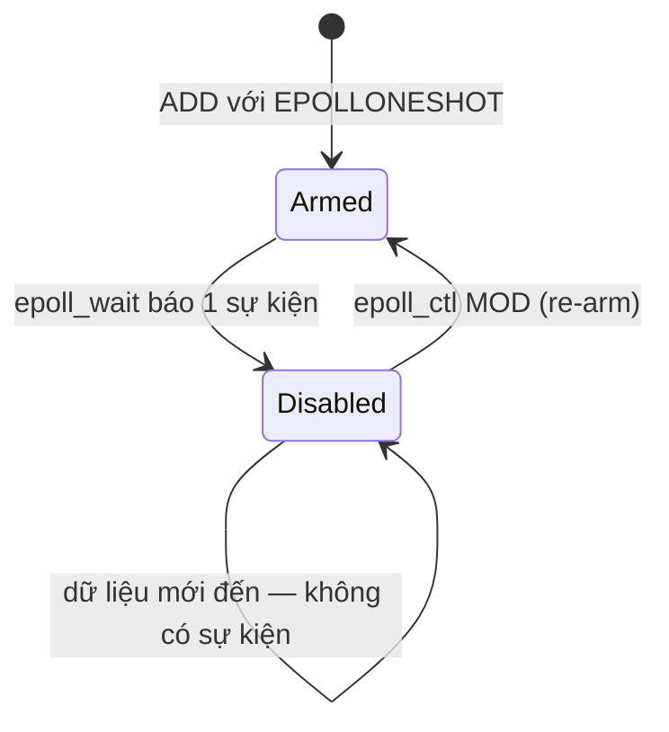

# P7 · Chương 02 — select, poll và epoll

> Mọi khẳng định về kernel/syscall là về **Linux** (man page Debian bookworm = Linux man-pages 6.03; source kernel ghim tag `v6.8`). Thí nghiệm chạy trong container lab (`./labs/linux.sh`, kernel 6.8, **aarch64**, glibc, `gcc`, `strace`); kết quả là *quan sát* một lần chạy, không phải bảo đảm của tài liệu. epoll là API riêng của Linux;[^epoll-linux] cơ chế tương ứng ở BSD/macOS nằm ở [Chương 03](03-kqueue-io-uring.md).

## Bạn sẽ hiểu được gì

1. **Q1.** `select(2)` giới hạn ở 1024 fd là giới hạn của ai — kernel hay glibc? Vì sao phải dựng lại `fd_set` trước mỗi lần gọi? → mục 2
2. **Q2.** `poll(2)` sửa được những gì của `select`, và `revents` khác `events` ở đâu? Điều gì xảy ra với fd âm hoặc fd đã đóng? → mục 3
3. **Q3.** Interest list và ready list của epoll là gì; ai đưa fd vào ready list, ai lấy ra? → mục 4
4. **Q4.** Level-triggered khác edge-triggered thế nào; vì sao ví dụ 2 KB trong `epoll(7)` làm `epoll_wait` treo ở chế độ ET, và quy tắc "đọc tới `EAGAIN`" ra đời từ đó? → mục 5
5. **Q5.** Vì sao `close(fd)` đôi khi *không* làm fd biến mất khỏi epoll (và event cache là gì)? Vì sao `epoll_ctl` với file thường trả `EPERM`? → mục 6
6. **Q6.** `EPOLLONESHOT` và `EPOLLEXCLUSIVE` giải quyết vấn đề gì; "một hoặc nhiều" nghĩa là gì; `EPOLLRDHUP`/`EPOLLHUP`/`EPOLLERR` và giới hạn bộ nhớ nói gì? → mục 7
7. **Q7.** mio đăng ký mọi fd với epoll ở chế độ nào, tài liệu mio nói gì về nó, và điều đó đặt nghĩa vụ gì lên code của bạn? → mục 8

## Kiến thức cần trước

- [Chương 01 — Mô hình I/O](01-mo-hinh-io.md), mục 2–3: `O_NONBLOCK`, `EAGAIN`, khái niệm *readiness* (fd "sẵn sàng" nghĩa là gì) và vì sao cần chờ nhiều fd cùng lúc.
- [P1 · Chương 04 — File descriptor và VFS](../01-linux/04-file-descriptor-va-vfs.md), mục 1–3: fd, *open file description* (OFD), `dup`/`fork` — nền cho mục 6 (fd đã đóng nhưng vẫn nằm trong interest list).

## 1. Bài toán: một thread, nhiều fd

Một server giữ hàng nghìn kết nối; với fd non-blocking, thread phải biết *khi nào* gọi `read` lại. `O_NONBLOCK` không báo điều đó; các giao diện `poll`/`select`/`epoll` chỉ báo fd "sẵn sàng", nghĩa là một I/O trên fd đó (với `O_NONBLOCK` tắt) sẽ không chặn.[^open-poll] ([Chương 01, mục 2–3](01-mo-hinh-io.md) đã bàn kỹ phần này.) Chương này đi qua ba thế hệ giao diện "cái nào sẵn sàng?" của Linux, dừng ở epoll — trên Linux là nền của mio, và qua mio là của Tokio ([Chương 07](07-executor-va-mio.md), [Chương 08](08-tokio.md)).

## 2. `select(2)`: giới hạn 1024 và value-result (Q1)

> **Trả lời ngắn.** Giới hạn 1024 là của glibc, không phải của kernel: glibc làm `fd_set` thành kiểu có kích thước cố định `FD_SETSIZE` = 1024.[^sel-glibc] Nó áp cho *số* của fd (phải nhỏ hơn 1024), không phải số lượng fd.[^sel-warn] Phải dựng lại `fd_set` trước mỗi lần gọi vì `select` sửa chính các tập đó để báo fd nào ready.[^sel-reinit]

**Giải thích.**

Hình dung (nhận xét của người soạn): `fd_set` giống tờ phiếu điểm danh có đúng 1024 ô, mỗi fd một ô theo số thứ tự; kernel gạch bỏ các ô chưa sẵn sàng ngay trên tờ phiếu bạn đưa, nên lần sau phải đưa tờ mới.

**Giao diện.**

`select` nhận ba `fd_set` — đọc, ghi, "exceptional" — cộng với `nfds` và `timeout`.[^sel-sets] Một fd "ready" khi có thể thực hiện I/O tương ứng mà không chặn (ví dụ `read`, hoặc một `write` đủ nhỏ).[^sel-ready] `nfds` phải là số fd lớn nhất trong ba tập *cộng 1*.[^sel-nfds] Thao tác trên tập qua macro `FD_ZERO`, `FD_SET`, `FD_CLR`, `FD_ISSET`.[^sel-macros]

**Giới hạn 1024 là của glibc.**

Man page mở đầu bằng cảnh báo: `select()` chỉ theo dõi được fd có *số* nhỏ hơn `FD_SETSIZE` (1024), giới hạn này "sẽ không đổi", và ứng dụng hiện đại nên dùng `poll` hoặc `epoll`.[^sel-warn] Chữ quan trọng là **số** của fd, không phải *số lượng* fd: một process có 10 kết nối nhưng fd mang số 1500 vẫn không đưa được vào `fd_set`. Mục BUGS nói rõ giới hạn nằm ở đâu: kernel Linux không áp giới hạn cố định; chính glibc làm `fd_set` thành kiểu kích thước cố định với `FD_SETSIZE` = 1024.[^sel-glibc]

Quan sát trong container (glibc, aarch64): `FD_SETSIZE=1024`, `sizeof(fd_set)=128` byte — tức 1024 bit, mỗi fd một bit. Con số 128 khớp với việc `fd_set` là bitmap kích thước cố định; nó là kết quả đo, không phải điều man page hứa.

**Value-result: phải dựng lại tập mỗi lần.**

Khi `select` trả về, **chính các `fd_set` bị sửa** để chỉ ra fd nào đang ready; vì vậy gọi trong vòng lặp thì phải khởi tạo lại các tập trước mỗi lần gọi.[^sel-reinit] Man page còn đánh giá thẳng: việc `fd_set` là đối số value-result là "a design error" mà `poll` và `epoll` tránh được.[^sel-design]

Quan sát: hai pipe `a`, `b`, cả hai đều nằm trong `fd_set` đọc, chỉ ghi vào `a`, gọi `select` với timeout 0 → trả về 1, và *sau* lời gọi `FD_ISSET(a)`=1, `FD_ISSET(b)`=0. Tập đầu vào của `b` đã bị xóa; lần gọi sau mà không `FD_SET(b)` lại thì `b` không còn được theo dõi.

<details><summary>Đi sâu: <code>select</code> báo ready giả; tên syscall thật</summary>

- Trên Linux `select` có thể báo socket là sẵn sàng đọc mà `read` sau đó vẫn chặn (ví dụ dữ liệu đến nhưng bị bỏ vì sai checksum);[^sel-spurious] man page khuyên dùng `O_NONBLOCK` trên socket không được phép chặn.[^sel-spurious-nb] ([Chương 01, mục 3](01-mo-hinh-io.md) nêu cùng điểm này từ góc độ readiness.)
- Quan sát bằng strace trên aarch64: lời gọi `select` trong C hiện ra là `pselect6(6, [3 5], NULL, NULL, {tv_sec=0, tv_nsec=0}, NULL)`. Tên syscall khác tên hàm libc: man page nêu syscall nằm dưới `pselect()` của glibc tên là `pselect6()`.[^sel-pselect6] Trên aarch64 đây có vẻ là con đường duy nhất (suy luận của người soạn): arm64 lấy bảng syscall từ `asm-generic/unistd.h`,[^k-arm64-unistd] bảng đó có `pselect6` (số 72)[^k-generic-pselect6] và khi grep tệp v6.8 tôi không tìm thấy dòng nào cho `select`. Hiện tượng tương tự với `epoll_wait` (mục 4).

</details>

**Quay lại Q1:** giới hạn 1024 là `FD_SETSIZE` của glibc áp lên *số* của fd, và `fd_set` là value-result nên phải dựng lại mỗi lần gọi.

## 3. `poll(2)`: mảng `pollfd`, `events` và `revents` (Q2)

> **Trả lời ngắn.** `poll` nhận tập fd là một mảng `struct pollfd`; `events` là đầu vào, `revents` là đầu ra do kernel điền,[^poll-revents] nên không phải dựng lại tập giữa các lần gọi như `select`. fd âm bị bỏ qua (`revents` = 0),[^poll-neg] còn fd chưa mở được báo bằng `POLLNVAL` trong `revents`.[^poll-nval]

**Giải thích.**

Hình dung (nhận xét của người soạn): thay vì một tờ phiếu bị gạch xóa, bạn đưa một bảng hai cột — cột "tôi muốn biết gì" kernel không đụng tới, cột "đã xảy ra gì" kernel tự điền.

**Giao diện.**

`poll` làm việc tương tự `select`: chờ một trong một tập fd sẵn sàng I/O.[^poll-desc] Tập fd là một **mảng** `struct pollfd` truyền qua đối số `fds`:[^poll-fds]

```c
struct pollfd {
    int   fd;         /* file descriptor */
    short events;     /* requested events */
    short revents;    /* returned events */
};
```

`events` là tham số vào (mặt nạ bit những sự kiện ta quan tâm); `revents` là tham số ra do kernel điền những sự kiện thực sự xảy ra.[^poll-revents] Vì đầu vào và đầu ra nằm ở hai trường khác nhau nên **không cần dựng lại `events`** giữa các lần gọi — đó là điểm mà man page `select(2)` nói `poll` tránh được lỗi thiết kế value-result.[^sel-design] Quan sát: `sizeof(struct pollfd)` = 8 byte trên máy thử.

**Những điểm tinh tế (có nguồn, kèm quan sát một lần chạy).**

- **fd âm bị bỏ qua**: trường `events` của phần tử đó bị bỏ qua và `revents` trả 0; man page nêu đây là cách dễ để "tắt" một phần tử cho một lần gọi.[^poll-neg] Quan sát: phần tử với `fd = ~5` cho `revents = 0`.
- **`POLLNVAL`** ("invalid request: fd not open") chỉ xuất hiện trong `revents`.[^poll-nval] Quan sát: `poll` trên fd 999 chưa mở trả `revents = 0x20` (= `POLLNVAL`).

<details><summary>Đi sâu: <code>POLLHUP</code>, <code>POLLERR</code> không cần đăng ký</summary>

- **`POLLHUP`, `POLLERR` không cần đăng ký**: ba bit `POLLERR`, `POLLHUP`, `POLLNVAL` vô nghĩa trong `events` và được đặt vào `revents` bất cứ khi nào điều kiện tương ứng đúng.[^poll-always] Với pipe hoặc stream socket, `POLLHUP` chỉ nghĩa là peer đã đóng đầu của nó; `read` chỉ trả 0 (EOF) *sau khi* dữ liệu còn lại đã được đọc hết.[^poll-hup]

</details>

**Quay lại Q2:** `poll` tách `events` (vào) khỏi `revents` (ra) nên không dựng lại tập; fd âm bị bỏ qua, fd chưa mở báo `POLLNVAL`.

## 4. epoll: interest list, ready list và vì sao không phải quét (Q3)

> **Trả lời ngắn.** Một epoll instance trong kernel chứa hai danh sách: *interest list* là các fd bạn đã đăng ký, *ready list* là các fd đang sẵn sàng.[^epoll-lists] Khi một fd có I/O, một callback cài sẵn trên wait queue của nó đưa fd vào ready list (kernel 6.8), rồi `epoll_wait` lấy các phần tử từ ready list.[^k-ep-ready][^ep-wait-fetch] Vì thế epoll không phải quét lại toàn bộ tập đã đăng ký mỗi lần gọi như `select`/`poll`, mà chỉ xét các fd đã nằm trong ready list (suy luận của người soạn từ source).

**Giải thích.**

Hình dung (nhận xét của người soạn): `select`/`poll` giống giáo viên mỗi tiết gọi tên cả lớp để hỏi "ai làm xong rồi?"; epoll giống để học sinh làm xong tự ghi tên lên bảng, giáo viên chỉ đọc bảng.

**Vì sao `select` và `poll` quét toàn bộ tập mỗi lần.**

Các man page `select(2)`, `poll(2)`, `epoll(7)` **không** nêu độ phức tạp tiệm cận, nên chương này **không** ghi Big-O cho chúng. Điều có nguồn: `select` kiểm tra các fd trong ba tập tới giới hạn `nfds`;[^sel-nfds2] `poll` nhận tập fd là đối số `fds` ở mỗi lần gọi;[^poll-fds] epoll chỉ được man page mô tả là mở rộng tốt với số lượng lớn fd được theo dõi.[^epoll-intro]

*Đọc source kernel 6.8 (chi tiết cài đặt, có thể đổi).*

Để thấy cấu trúc, ta đọc source Linux `v6.8`, `fs/select.c` — **chi tiết cài đặt của một phiên bản**, không phải bảo đảm giao diện.

- `do_poll` có vòng ngoài `for (;;)` và bên trong duyệt từng phần tử `pollfd`, gọi `do_pollfd` ở mỗi phần tử; comment mô tả việc kernel dò sự kiện ở từng fd.[^k-poll-fish] Vòng duyệt từng entry nằm ở dòng `for (; pfd != pfd_end; pfd++) {`.[^k-poll-loop]
- `do_select` cũng có `for (;;)`, duyệt các bit của bitmap và gọi `vfs_poll` (hỏi file "bây giờ có sự kiện không?") cho mỗi fd có bit đặt.[^k-select-loop]

Cấu trúc đọc được: **mỗi lần gọi** (và mỗi lần vòng ngoài chạy lại sau khi bị đánh thức) kernel đi qua từng fd được truyền vào và hỏi từng file, nên chi phí một lần gọi gắn với *kích thước tập truyền vào* chứ không chỉ với số fd ready (suy luận của người soạn từ source; không nêu hàm Big-O vì không có nguồn tài liệu phát biểu — muốn con số, đo).

Đừng hiểu `select`/`poll` là vòng lặp bận thuần túy: `do_poll` cũng đăng ký waiter vào wait queue của các file ở lượt quét đầu, và comment nói lượt sau không đăng ký lại.[^k-poll-waiters] Khác biệt nằm ở chỗ tập fd là đối số của *từng lần gọi*, nên việc theo dõi này gắn với một lần gọi; epoll giữ interest list trong kernel giữa các lần `epoll_wait` (suy luận của người soạn, dựa trên cấu trúc code trên và mô tả interest list của `epoll(7)`).

**Hai danh sách trong kernel (epoll).**

`epoll` làm việc tương tự `poll` — theo dõi nhiều fd xem I/O có khả thi — dùng được ở cả kiểu edge-triggered lẫn level-triggered, và mở rộng tốt với số lượng lớn fd.[^epoll-intro] Khái niệm trung tâm là **epoll instance**: một cấu trúc dữ liệu trong kernel mà từ góc nhìn user space là container của hai danh sách:[^epoll-lists]

- **interest list** (còn gọi là epoll set): tập fd process đã đăng ký quan tâm;
- **ready list**: tập fd đang "ready" cho I/O; là tập con (chính xác hơn, tập *tham chiếu* tới) các fd trong interest list, và được kernel *điền động* theo hoạt động I/O trên các fd đó.[^epoll-lists]



Ba system call tương ứng:

| Syscall | Việc | Nguồn |
|---|---|---|
| `epoll_create1(flags)` | tạo instance, trả fd tham chiếu tới nó; `EPOLL_CLOEXEC` đặt close-on-exec; `epoll_create(size)` cũ bỏ qua `size` (từ Linux 2.6.8) nhưng phải > 0 | [^ep-create][^ep-create1] |
| `epoll_ctl(epfd, op, fd, &event)` | `EPOLL_CTL_ADD` / `MOD` / `DEL` thêm, sửa, gỡ entry của interest list | [^ep-ctl] |
| `epoll_wait(epfd, events, maxevents, timeout)` | chờ sự kiện; trả thông tin lấy từ ready list, tối đa `maxevents`; `timeout` = −1 chặn vô hạn, 0 trả ngay | [^ep-wait][^ep-wait-timeout] |

`epoll(7)` mô tả `epoll_wait` như thao tác "fetching items from the ready list".[^ep-wait-fetch] Trường `data` bạn đặt trong `epoll_ctl` được trả lại nguyên vẹn ở `epoll_wait`;[^ep-wait-data] đó là chỗ nhét số fd hay token để biết sự kiện thuộc về ai.

**Ai cập nhật ready list? (đọc source, có nhãn)**

Cơ chế cụ thể, theo một comment minh họa epoll lồng nhau trong `fs/eventpoll.c` (kernel 6.8): khi có gói tin tới thiết bị bên dưới một socket, code mạng gọi `wake_up()` trên *poll wake list* của file; epoll đã cài sẵn một *callback entry* trên hàng đợi đó.[^k-ep-callback] Hàm `ep_poll_callback` được gán làm hàm đánh thức của entry này (`init_waitqueue_func_entry(&pwq->wait, ep_poll_callback)` trong `ep_ptable_queue_proc`);[^k-ep-func-entry] ở trường hợp thông thường nó thêm entry vào ready list.[^k-ep-ready]

Vậy thứ tự cơ chế là (đọc từ source 6.8, chi tiết cài đặt):



Khác với phần quét ở trên: giữa hai lần `epoll_wait`, kernel đã tích lũy sẵn các fd ready nhờ callback (suy luận của người soạn từ cấu trúc code trên; man page không phát biểu như vậy, nên mục này không kèm khẳng định về tốc độ).

<details><summary>Đi sâu: quan sát strace một server echo dùng epoll thô</summary>

Trong container (aarch64), một server echo dùng epoll thô (`labs/crates/lab-io-async`, `epoll_echo`) chạy dưới `strace` cho vòng đời sau (rút gọn):

```text
epoll_create1(EPOLL_CLOEXEC)      = 4
epoll_ctl(4, EPOLL_CTL_ADD, 3, {events=EPOLLIN, data={u32=3, u64=3}}) = 0
epoll_pwait(4, [{events=EPOLLIN, data={u32=3, u64=3}}], 64, -1, NULL, 8) = 1
accept4(3, {...}, [128 => 16], SOCK_CLOEXEC) = 5
epoll_ctl(4, EPOLL_CTL_ADD, 5, {events=EPOLLIN|EPOLLOUT|EPOLLRDHUP|EPOLLET, data={u32=5, u64=5}}) = 0
accept4(3, ..., SOCK_CLOEXEC) = -1 EAGAIN (Resource temporarily unavailable)
epoll_pwait(4, [{events=EPOLLIN|EPOLLOUT, data={u32=5, u64=5}}], 64, -1, NULL, 8) = 1
read(5, ..., 4096) = 64
read(5, ..., 4096) = 64
read(5, "", 4096)                 = 0
epoll_ctl(4, EPOLL_CTL_DEL, 5, 0xffffc4cdce90) = 0
```

Cách đọc từng bước (quan sát một lần chạy; phần giải nghĩa dựa trên man page, chỗ nào là suy luận thì ghi rõ):

- `epoll_create1(EPOLL_CLOEXEC) = 4`: tạo epoll instance và trả fd 4 tham chiếu tới nó, có cờ close-on-exec.[^ep-create][^ep-create1] Từ `accept4(3, …)` bên dưới suy ra fd 3 là socket lắng nghe (các lời gọi tạo nó đã bị rút gọn).
- `epoll_ctl(4, EPOLL_CTL_ADD, 3, {events=EPOLLIN, …})`: đăng ký listener chỉ với `EPOLLIN`, không có `EPOLLET` nên là level-triggered (mặc định).[^ep-et] Code nhét chính số fd vào `data`, và `epoll_wait` trả lại đúng giá trị đó để biết sự kiện thuộc fd nào.[^ep-wait-data]
- `epoll_pwait(4, [...], 64, -1, NULL, 8) = 1`: `64` là `maxevents`; `-1` là timeout vô hạn nên thread ngủ ở đây tới khi có sự kiện;[^ep-wait-timeout] `= 1` là số fd ready (listener có kết nối đến).
- Tên `epoll_pwait` và hai đối số cuối `NULL, 8`: code gọi `epoll_wait` (libc) nhưng strace hiện `epoll_pwait`. Man page nói khi `sigmask` là `NULL` thì `epoll_pwait()` tương đương `epoll_wait()`,[^ep-pwait] và syscall thô có đối số thứ sáu `sigsetsize` là kích thước (byte) của `sigmask`[^ep-pwait-size] — số `8` ở cuối ứng với đối số này (suy luận của người soạn). Trên aarch64, `epoll_pwait` có vẻ là con đường duy nhất (suy luận của người soạn): arm64 lấy bảng syscall từ `asm-generic/unistd.h`,[^k-arm64-unistd] bảng đó có `epoll_pwait` (số 22)[^k-generic-pwait] và khi grep tệp v6.8 tôi không tìm thấy dòng nào cho `epoll_wait`.
- `accept4(3, …) = 5` rồi `epoll_ctl(4, EPOLL_CTL_ADD, 5, {EPOLLIN|EPOLLOUT|EPOLLRDHUP|EPOLLET})`: kết nối mới (fd 5) được đăng ký edge-triggered, một lần cho cả đọc lẫn ghi — cách man page nêu để khỏi `EPOLL_CTL_MOD` mỗi lần chuyển giữa đọc và ghi;[^ep-both] `EPOLLRDHUP` để biết peer đóng hoặc shutdown.[^ep-rdhup]
- `accept4(3, …) = -1 EAGAIN`: vòng accept chạy tới khi hết kết nối chờ rồi mới quay lại chờ. Listener là LT nên không bắt buộc phải làm vậy; đây là lựa chọn của code (nhận xét của người soạn).
- `epoll_pwait(…) = 1` với `EPOLLIN|EPOLLOUT` trên fd 5: kết nối vừa đọc được vừa ghi được. Sau đó là hai `read` 64 byte rồi `read = 0`: 0 byte là EOF, và `read` chỉ trả 0 sau khi dữ liệu còn lại đã được đọc hết.[^poll-hup] Vòng đọc kết thúc ở EOF nên trích đoạn này không có `read = -1 EAGAIN`.
- `epoll_ctl(4, EPOLL_CTL_DEL, 5, 0xffffc4cdce90) = 0`: gỡ fd 5 khỏi interest list. Với `DEL`, đối số `event` bị bỏ qua và có thể là `NULL`;[^ep-ctl-del] việc strace in một địa chỉ thay vì `NULL` nghĩa là code truyền con trỏ không-NULL mà kernel không dùng (suy luận của người soạn). Gỡ tường minh tránh được bẫy ở mục 6 nếu fd có bản sao (nhận xét của người soạn).

</details>

**Quay lại Q3:** epoll giữ interest list (fd đã đăng ký) và ready list (fd sẵn sàng); callback trên wait queue của file điền ready list, `epoll_wait` lấy ra.

## 5. Level-triggered và edge-triggered (Q4)

> **Trả lời ngắn.** Mặc định epoll là level-triggered (LT): còn dữ liệu thì còn báo (cùng ngữ nghĩa với `poll`);[^ep-lt] cờ `EPOLLET` chuyển sang edge-triggered (ET), chỉ báo khi có thay đổi.[^ep-et][^ep-et-change] Vì thế ở ET, ví dụ 2 kB của `epoll(7)` (đọc 1 kB rồi chờ lại) nhiều khả năng treo dù buffer còn dữ liệu;[^ep-et-scenario] quy tắc dùng ET đúng là fd non-blocking và chỉ chờ sau khi `read`/`write` trả `EAGAIN`.[^ep-et-rule]

**Giải thích.**

Hình dung (nhận xét của người soạn): LT giống chuông reo mãi chừng nào còn thư trong hộp; ET chỉ reo đúng lúc có thư mới bỏ vào — lấy một nửa rồi ngồi chờ chuông thì chuông không reo nữa.

**Định nghĩa.**

Mặc định epoll là **level-triggered** (LT); cờ `EPOLLET` yêu cầu **edge-triggered** (ET).[^ep-et] Ở chế độ LT, epoll đơn giản là một `poll(2)` nhanh hơn và dùng được ở mọi nơi `poll` dùng vì cùng ngữ nghĩa.[^ep-lt] Chế độ ET chỉ phát sự kiện khi có thay đổi trên fd được theo dõi.[^ep-et-change]

**Ví dụ 2 KB trong `epoll(7)`.**

Man page dựng kịch bản: (1) đầu đọc của pipe, `rfd`, đăng ký vào epoll; (2) writer ghi 2 kB; (3) `epoll_wait` trả `rfd` ready; (4) reader đọc 1 kB; (5) gọi `epoll_wait` lần nữa. Nếu `rfd` đăng ký với `EPOLLET`, lần gọi ở bước 5 nhiều khả năng sẽ treo dù dữ liệu vẫn còn trong buffer.[^ep-et-scenario] Lý do: sự kiện sinh ra do lần ghi và bị tiêu thụ ở bước 3; lần đọc ở bước 4 không tiêu thụ hết buffer nên `epoll_wait` ở bước 5 có thể chặn vô thời hạn.[^ep-et-hang]



**Quy tắc dùng ET đúng.**

Man page nêu cách dùng ET được đề nghị: (1) với fd non-blocking, và (2) chỉ chờ sự kiện *sau khi* `read`/`write` trả `EAGAIN`.[^ep-et-rule] Fd phải non-blocking để một `read`/`write` bị chặn không làm đói các fd khác mà thread đang phục vụ.[^ep-et-nonblock]

Vì sao "đến `EAGAIN`"? Nhận được sự kiện nghĩa là fd "ready", và bạn phải coi nó ready cho đến khi `read`/`write` non-blocking kế tiếp trả `EAGAIN`.[^ep-qa-eagain] Với file hướng gói/token (datagram socket, terminal canonical mode), cách *duy nhất* để biết đã hết là đọc/ghi tới `EAGAIN`.[^ep-qa-packet] Với file hướng stream (pipe, FIFO, stream socket), `read` trả ít byte hơn yêu cầu cho biết đã rút cạn — nhưng man page dặn tránh kỹ thuật này nếu không chắc fd luôn là stream.[^ep-qa-short][^ep-qa-short-caveat] Và vì nhiều sự kiện xảy ra giữa hai lần `epoll_wait` được gộp lại thành một báo cáo,[^ep-combine] một lần đánh thức có thể ứng với nhiều đợt dữ liệu (suy luận của người soạn).

**Cái giá và phần được lợi của ET.** Kegel (C10k) nhận xét readiness-change (kiểu edge) kém tha thứ lỗi lập trình — bỏ sót một sự kiện thì kết nối đó kẹt vĩnh viễn.[^c10k-edge] Phần được lợi (nhận xét của người soạn): ít sự kiện lặp, và đăng ký một lần `EPOLLIN|EPOLLOUT` để khỏi `epoll_ctl(MOD)` mỗi khi đổi giữa đọc và ghi — man page nêu điều này vì lý do hiệu năng.[^ep-both]

**Starvation ở ET.** Nếu một fd có lượng I/O rất lớn và bạn cố rút cạn nó trong một lần, các fd khác có thể bị bỏ đói.[^ep-starve] Man page đề xuất giữ một ready list ở user space và round-robin giữa các fd ready.[^ep-starve-fix]

<details><summary>Đi sâu: cơ chế LT/ET trong kernel 6.8, thí nghiệm "đọc một lần" và tái hiện ví dụ 2 KB (quan sát một lần chạy)</summary>

**Cơ chế trong source (kernel 6.8, chi tiết cài đặt).** Khi `epoll_wait` lấy sự kiện, `ep_send_events` duyệt các entry của ready list, gọi lại `ep_item_poll` để lấy mặt nạ sự kiện *hiện tại* của từng entry và chỉ giao cho user space nếu mặt nạ giao với mặt nạ người gọi yêu cầu.[^k-ep-send-mask] Entry vừa được giao bị gỡ khỏi ready list; chỉ entry *không* đặt `EPOLLET` (và không `EPOLLONESHOT`) được xếp lại vào cuối ready list để lần `epoll_wait` kế tiếp kiểm tra lại.[^k-ep-lt-requeue] Từ đó suy ra khác biệt LT/ET ở mức code (suy luận của người soạn): fd LT còn nằm trong ready list nên lần sau được hỏi lại và thấy còn dữ liệu; fd ET chỉ quay lại ready list khi callback ở mục 4 chạy lần nữa, nên buffer còn dữ liệu mà không có đánh thức mới thì `epoll_wait` không thấy gì. Callback ấy còn lọc theo mặt nạ: đánh thức có mặt nạ không giao với `events` đã đăng ký bị bỏ qua.[^k-ep-mask-filter]

**Bug "đọc một lần" (thí nghiệm của lab).** Server echo `epoll_echo` có cờ `--read-once` cố tình vi phạm quy tắc ET: mỗi sự kiện chỉ `read` đúng 16 byte rồi quay lại `epoll_wait`. Chạy lại trong container với một kết nối gửi một message 64 byte:

```text
[epoll] listening on 127.0.0.1:7107 (epfd=4, listener fd=3, mode=ET, read once (broken))
[epoll] accepted 127.0.0.1:60960 as fd 5
[load] 1 conns x 1 msgs x 64 B: 0 ok, 1 failed, 3022 ms
[load] conn 0: message 0: Resource temporarily unavailable (os error 11)
[epoll] served 1 conns: epoll_wait calls=4, events=4, reads with data=3, reads -> EAGAIN=0, bytes echoed=48, threads=1
```

(Dòng `[epoll] fd 5: Broken pipe` bị trộn vào output vì hai tiến trình cùng ghi stderr.) Server echo được 48 byte (3 lần đọc × 16) rồi ngủ trong `epoll_wait`; 16 byte còn lại nằm trong buffer nhưng không có edge mới. Client có read timeout ~3 s nên báo `WouldBlock` (`os error 11` = `EAGAIN`) — không có lỗi mạng, chỉ là một phản hồi không bao giờ tới. Cách đọc số liệu: `reads -> EAGAIN=0` cho thấy server không bao giờ chạy tới `EAGAIN` — đúng điều quy tắc ET cấm; `bytes echoed=48` khớp 3 × 16. Đừng đọc `events=4` như "bốn edge do dữ liệu": theo ghi chú của lab (`docs/labs/07-io-async-lab.md`), server còn được đánh thức thêm một lần sau khi client timeout và đóng kết nối, và tôi không tách được từng sự kiện thuộc thời điểm nào. Đối chứng ở chế độ đọc tới `EAGAIN` (số liệu có sẵn trong lab, tải khác: 4 kết nối × 200 message × 64 B): `bytes echoed=51200` và `reads -> EAGAIN=798`.

**Tái hiện thật.** Người soạn dựng đúng kịch bản bằng C (pipe non-blocking, `epoll_wait` timeout 200 ms để "treo" hiện ra thành `0`), trong container:

| Chế độ | wait #1 | read 1024 | wait #2 | read 1024 nữa | wait #3 |
|---|---|---|---|---|---|
| LT | 1 | 1024 | **1** | 1024 | 0 |
| ET (`EPOLLET`) | 1 | 1024 | **0** (treo) | 1024 | 0 |

(Sau khi đọc nốt, `read` tiếp theo trả `-1 EAGAIN` ở cả hai chế độ.) Cách đọc bảng: `wait #1 = 1` ở cả hai chế độ vì lần ghi đầu tiên là thay đổi mới. Sau `read 1024` còn 1024 byte trong buffer, và ô đậm là chỗ hai chế độ tách ra: LT báo lại vì fd còn dữ liệu (khớp cơ chế xếp lại ready list ở trên, suy luận của người soạn), ET không có đánh thức mới nên `epoll_wait` hết timeout 200 ms và trả `0`. `wait #3 = 0` ở cả hai chế độ vì buffer đã rỗng — không còn gì để báo, kể cả LT; đây là đối chứng cho thấy LT im lặng đúng khi hết dữ liệu chứ không phải vì timeout quá ngắn. Strace xác nhận chuỗi `epoll_pwait(..., 200, ...) = 1, 1, 0` cho LT và `= 1, 0` cho ET. `0` chỉ nghĩa là hết timeout 200 ms không có sự kiện, trong một lần chạy; man page chỉ nói nhiều khả năng sẽ treo.

</details>

**Quay lại Q4:** ET chỉ báo khi có thay đổi, nên phải dùng fd non-blocking và đọc/ghi tới `EAGAIN`; bỏ sót thì fd kẹt như ở ví dụ 2 KB.

## 6. Đóng fd, event cache và file thường (Q5)

> **Trả lời ngắn.** Interest list nhận diện fd bằng cả số fd lẫn open file description (OFD), nên `close(fd)` chỉ gỡ fd khi mọi fd cùng trỏ vào OFD đó đã đóng.[^ep-key][^ep-close] `epoll_ctl` trả `EPERM` khi file đích không hỗ trợ epoll, ví dụ file thường.[^ep-eperm]

**Giải thích.**

Hình dung (nhận xét của người soạn): bạn trả thẻ thư viện của mình nhưng bản sao thẻ vẫn nằm trong tay người khác, nên hệ thống vẫn nhận ra phiếu mượn cũ.

**Đóng fd không chắc gỡ nó khỏi interest list.**

Khóa phân biệt các fd trong interest list là tổ hợp *số fd* **và** *open file description*.[^ep-key] `EPOLL_CTL_ADD` lưu một tham chiếu tới open file description tương ứng.[^ep-ctl-ofd] Hệ quả (Q&A trong `epoll(7)`): fd chỉ bị gỡ sau khi *mọi* fd cùng tham chiếu OFD đó đã đóng; nên kể cả sau khi bạn `close` fd đã đăng ký, sự kiện vẫn có thể được báo nếu còn fd khác (do `dup`, `fork`...) trỏ tới OFD đó. Cách phòng: `EPOLL_CTL_DEL` tường minh *trước khi* nhân bản fd, hoặc bảo đảm mọi bản sao đều đóng — khó khi thư viện tự `dup`/`fork` sau lưng.[^ep-close] (Về OFD và `dup`: [P1 · Chương 04, mục 1–3](../01-linux/04-file-descriptor-va-vfs.md).)

**Event cache: sự kiện thứ 47 đóng fd của sự kiện thứ 13.**

Nếu bạn giữ cả mảng sự kiện của một `epoll_wait` (event cache: nơi lưu các sự kiện hoặc fd mà `epoll_wait` trả về để xử lý dần), hãy có cách đánh dấu việc đóng xảy ra *giữa chừng*: nhận 100 sự kiện, ở #47 có điều kiện làm đóng fd của sự kiện #13 → `close(2)` fd #13 mà cache vẫn nói có sự kiện cho nó.[^ep-cache] Man page đề xuất: ở #47 gọi `EPOLL_CTL_DEL` cho fd 13 rồi `close(2)`, đánh dấu cấu trúc của nó là `removed` để nhận ra khi gặp sự kiện #13 trong cùng lô.[^ep-cache-fix]

**File thường không dùng được với epoll.** `epoll_ctl` trả `EPERM` khi file đích không hỗ trợ epoll, ví dụ `fd` là file thường hoặc thư mục.[^ep-eperm] Ở source 6.8, `do_epoll_ctl` kiểm tra file đích có hỗ trợ poll không và trả `-EPERM` nếu không.[^k-ep-eperm] Hệ quả (nhận xét của người soạn): readiness không giúp đọc đĩa không chặn; cần thread pool hoặc cơ chế completion — [Chương 03](03-kqueue-io-uring.md).

<details><summary>Đi sâu: quan sát bẫy <code>dup</code>, <code>EEXIST</code>, <code>EPOLL_CTL_MOD</code> và <code>EPERM</code></summary>

Quan sát (container): đăng ký đầu đọc pipe `q0`, `dup` ra `d`, `close(q0)`, rồi ghi vào pipe → `epoll_wait` trả **1 sự kiện** với `data.fd` bằng số của `q0` — số fd *đã đóng*. Đối chứng: đăng ký, ghi, `close` mà không `dup` → `epoll_wait` trả 0. Đây là bẫy kinh điển (nhận xét của người soạn): ứng dụng nhận sự kiện cho một số fd mà nó tưởng đã dọn xong.

Ba điều liên quan trong Q&A của `epoll(7)`: hai epoll instance cùng chờ một fd thì sự kiện được báo cho cả hai;[^ep-two-instances] đăng ký *cùng* fd hai lần trên một instance nhiều khả năng nhận `EEXIST` (quan sát: `errno=File exists`), nhưng thêm một bản `dup` thì được — hữu ích để lọc sự kiện nếu các bản dup đăng ký mặt nạ khác nhau;[^ep-eexist] và `EPOLL_CTL_MOD` trên fd đã có sẽ đọc lại I/O khả dụng.[^ep-mod]

Quan sát về `EPERM`: `EPOLL_CTL_ADD` cho `/etc/hostname` mở bằng `open` → `-1 EPERM`. Trong khi đó `poll` trên cùng fd trả ngay `revents = 0x1` (`POLLIN`) (quan sát một file, không phải bảo đảm cho mọi filesystem).

</details>

**Quay lại Q5:** epoll giữ tham chiếu tới OFD nên `close` chưa chắc gỡ fd, event cache có thể giữ sự kiện của fd đã đóng, và file thường bị `EPERM`.

## 7. `EPOLLONESHOT`, `EPOLLEXCLUSIVE` và các cờ trạng thái (Q6)

> **Trả lời ngắn.** `EPOLLONESHOT` vô hiệu fd trong interest list sau khi báo một sự kiện, cho tới khi bạn `EPOLL_CTL_MOD` để bật lại.[^ep-oneshot][^ep-oneshot-rearm] `EPOLLEXCLUSIVE` có thể giúp tránh thundering herd (nhiều bên cùng bị đánh thức) trong một số tình huống, nhưng chỉ hứa "một hoặc nhiều" epoll fd nhận event, không hứa đúng một.[^ep-excl-one]

**Giải thích.**

Hình dung (nhận xét của người soạn): `EPOLLONESHOT` giống thẻ "đã có người nhận việc": nhân viên nhận việc thì thẻ bị gỡ, họ phải treo thẻ lại thì mới có việc mới tới; `EPOLLEXCLUSIVE` giống chỉ gọi bớt nhân viên dậy, nhưng không cam kết chỉ gọi đúng một người.

**`EPOLLONESHOT`.**

Với `EPOLLONESHOT`, sau khi `epoll_wait` báo một sự kiện cho fd, fd bị **vô hiệu hóa trong interest list** và epoll không báo thêm sự kiện nào cho nó; người dùng phải gọi `epoll_ctl(EPOLL_CTL_MOD)` với mặt nạ mới để *re-arm* (bật lại).[^ep-oneshot][^ep-oneshot-rearm]

Man page `epoll(7)` giải thích động cơ: ngay cả ở ET, nhiều sự kiện có thể được sinh ra khi nhận nhiều "chunk" dữ liệu; caller có thể chỉ định `EPOLLONESHOT` để epoll vô hiệu fd sau khi nhận một sự kiện, và trách nhiệm bật lại thuộc về caller.[^ep-oneshot-et]



**Thundering herd: ET trên cùng epoll fd, và `EPOLLEXCLUSIVE`.**

Có hai tình huống khác nhau, đừng lẫn:

1. **Nhiều thread/process cùng chờ trên *một* epoll fd.** Nếu fd trong interest list đánh dấu ET trở nên ready thì *chỉ một* thread (hoặc process) được đánh thức khỏi `epoll_wait`; man page gọi đây là tối ưu hữu ích để tránh "thundering herd" ở một số kịch bản.[^ep-herd]
2. **Nhiều epoll fd (instance khác nhau) cùng gắn vào *một* fd đích.** Mặc định *tất cả* epoll fd nhận sự kiện. Với `EPOLLEXCLUSIVE` (từ Linux 4.5) trên các lần gắn, **một hoặc nhiều** epoll fd sẽ nhận event, nên cờ hữu ích để tránh thundering herd trong một số tình huống.[^ep-excl][^ep-excl-one]

"Một hoặc **nhiều**" quan trọng: tài liệu **không hứa đúng một**; nếu cần độc quyền tuyệt đối (đúng một worker xử lý) phải tự bảo đảm bằng cơ chế khác. Quy tắc cờ: `EPOLLEXCLUSIVE` chỉ dùng trong `EPOLL_CTL_ADD`; `EPOLL_CTL_MOD` có cờ này trả `EINVAL`;[^ep-excl-add][^ep-excl-einval] nếu cùng fd nằm trong nhiều instance mà có instance không đặt cờ, sự kiện đến *tất cả* instance không đặt cờ và ít nhất một instance có đặt cờ;[^ep-excl-mixed] cờ khác ngoài một tập nhỏ (`EPOLLIN`, `EPOLLOUT`, `EPOLLWAKEUP`, `EPOLLET`, cùng `EPOLLHUP`/`EPOLLERR`) đi kèm gây `EINVAL`.[^ep-excl-flags] (Không có thí nghiệm cho `EPOLLEXCLUSIVE`; chỉ dựa trên man page.)

**`EPOLLRDHUP`, `EPOLLHUP`, `EPOLLERR`.**

- `EPOLLRDHUP` (từ Linux 2.6.17): peer của stream socket đóng kết nối hoặc đóng nửa ghi; man page ghi cờ này đặc biệt hữu ích để phát hiện peer shutdown khi dùng ET.[^ep-rdhup] Quan sát (container, `socketpair`): đăng ký `EPOLLIN|EPOLLRDHUP`, phía kia `shutdown(SHUT_WR)` → `epoll_wait` trả `events = 0x2001` = `EPOLLIN | EPOLLRDHUP` (không có `EPOLLHUP`).
- `EPOLLHUP` và `EPOLLERR` được `epoll_wait` luôn báo, không cần đặt trong `events`.[^ep-hup-always][^ep-err-always] Với pipe/stream socket, `EPOLLHUP` chỉ nghĩa peer đã đóng đầu của nó; các `read` tiếp theo trả 0 chỉ sau khi dữ liệu còn lại đã được tiêu thụ.[^ep-hup] `EPOLLERR` cũng được báo cho đầu ghi của pipe khi đầu đọc đã đóng.[^ep-err]

**Giới hạn bộ nhớ.**

Mỗi fd đăng ký tốn bộ nhớ kernel — khoảng 160 byte trên kernel 64-bit — và tổng số fd một user đăng ký bị giới hạn bởi `/proc/sys/fs/epoll/max_user_watches`;[^ep-watches] vượt ra thì `epoll_ctl(ADD)` lỗi `ENOSPC`.[^ep-enospc]

<details><summary>Đi sâu: quan sát <code>EPOLLONESHOT</code> và vì sao nó hữu ích cho đa luồng (suy luận)</summary>

Quan sát (container): fd đăng ký `EPOLLIN|EPOLLET|EPOLLONESHOT`; ghi 1 byte → `epoll_wait` = 1; đọc xong rồi ghi thêm 1 byte → `epoll_wait` = **0**; gọi `EPOLL_CTL_MOD` re-arm → `epoll_wait` = 1. Về cài đặt (kernel 6.8): sau khi giao một sự kiện cho entry có `EPOLLONESHOT`, `ep_send_events` xóa các bit sự kiện công khai khỏi mặt nạ của entry;[^k-ep-oneshot-clear] trong `ep_poll_callback`, comment nói khi mặt nạ không còn bit nào của `poll(2)` thì fd được coi là bị vô hiệu, nhiều khả năng do bit `EPOLLONESHOT`, cho tới khi có `EPOLL_CTL_MOD` kế tiếp.[^k-ep-oneshot] Hai đoạn code ghép lại giải thích vì sao quan sát cho `0` (suy luận của người soạn).

**Mục đích đa luồng** (suy luận của người soạn): đã đọc lại `epoll(7)`, `epoll_ctl(2)` và `epoll_wait(2)` (bookworm) — không trang nào nêu thẳng mục đích đa luồng của `EPOLLONESHOT`; chỉ có lý do "nhiều chunk → nhiều sự kiện" ở trên. Nếu nhiều worker thread cùng `epoll_wait` trên một epoll fd, hai sự kiện liên tiếp của một kết nối có thể đánh thức hai thread khác nhau và cả hai cùng xử lý kết nối đó; `EPOLLONESHOT` giữ cho mỗi lúc chỉ một sự kiện "mở" cho fd, nên thread nhận nó xử lý độc quyền cho tới khi tự re-arm. **Không** có câu nào trong tài liệu nói thẳng điều này, đừng trích như tài liệu.

</details>

**Quay lại Q6:** `EPOLLONESHOT` tắt fd sau một sự kiện cho tới khi re-arm; `EPOLLEXCLUSIVE` chỉ hứa "một hoặc nhiều" bên nhận event, không hứa đúng một.

## 8. Liên hệ với Rust: mio và `EPOLLET` (Q7)

> **Trả lời ngắn.** Source mio 1.2.4 đặt `EPOLLET` trong mọi lần đăng ký fd với epoll trên Linux.[^mio-src] Tài liệu `Poll` của mio không gọi tên chế độ này và không nêu lý do; nó chỉ đặt nghĩa vụ lặp thao tác tới khi nhận `WouldBlock` sau mỗi readiness event,[^mio-drain] khớp với quy tắc "đọc tới `EAGAIN`" của ET ở mục 5.

**Giải thích.**

Hình dung (nhận xét của người soạn): mio đưa bạn một chuông kiểu ET; mỗi lần chuông reo bạn phải lấy hết thư trong hộp, vì chuông sẽ không reo lại cho số thư cũ.

Mio dùng epoll trên Linux và kqueue trên macOS theo bảng Implementation notes của `Poll`.[^mio-impl] Hợp đồng chung của `Poll` là: sau khi nhận readiness event, thao tác tương ứng phải được lặp lại cho tới khi trả `WouldBlock`.[^mio-drain] Đó là quy tắc "đọc tới `EAGAIN`" của `epoll(7)` với tên lỗi Rust (`WouldBlock`); quên nó, bạn gặp lại đúng bug `--read-once` ở mục 5. Mối liên hệ nhân quả (ET là lý do hợp đồng này cần thiết trên Linux) là suy luận của người soạn: docs mio không nối hai điều đó.

**Vì sao mio chọn ET?** Không tài liệu hay source nào đã tải nêu lý do. Điều có nguồn: backend kqueue của mio đăng ký với `EV_CLEAR`,[^mio-kq] và `EV_CLEAR` đặt lại trạng thái sự kiện sau khi người dùng lấy nó.[^kq-clear] Từ đó suy luận (của người soạn) rằng mio muốn hai backend cùng một ngữ nghĩa "báo theo thay đổi" để dùng chung một hợp đồng drain ([Chương 03, mục 2](03-kqueue-io-uring.md) so sánh `EV_CLEAR` với `EPOLLET`).

Phần còn lại của mio (`Poll`, `Registry`, `Token`, `Waker`; spurious event và draining readiness với log `strace` đầy đủ) thuộc [Chương 07, mục 4–6](07-executor-va-mio.md), Tokio ở [Chương 08](08-tokio.md), kiến trúc event loop ở [Chương 04](04-kien-truc-event-loop.md).

<details><summary>Đi sâu: bằng chứng mio đặt <code>EPOLLET</code> (source và strace)</summary>

- Source mio `v1.2.4`, `src/sys/unix/selector/epoll.rs`, hàm `interests_to_epoll`, bắt đầu bằng `let mut kind = EPOLLET;` rồi cộng `EPOLLIN | EPOLLRDHUP` cho interest đọc, `EPOLLOUT` cho ghi.[^mio-src] (Chi tiết cài đặt của phiên bản 1.2.4.)
- Quan sát (strace `mio_echo`; log đầy đủ ở [Chương 07, mục 6](07-executor-va-mio.md)): `epoll_ctl(3, EPOLL_CTL_ADD, 5, {events=EPOLLIN|EPOLLOUT|EPOLLRDHUP|EPOLLET, data={u32=1, u64=1}})` cho kết nối, và `EPOLLIN|EPOLLRDHUP|EPOLLET` cho listener — **kể cả listener** đều ET; `data` mang `Token` của mio. (Server echo thô ở mục 4 chọn khác: listener giữ LT.)

</details>

**Quay lại Q7:** source mio đặt `EPOLLET` cho mọi fd (docs không gọi tên nó), nên sau mỗi readiness event bạn phải lặp tới `WouldBlock`.

## Tóm tắt

- `select` chặn ở fd có *số* < 1024 vì glibc làm `fd_set` cố định, không phải kernel; `fd_set` là value-result nên phải dựng lại mỗi lần gọi.
- `poll` tách `events` (vào) khỏi `revents` (ra), bỏ qua fd âm, báo `POLLNVAL` cho fd không mở.
- Man page không nêu Big-O. Source 6.8: `select`/`poll` duyệt từng fd truyền vào mỗi lần gọi; epoll dùng callback đưa fd vào ready list (hệ quả hiệu năng là suy luận — hãy đo).
- epoll = interest list + ready list, qua `epoll_create1` / `epoll_ctl` / `epoll_wait`; trên aarch64 strace hiện `epoll_pwait`.
- ET chỉ báo khi có thay đổi: fd non-blocking, đọc/ghi tới `EAGAIN`; `--read-once` làm echo kẹt ở 48/64 byte.
- `EPOLLONESHOT` vô hiệu fd tới khi `EPOLL_CTL_MOD`; `EPOLLEXCLUSIVE` cho "một hoặc nhiều" epoll fd nhận event.
- Đóng fd không chắc gỡ nó khỏi interest list khi OFD còn tham chiếu; file thường bị `EPERM`.
- mio (source 1.2.4) đặt `EPOLLET` cho mọi fd; docs mio đòi lặp tới `WouldBlock`.

## Câu hỏi tự kiểm tra

1. Giới hạn 1024 của `select` nằm ở kernel hay glibc? Giới hạn "số lượng" hay "số của" fd?
<details><summary>Đáp án</summary>

Ở glibc: kernel không áp giới hạn cố định.[^sel-glibc] Man page nói `select` chỉ theo dõi fd có *số* nhỏ hơn `FD_SETSIZE`[^sel-warn] — giới hạn theo số của fd.

</details>

2. Vì sao `select` trong vòng lặp phải khởi tạo lại `fd_set`, còn `poll` thì không?
<details><summary>Đáp án</summary>

`select` sửa tập tại chỗ để chỉ ra fd ready.[^sel-reinit] `poll` tách `events` vào và `revents` ra.[^poll-revents]

</details>

3. Interest list và ready list khác nhau thế nào; ai điền ready list?
<details><summary>Đáp án</summary>

Interest list là tập fd đã đăng ký; ready list là tập tham chiếu tới fd đang ready, được kernel điền động theo I/O.[^epoll-lists] Theo source 6.8, callback cài trên wait queue của file đưa entry vào ready list.[^k-ep-callback][^k-ep-ready]

</details>

4. Trong ví dụ 2 KB của `epoll(7)`, vì sao bước 5 treo ở ET mà không treo ở LT?
<details><summary>Đáp án</summary>

ET chỉ phát sự kiện khi có thay đổi;[^ep-et-change] sự kiện bị tiêu thụ ở bước 3 và lần đọc 1 kB không rút cạn buffer.[^ep-et-hang] LT về bản chất là một `poll(2)` nhanh hơn nên còn dữ liệu thì còn báo.[^ep-lt]

</details>

5. Hai quy tắc dùng ET đúng cách? Với stream socket có đường tắt nào, và vì sao dặn thận trọng?
<details><summary>Đáp án</summary>

Fd non-blocking và chỉ chờ sau khi `read`/`write` trả `EAGAIN`.[^ep-et-rule] `read` trả ít byte hơn yêu cầu cho biết đã rút cạn, nhưng tránh kỹ thuật này nếu không chắc fd luôn là stream-oriented.[^ep-qa-short][^ep-qa-short-caveat]

</details>

6. `EPOLLONESHOT` làm gì? Câu nào trong tài liệu nói về dùng nó cho đa luồng?
<details><summary>Đáp án</summary>

Sau một sự kiện, fd bị vô hiệu hóa đến khi `EPOLL_CTL_MOD`.[^ep-oneshot][^ep-oneshot-rearm] Tài liệu chỉ nêu lý do "nhiều chunk → nhiều sự kiện";[^ep-oneshot-et] phần đa luồng là suy luận của người soạn.

</details>

7. "Một hoặc nhiều" của `EPOLLEXCLUSIVE` nghĩa là gì; khác gì ET trên một epoll fd dùng chung?
<details><summary>Đáp án</summary>

Nhiều epoll fd gắn vào cùng fd đích: một hoặc nhiều nhận event, không hứa đúng một.[^ep-excl-one] ET trên *một* epoll fd có nhiều thread chờ: chỉ một thread được đánh thức.[^ep-herd]

</details>

8. `close(fd)` mà epoll vẫn báo sự kiện cho số fd đó: nguyên nhân và cách chữa?
<details><summary>Đáp án</summary>

OFD còn tham chiếu qua `dup`/`fork`;[^ep-close] chữa bằng `EPOLL_CTL_DEL` trước. Hoặc event cache còn sự kiện cũ trong cùng lô;[^ep-cache] chữa bằng đánh dấu "removed".[^ep-cache-fix]

</details>

9. Vì sao `epoll_ctl(ADD)` trên file thường thất bại, và mio đặt cờ nào cho mọi fd?
<details><summary>Đáp án</summary>

`EPERM`: file đích không hỗ trợ epoll.[^ep-eperm] mio đặt `EPOLLET`;[^mio-src] docs mio đòi lặp tới `WouldBlock`.[^mio-drain]

</details>

## Đọc thêm

- [`epoll(7)`](https://manpages.debian.org/bookworm/manpages/epoll.7.en.html) — đọc *toàn bộ* các mục "Level-triggered and edge-triggered", "Example for suggested usage", "Questions and answers", "Possible pitfalls": đó là đặc tả hành vi thật.
- [`epoll_ctl(2)`](https://manpages.debian.org/bookworm/manpages-dev/epoll_ctl.2.en.html) — danh sách đầy đủ cờ (`EPOLLET`, `EPOLLONESHOT`, `EPOLLEXCLUSIVE`, `EPOLLWAKEUP`) và mã lỗi.
- [Chương 01 — Mô hình I/O](01-mo-hinh-io.md) — vì sao cần readiness; [Chương 03 — kqueue và io_uring](03-kqueue-io-uring.md) — hai hướng khác; [Chương 04](04-kien-truc-event-loop.md) — dựng event loop trên cơ chế này; [Chương 07](07-executor-va-mio.md), mục 4–6 — mio chi tiết.
- [P1 · Chương 04 — File descriptor và VFS](../01-linux/04-file-descriptor-va-vfs.md), mục 1–3 — OFD, `dup`: nền của bẫy mục 6.

[^epoll-linux]: epoll(7), mục STANDARDS — <https://manpages.debian.org/bookworm/manpages/epoll.7.en.html> — "The epoll API is Linux-specific."
[^open-poll]: open(2), mục O_NONBLOCK — <https://manpages.debian.org/bookworm/manpages-dev/open.2.en.html> — "since those interfaces merely inform the caller about whether a file descriptor is ready, meaning that an I/O operation performed on the file descriptor with the O_NONBLOCK flag clear would not block"
[^sel-ready]: select(2), mục DESCRIPTION — <https://manpages.debian.org/bookworm/manpages-dev/select.2.en.html> — "A file descriptor is considered ready if it is possible to perform a corresponding I/O operation (e.g., read(2), or a sufficiently small write(2)) without blocking."
[^sel-nfds]: select(2), mục Arguments — <https://manpages.debian.org/bookworm/manpages-dev/select.2.en.html> — "This argument should be set to the highest-numbered file descriptor in any of the three sets, plus 1."
[^sel-nfds2]: select(2), mục Arguments — <https://manpages.debian.org/bookworm/manpages-dev/select.2.en.html> — "The indicated file descriptors in each set are checked, up to this limit (but see BUGS)."
[^sel-warn]: select(2), mục DESCRIPTION (WARNING) — <https://manpages.debian.org/bookworm/manpages-dev/select.2.en.html> — "select() can monitor only file descriptors numbers that are less than FD_SETSIZE (1024)"
[^sel-glibc]: select(2), mục BUGS — <https://manpages.debian.org/bookworm/manpages-dev/select.2.en.html> — "The Linux kernel imposes no fixed limit, but the glibc implementation makes fd_set a fixed-size type, with FD_SETSIZE defined as 1024"
[^sel-reinit]: select(2), mục DESCRIPTION — <https://manpages.debian.org/bookworm/manpages-dev/select.2.en.html> — "Thus, if using select() within a loop, the sets must be reinitialized before each call."
[^sel-design]: select(2), mục BUGS — <https://manpages.debian.org/bookworm/manpages-dev/select.2.en.html> — "The implementation of the fd_set arguments as value-result arguments is a design error that is avoided in poll(2) and epoll(7)."
[^sel-spurious]: select(2), mục BUGS — <https://manpages.debian.org/bookworm/manpages-dev/select.2.en.html> — "while nevertheless a subsequent read blocks. This could for example happen when data has arrived but upon examination has the wrong checksum and is discarded."
[^sel-spurious-nb]: select(2), mục BUGS — <https://manpages.debian.org/bookworm/manpages-dev/select.2.en.html> — "Thus it may be safer to use O_NONBLOCK on sockets that should not block."
[^sel-sets]: select(2), mục DESCRIPTION (File descriptor sets) — <https://manpages.debian.org/bookworm/manpages-dev/select.2.en.html> — "which allow the caller to wait for three classes of events on the specified set of file descriptors."
[^sel-macros]: select(2), mục DESCRIPTION (File descriptor sets) — <https://manpages.debian.org/bookworm/manpages-dev/select.2.en.html> — "The contents of a file descriptor set can be manipulated using the following macros:"
[^sel-pselect6]: select(2), mục NOTES (C library/kernel differences) — <https://manpages.debian.org/bookworm/manpages-dev/select.2.en.html> — "The underlying Linux system call is named pselect6()."
[^k-arm64-unistd]: Linux v6.8, arch/arm64/include/uapi/asm/unistd.h — <https://raw.githubusercontent.com/torvalds/linux/v6.8/arch/arm64/include/uapi/asm/unistd.h> — "#define __ARCH_WANT_SYS_CLONE3 #define __ARCH_WANT_MEMFD_SECRET #include \<asm-generic/unistd.h>"
[^k-generic-pselect6]: Linux v6.8, include/uapi/asm-generic/unistd.h — <https://raw.githubusercontent.com/torvalds/linux/v6.8/include/uapi/asm-generic/unistd.h> — "#define __NR_pselect6 72 __SC_COMP_3264(__NR_pselect6, sys_pselect6_time32, sys_pselect6, compat_sys_pselect6_time32)"
[^k-generic-pwait]: Linux v6.8, include/uapi/asm-generic/unistd.h — <https://raw.githubusercontent.com/torvalds/linux/v6.8/include/uapi/asm-generic/unistd.h> — "#define __NR_epoll_pwait 22 __SC_COMP(__NR_epoll_pwait, sys_epoll_pwait, compat_sys_epoll_pwait)"
[^k-poll-waiters]: Linux v6.8, fs/select.c, do_poll — <https://raw.githubusercontent.com/torvalds/linux/v6.8/fs/select.c> — "All waiters have already been registered, so don't provide a poll_table->_qproc to them on the next loop iteration."
[^poll-desc]: poll(2), mục DESCRIPTION — <https://manpages.debian.org/bookworm/manpages-dev/poll.2.en.html> — "poll() performs a similar task to select(2): it waits for one of a set of file descriptors to become ready to perform I/O."
[^poll-fds]: poll(2), mục DESCRIPTION — <https://manpages.debian.org/bookworm/manpages-dev/poll.2.en.html> — "The set of file descriptors to be monitored is specified in the fds argument, which is an array of structures of the following form:"
[^poll-revents]: poll(2), mục DESCRIPTION — <https://manpages.debian.org/bookworm/manpages-dev/poll.2.en.html> — "The field revents is an output parameter, filled by the kernel with the events that actually occurred."
[^poll-neg]: poll(2), mục DESCRIPTION — <https://manpages.debian.org/bookworm/manpages-dev/poll.2.en.html> — "If this field is negative, then the corresponding events field is ignored and the revents field returns zero."
[^poll-nval]: poll(2), mục DESCRIPTION — <https://manpages.debian.org/bookworm/manpages-dev/poll.2.en.html> — "Invalid request: fd not open (only returned in revents; ignored in events)."
[^poll-hup]: poll(2), mục DESCRIPTION — <https://manpages.debian.org/bookworm/manpages-dev/poll.2.en.html> — "Subsequent reads from the channel will return 0 (end of file) only after all outstanding data in the channel has been consumed."
[^poll-always]: poll(2), mục DESCRIPTION — <https://manpages.debian.org/bookworm/manpages-dev/poll.2.en.html> — "These three bits are meaningless in the events field, and will be set in the revents field whenever the corresponding condition is true."
[^k-poll-fish]: Linux v6.8, fs/select.c, do_poll — <https://raw.githubusercontent.com/torvalds/linux/v6.8/fs/select.c> — "Fish for events. If we found one, record it"
[^k-poll-loop]: Linux v6.8, fs/select.c, do_poll — <https://raw.githubusercontent.com/torvalds/linux/v6.8/fs/select.c> — "for (; pfd != pfd_end; pfd++) {"
[^k-select-loop]: Linux v6.8, fs/select.c, do_select — <https://raw.githubusercontent.com/torvalds/linux/v6.8/fs/select.c> — "for (j = 0; j < BITS_PER_LONG; ++j, ++i, bit <<= 1) {"
[^epoll-intro]: epoll(7), mục DESCRIPTION — <https://manpages.debian.org/bookworm/manpages/epoll.7.en.html> — "The epoll API performs a similar task to poll(2): monitoring multiple file descriptors to see if I/O is possible on any of them. The epoll API can be used either as an edge-triggered or a level-triggered interface and scales well to large numbers of watched file descriptors."
[^epoll-lists]: epoll(7), mục DESCRIPTION — <https://manpages.debian.org/bookworm/manpages/epoll.7.en.html> — "The ready list is a subset of (or, more precisely, a set of references to) the file descriptors in the interest list."
[^ep-create]: epoll_create(2), mục DESCRIPTION — <https://manpages.debian.org/bookworm/manpages-dev/epoll_create.2.en.html> — "Since Linux 2.6.8, the size argument is ignored, but must be greater than zero; see NOTES."
[^ep-create1]: epoll_create(2), mục epoll_create1() — <https://manpages.debian.org/bookworm/manpages-dev/epoll_create.2.en.html> — "EPOLL_CLOEXEC Set the close-on-exec (FD_CLOEXEC) flag on the new file descriptor."
[^ep-ctl]: epoll_ctl(2), mục DESCRIPTION — <https://manpages.debian.org/bookworm/manpages-dev/epoll_ctl.2.en.html> — "This system call is used to add, modify, or remove entries in the interest list of the epoll(7) instance referred to by the file descriptor epfd."
[^ep-ctl-del]: epoll_ctl(2), mục DESCRIPTION — <https://manpages.debian.org/bookworm/manpages-dev/epoll_ctl.2.en.html> — "The event argument is ignored and can be NULL (but see BUGS below)."
[^ep-pwait-size]: epoll_wait(2), mục C library/kernel differences — <https://manpages.debian.org/bookworm/manpages-dev/epoll_wait.2.en.html> — "The raw epoll_pwait() and epoll_pwait2() system calls have a sixth argument, size_t sigsetsize, which specifies the size in bytes of the sigmask argument."
[^k-ep-func-entry]: Linux v6.8, fs/eventpoll.c, ep_ptable_queue_proc — <https://raw.githubusercontent.com/torvalds/linux/v6.8/fs/eventpoll.c> — "init_waitqueue_func_entry(&pwq->wait, ep_poll_callback); pwq->whead = whead; pwq->base = epi;"
[^k-ep-send-mask]: Linux v6.8, fs/eventpoll.c, ep_send_events — <https://raw.githubusercontent.com/torvalds/linux/v6.8/fs/eventpoll.c> — "If the event mask intersect the caller-requested one, deliver the event to userspace."
[^k-ep-lt-requeue]: Linux v6.8, fs/eventpoll.c, ep_send_events — <https://raw.githubusercontent.com/torvalds/linux/v6.8/fs/eventpoll.c> — "If this file has been added with Level Trigger mode, we need to insert back inside the ready list, so that the next call to epoll_wait() will check again the events availability."
[^k-ep-mask-filter]: Linux v6.8, fs/eventpoll.c, ep_poll_callback — <https://raw.githubusercontent.com/torvalds/linux/v6.8/fs/eventpoll.c> — "if (pollflags && !(pollflags & epi->event.events)) goto out_unlock;"
[^k-ep-oneshot-clear]: Linux v6.8, fs/eventpoll.c, ep_send_events — <https://raw.githubusercontent.com/torvalds/linux/v6.8/fs/eventpoll.c> — "if (epi->event.events & EPOLLONESHOT) epi->event.events &= EP_PRIVATE_BITS; else if (!(epi->event.events & EPOLLET)) {"
[^k-ep-eperm]: Linux v6.8, fs/eventpoll.c, do_epoll_ctl — <https://raw.githubusercontent.com/torvalds/linux/v6.8/fs/eventpoll.c> — "The target file descriptor must support poll error = -EPERM; if (!file_can_poll(tf.file)) goto error_tgt_fput;"
[^ep-ctl-ofd]: epoll_ctl(2), mục DESCRIPTION — <https://manpages.debian.org/bookworm/manpages-dev/epoll_ctl.2.en.html> — "The entry includes the file descriptor, fd, a reference to the corresponding open file description (see epoll(7) and open(2)), and the settings specified in event."
[^ep-wait]: epoll_wait(2), mục DESCRIPTION — <https://manpages.debian.org/bookworm/manpages-dev/epoll_wait.2.en.html> — "Up to maxevents are returned by epoll_wait()."
[^ep-wait-timeout]: epoll_wait(2), mục DESCRIPTION — <https://manpages.debian.org/bookworm/manpages-dev/epoll_wait.2.en.html> — "Specifying a timeout of -1 causes epoll_wait() to block indefinitely, while specifying a timeout equal to zero cause epoll_wait() to return immediately, even if no events are available."
[^ep-wait-fetch]: epoll(7), mục DESCRIPTION — <https://manpages.debian.org/bookworm/manpages/epoll.7.en.html> — "This system call can be thought of as fetching items from the ready list of the epoll instance."
[^ep-wait-data]: epoll_wait(2), mục DESCRIPTION — <https://manpages.debian.org/bookworm/manpages-dev/epoll_wait.2.en.html> — "The data field of each returned epoll_event structure contains the same data as was specified in the most recent call to epoll_ctl(2) (EPOLL_CTL_ADD, EPOLL_CTL_MOD) for the corresponding open file descriptor."
[^k-ep-callback]: Linux v6.8, fs/eventpoll.c, comment về nested epoll — <https://raw.githubusercontent.com/torvalds/linux/v6.8/fs/eventpoll.c> — "issue a wake_up() on its poll wake list. Epoll (efd1) has installed a"
[^k-ep-ready]: Linux v6.8, fs/eventpoll.c, ep_poll_callback — <https://raw.githubusercontent.com/torvalds/linux/v6.8/fs/eventpoll.c> — "In the usual case, add event to ready list."
[^ep-pwait]: epoll_wait(2), mục epoll_pwait() — <https://manpages.debian.org/bookworm/manpages-dev/epoll_wait.2.en.html> — "The sigmask argument may be specified as NULL, in which case epoll_pwait() is equivalent to epoll_wait()."
[^ep-et]: epoll_ctl(2), mục EPOLLET — <https://manpages.debian.org/bookworm/manpages-dev/epoll_ctl.2.en.html> — "EPOLLET Requests edge-triggered notification for the associated file descriptor. The default behavior for epoll is level-triggered."
[^ep-lt]: epoll(7), mục Level-triggered and edge-triggered — <https://manpages.debian.org/bookworm/manpages/epoll.7.en.html> — "when used as a level-triggered interface (the default, when EPOLLET is not specified), epoll is simply a faster poll(2)"
[^ep-et-change]: epoll(7), mục Level-triggered and edge-triggered — <https://manpages.debian.org/bookworm/manpages/epoll.7.en.html> — "edge-triggered mode delivers events only when changes occur on the monitored file descriptor."
[^ep-et-scenario]: epoll(7), mục Level-triggered and edge-triggered — <https://manpages.debian.org/bookworm/manpages/epoll.7.en.html> — "call to epoll_wait(2) done in step 5 will probably hang despite the available data still present in the file input buffer"
[^ep-et-hang]: epoll(7), mục Level-triggered and edge-triggered — <https://manpages.debian.org/bookworm/manpages/epoll.7.en.html> — "Since the read operation done in 4 does not consume the whole buffer data, the call to epoll_wait(2) done in step 5 might block indefinitely."
[^ep-et-rule]: epoll(7), mục Level-triggered and edge-triggered — <https://manpages.debian.org/bookworm/manpages/epoll.7.en.html> — "(1) with nonblocking file descriptors; and (2) by waiting for an event only after read(2) or write(2) return EAGAIN."
[^ep-et-nonblock]: epoll(7), mục Level-triggered and edge-triggered — <https://manpages.debian.org/bookworm/manpages/epoll.7.en.html> — "An application that employs the EPOLLET flag should use nonblocking file descriptors to avoid having a blocking read or write starve a task that is handling multiple file descriptors."
[^ep-qa-eagain]: epoll(7), mục Questions and answers — <https://manpages.debian.org/bookworm/manpages/epoll.7.en.html> — "You must consider it ready until the next (nonblocking) read/write yields EAGAIN."
[^ep-qa-packet]: epoll(7), mục Questions and answers — <https://manpages.debian.org/bookworm/manpages/epoll.7.en.html> — "the only way to detect the end of the read/write I/O space is to continue to read/write until EAGAIN."
[^ep-qa-short]: epoll(7), mục Questions and answers — <https://manpages.debian.org/bookworm/manpages/epoll.7.en.html> — "if you call read(2) by asking to read a certain amount of data and read(2) returns a lower number of bytes, you can be sure of having exhausted the read I/O space for the file descriptor."
[^ep-qa-short-caveat]: epoll(7), mục Questions and answers — <https://manpages.debian.org/bookworm/manpages/epoll.7.en.html> — "Avoid this latter technique if you cannot guarantee that the monitored file descriptor always refers to a stream-oriented file."
[^c10k-edge]: Dan Kegel, The C10K problem, mục Serve many clients with each thread, and use nonblocking I/O and readiness change notification — <http://www.kegel.com/c10k.html> — "It's a bit less forgiving of programming mistakes, since if you miss just one event, the connection that event was for gets stuck forever."
[^ep-both]: epoll(7), mục Example for suggested usage — <https://manpages.debian.org/bookworm/manpages/epoll.7.en.html> — "This allows you to avoid continuously switching between EPOLLIN and EPOLLOUT calling epoll_ctl(2) with EPOLL_CTL_MOD."
[^ep-key]: epoll(7), mục Questions and answers — <https://manpages.debian.org/bookworm/manpages/epoll.7.en.html> — "The key is the combination of the file descriptor number and the open file description"
[^ep-close]: epoll(7), mục Questions and answers — <https://manpages.debian.org/bookworm/manpages/epoll.7.en.html> — "This means that even after a file descriptor that is part of an interest list has been closed, events may be reported for that file descriptor if other file descriptors referring to the same underlying file description remain open."
[^ep-eexist]: epoll(7), mục Questions and answers — <https://manpages.debian.org/bookworm/manpages/epoll.7.en.html> — "You will probably get EEXIST. However, it is possible to add a duplicate (dup(2), dup2(2), fcntl(2) F_DUPFD) file descriptor to the same epoll instance."
[^ep-two-instances]: epoll(7), mục Questions and answers — <https://manpages.debian.org/bookworm/manpages/epoll.7.en.html> — "Yes, and events would be reported to both."
[^ep-mod]: epoll(7), mục Questions and answers — <https://manpages.debian.org/bookworm/manpages/epoll.7.en.html> — "Modify will reread available I/O."
[^ep-cache]: epoll(7), mục Possible pitfalls and ways to avoid them — <https://manpages.debian.org/bookworm/manpages/epoll.7.en.html> — "Suppose you receive 100 events from epoll_wait(2), and in event #47 a condition causes event #13 to be closed."
[^ep-cache-fix]: epoll(7), mục Possible pitfalls and ways to avoid them — <https://manpages.debian.org/bookworm/manpages/epoll.7.en.html> — "to delete file descriptor 13 and close(2), then mark its associated data structure as removed and link it to a cleanup list."
[^ep-combine]: epoll(7), mục Questions and answers — <https://manpages.debian.org/bookworm/manpages/epoll.7.en.html> — "If more than one event occurs between epoll_wait(2) calls, are they combined or reported separately? They will be combined."
[^ep-starve]: epoll(7), mục Possible pitfalls and ways to avoid them — <https://manpages.debian.org/bookworm/manpages/epoll.7.en.html> — "If there is a large amount of I/O space, it is possible that by trying to drain it the other files will not get processed causing starvation."
[^ep-starve-fix]: epoll(7), mục Possible pitfalls and ways to avoid them — <https://manpages.debian.org/bookworm/manpages/epoll.7.en.html> — "thereby allowing the application to remember which files need to be processed but still round robin amongst all the ready files."
[^ep-oneshot]: epoll_ctl(2), mục EPOLLONESHOT — <https://manpages.debian.org/bookworm/manpages-dev/epoll_ctl.2.en.html> — "the file descriptor is disabled in the interest list and no other events will be reported by the epoll interface."
[^ep-oneshot-rearm]: epoll_ctl(2), mục EPOLLONESHOT — <https://manpages.debian.org/bookworm/manpages-dev/epoll_ctl.2.en.html> — "The user must call epoll_ctl() with EPOLL_CTL_MOD to rearm the file descriptor with a new event mask."
[^ep-oneshot-et]: epoll(7), mục Level-triggered and edge-triggered — <https://manpages.debian.org/bookworm/manpages/epoll.7.en.html> — "the caller has the option to specify the EPOLLONESHOT flag, to tell epoll to disable the associated file descriptor after the receipt of an event with epoll_wait(2)."
[^k-ep-oneshot]: Linux v6.8, fs/eventpoll.c, ep_poll_callback — <https://raw.githubusercontent.com/torvalds/linux/v6.8/fs/eventpoll.c> — "EPOLLONESHOT bit that disables the descriptor when an event is received,"
[^ep-herd]: epoll(7), mục Level-triggered and edge-triggered — <https://manpages.debian.org/bookworm/manpages/epoll.7.en.html> — "just one of the threads (or processes) is awoken from epoll_wait(2)."
[^ep-excl]: epoll_ctl(2), mục EPOLLEXCLUSIVE — <https://manpages.debian.org/bookworm/manpages-dev/epoll_ctl.2.en.html> — "EPOLLEXCLUSIVE is thus useful for avoiding thundering herd problems in certain scenarios."
[^ep-excl-one]: epoll_ctl(2), mục EPOLLEXCLUSIVE — <https://manpages.debian.org/bookworm/manpages-dev/epoll_ctl.2.en.html> — "one or more of the epoll file descriptors will receive an event with epoll_wait(2)."
[^ep-excl-add]: epoll_ctl(2), mục EPOLLEXCLUSIVE — <https://manpages.debian.org/bookworm/manpages-dev/epoll_ctl.2.en.html> — "EPOLLEXCLUSIVE may be used only in an EPOLL_CTL_ADD operation; attempts to employ it with EPOLL_CTL_MOD yield an error."
[^ep-excl-mixed]: epoll_ctl(2), mục EPOLLEXCLUSIVE — <https://manpages.debian.org/bookworm/manpages-dev/epoll_ctl.2.en.html> — "then events will be provided to all epoll instances that did not specify EPOLLEXCLUSIVE, and at least one of the epoll instances that did specify EPOLLEXCLUSIVE."
[^ep-excl-flags]: epoll_ctl(2), mục EPOLLEXCLUSIVE — <https://manpages.debian.org/bookworm/manpages-dev/epoll_ctl.2.en.html> — "Attempts to specify other values in events yield the error EINVAL."
[^ep-excl-einval]: epoll_ctl(2), mục ERRORS — <https://manpages.debian.org/bookworm/manpages-dev/epoll_ctl.2.en.html> — "op was EPOLL_CTL_MOD and events included EPOLLEXCLUSIVE."
[^ep-rdhup]: epoll_ctl(2), mục EPOLLRDHUP — <https://manpages.debian.org/bookworm/manpages-dev/epoll_ctl.2.en.html> — "Stream socket peer closed connection, or shut down writing half of connection. (This flag is especially useful for writing simple code to detect peer shutdown when using edge-triggered monitoring.)"
[^ep-hup-always]: epoll_ctl(2), mục EPOLLHUP — <https://manpages.debian.org/bookworm/manpages-dev/epoll_ctl.2.en.html> — "epoll_wait(2) will always wait for this event; it is not necessary to set it in events when calling epoll_ctl()."
[^ep-hup]: epoll_ctl(2), mục EPOLLHUP — <https://manpages.debian.org/bookworm/manpages-dev/epoll_ctl.2.en.html> — "Subsequent reads from the channel will return 0 (end of file) only after all outstanding data in the channel has been consumed."
[^ep-err]: epoll_ctl(2), mục EPOLLERR — <https://manpages.debian.org/bookworm/manpages-dev/epoll_ctl.2.en.html> — "This event is also reported for the write end of a pipe when the read end has been closed."
[^ep-err-always]: epoll_ctl(2), mục EPOLLERR — <https://manpages.debian.org/bookworm/manpages-dev/epoll_ctl.2.en.html> — "epoll_wait(2) will always report for this event; it is not necessary to set it in events when calling epoll_ctl()."
[^ep-eperm]: epoll_ctl(2), mục ERRORS — <https://manpages.debian.org/bookworm/manpages-dev/epoll_ctl.2.en.html> — "The target file fd does not support epoll."
[^ep-watches]: epoll(7), mục /proc interfaces — <https://manpages.debian.org/bookworm/manpages/epoll.7.en.html> — "Each registered file descriptor costs roughly 90 bytes on a 32-bit kernel, and roughly 160 bytes on a 64-bit kernel."
[^ep-enospc]: epoll_ctl(2), mục ERRORS — <https://manpages.debian.org/bookworm/manpages-dev/epoll_ctl.2.en.html> — "The limit imposed by /proc/sys/fs/epoll/max_user_watches was encountered while trying to register (EPOLL_CTL_ADD) a new file descriptor on an epoll instance."
[^mio-impl]: mio 1.2.4, struct Poll, mục Implementation notes — <https://docs.rs/mio/1.2.4/mio/struct.Poll.html> — "Android epoll DragonFly BSD kqueue FreeBSD kqueue iOS kqueue illumos epoll Linux epoll NetBSD kqueue OpenBSD kqueue Solaris event ports Windows IOCP macOS kqueue"
[^mio-kq]: mio v1.2.4, src/sys/unix/selector/kqueue.rs, fn register — <https://raw.githubusercontent.com/tokio-rs/mio/v1.2.4/src/sys/unix/selector/kqueue.rs> — "let flags = libc::EV_CLEAR | libc::EV_RECEIPT | libc::EV_ADD;"
[^kq-clear]: FreeBSD kqueue(2), mục flags EV_CLEAR — <https://man.freebsd.org/cgi/man.cgi?query=kqueue&sektion=2&format=html> — "Reset the state of the event after it is retrieved by the user."
[^mio-src]: mio v1.2.4, src/sys/unix/selector/epoll.rs, fn interests_to_epoll — <https://raw.githubusercontent.com/tokio-rs/mio/v1.2.4/src/sys/unix/selector/epoll.rs> — "fn interests_to_epoll(interests: Interest) -> u32 { let mut kind = EPOLLET;"
[^mio-drain]: mio 1.2.4, struct Poll, mục Draining readiness — <https://docs.rs/mio/1.2.4/mio/struct.Poll.html> — "Once a readiness event is received, the corresponding operation must be performed repeatedly until it returns WouldBlock."
