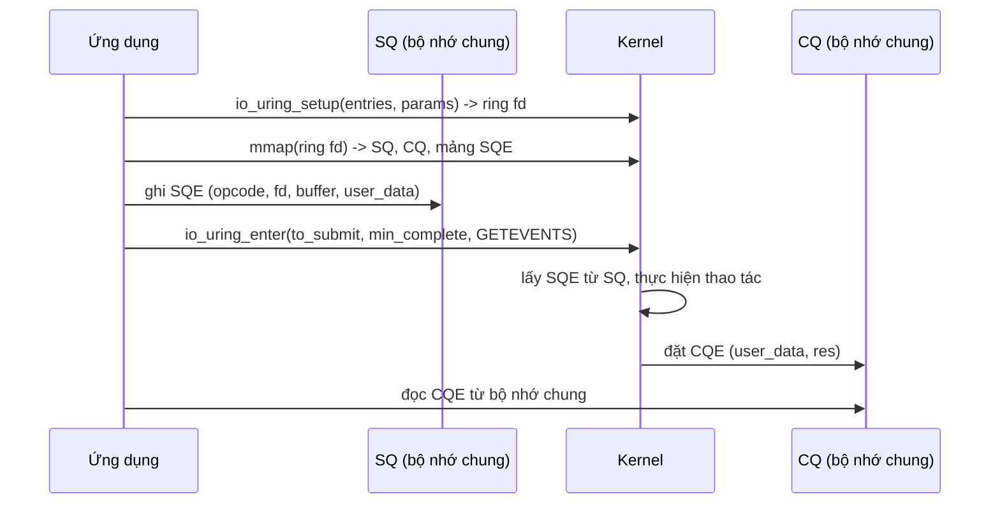

# P7 · Chương 03 — kqueue, io_uring, readiness vs completion

## Bạn sẽ hiểu được gì

1. **Q1.** `kqueue` đăng ký và chờ sự kiện bằng cách nào, và vì sao một syscall `kevent()` làm được cả hai việc? → mục 1
2. **Q2.** Các filter `EVFILT_READ`, `EVFILT_WRITE`, `EVFILT_TIMER`, `EVFILT_PROC`, `EVFILT_SIGNAL` và các cờ `EV_ADD`, `EV_CLEAR`, `EV_ONESHOT` có nghĩa gì? kqueue khác epoll ở điểm nào *có nguồn*? → mục 2
3. **Q3.** `io_uring` gồm những thành phần nào (SQ, CQ, SQE, CQE), chúng chia sẻ giữa user space và kernel ra sao, `io_uring_enter` làm gì, lỗi được báo ở đâu, vì sao completion không theo thứ tự và `user_data` giải quyết gì? → mục 3
4. **Q4.** "Readiness" (kernel báo *có thể làm*) khác "completion" (kernel báo *đã làm xong*) thế nào; reactor khác proactor thế nào? → mục 4
5. **Q5.** Vì sao I/O kiểu completion kéo theo chuyển quyền sở hữu buffer cho kernel, và vì sao điều đó khó ghép với việc hủy future bằng `drop` trong Rust? → mục 5
6. **Q6.** Hệ sinh thái Rust hiện nay đặt `io_uring` ở đâu: `mio`, Tokio, `tokio-uring`? → mục 6

## Kiến thức cần trước

- [Chương 01 — Các mô hình I/O](01-mo-hinh-io.md): blocking, non-blocking, `EAGAIN`, năm mô hình I/O (mô hình 3 = I/O multiplexing, 4 = signal-driven, 5 = asynchronous/completion).
- [Chương 02 — select, poll và epoll](02-select-poll-epoll.md): interest list, level/edge-triggered. Chương này so kqueue với epoll nên nên đọc epoll trước.

Phạm vi: chương này chỉ nói về *cơ chế của kernel* (kqueue, io_uring) và *mô hình* readiness/completion; event loop ở chương 04, `mio` ở chương 07, Tokio ở chương 08.

## 1. kqueue: một hàng đợi, một syscall `kevent()` (Q1)

> **Trả lời ngắn.** kqueue là một hàng đợi sự kiện trong kernel; mỗi *filter* là một đoạn code nhỏ của kernel quyết định khi nào sự kiện kích hoạt.[^freebsd-kqueue] Mọi việc đi qua một syscall `kevent()`: nó vừa đăng ký thay đổi vào hàng đợi vừa trả về các sự kiện đang chờ, và các thay đổi được áp dụng trước khi đọc sự kiện.[^kq-changelist]

**Giải thích.**

Hình dung (nhận xét của người soạn): một hộp thư chung — mỗi lần ghé, bạn dán thêm yêu cầu "báo tôi khi X xảy ra" lên hộp và lấy luôn các thư báo đang chờ, chỉ tốn một lượt đi.

**Vấn đề kqueue giải quyết.**

epoll chỉ nói về file descriptor (diễn giải của người soạn). Trong một chương trình thật, một event loop còn muốn chờ timer, chờ một process con thoát, chờ một signal. kqueue gom tất cả vào một hàng đợi sự kiện duy nhất nhờ các filter (nhận xét của người soạn); các filter cụ thể nằm ở mục 2.

Lưu ý nguồn: tôi dùng man page **FreeBSD** vì đó là mô tả ổn định nhất của API này (trang tải về ghi "FreeBSD 15.1-RELEASE", URL không ghim phiên bản). Hành vi chi tiết trên macOS (nơi bạn có thể chạy thật) có thể khác, kể cả danh sách filter và cờ; mọi chi tiết dưới đây là của FreeBSD, không phải bảo đảm cho macOS (nhận xét của người soạn).

**Cơ chế: một kqueue, một syscall `kevent()`.**

Gọi `kqueue()` tạo ra một hàng đợi sự kiện mới trong kernel và trả về một descriptor.[^kq-create] Mọi thứ còn lại đi qua `kevent()`:

```c
int kevent(int kq, const struct kevent *changelist, int nchanges,
           struct kevent *eventlist, int nevents,
           const struct timespec *timeout);
```

Man page nói: `kevent()` dùng để đăng ký sự kiện vào hàng đợi *và* trả về các sự kiện đang chờ; mọi thay đổi trong `changelist` được áp dụng **trước** khi đọc các sự kiện đang chờ.[^kq-changelist] Nếu `timeout` là con trỏ NULL thì `kevent()` chờ vô hạn.[^kq-timeout-null] Như vậy một vòng lặp có thể: đăng ký fd mới + lấy sự kiện kế tiếp bằng đúng một syscall. Với epoll, đăng ký (`epoll_ctl`) và chờ (`epoll_wait`) là hai syscall riêng (xem chương 02, mục 4); lợi thế "ít syscall hơn" là suy luận của người soạn từ hai mô tả này, tôi không có số đo.

<details><summary>Đi sâu: <code>struct kevent</code> và cách một kevent được định danh</summary>

Mỗi sự kiện là một `struct kevent`. Các trường quan trọng:

| Trường | Ý nghĩa (theo man FreeBSD) |
|---|---|
| `ident` | định danh của nguồn: fd, pid, số signal, id timer… tùy filter |
| `filter` | loại sự kiện (ví dụ `EVFILT_READ`) |
| `flags` | hành động (`EV_ADD`…) và trạng thái trả về (`EV_EOF`, `EV_ERROR`) |
| `fflags`, `data` | tham số và kết quả riêng của từng filter |
| `udata` | giá trị tùy ý của người dùng, kernel trả lại nguyên vẹn[^kq-udata] |

Một kevent được định danh bởi cặp (`ident`, `filter`); mỗi kqueue chỉ có một kevent duy nhất ứng với một cặp.[^kq-ident] Nhiều sự kiện cùng kích hoạt một filter không tạo nhiều kevent: filter gộp chúng vào một `struct kevent`.[^kq-aggregate] Hệ quả (suy luận của người soạn): bạn nhận *trạng thái đã gộp* chứ không phải một bản ghi cho mỗi lần xảy ra.

</details>

**Quay lại Q1:** `kqueue()` tạo hàng đợi, `kevent()` vừa áp dụng changelist vừa trả sự kiện đang chờ — hai việc trong một syscall.

## 2. Cờ, filter và so sánh với epoll (Q2)

> **Trả lời ngắn.** `EV_ADD` thêm sự kiện (đăng ký lại thì sửa sự kiện gốc),[^kq-add] `EV_ONESHOT` xóa sự kiện sau lần lấy đầu tiên,[^kq-oneshot] và `EV_CLEAR` đặt lại trạng thái sau khi lấy,[^kq-clear] nhờ đó chọn được kiểu edge ở từng kevent (suy luận của người soạn, xem mục bên dưới). Khác epoll (có nguồn): filter của kqueue phủ cả timer, process, signal chứ không chỉ fd,[^kq-timer][^kq-proc][^kq-signal] và `EV_ADD` lần hai sửa sự kiện còn `EPOLL_CTL_ADD` lần hai báo `EEXIST`.[^epoll-eexist]

**Giải thích.**

Hình dung (nhận xét của người soạn): các filter giống những loại cảm biến khác nhau (cửa, đồng hồ, chuông) cùng nối vào một bảng đèn; các cờ quyết định đèn tắt hay giữ sau khi bạn nhìn.

**Các cờ hành động.**

- **`EV_ADD`**: thêm sự kiện vào kqueue. Đăng ký lại một sự kiện đã có sẽ *sửa* tham số của sự kiện gốc chứ không tạo bản trùng.[^kq-add] (epoll thì khác: `EPOLL_CTL_ADD` lần hai cho cùng fd báo lỗi `EEXIST`.[^epoll-eexist])
- **`EV_ONESHOT`**: chỉ trả lần kích hoạt đầu tiên; sau khi người dùng lấy sự kiện, nó bị xóa khỏi kqueue.[^kq-oneshot] `EPOLLONESHOT` khác: fd chỉ bị vô hiệu hóa, người gọi phải bật lại bằng `EPOLL_CTL_MOD`.[^epoll-rearm] Gần `EPOLLONESHOT` hơn là `EV_DISPATCH`, vô hiệu hóa nguồn sự kiện ngay sau khi giao một sự kiện[^kq-dispatch] (so sánh của người soạn).
- **`EV_CLEAR`**: đặt lại trạng thái của sự kiện sau khi người dùng lấy nó; hữu ích cho các filter báo *chuyển trạng thái* thay vì trạng thái hiện tại.[^kq-clear] Kegel ghi kqueue có thể chọn edge hoặc level triggering.[^kq-c10k] Man page FreeBSD không dùng chữ "edge"/"level" cho cờ này, nên phần sau là suy luận của người soạn: có `EV_CLEAR` thì kevent giống edge-triggered (báo khi trạng thái chuyển); không có `EV_CLEAR` thì kevent tiếp tục được báo chừng nào điều kiện còn đúng (hành vi level), vì filter được chạy lại khi người dùng lấy kevent và kevent chỉ bị bỏ khi điều kiện không còn đúng.[^kq-rerun] Một số filter tự bật cờ này ngầm, như `EVFILT_SIGNAL` bên dưới.
- **`EV_EOF`**: filter đặt cờ này để báo điều kiện EOF riêng của nó.[^kq-eof]
- **`EV_DELETE`**: gỡ sự kiện; sự kiện gắn với fd tự động bị xóa ở lần đóng cuối cùng của descriptor đó.[^kq-delete] Với epoll, fd chỉ bị gỡ khỏi interest list sau khi *mọi* fd cùng trỏ tới một open file description đã đóng.[^epoll-close] Hai man page nói gần như cùng một ý, nên tôi không kết luận hai bên khác nhau (nhận xét của người soạn).

**Các filter chính.**

| Filter | `ident` | Khi nào trả về (FreeBSD; chú thích ở phần Đi sâu bên dưới) |
|---|---|---|
| `EVFILT_READ` | descriptor | có dữ liệu để đọc; chi tiết tùy loại descriptor |
| `EVFILT_WRITE` | descriptor | có thể ghi vào descriptor |
| `EVFILT_TIMER` | id tùy chọn | timer hết hạn |
| `EVFILT_PROC` | pid | process có sự kiện (`NOTE_EXIT`, `NOTE_FORK`, `NOTE_EXEC`) |
| `EVFILT_SIGNAL` | số signal | signal được gửi tới process |

**kqueue so với epoll — bảng so sánh.**

| Khía cạnh | kqueue (FreeBSD man) | epoll (man Linux, chương 02) | Mức chắc chắn |
|---|---|---|---|
| Đăng ký + chờ | một syscall `kevent()` | `epoll_ctl` rồi `epoll_wait` | kqueue: có nguồn; epoll: chương 02 |
| Loại nguồn sự kiện | fd, process, signal, timer… qua filter | fd | kqueue: có nguồn; "epoll chỉ fd" là diễn giải của người soạn |
| Chọn level/edge | từng kevent, qua `EV_CLEAR` | từng fd, qua `EPOLLET` | kqueue: `EV_CLEAR` có nguồn, ánh xạ sang "edge" là suy luận (xem trên); epoll: chương 02, mục 5 |
| Đăng ký trùng | `EV_ADD` sửa sự kiện cũ | `EEXIST` | có nguồn cả hai |
| Đóng fd | xóa ở lần đóng cuối của descriptor | gỡ sau khi mọi fd cùng open file description đóng; muốn gỡ sớm: `EPOLL_CTL_DEL` | có nguồn cả hai; khác biệt thực chất chưa chứng minh |
| File thường | `EVFILT_READ` có nghĩa trên vnode | `EPERM` | có nguồn cả hai[^epoll-eperm] |

Điểm quan trọng nhất: các filter I/O `EVFILT_READ`/`EVFILT_WRITE` là **readiness** (báo "có thể", chứ chưa làm hộ). `EVFILT_READ` chỉ báo có dữ liệu (với socket, `data` cho biết số byte sẵn[^kq-read-data]); bạn vẫn phải gọi `read`. Ngoại lệ ngay trong man page: `EVFILT_AIO` gắn vào `aio_sigevent` của một request POSIX AIO và trả về trong cùng điều kiện với `aio_error()`[^kq-aio], tức là báo *hoàn tất* (suy luận của người soạn, xem POSIX AIO ở chương 01, mục 5). Các filter timer/process/signal báo sự kiện không phải I/O nên không thuộc cặp readiness/completion (nhận xét của người soạn). `mio` đặt epoll (Linux) và kqueue (macOS) sau cùng một API `Poll`.[^mio-impl-linux]

<details><summary>Đi sâu: từng filter — <code>EVFILT_READ</code>, <code>EVFILT_WRITE</code>, <code>EVFILT_TIMER</code>, <code>EVFILT_PROC</code>, <code>EVFILT_SIGNAL</code> (FreeBSD)</summary>

**`EVFILT_READ`.** Với socket đã `listen(2)`, filter trả về khi có kết nối đang chờ.[^kq-read-listen] Với vnode, nó trả về khi con trỏ file chưa ở cuối file.[^kq-read-vnode] Nghĩa là trên FreeBSD, một vnode như file thường (suy luận của người soạn: file thường là một loại vnode) *có* thể đăng ký với kqueue và cho kết quả có nghĩa — khác epoll, nơi file thường không dùng được cho mục đích này (chương 02, mục 6). Nếu hướng đọc của socket bị shutdown, filter đặt `EV_EOF`; man page nói rõ có thể nhận `EOF` trong khi vẫn còn dữ liệu trong buffer socket.[^kq-read-eof]

**`EVFILT_WRITE`.** Trả về bất cứ khi nào có thể ghi vào descriptor, và filter đặt `EV_EOF` khi phía đọc ngắt kết nối.[^kq-write] Filter này không hỗ trợ cho vnode.[^kq-write-vnode]

**`EVFILT_TIMER`.** Tạo một timer tùy ý. Timer là định kỳ trừ khi có `EV_ONESHOT` hoặc `NOTE_ABSTIME`.[^kq-timer] Timer là *một loại sự kiện của cùng hàng đợi*, nên một event loop dùng kqueue không cần fd riêng cho timer (nhận xét của người soạn).

**`EVFILT_PROC`.** Lấy pid làm `ident`, các sự kiện cần theo dõi đặt trong `fflags`.[^kq-proc] Với `NOTE_EXIT`, exit status được đặt vào `data` cùng định dạng với `wait(2)`.[^kq-proc-exit]

**`EVFILT_SIGNAL`.** Lấy số signal làm `ident` và trả về khi signal được gửi tới process. Nó cùng tồn tại với `signal()`/`sigaction()` nhưng có độ ưu tiên thấp hơn; `data` là số lần signal xảy ra kể từ lần gọi `kevent()` trước; filter tự đặt `EV_CLEAR` bên trong.[^kq-signal] Vì vậy một event loop có thể nhận signal như một sự kiện bình thường thay vì viết signal handler (nhận xét của người soạn).

</details>

**Quay lại Q2:** cờ `EV_ADD`/`EV_ONESHOT`/`EV_CLEAR` điều khiển đăng ký, xóa-sau-lần-đầu và đặt lại trạng thái (gần edge); so với epoll, kqueue phủ nhiều loại nguồn hơn qua filter, còn các filter I/O chính (`EVFILT_READ`/`EVFILT_WRITE`) vẫn là readiness.

## 3. io_uring: SQ, CQ, SQE, CQE (Q3)

> **Trả lời ngắn.** `io_uring` dựng hai ring buffer chia sẻ giữa user space và kernel qua `mmap`: ứng dụng đặt yêu cầu (SQE) vào submission queue (SQ) và kernel đặt kết quả (CQE) vào completion queue (CQ).[^iou-model] `io_uring_enter` báo kernel lấy yêu cầu khỏi SQ, và có thể đồng thời chờ hoàn tất.[^iou-enter][^iou-enter-both] Lỗi nằm trong trường `res` của CQE chứ không qua `errno`;[^iou-res] các yêu cầu có thể hoàn thành theo thứ tự bất kỳ nên ứng dụng gắn `user_data` vào SQE để nhận ra CQE tương ứng.[^iou-order]

**Giải thích.**

Hình dung (nhận xét của người soạn): bạn bỏ phiếu gọi món vào một khay chung (SQ); bếp trả đĩa vào khay kết quả (CQ) kèm số phiếu của bạn (`user_data`), và đĩa không nhất thiết ra theo thứ tự gọi.

**Vấn đề.**

Với readiness, mỗi thao tác cần ít nhất hai bước: nhận thông báo (`epoll_wait`/`kevent`) rồi gọi `read`/`write`. Ngoài ra readiness kiểu epoll không dùng được cho file thường: `epoll_ctl` trả `EPERM` khi fd là file thường (chương 02, mục 6).[^epoll-eperm] `io_uring` đảo ngược mô hình: ta **nộp yêu cầu** ("đọc từ fd này vào buffer này") và kernel **trả kết quả**, trao đổi qua bộ nhớ chung.

Man page `io_uring(7)`: `io_uring` là API dành riêng cho Linux cho asynchronous I/O; nó cho phép nộp một hoặc nhiều I/O request được xử lý bất đồng bộ mà không chặn tiến trình gọi.[^iou-desc] Tên đến từ các ring buffer chia sẻ giữa user space và kernel.[^iou-ring] Các trang man này nằm trong gói `liburing-dev`; SYNOPSIS của `io_uring_setup(2)` ghi `#include <liburing.h>`,[^iou-synopsis] nhưng nội dung mô tả giao diện ở mức syscall (`struct io_uring_params`, offset `mmap`) và ví dụ trong `io_uring(7)` gọi thẳng `syscall(__NR_io_uring_setup, …)`.[^iou-example-raw] Các chi tiết cấp syscall dưới đây lấy từ `io_uring(7)`, `io_uring_setup(2)` và `io_uring_enter(2)` của gói này.

**Cơ chế từng bước.**



1. **Dựng ring.** `io_uring_setup(2)` tạo SQ và CQ và trả về một file descriptor dùng cho các thao tác sau trên instance đó;[^iou-setup-fd] `mmap(2)` ánh xạ các buffer chia sẻ cho *submission queue* (SQ) và *completion queue* (CQ) vào user space.[^iou-model] `io_uring_setup` còn báo qua cờ `IORING_FEAT_SINGLE_MMAP` rằng hai ring có thể ánh xạ bằng một lần `mmap`, nhưng các SQE vẫn phải được cấp riêng; con số `mmap` giảm từ ba xuống hai (kernel 5.4 trở lên).[^iou-single-mmap]
2. **Tạo SQE.** Với mỗi yêu cầu (đọc, ghi, accept…), ứng dụng điền một *SQE* (submission queue entry) và thêm vào đuôi SQ. Mỗi thao tác về bản chất tương đương một system call mà lẽ ra bạn phải gọi.[^iou-sqe] Cả hai ring là hàng đợi vòng có đầu và đuôi: ứng dụng thêm SQE vào đuôi SQ còn kernel đọc từ đầu; với CQ thì kernel thêm vào đuôi và ứng dụng đọc từ đầu.[^iou-head-tail]
3. **Nộp.** Gọi `io_uring_enter(2)` để báo kernel lấy các yêu cầu khỏi SQ và bắt đầu xử lý.[^iou-enter] Một lần gọi có thể vừa nộp I/O mới vừa chờ hoàn tất I/O đã khởi tạo bởi lần này hoặc các lần gọi trước.[^iou-enter-both] Cờ `IORING_ENTER_GETEVENTS` làm syscall chờ `min_complete` sự kiện trước khi trả về.[^iou-getevents] Nhiều SQE có thể gửi chung bằng một lần `io_uring_enter` (so với ít nhất một syscall cho mỗi yêu cầu ở các interface khác).[^iou-batch]
4. **Nhận CQE.** Với mỗi SQE nộp lên, kernel đặt đúng một *CQE* (completion queue entry) tương ứng vào CQ.[^iou-cqe] (Chính man page nêu ngoại lệ: request multi-shot, receive hay accept có thể sinh nhiều completion, báo bằng cờ `IORING_CQE_F_MORE`.[^iou-more]) Ứng dụng đọc CQE từ ring chia sẻ (CQ là bộ nhớ chung nên không cần syscall chỉ để đọc, suy luận của người soạn; man page chỉ nói rõ trường hợp SQPOLL, xem Đi sâu).
5. **Lỗi nằm trong `res`.** Kết quả (số byte, hoặc `-errno`) nằm ở trường `res` của CQE. Man page: vì đây là async interface, `errno` không bao giờ được dùng để trả thông tin lỗi.[^iou-res]
6. **Không theo thứ tự.** Các yêu cầu đã nộp có thể hoàn thành theo thứ tự bất kỳ,[^iou-order] nên ứng dụng gắn `user_data` vào SQE để nhận ra CQE tương ứng. Man page nêu chính cách này; việc dùng nó làm khóa tra bảng là nhận xét của người soạn.

<details><summary>Đi sâu: thử nghiệm một lô hai SQE (một SQE lỗi) và SQPOLL</summary>

**Thử nghiệm đã chạy: một lô hai SQE, một SQE lỗi.**

Phần này là *quan sát* từ lần chạy của người soạn trước (không có chú thích nguồn; lần audit này không chạy lại). Chạy trong container Linux của repo (kernel `6.8.0-117-generic`, aarch64; một lần review sau đó chạy lại và thấy kết quả y hệt). `io_uring_setup` **không bị chặn**: `labs/linux.sh` chạy container với `--security-opt seccomp=unconfined`, nên không có bộ lọc seccomp của Docker; fd ring trả về là 3. Chương trình C dùng syscall thô (không liburing): `io_uring_setup(8, …)`, ba `mmap`, rồi ghi hai SQE `IORING_OP_READ` — một đọc `/etc/hostname` (`user_data=100`), một đọc fd `999` không tồn tại (`user_data=101`) — và một lần `io_uring_enter(to_submit=2, min_complete=2, GETEVENTS)`. Output quan sát được:

```text
ring fd=3 sq_entries=8 cq_entries=16 single_mmap=1
io_uring_enter returned 2
CQE user_data=100 res=13 (bytes read)
CQE user_data=101 res=-9 (Bad file descriptor)
errno after enter = 0
```

Đọc kết quả:

- Một syscall nộp cả hai yêu cầu và chờ cả hai hoàn tất; `io_uring_enter` trả `2` — theo man page, giá trị trả về là số SQE đã được tiêu thụ.[^iou-enter-ret]
- Yêu cầu hỏng **không** làm syscall thất bại: man page ghi lỗi liên quan tới một SQE được trả qua CQE chứ không qua chính syscall.[^iou-enter-err] Lỗi `EBADF` (9) nằm trong `res=-9` của CQE `101`, đúng như quy ước `res = -errno`.[^iou-res] (Dòng `errno after enter = 0` chỉ cho thấy syscall thành công, tự nó không chứng minh quy ước.) Với `read(2)` thường, theo quy ước đó, bạn sẽ nhận `-1` và `errno=EBADF`.
- Hai CQE ở đây ra theo thứ tự nộp (quan sát một lần), nhưng man page nói các request có thể hoàn thành theo thứ tự bất kỳ và không thể biết cái nào xong trước khi có nhiều request đang bay;[^iou-order] code đúng không được dựa vào thứ tự quan sát được.
- Kết quả chỉ là quan sát cho container này (seccomp tắt, kernel 6.8); profile seccomp mặc định của Docker chặn cả họ `io_uring_*` vì lý do an ninh,[^docker-tbl-iouring] nên trong container Docker thông thường `io_uring_setup` sẽ bị từ chối (chi tiết ở [P8 · Chương 05, mục 5](../08-containers/05-bao-mat-container.md)). Các cấu hình môi trường khác (VM, kernel tắt io_uring) thì tôi không có nguồn.

**SQPOLL — nộp mà không cần syscall (mức có nguồn).**

Với `IORING_SETUP_SQPOLL`, kernel tạo một thread chuyên polling SQ. Theo `io_uring_setup(2)`: ứng dụng cấu hình như vậy có thể phát I/O mà không bao giờ chuyển ngữ cảnh vào kernel; chỉ cần điền SQE vào SQ và theo dõi CQ thì có thể nộp và thu hoạch I/O mà không một syscall nào.[^iou-sqpoll-nosys] Cái giá: nếu thread kernel rảnh quá `sq_thread_idle` mili-giây, nó đặt bit `IORING_SQ_NEED_WAKEUP`, khi đó ứng dụng phải gọi `io_uring_enter(2)` để đánh thức nó.[^iou-sqpoll-wake] Về quyền: từ kernel 5.11, tính năng này dùng được không cần root nếu có capability `CAP_SYS_NICE`.[^iou-sqpoll-cap] Số liệu hiệu năng và chi phí CPU của thread polling tôi không có nguồn nên không nêu.

</details>

**Quay lại Q3:** SQ/CQ là ring chia sẻ; ứng dụng ghi SQE, `io_uring_enter` nộp, kernel đặt CQE kèm `res` (lỗi là `-errno`) và `user_data` để ghép với yêu cầu vì thứ tự hoàn thành không được bảo đảm.

## 4. Readiness vs completion; reactor vs proactor (Q4)

> **Trả lời ngắn.** Với readiness, kernel chỉ báo "có thể làm mà không chặn" và ứng dụng tự gọi `read`/`write`; với completion, ứng dụng nộp thao tác và kết quả được trả khi đã xong (bảng bên dưới). Hai mô hình có mẫu thiết kế tương ứng: Reactor thông báo khi có thể khởi tạo thao tác mà không bị chặn,[^sch-reactor] còn Proactor dispatch handler được kích hoạt bởi sự hoàn thành của thao tác bất đồng bộ.[^sch-proactor]

**Giải thích.**

Hình dung (nhận xét của người soạn): readiness là chuông báo "quầy đã trống, mời bạn ra lấy"; completion là nhờ người giao hàng, họ báo "xong rồi, đồ đây".

**Hai mô hình đặt cạnh nhau.**

| | Readiness | Completion |
|---|---|---|
| Kernel báo | "fd này có thể làm mà không chặn" | "thao tác bạn nhờ đã xong, kết quả đây" |
| Ai thực hiện I/O thật | ứng dụng, bằng `read`/`write` non-blocking | hệ điều hành thực hiện thay ứng dụng (mẫu Proactor)[^sch-proactor-flow]; nhưng thư viện cũng có thể giả lập (Đi sâu) |
| Buffer | ứng dụng chỉ cần có khi socket sẵn sàng[^asio-memory] | phải được cấp lúc *nộp* và còn hợp lệ đến lúc xong[^asio-memory] |
| Ví dụ | epoll, kqueue, `poll` | io_uring, IOCP, POSIX AIO (phân loại theo chương 01, mục 6) |
| Lỗi | `read` trả `-1`/`errno` | io_uring: trong `res` của CQE (mục 3); cách báo lỗi của IOCP/POSIX AIO không có nguồn trong chương này |

Kết nối với chương 01 (mục 6): readiness là mô hình 3 (và 4), completion là mô hình 5 (POSIX AIO nằm ở đó). Bài Proactor nêu Windows NT dùng I/O completion port và overlapped I/O để hiện thực asynchronous I/O.[^sch-iocp]

Hai mẫu thiết kế trên đến từ bài báo của Pyarali, Harrison, Schmidt và Jordan (PLoP 1997); thêm chi tiết từ bài:

- **Reactor**: ứng dụng đăng ký Event Handler với một Initiation Dispatcher và dispatcher gọi handler khi có thể khởi tạo thao tác mà không bị chặn; ánh xạ sang `epoll`/`mio` ở [chương 04, mục 5](04-kien-truc-event-loop.md).
- **Proactor**: ý chính là ứng dụng phát một thao tác bất đồng bộ cho OS và đăng ký một callback với Completion Dispatcher; OS thực hiện thao tác rồi xếp kết quả vào một nơi biết trước.[^sch-proactor-flow] Các Asynchronous Operation chạy tới hoàn tất bởi Asynchronous Operation Processor, thành phần thường do OS hiện thực.[^sch-processor] Lợi ích chính: nhiều thao tác đồng thời chạy song song mà không nhất thiết cần nhiều thread.[^sch-proactor-adv]

Kegel tóm gọn theo cách OO, khi nói về thư viện ACE: Reactor là cách làm non-blocking I/O, Proactor là cách làm asynchronous I/O.[^c10k-ace]

<details><summary>Đi sâu: "API completion" không đồng nghĩa "kernel làm completion" (Boost.Asio), và IOCP của Windows</summary>

**"API completion" không đồng nghĩa "kernel làm completion".**

Tài liệu Boost.Asio (bản 1.84.0) nói rõ: trên nhiều nền tảng, Boost.Asio hiện thực Proactor *trên nền* một Reactor như select, epoll hoặc kqueue;[^asio-reactor] khi reactor báo tài nguyên sẵn sàng, "processor" tự thực hiện thao tác và xếp completion handler vào hàng đợi hoàn tất.[^asio-reactor-impl] Trên Windows, nó dùng overlapped I/O, và khi đó Asynchronous Operation Processor *do hệ điều hành* hiện thực.[^asio-win][^asio-win-os] Vậy bề mặt API kiểu completion có thể được giả lập bằng readiness. Điều này có hệ quả với buffer: nếu thư viện tự gọi `read` khi fd sẵn sàng thì buffer của bạn chỉ bị đụng tới lúc đó, còn I/O completion thật (io_uring, IOCP) có thể ghi vào buffer bất cứ lúc nào giữa nộp và hoàn tất (suy luận của người soạn từ định nghĩa hai mô hình).

Trên Linux, trang "Platform-specific implementation notes" của Asio 1.84.0 ghi: nhân 2.6 dùng epoll để demultiplex;[^asio-linux-epoll] io_uring là tùy chọn: nếu định nghĩa macro `BOOST_ASIO_HAS_IO_URING` (nhân 5.10) thì dùng io_uring cho các thao tác bất đồng bộ liên quan file và vẫn dùng epoll cho các nguồn sự kiện khác,[^asio-linux-file] và chỉ khi thêm `BOOST_ASIO_DISABLE_EPOLL` mới dùng io_uring cho mọi thao tác bất đồng bộ.[^asio-linux]

Về bộ nhớ, Boost.Asio ghi nhược điểm của hướng asynchronous: buffer phải được cam kết suốt thời gian một thao tác đọc/ghi, có thể kéo dài vô hạn, và mỗi thao tác đồng thời cần một buffer riêng; Reactor thì không cần buffer đến khi socket sẵn sàng.[^asio-memory]

**IOCP của Windows — nhắc ngắn.**

Windows có I/O completion port (IOCP), là mô hình completion (theo chính docs `mio` dưới đây). Docs của `mio` 1.2.4 ghi: trên mọi nền tảng trừ Windows, `Poll::poll` chủ yếu là một lời gọi thẳng vào system selector; IOCP dùng mô hình completion, nên `Poll` phải *chuyển đổi* mô hình completion sang API của Mio; lớp cầu nối này "khá hiệu quả" nhưng phần đắt nhất là các lệnh `read`/`write` phải sao chép dữ liệu vào một buffer trung gian trước khi chuyển cho kernel.[^mio-iocp] Nói cách khác: `mio` bọc *completion* thành *readiness* và trả giá bằng buffer trung gian trên Windows.

</details>

**Quay lại Q4:** readiness = "có thể làm, bạn tự làm" (reactor); completion = "đã làm xong" (proactor), và bề mặt API completion vẫn có thể được giả lập trên readiness.

## 5. Sở hữu buffer và hủy future trong Rust (Q5)

> **Trả lời ngắn.** Với completion, bạn trao buffer cho kernel rồi làm việc khác, nên quyền sở hữu buffer được chuyển cho kernel và chỉ trả lại khi xong; vì vậy `tokio-uring` nhận buffer theo giá trị.[^tokio-uring-own] Khó khăn khi hủy future bằng `drop`: destructor chạy ngay, trong khi kernel có thể vẫn đang ghi vào buffer (suy luận của người soạn); `tokio-uring` v0.5.0 giải quyết bằng cách giữ buffer trong driver đến khi CQE về.[^tu-remove-op][^tu-ignored]

**Giải thích.**

Hình dung (nhận xét của người soạn): bạn đưa chìa khóa nhà cho thợ sửa rồi bỏ đi; nếu bạn "hủy hợp đồng" nhưng thợ vẫn đang làm trong nhà, bạn không thể coi như nhà trống để cho người khác vào.

**Vì sao completion kéo theo chuyển sở hữu buffer.**

Với readiness, bạn gọi `read(fd, &mut buf)` và `&mut buf` chỉ cần sống trong lời gọi đó. Với completion, bạn trao buffer cho kernel *rồi làm việc khác*; kernel ghi vào buffer lúc nào đó sau. Docs `tokio-uring` 0.5.0 (crate riêng, không phải `tokio`): khác với Tokio, io-uring dựa trên thao tác kiểu *submission*; quyền sở hữu tài nguyên được chuyển cho kernel và trả lại caller khi xong, nên đọc từ `File` đòi truyền ownership của buffer.[^tokio-uring-own]

Chữ ký: `read_at` nhận `buf: T` (với `T: BoundedBufMut`) *theo giá trị* và trả `BufResult<usize, T>`: kết quả cùng giá trị buffer đã truyền vào,[^tu-readat-ret] kể cả khi lỗi.[^tu-readat-err] Trait `IoBuf` là `unsafe`: buffer phải trỏ vào vùng nhớ ổn định; trong lúc runtime giữ buffer, `stable_ptr` phải còn hợp lệ ngay cả khi giá trị `IoBuf` bị di chuyển.[^tu-iobuf-safety]

**Hủy future bằng `drop`: tokio-uring giữ buffer đến khi CQE về.**

Dữ kiện có nguồn:

1. Trong Tokio, khi một task bị hủy, nó dừng ở `.await` mà nó đang treo, và mọi biến cục bộ bị hủy bằng cách chạy destructor.[^tokio-cancel-drop] Docs `select!` mô tả cancellation là chuyện một future bị drop trước khi hoàn tất.[^tokio-select-drop]
2. `tokio-uring` ghi rằng đóng tài nguyên (ví dụ file) với io-uring là một thao tác bất đồng bộ; vì Rust chưa hỗ trợ asynchronous drop, các kiểu tài nguyên cung cấp hàm `close()` tường minh; nếu không gọi, tài nguyên vẫn đóng khi drop nhưng thao tác diễn ra ở nền và không có bảo đảm thời điểm.[^tu-close]
3. Buffer đã nộp phải còn hợp lệ cho đến khi kernel xong: docs của trait `IoBuf` đòi buffer trỏ vào vùng nhớ ổn định trong lúc runtime giữ nó.[^tu-iobuf-safety]

**Suy luận của người soạn** (bài toán): với API readiness, drop future giữa chừng an toàn vì chưa có gì "đang bay". Với completion, giả sử một future đọc vào `&mut [u8]` mượn từ stack bị drop khi thao tác đã nộp cho kernel: destructor chạy, bộ nhớ có thể được tái sử dụng trong khi kernel vẫn có thể ghi vào đó — use-after-free. Drop không thể "đợi kernel xong" vì `drop` là hàm đồng bộ (cùng lý do `close()` phải tường minh theo nguồn 2). Hai lối thoát: (a) bắt chuyển sở hữu buffer cho runtime và giữ nó sống đến CQE; (b) gửi yêu cầu hủy cho kernel — nhưng yêu cầu hủy cũng là thao tác bất đồng bộ, kết quả vẫn phải chờ.

<details><summary>Đi sâu: source <code>tokio-uring</code> v0.5.0 xử lý drop future thế nào</summary>

**Đã chốt bằng source `tokio-uring` tag `v0.5.0`** (chi tiết cài đặt, có thể đổi; tôi chỉ đọc code, chưa chạy):

- `File::read_at` đặt buffer vào struct `Read<T>` nằm trong `Op`, field được chú thích là buffer đang bay.[^tu-read-buf]
- Khi future (`Op`) bị drop mà CQE chưa về, `Driver::remove_op` chuyển dữ liệu của op — gồm buffer — vào trạng thái `Lifecycle::Ignored(Box<..>)`;[^tu-remove-op] chú thích của enum nói trạng thái này phải được trao cho driver và giữ cho tới khi thao tác hoàn tất.[^tu-ignored]
- Khi CQE về mà op đang `Ignored`, driver chỉ xóa mục đó (và buffer được thả) nếu CQE không có cờ `more`; còn có `more` thì giữ nguyên chờ CQE tiếp theo.[^tu-complete]
- Drop future **không** gửi yêu cầu hủy: `AsyncCancel` trong crate chỉ xuất hiện ở `Drop for Driver` (tắt runtime), nơi nó hủy các op còn bay rồi chờ chúng kết thúc.[^tu-driver-drop]

Vậy `tokio-uring` chọn lối thoát (a): drop future chỉ bỏ *kết quả*; kernel vẫn hoàn tất và ghi vào buffer, buffer sống đến CQE nên không có use-after-free, và người gọi không lấy lại được buffer (suy luận của người soạn từ code đã đọc).

</details>

**Quay lại Q5:** completion buộc buffer phải sống đến khi kernel xong, nên chuyển sở hữu cho runtime; drop future chỉ bỏ kết quả chứ không rút buffer khỏi kernel.

## 6. Liên hệ với Rust: hệ sinh thái hiện tại (Q6)

> **Trả lời ngắn.** `mio` 1.2.4 không có io_uring: bảng selector của nó chỉ có epoll, kqueue, event ports và IOCP.[^mio-impl-linux] Tokio 1.53.2 có flag `io-uring` nhưng chỉ khi truyền `--cfg tokio_unstable`.[^tokio-uring-flag][^tokio-unstable] `tokio-uring` 0.5.0 là crate riêng cho runtime io-uring.[^tu-intro]

**Giải thích.**

Hình dung (nhận xét của người soạn): `mio` là hệ thống điện cũ của căn nhà (epoll/kqueue); io_uring cần một hệ thống khác, hiện nằm ở tính năng thử nghiệm của Tokio hoặc ở một crate riêng.

- **`mio` 1.2.4 không có io_uring** (suy ra từ việc bảng không có dòng nào cho io_uring). Bảng "Implementation notes": Linux/Android/illumos→epoll, macOS/iOS/BSD→kqueue, Solaris→event ports, Windows→IOCP.[^mio-impl-linux] Với Windows, mio bọc IOCP (completion) thành readiness (mục 4).[^mio-iocp]
- **Tokio 1.53.2** có feature flag `io-uring` (chỉ Linux) nằm trong nhóm các flag chỉ có khi truyền `--cfg tokio_unstable`.[^tokio-uring-flag][^tokio-unstable] I/O driver của runtime trong source được ghi là dựa trên Mio (epoll/kqueue qua bảng của mio).[^tokio-driver-mio] Tokio và runtime của nó nằm ở [chương 08](08-tokio.md), `mio` ở [chương 07](07-executor-va-mio.md).
- **`tokio-uring` 0.5.0** là crate riêng "cung cấp interface io-uring an toàn cho runtime Tokio", yêu cầu Linux kernel 5.10 trở lên.[^tu-intro] `tokio_uring::start` khởi động một runtime current-thread; để có concurrency, hãy tạo nhiều thread, mỗi thread một runtime tokio-uring; các kiểu tài nguyên tối ưu cho single-thread và hầu hết là `!Sync`.[^tu-thread]

<details><summary>Đi sâu: phạm vi hỗ trợ io_uring trong Tokio 1.53.2</summary>

Docs của `tokio::fs::read` ghi rằng trên Linux, để dùng io_uring cần `--cfg tokio_unstable`, cargo feature `io-uring` và tùy chọn runtime `Builder::enable_io_uring`;[^tokio-fs-uring] hỗ trợ này hiện còn thử nghiệm (experimental).[^tokio-fs-uring-exp] `OpenOptions::open` có đoạn docs tương tự, nêu cùng ba điều kiện.[^tokio-oo-uring] Trong `net/tcp/stream.rs` của tag `tokio-1.53.2` tôi grep không thấy nhắc io_uring, nên đừng suy ra `TcpStream` chạy trên io_uring. Lưu ý: docs module `tokio::fs` cùng bản vẫn ghi Tokio "luôn dùng `spawn_blocking`" và chỉ "có thể" đổi sang io_uring trong tương lai;[^tokio-fs-always] hai đoạn docs không khớp hoàn toàn, nên cách đọc an toàn (suy luận của người soạn) là: mặc định (không bật ba điều kiện trên) `tokio::fs` chạy trên `spawn_blocking`, còn đường io_uring là thử nghiệm opt-in.

</details>

**Quay lại Q6:** mio không có io_uring; Tokio chỉ có hỗ trợ thử nghiệm sau `tokio_unstable`; `tokio-uring` là runtime riêng.

## Tóm tắt

- kqueue gom nhiều loại nguồn (fd, timer, process, signal) qua *filter*; một syscall `kevent()` vừa áp dụng changelist vừa trả sự kiện đang chờ.
- Một kevent định danh bởi (`ident`, `filter`); `EV_ADD` sửa sự kiện trùng, `EV_ONESHOT` xóa sau lần lấy đầu, `EV_CLEAR` đặt lại trạng thái sau khi lấy (gần edge, suy luận của người soạn). Mọi chi tiết ở đây là của FreeBSD, macOS có thể khác.
- Các filter I/O chính của kqueue (`EVFILT_READ`/`EVFILT_WRITE`) và epoll đều là readiness: chỉ báo "có thể làm", ứng dụng tự gọi `read` (ngoại lệ: `EVFILT_AIO` báo hoàn tất POSIX AIO).
- io_uring: SQ và CQ là ring chia sẻ qua `mmap`; ứng dụng ghi SQE, nộp bằng `io_uring_enter`, đọc CQE; kernel đặt đúng một CQE cho mỗi SQE (trừ request multi-shot/receive/accept có thể sinh nhiều CQE, báo bằng `IORING_CQE_F_MORE`).
- Lỗi của io_uring nằm trong `res` dưới dạng `-errno`, không phải `errno`; completion có thể theo thứ tự bất kỳ nên cần `user_data`. Quan sát (một lần chạy trong container, không có nguồn): `res=-9` cho fd sai, `io_uring_enter` vẫn trả 2.
- SQPOLL cho phép nộp/thu hoạch không cần syscall nhưng có thread kernel polling, cần `io_uring_enter` khi nó ngủ, và cần `CAP_SYS_NICE` nếu không root (từ 5.11).
- Reactor = báo sẵn sàng rồi tự làm; Proactor = nhờ OS làm và nhận hoàn tất. Boost.Asio hiện thực Proactor trên reactor ở nhiều nền tảng, nên API completion không chứng tỏ kernel làm completion.
- Completion kéo theo chuyển sở hữu buffer cho kernel (tokio-uring); `tokio-uring` v0.5.0 xử lý drop future bằng cách giữ buffer trong driver đến khi CQE về (đọc code, chưa chạy).
- mio 1.2.4 không có io_uring; Tokio 1.53.2 có flag `io-uring` sau `tokio_unstable`; `tokio-uring` 0.5.0 là runtime riêng, current-thread.

## Câu hỏi tự kiểm tra

1. `kevent()` khác `epoll_ctl` + `epoll_wait` ở điểm nào về số syscall? Thứ tự áp dụng `changelist` so với đọc sự kiện là gì?
<details><summary>Đáp án</summary>

Một syscall `kevent()` làm cả hai; mọi thay đổi trong changelist được áp dụng trước khi đọc sự kiện đang chờ.[^kq-changelist]

</details>

2. Hai cờ `EV_ONESHOT` và `EV_CLEAR` khác nhau thế nào?
<details><summary>Đáp án</summary>

`EV_ONESHOT`: chỉ trả lần kích hoạt đầu và xóa kevent sau khi người dùng lấy.[^kq-oneshot] `EV_CLEAR`: đặt lại trạng thái sau khi lấy, hữu ích cho filter báo chuyển trạng thái.[^kq-clear]

</details>

3. `EVFILT_SIGNAL` cho bạn biết gì trong `data`, và nó có thay thế `sigaction` không?
<details><summary>Đáp án</summary>

Số lần signal xảy ra kể từ lần `kevent()` trước; nó cùng tồn tại với `signal()`/`sigaction()` và có độ ưu tiên thấp hơn.[^kq-signal]

</details>

4. Một io_uring request lỗi `EBADF` thì bạn thấy lỗi ở đâu?
<details><summary>Đáp án</summary>

Ở `res` của CQE dưới dạng `-9`; `errno` không được dùng.[^iou-res] Quan sát trong container (một lần chạy, không có nguồn): `res=-9` trong khi `io_uring_enter` trả 2.

</details>

5. SQPOLL loại bỏ syscall nào, và khi nào syscall vẫn cần?
<details><summary>Đáp án</summary>

Với `IORING_SETUP_SQPOLL`, ứng dụng có thể nộp và thu hoạch I/O mà không cần syscall nào;[^iou-sqpoll-nosys] syscall `io_uring_enter` vẫn cần khi thread kernel rảnh quá `sq_thread_idle` và đặt `IORING_SQ_NEED_WAKEUP`.[^iou-sqpoll-wake]

</details>

6. Phân biệt reactor và proactor bằng một câu mỗi mẫu.
<details><summary>Đáp án</summary>

Reactor: thông báo khi có thể khởi tạo thao tác mà không bị chặn.[^sch-reactor] Proactor: dispatch handler được kích hoạt bởi sự hoàn thành của thao tác bất đồng bộ.[^sch-proactor]

</details>

7. Boost.Asio trên Linux có chắc dùng completion thật của kernel không?
<details><summary>Đáp án</summary>

Không mặc định: docs 1.84.0 nói trên nhiều nền tảng nó hiện thực Proactor trên nền Reactor (select/epoll/kqueue);[^asio-reactor] trang implementation ghi Linux dùng epoll, io_uring chỉ khi định nghĩa macro.[^asio-linux] Windows dùng overlapped I/O.[^asio-win]

</details>

8. Vì sao `tokio-uring::File::read_at` nhận buffer theo giá trị và trả lại nó?
<details><summary>Đáp án</summary>

Quyền sở hữu tài nguyên được chuyển cho kernel rồi trả lại khi xong.[^tokio-uring-own] Hàm trả kết quả cùng giá trị buffer đã truyền.[^tu-readat-ret]

</details>

9. Phần nào trong lập luận "drop future không an toàn với completion I/O" là fact có nguồn, phần nào là suy luận?
<details><summary>Đáp án</summary>

Có nguồn: drop chạy destructor của biến cục bộ;[^tokio-cancel-drop] Rust chưa có asynchronous drop nên `close()` tường minh;[^tu-close] buffer phải ổn định khi runtime giữ nó.[^tu-iobuf-safety] Use-after-free với buffer mượn từ stack là suy luận của người soạn (mục 5). Source `tokio-uring` v0.5.0 cho thấy nó giữ buffer ở `Lifecycle::Ignored` đến khi CQE về.[^tu-remove-op][^tu-ignored]

</details>

10. `mio` 1.2.4 có io_uring không? Tokio 1.53.2 thì sao?
<details><summary>Đáp án</summary>

mio: không có trong bảng selector.[^mio-impl-linux] Tokio: có flag `io-uring`, chỉ khi bật `--cfg tokio_unstable`.[^tokio-uring-flag][^tokio-unstable]

</details>

## Đọc thêm

- [Chương 02 — select, poll và epoll](02-select-poll-epoll.md): để đối chiếu từng khái niệm kqueue ở trên với epoll (mục 4 interest list, mục 5 level/edge, mục 6 file thường).
- FreeBSD `kqueue(2)` — <https://man.freebsd.org/cgi/man.cgi?query=kqueue&sektion=2&format=html>: danh sách đầy đủ filter, gồm `EVFILT_VNODE`, `EVFILT_USER`.
- `io_uring(7)`, `io_uring_setup(2)`, `io_uring_enter(2)` (gói liburing-dev trên manpages.debian.org): các opcode, cờ ring và cách dùng đầy đủ; ví dụ trong `io_uring(7)` dùng syscall thô.
- Pyarali et al., *Proactor* (PLoP 1997) — <https://www.dre.vanderbilt.edu/~schmidt/PDF/proactor.pdf>: cấu trúc đầy đủ của mẫu, và phần so sánh với Reactor.
- Boost.Asio 1.84.0, "The Proactor Design Pattern: Concurrency Without Threads" — <https://www.boost.org/doc/libs/1_84_0/doc/html/boost_asio/overview/core/async.html>: ưu/nhược điểm và hai hiện thực.
- docs.rs `tokio-uring` 0.5.0 — <https://docs.rs/tokio-uring/0.5.0/tokio_uring/>: mô hình runtime và các trait buffer.
- [Chương 04 — Kiến trúc event loop](04-kien-truc-event-loop.md), [Chương 07 — Executor, reactor và mio](07-executor-va-mio.md) và [Chương 08 — Tokio](08-tokio.md): reactor dùng kqueue/epoll được đặt vào event loop và runtime ra sao.

[^freebsd-kqueue]: FreeBSD kqueue(2), mục DESCRIPTION — <https://man.freebsd.org/cgi/man.cgi?query=kqueue&sektion=2&format=html> — "provides a generic method of notifying the user when an event happens or a condition holds, based on the results of small pieces of kernel code termed filters."
[^kq-changelist]: FreeBSD kqueue(2), mục DESCRIPTION — <https://man.freebsd.org/cgi/man.cgi?query=kqueue&sektion=2&format=html> — "All changes contained in the changelist are applied before any pending events are read from the queue."
[^kq-timeout-null]: FreeBSD kqueue(2), mục DESCRIPTION — <https://man.freebsd.org/cgi/man.cgi?query=kqueue&sektion=2&format=html> — "If timeout is a NULL pointer, kevent() waits indefinitely."
[^kq-udata]: FreeBSD kqueue(2), mục DESCRIPTION, struct kevent — <https://man.freebsd.org/cgi/man.cgi?query=kqueue&sektion=2&format=html> — "Opaque user-defined value passed through the kernel unchanged."
[^kq-ident]: FreeBSD kqueue(2), mục DESCRIPTION — <https://man.freebsd.org/cgi/man.cgi?query=kqueue&sektion=2&format=html> — "A kevent is identified by the (ident, filter) pair; there may only be one unique kevent per kqueue."
[^kq-aggregate]: FreeBSD kqueue(2), mục DESCRIPTION — <https://man.freebsd.org/cgi/man.cgi?query=kqueue&sektion=2&format=html> — "Multiple events which trigger the filter do not result in multiple kevents being placed on the kqueue; instead, the filter will aggregate the events into a single struct kevent."
[^kq-add]: FreeBSD kqueue(2), flags EV_ADD — <https://man.freebsd.org/cgi/man.cgi?query=kqueue&sektion=2&format=html> — "Re-adding an existing event will modify the parameters of the original event"
[^kq-oneshot]: FreeBSD kqueue(2), flags EV_ONESHOT — <https://man.freebsd.org/cgi/man.cgi?query=kqueue&sektion=2&format=html> — "After the user retrieves the event from the kqueue, it is deleted."
[^kq-clear]: FreeBSD kqueue(2), mục flags EV_CLEAR — <https://man.freebsd.org/cgi/man.cgi?query=kqueue&sektion=2&format=html> — "Reset the state of the event after it is retrieved by the user."
[^kq-c10k]: Dan Kegel, The C10K problem, mục kqueue() — <http://www.kegel.com/c10k.html> — "kqueue() can specify either edge triggering or level triggering."
[^kq-eof]: FreeBSD kqueue(2), flags EV_EOF — <https://man.freebsd.org/cgi/man.cgi?query=kqueue&sektion=2&format=html> — "Filters may set this flag to indicate filter-specific EOF condition."
[^kq-delete]: FreeBSD kqueue(2), flags EV_DELETE — <https://man.freebsd.org/cgi/man.cgi?query=kqueue&sektion=2&format=html> — "Events which are attached to file descriptors are automatically deleted on the last close of the descriptor."
[^kq-read-listen]: FreeBSD kqueue(2), filter EVFILT_READ — <https://man.freebsd.org/cgi/man.cgi?query=kqueue&sektion=2&format=html> — "return when there is an incoming connection pending."
[^kq-read-vnode]: FreeBSD kqueue(2), filter EVFILT_READ, Vnodes — <https://man.freebsd.org/cgi/man.cgi?query=kqueue&sektion=2&format=html> — "Returns when the file pointer is not at the end of file."
[^kq-read-eof]: FreeBSD kqueue(2), filter EVFILT_READ, Sockets — <https://man.freebsd.org/cgi/man.cgi?query=kqueue&sektion=2&format=html> — "It is possible for EOF to be returned (indicating the connection is gone)"
[^kq-write]: FreeBSD kqueue(2), filter EVFILT_WRITE — <https://man.freebsd.org/cgi/man.cgi?query=kqueue&sektion=2&format=html> — "The filter will set EV_EOF when the reader disconnects"
[^kq-write-vnode]: FreeBSD kqueue(2), filter EVFILT_WRITE — <https://man.freebsd.org/cgi/man.cgi?query=kqueue&sektion=2&format=html> — "Note that this filter is not supported for vnodes."
[^kq-timer]: FreeBSD kqueue(2), filter EVFILT_TIMER — <https://man.freebsd.org/cgi/man.cgi?query=kqueue&sektion=2&format=html> — "The timer will be periodic unless EV_ONESHOT or NOTE_ABSTIME is specified."
[^kq-proc]: FreeBSD kqueue(2), filter EVFILT_PROC — <https://man.freebsd.org/cgi/man.cgi?query=kqueue&sektion=2&format=html> — "Takes the process ID to monitor as the identifier"
[^kq-proc-exit]: FreeBSD kqueue(2), filter EVFILT_PROC, NOTE_EXIT — <https://man.freebsd.org/cgi/man.cgi?query=kqueue&sektion=2&format=html> — "The exit status will be stored in data in the same format as the status returned by wait(2)."
[^kq-signal]: FreeBSD kqueue(2), filter EVFILT_SIGNAL — <https://man.freebsd.org/cgi/man.cgi?query=kqueue&sektion=2&format=html> — "data returns the number of times the signal has occurred since the last call to kevent()."
[^mio-impl-linux]: mio 1.2.4, struct Poll, mục Implementation notes — <https://docs.rs/mio/1.2.4/mio/struct.Poll.html> — "Android epoll DragonFly BSD kqueue FreeBSD kqueue iOS kqueue illumos epoll Linux epoll NetBSD kqueue OpenBSD kqueue Solaris event ports Windows IOCP macOS kqueue"
[^mio-iocp]: mio 1.2.4, struct Poll, mục Implementation notes — <https://docs.rs/mio/1.2.4/mio/struct.Poll.html> — "However, IOCP uses a completion model instead of a readiness model."
[^iou-desc]: io_uring(7), mục DESCRIPTION — <https://manpages.debian.org/bookworm/liburing-dev/io_uring.7.en.html> — "io_uring is a Linux-specific API for asynchronous I/O. It allows the user to submit one or more I/O requests, which are processed asynchronously without blocking the calling process."
[^iou-ring]: io_uring(7), mục DESCRIPTION — <https://manpages.debian.org/bookworm/liburing-dev/io_uring.7.en.html> — "io_uring gets its name from ring buffers which are shared between user space and kernel space."
[^iou-model]: io_uring(7), mục DESCRIPTION — <https://manpages.debian.org/bookworm/liburing-dev/io_uring.7.en.html> — "mapping into user space shared buffers for the submission queue (SQ) and the completion queue (CQ)."
[^iou-single-mmap]: io_uring_setup(2), IORING_FEAT_SINGLE_MMAP — <https://manpages.debian.org/bookworm/liburing-dev/io_uring_setup.2.en.html> — "If this flag is set, the two SQ and CQ rings can be mapped with a single mmap(2) call. The SQEs must still be allocated separately."
[^iou-sqe]: io_uring(7), mục DESCRIPTION — <https://manpages.debian.org/bookworm/liburing-dev/io_uring.7.en.html> — "Each I/O operation is, in essence, the equivalent of a system call you would have made otherwise, if you were not using io_uring."
[^iou-enter]: io_uring(7), mục DESCRIPTION — <https://manpages.debian.org/bookworm/liburing-dev/io_uring.7.en.html> — "you need to call io_uring_enter(2) to tell the kernel to dequeue your I/O requests off the SQ and begin processing them."
[^iou-enter-both]: io_uring_enter(2), mục DESCRIPTION — <https://manpages.debian.org/bookworm/liburing-dev/io_uring_enter.2.en.html> — "A single call can both submit new I/O and wait for completions of I/O initiated by this call or previous calls to io_uring_enter(2)."
[^iou-getevents]: io_uring_enter(2), IORING_ENTER_GETEVENTS — <https://manpages.debian.org/bookworm/liburing-dev/io_uring_enter.2.en.html> — "If this flag is set, then the system call will wait for the specified number of events in min_complete before returning."
[^iou-batch]: io_uring(7), mục io_uring performance — <https://manpages.debian.org/bookworm/liburing-dev/io_uring.7.en.html> — "you can batch several requests in one go, simply by queueing up multiple SQEs, each describing an I/O operation you want and make a single call to io_uring_enter(2)."
[^iou-cqe]: io_uring(7), mục DESCRIPTION — <https://manpages.debian.org/bookworm/liburing-dev/io_uring.7.en.html> — "The kernel places exactly one matching CQE in the CQ for every SQE you submit on the SQ."
[^iou-res]: io_uring(7), mục DESCRIPTION — <https://manpages.debian.org/bookworm/liburing-dev/io_uring.7.en.html> — "Given that io_uring is an async interface, errno is never used for passing back error information."
[^iou-order]: io_uring(7), mục DESCRIPTION — <https://manpages.debian.org/bookworm/liburing-dev/io_uring.7.en.html> — "I/O requests submitted to the kernel can complete in any order."
[^iou-enter-ret]: io_uring_enter(2), mục RETURN VALUE — <https://manpages.debian.org/bookworm/liburing-dev/io_uring_enter.2.en.html> — "io_uring_enter(2) returns the number of I/Os successfully consumed."
[^iou-sqpoll-nosys]: io_uring_setup(2), IORING_SETUP_SQPOLL — <https://manpages.debian.org/bookworm/liburing-dev/io_uring_setup.2.en.html> — "An io_uring instance configured in this way enables an application to issue I/O without ever context switching into the kernel."
[^iou-sqpoll-wake]: io_uring_setup(2), IORING_SETUP_SQPOLL — <https://manpages.debian.org/bookworm/liburing-dev/io_uring_setup.2.en.html> — "When this happens, the application must call io_uring_enter(2) to wake the kernel thread."
[^iou-sqpoll-cap]: io_uring_setup(2), IORING_SETUP_SQPOLL — <https://manpages.debian.org/bookworm/liburing-dev/io_uring_setup.2.en.html> — "5.11 also allows using this as non-root, if the user has the CAP_SYS_NICE capability."
[^sch-reactor]: Pyarali, Harrison, Schmidt, Jordan, Proactor (PLoP 1997), mục Motivation — <https://www.dre.vanderbilt.edu/~schmidt/PDF/proactor.pdf> — "The Initiation Dispatcher notifies the Event Handler when it is possible to initiate an operation without blocking."
[^sch-proactor]: Pyarali, Harrison, Schmidt, Jordan, Proactor (PLoP 1997), mục Intent — <https://www.dre.vanderbilt.edu/~schmidt/PDF/proactor.pdf> — "The Proactor pattern supports the demultiplexing and dispatching of multiple event handlers, which are triggered by the completion of asynchronous events."
[^sch-proactor-flow]: Pyarali, Harrison, Schmidt, Jordan, Proactor (PLoP 1997), mục Motivation — <https://www.dre.vanderbilt.edu/~schmidt/PDF/proactor.pdf> — "The OS then performs the operation on behalf of the Web server and subsequently queues the result in a well-known location."
[^sch-processor]: Pyarali, Harrison, Schmidt, Jordan, Proactor (PLoP 1997), mục Structure — <https://www.dre.vanderbilt.edu/~schmidt/PDF/proactor.pdf> — "This component is typically implemented by the OS."
[^sch-proactor-adv]: Pyarali, Harrison, Schmidt, Jordan, Proactor (PLoP 1997), mục 2.3 Solution — <https://www.dre.vanderbilt.edu/~schmidt/PDF/proactor.pdf> — "The primary advantage of using the Proactor pattern is that multiple concurrent operations can be started and can run in parallel without necessarily requiring the application to have multiple threads."
[^c10k-ace]: Dan Kegel, The C10K problem, mục Interesting select()-based servers (ACE) — <http://www.kegel.com/c10k.html> — "In particular, his Reactor is an OO way of doing nonblocking I/O, and Proactor is an OO way of doing asynchronous I/O."
[^asio-reactor]: Boost.Asio 1.84.0, Proactor and Boost.Asio — <https://www.boost.org/doc/libs/1_84_0/doc/html/boost_asio/overview/core/async.html> — "On many platforms, Boost.Asio implements the Proactor design pattern in terms of a Reactor, such as select, epoll or kqueue."
[^asio-reactor-impl]: Boost.Asio 1.84.0, Implementation Using Reactor — <https://www.boost.org/doc/libs/1_84_0/doc/html/boost_asio/overview/core/async.html> — "When the reactor indicates that the resource is ready to perform the operation, the processor executes the asynchronous operation and enqueues the associated completion handler on the completion event queue."
[^asio-win]: Boost.Asio 1.84.0, Implementation Using Windows Overlapped I/O — <https://www.boost.org/doc/libs/1_84_0/doc/html/boost_asio/overview/core/async.html> — "On Windows NT, 2000 and XP, Vista, 7 and later, Boost.Asio takes advantage of overlapped I/O to provide an efficient implementation of the Proactor design pattern."
[^asio-win-os]: Boost.Asio 1.84.0, Implementation Using Windows Overlapped I/O — <https://www.boost.org/doc/libs/1_84_0/doc/html/boost_asio/overview/core/async.html> — "This is implemented by the operating system."
[^asio-memory]: Boost.Asio 1.84.0, Disadvantages — <https://www.boost.org/doc/libs/1_84_0/doc/html/boost_asio/overview/core/async.html> — "Buffer space must be committed for the duration of a read or write operation, which may continue indefinitely, and a separate buffer is required for each concurrent operation."
[^tokio-uring-own]: tokio-uring 0.5.0, crate tokio_uring — <https://docs.rs/tokio-uring/0.5.0/tokio_uring/> — "Ownership of resources are passed to the kernel, which then performs the operation."
[^tu-readat-ret]: tokio-uring 0.5.0, fs::File::read_at — <https://docs.rs/tokio-uring/0.5.0/tokio_uring/fs/struct.File.html> — "The method returns the operation result and the same buffer value passed as an argument."
[^tu-readat-err]: tokio-uring 0.5.0, fs::File::read_at — <https://docs.rs/tokio-uring/0.5.0/tokio_uring/fs/struct.File.html> — "The buffer is returned on error."
[^tu-iobuf-safety]: tokio-uring 0.5.0, trait buf::IoBuf, mục Safety — <https://docs.rs/tokio-uring/0.5.0/tokio_uring/buf/trait.IoBuf.html> — "While the runtime holds ownership to a buffer, the pointer returned by stable_ptr must remain valid even if the IoBuf value is moved."
[^tu-close]: tokio-uring 0.5.0, crate tokio_uring, mục Closing resources — <https://docs.rs/tokio-uring/0.5.0/tokio_uring/> — "Because Rust does not support asynchronous drop yet, resource types provide an explicit close() function."
[^tu-intro]: tokio-uring 0.5.0, crate tokio_uring — <https://docs.rs/tokio-uring/0.5.0/tokio_uring/> — "Tokio-uring provides a safe io-uring interface for the Tokio runtime. The library requires Linux kernel 5.10 or later."
[^tu-thread]: tokio-uring 0.5.0, crate tokio_uring — <https://docs.rs/tokio-uring/0.5.0/tokio_uring/> — "Under the hood, tokio_uring::start starts a [current-thread] Runtime."
[^tokio-uring-flag]: Tokio 1.53.2, crate tokio, mục Feature flags — <https://docs.rs/tokio/1.53.2/tokio/index.html> — "io-uring: Enables io-uring (Linux only)."
[^tokio-unstable]: Tokio 1.53.2, crate tokio, mục Unstable features — <https://docs.rs/tokio/1.53.2/tokio/index.html> — "Some feature flags are only available when specifying the tokio_unstable flag:"
[^tokio-driver-mio]: Tokio 1.53.2, source runtime/io/driver.rs — <https://raw.githubusercontent.com/tokio-rs/tokio/tokio-1.53.2/tokio/src/runtime/io/driver.rs> — "I/O driver, backed by Mio."
[^tokio-cancel-drop]: Tokio 1.53.2, module tokio::task, mục Cancellation — <https://docs.rs/tokio/1.53.2/tokio/task/index.html> — "When tasks are shut down, it will stop running at whichever .await it has yielded at. All local variables are destroyed by running their destructor."
[^epoll-eexist]: epoll_ctl(2), mục ERRORS — <https://manpages.debian.org/bookworm/manpages-dev/epoll_ctl.2.en.html> — "op was EPOLL_CTL_ADD, and the supplied file descriptor fd is already registered with this epoll instance."
[^epoll-eperm]: epoll_ctl(2), mục ERRORS — <https://manpages.debian.org/bookworm/manpages-dev/epoll_ctl.2.en.html> — "The target file fd does not support epoll. This error can occur if fd refers to, for example, a regular file or a directory."
[^epoll-rearm]: epoll(7), mục Edge-triggered — <https://manpages.debian.org/bookworm/manpages/epoll.7.en.html> — "When the EPOLLONESHOT flag is specified, it is the caller's responsibility to rearm the file descriptor using epoll_ctl(2) with EPOLL_CTL_MOD."
[^epoll-close]: epoll(7), mục Questions and answers — <https://manpages.debian.org/bookworm/manpages/epoll.7.en.html> — "A file descriptor is removed from an interest list only after all the file descriptors referring to the underlying open file description have been closed."
[^kq-dispatch]: FreeBSD kqueue(2), flags EV_DISPATCH — <https://man.freebsd.org/cgi/man.cgi?query=kqueue&sektion=2&format=html> — "Disable the event source immediately after delivery of an event."
[^kq-read-data]: FreeBSD kqueue(2), filter EVFILT_READ, Sockets — <https://man.freebsd.org/cgi/man.cgi?query=kqueue&sektion=2&format=html> — "data contains the number of bytes of protocol data available to read."
[^kq-aio]: FreeBSD kqueue(2), filter EVFILT_AIO — <https://man.freebsd.org/cgi/man.cgi?query=kqueue&sektion=2&format=html> — "The filter returns under the same conditions as"
[^iou-synopsis]: io_uring_setup(2), mục SYNOPSIS — <https://manpages.debian.org/bookworm/liburing-dev/io_uring_setup.2.en.html> — "#include \<liburing.h> int io_uring_setup(u32 entries, struct io_uring_params *p);"
[^iou-example-raw]: io_uring(7), mục EXAMPLES — <https://manpages.debian.org/bookworm/liburing-dev/io_uring.7.en.html> — "return (int) syscall(__NR_io_uring_setup, entries, p);"
[^iou-head-tail]: io_uring(7), mục DESCRIPTION — <https://manpages.debian.org/bookworm/liburing-dev/io_uring.7.en.html> — "You add SQEs to the tail of the SQ. The kernel reads SQEs off the head of the queue. The kernel adds CQEs to the tail of the CQ. You read CQEs off the head of the queue."
[^iou-more]: io_uring(7), mục Reading completion events — <https://manpages.debian.org/bookworm/liburing-dev/io_uring.7.en.html> — "If set, the application should expect more completions from the request. This is used for requests that can generate multiple completions, such as multi-shot requests, receive, or accept."
[^iou-enter-err]: io_uring_enter(2), mục RETURN VALUE — <https://manpages.debian.org/bookworm/liburing-dev/io_uring_enter.2.en.html> — "The errors related to a submission queue entry will be returned through a completion queue entry (see section CQE ERRORS), rather than through the system call itself."
[^sch-iocp]: Pyarali, Harrison, Schmidt, Jordan, Proactor (PLoP 1997), mục 6.1 Benefits — <https://www.dre.vanderbilt.edu/~schmidt/PDF/proactor.pdf> — "In Windows NT, I/O completion ports and overlapped I/O are used to implement asynchronous I/O"
[^asio-linux-epoll]: Boost.Asio 1.84.0, Platform-Specific Implementation Notes, Linux — <https://www.boost.org/doc/libs/1_84_0/doc/html/boost_asio/overview/implementation.html> — "Linux Kernel 2.6 Demultiplexing mechanism: Uses epoll for demultiplexing."
[^asio-linux]: Boost.Asio 1.84.0, Platform-Specific Implementation Notes, Linux Kernel 5.10 — <https://www.boost.org/doc/libs/1_84_0/doc/html/boost_asio/overview/implementation.html> — "Optionally uses io_uring for all asynchronous operations if, in addition to BOOST_ASIO_HAS_IO_URING, BOOST_ASIO_DISABLE_EPOLL is defined to disable epoll."
[^tokio-select-drop]: Tokio 1.53.2, macro tokio::select!, mục Cancellation safety — <https://docs.rs/tokio/1.53.2/tokio/macro.select.html> — "Cancellation safety describes what happens when a future is dropped before it completes."
[^tokio-fs-uring]: Tokio 1.53.2, source fs/read.rs, mục io_uring support — <https://raw.githubusercontent.com/tokio-rs/tokio/tokio-1.53.2/tokio/src/fs/read.rs> — "To enable io_uring, you need to specify the --cfg tokio_unstable flag at compile time, enable the io-uring cargo feature, and set the Builder::enable_io_uring runtime option."
[^tokio-fs-uring-exp]: Tokio 1.53.2, source fs/read.rs, mục io_uring support — <https://raw.githubusercontent.com/tokio-rs/tokio/tokio-1.53.2/tokio/src/fs/read.rs> — "Support for io_uring is currently experimental, so its behavior may change or it may be removed in future versions."
[^tu-read-buf]: tokio-uring v0.5.0, source io/read.rs, struct Read — <https://raw.githubusercontent.com/tokio-rs/tokio-uring/v0.5.0/src/io/read.rs> — "Reference to the in-flight buffer."
[^tu-remove-op]: tokio-uring v0.5.0, source runtime/driver/mod.rs, Driver::remove_op — <https://raw.githubusercontent.com/tokio-rs/tokio-uring/v0.5.0/src/runtime/driver/mod.rs> — "Lifecycle::Submitted | Lifecycle::Waiting(_) => { *lifecycle = Lifecycle::Ignored(Box::new(op.take_data())); }"
[^tu-ignored]: tokio-uring v0.5.0, source runtime/driver/op/mod.rs, enum Lifecycle — <https://raw.githubusercontent.com/tokio-rs/tokio-uring/v0.5.0/src/runtime/driver/op/mod.rs> — "The submitter no longer has interest in the operation result. The state must be passed to the driver and held until the operation completes."
[^tu-complete]: tokio-uring v0.5.0, source runtime/driver/op/mod.rs, Lifecycle::complete (nhánh Ignored) — <https://raw.githubusercontent.com/tokio-rs/tokio-uring/v0.5.0/src/runtime/driver/op/mod.rs> — "This Op has completed, we can drop"
[^tu-driver-drop]: tokio-uring v0.5.0, source runtime/driver/mod.rs, impl Drop for Driver — <https://raw.githubusercontent.com/tokio-rs/tokio-uring/v0.5.0/src/runtime/driver/mod.rs> — "Drop the driver, cancelling any in-progress ops and waiting for them to terminate."
[^kq-create]: FreeBSD kqueue(2), mục DESCRIPTION — <https://man.freebsd.org/cgi/man.cgi?query=kqueue&sektion=2&format=html> — "The kqueue() system call creates a new kernel event queue and returns a de- scriptor."
[^kq-rerun]: FreeBSD kqueue(2), mục DESCRIPTION — <https://man.freebsd.org/cgi/man.cgi?query=kqueue&sektion=2&format=html> — "The filter is also run when the user attempts to retrieve the kevent from the kqueue."
[^iou-setup-fd]: io_uring_setup(2), mục DESCRIPTION — <https://manpages.debian.org/bookworm/liburing-dev/io_uring_setup.2.en.html> — "sets up a submission queue (SQ) and completion queue (CQ) with at least entries entries, and returns a file descriptor which can be used to perform subsequent operations on the io_uring instance."
[^asio-linux-file]: Boost.Asio 1.84.0, Platform-Specific Implementation Notes, Linux Kernel 5.10 — <https://www.boost.org/doc/libs/1_84_0/doc/html/boost_asio/overview/implementation.html> — "If BOOST_ASIO_HAS_IO_URING is defined, uses io_uring for file-related asynchonous operations. Uses epoll for demultiplexing other event sources."
[^tokio-oo-uring]: Tokio 1.53.2, source fs/open_options.rs, OpenOptions::open, mục io_uring support — <https://raw.githubusercontent.com/tokio-rs/tokio/tokio-1.53.2/tokio/src/fs/open_options.rs> — "To enable io_uring, you need to specify the --cfg tokio_unstable flag at compile time, enable the io-uring cargo feature, and set the Builder::enable_io_uring runtime option."
[^tokio-fs-always]: Tokio 1.53.2, module tokio::fs — <https://docs.rs/tokio/1.53.2/tokio/fs/index.html> — "Currently, Tokio will always use spawn_blocking on all platforms, but it may be changed to use asynchronous file system APIs such as io_uring in the future."
[^docker-tbl-iouring]: Docker, Seccomp security profiles — <https://docs.docker.com/engine/security/seccomp/> — "Blocked due to security vulnerabilities that can be exploited to break out of containers."
