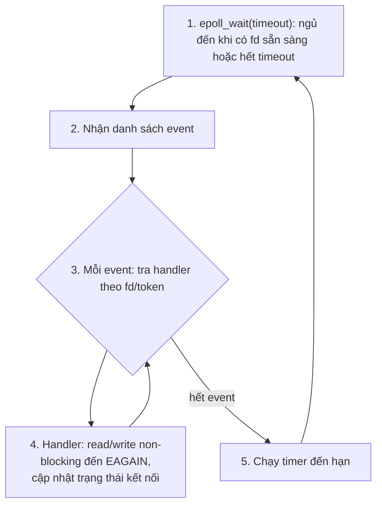
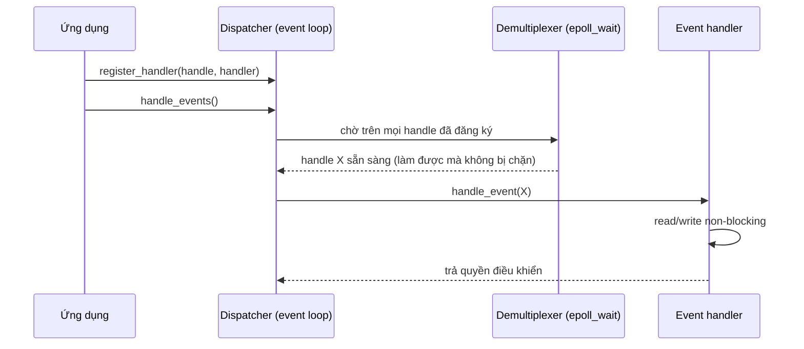
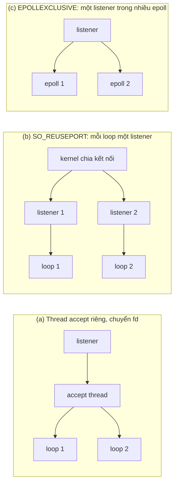
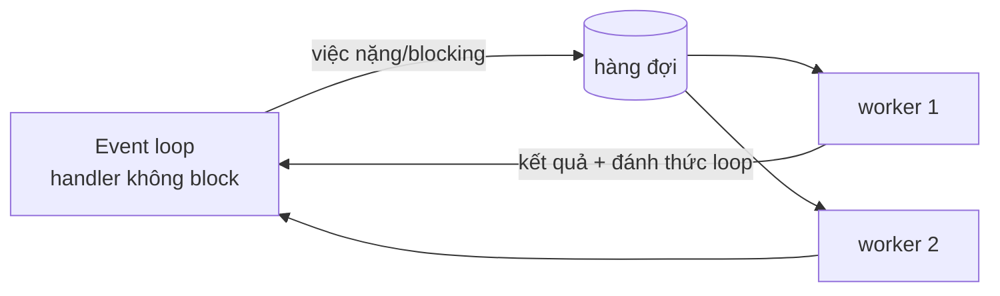

# P7 · Chương 04 — Kiến trúc event loop

## Bạn sẽ hiểu được gì

1. **Q1.** Bài toán C10K của Dan Kegel được đặt ra trong bối cảnh năm nào, và nó dẫn tới những chiến lược I/O nào? → mục 1
2. **Q2.** Thread-per-connection đánh đổi gì (bộ nhớ stack, context switch), và con số nào ta được phép khẳng định? → mục 2
3. **Q3.** Một event loop gồm những bước nào, và vì sao handler không được block? → mục 3
4. **Q4.** "Manual stack management" là gì, và vì sao code callback khó đọc hơn code tuần tự? → mục 4
5. **Q5.** Reactor pattern có những thành phần nào và chúng ánh xạ vào `epoll` ra sao (kèm Proactor, nginx, Node.js)? → mục 5
6. **Q6.** Làm sao dùng nhiều core: một loop mỗi core, `SO_REUSEPORT`, `EPOLLEXCLUSIVE`? → mục 6
7. **Q7.** Timer sống ở đâu trong event loop; việc nặng CPU và blocking call được xử lý thế nào? → mục 7
8. **Q8.** `async`/`await` của Rust liên quan gì đến "continuation viết như code tuần tự"? → mục 8

## Kiến thức cần trước

- [Chương 01 — Mô hình I/O](01-mo-hinh-io.md): blocking, non-blocking, readiness (mục 3), completion (mục 6); thread-per-connection và event loop ở mục 4.
- [Chương 02 — select, poll, epoll](02-select-poll-epoll.md): interest/ready list (mục 4), level/edge-triggered (mục 5), `EPOLLEXCLUSIVE` (mục 7).
- [Chương 03 — kqueue và io_uring](03-kqueue-io-uring.md): completion-based, readiness vs completion và reactor vs proactor (mục 4).
- Thread, stack, context switch từ phase concurrency: [Thread, mục 7](../04-concurrency/01-thread.md) (chi phí thread) và [Scheduling](../04-concurrency/02-scheduling.md) (cơ chế context switch, mục 1).

Chương này ghép các cơ chế kernel của chương 01–03 thành kiến trúc một server. Future/Waker bắt đầu ở [chương 05](05-future-poll-waker.md).

## 1. C10K: câu hỏi được đặt ra khi nào (Q1)

> **Trả lời ngắn.** Bài toán C10K là câu hỏi làm sao để web server xử lý mười nghìn client đồng thời.[^c10k-open] Trang gốc của Dan Kegel dẫn ví dụ năm 1999 và ghi lần cập nhật cuối là 5 tháng 2 năm 2014,[^c10k-1999][^c10k-updated] nên đây là nguồn lịch sử. Phần còn giá trị là cách phân loại chiến lược I/O: một thread phục vụ nhiều client (non-blocking hoặc asynchronous I/O) hay một thread cho mỗi client (blocking I/O), kèm cả ý tưởng nhét server vào kernel.[^c10k-five]

**Giải thích.**

Hình dung (nhận xét của người soạn): một quán nhỏ thuê mỗi khách một người phục vụ riêng thì ổn với 10 bàn, nhưng với 10.000 bàn câu hỏi trở thành: cần bao nhiêu người phục vụ, và họ chờ ở đâu.

**Vấn đề.** Trang "The C10K problem" của Dan Kegel mở đầu bằng câu: đã đến lúc web server xử lý mười nghìn client đồng thời.[^c10k-open] Ông lập luận hardware không còn là nút thắt: với máy 1000 MHz, 2 GB RAM, card mạng 1000 Mbit/s giá khoảng 1200 USD;[^c10k-hw] chia cho 20000 client vẫn còn 50 KHz, 100 KB và 50 Kbit/s mỗi client.[^c10k-share]

**Các chiến lược Kegel liệt kê.** Hai trục: một thread phục vụ nhiều client hay một thread mỗi client; và kiểu I/O. Năm tổ hợp "có vẻ phổ biến": nhiều client mỗi thread với non-blocking + level-triggered readiness; nhiều client mỗi thread với non-blocking + readiness change (edge-triggered); nhiều client mỗi thread với asynchronous I/O; một client mỗi thread với blocking I/O; và nhét server vào kernel.[^c10k-five] Ánh xạ sang chương 01–03 (nhận xét của người soạn): nhóm đầu trong trang liệt kê `select()`, `poll()`, `kqueue`; nhóm hai liệt kê `epoll`, `kqueue`; nhóm ba là asynchronous I/O (trang không nhắc `io_uring`); tổ hợp thứ tư là thread-per-connection (mục 2). Khi một thread phục vụ nhiều client, Kegel còn liệt kê cách điều khiển code của mỗi client: user-level thread, *state machine* ("my favorite"), hoặc *continuation*.[^c10k-control] Hai khái niệm sau là trọng tâm của mục 4 và dẫn tới `async`/`await` ở mục 8.

<details><summary>Đi sâu: trang C10K viết năm nào, và phần cứng trong trang là của thời đó</summary>

**Bối cảnh năm.** Đây là nguồn *lịch sử*. Trang không nêu một "năm ra đời" duy nhất của bài toán; các mốc nó tự ghi là: ví dụ năm 1999 về một FTP site phục vụ 10000 client cùng lúc,[^c10k-1999] mốc 2001 khi tốc độ Gigabit Ethernet đó đã có ở vài ISP,[^c10k-2001] và cuối trang ghi lần cập nhật là 5 tháng 2 năm 2014,[^c10k-updated] kèm một dòng "minor correction" ngày 28 tháng 5 năm 2019.[^c10k-minor] Cấu hình phần cứng, giới hạn 32-bit trong trang thuộc thời đó; đừng dùng chúng để dự đoán máy hiện nay (nhận xét của người soạn). Phần còn giá trị là *phân loại các chiến lược*.

</details>

**Quay lại Q1:** C10K là câu hỏi lịch sử (ví dụ 1999, cập nhật đến 2014); thứ ta giữ lại là bảng phân loại chiến lược, không phải số liệu phần cứng.

## 2. Thread-per-connection: đơn giản, và chi phí nằm ở đâu (Q2)

> **Trả lời ngắn.** Thread-per-connection giữ code tuần tự và đơn giản: thread nào bị treo ở I/O thì thread khác chạy tiếp.[^ostep-natural] Cái giá là mỗi client tốn một stack[^c10k-stack] (stack mặc định của thread trong Rust hiện là 2 MiB trên các nền tảng Tier-1, và tài liệu ghi rõ con số này có thể đổi[^std-stack]) cùng chi phí context switching và đồng bộ hóa mà Schmidt nêu là có thể làm hiệu năng kém.[^sch-threads] Số duy nhất mục này lấy từ tài liệu là stack mặc định đó; các số `VmSize`/`VmRSS` ở phần Đi sâu chỉ là quan sát trên một máy.

**Giải thích.**

Hình dung (nhận xét của người soạn): thuê một nhân viên trực tổng đài riêng cho từng cuộc gọi. Ai cũng làm theo kịch bản thẳng từ đầu đến cuối nên dễ viết, nhưng lương và chỗ ngồi tính theo số cuộc gọi mở chứ không theo số cuộc gọi đang thật sự nói chuyện.

**Cơ chế.** Mỗi kết nối một thread blocking; code là một vòng lặp tuần tự. OSTEP nêu lợi ích: khi thread phát I/O bị treo, thread khác chạy tiếp, và chính sự chồng lấn tự nhiên giữa I/O và tính toán làm lập trình thread trở nên tự nhiên, thẳng thắn.[^ostep-natural] [Chương 01 mục 4](01-mo-hinh-io.md) đã đặt mô hình này cạnh event loop; ở đây chỉ đi vào chi phí.

**Chi phí 1 — bộ nhớ stack.** Kegel: mô hình này dùng cả một stack frame cho mỗi client, tốn bộ nhớ.[^c10k-stack] Ông tính ví dụ: với stack 2 MB mỗi thread, máy 32-bit có 1 GB bộ nhớ ảo cho người dùng sẽ hết bộ nhớ ảo ở 512 thread.[^c10k-512] Đó là phép tính của thời 32-bit, nhưng nó chỉ ra chỗ cần nhìn: stack tốn trước hết là *address space* (nhận xét của người soạn). Trong Rust, stack mặc định của thread phụ thuộc nền tảng, hiện là 2 MiB trên mọi nền tảng Tier-1 và có thể đổi.[^std-stack]

Hai số trong `/proc/<pid>/status` đo hai thứ khác nhau: `VmSize` là kích thước virtual memory,[^proc-vmsize] còn `VmRSS` là resident set size, bằng tổng `RssAnon`, `RssFile` và `RssShmem`.[^proc-vmrss] Một vùng stack mới cấp mà chưa bị chạm tới thì chưa chiếm RAM vật lý: OSTEP mô tả nguyên lý này (demand zeroing) cho trang heap;[^ostep-demand-zero] áp dụng cho stack của thread là suy luận của người soạn, khớp với số đo ở phần Đi sâu và với thí nghiệm `mmap` ở [P3 chương 05 mục 4](../03-memory/05-bo-nho-tien-trinh-linux.md).

**Chi phí 2 — context switch và đồng bộ hóa.** Schmidt, khi giải thích vì sao logging server "một thread mỗi kết nối" trong ví dụ của ông chưa đủ tốt, viết rằng threading có thể gây hiệu năng kém do context switching, đồng bộ hóa và sao chép dữ liệu;[^sch-threads] đó là nhận định thiết kế, câu này không kèm số đo. Node.js nêu cùng ý từ phía ngược lại: ít thread thì hệ thống dành nhiều thời gian và bộ nhớ hơn cho client, thay vì trả chi phí không gian và thời gian cho thread (bộ nhớ, context switching).[^node-overhead] Kegel nhận xét nhiều OS lúc đó khó xử lý hơn vài trăm thread,[^c10k-hundreds] và dự đoán thread sẽ cải thiện nhưng "ở thời điểm hiện tại" nên dùng mô hình khác nếu cần chừng đó client.[^c10k-future] Kegel và Schmidt là nguồn cũ. Tokio nói tạo/chạy/hủy rất nhiều task là rất rẻ, đặc biệt so với OS thread, và chuyển giữa task không cần context switch.[^tokio-light] Chương không đưa con số "bao nhiêu thread thì sập" hay "một context switch tốn bao nhiêu µs": hãy đo trên máy của bạn.

**Trade-off.** Thread-per-connection đổi *độ đơn giản của code* lấy *chi phí tài nguyên theo số kết nối*. Với số kết nối nhỏ, chi phí theo kết nối thường chưa đáng kể; hàng chục nghìn kết nối phần lớn rảnh (websocket, long-poll) thì chi phí theo kết nối mới thành vấn đề (nhận xét của người soạn).

<details><summary>Đi sâu: số đo VmSize/VmRSS trên một máy, và mỗi số nói gì</summary>

**Số đo thật (một máy, container; quan sát).** Người soạn tạo N thread, mỗi thread chặn trong `read` trên một `UnixStream` không có dữ liệu, rồi đọc `/proc/self/status`. Môi trường: container Linux `rust-foundations-lab:1.95` trên macOS, kernel 6.8.0, 4 core, rustc 1.95.0 `-O`.

| Số thread | `Threads` | `VmSize` | `VmRSS` |
|---|---|---|---|
| 1 (lúc bắt đầu) | 1 | 2756 kB | 1668 kB |
| 2000 | 2001 | 6 299 428 kB | 20 888 kB |
| 5000 | 5001 | 12 697 144 kB | 49 540 kB |

**Mỗi số nói gì.**

- `Threads` là số thread của process chứa thread đang đọc.[^proc-threads] 2001 và 5001 là N thread cộng thread chính: lúc đọc, mọi thread chặn đều đã sống (quan sát; dùng để kiểm tra thí nghiệm chạy đúng).
- `VmRSS` tăng khoảng 9,6 kB mỗi thread, cùng tỷ lệ ở cả hai lần: (20 888 − 1668) / 2000 = 9,6 và (49 540 − 1668) / 5000 ≈ 9,6 (phép tính của người soạn). So với stack 2 MiB mỗi thread thì chỉ khoảng 0,5%, nên thread rảnh gần như không tốn RAM thật cho stack chưa chạm tới. Hai giới hạn khi đọc: proc(5) ghi giá trị `VmRSS` là không chính xác vì một tối ưu hóa scalability trong kernel,[^proc-vmrss-inacc] nên coi 9,6 kB là bậc độ lớn; và vì `VmRSS` chỉ gồm ba loại ở trên nên nó không phản ánh bộ nhớ kernel dành cho thread hay socket (suy luận của người soạn từ định nghĩa).
- `VmSize` chia cho số thread ra 3150 kB ở 2000 thread và 2539 kB ở 5000 thread: không phải hằng số, vì có một phần cố định rất lớn (xem dòng sau). Lấy hiệu giữa hai lần đo thì chi phí biên là (12 697 144 − 6 299 428) / 3000 ≈ 2133 kB mỗi thread. Nếu `kB` ở đây là 1024 byte (giả định của người soạn) thì 2133 kB ≈ 2048 kB (2 MiB, stack mặc định ở Chi phí 1) cộng khoảng 85 kB; ~85 kB chưa được phân rã, chương này không khẳng định nó gồm những gì. Ý nghĩa: mỗi thread rảnh vẫn giữ trong address space một phần xấp xỉ stack của nó. Con số này tiện để nhớ nhưng là quan sát cộng với mặc định hiện tại của Rust, không phải bảo đảm.
- Phần dư ~2 GB của `VmSize` không phụ thuộc số thread. Chạy lại với `MALLOC_ARENA_MAX=1` cho `VmSize` 4 269 792 kB (2000 thread) và 10 670 644 kB (5000 thread): chi phí biên vẫn ≈ 2133 kB mỗi thread, nhưng tổng giảm 2 029 636 kB và 2 026 500 kB so với lần đầu (phép trừ của người soạn). Man page `mallopt(3)` cho biết biến môi trường `MALLOC_ARENA_MAX` điều khiển cùng tham số với `M_ARENA_MAX`,[^mallopt-env] một arena là một pool bộ nhớ mà các lời gọi `malloc(3)` dùng để phục vụ cấp phát,[^mallopt-arena-def] và khi `M_ARENA_MAX` để mặc định (0) thì giới hạn cứng số arena do implementation tính, thường là bội số số CPU.[^mallopt-arena] Ở [chương Thread](../04-concurrency/01-thread.md) mục 7 (phần Đi sâu), người soạn đọc `/proc/self/maps` và quan sát 31 vùng ≈ 64 MiB (glibc 2.36; quan sát ở đó, không phải bảo đảm); 31 × 66 973 696 byte ≈ 2 027 524 KiB, sát với phần dư ở đây (phép tính của người soạn). Kết luận "phần dư là các arena của `malloc`" là suy luận có đối chiếu, không phải điều tài liệu nói thẳng.

**Phân loại các con số của mục này.**

| Con số | Loại | Nguồn / ghi chú |
|---|---|---|
| Stack mặc định của thread Rust: 2 MiB | tài liệu, nhưng "có thể đổi" | docs `std::thread`[^std-stack] |
| 512 thread ở máy 32-bit, stack 2 MB | phép tính lịch sử của Kegel | trang C10K[^c10k-512] |
| ≈ 9,6 kB `VmRSS` mỗi thread rảnh | quan sát một máy, bậc độ lớn | proc(5) ghi `VmRSS` không chính xác[^proc-vmrss-inacc] |
| ≈ 2133 kB `VmSize` mỗi thread | quan sát một máy | khớp 2 MiB + ~85 kB (chưa phân rã) |
| ~2 GB `VmSize` hằng số | quan sát; nguyên nhân là suy luận có đối chiếu | `mallopt(3)`[^mallopt-arena] và chương Thread |

Các số đo này không đo context switch, không đo giới hạn số thread, và chỉ là một máy, một kernel.

</details>

**Quay lại Q2:** thread-per-connection đổi độ đơn giản của code lấy chi phí tài nguyên tỷ lệ với số kết nối (stack là address space trước, RAM thật sau); chỉ stack mặc định có nguồn tài liệu, mọi số còn lại phải đo trên máy của bạn.

## 3. Cấu trúc của một event loop (Q3)

> **Trả lời ngắn.** Event loop là một vòng lặp lấy các sự kiện về rồi gọi handler xử lý từng cái một.[^ostep-loop] Vì handler đang chạy là hoạt động duy nhất trong hệ thống, việc chọn event kế tiếp chính là lập lịch,[^ostep-sched] nên nếu handler gọi thứ gì block thì cả server dừng theo.[^ostep-halt]

**Giải thích.**

Hình dung (nhận xét của người soạn): một lễ tân duy nhất đứng ở quầy; chuông reo ở bàn nào thì chạy tới phục vụ nhanh rồi quay về quầy. Nếu lễ tân ngồi xuống trò chuyện lâu với một khách, mọi bàn khác phải chờ.

**Vấn đề.** Để một thread phục vụ nhiều kết nối, nó phải ngủ ở "bất kỳ kết nối nào có việc", không phải ở một kết nối cụ thể.

**Cơ chế.** OSTEP gọi đây là *event-based concurrency*: một vòng lặp lấy về các sự kiện và xử lý từng cái một; đoạn code xử lý là *event handler*.[^ostep-loop] Khi một handler chạy, nó là hoạt động duy nhất trong hệ thống nên chọn event kế tiếp chính là lập lịch.[^ostep-sched]



Phác thảo (minh họa cấu trúc, không phải code chạy được):

```rust
loop {
    let events = poll.wait(nearest_timer_deadline());   // epoll_wait / mio::Poll::poll
    for ev in events {
        connections[ev.token].on_event(ev);              // handler: KHÔNG được block
    }
    run_expired_timers();
}
```

**Handler không được block.** OSTEP: để giữ quyền kiểm soát lập lịch, không lời gọi nào có thể block caller được phép thực hiện;[^ostep-tip] nếu handler gọi thứ block, cả server block đến khi lời gọi xong.[^ostep-halt] Schmidt viết cùng ý: handler không bị preempt nên không được làm I/O blocking trên một handle, vì sẽ chặn cả tiến trình và làm chậm client của các handle khác.[^sch-nonpreempt]

<details><summary>Đi sâu: hai nguồn block "ngầm" và giới hạn của event loop thuần</summary>

Có hai nguồn block "ngầm". (1) `O_NONBLOCK` không có tác dụng với file thường và block device: I/O trên chúng vẫn (ngắn hạn) block;[^man-open-reg] Kegel cũng nhắc: lần đầu server cần I/O đĩa, tiến trình bị block và mọi client phải chờ.[^c10k-disk] (2) Page fault: handler bị page fault thì block, và OSTEP gọi đây là block ngầm khó tránh.[^ostep-paging]

**Lợi ích và giới hạn.** Với một thread, mỗi lúc chỉ xử lý một event nên không cần acquire/release lock.[^ostep-nolock] Nhưng OSTEP ghi sự đơn giản này mất khi dùng nhiều CPU (mục 6).[^ostep-multicpu] Và event loop thuần cần asynchronous I/O để chạy; không có nó thì cách tiếp cận thuần không thể hiện thực (mục 7 nói về giải pháp lai).[^ostep-noaio]

</details>

**Quay lại Q3:** vòng lặp là `chờ → dispatch handler → chờ`; chọn event nào chạy là lập lịch, nên handler không được block.

## 4. State management và vì sao code callback khó (Q4)

> **Trả lời ngắn.** Với thread, việc đang làm dở nằm sẵn trên stack. Với event loop, handler trả về vòng lặp nên stack biến mất, và handler phải tự đóng gói một phần trạng thái cho handler kế tiếp dùng.[^ostep-msm] Adya và cộng sự gọi công việc đó là manual stack management;[^ostep-manual] lời giải OSTEP nêu theo Adya và cộng sự là continuation: ghi thông tin cần để hoàn tất xử lý vào một cấu trúc dữ liệu rồi tra ra khi sự kiện xảy ra.[^ostep-cont]

**Giải thích.**

Hình dung (nhận xét của người soạn): khi bạn bị gọi sang việc khác giữa chừng, bạn phải ghi vào một tờ ticket "đang làm đến đâu, còn thiếu gì", vì không ai nhớ giùm trên bàn làm việc nữa. Thread tự có "bàn làm việc" (stack); event loop thì không.

**Vấn đề.** Với thread, trạng thái "việc đang làm dở" nằm sẵn trên stack. Với event loop, handler phát thao tác bất đồng bộ rồi *trả về* vòng lặp, và stack của nó biến mất.

OSTEP: khi event handler phát một asynchronous I/O, nó phải đóng gói một phần trạng thái cho handler kế tiếp dùng khi I/O xong; chương trình dùng thread không cần việc này vì trạng thái nằm trên stack.[^ostep-msm] Adya và cộng sự gọi công việc đó là *manual stack management*, nền tảng của lập trình event-based.[^ostep-manual]

**Vì sao khó hơn (nhận xét của người soạn).** Luồng điều khiển bị băm thành nhiều hàm; biến sống qua điểm tạm dừng phải đưa vào struct bằng tay; xử lý lỗi và hủy rải rác. OSTEP thêm một khó khăn bảo trì: nếu một hàm đổi từ non-blocking sang blocking, handler gọi nó phải "xé mình thành hai mảnh".[^ostep-rip]

<details><summary>Đi sâu: ví dụ continuation và state machine mỗi kết nối</summary>

**Ví dụ.** Thread-based: `rc = read(fd, buf, n); rc = write(sd, buf, n);` — `sd` là biến cục bộ, sau `read` code biết ngay. Event-based: phải tách thành hai handler và lưu `sd` ở đâu đó. OSTEP đề xuất *continuation*: ghi lại thông tin cần để hoàn tất xử lý vào một cấu trúc dữ liệu, khi sự kiện xảy ra thì tra ra và xử lý tiếp;[^ostep-cont] trong ví dụ của họ đó là hash table khóa `fd`, giá trị `sd`.[^ostep-hash] Dạng thực tế hơn là *state machine* mỗi kết nối:

```rust
enum Conn {                                       // phác thảo, không chạy
    ReadingRequest { buf: Vec<u8> },
    WritingResponse { out: Vec<u8>, sent: usize },
    Closed,
}
// handler = (Conn, event) -> Conn mới; biến nào sống qua lần tạm dừng phải là field.
```

</details>

**Quay lại Q4:** trạng thái "làm dở" phải được lưu tay (continuation hoặc state machine) vì stack không còn; đó là cái giá của event loop.

## 5. Reactor pattern (Schmidt) (Q5)

> **Trả lời ngắn.** Reactor là pattern thiết kế phần mềm của Schmidt: mỗi dịch vụ do một event handler đại diện, initiation dispatcher gọi handler, còn việc demultiplex yêu cầu do một synchronous event demultiplexer làm.[^sch-intent] Demultiplexer block chờ trên tập handle và trả về khi có thể khởi tạo một thao tác trên một handle mà không bị chặn (readiness);[^sch-demux] Proactor thì dispatch theo sự hoàn thành của thao tác bất đồng bộ.[^sch-proactor]

**Giải thích.**

Hình dung (nhận xét của người soạn): bảng điện báo ở quầy lễ tân chỉ cho biết "bàn 7 đang gọi", không phục vụ hộ; lễ tân (dispatcher) nhìn bảng rồi gọi đúng nhân viên phụ trách bàn đó.

**Nguồn.** Reactor do Douglas C. Schmidt mô tả; bản dùng ở đây ghi rằng phiên bản trước của bài xuất hiện thành một chương sách của Addison-Wesley năm 1995.[^sch-year] Đây là pattern thiết kế phần mềm, không phải API kernel.

**Định nghĩa.** Mỗi dịch vụ được đại diện bởi một event handler; việc dispatch handler do một *initiation dispatcher* làm, việc demultiplex yêu cầu do một *synchronous event demultiplexer* làm.[^sch-intent] Các thành phần và ánh xạ:

| Thành phần (Schmidt) | Vai trò | Ánh xạ Linux/Rust (nhận xét của người soạn) |
|---|---|---|
| Handle | Định danh tài nguyên truyền thông do OS quản lý[^sch-handle] | file descriptor; `mio::Token` là nhãn do ứng dụng gán |
| Synchronous event demultiplexer | Block chờ trên tập handle, trả về khi có thể khởi tạo thao tác trên một handle mà không bị chặn[^sch-demux] | `epoll_wait`, `kevent`; `mio::Poll::poll` |
| Concrete event handler | Ứng dụng đăng ký với dispatcher để xử lý từng loại sự kiện[^sch-concrete] | struct/hàm theo kết nối (như `Conn` ở mục 4) |
| Initiation dispatcher | Quản lý handler đã đăng ký[^sch-dispatch] | vòng `for ev in events` |

Động thái: khi sự kiện xảy ra, demultiplexer thông báo dispatcher, dispatcher *gọi đồng bộ* hook method của handler tương ứng.[^sch-dyn]



Reactor báo *"có thể bắt đầu thao tác mà không bị block"*, không báo *"đã xong"*: đó là readiness, nên handler tự gọi `read`/`write`. Với thao tác dài, Schmidt gợi ý pattern Active Object: dùng đa luồng hoặc đa tiến trình để chạy song song với vòng event chính.[^sch-active] Đây là gốc của giải pháp lai ở mục 7.

<details><summary>Đi sâu: Proactor, và event loop trong nginx và Node.js</summary>

Proactor dispatch các handler được kích hoạt bởi *sự hoàn thành* của thao tác bất đồng bộ;[^sch-proactor] định nghĩa đầy đủ, lợi ích và bảng so sánh readiness với completion nằm ở [chương 03 mục 4](03-kqueue-io-uring.md). `epoll`, `mio`, Tokio đứng trên reactor ([chương 07](07-executor-va-mio.md), [chương 08](08-tokio.md)).

**Event loop trong thực tế: nginx và Node.js.**

Chỉ nêu điều tài liệu chính thức của dự án nói. Các trang này là tài liệu hiện hành, không ghi phiên bản trang; con số phiên bản bên dưới là do chính trang ghi.

**nginx.** Hướng dẫn cho người mới: nginx có một master process và nhiều worker process; worker xử lý request; nginx dùng mô hình dựa trên sự kiện cùng cơ chế phụ thuộc OS để phân phối request hiệu quả giữa các worker.[^ngx-model] Trang "Connection processing methods" ghi `epoll` là phương pháp hiệu quả trên Linux 2.6+,[^ngx-epoll] và `EPOLLEXCLUSIVE` (Linux 4.5) được hỗ trợ từ nginx 1.11.3.[^ngx-exclusive] Về số worker: khi phân vân, đặt bằng số core CPU là điểm khởi đầu tốt.[^ngx-workers]

**Node.js.** Trang "The Node.js Event Loop" nói event loop cho phép I/O non-blocking dù mặc định chỉ có một thread JavaScript, bằng cách giao việc cho kernel khi có thể.[^node-loop] Trang "Don't Block the Event Loop" nói có hai loại thread: một Event Loop và một Worker Pool gồm k Worker;[^node-threads] khi một thread bị block vì một client, nó không xử lý được client khác.[^node-blocked] Worker Pool dùng cho I/O mà OS không cung cấp bản non-blocking và cho tác vụ tốn CPU.[^node-pool] Đây cùng dạng với kiến trúc lai của mục 7 (nhận xét của người soạn), do dự án tự ghi lại. Về thứ tự pha: libuv từ 1.45.0 (Node.js 20) chạy timer *sau* pha poll, bản trước chạy trước[^node-version] — thứ tự pha là chi tiết có thể đổi theo phiên bản.

</details>

**Quay lại Q5:** Reactor = handle + demultiplexer (`epoll_wait`) + dispatcher + handler, và nó báo readiness; Proactor báo completion.

## 6. Dùng nhiều core: nhiều event loop (Q6)

> **Trả lời ngắn.** Một event loop chạy trên một thread; khi chuyển sang nhiều CPU, server phải chạy nhiều handler song song và các vấn đề đồng bộ quay lại.[^ostep-multicpu] Thiết kế phổ biến là một loop mỗi core (nhận xét của người soạn); còn lại là chia kết nối mới cho loop nào: thread accept riêng,[^man-reuseport-dist] `SO_REUSEPORT` cho mỗi loop một listener riêng,[^man-reuseport-tcp] hoặc `EPOLLEXCLUSIVE` để một hay nhiều epoll fd nhận event.[^man-exclusive]

**Giải thích.**

Hình dung (nhận xét của người soạn): mở thêm quầy lễ tân; mỗi quầy phục vụ trọn đời những khách đã đến quầy đó nên các quầy không phải giành chung một cuốn sổ. Việc còn lại là ai chỉ khách mới vào quầy nào.

**Vấn đề.** Một event loop chạy trên một thread. OSTEP: khi chuyển sang nhiều CPU, server phải chạy nhiều handler song song và các vấn đề đồng bộ cùng lock quay lại.[^ostep-multicpu]

**Thiết kế phổ biến (nhận xét của người soạn).** Một loop mỗi core, mỗi loop có epoll instance và tập kết nối riêng; một kết nối sống trọn đời trên một loop nên trạng thái kết nối không cần lock. Còn lại là câu hỏi: kết nối mới chia cho loop nào?



**(a) Thread accept riêng**, và cách các thread tranh nhau `accept` trên cùng socket, là hai kỹ thuật "truyền thống" mà man page `socket(7)` dùng làm mốc so sánh với `SO_REUSEPORT`.[^man-reuseport-dist]

**(b) `SO_REUSEPORT` (Linux 3.9).**[^man-reuseport-since] Mỗi loop có một listener riêng bind chung một địa chỉ; điều kiện (đặt trên mỗi socket trước `bind(2)`, cùng effective UID) và thí nghiệm bind trùng nằm ở [P6 · Chương 07, mục 5](../06-networking/07-socket-va-kernel.md). Với TCP, man page nói nó cải thiện phân phối `accept(2)` của server đa luồng bằng listener riêng cho mỗi thread.[^man-reuseport-tcp] nginx dùng đúng cơ chế: tham số `reuseport` của `listen` cho phép kernel phân phối kết nối giữa các worker.[^ngx-reuseport]

**(c) `EPOLLEXCLUSIVE` (Linux 4.5)**, chi tiết ở [chương 02 mục 7](02-select-poll-epoll.md): khi nhiều epoll fd cùng gắn vào một fd đích, một *hoặc nhiều* epoll fd nhận event thay vì tất cả, nhờ đó tránh thundering herd trong một số tình huống;[^man-exclusive] man page không hứa đúng một.[^man-epoll-exclusive-one] Tài liệu nginx: không cần bật `accept_mutex` khi hệ thống hỗ trợ `EPOLLEXCLUSIVE` hoặc khi dùng `reuseport`.[^ngx-accept-mutex]

**Trade-off (suy luận của người soạn).** `SO_REUSEPORT` cho mỗi loop một hàng đợi accept riêng nên ít tranh chấp, nhưng kết nối đã được gán cho một listener thì phải chờ loop đó dù loop khác rảnh: phân phối quyết định lúc kết nối đến, không theo tải. Work-stealing của Tokio multi-thread xử lý vấn đề này ở tầng task ([chương 08 mục 2](08-tokio.md)).

<details><summary>Đi sâu: số đo SO_REUSEPORT trên một máy</summary>

*Số đo thật (một máy, container).* Người soạn viết chương trình 4 thread, mỗi thread một listener riêng bind cổng 7300 với `SO_REUSEPORT` rồi `accept` blocking; một client kết nối 400 lần. Trên container kernel 6.8.0 ở mục 2, hai lần chạy cho số `accept` mỗi listener là `[107, 87, 104, 102]` và `[109, 116, 82, 93]`, tổng đều 400. Chạy lại ba lần khi review cho `[98, 96, 107, 99]`, `[94, 107, 99, 100]`, `[105, 102, 95, 98]`, cũng tổng 400. Chỉ kết luận được (quan sát một máy, client và server cùng loopback): kernel chia kết nối cho cả 4 listener, không đều tuyệt đối, và khác nhau giữa các lần chạy; chương này không khẳng định cơ chế chọn listener vì man page không nêu. Thí nghiệm nhỏ hơn ở [P6 · Chương 07, mục 5](../06-networking/07-socket-va-kernel.md) (3 listener, 30 kết nối) ra 8/8/14: với 400 kết nối × 5 lần ở đây, mỗi listener nằm trong khoảng 82–116, nên độ lệch lớn ở đó nhiều khả năng do mẫu nhỏ (nhận xét của người soạn, không có nguồn về thuật toán chọn). Man page còn cho gắn chương trình BPF để tự quyết định cách gán gói vào socket trong nhóm.[^man-reuseport-bpf]

</details>

**Quay lại Q6:** một loop mỗi core; chọn một trong ba cách chia kết nối (thread accept riêng, `SO_REUSEPORT`, `EPOLLEXCLUSIVE`) và biết rõ mỗi cách hứa gì, không hứa gì.

## 7. Timer và việc nặng CPU/blocking trong event loop (Q7)

> **Trả lời ngắn.** Timer đánh thức loop bằng hai cách: truyền timeout đến timer gần nhất cho `epoll_wait` (tham số `timeout` là số mili giây nó sẽ block),[^man-epoll-timeout] hoặc dùng `timerfd` để timer thành một file descriptor theo dõi được bằng `select`, `poll`, `epoll`.[^man-timerfd] Việc nặng CPU hoặc blocking thì đẩy sang pool thread phụ rồi đánh thức loop: OSTEP gọi đó là cách lai,[^ostep-hybrid] còn Tokio có `spawn_blocking`.[^tokio-csb]

**Giải thích.**

Hình dung (nhận xét của người soạn): lễ tân đặt báo thức theo cuộc hẹn gần nhất rồi ngủ đến đó; việc nào cần ngồi lâu thì giao cho nhân viên phòng sau, xong họ bấm chuông gọi lễ tân dậy.

**Phần A — timer.**

**Vấn đề.** Loop ngủ trong `epoll_wait`; nếu không có I/O thì ai đánh thức nó đúng lúc timer hết hạn?

**Cách 1 — timeout của syscall chờ.** `epoll_wait` nhận `timeout` (mili giây): số mili giây nó sẽ block, đo theo `CLOCK_MONOTONIC`.[^man-epoll-timeout] Timeout bị làm tròn lên theo độ chi tiết đồng hồ hệ thống và có thể vượt một chút do lập lịch.[^man-epoll-round] `-1` là chờ vô hạn, `0` là trả về ngay kể cả khi không có event.[^man-epoll-timeout-edge] Loop tự giữ danh sách timer ở user space và mỗi vòng truyền khoảng thời gian đến timer gần nhất. `mio::Poll::poll` có cùng giao diện: block đến khi có readiness event hoặc hết `timeout`.[^mio-timeout]

**Phần B — việc nặng CPU và blocking call: thread pool phụ.**

**Vấn đề.** Handler không được block, nhưng có việc không thể non-blocking: tính toán nặng, thư viện chỉ có API blocking, I/O file thường (mục 3).

**Giải pháp lai.** OSTEP: khi thiếu asynchronous I/O, có thể dùng cách lai — event xử lý gói tin mạng, thread pool quản lý các I/O đang chờ.[^ostep-hybrid] Kegel: thread hoặc process công nhân làm I/O đĩa cũng vượt được giới hạn này.[^c10k-workers]



Loop đang ngủ trong `epoll_wait` nên worker phải làm một fd sẵn sàng (ví dụ `eventfd` hoặc pipe đã đăng ký trong epoll) để đánh thức nó (suy luận của người soạn). Mio có kiểu `Waker` cho phép đánh thức `Poll` từ thread khác;[^mio-waker] trong strace ở lab, Tokio tạo một `eventfd` đăng ký vào epoll ngay sau khi tạo epoll instance, nhất quán với vai trò này (quan sát, không phải trích nguồn).

**Ví dụ có tài liệu.** Node.js dùng Worker Pool (mục 5).[^node-pool] Tokio: block hoặc tính toán nặng trong future mà không yield là vấn đề vì có thể ngăn executor đẩy future khác tiến lên; `spawn_blocking` chạy closure trên một thread dành riêng cho thao tác blocking.[^tokio-csb] Số thread của nó mặc định rất lớn vì nó thường dùng cho I/O không làm bất đồng bộ được.[^tokio-csb-limit]

**Hệ quả (nhận xét của người soạn).** Pool phụ cần giới hạn kích thước và hàng đợi, nếu không bạn quay lại thread-per-request với mọi chi phí ở mục 2 — giống connection pool của DB: giới hạn là một phần thiết kế. Rust Book: việc rất song song (CPU-bound) hợp với thread, việc rất đồng thời (I/O-bound) hợp với async,[^book-cpu][^book-io] và thread với task thường phối hợp tốt.[^book-both] Chi tiết `spawn_blocking` và cách phát hiện việc chặn: [chương 08 mục 4](08-tokio.md), [chương 09 mục 5](09-async-trong-production.md).

<details><summary>Đi sâu: timerfd, cấu trúc dữ liệu timer (heap, timing wheel) và driver thời gian của Tokio</summary>

**Cách 2 — `timerfd`.** `timerfd_create(2)` báo timer hết hạn qua file descriptor; ưu điểm so với `setitimer(2)`/`timer_create(2)` là fd có thể theo dõi bằng `select`, `poll`, `epoll`.[^man-timerfd] `read` trả số nguyên 8 byte là số lần hết hạn.[^man-timerfd-read] Timer thành một handle nữa trong cùng reactor, đổi lại mỗi timer một fd (nhận xét của người soạn).

**Cấu trúc dữ liệu (mức khái niệm).** Varghese và Lauck (IEEE/ACM ToN, 1997) nêu thuật toán timer thông thường của OS tốn O(n) để bắt đầu hoặc duy trì timer,[^vl-abstract] và đề xuất *timing wheel*, rồi *hierarchical timing wheel* gồm nhiều bánh xe với độ chi tiết khác nhau để phủ khoảng thời gian lớn.[^vl-hier] Họ cũng nêu phương án priority queue chỉ xử lý phần tử nhỏ nhất,[^vl-pq] hiện thực bằng cây hoặc heap.[^vl-tree] Tài liệu kernel Linux nhận xét timer wheel hợp nhất với *timeout*: phần lớn không bao giờ hết hạn vì sự kiện đúng đến kịp,[^hrt-wheel] đúng hình dạng timeout read/keep-alive của server (nhận xét của người soạn).

**Ví dụ: Tokio 1.53.2.** Driver thời gian có độ phân giải một mili giây[^tokio-wheel-res] và giữ sáu bánh xe theo tầng.[^tokio-wheel-six] Trước khi ngủ nó hỏi bánh xe thời điểm hết hạn gần nhất[^tokio-next] và ngủ không quá `min(limit, thời gian đến hạn)` khi có `limit` do caller truyền vào[^tokio-min] — cùng ý với Cách 1 (suy luận của người soạn từ source: `park_timeout` đi xuống I/O driver, nơi gọi `Poll::poll` của mio với `max_wait`). (Chi tiết hiện thực ở 1.53.2, có thể đổi.)

</details>

**Quay lại Q7:** loop ngủ đến timer gần nhất (hoặc nhận timer qua fd), và mọi việc không thể non-blocking bị đẩy sang pool phụ có giới hạn.
## 8. Liên hệ với Rust: `async`/`await` là continuation viết như code tuần tự (Q8)

> **Trả lời ngắn.** Compiler làm thay phần "tự lưu trạng thái" của mục 4: Rust theo dõi trạng thái trong async block như một state machine vô hình, như thể bạn viết một `enum` lưu trạng thái tại mỗi điểm await.[^book-state] Khi future bên trong trả `Pending`, future bên ngoài cũng trả `Pending` và tạm dừng trạng thái để lần poll sau tiếp tục từ chỗ đó.[^ref-await] Luật "không block" vẫn nguyên: việc đổi task chỉ xảy ra tại `.await`.[^tokio-await-only]

**Giải thích.**

Hình dung (nhận xét của người soạn): thay vì tự ghi ticket, bạn viết kịch bản thẳng "làm A, chờ, làm B" và có một thư ký (compiler) tự ghi bạn đang ở bước nào mỗi khi bị gọi đi.

Mục 4 cho thấy gánh nặng của event loop là tự lưu trạng thái giữa các lần tạm dừng. Rust Book mô tả điều compiler làm giúp: Rust theo dõi trạng thái trong async block để runtime làm việc khác rồi quay lại; đó là một "state machine vô hình", như thể bạn viết một `enum` lưu trạng thái tại mỗi điểm await.[^book-state] Mỗi biến thể lấy quyền truy cập cần thiết tới dữ liệu của đoạn code đó, bằng sở hữu hoặc tham chiếu.[^book-variants] Nói cách khác, việc `enum Conn` ở mục 4 làm bằng tay thì compiler làm thay (nhận xét của người soạn; Rust Book chỉ nói "như thể" viết enum); "tách handler" thành "một hàm nhiều `.await`". Khi future bên trong trả `Poll::Pending`, future bên ngoài cũng trả `Pending` và tạm dừng trạng thái để lần poll sau tiếp tục từ chỗ đó.[^ref-await]

| Event loop (chương này) | Async Rust (diễn giải của người soạn) |
|---|---|
| Handler gặp `EAGAIN`, trả quyền cho loop | `poll` trả `Poll::Pending` |
| Continuation (hash table, enum) | future do compiler sinh (state machine) |
| Dispatcher gọi handler khi demultiplexer báo | executor `poll` task khi `Waker` được gọi |
| Demultiplexer (`epoll_wait`) | driver: Tokio gọi nó là I/O event loop[^tokio-services], dựa trên Mio[^tokio-driver-mio] |
| Handler không được block | task không nên chặn thread[^tokio-noblock] |

Chi tiết `Future`/`Waker` ở [chương 05](05-future-poll-waker.md); state machine do compiler sinh ở [chương 06 mục 3](06-async-await-pin.md) và `Pin` ở [chương 06 mục 5](06-async-await-pin.md). Hai điểm cần nhớ. (1) Việc đổi task chỉ xảy ra tại `.await`, nên code chạy lâu mà không tới `.await` chặn các task khác[^tokio-await-only] — đây là luật "handler không được block" của OSTEP, đổi đơn vị từ handler sang task. (2) Runtime multi-thread của Tokio mặc định bắt đầu một worker mỗi core,[^tokio-multi] còn current-thread scheduler chạy mọi task trên thread hiện tại[^tokio-current] — tương ứng "nhiều loop" và "một loop" của mục 6, dù Tokio dùng work-stealing thay vì gán kết nối cố định ([chương 08 mục 2](08-tokio.md)).

<details><summary>Đi sâu: quan sát từ lab (một máy, container)</summary>

**Quan sát từ lab (một máy, container, 4 core; xem `docs/labs/07-io-async-lab.md`).** Với 4 kết nối × 200 message × 64 byte, `epoll_echo` phục vụ bằng 1 thread; `thread_echo` đạt đỉnh 5 thread (main + 4); Tokio multi-thread có 5 thread. Số thread của `thread_echo` tăng theo số kết nối, còn của Tokio theo số core. Số syscall dao động giữa các lần chạy và chỉ so sánh được bậc độ lớn. Chạy lại: `./labs/linux.sh bash -c 'cd /work/labs && ./target-linux/debug/epoll_echo 7101 4 & sleep 0.5; ./target-linux/debug/echo_load 7101 4 200 64; wait'` sau `cargo build -p lab-io-async`.

</details>

**Quay lại Q8:** `async`/`await` là compiler viết hộ state machine mà event loop thuần bắt bạn viết tay; nhưng task vẫn không được block thread.

## Tóm tắt

- C10K của Kegel là nguồn lịch sử (ví dụ 1999, trang cập nhật đến 2014); giá trị còn lại là phân loại chiến lược: một thread nhiều client (readiness hoặc async I/O) so với một thread mỗi client.
- Thread-per-connection đơn giản vì trạng thái nằm trên stack; chi phí theo số kết nối là stack (address space trước, RAM thật sau) và lập lịch. Chỉ stack mặc định 2 MiB của Rust có nguồn tài liệu; quan sát trên một máy: ≈ 2133 kB `VmSize` (≈ 2 MiB + ~85 kB) và ≈ 9,6 kB `VmRSS` mỗi thread rảnh.
- Event loop: chờ sự kiện → dispatch handler → chờ tiếp. Chọn event nào chạy là lập lịch, nên handler không được block (kể cả block ngầm: file thường, page fault).
- Cái giá là manual stack management: trạng thái lưu tay thành continuation hoặc state machine.
- Reactor (Schmidt): handle, synchronous event demultiplexer, initiation dispatcher, event handler; nó báo readiness. Proactor báo completion.
- Nhiều core: một loop mỗi core; chia kết nối bằng thread accept riêng, `SO_REUSEPORT` hoặc `EPOLLEXCLUSIVE`.
- Timer: tính timeout cho `epoll_wait` từ timer gần nhất, hoặc `timerfd`; cấu trúc dữ liệu là heap hoặc timing wheel (Tokio: sáu bánh xe xếp theo tầng).
- Việc nặng/blocking đẩy sang pool phụ rồi đánh thức loop (OSTEP hybrid, Node.js Worker Pool, Tokio `spawn_blocking`).
- `async`/`await` là compiler sinh state machine từ code tuần tự; luật không-block vẫn nguyên.

## Câu hỏi tự kiểm tra

1. Vì sao không dùng số liệu trong trang C10K (1000 MHz, 2 GB…) để suy ra giới hạn máy hiện nay?
   <details><summary>Đáp án</summary>

   Trang là nguồn lịch sử: ví dụ năm 1999, cập nhật cuối 2014, lập luận trên phần cứng thời đó.[^c10k-1999][^c10k-updated] Giá trị còn lại là phân loại chiến lược.[^c10k-five]

   </details>

2. Kể các chi phí của thread-per-connection và nguồn từng chi phí.
   <details><summary>Đáp án</summary>

   Stack mỗi client tốn bộ nhớ,[^c10k-stack] stack mặc định Rust là 2 MiB (tài liệu ghi có thể đổi),[^std-stack] context switching/đồng bộ hóa có thể làm hiệu năng kém (theo Schmidt, trong ví dụ logging server đa luồng).[^sch-threads] Số đo `VmSize`/`VmRSS` ở mục 2 chỉ là quan sát một máy: `VmSize` là virtual memory,[^proc-vmsize] `VmRSS` là phần resident.[^proc-vmrss]

   </details>

3. Vì sao chọn event kế tiếp là "lập lịch", và hệ quả với handler?
   <details><summary>Đáp án</summary>

   Handler đang chạy là hoạt động duy nhất trong hệ thống nên chọn event tiếp theo là lập lịch;[^ostep-sched] gọi thứ block thì cả server dừng.[^ostep-halt]

   </details>

4. "Manual stack management" là gì? Cho ví dụ continuation.
   <details><summary>Đáp án</summary>

   Handler tự đóng gói trạng thái cho handler kế vì stack không còn;[^ostep-msm][^ostep-manual] ví dụ lưu `sd` trong hash table khóa bởi `fd`.[^ostep-cont][^ostep-hash]

   </details>

5. Bốn thành phần Reactor và ánh xạ vào epoll?
   <details><summary>Đáp án</summary>

   Handle (fd), demultiplexer (`epoll_wait`), dispatcher (vòng dispatch), event handler (xử lý theo kết nối).[^sch-intent][^sch-handle][^sch-demux][^sch-dispatch][^sch-concrete]

   </details>

6. Reactor và Proactor khác nhau ở loại thông báo nào?
   <details><summary>Đáp án</summary>

   Reactor báo có thể khởi tạo thao tác mà không bị chặn;[^sch-demux] Proactor báo thao tác bất đồng bộ đã hoàn thành.[^sch-proactor]

   </details>

7. Ba cách chia kết nối cho nhiều event loop và một lưu ý cho `SO_REUSEPORT`, `EPOLLEXCLUSIVE`?
   <details><summary>Đáp án</summary>

   Thread accept riêng, `SO_REUSEPORT`, `EPOLLEXCLUSIVE`.[^man-reuseport-dist][^man-reuseport-tcp][^man-exclusive] `SO_REUSEPORT` đòi cùng effective UID và đặt trước `bind`;[^man-reuseport] `EPOLLEXCLUSIVE` không hứa đúng một epoll fd.[^man-epoll-exclusive-one]

   </details>

8. Hai cách để timer đánh thức loop đang ngủ trong epoll_wait?
   <details><summary>Đáp án</summary>

   Truyền timeout đến timer gần nhất cho `epoll_wait`,[^man-epoll-timeout] hoặc dùng `timerfd` để timer thành fd trong epoll.[^man-timerfd]

   </details>

9. Vì sao timer wheel hợp với timeout của server? Tokio dùng gì?
   <details><summary>Đáp án</summary>

   Phần lớn timeout bị hủy trước khi hết hạn;[^hrt-wheel] Tokio dùng timing wheel gồm sáu bánh xe xếp theo tầng, độ phân giải 1 ms.[^tokio-wheel-res][^tokio-wheel-six]

   </details>

10. Xử lý việc nặng CPU trong server event loop thế nào?
    <details><summary>Đáp án</summary>

    Đẩy sang pool phụ rồi đánh thức loop: OSTEP gọi là hybrid,[^ostep-hybrid] Node.js dùng Worker Pool,[^node-pool] Tokio dùng `spawn_blocking`.[^tokio-csb]

    </details>

11. `async`/`await` giải quyết vấn đề nào của mục 4? Nó có bỏ luật không-block không?
    <details><summary>Đáp án</summary>

    Compiler sinh state machine cho trạng thái qua các điểm await;[^book-state] luật không-block vẫn giữ vì đổi task chỉ ở `.await`.[^tokio-await-only]

    </details>

12. Vì sao `O_NONBLOCK` chưa đủ để mọi I/O trong handler an toàn?
    <details><summary>Đáp án</summary>

    Nó không có tác dụng với file thường và block device;[^man-open-reg] page fault cũng có thể block handler.[^ostep-paging]

    </details>

## Đọc thêm

- OSTEP chương 33 "Event-based Concurrency (Advanced)" — nền khái niệm, đọc cả "State Management": <https://pages.cs.wisc.edu/~remzi/OSTEP/threads-events.pdf>
- Kegel, "The C10K problem" — phân loại chiến lược (nguồn lịch sử, đọc kèm ngày): <http://www.kegel.com/c10k.html>
- Schmidt, "Reactor" — định nghĩa gốc của pattern: <https://www.dre.vanderbilt.edu/~schmidt/PDF/reactor-siemens.pdf>
- `socket(7)` mục `SO_REUSEPORT`; `epoll_ctl(2)` mục `EPOLLEXCLUSIVE` — phân phối accept: <https://manpages.debian.org/bookworm/manpages/socket.7.en.html>, <https://manpages.debian.org/bookworm/manpages-dev/epoll_ctl.2.en.html>
- Varghese và Lauck, "Hashed and Hierarchical Timing Wheels" — cấu trúc dữ liệu timer: <http://www.cs.columbia.edu/~nahum/w6998/papers/ton97-timing-wheels.pdf>
- Tokio 1.53.2 `runtime` và `task` — scheduler, driver, cooperative scheduling; tiếp ở [chương 07](07-executor-va-mio.md) và [chương 08](08-tokio.md): <https://docs.rs/tokio/1.53.2/tokio/runtime/index.html>
- [Chương 01 mục 4](01-mo-hinh-io.md) — phần giới thiệu ngắn thread-per-connection so với event loop, đọc trước khi vào chương này nếu cần.
- [Lab `docs/labs/07-io-async-lab.md`](../labs/07-io-async-lab.md) (crate `lab-io-async`) — echo server epoll/mio/Tokio/thread để quan sát số liệu.

[^c10k-open]: Dan Kegel, The C10K problem, phần mở đầu — <http://www.kegel.com/c10k.html> — "It's time for web servers to handle ten thousand clients simultaneously, don't you think?"
[^c10k-hw]: Dan Kegel, The C10K problem, phần mở đầu — <http://www.kegel.com/c10k.html> — "You can buy a 1000MHz machine with 2 gigabytes of RAM and an 1000Mbit/sec Ethernet card for $1200 or so."
[^c10k-share]: Dan Kegel, The C10K problem, phần mở đầu — <http://www.kegel.com/c10k.html> — "at 20000 clients, that's 50KHz, 100Kbytes, and 50Kbits/sec per client."
[^c10k-1999]: Dan Kegel, The C10K problem, phần mở đầu — <http://www.kegel.com/c10k.html> — "In 1999 one of the busiest ftp sites, cdrom.com, actually handled 10000 clients simultaneously through a Gigabit Ethernet pipe."
[^c10k-minor]: Dan Kegel, The C10K problem, cuối trang — <http://www.kegel.com/c10k.html> — "(minor correction: 28 May 2019)"
[^c10k-updated]: Dan Kegel, The C10K problem, cuối trang — <http://www.kegel.com/c10k.html> — "Last updated: 5 February 2014"
[^c10k-five]: Dan Kegel, The C10K problem, mục I/O Strategies — <http://www.kegel.com/c10k.html> — "The following five combinations seem to be popular:"
[^c10k-control]: Dan Kegel, The C10K problem, mục I/O Strategies — <http://www.kegel.com/c10k.html> — "a state machine (a bit esoteric, but popular in some circles; my favorite)"
[^c10k-stack]: Dan Kegel, The C10K problem, mục Serve one client with each server thread — <http://www.kegel.com/c10k.html> — "Has the disadvantage of using a whole stack frame for each client, which costs memory."
[^c10k-hundreds]: Dan Kegel, The C10K problem, mục Serve one client with each server thread — <http://www.kegel.com/c10k.html> — "Many OS's also have trouble handling more than a few hundred threads."
[^c10k-future]: Dan Kegel, The C10K problem, mục Serve one client with each server thread — <http://www.kegel.com/c10k.html> — "Nevertheless, at the current time, if you actually want to support that many clients, you're probably better off using some other paradigm."
[^c10k-disk]: Dan Kegel, The C10K problem, mục Serve many clients with each thread, and use nonblocking I/O and level-triggered readiness notification — <http://www.kegel.com/c10k.html> — "The first time a server needs disk I/O, its process blocks, all clients must wait, and that raw nonthreaded performance goes to waste."
[^c10k-workers]: Dan Kegel, The C10K problem, mục Serve many clients with each thread, and use nonblocking I/O and level-triggered readiness notification — <http://www.kegel.com/c10k.html> — "worker threads or processes that do the disk I/O can also get around this"
[^ostep-natural]: OSTEP, chương 33, mục A Problem: Blocking System Calls — <https://pages.cs.wisc.edu/~remzi/OSTEP/threads-events.pdf> — "this natural overlap of I/O and other computation is what makes thread-based programming quite natural and straightforward."
[^ostep-loop]: OSTEP, chương 33, mục The Basic Idea: An Event Loop — <https://pages.cs.wisc.edu/~remzi/OSTEP/threads-events.pdf> — "The main loop simply waits for something to do (by calling getEvents() in the code above) and then, for each event returned, processes them, one at a time; the code that processes each event is known as an event handler."
[^ostep-sched]: OSTEP, chương 33, mục The Basic Idea: An Event Loop — <https://pages.cs.wisc.edu/~remzi/OSTEP/threads-events.pdf> — "when a handler processes an event, it is the only activity taking place in the system; thus, deciding which event to handle next is equivalent to scheduling."
[^ostep-tip]: OSTEP, chương 33, hộp Tip: Don't Block In Event-Based Servers — <https://pages.cs.wisc.edu/~remzi/OSTEP/threads-events.pdf> — "no call that blocks the execution of the caller can ever be made"
[^ostep-halt]: OSTEP, chương 33, mục A Problem: Blocking System Calls — <https://pages.cs.wisc.edu/~remzi/OSTEP/threads-events.pdf> — "if an event handler issues a call that blocks, the entire server will do just that: block until the call completes."
[^ostep-paging]: OSTEP, chương 33, mục What Is Still Difficult With Events — <https://pages.cs.wisc.edu/~remzi/OSTEP/threads-events.pdf> — "if an event-handler page faults, it will block, and thus the server will not make progress until the page fault completes."
[^ostep-nolock]: OSTEP, chương 33, mục Why Simpler? No Locks Needed — <https://pages.cs.wisc.edu/~remzi/OSTEP/threads-events.pdf> — "because only one event is being handled at a time, there is no need to acquire or release locks"
[^ostep-multicpu]: OSTEP, chương 33, mục What Is Still Difficult With Events — <https://pages.cs.wisc.edu/~remzi/OSTEP/threads-events.pdf> — "in order to utilize more than one CPU, the event server has to run multiple event handlers in parallel; when doing so, the usual synchronization problems (e.g., critical sections) arise,"
[^ostep-noaio]: OSTEP, chương 33, mục A Solution: Asynchronous I/O — <https://pages.cs.wisc.edu/~remzi/OSTEP/threads-events.pdf> — "In systems without asynchronous I/O, the pure event-based approach cannot be implemented."
[^ostep-hybrid]: OSTEP, chương 33, mục A Solution: Asynchronous I/O — <https://pages.cs.wisc.edu/~remzi/OSTEP/threads-events.pdf> — "describe a hybrid approach in which events are used to process network packets, and a thread pool is used to manage outstanding I/Os."
[^ostep-msm]: OSTEP, chương 33, mục Another Problem: State Management — <https://pages.cs.wisc.edu/~remzi/OSTEP/threads-events.pdf> — "when an event handler issues an asynchronous I/O, it must package up some program state for the next event handler to use when the I/O finally completes"
[^ostep-manual]: OSTEP, chương 33, mục Another Problem: State Management — <https://pages.cs.wisc.edu/~remzi/OSTEP/threads-events.pdf> — "Adya et al. call this work manual stack management, and it is fundamental to event-based programming"
[^ostep-cont]: OSTEP, chương 33, mục Another Problem: State Management — <https://pages.cs.wisc.edu/~remzi/OSTEP/threads-events.pdf> — "basically, record the needed information to finish processing this event in some data structure; when the event happens (i.e., when the disk I/O completes), look up the needed information and process the event."
[^ostep-hash]: OSTEP, chương 33, mục Another Problem: State Management — <https://pages.cs.wisc.edu/~remzi/OSTEP/threads-events.pdf> — "the solution would be to record the socket descriptor (sd) in some kind of data structure (e.g., a hash table), indexed by the file descriptor (fd)."
[^ostep-rip]: OSTEP, chương 33, mục What Is Still Difficult With Events — <https://pages.cs.wisc.edu/~remzi/OSTEP/threads-events.pdf> — "if a routine changes from non-blocking to blocking, the event handler that calls that routine must also change to accommodate its new nature, by ripping itself into two pieces."
[^sch-threads]: Schmidt, Reactor, mục 3 Example (logging server đa luồng, nhược điểm của thread-per-connection) — <https://www.dre.vanderbilt.edu/~schmidt/PDF/reactor-siemens.pdf> — "Threading may lead to poor performance due to context switching, synchronization, and data movement"
[^sch-year]: Schmidt, Reactor, trang đầu — <https://www.dre.vanderbilt.edu/~schmidt/PDF/reactor-siemens.pdf> — "published by Addison-Wesley, 1995."
[^sch-intent]: Schmidt, Reactor, Intent — <https://www.dre.vanderbilt.edu/~schmidt/PDF/reactor-siemens.pdf> — "Demultiplexing of service requests is performed by a synchronous event demultiplexer."
[^sch-handle]: Schmidt, Reactor, mục Example — <https://www.dre.vanderbilt.edu/~schmidt/PDF/reactor-siemens.pdf> — "A handle identifies network communication resources managed within an OS."
[^sch-demux]: Schmidt, Reactor, mục Structure, Synchronous Event Demultiplexer — <https://www.dre.vanderbilt.edu/~schmidt/PDF/reactor-siemens.pdf> — "It returns when it is possible to initiate an operation on a Handle without blocking."
[^sch-concrete]: Schmidt, Reactor, mục Structure, Concrete Event Handler — <https://www.dre.vanderbilt.edu/~schmidt/PDF/reactor-siemens.pdf> — "Applications register Concrete Event Handlers with the Initiation Dispatcher to process certain types of events."
[^sch-dispatch]: Schmidt, Reactor, Intent — <https://www.dre.vanderbilt.edu/~schmidt/PDF/reactor-siemens.pdf> — "Dispatching of event handlers is performed by an initiation dispatcher, which manages the registered event handlers."
[^sch-dyn]: Schmidt, Reactor, mục Solution — <https://www.dre.vanderbilt.edu/~schmidt/PDF/reactor-siemens.pdf> — "notifies the Initiation Dispatcher, which synchronously calls back to the Event Handler associated with the event."
[^sch-nonpreempt]: Schmidt, Reactor, mục Consequences, Non-preemptive — <https://www.dre.vanderbilt.edu/~schmidt/PDF/reactor-siemens.pdf> — "an Event Handler should not perform blocking I/O on an individual Handle since this will block the entire process and impede the responsiveness for clients connected to other Handles."
[^sch-active]: Schmidt, Reactor, mục Consequences, Non-preemptive — <https://www.dre.vanderbilt.edu/~schmidt/PDF/reactor-siemens.pdf> — "An Active Object uses multithreading or multi-processing to complete its tasks in parallel with the Initiation Dispatcher’s main event-loop."
[^sch-proactor]: Pyarali, Harrison, Schmidt, Jordan, Proactor (PLoP 1997), mục Intent — <https://www.dre.vanderbilt.edu/~schmidt/PDF/proactor.pdf> — "The Proactor pattern supports the demultiplexing and dispatching of multiple event handlers, which are triggered by the completion of asynchronous events."
[^ngx-model]: nginx, Beginner's Guide — <https://nginx.org/en/docs/beginners_guide.html> — "nginx employs event-based model and OS-dependent mechanisms to efficiently distribute requests among worker processes."
[^ngx-epoll]: nginx, Connection processing methods — <https://nginx.org/en/docs/events.html> — "epoll — efficient method used on Linux 2.6+."
[^ngx-exclusive]: nginx, Connection processing methods — <https://nginx.org/en/docs/events.html> — "The EPOLLRDHUP (Linux 2.6.17, glibc 2.8) and EPOLLEXCLUSIVE (Linux 4.5, glibc 2.24) flags are supported since 1.11.3."
[^ngx-workers]: nginx, core module, worker_processes — <https://nginx.org/en/docs/ngx_core_module.html> — "setting it to the number of available CPU cores would be a good start"
[^ngx-reuseport]: nginx, ngx_http_core_module, listen, tham số reuseport — <https://nginx.org/en/docs/http/ngx_http_core_module.html> — "allowing a kernel to distribute incoming connections between worker processes."
[^ngx-accept-mutex]: nginx, core module, accept_mutex — <https://nginx.org/en/docs/ngx_core_module.html> — "There is no need to enable accept_mutex on systems that support the EPOLLEXCLUSIVE flag (1.11.3) or when using reuseport."
[^node-loop]: Node.js Learn, The Node.js Event Loop — <https://nodejs.org/en/learn/asynchronous-work/event-loop-timers-and-nexttick> — "despite the fact that a single JavaScript thread is used by default"
[^node-threads]: Node.js Learn, Don't Block the Event Loop — <https://nodejs.org/en/learn/asynchronous-work/dont-block-the-event-loop> — "In Node.js there are two types of threads: one Event Loop (aka the main loop, main thread, event thread, etc.), and a pool of k Workers in a Worker Pool (aka the threadpool)."
[^node-blocked]: Node.js Learn, Don't Block the Event Loop — <https://nodejs.org/en/learn/asynchronous-work/dont-block-the-event-loop> — "While a thread is blocked working on behalf of one client, it cannot handle requests from any other clients."
[^node-pool]: Node.js Learn, Don't Block the Event Loop — <https://nodejs.org/en/learn/asynchronous-work/dont-block-the-event-loop> — "I/O for which an operating system does not provide a non-blocking version, as well as particularly CPU-intensive tasks."
[^node-version]: Node.js Learn, The Node.js Event Loop — <https://nodejs.org/en/learn/asynchronous-work/event-loop-timers-and-nexttick> — "Starting with libuv 1.45.0 (Node.js 20), timers are run after the poll phase in each event loop iteration."
[^man-open-reg]: open(2), mục O_NONBLOCK — <https://manpages.debian.org/bookworm/manpages-dev/open.2.en.html> — "Note that this flag has no effect for regular files and block devices; that is, I/O operations will (briefly) block when device activity is required, regardless of whether O_NONBLOCK is set."
[^man-reuseport]: socket(7), mục SO_REUSEPORT — <https://manpages.debian.org/bookworm/manpages/socket.7.en.html> — "To prevent port hijacking, all of the processes binding to the same address must have the same effective UID."
[^man-reuseport-since]: socket(7), mục SO_REUSEPORT — <https://manpages.debian.org/bookworm/manpages/socket.7.en.html> — "SO_REUSEPORT (since Linux 3.9)"
[^man-reuseport-tcp]: socket(7), mục SO_REUSEPORT — <https://manpages.debian.org/bookworm/manpages/socket.7.en.html> — "this option allows accept(2) load distribution in a multi-threaded server to be improved by using a distinct listener socket for each thread."
[^man-reuseport-dist]: socket(7), mục SO_REUSEPORT — <https://manpages.debian.org/bookworm/manpages/socket.7.en.html> — "This provides improved load distribution as compared to traditional techniques such using a single accept(2)ing thread that distributes connections, or having multiple threads that compete to accept(2) from the same socket."
[^man-reuseport-bpf]: socket(7), mục SO_ATTACH_REUSEPORT_CBPF — <https://manpages.debian.org/bookworm/manpages/socket.7.en.html> — "these options allow the user to set a classic BPF (SO_ATTACH_REUSEPORT_CBPF) or an extended BPF (SO_ATTACH_REUSEPORT_EBPF) program which defines how packets are assigned to the sockets in the reuseport group"
[^man-exclusive]: epoll_ctl(2), mục EPOLLEXCLUSIVE — <https://manpages.debian.org/bookworm/manpages-dev/epoll_ctl.2.en.html> — "EPOLLEXCLUSIVE is thus useful for avoiding thundering herd problems in certain scenarios."
[^man-epoll-exclusive-one]: epoll_ctl(2), mục EPOLLEXCLUSIVE — <https://manpages.debian.org/bookworm/manpages-dev/epoll_ctl.2.en.html> — "one or more of the epoll file descriptors will receive an event with epoll_wait(2)."
[^man-epoll-timeout]: epoll_wait(2), mục DESCRIPTION — <https://manpages.debian.org/bookworm/manpages-dev/epoll_wait.2.en.html> — "The timeout argument specifies the number of milliseconds that epoll_wait() will block. Time is measured against the CLOCK_MONOTONIC clock."
[^man-epoll-timeout-edge]: epoll_wait(2), mục DESCRIPTION — <https://manpages.debian.org/bookworm/manpages-dev/epoll_wait.2.en.html> — "Specifying a timeout of -1 causes epoll_wait() to block indefinitely, while specifying a timeout equal to zero cause epoll_wait() to return immediately, even if no events are available."
[^man-epoll-round]: epoll_wait(2), mục DESCRIPTION — <https://manpages.debian.org/bookworm/manpages-dev/epoll_wait.2.en.html> — "Note that the timeout interval will be rounded up to the system clock granularity, and kernel scheduling delays mean that the blocking interval may overrun by a small amount."
[^man-timerfd]: timerfd_create(2), mục DESCRIPTION — <https://manpages.debian.org/bookworm/manpages-dev/timerfd_create.2.en.html> — "with the advantage that the file descriptor may be monitored by select(2), poll(2), and epoll(7)."
[^man-timerfd-read]: timerfd_create(2), mục read(2) — <https://manpages.debian.org/bookworm/manpages-dev/timerfd_create.2.en.html> — "returns an unsigned 8-byte integer (uint64_t) containing the number of expirations that have occurred."
[^mio-timeout]: mio 1.2.4, struct Poll, method poll — <https://docs.rs/mio/1.2.4/mio/struct.Poll.html> — "The function will block until either at least one readiness event has been received or timeout has elapsed."
[^mio-waker]: mio 1.2.4, crate mio, mục Structs — <https://docs.rs/mio/1.2.4/mio/> — "Waker allows cross-thread waking of Poll."
[^vl-abstract]: Varghese và Lauck, Hashed and Hierarchical Timing Wheels (IEEE/ACM ToN, 1997), Abstract — <http://www.cs.columbia.edu/~nahum/w6998/papers/ton97-timing-wheels.pdf> — "Conventional algorithms to implement an Operating System timer module take O (n ) time to start or maintain a timer, where n is the number of outstanding timers"
[^vl-hier]: Varghese và Lauck, Hashed and Hierarchical Timing Wheels, Abstract — <http://www.cs.columbia.edu/~nahum/w6998/papers/ton97-timing-wheels.pdf> — "In the second, a hierarchy of timing wheels with different granularities is used to span a greater range of intervals."
[^vl-pq]: Varghese và Lauck, Hashed and Hierarchical Timing Wheels, mục IV.A Sorting Algorithms and Priority Queues — <http://www.cs.columbia.edu/~nahum/w6998/papers/ton97-timing-wheels.pdf> — "A timer module can use a priority queue, and do PERTICKBOOKKEEPING only on the smallest timer element."
[^vl-tree]: Varghese và Lauck, Hashed and Hierarchical Timing Wheels, mục Scheme 3 — <http://www.cs.columbia.edu/~nahum/w6998/papers/ton97-timing-wheels.pdf> — "These include unbalanced binary trees, heaps, post-order and end-order trees,"
[^hrt-wheel]: Linux kernel docs, High resolution timers and dynamic ticks design notes — <https://docs.kernel.org/timers/hrtimers.html> — "The vast majority of those timers never expire and are rarely recascaded because the expected correct event arrives in time"
[^tokio-wheel-res]: Tokio 1.53.2, source runtime/time/mod.rs, Driver — <https://raw.githubusercontent.com/tokio-rs/tokio/tokio-1.53.2/tokio/src/runtime/time/mod.rs> — "The driver has a resolution of one millisecond."
[^tokio-wheel-six]: Tokio 1.53.2, source runtime/time/mod.rs, Driver — <https://raw.githubusercontent.com/tokio-rs/tokio/tokio-1.53.2/tokio/src/runtime/time/mod.rs> — "The implementation maintains six wheels arranged in a set of levels."
[^tokio-next]: Tokio 1.53.2, source runtime/time/mod.rs, fn park_internal — <https://raw.githubusercontent.com/tokio-rs/tokio/tokio-1.53.2/tokio/src/runtime/time/mod.rs> — "let next_wake = lock.wheel.next_expiration_time();"
[^tokio-min]: Tokio 1.53.2, source runtime/time/mod.rs, fn park_internal — <https://raw.githubusercontent.com/tokio-rs/tokio/tokio-1.53.2/tokio/src/runtime/time/mod.rs> — "duration = std::cmp::min(limit, duration);"
[^tokio-light]: Tokio 1.53.2, module tokio::task — <https://docs.rs/tokio/1.53.2/tokio/task/index.html> — "creating new tasks or switching between tasks does not require a context switch and has fairly low overhead. Creating, running, and destroying large numbers of tasks is quite cheap, especially compared to OS threads."
[^tokio-csb]: Tokio 1.53.2, fn task::spawn_blocking — <https://docs.rs/tokio/1.53.2/tokio/task/fn.spawn_blocking.html> — "In general, issuing a blocking call or performing a lot of compute in a future without yielding is problematic, as it may prevent the executor from driving other futures forward."
[^tokio-csb-limit]: Tokio 1.53.2, fn task::spawn_blocking — <https://docs.rs/tokio/1.53.2/tokio/task/fn.spawn_blocking.html> — "The thread limit is very large by default, because spawn_blocking is often used for various kinds of IO operations that cannot be performed asynchronously."
[^tokio-services]: Tokio 1.53.2, module tokio::runtime — <https://docs.rs/tokio/1.53.2/tokio/runtime/index.html> — "An I/O event loop, called the driver, which drives I/O resources and dispatches I/O events to tasks that depend on them."
[^tokio-driver-mio]: Tokio 1.53.2, source runtime/io/driver.rs — <https://raw.githubusercontent.com/tokio-rs/tokio/tokio-1.53.2/tokio/src/runtime/io/driver.rs> — "I/O driver, backed by Mio."
[^tokio-noblock]: Tokio 1.53.2, module tokio::task — <https://docs.rs/tokio/1.53.2/tokio/task/index.html> — "Tasks should generally not perform system calls or other operations that could block a thread, as this would prevent other tasks running on the same thread from executing as well."
[^tokio-await-only]: Tokio 1.53.2, crate tokio, mục CPU-bound tasks and blocking code — <https://docs.rs/tokio/1.53.2/tokio/index.html> — "this kind of swapping can only happen at .await points, so code that spends a long time without reaching an .await will prevent other tasks from running."
[^tokio-multi]: Tokio 1.53.2, module tokio::runtime, mục Multi-Thread Scheduler — <https://docs.rs/tokio/1.53.2/tokio/runtime/index.html> — "The multi-thread scheduler executes futures on a thread pool, using a work-stealing strategy. By default, it will start a worker thread for each CPU core available on the system."
[^tokio-current]: Tokio 1.53.2, module tokio::runtime, mục Current-Thread Scheduler — <https://docs.rs/tokio/1.53.2/tokio/runtime/index.html> — "The current-thread scheduler provides a single-threaded future executor. All tasks will be created and executed on the current thread."
[^book-cpu]: The Rust Book 1.95.0, ch17.6 Futures, Tasks, and Threads — <https://doc.rust-lang.org/1.95.0/book/ch17-06-futures-tasks-threads.html> — "If the work is very parallelizable (that is, CPU-bound), such as processing a bunch of data where each part can be processed separately, threads are a better choice."
[^book-io]: The Rust Book 1.95.0, ch17.6 Futures, Tasks, and Threads — <https://doc.rust-lang.org/1.95.0/book/ch17-06-futures-tasks-threads.html> — "If the work is very concurrent (that is, I/O-bound), such as handling messages from a bunch of different sources that may come in at different intervals or different rates, async is a better choice."
[^book-both]: The Rust Book 1.95.0, ch17.6 Futures, Tasks, and Threads — <https://doc.rust-lang.org/1.95.0/book/ch17-06-futures-tasks-threads.html> — "And it turns out that threads and tasks often work very well together"
[^book-state]: The Rust Book 1.95.0, ch17.1 Futures and the Async Syntax — <https://doc.rust-lang.org/1.95.0/book/ch17-01-futures-and-syntax.html> — "This is an invisible state machine, as if you’d written an enum like this to save the current state at each await point"
[^book-variants]: The Rust Book 1.95.0, ch17.5 A Closer Look at the Traits for Async — <https://doc.rust-lang.org/1.95.0/book/ch17-05-traits-for-async.html> — "Each variant gets the access it needs to the data that will be used in that section of the source code, whether by taking ownership of that data or by getting a mutable or immutable reference to it."
[^ref-await]: Rust Reference 1.95.0, Await expressions — <https://doc.rust-lang.org/1.95.0/reference/expressions/await-expr.html> — "If the call to poll returns Poll::Pending, then the future returns Poll::Pending, suspending its state so that, when the surrounding async context is re-polled, execution returns to step 3"
[^std-stack]: Rust std 1.95.0, module std::thread, mục Stack size — <https://doc.rust-lang.org/1.95.0/std/thread/index.html> — "The default stack size is platform-dependent and subject to change. Currently, it is 2 MiB on all Tier-1 platforms."
[^c10k-2001]: Dan Kegel, The C10K problem, phần mở đầu — <http://www.kegel.com/c10k.html> — "As of 2001, that same speed is now being offered by several ISPs, who expect it to become increasingly popular with large business customers."
[^c10k-512]: Dan Kegel, The C10K problem, mục Serve one client with each server thread — <http://www.kegel.com/c10k.html> — "If each thread gets a 2MB stack (not an uncommon default value), you run out of *virtual memory* at (2^30 / 2^21) = 512 threads on a 32 bit machine with 1GB user-accessible VM"
[^node-overhead]: Node.js Learn, Don't Block the Event Loop, mục Summary — <https://nodejs.org/en/learn/asynchronous-work/dont-block-the-event-loop> — "If Node.js can make do with fewer threads, then it can spend more of your system's time and memory working on clients rather than on paying space and time overheads for threads (memory, context-switching)."
[^proc-vmsize]: proc(5), /proc/pid/status, Debian bookworm — <https://manpages.debian.org/bookworm/manpages/proc.5.en.html> — "VmSize Virtual memory size. VmLck Locked memory size (see mlock(2))."
[^proc-vmrss]: proc(5), /proc/pid/status, Debian bookworm — <https://manpages.debian.org/bookworm/manpages/proc.5.en.html> — "Resident set size. Note that the value here is the sum of RssAnon, RssFile, and RssShmem."
[^proc-vmrss-inacc]: proc(5), /proc/pid/status, VmRSS, Debian bookworm — <https://manpages.debian.org/bookworm/manpages/proc.5.en.html> — "Resident set size. Note that the value here is the sum of RssAnon, RssFile, and RssShmem. This value is inaccurate; see /proc/pid/statm above."
[^proc-threads]: proc(5), /proc/pid/status, Debian bookworm — <https://manpages.debian.org/bookworm/manpages/proc.5.en.html> — "Threads Number of threads in process containing this thread."
[^ostep-demand-zero]: OSTEP, ch.23 Complete VM Systems, mục Demand zeroing — <https://pages.cs.wisc.edu/~remzi/OSTEP/vm-complete.pdf> — "If the process never accesses the page, all such work is avoided, and thus the virtue of demand zeroing."
[^mallopt-env]: mallopt(3), Linux man-pages (Debian bookworm) — <https://manpages.debian.org/bookworm/manpages-dev/mallopt.3.en.html> — "MALLOC_ARENA_MAX Controls the same parameter as mallopt() M_ARENA_MAX."
[^mallopt-arena-def]: mallopt(3), mục M_ARENA_MAX — <https://manpages.debian.org/bookworm/manpages-dev/mallopt.3.en.html> — "An arena represents a pool of memory that can be used by malloc(3) (and similar) calls to service allocation requests."
[^mallopt-arena]: mallopt(3), Linux man-pages (Debian bookworm) — <https://manpages.debian.org/bookworm/manpages-dev/mallopt.3.en.html> — "The computation of the arena hard limit is implementation-defined and is usually calculated as a multiple of the number of available CPUs."
