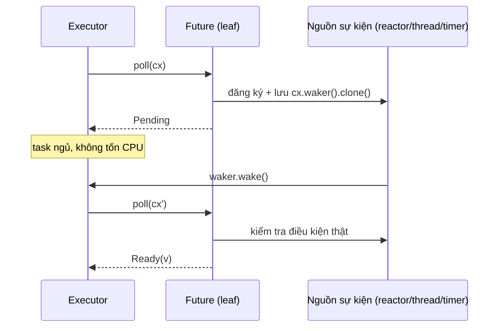

# P7 · Chương 05 — Future, poll và Waker

## Bạn sẽ hiểu được gì

(Mục 1 là phần dẫn nhập; các câu hỏi Q1–Q8 nằm ở mục 2–9.)

1. **Q1.** `Future::poll` có chữ ký gì, `Poll::Ready`/`Poll::Pending` nghĩa là gì, và vì sao future được gọi là "lười"? → mục 2
2. **Q2.** Khi một future trả `Pending`, nó phải làm gì để không bị treo vĩnh viễn? Vì sao `poll` có thể bị gọi "khi chưa có gì mới"? → mục 3
3. **Q3.** `Context` và `Waker` là gì; `wake` khác `wake_by_ref` ra sao; `will_wake` dùng để làm gì; nhiều lần `wake` có thành nhiều lần `poll` không? → mục 4
4. **Q4.** `RawWaker`/`RawWakerVTable` là gì và vì sao std vẫn cho dựng waker bằng vtable thủ công? → mục 5
5. **Q5.** Trait `Wake` và `From<Arc<W>> for Waker` giải quyết việc gì? → mục 6
6. **Q6.** Tự viết một future thủ công (timer) và một `block_on` tối giản bằng `thread::park`/`unpark` như thế nào, và chạy ra gì? → mục 7
7. **Q7.** `IntoFuture` và `.await` liên hệ với nhau ra sao? → mục 8
8. **Q8.** Mô hình poll-based của Rust khác Promise của JavaScript/C# ở đâu? → mục 9

## Kiến thức cần trước

- [Chương 01 — Các mô hình I/O](01-mo-hinh-io.md): non-blocking, `EAGAIN` (mục 2), readiness (mục 3).
- [Chương 04 — Kiến trúc event loop](04-kien-truc-event-loop.md): reactor (mục 5) và event loop (mục 3); chương này đi tiếp sang phía Rust, và mục 8 của chương 04 là cầu nối sang `async`/`await`.
- Biết `Arc`, `Mutex`, `thread::spawn` cơ bản. `Pin` chỉ cần hiểu sơ lược ở đây; chi tiết ở [Chương 06, mục 5](06-async-await-pin.md).

## 1. Vấn đề: một thread, rất nhiều thứ đang chờ

Ở các chương trước, một thread dùng `epoll`/`kqueue` để chờ nhiều file descriptor. Câu hỏi của Rust (nhận xét của người soạn): *code của người dùng* biểu diễn "một thao tác đang chờ" bằng gì, để một vòng lặp chung (executor) xen kẽ rất nhiều thao tác như vậy trên vài thread? Câu trả lời là trait `Future`: Rust Book nhắc khái niệm này còn xuất hiện dưới các tên như task hay promise,[^book-concept] và docs của std mô tả future là một giá trị "có thể chưa tính xong", cho phép thread làm việc hữu ích khác trong lúc chờ giá trị sẵn sàng.[^std-future-def]

## 2. Trait `Future`, `poll` và `Poll` (Q1)

> **Trả lời ngắn.** `Future::poll` có chữ ký `fn poll(self: Pin<&mut Self>, cx: &mut Context<'_>) -> Poll<Self::Output>`.[^std-future-sig] Nó là một lần *thử*: nếu giá trị chưa sẵn sàng thì không chặn mà trả `Pending`, và task được lên lịch đánh thức khi có thể poll tiếp.[^std-future-poll] `Poll` chỉ có hai kết quả: `Ready(T)` (đã xong) hoặc `Pending` (còn việc).[^book-poll] Future là "lười" vì tự nó bất động: phải có ai đó chủ động poll thì phép tính mới tiến triển.[^std-future-inert]

**Giải thích.**

Hình dung (nhận xét của người soạn): `poll` giống việc gõ cửa phòng hỏi "xong chưa?". Câu trả lời là "xong, đây" hoặc "chưa, lát nữa tôi gọi lại"; không ai gõ cửa thì căn phòng không làm gì.

```rust
pub trait Future {
    type Output;
    fn poll(self: Pin<&mut Self>, cx: &mut Context<'_>) -> Poll<Self::Output>;
}
```

Chữ ký này đúng như docs nêu.[^std-future-sig] Ba phần cần đọc:

- `type Output`: kiểu giá trị khi future hoàn tất.[^std-future-output]
- `self: Pin<&mut Self>`: thay vì `&mut self`, `poll` nhận một tham chiếu *đã ghim*. Ở mức chương này chỉ cần nhớ lý do: std ghi rằng ví dụ điển hình của kiểu tự tham chiếu (self-referential) là chính các state machine mà compiler sinh ra để cài `Future` cho `async fn`.[^std-pin-sr] Nếu giá trị loại đó bị di chuyển trong bộ nhớ thì tham chiếu nội bộ sẽ hỏng. `Pin` không phải phép màu của compiler: nó là một lời hứa "sẽ không move giá trị này", còn bản thân Rust vẫn coi mọi giá trị là có thể move bằng phép gán hay `mem::replace`.[^std-pin-promise] Để giữ lời hứa trong code an toàn, `Pin<Ptr>` hạn chế quyền truy cập vào con trỏ bọc bên trong.[^std-pin-restrict] Cơ chế đầy đủ, `Unpin` (ngoại lệ của hạn chế này), `pin!` nằm ở [Chương 06, mục 5](06-async-await-pin.md). Trong các ví dụ bên dưới, các future thủ công của ta không tự tham chiếu nên không cần lo.
- `cx: &mut Context<'_>`: nơi future lấy `Waker` (mục 4).

### 2.1 `poll` là một lần *thử*, không phải một lần *chờ*

Docs viết: `poll` cố gắng đưa future tới giá trị cuối; phương thức này không chặn nếu giá trị chưa sẵn sàng, thay vào đó task hiện tại được lên lịch để đánh thức khi có thể tiến triển tiếp bằng cách poll lại.[^std-future-poll] Docs cũng nói thêm: thông thường bạn không gọi `poll` trực tiếp mà `.await` giá trị.[^std-future-await]

So với `read` non-blocking ([Chương 01](01-mo-hinh-io.md)): `read` trả dữ liệu hoặc `EAGAIN`; `poll` trả `Ready(giá trị)` hoặc `Pending`. Docs cũng nói futures "giống `epoll(4)`" hơn là `poll(2)`/`select(2)`, vì không đòi mọi lần wakeup phải poll lại mọi sự kiện.[^std-future-epoll] Phần "đăng ký để được báo khi sẵn sàng" mà `epoll_ctl` làm trong kernel được `Waker` làm ở mức thư viện (nhận xét của người soạn).

Yêu cầu kèm theo: một cài đặt `poll` nên trả về nhanh và không chặn; nếu biết trước một lần gọi có thể tốn thời gian thì việc đó nên được đẩy sang thread pool hoặc thứ tương tự để `poll` trả về nhanh.[^std-future-quick]

### 2.2 `Poll`: hai kết quả

`Poll<T>` có hai biến thể: `Ready(T)` và `Pending`. Rust Book nói nó giống `Option` về hình dạng nhưng ý nghĩa khác hẳn: `Pending` cho biết future vẫn còn việc, người gọi sẽ phải kiểm tra lại sau; `Ready` cho biết future đã xong và giá trị `T` có sẵn.[^book-poll]

### 2.3 Future "lười"

Docs: future tự nó *bất động* (inert); phải có ai đó chủ động poll thì phép tính bên dưới mới tiến triển. Mỗi khi task được đánh thức, nó nên poll lại các future còn quan tâm.[^std-future-inert] Rust Book: future trong Rust là lazy, không làm gì cho đến khi bạn yêu cầu bằng `await`.[^book-lazy] Reference nói rõ với `async fn`: gọi hàm chỉ "capture" đối số vào một future, thân hàm chỉ chạy khi future bị poll.[^ref-async-fn]

<details><summary>Đi sâu: future "ống dẫn" và quan sát thân async chỉ chạy khi bị poll</summary>

Ngoại lệ đã được docs ghi nhận: một số future chỉ là "ống dẫn" cho giá trị đang được tính ở task khác (điển hình là future có được khi spawn một task vào runtime); phép tính nền của chúng chạy độc lập với future.[^std-future-conduit] Đó là hành vi của kiểu cụ thể, không phải của trait.

Quan sát chạy thật ở mục 7.1 (phần 1): dòng "thân async chạy" chỉ xuất hiện sau khi `block_on` poll lần đầu.

</details>

**Quay lại Q1:** `poll` là một lần thử không chặn trả `Ready` hoặc `Pending`, và future không làm gì cho đến khi có người poll.

## 3. Hợp đồng của `poll` (Q2)

> **Trả lời ngắn.** Future trả `Pending` thì phải bảo đảm task hiện tại được lên lịch đánh thức khi có thể tiến triển;[^std-poll-pending] cụ thể là lưu một bản clone của `Waker` lấy từ `Context`.[^std-future-clone] Dù vậy `poll` vẫn có thể bị gọi khi chưa có gì mới (Tokio gọi là spurious wakeup),[^tokio-spurious] nên `poll` đúng luôn kiểm tra lại điều kiện thật (nhận xét của người soạn).

**Giải thích.**

Hình dung (nhận xét của người soạn): trước khi cúp máy bạn phải để lại số điện thoại, nếu không không ai biết gọi bạn khi có tin. Đôi khi chuông reo mà chưa có tin gì, nên mỗi lần nghe máy bạn vẫn phải kiểm tra lại.

Đây là phần dễ viết sai nhất khi tự cài future. Bốn điều khoản (đã đối chiếu docs):

**(a) `Pending` đi kèm một lời hứa wake.** Doc của `Poll::Pending`: hàm trả `Pending` thì cũng phải đảm bảo task hiện tại được lên lịch đánh thức khi có thể tiến triển.[^std-poll-pending] Docs của `Future::poll` cụ thể hóa: khi chưa sẵn sàng, `poll` trả `Pending` và lưu một bản clone của `Waker` lấy từ `Context`.[^std-future-clone] Trả `Pending` mà không để ai giữ waker thì không ai có lý do poll lại, và task treo mãi (hệ quả logic; người soạn).

**(b) Chỉ waker của lần poll gần nhất cần được lên lịch.**[^std-future-latest] Mỗi lần poll có thể mang một `Context` khác (ví dụ future được chuyển sang task khác), nên future giữ waker phải làm tươi nó mỗi lần bị poll (suy luận của người soạn từ câu trích). Mục 4.3 nói `clone_from` làm việc này mà tránh clone thừa khi hai waker cùng đánh thức một task.

**(c) `poll` có thể bị gọi khi chưa có gì mới.** Hợp đồng "wake ⇒ ít nhất một poll" không có chiều ngược lại. Docs `Future::poll` chỉ nói rằng sau khi task được đánh thức thì nó nên poll lại và lần poll đó "có thể hoặc không" ra giá trị cuối;[^std-future-maybe] docs std (các trang đã đọc) không tuyên bố rõ chuyện poll khi chưa có wake. Docs cũng nói mỗi lần task được đánh thức, nó nên poll lại các future còn quan tâm đang chờ;[^std-future-inert] vì vậy một future có thể bị poll lại dù sự kiện của riêng nó chưa tới (suy luận của người soạn từ câu trích). Tokio thì nói thẳng rằng nó có thể lên lịch task chưa được wake, gọi là spurious wakeup.[^tokio-spurious] Vì thế `poll` đúng luôn *kiểm tra lại điều kiện thật* và trả `Pending` nếu chưa đủ (nhận xét của người soạn). Mục 7.1, phần 4, minh họa điều này: poll tay lần hai khi chưa ai wake, Timer trả lại `Pending`.



<details><summary>Đi sâu: điều khoản (d) — sau <code>Ready</code> đừng poll nữa — và cảnh báo busy-poll</summary>

**(d) Sau `Ready`, đừng poll nữa.** Docs: client không nên poll lại future đã xong.[^std-future-once] Nếu làm vậy, `poll` có thể panic, chặn mãi hay gây vấn đề khác; trait không đặt yêu cầu nào lên hiệu ứng, nhưng vì `poll` không phải `unsafe` nên nó không bao giờ được gây undefined behavior.[^std-future-panic] Rust Book: nhiều future sẽ panic nếu bị poll lại, giống `Iterator::next`.[^book-poll-again] Quan sát: `async { 7 }` poll lần hai panic với thông báo `` `async fn` resumed after completion `` (mục 7.2); đó là hành vi của kiểu compiler sinh, không phải điều trait hứa.

Docs còn dặn: không gọi `poll` lặp trong vòng lặp chặt, chỉ gọi khi future cho biết nó có thể tiến triển bằng `wake()`.[^std-future-tight] Đó là ranh giới giữa executor đúng và busy-poll.

</details>

**Quay lại Q2:** `Pending` đi kèm lời hứa wake (lưu clone waker), và vì `poll` có thể bị gọi dư, nó phải luôn kiểm tra lại điều kiện thật.

## 4. `Context` và `Waker` (Q3)

> **Trả lời ngắn.** `Context` hiện chỉ để cung cấp truy cập tới một `&Waker`;[^std-context] `Waker` là tay cầm để đánh thức một task bằng cách báo cho executor rằng task sẵn sàng chạy.[^std-waker-def] `wake` tiêu thụ waker còn `wake_by_ref` thì không,[^std-waker-wake-doc][^std-waker-noconsume] và `will_wake` cho biết (best-effort) hai waker có đánh thức cùng task không.[^std-waker-will] Chừng nào executor còn chạy và task chưa xong, mỗi lần wake được bảo đảm theo sau bởi ít nhất một `poll`, nhưng nhiều lần wake có thể bị gộp thành một.[^std-waker-wake][^std-waker-coalesce]

**Giải thích.**

Hình dung (nhận xét của người soạn): `Waker` là chiếc nút bấm chuông gọi riêng của một task, được trao cho nguồn sự kiện. Bấm nhiều lần trước khi executor kịp ra thì executor chỉ cần ra một lần.

### 4.1 `Context` chỉ là cái túi đựng `&Waker`

Docs 1.95.0: hiện tại `Context` chỉ phục vụ việc cung cấp truy cập tới một `&Waker` dùng để đánh thức task hiện tại.[^std-context] Tạo bằng `Context::from_waker(&waker)` và lấy lại bằng `cx.waker()`.[^std-context-api] (Docs liệt kê thêm `local_waker` và `ext` nhưng đánh dấu nightly-only; chương này không dùng.) `Context` cũng được ghi là `!Send` và `!Sync`.[^std-context-send] Lý do tách khỏi `Waker` là để std có thể bổ sung dữ liệu vào `Context` về sau mà không đổi chữ ký `poll` (suy luận của người soạn từ chữ "Currently"). Docs `Context` 1.95.0 không có câu nào nói thẳng mục đích tách này; chỉ có `Context::ext` ("extension data", nightly-only) là dấu hiệu cùng hướng, chưa phải bảo đảm.[^std-context-ext]

### 4.2 `Waker`: tay cầm để đánh thức một task

Docs: `Waker` là tay cầm để đánh thức một task bằng cách báo cho executor của nó rằng task sẵn sàng chạy.[^std-waker-def] Vòng đời điển hình: executor dựng waker, bọc trong `Context`, truyền vào `poll`; nếu future trả `Pending` thì nó phải lưu waker và gọi `wake()` khi nên được poll lại.[^std-waker-life] `Waker` là `Clone`, `Send` và `Sync`, nên có thể được gọi từ bất kỳ thread nào, kể cả thread không do executor quản lý; docs đưa ví dụ đánh thức future khi một lời gọi chặn kết thúc trên thread khác.[^std-waker-send] Mục 7 làm đúng điều đó: Timer sinh một thread, thread đó giữ clone của waker rồi gọi `wake()` sau khi ngủ.

### 4.3 `wake`, `wake_by_ref`, `will_wake`, `clone_from`

| Phương thức | Ý nghĩa (theo docs) |
|---|---|
| `wake(self)` | Đánh thức task, **tiêu thụ** waker (nhận `self`).[^std-waker-wake-doc] |
| `wake_by_ref(&self)` | Giống `wake` nhưng không tiêu thụ waker;[^std-waker-noconsume] docs nói nó có thể kém hiệu quả hơn chút khi bạn đang có waker sở hữu, nhưng nên được ưu tiên hơn `waker.clone().wake()`.[^std-waker-byref] |
| `will_wake(&self, &Waker)` | `true` nếu hai waker sẽ đánh thức cùng một task; làm theo kiểu best-effort, có thể trả `false` dù thực tế cùng task, nhưng nếu trả `true` thì đảm bảo cùng task.[^std-waker-will] |
| `clone_from(&mut self, &Waker)` | Gán bản clone của nguồn, *trừ khi* `self.will_wake(source)`; docs khuyên dùng thay cho `*waker = new_waker.clone()` vì tránh clone thừa.[^std-waker-clonefrom] |

`will_wake` được docs mô tả là chủ yếu dùng để tối ưu, ví dụ `clone_from` dùng nó để khỏi clone khi hai waker cùng đánh thức một task.[^std-waker-will-opt] Trong ví dụ mục 7, Timer dùng `clone_from` mỗi lần bị poll mà chưa xong.

**Lời hứa cốt lõi của `wake`.** Chừng nào executor còn chạy và task chưa xong, mỗi lần gọi `wake()` (hay `wake_by_ref()`) được đảm bảo theo sau bởi ít nhất một lần `poll()` task đó.[^std-waker-wake] Hệ quả mà docs ghi rõ: nhiều lần wake có thể bị gộp (coalesce) thành một lần `poll`.[^std-waker-coalesce] Docs cũng lưu ý executor không bắt buộc phải nhường cho task khác: nó có thể chọn chạy lại ngay chính task đó.[^std-waker-yield] Với backend (nhận xét của người soạn): giống ready list của epoll tích lũy các fd giữa hai lần `epoll_wait` (xem [Chương 02, mục 4](02-select-poll-epoll.md)), một lần `poll` có thể xử lý "gộp" cả loạt wake, nên đừng suy số lần `poll` từ số lần `wake`.

Quan sát: ở mục 7.1 phần 3, future gọi `wake` ba lần rồi trả `Pending`; `block_on` của ta chỉ poll thêm một lần (polls = 2), hợp với quyền gộp của docs.

<details><summary>Đi sâu: <code>Waker::noop</code></summary>

### 4.4 `Waker::noop`

`Waker::noop()` (ổn định từ 1.85.0, nên có trong 1.95.0;[^std-waker-noop-since] kiểu trả về `&'static Waker`) trả về waker không làm gì, chủ yếu cho test cần một `Context`; docs cảnh báo dùng nó để poll nghĩa là bỏ đi thông báo "khi nào nên poll lại", nên chỉ dùng khi thông báo đó không cần để tiến triển.[^std-waker-noop] Mục 7 dùng nó để poll tay.

</details>

**Quay lại Q3:** `Context` mang `&Waker`; `wake` tiêu thụ, `wake_by_ref` không; `will_wake` chỉ best-effort; wake được bảo đảm ít nhất một `poll` nhưng có thể gộp.

## 5. `RawWaker` và `RawWakerVTable` (Q4)

> **Trả lời ngắn.** Bên trong, `Waker` bọc một `RawWaker`: một con trỏ dữ liệu cộng một bảng con trỏ hàm ảo (vtable) tùy biến hành vi đánh thức.[^std-rawwaker-def] Dựng `Waker` từ `RawWaker` là `unsafe`, còn trait `Wake` là phương án an toàn nhưng cần cấp phát bộ nhớ;[^std-waker-unsafe] vì `Wake` có thể không dùng được ở một số executor, đặc biệt trên hệ nhúng, `RawWaker` tồn tại như phương án thay thế.[^std-wake-embedded]

**Giải thích.**

Hình dung (nhận xét của người soạn): giống một interface viết tay kiểu C, gồm một con trỏ thô và một bảng hàm `clone`/`wake`/`wake_by_ref`/`drop`; mỗi executor tự quyết dữ liệu đánh thức nằm ở đâu.

Một `Waker` là gì bên trong? Docs: nó bọc một `RawWaker`, vốn định nghĩa hành vi đánh thức đặc thù của executor.[^std-waker-raw] `RawWaker` gồm một con trỏ dữ liệu và một bảng con trỏ hàm ảo (vtable) tùy biến hành vi.[^std-rawwaker-def] Con trỏ dữ liệu chứa dữ liệu tùy ý mà executor cần, ví dụ con trỏ đã xóa kiểu (type-erased) tới một `Arc` gắn với task, và giá trị này được truyền làm tham số đầu cho mọi hàm trong vtable.[^std-rawwaker-data]

`RawWakerVTable::new` nhận bốn hàm `unsafe fn`, mỗi hàm nhận `*const ()` (riêng `clone` còn trả về một `RawWaker`): `clone`, `wake`, `wake_by_ref`, `drop`.[^std-vtable-new] Vai trò từng hàm theo docs:

- `clone`: phải giữ lại mọi tài nguyên cần cho bản thể mới, và `wake` trên bản đó phải đánh thức cùng task với bản gốc.[^std-vtable-clone]
- `wake`: phải đánh thức task và *giải phóng* tài nguyên gắn với bản thể này (nó tiêu thụ waker).[^std-vtable-wake]
- `wake_by_ref`: tương tự `wake` nhưng không được tiêu thụ con trỏ dữ liệu.[^std-vtable-byref]
- `drop`: được gọi khi waker bị hủy và phải giải phóng tài nguyên gắn với nó.[^std-vtable-drop]

**Vì sao có đường "thủ công" này?** Docs chỉ nói hai điều có thể trích: (1) dựng `Waker` từ `RawWaker` là `unsafe`, còn cài trait `Wake` là phương án an toàn nhưng *cần cấp phát bộ nhớ*;[^std-waker-unsafe] (2) trait `Wake` có thể không dùng được ở một số executor, đặc biệt trên hệ nhúng, và đó là lý do `RawWaker` tồn tại như phương án thay thế cho những hệ ấy.[^std-wake-embedded] Vtable là type erasure kiểu C: một `*const ()` thô cộng bảng hàm, để mỗi executor tự chọn cách lưu dữ liệu đánh thức (suy luận của người soạn: docs không nêu "no_std" bằng chữ ở các trang đã đọc, chỉ nêu hệ nhúng và yêu cầu cấp phát của `Wake`).

<details><summary>Đi sâu: an toàn luồng của vtable, và vì sao so sánh vtable không đáng tin</summary>

**An toàn luồng.** Dù `RawWaker` là `!Send + !Sync`, nếu dùng nó để dựng `Waker` thì mọi hàm trong vtable phải thread-safe, vì `Waker` là `Send + Sync`; ví dụ nếu `clone` và `drop` đếm tham chiếu thì phải làm *nguyên tử*.[^std-vtable-thread]

Docs cũng cảnh báo so sánh vtable không đáng tin: con trỏ hàm cùng hàm có thể so sánh khác nhau (do nhân bản qua codegen unit), và con trỏ hàm khác nhau có thể bằng nhau (do gộp hàm giống nhau).[^std-vtable-eq] Source 1.95.0 của `Waker::will_wake` so sánh địa chỉ vtable thay vì nội dung vtable,[^src-core-willwake-cmp] và chú thích ngay đó nói việc này được phép vì hàm được tài liệu hóa là best-effort.[^src-core-willwake] Hai điều trên là lý do hợp lý để `will_wake` chỉ "best-effort" (mục 4.3; liên hệ nhân quả là suy luận của người soạn).

</details>

**Quay lại Q4:** `RawWaker` = con trỏ dữ liệu + vtable bốn hàm, `unsafe`, dành cho executor không dùng được `Wake`.

## 6. Trait `Wake` và `From<Arc<W>> for Waker` (Q5)

> **Trả lời ngắn.** Trait `Wake` là phương án an toàn bộ nhớ và tiện hơn `RawWaker`, cho thiết kế phổ biến trong đó dữ liệu đánh thức task nằm trong một `Arc`.[^std-wake] Bọc kiểu cài `Wake` trong `Arc<W>` rồi gọi `Waker::from()` là có một `Waker`;[^std-wake-from] ràng buộc là `W: Wake + Send + Sync + 'static`.[^src-from-arc]

**Giải thích.**

Hình dung (nhận xét của người soạn): thay vì tự làm bảng hàm, bạn chỉ viết `wake` cho một đối tượng dùng chung qua `Arc`, còn std dựng vtable hộ.

Docs mô tả `Wake` là cài đặt cho việc đánh thức một task trên executor; nó là phương án an toàn bộ nhớ và tiện hơn `RawWaker`, hỗ trợ thiết kế phổ biến trong đó dữ liệu dùng để đánh thức task lưu trong một `Arc`.[^std-wake] Để dựng `Waker` từ kiểu `W` cài `Wake`, bọc nó trong `Arc<W>` rồi gọi `Waker::from()`.[^std-wake-from]

```rust
pub trait Wake {
    fn wake(self: Arc<Self>);              // bắt buộc
    fn wake_by_ref(self: &Arc<Self>) { }   // có mặc định
}
```

`wake_by_ref` có cài đặt mặc định; docs ghi nếu executor có cách đánh thức rẻ hơn mà không cần tiêu thụ waker thì nên override, còn mặc định là clone `Arc` rồi gọi `wake` trên bản clone.[^std-wake-byref]

<details><summary>Đi sâu: source của <code>From&lt;Arc&lt;W&gt;&gt;</code> và quan sát đếm tham chiếu</summary>

Phép chuyển đổi nằm trong source: `impl<W: Wake + Send + Sync + 'static> From<Arc<W>> for Waker`.[^src-from-arc] Ràng buộc `Send + Sync + 'static` có lý do: `Waker` là `Send + Sync` (mục 4.2) nên `W` phải thế; `'static` vì waker có thể được giữ lâu hơn bất kỳ vùng stack nào (lý do thứ hai là suy luận của người soạn). Source cũng cho thấy vtable do std dựng sẵn: `clone` tăng strong count của `Arc` bằng `Arc::increment_strong_count`.[^src-clone-waker] Quan sát (mục 7.2): `Arc::strong_count` tăng 1 khi `w.clone()`, giảm 1 sau `w2.wake()` (wake tiêu thụ waker) và giảm tiếp sau `drop`.

Mặc định của `wake_by_ref` cũng thấy được ở chương trình đó: `CountWake` chỉ cài `wake`, nhưng gọi `w.wake_by_ref()` vẫn làm bộ đếm `wake` tăng lên 1.

</details>

**Quay lại Q5:** `Wake` + `Arc` là đường an toàn để có `Waker`, đổi lại cần cấp phát và `W: Wake + Send + Sync + 'static`.

## 7. Thực hành: một Timer thủ công và `block_on` bằng `park`/`unpark` (Q6)

> **Trả lời ngắn.** Timer thủ công lưu clone waker ở lần poll đầu và nhờ một thread phụ gọi `wake()` sau khi ngủ; các lần poll sau làm tươi waker và vẫn trả `Pending` nếu chưa xong. `block_on` `park` thread khi future `Pending` và `unpark` trong `wake`; sườn của nó lấy từ ví dụ trong docs của `Wake`.[^std-wake-example-note] Kết quả chạy thật nằm ở mục 7.1 bên dưới.

**Giải thích.**

Hình dung (nhận xét của người soạn): Timer là người giao hàng hẹn "xong thì gọi bạn"; `block_on` là người ngồi cạnh điện thoại, ngủ cho đến khi chuông reo.

Mục tiêu: cài hai nửa của hợp đồng. *Future* (Timer) lưu waker và đảm bảo có người gọi `wake`; *executor* (`block_on`) ngủ khi `Pending` và thức khi waker được gọi.

### 7.1 Chương trình 1: `block_on`, `Timer`, `Burst`

Sườn `block_on` lấy từ ví dụ trong docs của `Wake`, kèm lời cảnh báo của chính docs: ví dụ đó "đánh đổi tính đúng đắn lấy sự đơn giản" và bản production phải xử lý các lời gọi `thread::unpark` xen giữa cũng như lời gọi lồng nhau.[^std-wake-example-note] Bản dưới thêm một cờ `AtomicBool` để không tin việc `park` trả về (xem file `labs/crates/lab-io-async/src/bin/mini_executor.rs` trong repo, nơi lab cũ có cùng cách làm).

```rust
use std::future::Future;
use std::pin::{Pin, pin};
use std::sync::atomic::{AtomicBool, Ordering};
use std::sync::{Arc, Mutex};
use std::task::{Context, Poll, Wake, Waker};
use std::thread::{self, Thread};
use std::time::{Duration, Instant};

// ---- executor: block_on ----
struct ThreadWaker {
    thread: Thread,
    woken: AtomicBool, // park có thể trả về "giả", nên tin cờ này chứ không tin việc park trả về
}
impl Wake for ThreadWaker {
    fn wake(self: Arc<Self>) {
        self.wake_by_ref();
    }
    fn wake_by_ref(self: &Arc<Self>) {
        self.woken.store(true, Ordering::Release);
        self.thread.unpark();
    }
}

fn block_on<F: Future>(fut: F) -> (F::Output, u32) {
    let mut fut = pin!(fut);
    let tw = Arc::new(ThreadWaker { thread: thread::current(), woken: AtomicBool::new(false) });
    let waker = Waker::from(tw.clone());
    let mut cx = Context::from_waker(&waker);
    let mut polls = 0;
    loop {
        polls += 1;
        if let Poll::Ready(v) = fut.as_mut().poll(&mut cx) {
            return (v, polls);
        }
        while !tw.woken.swap(false, Ordering::Acquire) {
            thread::park();
        }
    }
}
```

`pin!(fut)` ghim future trên stack của `block_on` ([Chương 06, mục 5](06-async-await-pin.md)); thread gọi `block_on` tự `park` khi `Pending`, và `wake` (có thể từ thread khác) `unpark` nó. Cờ `woken` là nơi executor kiểm tra điều kiện thật, vì docs của `thread::park` ghi rằng nó có thể trả về "giả" (spuriously) mà không tiêu thụ token.[^std-thread-park]

```rust
// ---- future thủ công: Timer ----
struct Shared {
    done: bool,
    waker: Option<Waker>,
}
struct Timer {
    created: Instant,
    deadline: Instant,
    shared: Option<Arc<Mutex<Shared>>>,
}
impl Timer {
    fn after(d: Duration) -> Self {
        let now = Instant::now();
        Timer { created: now, deadline: now + d, shared: None }
    }
}
impl Future for Timer {
    type Output = Duration;
    fn poll(mut self: Pin<&mut Self>, cx: &mut Context<'_>) -> Poll<Duration> {
        match &self.shared {
            None => {
                let sh = Arc::new(Mutex::new(Shared { done: false, waker: Some(cx.waker().clone()) }));
                let (sh2, dl) = (sh.clone(), self.deadline);
                thread::spawn(move || {
                    thread::sleep(dl.saturating_duration_since(Instant::now()));
                    let mut g = sh2.lock().unwrap();
                    g.done = true;
                    if let Some(w) = g.waker.take() {
                        w.wake();
                    }
                });
                self.shared = Some(sh);
                println!("  Timer: poll lần đầu -> Pending");
                Poll::Pending
            }
            Some(sh) => {
                let mut g = sh.lock().unwrap();
                if g.done {
                    println!("  Timer: poll -> Ready");
                    return Poll::Ready(self.created.elapsed());
                }
                match &mut g.waker {
                    Some(w) => w.clone_from(cx.waker()),
                    None => g.waker = Some(cx.waker().clone()),
                }
                println!("  Timer: poll khi chưa xong -> Pending (làm tươi waker)");
                Poll::Pending
            }
        }
    }
}
```

`Timer` là state machine hai trạng thái viết tay (chưa khởi động, tức `shared == None` / đang chờ), cài các điều khoản của mục 3. Lần poll đầu lưu clone waker và thread phụ gọi `wake()` sau khi ngủ (thay `epoll_wait` bằng `thread::sleep`); các lần sau làm tươi waker bằng `clone_from`; poll khi `done == false` chỉ trả lại `Pending`. `done` và `waker` nằm chung dưới một `Mutex` để không mất wake (suy luận của người soạn về tính đúng của thiết kế).

```rust
// ---- future gọi wake nhiều lần rồi mới Pending ----
struct Burst(bool);
impl Future for Burst {
    type Output = ();
    fn poll(mut self: Pin<&mut Self>, cx: &mut Context<'_>) -> Poll<()> {
        if self.0 {
            return Poll::Ready(());
        }
        self.0 = true;
        cx.waker().wake_by_ref();
        cx.waker().wake_by_ref();
        cx.waker().clone().wake();
        Poll::Pending
    }
}

fn main() {
    println!("1) async block là lười:");
    let f = async {
        println!("  thân async chạy");
        1
    };
    println!("  đã tạo future, chưa in gì");
    let (v, polls) = block_on(f);
    println!("  v={v} polls={polls}");

    println!("2) Timer 50ms:");
    let (el, polls) = block_on(Timer::after(Duration::from_millis(50)));
    println!("  elapsed>=50ms: {}, polls={polls}", el >= Duration::from_millis(50));

    println!("3) ba lần wake rồi Pending:");
    let (_, polls) = block_on(Burst(false));
    println!("  polls={polls}");

    println!("4) poll tay hai lần, không ai wake:");
    let mut t = Box::pin(Timer::after(Duration::from_millis(50)));
    let mut cx = Context::from_waker(Waker::noop());
    println!("  #1 pending={}", t.as_mut().poll(&mut cx).is_pending());
    println!("  #2 pending={}", t.as_mut().poll(&mut cx).is_pending());
}
```

Biên dịch bằng `rustc --edition 2024` (rustc 1.95.0, macOS aarch64) và chạy; đầu ra:

```text
1) async block là lười:
  đã tạo future, chưa in gì
  thân async chạy
  v=1 polls=1
2) Timer 50ms:
  Timer: poll lần đầu -> Pending
  Timer: poll -> Ready
  elapsed>=50ms: true, polls=2
3) ba lần wake rồi Pending:
  polls=2
4) poll tay hai lần, không ai wake:
  Timer: poll lần đầu -> Pending
  #1 pending=true
  Timer: poll khi chưa xong -> Pending (làm tươi waker)
  #2 pending=true
```

Kết quả: (1) thân `async` chỉ chạy khi bị poll; (2) hai lần poll, số lần này phụ thuộc lịch của OS; (3) ba lần `wake` gộp thành một lần poll thêm vì executor của ta dùng một cờ bool, hợp với quyền gộp mà docs cho phép; (4) poll "giả" không gây hại vì Timer kiểm tra lại điều kiện thật.

<details><summary>Đi sâu: chương trình 2 — các thuộc tính của <code>Waker</code> (đếm tham chiếu, <code>will_wake</code>, poll lần hai, kích thước)</summary>

### 7.2 Chương trình 2: các thuộc tính của `Waker`

```rust
use std::future::Future;
use std::sync::Arc;
use std::sync::atomic::{AtomicUsize, Ordering};
use std::task::{Context, Wake, Waker};

struct CountWake(AtomicUsize); // chỉ cài wake; wake_by_ref dùng mặc định
impl Wake for CountWake {
    fn wake(self: Arc<Self>) {
        self.0.fetch_add(1, Ordering::SeqCst);
    }
}

fn main() {
    let d = Arc::new(CountWake(AtomicUsize::new(0)));
    let w = Waker::from(d.clone());
    println!("strong_count sau Waker::from(d.clone()) = {}", Arc::strong_count(&d));
    w.wake_by_ref();
    println!("wake_by_ref mặc định -> wake đếm = {}, strong_count = {}", d.0.load(Ordering::SeqCst), Arc::strong_count(&d));
    let w2 = w.clone();
    println!("strong_count sau w.clone() = {}", Arc::strong_count(&d));
    println!("will_wake(clone) = {}", w.will_wake(&w2));
    let other = Waker::from(Arc::new(CountWake(AtomicUsize::new(0))));
    println!("will_wake(waker khác) = {}", w.will_wake(&other));
    w2.wake(); // tiêu thụ w2
    println!("sau w2.wake(): strong_count = {}", Arc::strong_count(&d));
    drop(w);
    println!("sau drop(w): strong_count = {}", Arc::strong_count(&d));
    println!("size_of Waker={} Context={}", size_of::<Waker>(), size_of::<Context>());

    let r = std::panic::catch_unwind(|| {
        let mut f = Box::pin(async { 7 });
        let mut cx = Context::from_waker(Waker::noop());
        println!("poll #1 = {:?}", f.as_mut().poll(&mut cx));
        println!("poll #2 = {:?}", f.as_mut().poll(&mut cx));
    });
    println!("poll #2 panic? {}", r.is_err());
}
```

Đầu ra (thông báo panic in ra stderr; tên thread có thể khác mỗi lần):

```text
strong_count sau Waker::from(d.clone()) = 2
wake_by_ref mặc định -> wake đếm = 1, strong_count = 2
strong_count sau w.clone() = 3
will_wake(clone) = true
will_wake(waker khác) = false
sau w2.wake(): strong_count = 2
sau drop(w): strong_count = 1
size_of Waker=16 Context=32
poll #1 = Ready(7)

thread 'main' (134785815) panicked at c2.rs:32:30:
`async fn` resumed after completion
note: run with `RUST_BACKTRACE=1` environment variable to display a backtrace
poll #2 panic? true
```

`size_of::<Waker>() = 16` và `Context = 32` là số đo trên macOS aarch64 với rustc 1.95.0; đó là chi tiết cài đặt, không phải bảo đảm của std. Giải thích từ source 1.95.0 (phần cộng số là suy luận của người soạn): `Waker` chỉ bọc một `RawWaker`,[^src-core-waker] mà `RawWaker` gồm một con trỏ dữ liệu và một con trỏ vtable;[^std-rawwaker-def] con trỏ tới kiểu có kích thước cố định cùng cỡ `usize`,[^ref-layout-thin] nên trên máy 64-bit là 8 + 8 = 16 byte. `Context` có ba trường dữ liệu: `waker: &'a Waker`, `local_waker: &'a LocalWaker` và `ext`,[^src-core-context] cộng hai `PhantomData` không chiếm byte. Hai tham chiếu đầu mỗi cái 8 byte; `ext` bọc enum `ExtData` có biến thể `Some(&'a mut dyn Any)`,[^src-core-extdata] mà con trỏ tới kiểu động (DST) hiện lớn gấp đôi `usize`,[^ref-layout-dst] tức 16 byte. 8 + 8 + 16 = 32 khớp số đo, với giả định enum hai biến thể này không thêm byte nhãn (tận dụng giá trị không hợp lệ của con trỏ; source không nói kích thước). Ý nghĩa: `local_waker` và `ext` đều là API nightly-only (mục 4.1) nhưng đã có chỗ trong struct, nên `Context` lớn hơn một `&Waker` đơn thuần dù docs nói nó "hiện" chỉ cung cấp `&Waker`; điều này nhất quán với suy luận ở mục 4.1 rằng `Context` là chỗ để std mở rộng.

</details>

**Quay lại Q6:** hai nửa của hợp đồng đều chạy được: Timer giữ waker và có người gọi `wake`, `block_on` ngủ khi `Pending` và thức khi bị wake.

## 8. `IntoFuture` và `.await` (Q7)

> **Trả lời ngắn.** `.await` không gọi thẳng `poll` trên toán hạng: đầu tiên nó gọi `IntoFuture::into_future` để tạo future,[^ref-await-intofuture] rồi ghim future và poll với task context hiện tại.[^ref-await-steps] Mọi `T: Future` đều đã cài `IntoFuture`,[^std-intofuture-blanket] còn kiểu cài `IntoFuture` riêng hữu ích nhất cho các "async builder".[^std-intofuture-builder]

**Giải thích.**

Hình dung (nhận xét của người soạn): `IntoFuture` như phiếu đặt hàng; `.await` đổi phiếu thành món (future) trước, rồi mới ngồi chờ món.

`.await` không gọi trực tiếp `poll` trên toán hạng. Reference: một biểu thức await bắt đầu bằng việc tạo future bằng cách gọi `IntoFuture::into_future` trên toán hạng.[^ref-await-intofuture] Docs của `IntoFuture` nói cùng điều: `.await` desugar thành một lời gọi `IntoFuture::into_future` trước khi poll future đến khi xong.[^std-intofuture-desugar] Sau đó, theo Reference, future được ghim (`Pin::new_unchecked`) và poll bằng `Future::poll` với task context hiện tại.[^ref-await-steps] Nếu `poll` trả `Pending` thì chính future bao ngoài trả `Pending`, tạm dừng trạng thái của nó để khi context async bao quanh được poll lại thì việc thực thi quay lại bước poll đó.[^ref-await]

Trait (chữ ký theo docs):[^std-intofuture-sig]

```rust
pub trait IntoFuture {
    type Output;
    type IntoFuture: Future<Output = Self::Output>;
    fn into_future(self) -> Self::IntoFuture;
}
```

<details><summary>Đi sâu: lời khuyên của docs, ví dụ builder và bound <code>IntoFuture</code></summary>

Mọi `T: Future` đều đã cài `IntoFuture` (nên `into_future` có sẵn trên mọi future).[^std-intofuture-blanket] Docs khuyên: khi cài future thủ công, cài `Future` là lựa chọn tốt trong đa số trường hợp; `IntoFuture` hữu ích nhất cho các kiểu "async builder", cho phép sửa giá trị nhiều lần trước khi `.await`.[^std-intofuture-builder] Ví dụ trong docs là `Multiply::new(0, 0).number(2).factor(2).await`, trong đó `Multiply` cài `IntoFuture` với `type IntoFuture = Ready<Self::Output>` (và `Output = u16`).[^std-intofuture-multiply] Tương tự, bound `Fut: IntoFuture` cho phép hàm generic nhận cả `Future` lẫn `IntoFuture` mà người gọi khỏi gọi `into_future` thủ công.[^std-intofuture-bound]

Việc compiler biến `async fn` thành state machine nằm ở [Chương 06, mục 3](06-async-await-pin.md); cách `.await` poll future con và lan `Pending` lên trên nằm ở [mục 2 của chương đó](06-async-await-pin.md).

</details>

**Quay lại Q7:** `.await` = `into_future` rồi ghim và poll; `IntoFuture` là cổng chuyển đổi, `Future` vẫn là lựa chọn mặc định khi tự cài.

## 9. Liên hệ: poll-based so với Promise của JavaScript/C# (Q8)

> **Trả lời ngắn.** Future của Rust là lười và poll-based: nó không làm gì cho đến khi `await`.[^book-lazy] Ngược lại, task trả về từ các phương thức TAP của C# đã được khởi động ("hot"),[^tap-hot] còn `Promise` của JavaScript gọi hàm executor ngay trong constructor[^ecma-promise-executor] và khi được resolve thì xếp các handler đã đăng ký vào hàng đợi job để đẩy kết quả cho chúng.[^ecma-promise-react]

**Giải thích.**

Hình dung (nhận xét của người soạn): với Rust bạn tự đi hỏi bếp "xong chưa"; với Promise bếp nấu ngay và bấm chuông gọi bạn khi xong.

Rust Book nói khái niệm future cũng xuất hiện trong nhiều ngôn ngữ với tên khác, như task hoặc promise,[^book-concept] và đồng thời mô tả future Rust là lười: không làm gì cho đến khi `await`.[^book-lazy] Bảng dưới đây dẫn nguồn cho phía JavaScript/C# và Rust Book; ô nào ghi "nhận xét của người soạn" thì không có nguồn:

| | Rust `Future` | `Promise` (JS) / `Task` (C#) |
|---|---|---|
| Ai làm việc chạy? | Không ai, cho đến khi có người `poll`[^book-lazy] | JS: hàm executor của `Promise` được gọi ngay trong constructor.[^ecma-promise-executor] C#: task từ phương thức TAP đã được khởi động.[^tap-hot] |
| Hướng thông báo | Consumer **kéo** (poll) và producer chỉ gọi `wake` để nhắc "hãy poll lại" (nhận xét của người soạn, tóm lại các mục 2–4) | Producer **đẩy**: khi promise được resolve, mỗi handler đã đăng ký thành một job.[^ecma-promise-react] C# cho phép chạy "continuation code" khi thao tác xong.[^tap-cont] |
| Trạng thái chờ ở đâu | Trong chính future (state machine), do executor giữ (nhận xét của người soạn) | Trong đối tượng promise/task trên heap, runtime giữ callback (nhận xét của người soạn; riêng việc promise giữ danh sách reaction thì thấy trong spec) |
| Runtime | Book nói Rust không đi kèm runtime[^book-noruntime] | Book nói phần lớn ngôn ngữ có async đi kèm runtime[^book-noruntime] |

<details><summary>Đi sâu: tạo future mà quên await</summary>

Vì future không chạy cho đến khi được poll, tạo mà quên await nghĩa là không làm gì cả (Book ghi compiler cảnh báo nếu future không được dùng[^book-warning]), khác với promise đã bắt đầu việc (nhận xét của người soạn).

</details>

**Quay lại Q8:** Rust kéo (poll) và lười; Promise đẩy và chạy sớm.

## Tóm tắt

- `Future::poll(self: Pin<&mut Self>, cx: &mut Context) -> Poll<Output>` là một lần *thử* không chặn; trả `Ready(v)` hoặc `Pending`.
- Future lười/inert: không có ai poll thì không chạy; `async fn` chỉ capture đối số khi gọi.
- `Pending` bắt buộc đi kèm lời hứa `wake`: future lưu clone của `cx.waker()`, và chỉ waker của lần poll gần nhất cần được lên lịch.
- `poll` có thể bị gọi khi chưa có gì mới (spurious); sau `Ready` không được poll lại, có thể panic nhưng không bao giờ được là UB.
- `Context` chỉ cung cấp `&Waker`; `Waker` là `Clone + Send + Sync`; mỗi `wake` bảo đảm ít nhất một `poll`, nhưng có thể bị gộp.
- `wake` tiêu thụ waker, `wake_by_ref` thì không (nên ưu tiên hơn `clone().wake()`); `will_wake` best-effort; `clone_from` tránh clone thừa.
- `RawWaker` = con trỏ dữ liệu + `RawWakerVTable` (`clone`/`wake`/`wake_by_ref`/`drop`), `unsafe`, phải thread-safe; `Wake` + `Arc` là đường an toàn nhưng cần cấp phát; `From<Arc<W>> for Waker` đòi `W: Wake + Send + Sync + 'static`.
- Tự viết được: Timer (thread phụ giữ waker) và `block_on` (`park` khi `Pending`, `unpark` trong `wake`), đã chạy thật.
- `.await` = `IntoFuture::into_future` rồi ghim và poll; Rust poll-based và lười, khác Promise đẩy và chạy sớm.

## Câu hỏi tự kiểm tra

1. Viết chữ ký của `Future::poll` và nói mỗi tham số làm gì.
<details><summary>Đáp án</summary>

`fn poll(self: Pin<&mut Self>, cx: &mut Context<'_>) -> Poll<Self::Output>`;[^std-future-sig] `Pin<&mut Self>` vì future do compiler sinh có thể tự tham chiếu (chi tiết ở Chương 06),[^std-pin-sr] `cx` cung cấp `&Waker`,[^std-context] kết quả là `Ready(v)` hoặc `Pending`.[^book-poll]

</details>

2. Vì sao `async { println!("x") }` không in gì khi chỉ được tạo?
<details><summary>Đáp án</summary>

Future lười/inert; chỉ khi bị poll thân mới chạy.[^std-future-inert][^book-lazy] Ví dụ mục 7.1, phần 1.

</details>

3. Một `poll` trả `Pending` nhưng không lưu waker ở đâu cả. Chuyện gì xảy ra và vì sao?
<details><summary>Đáp án</summary>

Vi phạm hợp đồng `Pending`;[^std-poll-pending] không ai gọi `wake`, nên task không có lý do được poll lại và treo (hệ quả logic, người soạn).

</details>

4. Nếu future bị poll hai lần với hai `Context` khác nhau, waker nào cần được lên lịch?
<details><summary>Đáp án</summary>

Chỉ waker từ lần gọi gần nhất.[^std-future-latest]

</details>

5. Future gọi `wake_by_ref()` ba lần rồi trả `Pending`; executor có bắt buộc poll ba lần không?
<details><summary>Đáp án</summary>

Không: đảm bảo là ít nhất một `poll` sau mỗi wake, và nhiều wake có thể bị gộp.[^std-waker-wake][^std-waker-coalesce] Executor của ta poll thêm đúng 1 lần (mục 7.1, phần 3).

</details>

6. `wake` khác `wake_by_ref` thế nào, và mặc định của `Wake::wake_by_ref` làm gì?
<details><summary>Đáp án</summary>

`wake` tiêu thụ waker, `wake_by_ref` thì không.[^std-waker-byref] Mặc định của trait clone `Arc` rồi gọi `wake`.[^std-wake-byref]

</details>

7. `will_wake` trả `false` thì hai waker có chắc đánh thức hai task khác nhau không?
<details><summary>Đáp án</summary>

Không; chỉ `true` mới là bảo đảm cùng task, `false` có thể xảy ra dù cùng task.[^std-waker-will]

</details>

8. Vì sao `RawWakerVTable` yêu cầu hàm trong vtable phải thread-safe dù `RawWaker` là `!Send`?
<details><summary>Đáp án</summary>

Vì `Waker` dựng từ nó là `Send + Sync` và có thể bị chuyển/gọi qua thread; nếu `clone`/`drop` đếm tham chiếu thì phải nguyên tử.[^std-vtable-thread]

</details>

9. Ràng buộc nào trên `W` để `Waker::from(Arc<W>)` biên dịch được?
<details><summary>Đáp án</summary>

`W: Wake + Send + Sync + 'static`.[^src-from-arc]

</details>

10. `.await` trên một kiểu cài `IntoFuture` (không phải `Future`) làm gì đầu tiên?
<details><summary>Đáp án</summary>

Gọi `IntoFuture::into_future` để tạo future, rồi ghim và poll.[^ref-await-intofuture][^ref-await-steps]

</details>

11. Nêu một khác biệt giữa `Future` Rust và `Promise` JS (có nhãn).
<details><summary>Đáp án</summary>

Future lười, kéo bằng poll;[^book-lazy] promise thường chạy ngay và đẩy kết quả cho callback — vế sau là nhận xét của người soạn, mục 9.

</details>

## Đọc thêm

- [std::future::Future](https://doc.rust-lang.org/1.95.0/std/future/trait.Future.html): bản đầy đủ về `poll`, "Runtime characteristics" và "Panics".
- [std::task::Waker](https://doc.rust-lang.org/1.95.0/std/task/struct.Waker.html) và [RawWakerVTable](https://doc.rust-lang.org/1.95.0/std/task/struct.RawWakerVTable.html): hợp đồng chi tiết của `wake`, `will_wake` và vtable.
- [std::task::Wake](https://doc.rust-lang.org/1.95.0/std/task/trait.Wake.html): ví dụ `block_on` chính thức và lời cảnh báo về tính đúng đắn.
- [Source `alloc/src/task.rs` 1.95.0](https://raw.githubusercontent.com/rust-lang/rust/1.95.0/library/alloc/src/task.rs): `raw_waker` và vtable sinh sẵn cho `Arc<W>`.
- [Rust Book ch17.1](https://doc.rust-lang.org/1.95.0/book/ch17-01-futures-and-syntax.html) và [ch17.5](https://doc.rust-lang.org/1.95.0/book/ch17-05-traits-for-async.html): `Poll`, `Pin`, `Unpin` ở mức giới thiệu.
- [Chương 06 — async/await và Pin](06-async-await-pin.md): vì sao cần `Pin` (mục 5) và `async fn` biến thành state machine thế nào (mục 3).
- [Chương 07 — Executor và mio](07-executor-va-mio.md): executor nhiều task (mục 2) và reactor thật; mục 5 phân biệt `mio::Waker` với `std::task::Waker`.
- Lab cũ: file `labs/crates/lab-io-async/src/bin/mini_executor.rs` trong repo — bản có đếm `polls/parks/wakes` và so sánh kích thước state machine.

[^book-concept]: The Rust Book 1.95.0, ch17.1 Futures and the Async Syntax — <https://doc.rust-lang.org/1.95.0/book/ch17-01-futures-and-syntax.html> — "sometimes under other names such as task or promise."
[^std-future-def]: Rust std 1.95.0, trait Future — <https://doc.rust-lang.org/1.95.0/std/future/trait.Future.html> — "A future is a value that might not have finished computing yet."
[^std-future-sig]: Rust std 1.95.0, trait Future — <https://doc.rust-lang.org/1.95.0/std/future/trait.Future.html> — "fn poll(self: Pin<&mut Self>, cx: &mut Context\<'_>) -> Poll\<Self::Output>;"
[^std-future-output]: Rust std 1.95.0, trait Future, Required Associated Types — <https://doc.rust-lang.org/1.95.0/std/future/trait.Future.html> — "The type of value produced on completion."
[^std-pin-sr]: Rust std 1.95.0, module std::pin — <https://doc.rust-lang.org/1.95.0/std/pin/index.html> — "A key example of such self-referential types are the state machines generated by the compiler to implement Future for async fns."
[^std-future-poll]: Rust std 1.95.0, trait Future, mục The poll method — <https://doc.rust-lang.org/1.95.0/std/future/trait.Future.html> — "This method does not block if the value is not ready. Instead, the current task is scheduled to be woken up when it’s possible to make further progress by polling again."
[^std-future-await]: Rust std 1.95.0, trait Future, mục The poll method — <https://doc.rust-lang.org/1.95.0/std/future/trait.Future.html> — "When using a future, you generally won’t call poll directly, but instead .await the value."
[^std-future-epoll]: Rust std 1.95.0, trait Future, mục Runtime characteristics — <https://doc.rust-lang.org/1.95.0/std/future/trait.Future.html> — "they are more like epoll(4)."
[^std-future-quick]: Rust std 1.95.0, trait Future, mục Runtime characteristics — <https://doc.rust-lang.org/1.95.0/std/future/trait.Future.html> — "An implementation of poll should strive to return quickly, and should not block."
[^book-poll]: The Rust Book 1.95.0, ch17.5 A Closer Look at the Traits for Async — <https://doc.rust-lang.org/1.95.0/book/ch17-05-traits-for-async.html> — "The Pending variant indicates that the future still has work to do, so the caller will need to check again later."
[^std-future-inert]: Rust std 1.95.0, trait Future, mục Runtime characteristics — <https://doc.rust-lang.org/1.95.0/std/future/trait.Future.html> — "Futures alone are inert; they must be actively polled for the underlying computation to make progress"
[^book-lazy]: The Rust Book 1.95.0, ch17.1 Futures and the Async Syntax — <https://doc.rust-lang.org/1.95.0/book/ch17-01-futures-and-syntax.html> — "futures in Rust are lazy: they don’t do anything until you ask them to with the await keyword."
[^ref-async-fn]: Rust Reference 1.95.0, Async functions — <https://doc.rust-lang.org/1.95.0/reference/items/functions.html> — "Async functions do no work when called: instead, they capture their arguments into a future. When polled, that future will execute the function’s body."
[^std-future-conduit]: Rust std 1.95.0, trait Future, mục Runtime characteristics — <https://doc.rust-lang.org/1.95.0/std/future/trait.Future.html> — "the future’s underlying computation is simply acting as a conduit for a value being computed by that other task, which will proceed independently of the Future."
[^std-poll-pending]: Rust std 1.95.0, enum Poll, variant Pending — <https://doc.rust-lang.org/1.95.0/std/task/enum.Poll.html> — "When a function returns Pending, the function must also ensure that the current task is scheduled to be awoken when progress can be made."
[^std-future-clone]: Rust std 1.95.0, trait Future, method poll — <https://doc.rust-lang.org/1.95.0/std/future/trait.Future.html> — "When a future is not ready yet, poll returns Poll::Pending and stores a clone of the Waker copied from the current Context."
[^std-future-latest]: Rust std 1.95.0, trait Future, method poll — <https://doc.rust-lang.org/1.95.0/std/future/trait.Future.html> — "only the Waker from the Context passed to the most recent call should be scheduled to receive a wakeup."
[^std-future-maybe]: Rust std 1.95.0, trait Future, method poll — <https://doc.rust-lang.org/1.95.0/std/future/trait.Future.html> — "Once a task has been woken up, it should attempt to poll the future again, which may or may not produce a final value."
[^tokio-spurious]: Tokio 1.53.2, module tokio::runtime, mục Detailed runtime behavior — <https://docs.rs/tokio/1.53.2/tokio/runtime/index.html> — "Tokio may schedule tasks that have not been woken under some circumstances. This is called a spurious wakeup."
[^std-future-once]: Rust std 1.95.0, trait Future, method poll — <https://doc.rust-lang.org/1.95.0/std/future/trait.Future.html> — "Once a future has finished, clients should not poll it again."
[^std-future-panic]: Rust std 1.95.0, trait Future, mục Panics — <https://doc.rust-lang.org/1.95.0/std/future/trait.Future.html> — "Once a future has completed (returned Ready from poll), calling its poll method again may panic, block forever, or cause other kinds of problems; the Future trait places no requirements on the effects of such a call."
[^book-poll-again]: The Rust Book 1.95.0, ch17.5 A Closer Look at the Traits for Async — <https://doc.rust-lang.org/1.95.0/book/ch17-05-traits-for-async.html> — "Many futures will panic if polled again after becoming ready."
[^std-future-tight]: Rust std 1.95.0, trait Future, mục Runtime characteristics — <https://doc.rust-lang.org/1.95.0/std/future/trait.Future.html> — "The poll function should not be called repeatedly in a tight loop – instead, it should only be called when the future indicates that it is ready to make progress (by calling wake())."
[^std-context]: Rust std 1.95.0, struct Context — <https://doc.rust-lang.org/1.95.0/std/task/struct.Context.html> — "Currently, Context only serves to provide access to a &Waker which can be used to wake the current task."
[^std-context-api]: Rust std 1.95.0, struct Context — <https://doc.rust-lang.org/1.95.0/std/task/struct.Context.html> — "Creates a new Context from a &Waker. 1.36.0 (const: 1.82.0) · Source pub const fn waker(&self) -> &'a Waker Returns a reference to the Waker for the current task."
[^std-context-send]: Rust std 1.95.0, struct Context, Auto Trait Implementations — <https://doc.rust-lang.org/1.95.0/std/task/struct.Context.html> — "impl\<'a> !Send for Context\<'a>"
[^std-waker-def]: Rust std 1.95.0, struct Waker — <https://doc.rust-lang.org/1.95.0/std/task/struct.Waker.html> — "A Waker is a handle for waking up a task by notifying its executor that it is ready to be run."
[^std-waker-life]: Rust std 1.95.0, struct Waker — <https://doc.rust-lang.org/1.95.0/std/task/struct.Waker.html> — "if the future chooses to return Poll::Pending, it must also store the waker somehow and call Waker::wake() when the future should be polled again."
[^std-waker-send]: Rust std 1.95.0, struct Waker — <https://doc.rust-lang.org/1.95.0/std/task/struct.Waker.html> — "Implements Clone, Send, and Sync; therefore, a waker may be invoked from any thread, including ones not in any way managed by the executor."
[^std-waker-wake-doc]: Rust std 1.95.0, struct Waker, method wake — <https://doc.rust-lang.org/1.95.0/std/task/struct.Waker.html> — "pub fn wake(self) Wakes up the task associated with this Waker."
[^std-waker-byref]: Rust std 1.95.0, struct Waker, method wake_by_ref — <https://doc.rust-lang.org/1.95.0/std/task/struct.Waker.html> — "This is similar to wake(), but may be slightly less efficient in the case where an owned Waker is available. This method should be preferred to calling waker.clone().wake()."
[^std-waker-noconsume]: Rust std 1.95.0, struct Waker, method wake_by_ref — <https://doc.rust-lang.org/1.95.0/std/task/struct.Waker.html> — "Wakes up the task associated with this Waker without consuming the Waker."
[^std-waker-will]: Rust std 1.95.0, struct Waker, method will_wake — <https://doc.rust-lang.org/1.95.0/std/task/struct.Waker.html> — "However, if this function returns true, it is guaranteed that the Wakers will awaken the same task."
[^std-waker-will-opt]: Rust std 1.95.0, struct Waker, method will_wake — <https://doc.rust-lang.org/1.95.0/std/task/struct.Waker.html> — "This function is primarily used for optimization purposes"
[^std-waker-clonefrom]: Rust std 1.95.0, struct Waker — <https://doc.rust-lang.org/1.95.0/std/task/struct.Waker.html> — "it is preferable to use waker.clone_from(&new_waker) instead of *waker = new_waker.clone(), as the former will avoid cloning the waker unnecessarily if the two wakers wake the same task."
[^std-waker-wake]: Rust std 1.95.0, struct Waker, method wake — <https://doc.rust-lang.org/1.95.0/std/task/struct.Waker.html> — "it is guaranteed that each invocation of wake() (or wake_by_ref()) will be followed by at least one poll() of the task to which this Waker belongs."
[^std-waker-coalesce]: Rust std 1.95.0, struct Waker, method wake — <https://doc.rust-lang.org/1.95.0/std/task/struct.Waker.html> — "multiple wake-ups may be coalesced into a single poll() invocation by the runtime."
[^std-waker-yield]: Rust std 1.95.0, struct Waker, method wake — <https://doc.rust-lang.org/1.95.0/std/task/struct.Waker.html> — "it is the executor’s choice which task to run and the executor may choose to run the current task again."
[^std-context-ext]: Rust std 1.95.0, struct Context, method ext — <https://doc.rust-lang.org/1.95.0/std/task/struct.Context.html> — "Returns a reference to the extension data for the current task."
[^std-waker-noop-since]: Rust std 1.95.0, struct Waker, method noop — <https://doc.rust-lang.org/1.95.0/std/task/struct.Waker.html> — "1.85.0 (const: 1.85.0) · Source pub const fn noop() -> &'static Waker"
[^std-waker-noop]: Rust std 1.95.0, struct Waker, method noop — <https://doc.rust-lang.org/1.95.0/std/task/struct.Waker.html> — "using Waker::noop() to poll a future means discarding the notification of when the future should be polled again."
[^std-waker-raw]: Rust std 1.95.0, struct Waker — <https://doc.rust-lang.org/1.95.0/std/task/struct.Waker.html> — "This handle encapsulates a RawWaker instance, which defines the executor-specific wakeup behavior."
[^std-rawwaker-def]: Rust std 1.95.0, struct RawWaker — <https://doc.rust-lang.org/1.95.0/std/task/struct.RawWaker.html> — "It consists of a data pointer and a virtual function pointer table (vtable) that customizes the behavior of the RawWaker."
[^std-rawwaker-data]: Rust std 1.95.0, struct RawWaker, method new — <https://doc.rust-lang.org/1.95.0/std/task/struct.RawWaker.html> — "This could be e.g. a type-erased pointer to an Arc that is associated with the task. The value of this pointer will get passed to all functions that are part of the vtable as the first parameter."
[^std-vtable-new]: Rust std 1.95.0, struct RawWakerVTable, method new — <https://doc.rust-lang.org/1.95.0/std/task/struct.RawWakerVTable.html> — "Creates a new RawWakerVTable from the provided clone, wake, wake_by_ref, and drop functions."
[^std-vtable-clone]: Rust std 1.95.0, struct RawWakerVTable, mục clone — <https://doc.rust-lang.org/1.95.0/std/task/struct.RawWakerVTable.html> — "The implementation of this function must retain all resources that are required for this additional instance of a RawWaker and associated task."
[^std-vtable-wake]: Rust std 1.95.0, struct RawWakerVTable, mục wake — <https://doc.rust-lang.org/1.95.0/std/task/struct.RawWakerVTable.html> — "It must wake up the task associated with this RawWaker. The implementation of this function must make sure to release any resources that are associated with this instance of a RawWaker and associated task."
[^std-vtable-byref]: Rust std 1.95.0, struct RawWakerVTable, mục wake_by_ref — <https://doc.rust-lang.org/1.95.0/std/task/struct.RawWakerVTable.html> — "This function is similar to wake, but must not consume the provided data pointer."
[^std-vtable-drop]: Rust std 1.95.0, struct RawWakerVTable, mục drop — <https://doc.rust-lang.org/1.95.0/std/task/struct.RawWakerVTable.html> — "This function will be called when a Waker/LocalWaker gets dropped. The implementation of this function must make sure to release any resources that are associated with this instance of a RawWaker and associated task."
[^std-vtable-thread]: Rust std 1.95.0, struct RawWakerVTable, mục Thread safety — <https://doc.rust-lang.org/1.95.0/std/task/struct.RawWakerVTable.html> — "this means that if the clone and drop functions manage a reference count, they must do so atomically."
[^std-waker-unsafe]: Rust std 1.95.0, struct Waker — <https://doc.rust-lang.org/1.95.0/std/task/struct.Waker.html> — "Implementing the Wake trait is a safe alternative that requires memory allocation."
[^std-wake-embedded]: Rust std 1.95.0, trait Wake — <https://doc.rust-lang.org/1.95.0/std/task/trait.Wake.html> — "Some executors (especially those for embedded systems) cannot use this API, which is why RawWaker exists as an alternative for those systems."
[^std-vtable-eq]: Rust std 1.95.0, struct RawWakerVTable — <https://doc.rust-lang.org/1.95.0/std/task/struct.RawWakerVTable.html> — "comparing function pointers, and hence comparing structs like this that contain function pointers, is unreliable"
[^std-wake]: Rust std 1.95.0, trait Wake — <https://doc.rust-lang.org/1.95.0/std/task/trait.Wake.html> — "It supports the common executor design in which the data used to wake up a task is stored in an Arc."
[^std-wake-from]: Rust std 1.95.0, trait Wake — <https://doc.rust-lang.org/1.95.0/std/task/trait.Wake.html> — "wrap it in an Arc\<W> and call Waker::from() on that."
[^std-wake-byref]: Rust std 1.95.0, trait Wake, method wake_by_ref — <https://doc.rust-lang.org/1.95.0/std/task/trait.Wake.html> — "By default, it clones the Arc and calls wake on the clone."
[^src-from-arc]: Rust 1.95.0, library/alloc/src/task.rs — <https://raw.githubusercontent.com/rust-lang/rust/1.95.0/library/alloc/src/task.rs> — "impl\<W: Wake + Send + Sync + 'static> From\<Arc\<W>> for Waker {"
[^src-clone-waker]: Rust 1.95.0, library/alloc/src/task.rs, fn raw_waker — <https://raw.githubusercontent.com/rust-lang/rust/1.95.0/library/alloc/src/task.rs> — "unsafe { Arc::increment_strong_count(waker as *const W) };"
[^std-wake-example-note]: Rust std 1.95.0, trait Wake, mục Examples — <https://doc.rust-lang.org/1.95.0/std/task/trait.Wake.html> — "A basic block_on function that takes a future and runs it to completion on the current thread. Note: This example trades correctness for simplicity. In order to prevent deadlocks, production-grade implementations will also need to handle intermediate calls to thread::unpark as well as nested invocations."
[^ref-await-intofuture]: Rust Reference 1.95.0, Await expressions — <https://doc.rust-lang.org/1.95.0/reference/expressions/await-expr.html> — "Create a future by calling IntoFuture::into_future on the future operand."
[^std-intofuture-desugar]: Rust std 1.95.0, trait IntoFuture — <https://doc.rust-lang.org/1.95.0/std/future/trait.IntoFuture.html> — "The .await keyword desugars into a call to IntoFuture::into_future first before polling the future to completion."
[^ref-await-steps]: Rust Reference 1.95.0, Await expressions — <https://doc.rust-lang.org/1.95.0/reference/expressions/await-expr.html> — "Pin tmp using Pin::new_unchecked; This pinned future is then polled by calling the Future::poll method and passing it the current task context;"
[^ref-await]: Rust Reference 1.95.0, Await expressions — <https://doc.rust-lang.org/1.95.0/reference/expressions/await-expr.html> — "If the call to poll returns Poll::Pending, then the future returns Poll::Pending, suspending its state so that, when the surrounding async context is re-polled, execution returns to step 3"
[^std-intofuture-sig]: Rust std 1.95.0, trait IntoFuture — <https://doc.rust-lang.org/1.95.0/std/future/trait.IntoFuture.html> — "fn into_future(self) -> Self::IntoFuture;"
[^std-intofuture-blanket]: Rust std 1.95.0, trait IntoFuture — <https://doc.rust-lang.org/1.95.0/std/future/trait.IntoFuture.html> — "IntoFuture is implemented for all T: Future which means the into_future method will be available on all futures."
[^std-intofuture-builder]: Rust std 1.95.0, trait IntoFuture, mục Async builders — <https://doc.rust-lang.org/1.95.0/std/future/trait.IntoFuture.html> — "Implementing Future is a good choice in most cases."
[^std-intofuture-bound]: Rust std 1.95.0, trait IntoFuture, mục Usage in trait bounds — <https://doc.rust-lang.org/1.95.0/std/future/trait.IntoFuture.html> — "Using IntoFuture in trait bounds allows a function to be generic over both Future and IntoFuture."
[^book-noruntime]: The Rust Book 1.95.0, ch17.1 Futures and the Async Syntax — <https://doc.rust-lang.org/1.95.0/book/ch17-01-futures-and-syntax.html> — "Most languages that support async bundle a runtime, but Rust does not."
[^book-warning]: The Rust Book 1.95.0, ch17.1 Futures and the Async Syntax — <https://doc.rust-lang.org/1.95.0/book/ch17-01-futures-and-syntax.html> — "(In fact, Rust will show a compiler warning if you don’t use a future.)"
[^std-intofuture-multiply]: Rust std 1.95.0, trait IntoFuture, mục Async builders — <https://doc.rust-lang.org/1.95.0/std/future/trait.IntoFuture.html> — "impl IntoFuture for Multiply { type Output = u16; type IntoFuture = Ready\<Self::Output>;"
[^std-thread-park]: Rust std 1.95.0, fn std::thread::park — <https://doc.rust-lang.org/1.95.0/std/thread/fn.park.html> — "It may also return spuriously, without consuming the token."
[^src-core-waker]: Rust 1.95.0, library/core/src/task/wake.rs, struct Waker — <https://raw.githubusercontent.com/rust-lang/rust/1.95.0/library/core/src/task/wake.rs> — "pub struct Waker { waker: RawWaker, }"
[^src-core-context]: Rust 1.95.0, library/core/src/task/wake.rs, struct Context — <https://raw.githubusercontent.com/rust-lang/rust/1.95.0/library/core/src/task/wake.rs> — "pub struct Context\<'a> { waker: &'a Waker, local_waker: &'a LocalWaker, ext: AssertUnwindSafe\<ExtData\<'a>>,"
[^src-core-extdata]: Rust 1.95.0, library/core/src/task/wake.rs, enum ExtData — <https://raw.githubusercontent.com/rust-lang/rust/1.95.0/library/core/src/task/wake.rs> — "enum ExtData\<'a> { Some(&'a mut dyn Any), None(()), }"
[^src-core-willwake-cmp]: Rust 1.95.0, library/core/src/task/wake.rs, fn Waker::will_wake — <https://raw.githubusercontent.com/rust-lang/rust/1.95.0/library/core/src/task/wake.rs> — "We optimize this by comparing vtable addresses instead of vtable contents."
[^src-core-willwake]: Rust 1.95.0, library/core/src/task/wake.rs, fn Waker::will_wake — <https://raw.githubusercontent.com/rust-lang/rust/1.95.0/library/core/src/task/wake.rs> — "This is permitted since the function is documented as best-effort."
[^ref-layout-thin]: Rust Reference 1.95.0, Type layout, Pointers and references layout — <https://doc.rust-lang.org/1.95.0/reference/type-layout.html> — "Pointers to sized types have the same size and alignment as usize."
[^ref-layout-dst]: Rust Reference 1.95.0, Type layout, Pointers and references layout — <https://doc.rust-lang.org/1.95.0/reference/type-layout.html> — "Though you should not rely on this, all pointers to DSTs are currently twice the size of the size of usize and have the same alignment."
[^ecma-promise-executor]: ECMAScript 2024 (ECMA-262, 15th edition), Promise ( executor ) — <https://262.ecma-international.org/15.0/> — "Let completion be Completion(Call(executor, undefined, « resolvingFunctions.[[Resolve]], resolvingFunctions.[[Reject]]"
[^ecma-promise-react]: ECMAScript 2024 (ECMA-262, 15th edition), TriggerPromiseReactions ( reactions, argument ) — <https://262.ecma-international.org/15.0/> — "It enqueues a new Job for each record in reactions. Each such Job processes the [[Type]] and [[Handler]] of the PromiseReaction Record, and if the [[Handler]] is not empty, calls it passing the given argument."
[^tap-hot]: Microsoft Learn, Task-based asynchronous pattern (TAP), mục Task status — <https://learn.microsoft.com/en-us/dotnet/standard/asynchronous-programming-patterns/task-based-asynchronous-pattern-tap> — "are already initiated and their task status is an enumeration value other than TaskStatus.Created. All tasks that are returned from TAP methods must be activated."
[^tap-cont]: Microsoft Learn, Task-based asynchronous pattern (TAP) — <https://learn.microsoft.com/en-us/dotnet/standard/asynchronous-programming-patterns/task-based-asynchronous-pattern-tap> — "or can run additional (continuation) code when the asynchronous operation completes."
[^std-pin-promise]: Rust std 1.95.0, module std::pin — <https://doc.rust-lang.org/1.95.0/std/pin/index.html> — "A Pin\<Ptr> is a handle to a value which we have promised we will not move out of, but Rust still considers all values themselves to be fundamentally moveable through, e.g. assignment or mem::replace."
[^std-pin-restrict]: Rust std 1.95.0, module std::pin — <https://doc.rust-lang.org/1.95.0/std/pin/index.html> — "In order to accomplish the goal of pinning the pointee value, Pin\<Ptr> restricts access to the wrapped Ptr type in safe code."
