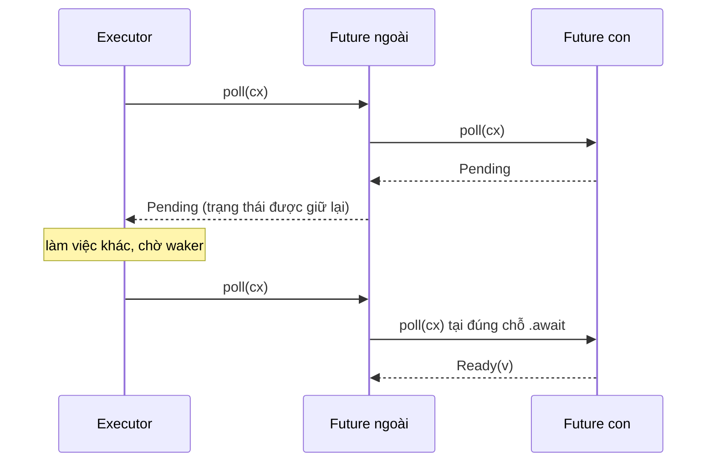

# P7 · Chương 06 — async/await, state machine và Pin

## Bạn sẽ hiểu được gì

(Mục 0 chỉ là tiện ích dùng chung cho ví dụ; các câu hỏi nằm ở mục 1–8.)

1. **Q1.** Gọi một `async fn` thì chính xác điều gì xảy ra? → mục 1
2. **Q2.** `.await` làm gì khi future con trả `Pending`? → mục 2
3. **Q3.** Compiler biến hàm async thành *state machine*: phần nào là bảo đảm, phần nào chỉ là mô hình giải thích; và cái gì quyết định kích thước một future? → mục 3
4. **Q4.** Vì sao tham chiếu giữa hai biến trong cùng một future làm *move* trở nên nguy hiểm? → mục 4
5. **Q5.** `Pin` bảo đảm gì, `Unpin` là gì, vì sao async block là `!Unpin`, `pin!` khác `Box::pin` ở đâu? → mục 5
6. **Q6.** Async closure đã stable chưa? → mục 6
7. **Q7.** `async fn` trong trait: đã stable chưa, vấn đề `Send` là gì? → mục 7
8. **Q8.** Hủy một future bằng `drop` có hệ quả gì với code nằm sau `.await`? → mục 8

## Kiến thức cần trước

- [05-future-poll-waker.md](05-future-poll-waker.md): `Future::poll`, `Poll`, `Context`, `Waker`.
- [04-kien-truc-event-loop.md](04-kien-truc-event-loop.md): vì sao một thread phải chia sẻ cho nhiều việc.
- Executor thật ở [07-executor-va-mio.md](07-executor-va-mio.md), Tokio ở [08-tokio.md](08-tokio.md); chương này chỉ dùng một executor tí hon.

## 0. Tiện ích dùng chung cho các ví dụ

Mọi ví dụ trong chương đều được biên dịch và chạy bằng `rustc 1.95.0` (macOS, aarch64, edition 2024), không cần Tokio. Chúng dùng chung hai tiện ích dưới đây, đặt cùng file: `yield_now()` giả lập một việc phải chờ (trả `Pending` đúng một lần), và `block_on` là executor tí hon cứ poll liên tục cho tới khi xong. `block_on` dùng `Waker::noop()`, một waker không làm gì khi được dùng,[^waker-noop] vì executor này không ngủ nên không cần ai đánh thức.

```rust
use std::future::Future;
use std::pin::{pin, Pin};
use std::task::{Context, Poll, Waker};

pub struct YieldNow(pub bool);   // Pending đúng một lần rồi Ready
impl Future for YieldNow {
    type Output = ();
    fn poll(mut self: Pin<&mut Self>, cx: &mut Context<'_>) -> Poll<()> {
        if self.0 { Poll::Ready(()) } else { self.0 = true; cx.waker().wake_by_ref(); Poll::Pending }
    }
}
pub fn yield_now() -> YieldNow { YieldNow(false) }

pub fn block_on<F: Future>(f: F) -> F::Output {   // busy-poll, không ngủ
    let mut f = pin!(f);
    let mut cx = Context::from_waker(Waker::noop());
    loop { if let Poll::Ready(v) = f.as_mut().poll(&mut cx) { return v; } }
}
```

## 1. `async fn` và async block: một future ẩn danh (Q1)

> **Trả lời ngắn.** Gọi `async fn` chưa làm việc gì: nó chỉ gói các đối số vào một future, và thân hàm chỉ chạy khi có ai poll future đó.[^ref-async-fn] Future này là một kiểu dữ liệu vô danh, duy nhất, implement `Future`.[^book-anon]

**Giải thích.**

*Với service của bạn.* Giả sử service đặt hàng có một handler `handle_order(req)`: đọc request vào một buffer, hỏi database một lần, rồi dựng response. Ta viết nó bằng `async fn`, và trong các ví dụ của chương, "hỏi database" được thay bằng `yield_now().await`, một chỗ phải chờ (nhận xét của người soạn: đây là ví dụ giả định, không phải code trong repo). Ta sẽ bám theo `handle_order` đến hết chương. Câu hỏi của mục này: dòng `let fut = handle_order(req);` làm gì?

Câu trả lời là chưa gì cả. Chưa có query nào xuống database, chưa byte nào của request bị đọc; `fut` chỉ là một giá trị nằm đó. Thân hàm chỉ chạy khi một bên poll `fut`: executor nếu bạn `spawn` nó, hoặc future bao ngoài nếu bạn `.await` nó. Ai quen với hàm thường ("gọi là chạy") rất hay hiểu nhầm điểm này.

Vì sao thiết kế như vậy? Ta muốn viết code tuần tự (`a().await; b().await`) mà thread không phải đứng chờ giữa chừng. Muốn thế cần một giá trị biểu diễn "phép tính chưa xong, chạy được từng nhịp", và future chính là giá trị đó.

Về cơ chế, một `async fn` gần tương đương một hàm thường trả về `impl Future`, với thân hàm là một `async move` block.[^ref-fn-desugar] Block này capture mọi tham số, kể cả tham số không dùng hoặc gán cho `_`, để thứ tự drop tham số giống hệt hàm thường, chỉ khác là việc drop xảy ra khi future đã được await xong.[^ref-fn-param] Vì vậy, `req` truyền vào `handle_order` nằm trong future từ lúc gọi, dù bạn chưa poll nó lần nào.

<details><summary>Đi sâu: khử đường của <code>async fn</code>, async block và tên kiểu của future</summary>

Async block là một biến thể của block expression, và nó đánh giá ra một future.[^ref-async-block] Chạy một async block giống chạy một closure: tác dụng tức thì là tạo ra và trả về một kiểu vô danh.[^ref-async-block-anon] Rust biên dịch nó thành kiểu dữ liệu vô danh, duy nhất, implement `Future`.[^book-anon] Riêng `async move { .. }` thì chuyển mọi biến mà nó tham chiếu vào trong future.[^ref-async-move]

Hệ quả thực tế: ta không viết ra được tên kiểu của future. Chữ ký hàm vì thế dùng `impl Future<Output = T>`, và khi lỗi, rustc gọi nó bằng cụm `{async block@file:dòng:cột}` (xem quan sát ở mục 5.3).

</details>

**Quay lại Q1:** gọi `async fn` chỉ tạo một future vô danh; `handle_order(req)` chưa chạm vào request hay database cho đến khi bên poll (executor hoặc `.await` bao ngoài) poll nó.

## 2. `.await`: poll future con, `Pending` lan lên trên (Q2)

> **Trả lời ngắn.** `.await` poll future con ngay tại chỗ nó đứng. Nếu `poll` trả `Pending` thì future bao ngoài cũng trả `Pending`, và giữ lại trạng thái để lần poll sau quay về đúng bước poll đó.[^ref-await] Nó không chặn thread: đó là điểm hàm có thể trả quyền điều khiển cho executor (nhận xét của người soạn).

**Giải thích.**

*Với `handle_order`.* Giữa hàm có dòng `let row = db.get(id).await;`. Database chưa trả lời thì future của `db.get` trả `Pending`. Lúc đó `handle_order` không đứng chờ trên thread: nó cũng trả `Pending` cho executor, và thread rảnh để poll request khác. Khi database trả lời, waker báo cho executor, executor poll lại `handle_order`, và hàm chạy tiếp từ ngay dòng `.await` ấy. Phần còn lại của mục này làm rõ chuyện đó diễn ra thế nào.

Về mặt ngữ nghĩa, await expression là cấu trúc để tạm dừng một phép tính cho đến khi future được await sẵn sàng cho ra giá trị.[^ref-await-intro] Sơ đồ dưới cho thấy hai lần executor poll future ngoài; lần đầu gặp `Pending` ở future con (người soạn vẽ lại từ các bước mà Reference mô tả, xem phần Đi sâu):



Điểm cần nhớ: `.await` **không** chặn thread. Nó chỉ là chỗ hàm có thể trả quyền điều khiển cho executor rồi được chạy tiếp từ đúng chỗ đó. Muốn chạy tiếp được thì trạng thái giữa hai lần poll phải được cất ở đâu đó, và đó là chuyện của mục 3.

<details><summary>Đi sâu: điều kiện hợp lệ của <code>.await</code> và các bước Reference mô tả</summary>

Await chỉ hợp lệ trong một async context: async fn, async closure hoặc async block.[^ref-await-legal] Reference mô tả các bước: tạo future bằng `IntoFuture::into_future`, ghim nó bằng `Pin::new_unchecked`, rồi poll với task context hiện tại.[^ref-await-steps] Vì ghim ngầm như vậy, khi bạn await trực tiếp một future thì không cần gọi `pin!` ở mọi nơi.[^book-await-pins]

</details>

**Quay lại Q2:** `.await` poll future con; `Pending` lan lên, trạng thái được giữ và `handle_order` chạy tiếp đúng chỗ, không chặn thread.

## 3. State machine: biến sống qua `.await` nằm trong future (Q3)

> **Trả lời ngắn.** Compiler theo dõi trạng thái giữa các điểm await để runtime làm việc khác rồi quay lại: một "state machine vô hình", như thể bạn đã viết một `enum` lưu trạng thái ở mỗi điểm await.[^book-state] Nhưng Reference chỉ nói "roughly equivalent" và ghi rõ định dạng dữ liệu thực tế là unspecified,[^ref-layout-unspec] nên layout và kích thước không được bảo đảm. Kích thước future phụ thuộc vào các biến phải sống qua `.await` (đây là quan sát từ phép đo ở phần Đi sâu, không phải bảo đảm).

**Giải thích.**

*Với `handle_order`.* Giả sử handler đọc request vào một `buf` lớn, `.await` database, rồi vẫn dùng `buf` để dựng response. Trong lúc handler chờ database, `buf` phải nằm ở đâu đó. Thread thường tạm dừng bằng cách để nguyên cả stack; future thì không có stack riêng, nên `buf` phải nằm ngay trong future. Mục này nói compiler làm việc đó thế nào và hệ quả với kích thước.

### 3.1 Nguồn chính thức nói gì

Rust Book mô tả: Rust phải theo dõi trạng thái để runtime làm việc khác rồi quay lại, và kết quả là một "invisible state machine", như thể ta viết một `enum` lưu trạng thái ở mỗi điểm await.[^book-state] Cụ thể, Rust xét dữ liệu cần giữ giữa một điểm await và điểm kế tiếp, rồi tạo variant tương ứng, mỗi variant có quyền truy cập dữ liệu nó cần, bằng ownership hoặc bằng mượn tham chiếu.[^book-variants] Reference có một Note rõ hơn: kiểu future do rustc sinh ra "roughly equivalent to an enum with one variant per await point".[^ref-layout-enum] Ngay sau đó, Reference ghi định dạng dữ liệu thực tế là *unspecified*.[^ref-layout-unspec]

Bảng dưới phân loại từng khẳng định theo mức chắc chắn:

| Khẳng định | Mức |
|---|---|
| Async block/fn cho một kiểu vô danh implement `Future` | Reference + Book |
| Trạng thái qua các điểm await được giữ trong future | Reference (`await-expr`) + Book |
| "Gần như `enum` mỗi điểm await một variant" | Mô hình, Reference tự ghi "roughly" |
| Layout, kích thước, tên variant | **Không bảo đảm** |

Hãy lấy `async fn f(n: usize) -> usize { let buf = vec![0u8; n]; yield_now().await; buf.len() }` làm ví dụ thu nhỏ của `handle_order`. Ta hình dung nó (mô hình giải thích, không phải code thật của rustc) là `enum F { Start{n}, Suspended1{buf, inner: YieldNow}, Done }`, còn `poll` là một `match`. Ở `Suspended1`, nếu future con trả `Pending` thì `poll` trả `Pending` và *giữ nguyên* `buf` trong variant. Docs của `pin!` xác nhận chỗ lưu này: trong async fn hoặc block, mọi local vắt qua một điểm `.await` là một phần trạng thái mà future bắt giữ, và dùng chỗ lưu của future.[^std-pin-macro] Tóm lại: thread tạm dừng thì kernel giữ cả stack, còn future chỉ giữ những gì còn cần khi quay lại (nhận xét của người soạn).

<details><summary>Đi sâu: đo kích thước future (quan sát, không phải bảo đảm)</summary>

### 3.2 Đo kích thước: quan sát, không phải bảo đảm

```rust
use std::mem::size_of_val;
async fn nothing() {}
async fn one_await() { yield_now().await; }
async fn big_across() { let buf = [0u8; 1024]; yield_now().await; std::hint::black_box(&buf); }
async fn big_not_across() { { let buf = [0u8; 1024]; std::hint::black_box(&buf); } yield_now().await; }
async fn nested2() { big_across().await; big_across().await; }
async fn with_arg(a: [u8; 256]) { yield_now().await; std::hint::black_box(&a); }
async fn with_arg_unused(_a: [u8; 256]) { yield_now().await; }
fn main() {
    println!("nothing {}", size_of_val(&nothing()));
    println!("one_await {}", size_of_val(&one_await()));
    println!("big_across {}", size_of_val(&big_across()));
    println!("big_not_across {}", size_of_val(&big_not_across()));
    println!("nested2 {}", size_of_val(&nested2()));
    println!("with_arg {}", size_of_val(&with_arg([0; 256])));
    println!("with_arg_unused {}", size_of_val(&with_arg_unused([0; 256])));
}
```

Output thật (rustc 1.95.0, aarch64-apple-darwin; bản debug và `-O` giống nhau):

```text
nothing 1
one_await 2
big_across 1026
big_not_across 2
nested2 1027
with_arg 514
with_arg_unused 258
```

Mọi điểm dưới đây là quan sát trên một phiên bản compiler; Reference nói layout là unspecified.[^ref-layout-unspec]

- `big_across` là 1026 byte còn `big_not_across` chỉ 2: mảng đã chết trước `.await` thì không làm phình future. Điều này khớp với docs của `pin!`: chỉ local *vắt qua* `.await` mới là phần trạng thái của future.[^std-pin-macro]
- `nested2` (await `big_across()` hai lần) vẫn chỉ 1027 byte, không phải khoảng 2053. Hai future con không sống cùng lúc nên có thể dùng chung chỗ; từ đó kích thước phụ thuộc vào *tập biến sống đồng thời tại mỗi điểm await* (cả hai điều này là suy luận của người soạn từ số đo).
- `with_arg_unused` là 258 dù `_a` không được dùng, khớp với điều Reference nói về việc capture mọi tham số.[^ref-fn-param] Còn `with_arg` là 514, gần gấp đôi: người soạn không có nguồn giải thích, nên coi đây là hiện tượng quan sát.

**Hệ quả (nhận xét của người soạn).** Một service có hàng chục nghìn request đang chờ database sẽ có hàng chục nghìn future `handle_order` cùng sống. Nếu mỗi future ôm một buffer lớn vắt qua `.await`, bộ nhớ nhân lên theo số request, y như mỗi connection giữ một receive buffer. Cách xử lý: thu hẹp scope của buffer để nó chết trước điểm await, hoặc đặt nó vào `Box` hay một pool; và đo lại bằng `size_of_val` thay vì tin con số của chương này.

</details>

**Quay lại Q3:** state machine là mô hình giải thích (layout unspecified); kích thước future theo tập biến sống đồng thời tại mỗi điểm await, nên `buf` của `handle_order` chỉ nằm trong future nếu nó còn sống qua `.await`.

## 4. Self-referential: vì sao move future nguy hiểm (Q4)

> **Trả lời ngắn.** Khi một biến và một tham chiếu tới nó cùng sống qua một `.await`, cả hai là trường của cùng một future, nên future chứa tham chiếu tới chính mình.[^book-selfref] Mà move future là move cả state machine.[^book-move-future] Sau khi move, con trỏ vẫn trỏ về địa chỉ cũ chứ không phải vị trí mới của `self`.[^std-pin-sr2]

**Giải thích.**

*Với `handle_order`.* Trong handler, bạn đọc request vào `buf` rồi cắt lấy dòng đầu: `let line = &buf[..n];`. Nếu cả `buf` lẫn `line` còn dùng sau `.await` database, thì cả hai sống qua điểm await, tức là cả hai là trường của future `handle_order`, và `line` trỏ vào chính future đó. Chuyện này vô hại cho tới khi có ai move future, và bạn move future rất dễ, chẳng hạn chỉ cần truyền nó vào một hàm như `spawn` (nhận xét của người soạn). Mục này giải thích vì sao đó là rắc rối.

**Vấn đề.** Ví dụ nhỏ hơn: `x` và tham chiếu `r = &x` cùng sống qua một `.await`:

```rust
let f = async { let x = [1u64; 4]; let r = &x; yield_now().await; r[0] + x[1] };
println!("size = {}", std::mem::size_of_val(&f));   // size = 48 (quan sát)
println!("{}", block_on(f));                          // 2
```

Chương trình biên dịch và in `size = 48`, rồi `2` (quan sát). 48 byte đủ chứa `x` (32 byte) và `r` (8 byte), nên `r` là con trỏ *vào bên trong chính future* (suy luận của người soạn từ số đo). Rust Book nói thẳng ý này: future mà Rust tạo cho async block có thể chứa tham chiếu đến chính nó trong các trường của một variant.[^book-selfref] Ví dụ điển hình của kiểu tự trỏ cũng chính là state machine mà compiler sinh ra cho `async fn`.[^std-pin-sr]

**Vì sao move gây hại.** Move là sao chép bit sang địa chỉ mới, và không có đoạn code nào báo cho giá trị biết nó vừa bị chuyển. Sau khi move, con trỏ bên trong vẫn trỏ về địa chỉ cũ, không phải vị trí mới của `self`.[^std-pin-sr2] Struct tự trỏ viết tay dưới đây cho thấy cơ chế (chỉ so sánh địa chỉ, không dereference):

```rust
struct SelfRef { value: u64, ptr: *const u64 }
impl SelfRef {
    fn init(&mut self) { self.ptr = &self.value; }
    fn points_to_own_field(&self) -> bool { std::ptr::eq(self.ptr, &self.value) }
}
fn main() {
    let mut a = SelfRef { value: 7, ptr: std::ptr::null() };
    a.init();
    println!("truoc move: {}", a.points_to_own_field());   // true
    let b = a;                                              // move
    println!("sau move:   {}", b.points_to_own_field());   // false
}
```

Output thật: `truoc move: true`, `sau move:   false`.

<details><summary>Đi sâu: hai hướng giải quyết và vì sao <code>Pin</code> là phương án còn lại</summary>

Docs của `std::pin` nêu hai hướng: (1) để giá trị tự phát hiện việc bị move và cập nhật con trỏ của nó, hoặc (2) bảo đảm địa chỉ không đổi. Rust có thể move giá trị mà không báo cho nó, nên hướng (1) bị loại.[^pin-first-ruled] Book bổ sung góc nhìn chi phí: nếu compiler cố cập nhật mọi tham chiếu mỗi lần move thì có thể tốn nhiều hiệu năng, nhất là khi cả một mạng tham chiếu cần sửa.[^book-overhead] Còn trong hướng (2), có một phương án là để mỗi kiểu tự giữ dữ liệu trong `Box`. Phương án này bị loại vì khi ghép các future lồng nhau, mỗi tầng ghép sẽ phải thêm indirection và allocation, điều mà docs gọi là không chấp nhận được.[^pin-indirection] `Pin` là phương án còn lại: một hợp đồng chung cho mọi kiểu.

</details>

**Quay lại Q4:** future có thể chứa tham chiếu vào chính nó, và move để lại con trỏ ở địa chỉ cũ; vì vậy một `handle_order` đã poll không được phép bị move nữa.

## 5. `Pin`: không move cho tới khi drop (Q5)

> **Trả lời ngắn.** `Pin<Ptr>` bọc một con trỏ và ghim giá trị mà con trỏ trỏ tới (pointee) tại chỗ: giá trị đó không bị move hay làm mất hiệu lực tại vị trí ấy, trừ khi nó là `Unpin`.[^std-pin-struct] `Unpin` là auto trait của các kiểu không nhạy địa chỉ, nên phần lớn kiểu không bị ảnh hưởng.[^pin-unpin-vast] Future của async block là `!Unpin` (quan sát bằng lỗi E0277 trên rustc 1.95.0; nguyên nhân nằm trong source rustc, là chi tiết cài đặt).[^rustc-static-unpin] `pin!` khác `Box::pin` ở chỗ nó không tạo heap allocation mới.[^std-pin-macro-heap]

**Giải thích.**

*Với `handle_order`.* Để poll `handle_order` bằng tay, như `block_on` ở mục 0 hay executor của bạn, bạn phải đưa cho `poll` một `Pin<&mut Future>`. Lời hứa kèm theo: future không bị move nữa cho tới lúc drop, nên con trỏ nội bộ như `line` ở mục 4 vẫn đúng. Mục này nói lời hứa ấy chính xác là gì, ai giữ nó, và hai cách ghim future trong thực tế.

### 5.1 Pin là gì

`Pin<Ptr>` là lớp bọc quanh một *con trỏ* (`&mut`, `Box`, ...); chính con trỏ đó làm nhiệm vụ ghim giá trị mà nó trỏ tới.[^std-pin-struct] Cái bị ghim là *giá trị được trỏ tới*, còn bản thân `Ptr` thì không bị ghim.[^pin-pointee] Vì vậy Book nói `Box` vẫn di chuyển tự do, miễn là dữ liệu nó trỏ tới đứng yên.[^book-box-moves]

Trong safe code, nếu pointee là `!Unpin` thì `Pin<&mut T>` không cho ta lấy ra `&mut T`, vì có `&mut T` là có thể dùng `mem::replace` để move giá trị ra ngoài.[^pin-getmut] Nếu pointee là `Unpin` thì `Pin<&mut T>` không thêm hạn chế nào so với `&mut T`.[^pin-unpin-vast] Có hai điểm cần hiểu cho đúng:

- *Không có phép màu compiler.* Tạo một `Pin<Ptr>` không làm compiler đối xử với giá trị khác đi. Đó là hợp đồng giữa phần unsafe của API và người dùng, và dùng `unsafe` sai vẫn có thể move một giá trị đã ghim.[^pin-nomagic]
- *Hợp đồng kéo dài đến drop.* Từ lúc ghim, giá trị phải còn hợp lệ ở cùng địa chỉ cho đến khi drop handler của nó được gọi.[^pin-drop-inv]

### 5.2 `Unpin`: trường hợp bình thường

Phần lớn kiểu không có trạng thái nhạy địa chỉ. Chúng implement auto trait `Unpin`, và trait này làm mất tác dụng hạn chế của `Pin`: khi `T: Unpin`, `Pin<Box<T>>` chạy như `Box<T>` thường.[^pin-unpin-vast] `Unpin` được tự implement cho gần như mọi kiểu,[^std-unpin-auto] gồm mọi kiểu nguyên thủy, `&T` và `&mut T`, `Box<T>`, `String`.[^pin-unpin-builtin] Book gói lại: `Unpin` là trường hợp "bình thường", còn `!Unpin` là trường hợp đặc biệt.[^book-unpin-normal] Một kiểu implement `Unpin` nghĩa là nó "pinning-agnostic": không phơi ra và không dựa vào bảo đảm pinning nào.[^std-unpin]

Có một chỗ hay hiểu sai: chỉ tính `Unpin` của *pointee* mới quyết định hành vi của `Pin<Ptr>`; việc bản thân `Ptr` (như `Box`) có `Unpin` hay không không ảnh hưởng.[^pin-unpin-pointee] Ngược lại, kiểu nào cần pinning để đúng đắn thì phải tự chặn `Unpin` tự động, bằng cách thêm một trường `PhantomPinned`.[^pin-phantom] Hai hàm tạo `Pin` phản ánh điều đó. `Pin::new` chỉ nhận pointee `Unpin`.[^std-pin-new] Còn `Pin::new_unchecked` là hàm `unsafe` nhận cả pointee có thể `!Unpin`, và người gọi tự cam kết không move giá trị.[^std-pin-new-unchecked]

### 5.3 Async block là `!Unpin`: lỗi E0277 thật

Quan sát bằng rustc 1.95.0 (người soạn chạy trước đó): future của async block là `!Unpin` kể cả khi nó không tự trỏ. Mã thử:

```rust
use std::pin::Pin;
fn main() {
    let mut fut = async { yield_now().await; };
    let _p = Pin::new(&mut fut);
}
```

```text
error[E0277]: `{async block@e0277.rs:4:15: 4:20}` cannot be unpinned
   5 |     let _p = Pin::new(&mut fut);
     |              -------- ^^^^^^^^ the trait `Unpin` is not implemented for `{async block@e0277.rs:4:15: 4:20}`
     = note: consider using the `pin!` macro
             consider using `Box::pin` if you need to access the pinned value outside of the current scope
note: required by a bound in `Pin::<Ptr>::new`
```

Quan sát thêm, cũng bằng rustc 1.95.0: một phép thử bound `fn assert_unpin<T: Unpin>()` cho `u32`, `String`, `Vec<u8>` qua; `PhantomPinned` và một async block bị E0277. Tương tự, `pin!(async {..}).as_mut().get_mut()` bị E0277 ở bound `T: Unpin` của `Pin::<&mut T>::get_mut`.

**Vì sao rustc làm vậy?** Rust Book 17.5 giải thích ở mức động cơ: các future đó có thể có tham chiếu nội bộ nên không tự động `Unpin`.[^book-async-notunpin] Nhưng các trang Reference về async block, hàm async, closure và auto trait, cùng docs `std::marker::Unpin` mà người soạn đã đọc, không có câu nào nêu thẳng rằng async block là `!Unpin`. `std::pin` chỉ nói state machine sinh cho `async fn` là ví dụ của kiểu tự trỏ (mục 4).[^std-pin-sr] Quy tắc thực tế chỉ thấy trong source rustc 1.95.0 (chi tiết cài đặt, có thể đổi), theo ba bước. Thứ nhất, `CoroutineKind::movability` trả `Movability::Static` cho async.[^rustc-async-static] Thứ hai, truy vấn `coroutine_movability` lấy đúng kết quả đó.[^rustc-movability] Thứ ba, coroutine immovable thì không bao giờ `Unpin`.[^rustc-static-unpin] Suy ra (suy luận của người soạn từ ba đoạn source): rustc đánh dấu *mọi* async block là `!Unpin` theo kiểu coroutine, không xét block cụ thể có tham chiếu chéo qua `.await` hay không. Điều này khớp quan sát ở trên: `async { yield_now().await; }`, không hề tự trỏ, vẫn bị E0277.

### 5.4 Ghim để poll: `pin!` và `Box::pin`

Vậy muốn poll một future `!Unpin`, ta ghim nó bằng một trong hai cách:

| | `pin!(fut)` | `Box::pin(fut)` |
|---|---|---|
| Kiểu | `Pin<&mut F>` | `Pin<Box<F>>` |
| Heap | Không cấp phát mới (chỗ lưu của local trong future vẫn có thể nằm trên heap) | Có |
| Sống | Trong scope của biến cục bộ | Tới khi Box drop; trả về/lưu được |
| Dùng khi | Poll tại chỗ | Trả ra khỏi hàm, `Vec`, `dyn Future`, đệ quy |

Hàng *Heap* lấy từ docs của `pin!`;[^std-pin-macro-heap] hai hàng *Sống* và *Dùng khi* là nhận xét của người soạn. Một lưu ý: nếu kiểu là `Unpin` thì `Pin<&mut T>` hành xử như `&mut T`, và `mem::replace` hay `mem::take` vẫn cho move giá trị.[^pin-macro-unpin] Ví dụ chạy thật dùng một `work()` thay cho `handle_order`:

```rust
async fn work() -> u32 { yield_now().await; 42 }
fn main() {
    let mut cx = Context::from_waker(Waker::noop());
    let mut f = pin!(work());
    let mut polls = 0;
    let r = loop { polls += 1; if let Poll::Ready(v) = f.as_mut().poll(&mut cx) { break v; } };
    println!("pin!: {r} sau {polls} lan poll");
    let mut b: Pin<Box<dyn Future<Output = u32>>> = Box::pin(work());
    let mut polls = 0;
    let r = loop { polls += 1; if let Poll::Ready(v) = b.as_mut().poll(&mut cx) { break v; } };
    println!("Box::pin: {r} sau {polls} lan poll");
    fn is_unpin<T: Unpin>(_: &T) {}
    is_unpin(&Box::pin(work()));          // biên dịch được
}
```

Output: `pin!: 42 sau 2 lan poll`, `Box::pin: 42 sau 2 lan poll`. Hai lần poll vì lần đầu gặp `Pending` của `yield_now`, lần hai chạy tiếp từ đúng điểm await. Dòng `is_unpin` biên dịch được (quan sát): `Pin<Box<async block>>` là `Unpin` dù pointee là `!Unpin`. Giải thích hợp lý (suy luận của người soạn): `Box<T>` là `Unpin`[^pin-unpin-builtin] và `Pin` chỉ là lớp bọc quanh con trỏ. Chiều ngược lại cũng có trong Book: `Box<T>` chỉ implement `Future` khi `T` là future `Unpin`, nên `join_all` trên `Vec<Box<dyn Future>>` không biên dịch nếu chưa ghim.[^book-join-all]

**Đệ quy cần Box.** `async fn` đệ quy trực tiếp bị rustc từ chối với `E0733: recursion in an async fn requires boxing` (quan sát, chạy trên 1.95.0, edition 2024; rustc còn ghi chú rằng lời gọi đệ quy phải đưa vào một tầng gián tiếp như `Box::pin` để tránh future kích thước vô hạn). Error index của rustc cũng nêu lỗi này: async function dùng đệ quy mà không boxing.[^rustc-e0733] Lời giải thích đi kèm: `Box<...>` làm kết quả có kích thước biết trước, còn `pin` giữ nó đứng yên.[^rustc-e0733-box] Bản dùng `Box::pin` chạy được (quan sát):

```rust
fn sum(n: u32) -> Pin<Box<dyn Future<Output = u32>>> {
    Box::pin(async move { if n == 0 { 0 } else { yield_now().await; n + sum(n - 1).await } })
}   // block_on(sum(4)) == 10
```

Chuyện này nối với mục 3 (suy luận của người soạn): future chứa future con *by value*, nên đệ quy tạo ra kiểu vô hạn nếu thiếu một tầng con trỏ.

<details><summary>Đi sâu: drop guarantee và projection</summary>

### 5.5 Drop guarantee

Pinning cho phép code khác *dựa vào* việc một giá trị còn ở một địa chỉ. Docs lấy ví dụ danh sách liên kết intrusive: `Drop` của mỗi phần tử phải báo cho phần tử kề gỡ mình ra, nên ta phải tin rằng `drop` *luôn* được gọi trước khi phần tử bị làm mất hiệu lực.[^pin-drop-crucial] Từ đó có quy tắc: bất cứ khi nào có thể ghi đè một giá trị đã ghim, `drop` của nó phải được gọi trước (trừ khi nó `Unpin`).[^std-pin-drop] Với bộ nhớ cấp phát thủ công, code unsafe phải gọi `ptr::drop_in_place` trước khi giải phóng hoặc dùng lại vùng nhớ đó.[^pin-drop-cases] `Pin::set` hợp lệ chính vì nó chạy `drop` trên pointee trước khi gán giá trị mới.[^pin-set]

Docs cũng mô tả vòng đời *thường gặp* của kiểu có trạng thái nhạy địa chỉ, và dùng future làm ví dụ ở từng bước:

1. Giá trị được tạo ra và move tự do (ví dụ gọi một async fn để nhận về state machine).[^pin-lc-create]
2. Một thao tác khiến giá trị phụ thuộc vào việc địa chỉ không đổi (ví dụ lần `poll` đầu tiên).[^pin-lifecycle]
3. Các phần safe khác của kiểu dùng thao tác unsafe nội bộ với giả định địa chỉ ổn định (ví dụ các lần poll sau).[^pin-lc-stable]
4. Trước khi giá trị bị làm mất hiệu lực, nó được drop để báo cho mọi thứ trỏ tới nó (ví dụ drop future).[^pin-lc-drop]

Drop là cách *hợp lệ* để kết thúc pinning, nên hủy một future bằng drop (mục 8) nhất quán với `Pin` (nhận xét của người soạn).

### 5.6 Projection

Khi tự viết một future bọc future con (như một combinator), `poll` nhận `self: Pin<&mut Self>`, và với từng field con ta phải quyết định lấy `&mut Field` hay `Pin<&mut Field>` (áp dụng của người soạn). Docs nói rằng chính tác giả của struct quyết định kiểu mà phép "projection" trả về,[^pin-proj-choice] và gọi việc phơi một field của giá trị đã ghim qua pinning pointer là *projecting* a pin.[^pin-projecting] Trong ví dụ của docs, field không được ghim cấu trúc thì phải dùng một lời gọi `unsafe`.[^pin-proj-unsafe] Crate `pin-project` tự mô tả là công cụ cho pin-projection an toàn và tiện dụng.[^pin-project-crate] Chương này chỉ nhắc khái niệm để bạn nhận ra khi đọc code combinator.

</details>

**Quay lại Q5:** `Pin` cấm move pointee cho tới khi drop (trừ `Unpin`); future của `handle_order` là `!Unpin` nên muốn poll tại chỗ thì `pin!`, muốn trả ra khỏi hàm hay lưu vào collection thì `Box::pin` (nhận xét của người soạn).

## 6. Async closure (Q6)

> **Trả lời ngắn.** Có: async closure được stabilize ở Rust 1.85.0,[^rel-185] nên ở 1.95.0 nó stable. Closure đánh dấu `async` là bất đồng bộ theo cách tương tự async function: gọi nó không làm việc gì mà chỉ cho ra một future ứng với thân closure.[^ref-async-closure]

**Giải thích.**

*Với `handle_order`.* Giả sử bạn muốn truyền "cách tra database" vào một hàm tiện ích dưới dạng closure, và mỗi lần hàm đó gọi closure sẽ có một lần tra, tức là một future. Câu hỏi là closure kiểu đó có viết trực tiếp được không.

Được, từ Rust 1.85. Mỗi lần gọi một async closure chỉ tạo future chứ chưa chạy thân của nó,[^ref-async-closure] đúng như `handle_order(req)` ở mục 1. Release notes xếp việc stabilize async closures vào Version 1.85.0 (2025-02-20) và trỏ tới RFC 3668,[^rel-185] nên ở 1.95.0 nó đã stable. Ví dụ chạy thật (cả edition 2021 và 2024) với bound `AsyncFn`:

```rust
async fn call_twice<F: AsyncFn(u32) -> u32>(f: F) -> u32 { f(1).await + f(2).await }
fn main() {
    let base = 10;
    let c = async |x: u32| { yield_now().await; x + base };
    println!("{}", block_on(call_twice(c)));   // 23
}
```

<details><summary>Đi sâu: <code>AsyncFn*</code> không dyn-compatible và lý do thiết kế</summary>

Reference ghi `AsyncFn`, `AsyncFnMut` và `AsyncFnOnce` *không* dyn-compatible.[^ref-asyncfn-dyn] Về lý do thiết kế, RFC 3668 (mà release notes trỏ tới) nêu hai điểm vướng khi dùng một closure trả async block với bound `Fn`. Một là không diễn đạt được chữ ký hàm async higher-ranked.[^rfc-hr] Hai là closure không trả được future mượn từ chính các giá trị nó capture.[^rfc-borrow]

</details>

**Quay lại Q6:** async closure stable từ 1.85.0 và gọi nó cho ra một future, như một `async fn` nhỏ gọn.

## 7. `async fn` trong trait và vấn đề `Send` (Q7)

> **Trả lời ngắn.** `async fn` trong trait được stabilize ở Rust 1.75.0.[^rel-175] Có hai giới hạn. Thứ nhất, method `async` làm trait không dyn-compatible.[^ref-trait-dyn] Thứ hai, trong code generic, future trả về không tự `Send` (quan sát bằng lỗi rustc ở dưới); người dùng trait không thêm được bound này về sau, nên tác giả trait phải chọn có bảo đảm `Send` hay không.[^blog-send]

**Giải thích.**

*Với `handle_order`.* Thực tế `handle_order` không gọi một database cụ thể mà gọi qua một trait, để test thì thay bằng bản giả: `trait Store { async fn get(&self, k: u32) -> u32; }`. Và bạn muốn viết `handle_order` generic theo `S: Store`, rồi `tokio::spawn` nó. Hai việc này vướng nhau ở chỗ `Send`.

Trước hết, `async fn` trong trait đã stable: release notes ghi ở Version 1.75.0 (2023-12-28) rằng async fn và return-position impl Trait trong trait đã được stabilize.[^rel-175] Với `trait Store { async fn get(&self, k: u32) -> u32; }` và `impl Store for Mem { async fn get(..) {..} }`, code biên dịch và chạy trên 1.95.0 (quan sát).

**Giới hạn 1: không dyn-compatible.** Một method muốn dyn-compatible thì không được là `async fn`, vì nó có kiểu `Future` ẩn.[^ref-trait-dyn] rustc xác nhận: `&dyn Store` cho lỗi `E0038`, "because method `get` is `async`" (quan sát). Nghĩa là bạn không giữ được `Box<dyn Store>` kiểu này.

**Giới hạn 2: `Send` của future trả về.** Trong code generic, compiler chỉ biết *chữ ký trait*: một `impl Future` ẩn, không biết nó có `Send` hay không (suy luận của người soạn, khớp với lỗi quan sát bên dưới). Ví dụ dưới mô phỏng `tokio::spawn` bằng một hàm đòi `Send`; output là của rustc 1.95.0:

```rust
trait Store { async fn get(&self, k: u32) -> u32; }
fn require_send<F: Future + Send>(_: F) {}
fn generic<S: Store + Send + Sync>(s: S) {
    require_send(async move { s.get(1).await });   // mô phỏng tokio::spawn
}
```

```text
error: future cannot be sent between threads safely
  = help: ... the trait `Send` is not implemented for `impl Future<Output = u32>`
help: `Send` can be made part of the associated future's guarantees for all implementations of `Store::get`
3 + trait Store { fn get(&self, k: u32) -> impl std::future::Future<Output = u32> + Send; }
```

Gợi ý của rustc là khử đường ngay trong *định nghĩa trait* (quan sát từ output trên). Bản sửa biên dịch và chạy được (quan sát), và mỗi impl vẫn viết `async fn` bình thường (`impl Store for Mem { async fn get(..) {..} }`, `block_on(Mem.get(21)) == 42`). Vì sao rustc không tự suy ra được? Vì đây là quyết định của *tác giả trait*, như thông báo trên Rust Blog giải thích: họ viết rằng tác giả phải chọn xem trait có dùng được với executor work-stealing đa luồng hay không.[^blog-send] Cũng bài đó nói `Send` là bound đáng quan tâm nhất trên future trả về.[^blog-send-interest] (Blog nhắc crate `trait-variant`; người soạn chưa chạy thử.)

<details><summary>Đi sâu: nối với <code>tokio::spawn</code> và vì sao chỉ biến sống qua <code>.await</code> mới tính</summary>

`tokio::spawn` đòi `F: Future + Send + 'static`.[^tokio-spawn-sig] Dù vậy, giá trị `!Send` vẫn dùng được trong task nếu nó chỉ tồn tại giữa các lần `.await`.[^tokio-spawn-send] Điều này khớp mục 3: chỉ biến sống *qua* `.await` mới là thành phần của future. Thử bằng rustc (quan sát): `async { let r = Rc::new(1); yield_now().await; println!("{r}"); }` không qua được `require_send` (note của rustc nói giá trị `Rc<i32>` không `Send` được dùng qua một `.await`); đặt `Rc` trong một block con chết trước `.await` thì biên dịch được. `Send` là các kiểu có thể chuyển qua ranh giới thread.[^std-send] Chi tiết `spawn` ở [08-tokio.md](08-tokio.md).

</details>

**Quay lại Q7:** `async fn` trong trait stable từ 1.75.0, nhưng không dyn-compatible, và future trả về không tự `Send` trong code generic nên `handle_order<S: Store>` không `spawn` được nếu trait `Store` không cam kết `Send`.

## 8. Hủy bằng drop: code sau `.await` không chạy (Q8)

> **Trả lời ngắn.** Hủy một future là thôi poll và drop nó: code sau `.await` không chạy, còn các biến đang sống trong state machine được drop (quan sát ở ví dụ bên dưới). Tokio nói cùng chiều: khi task bị shut down, nó dừng ở `.await` mà nó đã nhường, và mọi biến cục bộ bị hủy bằng cách chạy destructor.[^tokio-cancel-drop] Việc bắt buộc phải chạy nên đặt trong `Drop` của guard (nhận xét của người soạn).

**Giải thích.**

*Với `handle_order`.* Client đóng kết nối giữa chừng, hoặc request quá timeout, hoặc nhánh `select!` chứa handler thua một nhánh khác. Mỗi trường hợp đó, handler đang treo ở một `.await` nào đó và không ai poll nó nữa. Chuyện gì xảy ra với các dòng sau `.await`, ví dụ dòng trả connection về pool? Mục này trả lời.

Với future, "hủy" nghĩa là thôi poll và drop nó. Ví dụ dưới thay `handle_order` bằng `job()` có một `Guard` đóng vai connection lấy từ pool, và in ra khi drop:

```rust
struct Guard(&'static str);
impl Drop for Guard { fn drop(&mut self) { println!("  drop({})", self.0); } }
async fn job() {
    let _g = Guard("g1");
    println!("  job: truoc await");
    yield_now().await;
    println!("  job: sau await");
    let _g2 = Guard("g2");
}
fn main() {
    let mut cx = Context::from_waker(Waker::noop());
    println!("A) poll 1 lan roi drop:");
    { let mut f = pin!(job()); let r = f.as_mut().poll(&mut cx);
      println!("  poll -> {}", if r.is_pending() { "Pending" } else { "Ready" }); }
    println!("B) chua poll roi drop:");
    { let _f = job(); }
    println!("C) chay den het:");
    block_on(job());
}
```

Output thật:

```text
A) poll 1 lan roi drop:
  job: truoc await
  poll -> Pending
  drop(g1)
B) chua poll roi drop:
C) chay den het:
  job: truoc await
  job: sau await
  drop(g2)
  drop(g1)
```

- **A**: dòng `job: sau await` *không bao giờ in*, và `g2` không bao giờ được tạo. Nhưng `g1`, biến đã sống tại điểm dừng, **được drop** khi future bị drop. Tức là hủy = chạy destructor của các biến đang sống trong state machine rồi thôi (nhận xét của người soạn, rút từ output).
- **B**: future chưa poll thì thân hàm không chạy gì, khớp với Reference.[^ref-async-fn]
- **C**: chạy hết thì các biến drop theo thứ tự ngược với thứ tự tạo.

Bài toán hủy này xuất hiện nhiều nhất ở `select!`: nó chờ nhiều nhánh cùng lúc và *hủy các nhánh còn lại* khi một nhánh xong.[^tokio-select] Tokio định nghĩa cancellation safety là chuyện xảy ra khi một future bị drop trước khi hoàn thành.[^tokio-cs-def]

**Hệ quả với backend (nhận xét của người soạn, dựa trên các quan sát trên):**

- Mọi dòng sau một `.await` đều là *có điều kiện*. Việc phải chạy bất kể bị hủy (trả connection về pool, giải phóng khóa nghiệp vụ) phải đặt trong `Drop` của một guard như `g1`, không nằm sau `.await`.
- Hai bước có tác dụng phụ ngăn cách bởi một `.await` (ghi A, await, ghi B) có thể chỉ dừng ở A, nên không còn tính nguyên tử. Hãy thiết kế sao cho trạng thái dở dang vẫn nhất quán.

<details><summary>Đi sâu: cancellation safety của Tokio</summary>

- Tokio định nghĩa an toàn là "drop rồi tạo lại future" phải là no-op.[^tokio-cs-noop] `read` nằm trong danh sách an toàn,[^tokio-cs-safe] còn `read_exact`, `read_to_end`, `write_all` thì "can lead to loss of data".[^tokio-cs-list] Dữ liệu đã đọc dở nằm trong future bị hủy nên mất (suy luận của người soạn từ mô hình state machine).

</details>

**Quay lại Q8:** hủy = drop: client ngắt hay timeout thì các dòng sau `.await` của `handle_order` không chạy, và việc bắt buộc (như trả connection về pool) phải nằm trong `Drop`.

## Tóm tắt

- Gọi `async fn` hay async block chỉ tạo một future vô danh; thân hàm chạy khi có ai poll nó.[^ref-async-fn]
- `.await` poll future con; `Pending` lan lên và trạng thái được giữ để tiếp tục đúng chỗ.[^ref-await]
- "State machine, enum mỗi điểm await" là mô hình mà Reference chỉ ghi "roughly".[^ref-layout-enum] Layout thật là unspecified.[^ref-layout-unspec]
- Kích thước future theo các biến sống qua `.await` (đo được 1026 byte so với 2 byte); đó là quan sát, không phải bảo đảm.
- Tham chiếu giữa các biến cùng sống qua `.await` làm future tự trỏ,[^book-selfref] và move để lại con trỏ ở địa chỉ cũ.[^std-pin-sr2]
- `Pin<Ptr>` ghim pointee và cấm move trong safe code trừ khi pointee `Unpin`.[^std-pin-struct] Hợp đồng ghim kéo dài đến lúc drop.[^pin-drop-inv]
- Async block là `!Unpin` (quan sát bằng E0277; nguyên nhân là chi tiết cài đặt của rustc). Muốn poll thì ghim bằng `pin!`, không heap, hoặc `Box::pin`.[^std-pin-macro-heap]
- Async closure stable từ 1.85,[^rel-185] `async fn` trong trait stable từ 1.75.[^rel-175] Future trả về của trait không tự `Send` trong code generic (quan sát), nên tác giả trait phải chọn.[^blog-send]
- Hủy = drop future: code sau `.await` không chạy, biến đang sống được drop; việc bắt buộc phải đặt trong `Drop`.[^tokio-cancel-drop]

## Câu hỏi tự kiểm tra

1. Gọi `async fn` mà không poll thì thân hàm có chạy không?
   <details><summary>Đáp án</summary>

   Không: gọi chỉ capture đối số vào future, thân chạy khi bị poll.[^ref-async-fn] Ví dụ B mục 8 không in gì.

   </details>

2. Khi future con trả `Pending` trong `.await`, điều gì xảy ra với future ngoài?
   <details><summary>Đáp án</summary>

   Nó cũng trả `Pending` và giữ trạng thái; lần poll lại quay về đúng bước poll đó.[^ref-await]

   </details>

3. "Async fn là enum mỗi điểm await một variant" đúng đến đâu?
   <details><summary>Đáp án</summary>

   Đó là mô hình mà Reference tự ghi "roughly equivalent".[^ref-layout-enum] Định dạng dữ liệu thực tế là unspecified.[^ref-layout-unspec]

   </details>

4. Vì sao `big_not_across` 2 byte còn `big_across` 1026 byte? Vì sao `with_arg_unused` vẫn 258?
   <details><summary>Đáp án</summary>

   Mảng chỉ nằm trong future khi sống qua `.await` (quan sát; docs của `pin!` nói local vắt qua await là trạng thái future[^std-pin-macro]). Tham số unused vẫn bị capture theo Reference.[^ref-fn-param]

   </details>

5. Self-referential là gì, vì sao move làm hỏng?
   <details><summary>Đáp án</summary>

   Giá trị chứa con trỏ vào chính nó; move sao chép bit sang địa chỉ mới nên con trỏ vẫn trỏ địa chỉ cũ.[^std-pin-sr2] Struct tự trỏ ở mục 4 in `true` rồi `false`.

   </details>

6. `Pin` ghim con trỏ hay pointee? `Pin<Box<async block>>` có `Unpin` không?
   <details><summary>Đáp án</summary>

   Ghim pointee.[^pin-pointee] Có: `Box` là `Unpin`,[^pin-unpin-builtin] và chỉ `Unpin` của pointee mới quyết định hành vi của `Pin`.[^pin-unpin-pointee] Ví dụ `is_unpin` biên dịch.

   </details>

7. `pin!` khác `Box::pin` thế nào? Khi nào bắt buộc `Box::pin`?
   <details><summary>Đáp án</summary>

   `pin!` không cấp phát heap.[^std-pin-macro-heap] Cần `Box::pin` khi future phải sống lâu hơn scope tạo ra nó hoặc phải lưu vào collection/`dyn Future` (nhận xét của người soạn). Đệ quy async cũng cần: error index của rustc nêu `Box::pin` làm cách sửa E0733.[^rustc-e0733-box]

   </details>

8. Drop guarantee là gì?
   <details><summary>Đáp án</summary>

   Giá trị đã ghim còn hợp lệ ở cùng địa chỉ cho đến khi drop được gọi;[^pin-drop-inv] ghi đè thì `drop` phải chạy trước.[^std-pin-drop]

   </details>

9. Vì sao `async fn` trong trait có thể làm code generic không `spawn` được, và sửa thế nào?
   <details><summary>Đáp án</summary>

   Chữ ký trait không cam kết future `Send`. Sửa bằng `fn ... -> impl Future<Output = T> + Send` trong định nghĩa trait (rustc gợi ý đúng thế).[^blog-send]

   </details>

10. Future bị drop giữa hai điểm await thì code sau await có chạy không?
    <details><summary>Đáp án</summary>

    Không; biến đang sống được drop (A mục 8: `g1` drop, `g2` không tồn tại).[^tokio-cancel-drop]

    </details>

## Đọc thêm

- `std::pin` — <https://doc.rust-lang.org/1.95.0/std/pin/index.html>: nguồn gốc của "Address-sensitive", "Unpin", "Drop guarantee", "Projections"; đọc ví dụ `AddrTracker` và `Unmovable`.
- Rust Book 17.5 — <https://doc.rust-lang.org/1.95.0/book/ch17-05-traits-for-async.html>: hình minh họa self-referential, `Pin`/`Unpin`.
- Reference, Await expressions — <https://doc.rust-lang.org/1.95.0/reference/expressions/await-expr.html>: ngữ nghĩa từng bước của `.await`.
- Thông báo `async fn` in traits — <https://blog.rust-lang.org/2023/12/21/async-fn-rpit-in-traits/>: vấn đề `Send` và `trait-variant`.
- Tokio `select!` — <https://docs.rs/tokio/1.53.2/tokio/macro.select.html>: mục "Cancellation safety".
- Async book (đang viết lại, chỉ bổ trợ, không dùng làm nguồn khẳng định) — <https://rust-lang.github.io/async-book/>.
- Tiếp theo: [07-executor-va-mio.md](07-executor-va-mio.md): executor và reactor (mio) ghép với `Waker` thế nào để poll future đúng lúc.

[^waker-noop]: Rust std 1.95.0, struct Waker, method noop — <https://doc.rust-lang.org/1.95.0/std/task/struct.Waker.html> — "Returns a reference to a Waker that does nothing when used."
[^ref-async-fn]: Rust Reference 1.95.0, Async functions — <https://doc.rust-lang.org/1.95.0/reference/items/functions.html> — "Async functions do no work when called: instead, they capture their arguments into a future. When polled, that future will execute the function’s body."
[^ref-fn-desugar]: Rust Reference 1.95.0, Async functions — <https://doc.rust-lang.org/1.95.0/reference/items/functions.html> — "An async function is roughly equivalent to a function that returns impl Future and with an async move block as its body:"
[^ref-fn-param]: Rust Reference 1.95.0, Async functions — <https://doc.rust-lang.org/1.95.0/reference/items/functions.html> — "The async move block in the body captures all function parameters, including those that are unused or bound to a _ pattern."
[^ref-async-block]: Rust Reference 1.95.0, Async blocks — <https://doc.rust-lang.org/1.95.0/reference/expressions/block-expr.html> — "An async block is a variant of a block expression which evaluates to a future."
[^ref-async-block-anon]: Rust Reference 1.95.0, Async blocks — <https://doc.rust-lang.org/1.95.0/reference/expressions/block-expr.html> — "Executing an async block is similar to executing a closure expression: its immediate effect is to produce and return an anonymous type."
[^book-anon]: The Rust Book 1.95.0, ch17.1 Futures and the Async Syntax — <https://doc.rust-lang.org/1.95.0/book/ch17-01-futures-and-syntax.html> — "When Rust sees a block marked with the async keyword, it compiles it into a unique, anonymous data type that implements the Future trait."
[^ref-async-move]: Rust Reference 1.95.0, Async blocks — <https://doc.rust-lang.org/1.95.0/reference/expressions/block-expr.html> — "async move { .. } blocks however will move all referenced variables into the resulting future."
[^ref-await-intro]: Rust Reference 1.95.0, Await expressions — <https://doc.rust-lang.org/1.95.0/reference/expressions/await-expr.html> — "An await expression is a syntactic construct for suspending a computation provided by an implementation of std::future::IntoFuture until the given future is ready to produce a value."
[^ref-await-legal]: Rust Reference 1.95.0, Await expressions — <https://doc.rust-lang.org/1.95.0/reference/expressions/await-expr.html> — "Await expressions are legal only within an async context, like an async fn, async closure, or async block."
[^ref-await-steps]: Rust Reference 1.95.0, Await expressions — <https://doc.rust-lang.org/1.95.0/reference/expressions/await-expr.html> — "Pin tmp using Pin::new_unchecked; This pinned future is then polled by calling the Future::poll method and passing it the current task context;"
[^ref-await]: Rust Reference 1.95.0, Await expressions — <https://doc.rust-lang.org/1.95.0/reference/expressions/await-expr.html> — "If the call to poll returns Poll::Pending, then the future returns Poll::Pending, suspending its state so that, when the surrounding async context is re-polled, execution returns to step 3"
[^book-await-pins]: The Rust Book 1.95.0, ch17.5 A Closer Look at the Traits for Async — <https://doc.rust-lang.org/1.95.0/book/ch17-05-traits-for-async.html> — "Directly awaiting a future with await pins the future implicitly."
[^book-state]: The Rust Book 1.95.0, ch17.1 Futures and the Async Syntax — <https://doc.rust-lang.org/1.95.0/book/ch17-01-futures-and-syntax.html> — "This is an invisible state machine, as if you’d written an enum like this to save the current state at each await point"
[^book-variants]: The Rust Book 1.95.0, ch17.5 A Closer Look at the Traits for Async — <https://doc.rust-lang.org/1.95.0/book/ch17-05-traits-for-async.html> — "Each variant gets the access it needs to the data that will be used in that section of the source code, whether by taking ownership of that data or by getting a mutable or immutable reference to it."
[^ref-layout-enum]: Rust Reference 1.95.0, Async blocks — <https://doc.rust-lang.org/1.95.0/reference/expressions/block-expr.html> — "The future type that rustc generates is roughly equivalent to an enum with one variant per await point, where each variant stores the data needed to resume from its corresponding point."
[^ref-layout-unspec]: Rust Reference 1.95.0, Async blocks — <https://doc.rust-lang.org/1.95.0/reference/expressions/block-expr.html> — "The actual data format for this type is unspecified."
[^std-pin-macro]: Rust std 1.95.0, macro pin! — <https://doc.rust-lang.org/1.95.0/std/pin/macro.pin.html> — "In async functions or blocks however, any locals crossing an .await point are part of the state captured by the Future, and will use the storage of those."
[^book-selfref]: The Rust Book 1.95.0, ch17.5 A Closer Look at the Traits for Async — <https://doc.rust-lang.org/1.95.0/book/ch17-05-traits-for-async.html> — "the futures Rust creates for async blocks can end up with references to themselves in the fields of any given variant"
[^book-move-future]: The Rust Book 1.95.0, ch17.5 A Closer Look at the Traits for Async — <https://doc.rust-lang.org/1.95.0/book/ch17-05-traits-for-async.html> — "that actually means moving the state machine Rust creates for us."
[^std-pin-sr]: Rust std 1.95.0, module std::pin — <https://doc.rust-lang.org/1.95.0/std/pin/index.html> — "A key example of such self-referential types are the state machines generated by the compiler to implement Future for async fns."
[^std-pin-sr2]: Rust std 1.95.0, module std::pin — <https://doc.rust-lang.org/1.95.0/std/pin/index.html> — "But if that value is moved, the pointer will still point to the old address where the value was located and not into the new location of self, thus becoming invalid."
[^pin-first-ruled]: Rust std 1.95.0, module std::pin — <https://doc.rust-lang.org/1.95.0/std/pin/index.html> — "Since, as we discussed, Rust can move values without notifying them that they have moved, the first option is ruled out."
[^book-overhead]: The Rust Book 1.95.0, ch17.5 A Closer Look at the Traits for Async — <https://doc.rust-lang.org/1.95.0/book/ch17-05-traits-for-async.html> — "Theoretically, the Rust compiler could try to update every reference to an object whenever it gets moved, but that could add a lot of performance overhead, especially if a whole web of references needs updating."
[^pin-indirection]: Rust std 1.95.0, module std::pin — <https://doc.rust-lang.org/1.95.0/std/pin/index.html> — "It was deemed unacceptable to force indirection and allocation for each layer of composition in this case."
[^std-pin-struct]: Rust std 1.95.0, struct Pin — <https://doc.rust-lang.org/1.95.0/std/pin/struct.Pin.html> — "preventing the value referenced by that pointer from being moved or otherwise invalidated at that place in memory unless it implements Unpin."
[^pin-pointee]: Rust std 1.95.0, module std::pin — <https://doc.rust-lang.org/1.95.0/std/pin/index.html> — "A Pin\<Ptr> does not pin the Ptr; instead, it pins the pointer’s pointee value."
[^book-box-moves]: The Rust Book 1.95.0, ch17.5 A Closer Look at the Traits for Async — <https://doc.rust-lang.org/1.95.0/book/ch17-05-traits-for-async.html> — "In fact, the Box pointer can still move around freely."
[^pin-getmut]: Rust std 1.95.0, module std::pin — <https://doc.rust-lang.org/1.95.0/std/pin/index.html> — "a Pin<&mut T> makes it impossible to obtain the wrapped &mut T safely because through that &mut T it would be possible to move the underlying value out of the pointer with mem::replace, etc."
[^pin-nomagic]: Rust std 1.95.0, module std::pin — <https://doc.rust-lang.org/1.95.0/std/pin/index.html> — "Practically, this means that performing the mechanics of “pinning” a value by creating a Pin\<Ptr> to it does not actually change the way the compiler behaves towards the inner value!"
[^pin-drop-inv]: Rust std 1.95.0, module std::pin — <https://doc.rust-lang.org/1.95.0/std/pin/index.html> — "From the moment a value is pinned by constructing a Pinning pointer to it, that value must remain, valid, at that same address in memory, until its drop handler is called."
[^pin-unpin-vast]: Rust std 1.95.0, module std::pin — <https://doc.rust-lang.org/1.95.0/std/pin/index.html> — "The vast majority of Rust types have no address-sensitive states. These types implement the Unpin auto-trait, which cancels the restrictive effects of Pin when the pointee type T is Unpin."
[^std-unpin-auto]: Rust std 1.95.0, trait Unpin — <https://doc.rust-lang.org/1.95.0/std/marker/trait.Unpin.html> — "This trait is automatically implemented for almost every type."
[^pin-unpin-builtin]: Rust std 1.95.0, module std::pin — <https://doc.rust-lang.org/1.95.0/std/pin/index.html> — "Builtin types that are Unpin include all of the primitive types, like bool, i32, and f32, references (&T and &mut T), etc., as well as many core and standard library types like Box\<T>, String, and more."
[^book-unpin-normal]: The Rust Book 1.95.0, ch17.5 A Closer Look at the Traits for Async — <https://doc.rust-lang.org/1.95.0/book/ch17-05-traits-for-async.html> — "First, Unpin is the “normal” case, and !Unpin is the special case."
[^std-unpin]: Rust std 1.95.0, trait Unpin — <https://doc.rust-lang.org/1.95.0/std/marker/trait.Unpin.html> — "Implementing the Unpin trait for T expresses the fact that T is pinning-agnostic: it shall not expose nor rely on any pinning guarantees."
[^pin-unpin-pointee]: Rust std 1.95.0, module std::pin — <https://doc.rust-lang.org/1.95.0/std/pin/index.html> — "Whether the Ptr type itself implements Unpin does not affect the behavior of a Pin\<Ptr>."
[^pin-phantom]: Rust std 1.95.0, module std::pin — <https://doc.rust-lang.org/1.95.0/std/pin/index.html> — "It is the responsibility of the implementor of a type that relies upon pinning for soundness to ensure that type is not marked as Unpin by adding PhantomPinned field."
[^std-pin-new]: Rust std 1.95.0, struct Pin, method new — <https://doc.rust-lang.org/1.95.0/std/pin/struct.Pin.html> — "Constructs a new Pin\<Ptr> around a pointer to some data of a type that implements Unpin."
[^std-pin-new-unchecked]: Rust std 1.95.0, struct Pin, method new_unchecked — <https://doc.rust-lang.org/1.95.0/std/pin/struct.Pin.html> — "Constructs a new Pin\<Ptr> around a reference to some data of a type that may or may not implement Unpin."
[^std-pin-macro-heap]: Rust std 1.95.0, macro pin! — <https://doc.rust-lang.org/1.95.0/std/pin/macro.pin.html> — "Unlike Box::pin, this does not create a new heap allocation. As explained below, the element might still end up on the heap however."
[^pin-macro-unpin]: Rust std 1.95.0, macro pin! — <https://doc.rust-lang.org/1.95.0/std/pin/macro.pin.html> — "if the type does implement Unpin, Pin<&mut T> behaves like &mut T, and operations such as mem::replace() or mem::take() will allow moves of the value."
[^book-join-all]: The Rust Book 1.95.0, ch17.5 A Closer Look at the Traits for Async — <https://doc.rust-lang.org/1.95.0/book/ch17-05-traits-for-async.html> — "Box\<T> implements Future only if the T it wraps is a future that implements the Unpin trait."
[^pin-drop-crucial]: Rust std 1.95.0, module std::pin — <https://doc.rust-lang.org/1.95.0/std/pin/index.html> — "Crucially, this means we have to be able to rely on drop always being called before an element is invalidated."
[^std-pin-drop]: Rust std 1.95.0, module std::pin, mục Drop guarantee — <https://doc.rust-lang.org/1.95.0/std/pin/index.html> — "in any situation where we may want to overwrite a pinned value, that value’s drop must be called beforehand"
[^pin-drop-cases]: Rust std 1.95.0, module std::pin, mục Drop guarantee — <https://doc.rust-lang.org/1.95.0/std/pin/index.html> — "unsafe code must make sure to call ptr::drop_in_place before deallocating and re-using said storage."
[^pin-set]: Rust std 1.95.0, module std::pin — <https://doc.rust-lang.org/1.95.0/std/pin/index.html> — "This does not violate any guarantees, since it will run drop on the pointee value before assigning the new value."
[^pin-lifecycle]: Rust std 1.95.0, module std::pin — <https://doc.rust-lang.org/1.95.0/std/pin/index.html> — "An operation causes the value to depend on its own address not changing e.g. calling poll for the first time on the produced Future"
[^pin-lc-create]: Rust std 1.95.0, module std::pin — <https://doc.rust-lang.org/1.95.0/std/pin/index.html> — "A value is created which can be freely moved around. e.g. calling an async function which returns a state machine implementing Future"
[^pin-lc-stable]: Rust std 1.95.0, module std::pin — <https://doc.rust-lang.org/1.95.0/std/pin/index.html> — "Further pieces of the safe interface of the type use internal unsafe operations which assume that the address of the value is stable"
[^pin-lc-drop]: Rust std 1.95.0, module std::pin — <https://doc.rust-lang.org/1.95.0/std/pin/index.html> — "Before the value is invalidated (e.g. deallocated), it is dropped, giving it a chance to notify anything with pointers to itself that those pointers will be invalidated"
[^pin-proj-choice]: Rust std 1.95.0, module std::pin, mục Projections and Structural Pinning — <https://doc.rust-lang.org/1.95.0/std/pin/index.html> — "It turns out that it’s up to the author of Struct to decide which type the “projection” should produce."
[^pin-proj-unsafe]: Rust std 1.95.0, module std::pin, mục Projections and Structural Pinning — <https://doc.rust-lang.org/1.95.0/std/pin/index.html> — "unsafe { &mut self.get_unchecked_mut().field }"
[^book-async-notunpin]: The Rust Book 1.95.0, ch17.5 A Closer Look at the Traits for Async — <https://doc.rust-lang.org/1.95.0/book/ch17-05-traits-for-async.html> — "those futures may have internal references, so they don’t automatically implement Unpin."
[^rustc-movability]: Rust source 1.95.0, compiler/rustc_middle/src/ty/context.rs, TyCtxt::coroutine_movability — <https://raw.githubusercontent.com/rust-lang/rust/1.95.0/compiler/rustc_middle/src/ty/context.rs> — "self.coroutine_kind(def_id).expect("expected a coroutine").movability()"
[^rustc-e0733]: Rust 1.95.0 error index, E0733 — <https://doc.rust-lang.org/1.95.0/error_codes/E0733.html> — "An async function used recursion without boxing."
[^rustc-e0733-box]: Rust 1.95.0 error index, E0733 — <https://doc.rust-lang.org/1.95.0/error_codes/E0733.html> — "The Box<...> ensures that the result is of known size, and the pin is required to keep it in the same place in memory."
[^rfc-hr]: RFC 3668 async closures, mục Motivation — <https://rust-lang.github.io/rfcs/3668-async-closures.html> — "The inability to express higher-ranked async function signatures."
[^rfc-borrow]: RFC 3668 async closures, mục Motivation — <https://rust-lang.github.io/rfcs/3668-async-closures.html> — "That closures cannot return futures that borrow from the closure captures."
[^pin-projecting]: Rust std 1.95.0, module std::pin — <https://doc.rust-lang.org/1.95.0/std/pin/index.html> — "Exposing a field of a pinned value through a pinning pointer is called “projecting” a pin"
[^pin-project-crate]: pin-project 1.1.13, crate pin_project — <https://docs.rs/pin-project/1.1.13/pin_project/> — "A crate for safe and ergonomic pin-projection."
[^ref-async-closure]: Rust Reference 1.95.0, Closure expressions, mục Async closures — <https://doc.rust-lang.org/1.95.0/reference/expressions/closure-expr.html> — "Calling the async closure does not perform any work, but instead evaluates to a value that implements Future that corresponds to the computation of the body of the closure."
[^rel-185]: Rust 1.95.0 release notes, Version 1.85.0 (2025-02-20), Language — <https://doc.rust-lang.org/1.95.0/releases.html> — "Stabilize async closures See RFC 3668 for more details."
[^ref-asyncfn-dyn]: Rust Reference 1.95.0, Traits, dyn compatibility — <https://doc.rust-lang.org/1.95.0/reference/items/traits.html> — "The AsyncFn, AsyncFnMut, and AsyncFnOnce traits are not dyn-compatible."
[^rel-175]: Rust 1.95.0 release notes, Version 1.75.0 (2023-12-28), Language — <https://doc.rust-lang.org/1.95.0/releases.html> — "Stabilize async fn and return-position impl Trait in traits."
[^ref-trait-dyn]: Rust Reference 1.95.0, Traits, dyn compatibility — <https://doc.rust-lang.org/1.95.0/reference/items/traits.html> — "Not be an async fn (which has a hidden Future type)."
[^blog-send]: Rust Blog, Announcing async fn and return-position impl Trait in traits (2023-12-21), mục async fn in public traits — <https://blog.rust-lang.org/2023/12/21/async-fn-rpit-in-traits/> — "Do you want your trait to work with multithreaded, work-stealing executors?"
[^blog-send-interest]: Rust Blog, Announcing async fn and return-position impl Trait in traits (2023-12-21), mục async fn in public traits — <https://blog.rust-lang.org/2023/12/21/async-fn-rpit-in-traits/> — "Of particular interest to users of async are Send bounds on the returned future."
[^tokio-spawn-sig]: Tokio 1.53.2, fn task::spawn — <https://docs.rs/tokio/1.53.2/tokio/task/fn.spawn.html> — "F: Future + Send + 'static, F::Output: Send + 'static,"
[^tokio-spawn-send]: Tokio 1.53.2, fn task::spawn, mục Using !Send values from a task — <https://docs.rs/tokio/1.53.2/tokio/task/fn.spawn.html> — "The task supplied to spawn must implement Send. However, it is possible to use !Send values from the task as long as they only exist between calls to .await."
[^std-send]: Rust std 1.95.0, trait Send — <https://doc.rust-lang.org/1.95.0/std/marker/trait.Send.html> — "Types that can be transferred across thread boundaries."
[^tokio-cancel-drop]: Tokio 1.53.2, module tokio::task, mục Cancellation — <https://docs.rs/tokio/1.53.2/tokio/task/index.html> — "When tasks are shut down, it will stop running at whichever .await it has yielded at. All local variables are destroyed by running their destructor."
[^tokio-select]: Tokio 1.53.2, macro select! — <https://docs.rs/tokio/1.53.2/tokio/macro.select.html> — "Waits on multiple concurrent branches, returning when the first branch completes, cancelling the remaining branches."
[^tokio-cs-def]: Tokio 1.53.2, macro select!, mục Cancellation safety — <https://docs.rs/tokio/1.53.2/tokio/macro.select.html> — "Cancellation safety describes what happens when a future is dropped before it completes."
[^tokio-cs-noop]: Tokio 1.53.2, macro select!, mục Cancellation safety — <https://docs.rs/tokio/1.53.2/tokio/macro.select.html> — "If you have a future that has not yet completed, then it must be a no-op to drop that future and recreate it."
[^tokio-cs-list]: Tokio 1.53.2, macro select!, mục Cancellation safety — <https://docs.rs/tokio/1.53.2/tokio/macro.select.html> — "The following methods are not cancellation safe and can lead to loss of data:"
[^rustc-async-static]: Rust source 1.95.0, compiler/rustc_hir/src/hir.rs, CoroutineKind::movability — <https://raw.githubusercontent.com/rust-lang/rust/1.95.0/compiler/rustc_hir/src/hir.rs> — "CoroutineKind::Desugared(CoroutineDesugaring::Async, _) | CoroutineKind::Desugared(CoroutineDesugaring::AsyncGen, _) => Movability::Static,"
[^rustc-static-unpin]: Rust source 1.95.0, compiler/rustc_trait_selection/src/traits/select/candidate_assembly.rs — <https://raw.githubusercontent.com/rust-lang/rust/1.95.0/compiler/rustc_trait_selection/src/traits/select/candidate_assembly.rs> — "Immovable coroutines are never `Unpin`"
[^tokio-cs-safe]: Tokio 1.53.2, macro select!, mục Cancellation safety — <https://docs.rs/tokio/1.53.2/tokio/macro.select.html> — "The following methods are cancellation safe:"
