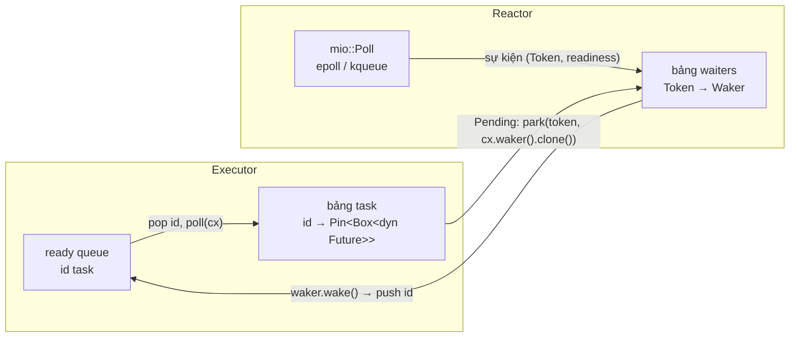
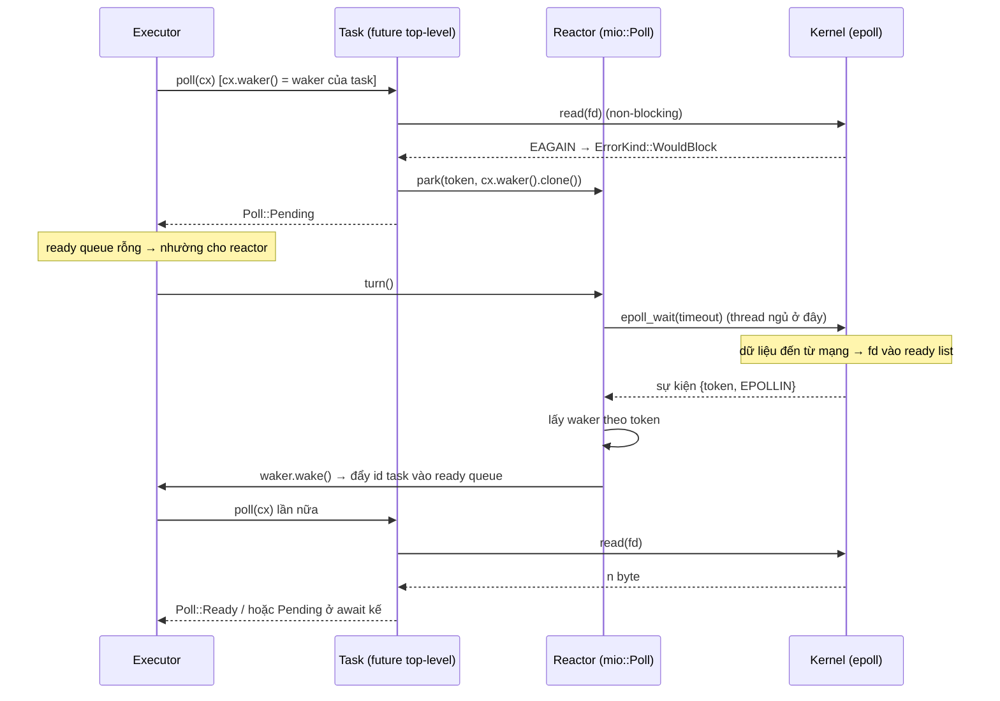

# P7 · Chương 07 — Executor, reactor và mio

## Bạn sẽ hiểu được gì

1. **Q1.** Executor và reactor khác nhau ở đâu; ai giữ ready queue, ai gọi `poll`, ai chờ OS, ai gọi `wake`? → mục 1
2. **Q2.** "Task" khác "future" thế nào, và waker của task thực chất làm gì? → mục 2
3. **Q3.** Một lần `read` async đi qua những bước nào: `poll` → `WouldBlock` → đăng ký → `epoll_wait` → `wake` → `poll` lại? → mục 3
4. **Q4.** `mio` có những kiểu nào, mỗi kiểu ứng với gì trong epoll/kqueue? → mục 4
5. **Q5.** Vì sao `mio::Waker` khác `std::task::Waker`, và khi nào cần cả hai? → mục 5
6. **Q6.** "Draining readiness" và "spurious event" bắt code viết thế nào; trên Linux mio edge-triggered ra sao (có `strace`)? → mục 6
7. **Q7.** Một executor single-thread tối giản trên mio trông thế nào? → mục 7
8. **Q8.** Timer nằm ở đâu trong runtime? → mục 8

## Kiến thức cần trước

- [Chương 01 — Các mô hình I/O](01-mo-hinh-io.md) (non-blocking, `EAGAIN`, readiness) và [Chương 02 — select/poll/epoll](02-select-poll-epoll.md) (interest list, ready list, level/edge-triggered).
- [Chương 04 — Kiến trúc event loop](04-kien-truc-event-loop.md): vòng lặp reactor "thuần OS". Chương này lắp vòng lặp đó với `Future`.
- [Chương 05 — Future, poll và Waker](05-future-poll-waker.md): hợp đồng của `poll`, `Context`, `Waker`, `Wake`. Chương này dùng lại chúng, không giải thích lại từ đầu. `Pin` ở [Chương 06](06-async-await-pin.md).

Ví dụ chạy xuyên chương là `echo-svc`, một TCP service viết bằng Rust, chạy trên đúng một thread, mỗi kết nối là một task. Mục 1 giới thiệu nó; mục 7 là code thật của nó.

## 1. Hai vai trò: executor và reactor (Q1)

> **Trả lời ngắn.** Một runtime async làm hai việc khác nhau. Executor giữ các task sẵn sàng chạy và gọi `Future::poll` lên từng task[^tokio-basic]. Reactor nói chuyện với hệ điều hành: nó chờ I/O sẵn sàng rồi báo cho những task đang đợi I/O đó[^tokio-services]. Rust không đi kèm runtime[^book-noruntime], nên hai phần này nằm trong crate ngoài như Tokio.

**Giải thích.**

*Với service của bạn.* Giả sử `echo-svc` nhận các kết nối TCP và gửi lại y nguyên những byte client gửi tới. Nó chạy trên đúng một thread, mỗi kết nối là một task (nhận xét của người soạn: ví dụ giả định, cùng thiết kế với demo ở mục 7). Phần lớn thời gian một kết nối chỉ ngồi chờ client gửi, nên thread không thể ngủ chờ riêng một socket nào, vì lúc đó các kết nối còn lại đứng hình. Cần có hai việc tách bạch: chọn task nào chạy tiếp, và biết socket nào vừa có dữ liệu. Hai việc đó là hai vai executor và reactor.

Chương 05 đã cho thấy một future trả `Pending` phải giữ một clone của `Waker` để lát nữa có ai gọi nó dậy[^std-future-clone]. Nhưng ai chạy future, và ai biết khi nào fd sẵn sàng, thì ngôn ngữ không quy định. Rust Book xếp việc chạy code async vào executor, một phần của runtime[^book-executor]. Từ đó ta có hai vai:

- **Executor** (hay scheduler) giữ các task và *ready queue*, hàng đợi những task đang sẵn sàng chạy (cách gọi của giáo trình này). Nó lấy một task ra rồi gọi `Future::poll`; Tokio mô tả ở mức cơ bản nhất cũng thế: runtime có một tập task cần lên lịch và cứ lặp lại việc lấy một task ra để `poll`[^tokio-basic]. Khi tập rỗng thì thread ngủ cho tới khi có task mới[^tokio-sleep].
- **Reactor** (hay driver) giữ bảng "nguồn sự kiện → waker đang chờ" (mô hình của người soạn, khớp demo mục 7). Nó đăng ký fd với OS, chờ bằng `epoll_wait`/`kevent`, và khi có sự kiện thì gọi `wake`. Tokio gọi nó là một I/O event loop, điều khiển các I/O resource và chuyển I/O event tới những task phụ thuộc vào chúng[^tokio-services]. Loop này chạy trên event queue của OS (epoll, kqueue, IOCP…)[^tokio-crate]. Trong source, khi nhận event của một I/O resource, driver đánh dấu readiness rồi gọi `io.wake(ready)`[^tokio-driver-wake].

Với `echo-svc`, một vòng như sau (nhận xét của người soạn). Executor `poll` task của kết nối 7; task `read` mà chưa có byte nào nên trả `Pending`. Executor chuyển sang task khác, và khi hết task sẵn sàng thì thread ngủ ở reactor. Client gửi byte, reactor biết nhờ OS và gọi `wake`, task 7 quay lại ready queue, executor `poll` nó lần nữa.

Tokio gói driver, scheduler và timer vào một kiểu `Runtime`[^tokio-bundle]. Sợi dây nối chúng là một phép kiểm tra định kỳ: runtime xem I/O resource và timer nào đã sẵn sàng rồi đánh thức task liên quan[^tokio-io-check].

<details><summary>Đi sâu: hai vai trên cùng một thread</summary>

Hai vai không nhất thiết là hai thread. Ở executor mục 7 và ở scheduler `current_thread` của Tokio, chúng luân phiên trên một thread: current-thread runtime kiểm tra IO/timer khi hết task sẵn sàng hoặc sau 61 task liên tiếp (hành vi "tại thời điểm viết")[^tokio-ct-check].

</details>

**Quay lại Q1:** executor lấy task ra và gọi `poll`, reactor chờ OS rồi gọi `wake`; hai việc khác nhau, nhưng có thể luân phiên trên cùng một thread như ở `echo-svc`.

## 2. Task, future và waker (Q2)

> **Trả lời ngắn.** Task là đơn vị thực thi nhẹ, không chặn, do runtime quản lý thay vì do OS[^tokio-task]. Về cấu tạo (nhận xét của người soạn), task là một future ở gốc cộng một danh tính để xếp hàng và một waker. Waker là tay cầm để báo executor rằng task đã sẵn sàng chạy lại[^std-waker-def].

**Giải thích.**

*Với `echo-svc`.* Mỗi kết nối của `echo-svc` là một `async fn handle` chứa vòng lặp `read().await` rồi `write_all().await`. Khi `poll`, future đó chạy tới `.await` đầu tiên chưa xong rồi trả `Pending`. Câu hỏi của mục này: executor phải nhớ gì để lần sau quay lại đúng kết nối ấy, và reactor phải báo cho ai khi socket có dữ liệu?

Bản thân future chỉ là thứ để `poll`. Để xếp hàng được, executor bọc nó thành task, và từ góc nhìn executor (nhận xét của người soạn) task gồm ba phần:

1. Một future *top-level*, tức gốc cây future. Mọi `.await` bên trong là một phần của cùng task (xem [chương 06](06-async-await-pin.md)).
2. Một *danh tính* để xếp hàng; demo mục 7 dùng số nguyên `id`.
3. Một *waker* nối danh tính đó với ready queue.

Phần thứ ba là chỗ trait `Wake` hỗ trợ: nó hợp với thiết kế phổ biến trong đó dữ liệu để đánh thức task nằm trong một `Arc`[^std-wake]. `Waker` là tay cầm để đánh thức task, bằng cách báo executor rằng task sẵn sàng chạy[^std-waker-def]. Hệ quả (nhận xét của người soạn): khi bị gọi, waker chỉ *đẩy `id` vào ready queue*, và đánh thức executor nếu nó đang ngủ; waker không chạy future. Với `echo-svc`, "wake kết nối 7" chỉ là ghi số 7 vào hàng đợi; việc đọc socket xảy ra khi executor tới lượt `poll` task 7.



Sơ đồ trên là cấu trúc của demo mục 7 (nhận xét của người soạn): `park` và bảng `waiters` là tên trong demo, không phải API chuẩn hay cấu trúc nội bộ của Tokio.

<details><summary>Đi sâu: những bảo đảm của <code>Waker::wake</code></summary>

- `Waker` gọi được từ mọi thread, kể cả thread không do executor quản lý[^std-waker-send].
- Nếu executor còn chạy và task chưa kết thúc, mỗi lần `wake()` kéo theo *ít nhất một* lần `poll()`[^std-waker-wake]. Nhưng nhiều lần wake có thể gộp thành một lần poll[^std-waker-coalesce].

</details>

**Quay lại Q2:** future là thứ để `poll`; task là future gốc kèm danh tính và waker (cấu tạo theo nhận xét của người soạn); waker chỉ báo cho executor rằng task sẵn sàng chạy lại.

## 3. Vòng đời của một lần `read` async (Q3)

> **Trả lời ngắn.** Task thử `read` trước. Nếu socket chưa có dữ liệu, `read` trên fd non-blocking trả `EAGAIN`[^man-read-eagain]. `std` ánh xạ lỗi đó thành `ErrorKind::WouldBlock`[^std-errno-map]. Khi ấy task lưu waker của mình vào reactor rồi trả `Pending`. Sau khi `epoll_wait` báo fd sẵn sàng, reactor gọi waker, executor `poll` lại task và `read` thử lần nữa.

**Giải thích.**

*Với `echo-svc`.* Client của kết nối 7 vừa nối vào nhưng chưa gửi gì. Handler `poll`, gọi `read`, và socket chưa có byte nào. Handler không được chặn thread, vì thread này đang phục vụ cả các kết nối khác. Nó để lại waker rồi nhường chỗ. Mục này đi từng bước từ lúc đó tới khi byte đầu tiên tới nơi.

Hai điều từ các chương trước làm nền. `WouldBlock` nghĩa là thao tác chưa làm xong và cần thử lại[^std-set-nb]. Còn epoll chỉ theo dõi xem I/O có thể thực hiện trên fd hay chưa[^man-epoll-intro]; nó không tự thực hiện I/O (nhận xét của người soạn).



Sơ đồ mô tả demo mục 7 (nhận xét của người soạn): `park`, `turn` là tên trong demo. "Ready list" là danh sách fd sẵn sàng của epoll instance, do kernel điền khi có I/O trên các fd đó[^man-epoll-ready] (xem [chương 02 mục 4](02-select-poll-epoll.md)). Source mio gọi hàm `epoll_wait` (mục 6), còn `strace` trên aarch64 thấy `epoll_pwait`.

**Thử syscall trước, park sau.** Với edge-triggered, epoll(7) khuyên chỉ nên chờ sự kiện *sau khi* `read`/`write` trả `EAGAIN`[^man-epoll-et-rule]. Lý do (suy luận của người soạn từ epoll(7) và code demo) có hai tầng. Tầng thứ nhất: edge-triggered chỉ phát sự kiện khi fd *có thay đổi*[^man-epoll-et-changes]. Ví dụ pipe trong epoll(7) cho thấy hậu quả: dữ liệu còn trong buffer mà bên đọc đã chờ tiếp thì có thể treo[^man-epoll-hang]. Với task cũng vậy: nếu một edge tới lúc bảng chưa có waker thì reactor bỏ qua nó, và task park luôn mà không `read` thử sẽ chờ một edge không bao giờ tới lại. Tầng thứ hai: lần `poll` đầu của task chưa có sự kiện nào để chờ. Còn nếu `read` tới `EAGAIN` rồi mới park thì dữ liệu tới trước đã bị đọc hết, và dữ liệu tới sau tạo ra edge mới. Nói cách khác, thread ngủ ở *reactor* (`epoll_wait`), không ngủ trong task.

**`WouldBlock` và `Pending`.** `WouldBlock` là kết quả của syscall, nghĩa là fd chưa sẵn sàng. `Pending` là kết quả của `Future::poll`, nghĩa là task chưa xong và waker đã được lưu. Leaf future là chỗ chuyển từ cái này sang cái kia: `WouldBlock` → lưu waker → `Pending`. Các `async fn` nằm trên nó chỉ thấy `Pending` lan lên qua `.await`[^ref-await], và không biết mio hay epoll tồn tại.

<details><summary>Đi sâu: sự kiện không bảo đảm có dữ liệu, waker mới nhất, hai nửa của chữ "register"</summary>

- **Khi được đánh thức, `poll` thử `read` thật**, không tin rằng "có sự kiện nghĩa là có dữ liệu" (mục 6). Tokio cũng có thể lên lịch task chưa được wake ("spurious wakeup")[^tokio-spurious].
- **Chỉ waker của lần `poll` gần nhất cần được đánh thức**[^std-future-latest], nên mỗi lần `Pending`, ghi đè waker cũ trong bảng là đúng.
- **Hai nửa của chữ "register".** Đăng ký với **OS** (`epoll_ctl(ADD)` / `Registry::register`) làm một lần, lúc tạo socket. Đăng ký với **reactor** (lưu `Waker` theo `Token`; cách làm của demo mục 7, nhận xét của người soạn) làm mỗi lần `Pending` và hết hiệu lực khi sự kiện kế tiếp tới. Với edge-triggered, nửa thứ nhất không cần lặp (mio dùng `EPOLLET`, mục 6; trong strace không có `epoll_ctl(MOD)` giữa các lần chờ). `EPOLLONESHOT` thì khác: nó bắt bạn `MOD` lại sau mỗi sự kiện[^man-epollctl-oneshot-off].

</details>

**Quay lại Q3:** `poll` → `read` → `WouldBlock` → lưu waker, `Pending` → `epoll_wait` → `wake` → `poll` lại và `read` lại.

## 4. `mio` từng kiểu một (Q4)

> **Trả lời ngắn.** `mio` là thư viện I/O mức thấp, tập trung vào API non-blocking và thông báo sự kiện[^mio-intro]. Dùng nó bắt đầu bằng việc tạo một `Poll`, thứ đọc sự kiện từ OS rồi đưa vào `Events`[^mio-usage]. Ba kiểu còn lại đi kèm: `Registry` để đăng ký nguồn, `Token` để nhận ra nguồn nào có sự kiện, `Interest` để chọn loại thao tác cần theo dõi.

**Giải thích.**

*Với `echo-svc`.* `echo-svc` cần nói với OS "báo tôi khi socket của kết nối 7 có dữ liệu", và khi OS báo thì phải biết đó là kết nối nào. Trên Linux việc này là epoll, nhưng gọi thẳng `epoll_ctl`/`epoll_wait` thì bạn tự lo luôn chỗ khác biệt giữa các nền tảng. `mio` bọc phần đó lại. Dưới đây là từng kiểu của nó, đặt vào đúng chỗ của `echo-svc`.

- **`Poll`** cho chương trình theo dõi nhiều `event::Source` và chờ tới khi một hay nhiều cái "ready" cho một loại thao tác nào đó[^mio-poll]. Bên dưới, nó dựa trên selector của hệ điều hành[^mio-impl].
- **`Registry`** là nơi gọi `register`. Đăng ký xong, `Poll` theo dõi source đó, và khi nhận thấy thay đổi trạng thái thì nó trả một readiness event cho handle ở lần `poll` kế tiếp[^mio-registry]. Bạn lấy `Registry` từ `poll.registry()`[^mio-poll-registry].
- **`Events`** là bộ chứa readiness event. Mỗi lần gọi, `poll` xóa nó rồi đẩy sự kiện mới vào, tối đa `events.capacity()` cái; phần dư nằm lại cho lần `poll` sau[^mio-poll-cap]. Một source có thể nhận nhiều event trong một lần `poll`, chẳng hạn một event readable và một event writable[^mio-poll-multi], nên hãy xử lý theo cờ của từng event.
- **`Poll::poll(&mut self, events, timeout: Option<Duration>)`** chặn tới khi có ít nhất một event hoặc hết `timeout`; `None` là chờ vô hạn[^mio-poll-block].
- **`Token`** là wrapper quanh `usize`, dùng làm đối số cho `Registry::register`/`reregister`[^mio-token]. Bạn tự chọn token lúc đăng ký, và khi `poll` trả event thì token đi kèm[^mio-reg-token]. Trên Linux, source mio ghi token vào trường `u64` của `epoll_event` khi gọi `epoll_ctl`[^mio-src-register]. Với executor, `Token` là chỗ để nhét khóa tìm waiter (nhận xét của người soạn); ở `echo-svc`, mỗi kết nối nhận một số tự tăng làm token, như demo mục 7.
- **`Interest`** chọn loại thao tác theo dõi. `Poll` chỉ trả readiness event cho các thao tác trong `interest`; đăng ký `READABLE` mà socket chỉ trở nên writable thì không có event nào[^mio-interest].

<details><summary>Đi sâu: <code>try_clone</code>, làm tròn timeout, <code>EINTR</code>, đăng ký lại, bảng nền tảng</summary>

- **Tokio dùng chính mio.** Mã nguồn driver của Tokio 1.53.2 mô tả nó là I/O driver chạy trên Mio[^tokio-driver-mio]. Tokio nhét một con trỏ vào `Token`: `token.0` được đổi lại thành con trỏ rồi ép thành `&ScheduledIo`[^tokio-driver-ptr].
- **`try_clone`.** `Registry::try_clone` tạo một `Registry` sở hữu độc lập, và các source đăng ký qua nó vẫn đăng ký vào `Poll` ban đầu[^mio-tryclone]. Trong `strace` ở mục 7 bạn sẽ thấy `fcntl(3, F_DUPFD_CLOEXEC, 3) = 5` rồi `epoll_ctl(5, …)`: bản clone là một fd mới trỏ vào cùng epoll instance (suy luận của người soạn: `F_DUPFD_CLOEXEC` là nhân đôi fd[^man-fcntl-dupfd]).
- **Timeout và `EINTR`.** `timeout` của `Poll::poll` được làm tròn lên theo độ phân giải đồng hồ (thường 1 ms), còn `Duration::ZERO` thì không[^mio-poll-round]. Đây là chỗ timer của runtime móc vào (mục 8). `poll` không tự thử lại khi gặp `EINTR`, dù bản mio cũ có[^mio-poll-eintr]. Vì vậy `mio_echo` có nhánh `Interrupted => continue`. Driver Tokio cũng bỏ qua lỗi này[^tokio-driver-loop-eintr].
- **`reregister`** đổi `Interest`/`Token`, và đối số mới "ghi đè hoàn toàn" giá trị trước[^mio-rereg].
- **Hợp đồng đăng ký.** Source từng đăng ký với `Poll` này phải `deregister` trước khi `register` lại; gọi `register` liên tiếp là hành vi *không xác định*[^mio-reg-twice]. Demo gọi `deregister` trong `Drop` của wrapper socket để gỡ tường minh (nhận xét của người soạn). Đóng fd cũng chưa chắc gỡ nó khỏi interest list, nếu còn fd khác chung open file description[^man-epoll-close].
- **Tính portable.** Bảng "Implementation notes" của `Poll` ghi: Linux, Android, illumos dùng epoll; macOS, iOS, FreeBSD, NetBSD, OpenBSD, DragonFly BSD dùng kqueue; Solaris dùng event ports; Windows dùng IOCP[^mio-impl-table]. Socket luôn đi qua selector của hệ thống, và có extension riêng như `SourceFd` (docs lấy ví dụ `signalfd` của Linux)[^mio-sourcefd]. IOCP là mô hình *completion* chứ không phải readiness[^mio-iocp]. Mio che sự khác biệt đó sau API readiness (cơ chế bên trong ngoài phạm vi chương này). Hợp đồng chặt của mio (luôn drain, chịu event giả, mục 6) vì thế là mẫu số chung của các backend (suy luận của người soạn). kqueue và io_uring ở mức OS: xem [chương 03](03-kqueue-io-uring.md).

</details>

**Quay lại Q4:** `Poll` đọc sự kiện từ OS vào `Events`; `Registry` đăng ký, `Token` định danh nguồn, `Interest` chọn thao tác.

## 5. `mio::Waker` khác `std::task::Waker` (Q5)

> **Trả lời ngắn.** Hai kiểu cùng tên nhưng đánh thức hai thứ khác nhau. `std::task::Waker` đánh thức một task[^std-waker-def]; `mio::Waker` đánh thức một lời gọi `Poll::poll` đang chặn, kể cả từ thread khác[^mio-waker]. Executor trên mio cần cả hai: khi thread khác đánh thức task lúc executor đang ngủ trong `epoll_wait`, chỉ `mio::Waker` mới làm `poll` trả về (suy luận của người soạn từ mã nguồn Tokio[^tokio-wakeup]).

**Giải thích.**

*Với `echo-svc`.* Giả sử `echo-svc` có thêm một thread phụ giữ giờ, như hàm `sleep` ở demo mục 7. Hết giờ, thread này gọi `wake` cho task của kết nối 7. Lúc đó executor có thể đang ngủ trong `epoll_wait` để chờ socket. Thread phụ đẩy id 7 vào ready queue thì chưa đủ, vì executor đang nằm trong kernel và không nhìn queue. Phải có thứ gì đó làm `epoll_wait` trả về, và thứ đó là `mio::Waker`.

Cả hai kiểu đều làm việc "đánh thức", nhưng đánh thức những thứ khác nhau:

| | `std::task::Waker` | `mio::Waker` |
|---|---|---|
| Đánh thức cái gì | một *task* (báo executor cần `poll` lại nó)[^std-waker-def] | một lời gọi `Poll::poll` đang chặn: `wake` làm `Poll` trả về một event readable mang `Token` đã đăng ký[^mio-waker-event] |
| Bản chất | handle bao một `RawWaker`, hành vi đánh thức do executor định nghĩa[^std-waker-raw] | nguồn sự kiện đăng ký vào chính `Poll`; docs mô tả nó là cách đánh thức `Poll` xuyên thread[^mio-waker] |

**Vì sao cần cả hai.** Giả sử executor đang ngủ trong `epoll_wait` và một thread khác (timer, thread pool, `spawn_blocking`) gọi `std::task::Waker::wake()` của task. Waker kiểu `Wake` + `Arc` chỉ đẩy `id` vào queue, mà executor đang ngủ trong kernel nên không thấy queue (suy luận của người soạn từ thiết kế demo). Muốn `epoll_wait` trả về thì phải ghi vào một fd mà epoll đang theo dõi; trên Linux đó là `eventfd` của `mio::Waker`[^mio-waker-impl]. Driver của Tokio làm đúng như thế: nó tạo `mio::Waker` với `TOKEN_WAKEUP`[^tokio-waker-new]. Khi nhận event mang token này, nó chỉ ghi chú rằng không có gì để làm, sự kiện chỉ để mở khóa I/O driver[^tokio-wakeup] (suy luận của người soạn từ mã nguồn). Demo mục 7 làm cùng cách.

<details><summary>Đi sâu: thời gian sống, <code>eventfd</code> và <code>EVFILT_USER</code></summary>

- Chi tiết của `mio::Waker` (docs): sự kiện chỉ được bảo đảm tới khi giá trị `Waker` còn sống. Mỗi `Poll` chỉ nên có *một* `Waker` hoạt động (nhiều thread dùng chung qua `Arc`), còn hành vi khi đăng ký nhiều cái là không xác định[^mio-waker-notes].
- Trên Linux nó dùng `eventfd`, còn nền tảng có kqueue thì dùng `EVFILT_USER`[^mio-waker-impl]. Source 1.2.4 mô tả `eventfd` là một bộ đếm 64 bit[^mio-eventfd-src].
- Source 1.2.4: `Waker::new` tạo `eventfd` rồi đăng ký vào selector với `Interest::READABLE` và `Token` đã cho[^mio-eventfd-reg]. `eventfd` được tạo với cờ `EFD_CLOEXEC | EFD_NONBLOCK`[^mio-eventfd-flags]. Mỗi `wake()` ghi 8 byte `1u64.to_ne_bytes()` vào nó[^mio-eventfd-wake]. Strace ở mục 7 (một lần quan sát) thấy `eventfd2 = 4` được `epoll_ctl(ADD)` với `EPOLLIN|EPOLLRDHUP|EPOLLET`, khớp với việc selector luôn thêm `EPOLLET` (mục 6).

</details>

**Quay lại Q5:** `std` waker đánh thức task, `mio::Waker` đánh thức `Poll` đang ngủ; thread khác đánh thức task lúc executor ngủ thì cần cả hai.

## 6. Spurious event, draining readiness và edge-triggered (Q6)

> **Trả lời ngắn.** `Poll::poll` của mio có thể báo sự kiện dù nguồn chưa sẵn sàng, nên đừng giả định thao tác sẽ thành công[^mio-spurious]. Đã nhận event thì phải lặp thao tác tới khi `WouldBlock`; nếu không thì không có bảo đảm sẽ còn event nào[^mio-drain]. Trên Linux, source mio đăng ký nguồn ở chế độ edge-triggered; đó là chi tiết cài đặt, không phải bảo đảm của docs[^mio-src-et].

**Giải thích.**

*Với `echo-svc`.* Giả sử client của kết nối 7 gửi 10 KB một lượt, trong khi `buf` của handler chỉ có 1024 byte (ví dụ giả định). Một lần `read` chỉ lấy được 1024 byte. Nếu handler dừng ở đó và đi chờ event kế tiếp, 9 KB còn lại nằm im trong buffer của kernel, và có thể không event nào tới nữa. Mục này nói mio buộc code viết thế nào để khỏi dính chuyện đó, và vì sao.

Mio chọn một hợp đồng chung đủ chặt để cùng một đoạn code chạy đúng trên mọi nền tảng nó hỗ trợ: `Poll` cung cấp interface portable "miễn là người gọi chú ý các điều sau"[^mio-portable]. Hai điều đó là event giả và drain.

**Spurious events.** `Poll::poll` có thể trả readiness event dù source thực ra chưa sẵn sàng, nên đừng bao giờ cho rằng nhận được event thì thao tác đi kèm sẽ thành công[^mio-spurious]. Nếu thao tác trả `WouldBlock` thì đó không phải lỗi; chỉ cần chờ event kế tiếp[^mio-spurious-wb]. Với future, hệ quả là `poll` *phải* chịu được kiểu đánh thức "báo có việc mà chưa có gì".

**Draining readiness.** Mio đòi rằng khi đã nhận readiness event thì phải thực hiện thao tác tương ứng lặp lại cho tới khi nó trả `WouldBlock`. Nếu không, không có bảo đảm sẽ còn event khác, kể cả khi source nhận thêm dữ liệu[^mio-drain]. Đây là cùng loại bẫy với "đọc một lần rồi treo" của epoll edge-triggered (suy luận của người soạn). epoll(7) giải thích rằng edge-triggered chỉ phát sự kiện khi fd *có thay đổi*[^man-epoll-et-changes]. Vì vậy ở ví dụ pipe của nó, lần `epoll_wait` kế "có lẽ sẽ treo dù dữ liệu vẫn nằm trong buffer"[^man-epoll-hang]. Lưu ý là trang `Poll` của mio 1.2.4 *không dùng* chữ "edge-triggered" (người soạn đã tìm chữ "edge" trong trang); nó chỉ nêu hợp đồng drain. Việc backend Linux dùng `EPOLLET` thì thấy trong source (phần Đi sâu bên dưới).

`accept` của `mio::net::TcpListener` cũng theo hợp đồng này: nó có thể trả `WouldBlock`, và khi đó phải chờ event rồi mới gọi lại[^mio-accept]. Vòng `loop { accept }` tới `WouldBlock` trong `mio_echo` chính là drain accept queue.

<details><summary>Đi sâu: <code>EPOLLET</code> trong source mio và quan sát <code>strace</code></summary>

**Từ source** (chi tiết cài đặt, không phải bảo đảm của docs): hàm `interests_to_epoll` của backend epoll mio 1.2.4 bắt đầu bằng `let mut kind = EPOLLET;`, rồi cộng `EPOLLIN | EPOLLRDHUP` nếu readable, `EPOLLOUT` nếu writable[^mio-src-et]. `register` dựng `epoll_event` bằng hàm này[^mio-src-register]. Nghĩa là mọi source đăng ký qua `Registry::register` trên Linux (bản 1.2.4) đều là edge-triggered (suy luận của người soạn từ source; `strace` bên dưới khớp).

**Quan sát** (một máy: container Linux aarch64 của repo, `./labs/linux.sh`; chạy `mio_echo` của `labs/crates/lab-io-async` dưới `strace -e trace=epoll_create1,epoll_ctl,epoll_pwait,accept4,recvfrom,sendto`, 1 kết nối, 2 message 8 byte từ `echo_load`):

```text
epoll_create1(EPOLL_CLOEXEC)            = 3
epoll_ctl(3, EPOLL_CTL_ADD, 4, {events=EPOLLIN|EPOLLRDHUP|EPOLLET, data={u32=0, u64=0}}) = 0
epoll_pwait(3, [{events=EPOLLIN, data={u32=0, u64=0}}], 64, -1, NULL, 8) = 1
accept4(4, {sa_family=AF_INET, ...}, [128 => 16], SOCK_CLOEXEC|SOCK_NONBLOCK) = 5
epoll_ctl(3, EPOLL_CTL_ADD, 5, {events=EPOLLIN|EPOLLOUT|EPOLLRDHUP|EPOLLET, data={u32=1, u64=1}}) = 0
accept4(4, 0xffffcd465158, [128], SOCK_CLOEXEC|SOCK_NONBLOCK) = -1 EAGAIN (Resource temporarily unavailable)
epoll_pwait(3, [{events=EPOLLIN|EPOLLOUT, data={u32=1, u64=1}}], 64, -1, NULL, 8) = 1
recvfrom(5, "\0\1\2\3\4\5\6\7", 4096, 0, NULL, NULL) = 8
sendto(5, "\0\1\2\3\4\5\6\7", 8, MSG_NOSIGNAL, NULL, 0) = 8
recvfrom(5, "\1\2\3\4\5\6\7\10", 4096, 0, NULL, NULL) = 8
sendto(5, "\1\2\3\4\5\6\7\10", 8, MSG_NOSIGNAL, NULL, 0) = 8
recvfrom(5, "", 4096, 0, NULL, NULL)    = 0
epoll_ctl(3, EPOLL_CTL_DEL, 5, NULL)    = 0
```

Đọc:
- Cả listener (`data=0`) và socket (`data=1`) đều có `EPOLLET`; `data` mang giá trị `Token`. Khớp với source.
- `epoll_pwait` thay cho `epoll_wait` trên aarch64 là điều quan sát (man page chỉ nói khi `sigmask` là `NULL` thì `epoll_pwait()` tương đương `epoll_wait()`[^man-epoll-pwait]).
- Timeout `-1` ứng với `poll(&mut events, None)`, và `64` là `Events::with_capacity(64)` của `mio_echo`: source mio đổi `None` thành `-1` và truyền `events.capacity()` làm `maxevents`[^mio-src-select]. Source gọi hàm `epoll_wait`; `strace` hiện `epoll_pwait` (dòng trên).

</details>

**Quay lại Q6:** chịu được event giả, drain tới `WouldBlock` sau mỗi event; trên Linux điều đó cần thiết vì mio đăng ký edge-triggered (`EPOLLET`), như `strace` cho thấy.

## 7. Một executor single-thread tối giản trên mio (Q7)

> **Trả lời ngắn.** Bản demo bên dưới (thiết kế tối thiểu, nhận xét của người soạn) chỉ cần một bảng task, một ready queue, một bảng "token → waker" và một `mio::Waker`. Vòng lặp chính luân phiên hai việc: poll các task trong queue, và khi queue rỗng thì chờ reactor ở `mio::Poll::poll`. Code nằm ở phần Đi sâu; nó đã chạy và hai client echo thành công (quan sát).

**Giải thích.**

*Với `echo-svc`.* Demo này chính là `echo-svc` thu nhỏ. `main` accept 2 kết nối, và với mỗi kết nối nó `spawn` một task `handle` (echo tới EOF rồi `sleep` 30 ms). Hai thread client blocking đóng vai client. Các mảnh của demo ghép lại như sau:

- `Executor` giữ bảng task `HashMap<id, Pin<Box<dyn Future>>>` và ready queue. Queue là `Arc<Mutex<VecDeque>>` vì `Waker` phải `Send + Sync`[^std-waker-send], dù executor chỉ chạy một thread.
- `TaskWaker` (`impl Wake`) đẩy `id` vào queue rồi gọi `mio::Waker::wake()`.
- `Reactor` giữ `Registry` và hai bảng `Token → Waker`, một cho task đợi đọc, một cho task đợi ghi.
- `Io::read`/`write_all` dựng bằng `std::future::poll_fn` theo mẫu "thử syscall; `WouldBlock` thì park waker, trả `Pending`".
- `sleep` dùng một thread phụ gọi `waker.wake()`, để dùng thật `mio::Waker`.

**Đã chạy** (rustc 1.95.0, `mio =1.2.4` với `features = ["os-poll", "net"]`, edition 2024; trong container Linux aarch64 của repo; build một crate tạm bên ngoài workspace):

```text
  client 0: echo ok (hello-0)
  client 1: echo ok (hello-1)
  handler Token(2): xong
  handler Token(3): xong
executor: polls=8 reactor_turns=5 would_block=3
```

Các điểm cần nhìn trong code (đối chiếu với mã ở phần Đi sâu):

1. **Vòng `run`** có ba nhánh. Có id trong queue thì poll task. Queue rỗng nhưng còn task thì gọi `poll.poll(&mut events, None)`: reactor chạy và thread ngủ ở đây. Bảng task rỗng thì thoát.
2. **Task bị `remove` khỏi bảng khi poll, rồi `insert` lại nếu `Pending`.** Nhờ vậy task có thể `spawn` task mới ngay trong lúc được poll mà không đụng `RefCell` đang mượn. Nếu một id nằm trong queue hai lần, lần thứ hai gặp task đã xong thì `remove` trả `None` và bị bỏ qua. Nếu task vẫn `Pending` thì lần poll thừa là vô hại, vì future phải chịu được đánh thức giả (Tokio cũng có thể lên lịch task chưa được wake[^tokio-spurious]).
3. **`park` ghi đè waker cũ**, đúng yêu cầu "chỉ waker của lần poll gần nhất"[^std-future-latest]. Khi sự kiện tới, reactor `remove` waker rồi `wake()`; task phải đăng ký lại nếu vẫn `Pending`.
4. **Edge-triggered được tôn trọng nhờ "syscall trước, park sau".** Vòng `loop { read().await; write_all().await }` chạy lại `read` ngay, tức drain từng bước đến `WouldBlock` rồi mới `Pending`.
5. **Đánh thức xuyên thread dùng cả hai waker.** Thread của `sleep` gọi `std` waker, `TaskWaker::wake` đẩy id vào queue rồi gọi `mio::Waker::wake()` để `epoll_wait` trả về. Đã chạy thử bản bỏ đúng dòng `self.mio_waker.wake().unwrap()`: 3/3 lần, hai client in `echo ok` rồi chương trình treo tới khi `timeout 5` giết (exit 124), không handler nào in "xong".
6. **Không có bảo vệ chống task chặn.** Task nên tránh system call có thể chặn thread, vì các task khác trên cùng thread sẽ không chạy được[^tokio-noblock-task]. Việc chuyển task chỉ xảy ra ở `.await`[^tokio-await-only]. Executor demo không có cơ chế chống điều này (đọc từ code): một `std::thread::sleep` trong `handle` sẽ chặn cả vòng lặp (suy luận của người soạn).

<details><summary>Đi sâu: mã nguồn đầy đủ, dao động giữa các lần chạy, <code>strace</code></summary>

```rust
use std::cell::{Cell, RefCell};
use std::collections::{HashMap, VecDeque};
use std::future::{Future, poll_fn};
use std::io::{self, ErrorKind, Read, Write};
use std::pin::Pin;
use std::rc::Rc;
use std::sync::{Arc, Mutex};
use std::task::{Context, Poll, Wake, Waker};
use std::time::Duration;

use mio::net::{TcpListener, TcpStream};
use mio::{Events, Interest, Token};

const WAKE: Token = Token(0);

/// Reactor: bảng "token -> Waker đang chờ", cộng với Registry để đăng ký fd.
struct Reactor {
    registry: mio::Registry,
    readers: RefCell<HashMap<Token, Waker>>,
    writers: RefCell<HashMap<Token, Waker>>,
    next: Cell<usize>,
    would_block: Cell<u32>,
}

impl Reactor {
    fn register(&self, src: &mut impl mio::event::Source) -> io::Result<Token> {
        let t = Token(self.next.get());
        self.next.set(t.0 + 1);
        self.registry.register(src, t, Interest::READABLE | Interest::WRITABLE)?;
        Ok(t)
    }
    fn park(&self, map: &RefCell<HashMap<Token, Waker>>, t: Token, cx: &Context<'_>) {
        self.would_block.set(self.would_block.get() + 1);
        map.borrow_mut().insert(t, cx.waker().clone());
    }
}

/// Waker của task: đẩy id vào ready queue, rồi đánh thức Poll (mio::Waker).
struct TaskWaker {
    id: usize,
    queue: Arc<Mutex<VecDeque<usize>>>,
    mio_waker: Arc<mio::Waker>,
}
impl Wake for TaskWaker {
    fn wake(self: Arc<Self>) {
        self.queue.lock().unwrap().push_back(self.id);
        self.mio_waker.wake().unwrap();
    }
}

struct Io { stream: TcpStream, token: Token, rx: Rc<Reactor> }
impl Io {
    async fn read(&mut self, buf: &mut [u8]) -> io::Result<usize> {
        poll_fn(|cx| loop {
            match self.stream.read(buf) {
                Err(e) if e.kind() == ErrorKind::Interrupted => continue,
                Err(e) if e.kind() == ErrorKind::WouldBlock => {
                    self.rx.park(&self.rx.readers, self.token, cx);
                    return Poll::Pending;
                }
                r => return Poll::Ready(r),
            }
        })
        .await
    }
    async fn write_all(&mut self, mut data: &[u8]) -> io::Result<()> {
        while !data.is_empty() {
            let n = poll_fn(|cx| loop {
                match self.stream.write(data) {
                    Err(e) if e.kind() == ErrorKind::Interrupted => continue,
                    Err(e) if e.kind() == ErrorKind::WouldBlock => {
                        self.rx.park(&self.rx.writers, self.token, cx);
                        return Poll::Pending;
                    }
                    r => return Poll::Ready(r),
                }
            })
            .await?;
            data = &data[n..];
        }
        Ok(())
    }
}
impl Drop for Io {
    fn drop(&mut self) {
        let _ = self.rx.registry.deregister(&mut self.stream);
    }
}

/// Timer mức demo: một thread ngủ rồi gọi waker từ thread khác.
async fn sleep(d: Duration) {
    let shared: Arc<Mutex<(bool, Option<Waker>)>> = Arc::default();
    let mut started = false;
    poll_fn(|cx| {
        let mut g = shared.lock().unwrap();
        if g.0 { return Poll::Ready(()); }
        g.1 = Some(cx.waker().clone());
        if !started {
            started = true;
            let s = shared.clone();
            std::thread::spawn(move || {
                std::thread::sleep(d);
                let mut g = s.lock().unwrap();
                g.0 = true;
                if let Some(w) = g.1.take() { w.wake(); }
            });
        }
        Poll::Pending
    })
    .await
}

async fn handle(mut io: Io) {
    let mut buf = [0u8; 1024];
    loop {
        let n = io.read(&mut buf).await.unwrap();
        if n == 0 { break; }
        io.write_all(&buf[..n]).await.unwrap();
    }
    sleep(Duration::from_millis(30)).await;
    println!("  handler {:?}: xong", io.token);
}

type Task = Pin<Box<dyn Future<Output = ()>>>;

struct Executor {
    poll: RefCell<mio::Poll>,
    reactor: Rc<Reactor>,
    tasks: RefCell<HashMap<usize, Task>>,
    queue: Arc<Mutex<VecDeque<usize>>>,
    mio_waker: Arc<mio::Waker>,
    next_id: Cell<usize>,
}
impl Executor {
    fn new() -> io::Result<Rc<Self>> {
        let poll = mio::Poll::new()?;
        let mio_waker = Arc::new(mio::Waker::new(poll.registry(), WAKE)?);
        let reactor = Rc::new(Reactor {
            registry: poll.registry().try_clone()?,
            readers: Default::default(), writers: Default::default(),
            next: Cell::new(1), would_block: Cell::new(0),
        });
        Ok(Rc::new(Executor {
            poll: RefCell::new(poll), reactor, tasks: Default::default(), queue: Default::default(),
            mio_waker, next_id: Cell::new(0),
        }))
    }
    fn spawn(&self, f: impl Future<Output = ()> + 'static) {
        let id = self.next_id.get();
        self.next_id.set(id + 1);
        self.tasks.borrow_mut().insert(id, Box::pin(f));
        self.queue.lock().unwrap().push_back(id);
    }
    fn run(&self) -> io::Result<()> {
        let mut events = Events::with_capacity(64);
        let (mut polls, mut turns) = (0, 0);
        loop {
            let next = self.queue.lock().unwrap().pop_front();
            if let Some(id) = next {
                let Some(mut task) = self.tasks.borrow_mut().remove(&id) else { continue };
                let waker = Waker::from(Arc::new(TaskWaker {
                    id, queue: self.queue.clone(), mio_waker: self.mio_waker.clone(),
                }));
                polls += 1;
                if task.as_mut().poll(&mut Context::from_waker(&waker)).is_pending() {
                    self.tasks.borrow_mut().insert(id, task);
                }
            } else if self.tasks.borrow().is_empty() {
                break;
            } else {
                turns += 1;
                self.poll.borrow_mut().poll(&mut events, None)?;
                for ev in events.iter() {
                    if ev.token() == WAKE { continue; }
                    let t = ev.token();
                    if ev.is_readable() || ev.is_read_closed() || ev.is_error() {
                        if let Some(w) = self.reactor.readers.borrow_mut().remove(&t) { w.wake(); }
                    }
                    if ev.is_writable() || ev.is_write_closed() || ev.is_error() {
                        if let Some(w) = self.reactor.writers.borrow_mut().remove(&t) { w.wake(); }
                    }
                }
            }
        }
        println!("executor: polls={polls} reactor_turns={turns} would_block={}", self.reactor.would_block.get());
        Ok(())
    }
}

fn main() -> io::Result<()> {
    let ex = Executor::new()?;
    let mut listener = TcpListener::bind("127.0.0.1:0".parse().unwrap())?;
    let addr = listener.local_addr()?;
    let ltok = ex.reactor.register(&mut listener)?;
    const CLIENTS: usize = 2;

    let rx = ex.reactor.clone();
    let ex2 = ex.clone();
    ex.spawn(async move {
        for _ in 0..CLIENTS {
            let (stream, _peer) = poll_fn(|cx| loop {
                match listener.accept() {
                    Err(e) if e.kind() == ErrorKind::WouldBlock => {
                        rx.park(&rx.readers, ltok, cx);
                        return Poll::Pending;
                    }
                    r => return Poll::Ready(r),
                }
            })
            .await
            .unwrap();
            let mut stream = stream;
            let token = rx.register(&mut stream).unwrap();
            ex2.spawn(handle(Io { stream, token, rx: rx.clone() }));
        }
    });

    let clients: Vec<_> = (0..CLIENTS).map(|i| std::thread::spawn(move || {
        let mut s = std::net::TcpStream::connect(addr).unwrap();
        let msg = format!("hello-{i}");
        s.write_all(msg.as_bytes()).unwrap();
        let mut got = vec![0u8; msg.len()];
        s.read_exact(&mut got).unwrap();
        assert_eq!(got, msg.as_bytes());
        println!("  client {i}: echo ok ({msg})");
    })).collect();

    ex.run()?;
    for c in clients { c.join().unwrap(); }
    Ok(())
}
```

Ba lần chạy đầu cho `polls=8`, `would_block=3`. Nhưng 30 lần chạy liên tiếp cho kết quả: `polls=8`/`would_block=3` ở 24 lần, `polls=9`/`would_block=4` ở 4 lần, `polls=7`/`would_block=2` ở 2 lần, còn `reactor_turns` từ 4 đến 8. Các số này phụ thuộc lịch thread client, không phải hằng số (suy luận của người soạn: lần đọc nào gặp dữ liệu đã tới sẵn thì không có `WouldBlock`).

**Quan sát `strace` chương trình này** (cùng container; một lần chạy, thứ tự xen kẽ với thread client đổi theo lịch): `epoll_create1 = 3` → `eventfd2 = 4` → `epoll_ctl(3, ADD, 4, EPOLLIN|EPOLLRDHUP|EPOLLET, data=0)` (`mio::Waker`) → `fcntl(3, F_DUPFD_CLOEXEC, 3) = 5` (`try_clone`) → `epoll_ctl(5, ADD, <fd>, …EPOLLET, data=1/2/3)` cho listener và hai kết nối; `epoll_ctl(5, DEL, …)` khi `Io` bị drop. Vòng chờ dùng fd 3, đăng ký đi qua fd 5, cùng một epoll instance.

</details>

**Quay lại Q7:** executor tối giản là vòng lặp "poll task trong queue, hết thì chờ `mio::Poll`", với waker của task đẩy id vào queue và `mio::Waker` đánh thức vòng chờ.

## 8. Timer trong runtime: mức khái niệm (Q8)

> **Trả lời ngắn.** Timer không nhất thiết cần fd riêng (nhận xét của người soạn; cách thứ hai là `timerfd`, xem [chương 04 mục 7](04-kien-truc-event-loop.md)). Runtime chỉ cần biết còn bao lâu tới deadline gần nhất và đưa khoảng đó làm `timeout` cho lời gọi chờ OS. Trong Tokio, timeout của timer chính là `max_wait` mà `Driver::turn` truyền vào `mio::Poll::poll`[^tokio-driver-poll]; chuỗi gọi nằm ở phần Đi sâu.

**Giải thích.**

*Với `echo-svc`.* Giả sử `echo-svc` muốn đóng kết nối nào im lặng quá 30 giây. Thread sắp ngủ ở `epoll_wait` thì không được ngủ vô hạn: nếu mọi socket đều im, không ai gọi nó dậy đúng hạn. Vậy thread cần biết mình được phép ngủ tối đa bao lâu.

Ý này đã có ở [chương 04 mục 7](04-kien-truc-event-loop.md) cho event loop thuần. Trong runtime async, nó diễn ra như sau (mô tả khái niệm của người soạn). `sleep(d)` đăng ký một deadline với timer của runtime, lưu waker rồi trả `Pending`. Trước khi ngủ, runtime tính khoảng còn lại tới deadline gần nhất[^tokio-time-park], và dùng nó làm `timeout` cho `Poll::poll` (mục 4). Sau khi tỉnh, runtime xử lý các timer đến hạn[^tokio-time-process]: nó `wake` task tương ứng, và các task đó vào ready queue.

Demo mục 7 không có timer trong reactor, vì thread phụ làm `sleep`. Một timer tối thiểu (nhận xét của người soạn) là `BTreeMap<Instant, Waker>`, với `timeout = deadline_gần_nhất - now` đưa vào `poll.poll`; đó đúng là ý bài tập 3 ở [capstone mục 4.6](../labs/capstone.md) (chưa chạy trong chương này). Tokio dùng một timer wheel thay vì `BTreeMap`[^tokio-time-park].

<details><summary>Đi sâu: chuỗi gọi từ timer tới <code>mio::Poll::poll</code> trong Tokio 1.53.2</summary>

Chuỗi gọi dưới đây đã lần theo source 1.53.2 (đọc, không chạy). `park_internal` của time driver lấy thời điểm hết hạn gần nhất từ timer wheel[^tokio-time-park]. Nó đổi thời điểm đó thành `duration` rồi gọi `park_timeout(duration)` của `park: IoStack`, qua `park_thread_timeout` khi không bật `test-util`[^tokio-time-parkcall]. `IoStack::Enabled` chỉ chuyển tiếp xuống I/O driver[^tokio-iostack]. I/O driver gọi `self.turn(handle, Some(duration))`[^tokio-driver-parktimeout]. Hàm `Driver::turn(.., max_wait)` nhận khoảng thời gian đó qua tham số `max_wait`[^tokio-driver-turn]. Bên trong, nó gọi `self.poll.poll(events, max_wait)`[^tokio-driver-poll]. Vậy timeout của timer chính là `max_wait` của `mio::Poll::poll`. Tỉnh dậy, `park_internal` xử lý timer đến hạn[^tokio-time-process]. Comment trong source nói làm tròn lên 1 ms[^tokio-time-round]. Docs của `sleep` cũng ghi độ phân giải mili-giây[^tokio-sleep-gran].

</details>

**Quay lại Q8:** timer là deadline gần nhất đổi thành `timeout` của `mio::Poll::poll`.

## Liên hệ với Rust

- `Future::poll(Pin<&mut Self>, &mut Context<'_>)` là toàn bộ giao diện giữa task và executor[^std-future-sig]. `Context` chỉ chứa `&Waker`[^std-context]. `Wake` + `Waker::from(Arc<W>)` là đường an toàn để dựng waker thay cho `RawWaker`[^std-wake-safe]. Còn `std::future::poll_fn` bọc một hàm trả `Poll` thành future[^std-poll-fn], đủ để viết leaf future mà không phải định nghĩa struct. Demo dùng cả hai.
- `mio` không phải executor: docs giới thiệu nó là thư viện I/O non-blocking và thông báo sự kiện[^mio-intro], và các kiểu ở mục 4 không nhận hay trả `Future` (suy luận của người soạn từ chữ ký trong docs). Vì thế nó dùng được cho cả code sync lẫn async (suy luận của người soạn).
- `tokio::spawn` đòi `F: Future + Send + 'static`[^tokio-spawn-sig]. Lý do là task có thể chạy trên thread khác nơi gọi `spawn`[^tokio-spawn-thread] (suy luận nối hai nguồn của người soạn). Future của demo chứa `Rc<Reactor>` nên không `Send`[^std-rc-nosend]; điều đó chấp nhận được vì executor demo chạy đúng một thread. Khi chuyển sang nhiều thread, có hai điều cần biết. Một: nhiều thread chờ cùng một epoll fd ET thì chỉ một thread được đánh thức[^man-epoll-herd-et]. Hai: scheduler multi-thread của Tokio chạy future trên thread pool theo work-stealing[^tokio-multi]. Chi tiết ở [chương 08](08-tokio.md).

## Tóm tắt

- Executor giữ task và ready queue, gọi `poll`; reactor đăng ký fd với OS, chờ sự kiện, gọi `wake` trên waker đã lưu. Hai vai có thể luân phiên trên một thread.
- Task = future top-level + danh tính + waker; waker chỉ đẩy task vào ready queue (và đánh thức executor nếu cần).
- Vòng đời read async: `poll` → `read` → `WouldBlock` → lưu waker theo `Token` → `Pending` → `epoll_wait` → sự kiện → `wake` → `poll` lại và `read` lại.
- `mio`: `Poll` (chờ), `Registry` (đăng ký), `Token` (`usize`), `Interest`, `Events`, `Waker` (đánh thức `Poll` xuyên thread, `eventfd` trên Linux).
- `mio::Waker` đánh thức `Poll`; `std::task::Waker` đánh thức task. Executor trên mio cần nối cái này vào cái kia.
- Hợp đồng portable của mio: chịu spurious event, drain tới `WouldBlock`. Docs không gọi tên "edge-triggered"; source Linux dùng `EPOLLET` và `strace` thấy đúng thế.
- Timer là `timeout` của lời gọi chờ OS cộng một cấu trúc deadline.

## Câu hỏi tự kiểm tra

1. Ba thứ nào một task cần để executor có thể chạy và lên lịch lại nó?
<details><summary>Đáp án</summary>

Một future top-level, một danh tính để xếp hàng, và một waker nối danh tính với ready queue (mục 2; waker là handle đánh thức task[^std-waker-def]).

</details>

2. Vì sao `Io::read` gọi `read` trước rồi mới park?
<details><summary>Đáp án</summary>

(a) epoll(7) khuyến nghị với ET chỉ chờ sự kiện sau khi `read`/`write` trả `EAGAIN`[^man-epoll-et-rule]. Park mà không thử `read` thì dữ liệu đã nằm sẵn trong buffer không tạo edge mới và task có thể treo, cùng cơ chế với ví dụ pipe của epoll(7)[^man-epoll-hang] (suy luận của người soạn; mục 3, 6). (b) Lần `poll` đầu của task chưa có sự kiện nào để chờ, nên phải thử syscall trước (suy luận của người soạn từ code demo).

</details>

3. "Draining readiness" của mio yêu cầu gì, và áp vào `accept` thế nào?
<details><summary>Đáp án</summary>

Sau khi nhận readiness event phải lặp thao tác tới khi `WouldBlock`, nếu không thì không có bảo đảm event kế tiếp[^mio-drain]. Với `accept`, lặp `accept` tới `WouldBlock`[^mio-accept].

</details>

4. Một spurious event ảnh hưởng thế nào lên `poll` của future?
<details><summary>Đáp án</summary>

Future không được giả định thao tác thành công[^mio-spurious]. Nếu gặp `WouldBlock` thì park lại và trả `Pending`[^mio-spurious-wb]. Tokio cũng có thể lên lịch task chưa được wake[^tokio-spurious].

</details>

5. `mio::Waker` và `std::task::Waker` khác nhau thế nào, và khi nào cần cả hai?
<details><summary>Đáp án</summary>

`std` waker đánh thức task; `mio::Waker` đánh thức `Poll::poll` đang chặn, bằng eventfd trên Linux[^mio-waker-impl]. Khi một thread khác wake task trong lúc executor ngủ ở `epoll_wait`, cần `mio::Waker` để làm `poll` trả về (mục 5).

</details>

6. Mio dùng chế độ trigger nào trên Linux, và bằng chứng ở đâu?
<details><summary>Đáp án</summary>

Edge-triggered: source 1.2.4 bắt đầu bằng `EPOLLET`[^mio-src-et]; strace `mio_echo` thấy `EPOLLET` ở mọi `epoll_ctl(ADD)` (mục 6). Docs `Poll` chỉ nêu hợp đồng drain, không gọi tên chế độ.

</details>

7. Timeout của `sleep` đi từ time driver xuống `epoll_wait` của Tokio theo đường nào?
<details><summary>Đáp án</summary>

Time driver lấy deadline gần nhất của timer wheel[^tokio-time-park]. Nó đổi thành khoảng thời gian rồi `park_timeout`[^tokio-time-parkcall]. I/O driver nhận lời gọi đó và gọi `turn(handle, Some(duration))`[^tokio-driver-parktimeout]. `turn` lại gọi `mio::Poll::poll(events, max_wait)`[^tokio-driver-poll]. Ở đó timeout được làm tròn lên theo độ phân giải đồng hồ[^mio-poll-round] (mục 8).

</details>

8. Bỏ `mio_waker.wake()` khỏi `TaskWaker::wake` ở demo thì chuyện gì xảy ra, và vì sao?
<details><summary>Đáp án</summary>

Chương trình treo (quan sát: 3/3 lần chạy, `timeout 5` giết, exit 124). Thread của `sleep` chỉ đẩy `id` vào queue, còn executor đang chặn trong `poll.poll(.., None)`. `None` nghĩa là chờ tới khi có readiness event[^mio-poll-block], mà không ai ghi vào eventfd của `mio::Waker` nên không có event nào (mục 5, 7). Ở demo, `sleep` chỉ bắt đầu sau khi cả hai kết nối đã EOF, nên không còn nguồn I/O nào khác tình cờ đánh thức vòng chờ (suy luận của người soạn từ code `handle`).

</details>

## Đọc thêm

- [mio::Poll](https://docs.rs/mio/1.2.4/mio/struct.Poll.html) và [mio::Waker](https://docs.rs/mio/1.2.4/mio/struct.Waker.html): hợp đồng Portability, Draining readiness, thời gian sống của Waker.
- [tokio::runtime — Detailed runtime behavior](https://docs.rs/tokio/1.53.2/tokio/runtime/index.html): fairness, queue, `event_interval`.
- [Tokio 1.53.2 `runtime/io/driver.rs`](https://raw.githubusercontent.com/tokio-rs/tokio/tokio-1.53.2/tokio/src/runtime/io/driver.rs): `Driver::turn` dùng `mio::Poll` và `TOKEN_WAKEUP` thế nào.
- [Chương 04](04-kien-truc-event-loop.md), [05](05-future-poll-waker.md), [06](06-async-await-pin.md): event loop, hợp đồng `poll`/`Waker`, `Pin`.
- [Capstone](../labs/capstone.md), mục 4.5 (Dự án 2: mini async runtime): executor + reactor viết trực tiếp trên epoll, không mio.


[^book-executor]: The Rust Book 1.95.0, ch17.1 Futures and the Async Syntax — <https://doc.rust-lang.org/1.95.0/book/ch17-01-futures-and-syntax.html> — "an executor is the part of a runtime responsible for executing the async code."
[^book-noruntime]: The Rust Book 1.95.0, ch17.1 Futures and the Async Syntax — <https://doc.rust-lang.org/1.95.0/book/ch17-01-futures-and-syntax.html> — "Most languages that support async bundle a runtime, but Rust does not."
[^man-epoll-close]: epoll(7), mục Questions and answers — <https://manpages.debian.org/bookworm/manpages/epoll.7.en.html> — "A file descriptor is removed from an interest list only after all the file descriptors referring to the underlying open file description have been closed."
[^man-epoll-et-rule]: epoll(7), mục Level-triggered and edge-triggered — <https://manpages.debian.org/bookworm/manpages/epoll.7.en.html> — "(1) with nonblocking file descriptors; and (2) by waiting for an event only after read(2) or write(2) return EAGAIN."
[^man-epoll-hang]: epoll(7), mục Level-triggered and edge-triggered — <https://manpages.debian.org/bookworm/manpages/epoll.7.en.html> — "the call to epoll_wait(2) done in step 5 will probably hang despite the available data still present in the file input buffer"
[^man-epoll-herd-et]: epoll(7), mục Level-triggered and edge-triggered — <https://manpages.debian.org/bookworm/manpages/epoll.7.en.html> — "just one of the threads (or processes) is awoken from epoll_wait(2)."
[^man-epoll-intro]: epoll(7), mục DESCRIPTION — <https://manpages.debian.org/bookworm/manpages/epoll.7.en.html> — "The epoll API performs a similar task to poll(2): monitoring multiple file descriptors to see if I/O is possible on any of them."
[^man-epoll-pwait]: epoll_wait(2), mục epoll_pwait() — <https://manpages.debian.org/bookworm/manpages-dev/epoll_wait.2.en.html> — "The sigmask argument may be specified as NULL, in which case epoll_pwait() is equivalent to epoll_wait()."
[^man-epollctl-oneshot-off]: epoll_ctl(2), mục EPOLLONESHOT — <https://manpages.debian.org/bookworm/manpages-dev/epoll_ctl.2.en.html> — "the file descriptor is disabled in the interest list and no other events will be reported by the epoll interface."
[^mio-accept]: mio 1.2.4, struct net::TcpListener, method accept — <https://docs.rs/mio/1.2.4/mio/net/struct.TcpListener.html> — "This means a stream may be ready at a later point and one should wait for an event before calling accept again."
[^mio-drain]: mio 1.2.4, struct Poll, mục Draining readiness — <https://docs.rs/mio/1.2.4/mio/struct.Poll.html> — "Once a readiness event is received, the corresponding operation must be performed repeatedly until it returns WouldBlock."
[^mio-eventfd-src]: mio 1.2.4, source sys/unix/waker/eventfd.rs — <https://raw.githubusercontent.com/tokio-rs/mio/v1.2.4/src/sys/unix/waker/eventfd.rs> — "`eventfd` is effectively an 64 bit counter."
[^mio-impl]: mio 1.2.4, struct Poll, mục Implementation notes — <https://docs.rs/mio/1.2.4/mio/struct.Poll.html> — "Poll is backed by the selector provided by the operating system."
[^mio-impl-table]: mio 1.2.4, struct Poll, mục Implementation notes — <https://docs.rs/mio/1.2.4/mio/struct.Poll.html> — "Android epoll DragonFly BSD kqueue FreeBSD kqueue iOS kqueue illumos epoll Linux epoll NetBSD kqueue OpenBSD kqueue Solaris event ports Windows IOCP macOS kqueue"
[^mio-interest]: mio 1.2.4, struct Interest — <https://docs.rs/mio/1.2.4/mio/struct.Interest.html> — "if a socket is registered with readable interests and the socket becomes writable, no event will be returned from a call to poll."
[^mio-intro]: mio 1.2.4, crate mio — <https://docs.rs/mio/1.2.4/mio/> — "Mio is a fast, low-level I/O library for Rust focusing on non-blocking APIs and event notification for building high performance I/O apps with as little overhead as possible over the OS abstractions."
[^mio-iocp]: mio 1.2.4, struct Poll, mục Implementation notes — <https://docs.rs/mio/1.2.4/mio/struct.Poll.html> — "However, IOCP uses a completion model instead of a readiness model."
[^mio-poll]: mio 1.2.4, struct Poll — <https://docs.rs/mio/1.2.4/mio/struct.Poll.html> — "Poll allows a program to monitor a large number of event::Sources, waiting until one or more become “ready” for some class of operations; e.g. reading and writing."
[^mio-poll-block]: mio 1.2.4, struct Poll, method poll — <https://docs.rs/mio/1.2.4/mio/struct.Poll.html> — "The function will block until either at least one readiness event has been received or timeout has elapsed. A timeout of None means that poll will block until a readiness event has been received."
[^mio-poll-cap]: mio 1.2.4, struct Poll, method poll — <https://docs.rs/mio/1.2.4/mio/struct.Poll.html> — "The supplied events will be cleared and newly received readiness events will be pushed onto the end. At most events.capacity() events will be returned. If there are further pending readiness events, they will be returned on the next call to poll."
[^mio-poll-eintr]: mio 1.2.4, struct Poll, method poll, mục Notes — <https://docs.rs/mio/1.2.4/mio/struct.Poll.html> — "This returns any errors without attempting to retry, previous versions of Mio would automatically retry the poll call if it was interrupted (if EINTR was returned)."
[^mio-poll-multi]: mio 1.2.4, struct Poll, method poll — <https://docs.rs/mio/1.2.4/mio/struct.Poll.html> — "A single call to poll may result in multiple readiness events being returned for a single event source."
[^mio-poll-round]: mio 1.2.4, struct Poll, method poll — <https://docs.rs/mio/1.2.4/mio/struct.Poll.html> — "Note that the timeout will be rounded up to the system clock granularity (usually 1ms), and kernel scheduling delays mean that the blocking interval may be overrun by a small amount. A timeout of Duration::ZERO is not affected by this rounding."
[^mio-portable]: mio 1.2.4, struct Poll, mục Portability — <https://docs.rs/mio/1.2.4/mio/struct.Poll.html> — "Using Poll provides a portable interface across supported platforms as long as the caller takes the following into consideration"
[^mio-reg-token]: mio 1.2.4, struct Registry, method register — <https://docs.rs/mio/1.2.4/mio/struct.Registry.html> — "The caller picks a token to associate with the socket. When poll returns an event for the handle, this token is included."
[^mio-reg-twice]: mio 1.2.4, struct Registry, method register, mục Notes — <https://docs.rs/mio/1.2.4/mio/struct.Registry.html> — "Consecutive calls to register is unspecified behavior."
[^mio-registry]: mio 1.2.4, struct Registry, method register — <https://docs.rs/mio/1.2.4/mio/struct.Registry.html> — "When it notices a state change, it will return a readiness event for the handle the next time poll is called."
[^mio-rereg]: mio 1.2.4, struct Registry, method reregister — <https://docs.rs/mio/1.2.4/mio/struct.Registry.html> — "The reregister arguments fully override the previous values."
[^mio-sourcefd]: mio 1.2.4, struct Poll, mục Implementation notes — <https://docs.rs/mio/1.2.4/mio/struct.Poll.html> — "Platform specific extensions (e.g. SourceFd) allow accessing other features provided by individual system selectors."
[^mio-spurious]: mio 1.2.4, struct Poll, mục Spurious events — <https://docs.rs/mio/1.2.4/mio/struct.Poll.html> — "It is important to never assume that, just because a readiness event was received, that the associated operation will succeed as well."
[^mio-spurious-wb]: mio 1.2.4, struct Poll, mục Spurious events — <https://docs.rs/mio/1.2.4/mio/struct.Poll.html> — "If operation fails with WouldBlock, then the caller should not treat this as an error, but instead should wait until another readiness event is received."
[^mio-src-et]: mio 1.2.4, source sys/unix/selector/epoll.rs, fn interests_to_epoll — <https://raw.githubusercontent.com/tokio-rs/mio/v1.2.4/src/sys/unix/selector/epoll.rs> — "let mut kind = EPOLLET; if interests.is_readable() { kind = kind | EPOLLIN | EPOLLRDHUP; }"
[^mio-token]: mio 1.2.4, struct Token — <https://docs.rs/mio/1.2.4/mio/struct.Token.html> — "Token is a wrapper around usize and is used as an argument to Registry::register and Registry::reregister."
[^mio-tryclone]: mio 1.2.4, struct Registry, method try_clone — <https://docs.rs/mio/1.2.4/mio/struct.Registry.html> — "Event sources registered with this Registry will be registered with the original Registry and Poll instance."
[^mio-usage]: mio 1.2.4, crate mio, mục Usage — <https://docs.rs/mio/1.2.4/mio/> — "Using Mio starts by creating a Poll, which reads events from the OS and puts them into Events."
[^mio-waker]: mio 1.2.4, crate mio, mục Structs — <https://docs.rs/mio/1.2.4/mio/> — "Waker allows cross-thread waking of Poll."
[^mio-waker-impl]: mio 1.2.4, struct Waker, mục Implementation notes — <https://docs.rs/mio/1.2.4/mio/struct.Waker.html> — "On platforms that support kqueue this will use the EVFILT_USER event filter, see implementation notes of Poll to see what platforms support kqueue. On Linux it uses eventfd."
[^mio-waker-notes]: mio 1.2.4, struct Waker, mục Notes — <https://docs.rs/mio/1.2.4/mio/struct.Waker.html> — "Waker events are only guaranteed to be delivered while the Waker value is alive. Only a single Waker can be active per Poll, if multiple threads need access to the Waker it can be shared via for example an Arc. What happens if multiple Wakers are registered with the same Poll is unspecified."
[^ref-await]: Rust Reference 1.95.0, Await expressions — <https://doc.rust-lang.org/1.95.0/reference/expressions/await-expr.html> — "If the call to poll returns Poll::Pending, then the future returns Poll::Pending, suspending its state so that, when the surrounding async context is re-polled, execution returns to step 3"
[^std-context]: Rust std 1.95.0, struct Context — <https://doc.rust-lang.org/1.95.0/std/task/struct.Context.html> — "Currently, Context only serves to provide access to a &Waker which can be used to wake the current task."
[^std-errno-map]: Rust 1.95.0, library/std/src/sys/io/error/unix.rs, decode_error_kind — <https://raw.githubusercontent.com/rust-lang/rust/1.95.0/library/std/src/sys/io/error/unix.rs> — "x if x == libc::EAGAIN || x == libc::EWOULDBLOCK => WouldBlock"
[^std-future-clone]: Rust std 1.95.0, trait Future, method poll — <https://doc.rust-lang.org/1.95.0/std/future/trait.Future.html> — "When a future is not ready yet, poll returns Poll::Pending and stores a clone of the Waker copied from the current Context."
[^std-future-latest]: Rust std 1.95.0, trait Future, method poll — <https://doc.rust-lang.org/1.95.0/std/future/trait.Future.html> — "only the Waker from the Context passed to the most recent call should be scheduled to receive a wakeup."
[^std-future-sig]: Rust std 1.95.0, trait Future — <https://doc.rust-lang.org/1.95.0/std/future/trait.Future.html> — "fn poll(self: Pin<&mut Self>, cx: &mut Context\<'_>) -> Poll\<Self::Output>;"
[^std-set-nb]: Rust std 1.95.0, TcpStream::set_nonblocking — <https://doc.rust-lang.org/1.95.0/std/net/struct.TcpStream.html> — "If the IO operation could not be completed and needs to be retried, an error with kind io::ErrorKind::WouldBlock is returned."
[^std-wake]: Rust std 1.95.0, trait Wake — <https://doc.rust-lang.org/1.95.0/std/task/trait.Wake.html> — "It supports the common executor design in which the data used to wake up a task is stored in an Arc."
[^std-waker-coalesce]: Rust std 1.95.0, struct Waker, method wake — <https://doc.rust-lang.org/1.95.0/std/task/struct.Waker.html> — "multiple wake-ups may be coalesced into a single poll() invocation by the runtime."
[^std-waker-def]: Rust std 1.95.0, struct Waker — <https://doc.rust-lang.org/1.95.0/std/task/struct.Waker.html> — "A Waker is a handle for waking up a task by notifying its executor that it is ready to be run."
[^std-waker-send]: Rust std 1.95.0, struct Waker — <https://doc.rust-lang.org/1.95.0/std/task/struct.Waker.html> — "Implements Clone, Send, and Sync; therefore, a waker may be invoked from any thread, including ones not in any way managed by the executor."
[^std-waker-wake]: Rust std 1.95.0, struct Waker, method wake — <https://doc.rust-lang.org/1.95.0/std/task/struct.Waker.html> — "it is guaranteed that each invocation of wake() (or wake_by_ref()) will be followed by at least one poll() of the task to which this Waker belongs."
[^tokio-await-only]: Tokio 1.53.2, crate tokio, mục CPU-bound tasks and blocking code — <https://docs.rs/tokio/1.53.2/tokio/index.html> — "this kind of swapping can only happen at .await points, so code that spends a long time without reaching an .await will prevent other tasks from running."
[^tokio-basic]: Tokio 1.53.2, module tokio::runtime, mục Detailed runtime behavior — <https://docs.rs/tokio/1.53.2/tokio/runtime/index.html> — "It will repeatedly remove a task from that collection and schedule it (by calling poll)."
[^tokio-crate]: Tokio 1.53.2, crate tokio — <https://docs.rs/tokio/1.53.2/tokio/index.html> — "an I/O driver backed by the operating system’s event queue (epoll, kqueue, IOCP, etc…)"
[^tokio-ct-check]: Tokio 1.53.2, module tokio::runtime, mục Current thread runtime — <https://docs.rs/tokio/1.53.2/tokio/runtime/index.html> — "The runtime will check for new IO or timer events whenever there are no tasks ready to be scheduled, or when it has scheduled 61 tasks in a row."
[^tokio-driver-loop-eintr]: Tokio 1.53.2, source runtime/io/driver.rs, fn turn — <https://raw.githubusercontent.com/tokio-rs/tokio/tokio-1.53.2/tokio/src/runtime/io/driver.rs> — "Err(ref e) if e.kind() == io::ErrorKind::Interrupted => {}"
[^tokio-driver-mio]: Tokio 1.53.2, source runtime/io/driver.rs — <https://raw.githubusercontent.com/tokio-rs/tokio/tokio-1.53.2/tokio/src/runtime/io/driver.rs> — "I/O driver, backed by Mio."
[^tokio-driver-parktimeout]: Tokio 1.53.2, source runtime/io/driver.rs, fn park_timeout — <https://raw.githubusercontent.com/tokio-rs/tokio/tokio-1.53.2/tokio/src/runtime/io/driver.rs> — "self.turn(handle, Some(duration));"
[^tokio-driver-poll]: Tokio 1.53.2, source runtime/io/driver.rs, fn turn — <https://raw.githubusercontent.com/tokio-rs/tokio/tokio-1.53.2/tokio/src/runtime/io/driver.rs> — "match self.poll.poll(events, max_wait) {"
[^tokio-driver-ptr]: Tokio 1.53.2, source runtime/io/driver.rs, fn turn — <https://raw.githubusercontent.com/tokio-rs/tokio/tokio-1.53.2/tokio/src/runtime/io/driver.rs> — "let ptr = super::EXPOSE_IO.from_exposed_addr(token.0);"
[^tokio-driver-turn]: Tokio 1.53.2, source runtime/io/driver.rs — <https://raw.githubusercontent.com/tokio-rs/tokio/tokio-1.53.2/tokio/src/runtime/io/driver.rs> — "fn turn(&mut self, handle: &Handle, max_wait: Option\<Duration>) {"
[^tokio-io-check]: Tokio 1.53.2, module tokio::runtime, mục IO and timers — <https://docs.rs/tokio/1.53.2/tokio/runtime/index.html> — "It does this by periodically checking whether there are any IO resources or timers that are ready, and waking the relevant task so that it will be scheduled."
[^tokio-multi]: Tokio 1.53.2, module tokio::runtime, mục Multi-Thread Scheduler — <https://docs.rs/tokio/1.53.2/tokio/runtime/index.html> — "The multi-thread scheduler executes futures on a thread pool, using a work-stealing strategy. By default, it will start a worker thread for each CPU core available on the system."
[^tokio-noblock-task]: Tokio 1.53.2, module tokio::task — <https://docs.rs/tokio/1.53.2/tokio/task/index.html> — "Tasks should generally not perform system calls or other operations that could block a thread, as this would prevent other tasks running on the same thread from executing as well."
[^tokio-services]: Tokio 1.53.2, module tokio::runtime — <https://docs.rs/tokio/1.53.2/tokio/runtime/index.html> — "An I/O event loop, called the driver, which drives I/O resources and dispatches I/O events to tasks that depend on them."
[^tokio-sleep]: Tokio 1.53.2, module tokio::runtime, mục Detailed runtime behavior — <https://docs.rs/tokio/1.53.2/tokio/runtime/index.html> — "When the collection is empty, the thread will go to sleep until a task is added to the collection."
[^tokio-sleep-gran]: Tokio 1.53.2, fn time::sleep — <https://docs.rs/tokio/1.53.2/tokio/time/fn.sleep.html> — "operates at millisecond granularity and should not be used for tasks that require high-resolution timers."
[^tokio-spawn-sig]: Tokio 1.53.2, fn task::spawn — <https://docs.rs/tokio/1.53.2/tokio/task/fn.spawn.html> — "F: Future + Send + 'static, F::Output: Send + 'static,"
[^tokio-spawn-thread]: Tokio 1.53.2, fn task::spawn — <https://docs.rs/tokio/1.53.2/tokio/task/fn.spawn.html> — "The spawned task may execute on the current thread, or it may be sent to a different thread to be executed."
[^tokio-spurious]: Tokio 1.53.2, module tokio::runtime, mục Detailed runtime behavior — <https://docs.rs/tokio/1.53.2/tokio/runtime/index.html> — "Tokio may schedule tasks that have not been woken under some circumstances. This is called a spurious wakeup."
[^tokio-task]: Tokio 1.53.2, module tokio::task, mục What are Tasks? — <https://docs.rs/tokio/1.53.2/tokio/task/index.html> — "A task is a light weight, non-blocking unit of execution. A task is similar to an OS thread, but rather than being managed by the OS scheduler, they are managed by the Tokio runtime."
[^tokio-time-park]: Tokio 1.53.2, source runtime/time/mod.rs, fn park_internal — <https://raw.githubusercontent.com/tokio-rs/tokio/tokio-1.53.2/tokio/src/runtime/time/mod.rs> — "let next_wake = lock.wheel.next_expiration_time();"
[^tokio-time-process]: Tokio 1.53.2, source runtime/time/mod.rs, fn park_internal — <https://raw.githubusercontent.com/tokio-rs/tokio/tokio-1.53.2/tokio/src/runtime/time/mod.rs> — "Process pending timers after waking up"
[^tokio-time-round]: Tokio 1.53.2, source runtime/time/mod.rs, fn park_internal — <https://raw.githubusercontent.com/tokio-rs/tokio/tokio-1.53.2/tokio/src/runtime/time/mod.rs> — "Note that we effectively round up to 1ms here - this avoids"
[^tokio-bundle]: Tokio 1.53.2, module tokio::runtime — <https://docs.rs/tokio/1.53.2/tokio/runtime/index.html> — "Tokio’s Runtime bundles all of these services as a single type, allowing them to be started, shut down, and configured together."
[^tokio-wakeup]: Tokio 1.53.2, source runtime/io/driver.rs, fn turn — <https://raw.githubusercontent.com/tokio-rs/tokio/tokio-1.53.2/tokio/src/runtime/io/driver.rs> — "Nothing to do, the event is used to unblock the I/O driver"
[^man-epoll-et-changes]: epoll(7), mục Level-triggered and edge-triggered — <https://manpages.debian.org/bookworm/manpages/epoll.7.en.html> — "edge-triggered mode delivers events only when changes occur on the monitored file descriptor."
[^man-epoll-ready]: epoll(7), mục DESCRIPTION — <https://manpages.debian.org/bookworm/manpages/epoll.7.en.html> — "The ready list is dynamically populated by the kernel as a result of I/O activity on those file descriptors."
[^man-fcntl-dupfd]: fcntl(2), mục F_DUPFD_CLOEXEC — <https://manpages.debian.org/bookworm/manpages-dev/fcntl.2.en.html> — "As for F_DUPFD, but additionally set the close-on-exec flag for the duplicate file descriptor."
[^man-read-eagain]: read(2), mục ERRORS — <https://manpages.debian.org/bookworm/manpages-dev/read.2.en.html> — "The file descriptor fd refers to a socket and has been marked nonblocking (O_NONBLOCK), and the read would block."
[^mio-eventfd-flags]: mio 1.2.4, source sys/unix/waker/eventfd.rs — <https://raw.githubusercontent.com/tokio-rs/mio/v1.2.4/src/sys/unix/waker/eventfd.rs> — "let flags = libc::EFD_CLOEXEC | libc::EFD_NONBLOCK;"
[^mio-eventfd-reg]: mio 1.2.4, source sys/unix/waker/eventfd.rs — <https://raw.githubusercontent.com/tokio-rs/mio/v1.2.4/src/sys/unix/waker/eventfd.rs> — "let waker = Waker::new_unregistered()?; selector.register(waker.fd.as_raw_fd(), token, Interest::READABLE)?;"
[^mio-eventfd-wake]: mio 1.2.4, source sys/unix/waker/eventfd.rs, fn wake — <https://raw.githubusercontent.com/tokio-rs/mio/v1.2.4/src/sys/unix/waker/eventfd.rs> — "let buf: [u8; 8] = 1u64.to_ne_bytes(); match (&self.fd).write(&buf) {"
[^mio-poll-registry]: mio 1.2.4, struct Poll, method registry — <https://docs.rs/mio/1.2.4/mio/struct.Poll.html> — "Returns a Registry which can be used to register event::Sources."
[^mio-src-register]: mio 1.2.4, source sys/unix/selector/epoll.rs, fn register — <https://raw.githubusercontent.com/tokio-rs/mio/v1.2.4/src/sys/unix/selector/epoll.rs> — "pub fn register(&self, fd: RawFd, token: Token, interests: Interest) -> io::Result<()> { let mut event = libc::epoll_event { events: interests_to_epoll(interests), u64: usize::from(token) as u64,"
[^mio-src-select]: mio 1.2.4, source sys/unix/selector/epoll.rs, fn select — <https://raw.githubusercontent.com/tokio-rs/mio/v1.2.4/src/sys/unix/selector/epoll.rs> — ".unwrap_or(-1); events.clear(); syscall!(epoll_wait( self.ep.as_raw_fd(), events.as_mut_ptr(), events.capacity() as i32, timeout, ))"
[^mio-waker-event]: mio 1.2.4, struct Waker — <https://docs.rs/mio/1.2.4/mio/struct.Waker.html> — "When created it will cause events with readable readiness and the provided token if wake is called, possibly from another thread."
[^std-poll-fn]: Rust std 1.95.0, fn future::poll_fn — <https://doc.rust-lang.org/1.95.0/std/future/fn.poll_fn.html> — "Creates a future that wraps a function returning Poll."
[^std-rc-nosend]: Rust std 1.95.0, module rc — <https://doc.rust-lang.org/1.95.0/std/rc/index.html> — "an Rc cannot be sent between threads, and consequently Rc does not implement Send."
[^std-wake-safe]: Rust std 1.95.0, trait Wake — <https://doc.rust-lang.org/1.95.0/std/task/trait.Wake.html> — "This trait is a memory-safe and ergonomic alternative to constructing a RawWaker."
[^std-waker-raw]: Rust std 1.95.0, struct Waker — <https://doc.rust-lang.org/1.95.0/std/task/struct.Waker.html> — "This handle encapsulates a RawWaker instance, which defines the executor-specific wakeup behavior."
[^tokio-driver-wake]: Tokio 1.53.2, source runtime/io/driver.rs, fn turn — <https://raw.githubusercontent.com/tokio-rs/tokio/tokio-1.53.2/tokio/src/runtime/io/driver.rs> — "let io: &ScheduledIo = unsafe { &*ptr }; io.set_readiness(Tick::Set, |curr| curr | ready); io.wake(ready);"
[^tokio-iostack]: Tokio 1.53.2, source runtime/driver.rs, impl IoStack — <https://raw.githubusercontent.com/tokio-rs/tokio/tokio-1.53.2/tokio/src/runtime/driver.rs> — "IoStack::Enabled(v) => v.park_timeout(handle, duration), IoStack::Disabled(v) => v.park_timeout(duration),"
[^tokio-time-parkcall]: Tokio 1.53.2, source runtime/time/mod.rs, fn park_thread_timeout — <https://raw.githubusercontent.com/tokio-rs/tokio/tokio-1.53.2/tokio/src/runtime/time/mod.rs> — "fn park_thread_timeout(&mut self, rt_handle: &driver::Handle, duration: Duration) { self.park.park_timeout(rt_handle, duration); }"
[^tokio-waker-new]: Tokio 1.53.2, source runtime/io/driver.rs, fn new — <https://raw.githubusercontent.com/tokio-rs/tokio/tokio-1.53.2/tokio/src/runtime/io/driver.rs> — "let waker = mio::Waker::new(poll.registry(), TOKEN_WAKEUP)?;"
