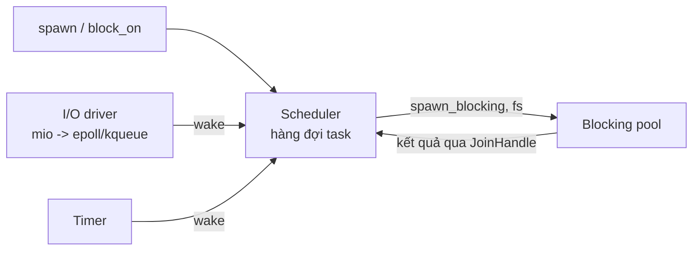
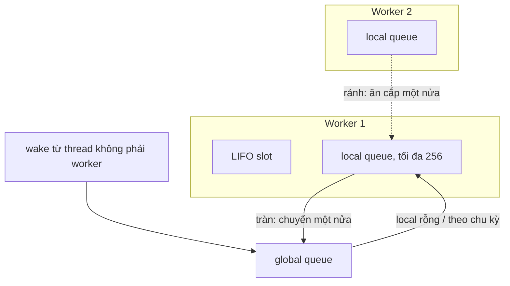
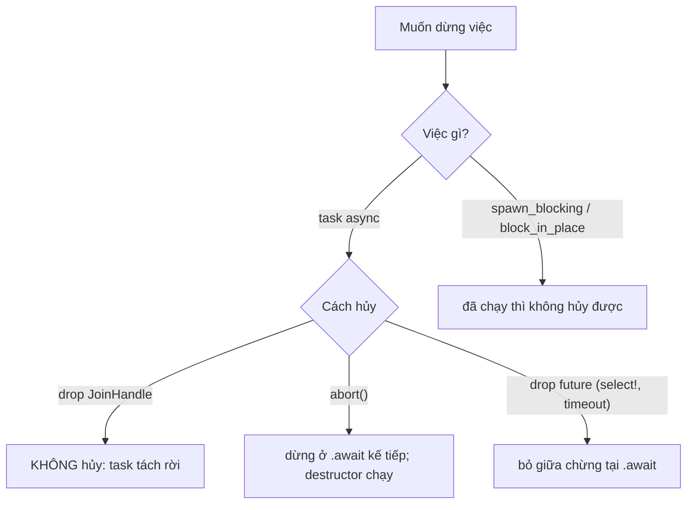

# P7 · Chương 08 — Tokio

## Bạn sẽ hiểu được gì

1. **Q1.** Runtime của Tokio gồm những thành phần nào và `#[tokio::main]` thực chất làm gì? → mục 1
2. **Q2.** Multi-thread scheduler (work-stealing, LIFO slot) khác current-thread scheduler ở đâu? → mục 2
3. **Q3.** `tokio::spawn` đòi `Send + 'static` vì sao; `spawn_local`/`LocalSet` dùng khi nào? → mục 3
4. **Q4.** Vì sao không được chặn thread trong async; `spawn_blocking` khác `block_in_place` thế nào; coop budget là gì? → mục 4
5. **Q5.** Hủy là gì: drop `JoinHandle`, `abort`, drop future tại `.await`, cancellation safety của `select!`? → mục 5
6. **Q6.** Khi nào dùng `std::sync::Mutex` thay vì mutex của Tokio; `mpsc`, `oneshot`, `Semaphore`, `Notify` để làm gì? → mục 6
7. **Q7.** `tokio::time`, `tokio::fs` chạy trên cái gì? → mục 7
8. **Q8.** Graceful shutdown dựng ra sao? → mục 8

Ngoài các câu hỏi trên: số đo `strace` giữa multi-thread và current-thread → mục 9; chọn `worker_threads` và cỡ pool DB (nhận xét của người soạn) → mục 10.

## Kiến thức cần trước

- [Chương 04 — Kiến trúc event loop](04-kien-truc-event-loop.md), [Chương 05 — Future, poll, Waker](05-future-poll-waker.md), [Chương 06 — async/await và Pin](06-async-await-pin.md), [Chương 07 — Executor và mio](07-executor-va-mio.md).
- [Chương 02 — select, poll, epoll](02-select-poll-epoll.md): thứ nằm dưới I/O driver trên Linux.

Chương này nói về **Tokio 1.53.2**, Rust 1.95.0. Mục docs gắn nhãn "behavior at the time of writing" là chi tiết cài đặt có thể đổi, không phải hợp đồng.

## 1. Runtime và `#[tokio::main]` (Q1)

> **Trả lời ngắn.** Rust không đi kèm runtime[^book-noruntime], nên chương trình async phải tự mang theo một cái; Tokio là cái đó. Nó gồm một I/O driver, một scheduler chạy task và một timer[^tokio-services]. Ngoài ra còn một blocking pool cho việc chặn[^tokio-runtime-struct]. `#[tokio::main]` chỉ là cách viết gọn: nó biến `async fn main` thành một hàm đồng bộ, và mỗi lần hàm đó được gọi thì một runtime khởi động[^tokio-main-sync].

**Giải thích.**

*Với service của bạn.* Hãy hình dung `orders-api`, một service viết bằng Rust và Tokio, nhận request qua TCP. Mỗi request nó đọc byte từ socket, hỏi Postgres, gọi một service thanh toán, ghi một file hóa đơn rồi trả lời. Cùng lúc có hàng nghìn kết nối đang mở, trong khi máy chỉ có vài core. Ta sẽ bám theo `orders-api` suốt chương (nhận xét của người soạn: đây là ví dụ giả định, không phải code trong repo). Câu hỏi của mục này: ai thực sự chạy hàng nghìn request đó, khi ngôn ngữ không có runtime?

### 1.1 Runtime gồm những gì

Hầu hết ngôn ngữ hỗ trợ async đều đóng gói sẵn một runtime, còn Rust thì không[^book-noruntime]. Vì vậy `orders-api` phải kèm một runtime, và ở đây ta dùng Tokio. Runtime của Tokio cung cấp ba dịch vụ: một vòng lặp sự kiện I/O gọi là *driver*, một *scheduler* chạy các task dùng tài nguyên I/O đó, và một *timer* để hẹn việc chạy sau một khoảng thời gian[^tokio-services]. Bên cạnh ba thứ ấy còn có *blocking pool*, nơi chạy những việc buộc phải chặn thread[^tokio-runtime-struct].

Với `orders-api`, mỗi thành phần đảm nhận một phần việc khác nhau:

| Thành phần | Việc làm | Trong `orders-api` |
|---|---|---|
| I/O driver | Chờ sự kiện từ hệ điều hành rồi đánh thức task phụ thuộc[^tokio-services] | Báo rằng socket của một request đã có dữ liệu |
| Scheduler | Lấy task ra khỏi hàng đợi và gọi `poll`[^tokio-loop] | Chạy handler của từng request |
| Timer | Đánh thức task khi `sleep` hoặc `timeout` đến hạn[^tokio-time-sleep] | Hết giờ chờ service thanh toán |
| Blocking pool | Thread riêng cho các việc chặn: `spawn_blocking`, thao tác `tokio::fs`, DNS qua `ToSocketAddrs` và vài việc khác (mục 4, 7)[^tokio-mbt-uses] | Đọc file hóa đơn, gọi một thư viện đồng bộ |

(Cột cuối là ví dụ của người soạn.)

Driver dựa trên mio[^tokio-driver-mio]. mio lại dùng epoll trên Linux và kqueue trên macOS[^mio-impl-linux]; phần này nằm ở [chương 07](07-executor-va-mio.md).



Driver và timer không chạy tách khỏi scheduler. Runtime kiểm tra định kỳ xem tài nguyên I/O hay timer nào đã sẵn sàng, rồi đánh thức task liên quan để scheduler xếp lịch; những lần kiểm tra này xen giữa các lần lập lịch task[^tokio-io-check]. Thread nào làm việc kiểm tra thì docs không nói; phần Đi sâu cuối mục có câu trả lời từ source.

### 1.2 `#[tokio::main]` làm gì

Còn hàm `main` của `orders-api` thì sao? Macro `#[tokio::main]` đánh dấu một hàm async để runtime đã chọn chạy nó[^tokio-main]. Docs cho dạng viết tay tương đương, với flavor mặc định là multi-thread[^tokio-main-multi]:

```rust
fn main() {
    tokio::runtime::Builder::new_multi_thread()
        .enable_all()
        .build()
        .unwrap()
        .block_on(async { println!("Hello world"); })
}
```

Nói cách khác, macro biến `async fn` thành hàm đồng bộ và mỗi lần gọi thì khởi động một runtime[^tokio-main-sync]. Phần còn lại là `block_on`: nó chạy future trên thread hiện tại và chặn tới khi future xong[^tokio-block-on].

Có một chỗ dễ nhầm: hàm async đó *không chạy như worker*, và docs mong các task khác được spawn từ nó[^tokio-main-nonworker]. Nếu `await` thẳng các future ngay trong `main` thì chúng chạy không nhanh bằng task đã spawn[^tokio-main-slow]. Vì vậy `orders-api` nên để `main` chỉ dựng runtime và `spawn` việc xử lý từng kết nối (nhận xét của người soạn). Còn runtime multi-thread thì luôn chạy, vì nó có worker thread riêng[^tokio-driving].

<details><summary>Đi sâu: thread nào gọi driver, bật driver khi dựng tay, số worker mặc định, hiểu lầm về io_uring</summary>

**Thread nào chờ sự kiện I/O.** Source 1.53.2 (chi tiết cài đặt, có thể đổi) cho thấy một worker rảnh mà giữ được khóa của driver thì chờ sự kiện bằng driver, còn worker khác ngủ trên condvar[^tokio-park-driver].

**Bật driver khi dựng tay.** Dựng runtime bằng `Builder` thì không có driver nào được bật mặc định[^tokio-drivers]. Bạn phải gọi `enable_io`, `enable_time` hoặc `enable_all`.

**Số worker mặc định.** Mặc định là số core mà hệ thống báo[^tokio-wt-default]. `worker_threads` ghi đè giá trị đọc từ biến môi trường `TOKIO_WORKER_THREADS`[^tokio-wt-env]. Với current-thread thì nó không có tác dụng[^tokio-wt-ct]. Source 1.53.2 lấy số core bằng `available_parallelism()`[^tokio-src-numcpus]; docs std cảnh báo hàm này trên Linux có thể đếm thừa khi không đọc được cgroup quota[^std-avail-par].

**Hiểu lầm: "Tokio dùng io_uring".** Mặc định thì không. Feature `io-uring` thuộc nhóm chỉ có khi bật cờ `tokio_unstable`[^tokio-uring-flag]. Còn `tokio::fs` mặc định vẫn dùng `spawn_blocking` (mục 7)[^tokio-fs-always]. Kernel io_uring nằm ở [chương 03](03-kqueue-io-uring.md).

</details>

**Quay lại Q1:** runtime = I/O driver + scheduler + timer + blocking pool; `#[tokio::main]` = dựng `Builder` rồi `block_on`; với `orders-api`, `main` chỉ nên dựng runtime và giao việc cho task.

## 2. Hai scheduler: multi-thread và current-thread (Q2)

> **Trả lời ngắn.** Multi-thread scheduler chạy future trên một thread pool theo chiến lược work-stealing, mặc định mỗi core một worker[^tokio-multi]. Current-thread scheduler thì chạy mọi task trên thread hiện tại[^tokio-current]. Docs khuyên đa số ứng dụng dùng loại multi-thread[^tokio-multi-default].

**Giải thích.**

*Với `orders-api`.* Mỗi kết nối của `orders-api` là một task (mục 3 nói cách tạo). Vấn đề của mục này là hàng nghìn task đó chạy trên bao nhiêu thread, và ai chia việc cho thread nào. Tokio có hai câu trả lời, ứng với hai scheduler.

Multi-thread là scheduler mặc định, cần feature `rt-multi-thread`. Docs chỉ nêu vài trường hợp hiếm nên chọn loại khác, chẳng hạn khi bắt buộc chạy một thread[^tokio-multi-default]. Trên máy 4 core, `orders-api` có 4 worker (nhận xét của người soạn). Work-stealing nghĩa là worker nào hết việc thì lấy bớt task của worker khác[^tokio-steal]; hàng đợi và các hằng số nằm ở phần Đi sâu.

Current-thread là một executor đơn luồng: mọi task được tạo và chạy trên thread hiện tại[^tokio-current]. Hệ quả là hai task của runtime này không bao giờ chạy song song (suy luận của người soạn). Nếu `orders-api` chạy kiểu này thì mọi request đều xếp hàng trên một thread.

### Vòng lặp và bảo đảm công bằng

Dù chọn loại nào, vòng lặp bên trong vẫn như nhau: runtime lấy một task ra và `poll` nó, hết task thì thread ngủ[^tokio-loop]. Về công bằng, docs chỉ hứa một điều: nếu tổng số task không tăng vô hạn và không task nào chặn thread, thì các task được lập lịch công bằng[^tokio-fair].

Ngoài bảo đảm đó, docs không hứa thứ tự nào. Nếu hai task A và B cùng sẵn sàng, runtime có thể chạy A năm lần trước B, kể cả khi A gọi `yield_now`; chỉ chắc chắn rằng cuối cùng nó sẽ lập lịch B[^tokio-noorder]. Tokio cũng có thể `poll` một task chưa được `wake`, gọi là spurious wakeup[^tokio-spurious]. Vế "không task nào chặn thread" của bảo đảm công bằng chính là lý do có mục 4 (nhận xét của người soạn).

<details><summary>Đi sâu: hàng đợi, work-stealing, LIFO slot (hành vi hiện tại)</summary>

**Current-thread.**

- Có hai hàng đợi FIFO là global và local. Runtime ưu tiên lấy từ local, chỉ lấy từ global khi local rỗng hoặc sau 31 lần liên tiếp lấy từ local[^tokio-ct-queues].
- Runtime kiểm tra I/O và timer khi hết task sẵn sàng, hoặc sau 61 task liên tiếp[^tokio-ct-events]. Các hằng 31 và 61 là hành vi hiện tại, không phải hợp đồng[^tokio-ct-notice].
- Current-thread không dùng tối ưu hóa LIFO slot[^tokio-ct-lifo].
- Runtime này không tự tạo thread, nên chỉ chạy được khi bạn gọi `Runtime::block_on`; `Handle::block_on` không điều khiển runtime[^tokio-driving-ct].

**Multi-thread: work-stealing và LIFO slot.** Docs lưu ý hành vi này có thể thay đổi ở các phiên bản Tokio sau[^tokio-mt-notice].

- Số worker cố định và tạo hết lúc khởi động. Có một hàng đợi global, và mỗi worker có một hàng đợi local chứa tối đa 256 task; thêm nữa thì một nửa chuyển sang global[^tokio-mt-queues].
- Worker ưu tiên lấy từ local; nó lấy từ global khi local rỗng hoặc sau `global_queue_interval` lần liên tiếp[^tokio-mt-prefer-local]. Nếu không đặt, runtime tự tính theo heuristic nhắm tới khoảng 10 ms giữa hai lần kiểm tra global[^tokio-mt-global].
- Local và global đều rỗng thì worker đi *ăn cắp*: chuyển một nửa số task trong hàng đợi local của worker khác sang hàng đợi của mình[^tokio-steal].
- **LIFO slot:** khi một task đánh thức task khác, task kia vào slot của worker thay vì vào hàng đợi; slot đã có task thì task cũ xuống hàng đợi local[^tokio-lifo-1]. Chạy xong một task, worker chạy ngay task trong slot mà không reset coop budget, và nếu dùng slot ba lần liên tiếp thì slot tạm tắt[^tokio-lifo-2]. Slot tách khỏi hàng đợi local nên worker khác không ăn cắp được task trong đó[^tokio-lifo-3].
- Task bị đánh thức từ thread không phải worker thì vào hàng đợi global[^tokio-mt-nonworker].



Docs còn nói runtime của Tokio không nhận biết NUMA (Non-Uniform Memory Access)[^tokio-numa].

</details>

**Quay lại Q2:** multi-thread = thread pool + work-stealing; current-thread = một thread, chỉ chạy trong `block_on`; các hằng số là hành vi hiện tại, không phải hợp đồng.

## 3. `tokio::spawn`, `JoinHandle` và `Send + 'static` (Q3)

> **Trả lời ngắn.** `tokio::spawn` giao một future cho runtime chạy thành task độc lập và trả về `JoinHandle`[^tokio-spawn]. Task có thể chạy trên thread khác với nơi gọi `spawn`, nên future phải `Send`[^tokio-spawn-thread]. Còn `'static` là suy luận của người soạn: task sống độc lập với caller nên không được mượn stack của caller. Future `!Send` thì dùng `LocalSet`/`spawn_local`[^tokio-localset].

**Giải thích.**

*Với `orders-api`.* Vòng `accept` của `orders-api` gọi `tokio::spawn` cho từng kết nối mới, rồi quay lại chờ kết nối kế tiếp mà không đợi request cũ xong. Chữ ký của `spawn` đặt ra hai điều kiện lên handler: `Send` và `'static`. Mục này giải thích vì sao, và `orders-api` làm gì khi một handler không đáp ứng được.

### 3.1 Task và `spawn`

Task giống thread của OS nhưng do runtime quản lý, không do OS scheduler; docs gọi mẫu này là "green threads"[^tokio-task-green]. Tạo task hay chuyển giữa các task không cần context switch của OS[^tokio-task-light]. Vì vậy `orders-api` có thể mở một task cho mỗi kết nối mà không tốn như mở một thread (nhận xét của người soạn).

`spawn` tạo một task bất đồng bộ mới và trả về `JoinHandle` cho nó[^tokio-spawn]. Future bắt đầu chạy nền ngay, kể cả khi bạn không `await` handle[^tokio-spawn-start]. Tuy vậy nó không bị poll đồng bộ ngay trong lời gọi `spawn`[^tokio-spawn-noblock]. Nếu task panic thì `await` handle trả về `JoinError`[^tokio-task-panic].

Chữ ký của hàm là `F: Future + Send + 'static, F::Output: Send + 'static`[^tokio-spawn-sig].

### 3.2 Vì sao `Send`

Task đã spawn có thể chạy ngay trên thread hiện tại, hoặc bị gửi sang một thread khác để chạy[^tokio-spawn-thread]. `Send` chính là đặc tính của các kiểu có thể chuyển qua ranh giới thread[^std-send]. Handler của `orders-api` có thể bắt đầu trên worker 1 rồi tiếp tục trên worker 3, nên mọi thứ nó giữ phải chuyển được sang thread khác (nhận xét của người soạn).

Giá trị `!Send` vẫn dùng được nếu nó chỉ tồn tại giữa các lần `.await`[^tokio-spawn-send]. Điều này khớp với [chương 06, mục 3](06-async-await-pin.md): biến sống qua `.await` nằm trong future (state machine), và chính future mới là thứ bị chuyển sang thread khác (nhận xét của người soạn).

### 3.3 Vì sao `'static`

Docs của `spawn` không viết "vì thế phải `'static`", nên phần này là suy luận của người soạn. Task sống độc lập với caller: drop handle không dừng task (mục 5), và không có bảo đảm task đã spawn sẽ chạy tới khi hoàn thành[^tokio-spawn-lifecycle]. Vì vậy task không được mượn stack của caller; nếu hàm gọi `spawn` trả về trước thì tham chiếu đó treo lơ lửng. Cùng lý do với `thread::spawn`: thread có thể sống lâu hơn phạm vi nơi nó được tạo[^thread-static].

### 3.4 Handler `!Send`: `LocalSet`

Nếu một phần của `orders-api` buộc phải dùng giá trị `!Send` (ví dụ một thư viện C chỉ dùng được trên một thread), thì dùng `LocalSet`. Docs mô tả: một local task set dùng để lập lịch một hoặc nhiều future `!Send` chạy cùng nhau trên cùng một thread[^tokio-localset].

Có vài chi tiết nên biết:

- `spawn_local` panic nếu gọi ngoài `LocalSet` hoặc `LocalRuntime`. `tokio::spawn` gọi trong `LocalSet` thì tạo task *ngoài* nó[^tokio-spawn-local].
- `LocalSet` chỉ chạy khi được `.await` hoặc điều khiển bằng một method của nó[^tokio-localset-driven].
- `#[tokio::main(flavor = "local")]` cũng có: nó tương tự current-thread runtime nhưng hỗ trợ `task::spawn_local`[^tokio-main-local].

<details><summary>Đi sâu: lỗi compiler quan sát được</summary>

Thử thật (rustc 1.95.0, tokio =1.53.2, container Linux): `tokio::spawn` một async block giữ `std::sync::MutexGuard` qua `.await` → lỗi `future cannot be sent between threads safely`; spawn block `async move` chứa `&v` mượn từ local → lỗi E0597 ``v` does not live long enough``. Quan sát một lần build; câu chữ lỗi có thể đổi theo phiên bản. Cách sửa: `move` hoặc `Arc` vào task (nhận xét của người soạn). Vì sao `MutexGuard` là `!Send` và các cách sửa cho trường hợp guard: [chương 09, mục 7](09-async-trong-production.md).

</details>

**Quay lại Q3:** `Send` vì task có thể đổi thread; `'static` (suy luận) vì task sống độc lập với caller; `LocalSet` cho future `!Send`.

## 4. Vì sao không được chặn trong async (Q4)

> **Trả lời ngắn.** Mỗi thread của scheduler chạy nhiều task xen kẽ, nên một task chặn thread làm các task khác trên thread đó đứng[^tokio-noblock-task]. Việc chặn phải chuyển sang `spawn_blocking`, nơi closure chạy trên một thread mà việc chặn là chấp nhận được[^tokio-csb]. Cách khác là `block_in_place`, báo cho executor giao các task khác sang worker mới trước khi chặn[^tokio-bip]. Coop budget là cơ chế buộc task trả `Pending` khi hết budget[^tokio-coop-budget].

**Giải thích.**

*Với `orders-api`.* Giả sử một handler của `orders-api` gọi driver Postgres đồng bộ, hoặc băm mật khẩu bằng một hàm tính toán nặng. Trong lúc đó worker chạy handler này không làm gì khác được, và mọi request đang nằm trên worker ấy bị đứng theo. Mục này cho thấy vì sao, đo mức độ, rồi nói `orders-api` có những lối thoát nào.

### 4.1 Chặn một task làm đứng cả thread

Docs nói task nhìn chung không nên thực hiện system call hay thao tác khác có thể chặn thread, vì như vậy các task khác trên cùng thread cũng không chạy được[^tokio-noblock-task]. Lý do nằm ở chỗ task chỉ đổi lượt tại `.await`: code chạy lâu mà không tới `.await` thì ngăn các task khác chạy[^tokio-await-only]. Nói cách khác, task là cooperative: được chạy cho tới khi tự nhường[^tokio-coop]. Điều này áp dụng cả cho hàm không-async mà bạn gọi từ code async, kể cả destructor[^tokio-sync-in-async].

**Đo thử.** Task "ticker" `sleep(20 ms)` 25 lần, ghi khoảng cách tick lớn nhất; trong lúc đó một task khác "làm việc" 300 ms. Một lần chạy, container Linux `nproc` = 4 (quan sát, dao động theo lần; chạy lại: 305 ms ở dòng đầu):

| Runtime | 300 ms bằng… | Tick lớn nhất |
|---|---|---|
| current_thread | `std::thread::sleep` | **307 ms** |
| current_thread | `tokio::time::sleep` | 26 ms |
| current_thread | `spawn_blocking(std::thread::sleep)` | 26 ms |
| multi_thread, 2 worker | `std::thread::sleep` | 26 ms |
| multi_thread, 2 worker | `spawn_blocking` / `block_in_place` | 26 ms |

Dòng đầu là đói: ticker 20 ms bị treo suốt thời gian task kia giữ thread. Dòng bốn dễ hiểu lầm: ticker chạy trên worker còn lại vì ta chỉ chặn một trong hai (suy luận của người soạn; số liệu không phân biệt được worker nào chạy task nào). Chặn đủ số worker thì runtime đứng (suy luận của người soạn, không đo).

### `spawn_blocking` và `block_in_place`

Vậy `orders-api` làm gì với việc chặn? Docs chia thread của Tokio làm hai loại: core thread chạy code async, mặc định mỗi core một[^tokio-core-threads]. Blocking thread thì được sinh ra theo nhu cầu[^tokio-blocking-ondemand]. Docs đưa ra hai lối thoát cho việc chặn: `spawn_blocking` và `block_in_place`.

**`spawn_blocking`** chạy closure bạn đưa vào trên một thread mà việc chặn là chấp nhận được[^tokio-csb]. Tokio sinh thêm thread cho tới giới hạn của `Builder`; vượt giới hạn thì task xếp hàng[^tokio-csb-queue]. Giới hạn mặc định của `max_blocking_threads` là 512[^tokio-mbt-default]. Hàng đợi không có backpressure nên có thể tăng không giới hạn[^tokio-mbt-queue]. Thread rảnh được giữ 10 giây[^tokio-keepalive]. `spawn_blocking` dùng được cả trên current-thread[^tokio-csb-ct].

Với việc CPU-bound thì cần thêm một lớp giới hạn. Docs khuyên dùng semaphore hoặc một primitive đồng bộ khác để giới hạn số phép tính chạy song song[^tokio-csb-cpu]; hoặc dùng một pool riêng như rayon[^tokio-rayon]. Việc chạy vô hạn thì nên dùng `thread::spawn`[^tokio-csb-long]. Trong `orders-api`, băm mật khẩu hợp với `spawn_blocking` kèm `Semaphore` hơn là để hàng trăm lượt băm cùng chiếm thread (nhận xét của người soạn).

**`block_in_place`** chỉ có ở multi-thread. Gọi hàm này là báo cho executor biết task hiện tại sắp chặn thread, nhờ đó executor kịp giao mọi task khác nó đang giữ sang một worker mới trước khi việc chặn xảy ra[^tokio-bip].

Hai hàm khác nhau ở chỗ việc chặn chạy ở đâu và chuyện gì xảy ra với code còn lại trong cùng task:

| | `spawn_blocking` | `block_in_place` |
|---|---|---|
| Chạy ở | Thread của blocking pool[^tokio-csb-ded] | Ngay worker hiện tại[^tokio-bip-summary] |
| Runtime | Cả hai flavor[^tokio-csb-ct] | Chỉ multi-thread; panic trên current_thread[^tokio-bip-panic] |
| Code khác trong *cùng task* (ví dụ `join!`) | Không bị treo (docs khuyên dùng `spawn_blocking` để tránh vấn đề này)[^tokio-bip-join] | Bị treo[^tokio-bip-join] |
| Hủy | Không abort được khi đã chạy[^tokio-csb-abort] | Không[^tokio-bip-cancel] |

Riêng ô "Hủy" của `spawn_blocking` có một ngoại lệ: nếu task chưa bắt đầu chạy thì `abort` có thể ngăn nó bắt đầu[^tokio-cancel-blocking]. Docs chỉ dùng cách nói "có thể", nên đừng coi đó là bảo đảm.

### Cooperative budget

Còn code async thuần mà chạy lâu thì sao? Một lần `poll` có thể làm rất nhiều việc trước khi trả `Pending`. Rust không có runtime nên khó ép một task dừng giữa chừng; module `coop` thay vào đó cung cấp một cơ chế tự nguyện để future phối hợp với executor, tránh starvation[^tokio-coop-mod]. Tokio đặt sẵn các điểm nhường trong hàm thư viện, buộc task định kỳ quay về executor[^tokio-coop-yield].

Cụ thể, mỗi task có một *coop budget*. `poll_proceed` trừ budget của task và trả `Poll::Pending` nếu budget đã cạn[^tokio-coop-budget]. `consume_budget` cho code của bạn cùng quyền đó[^tokio-consume]. Ngược lại, `unconstrained` tắt cơ chế này và khiến service của bạn dễ bị starvation[^tokio-unconstrained]. Docs `task::coop`, `task` và `runtime` của 1.53.2 không nêu giá trị budget mặc định (người soạn đã tìm), nên chương này không nêu con số.

<details><summary>Đi sâu: <code>block_in_place</code> trên current_thread; nhường CPU khi có budget</summary>

Quan sát (một lần chạy): `block_in_place` trong task spawn trên current_thread panic "can call blocking only when running on the multi-threaded runtime" và `JoinHandle` trả `Err`; khớp docs, vốn nói hàm này panic trên current_thread[^tokio-bip-panic]. (Nhận xét của người soạn: `spawn_blocking` là cầu nối cho driver DB đồng bộ, nén, băm mật khẩu; việc nặng CPU nên kèm `Semaphore` để khỏi nhồi hàng trăm thread vào máy 4 core.)

**Thử thật** (quan sát một lần chạy trên current_thread, output có sẵn từ lần soạn trước, không chạy lại): task A lặp 2.000.000 lần `tx.send(); rx.recv().await` trên `unbounded_channel` (luôn sẵn sàng); task B chỉ đặt một cờ. Khi A xong vòng cuối, B đã chạy chưa? Bình thường **có** (A bị buộc nhường giữa chừng); bọc A trong `unconstrained` thì **không**. Đúng kịch bản mà docs `coop` mô tả[^tokio-unconstrained-ex]. Ý nghĩa: `recv` của channel Tokio là một hàm thư viện có điểm nhường, nên A bị buộc nhường dù channel luôn sẵn sàng; `unconstrained` gỡ điểm nhường đó[^tokio-coop-yield]. Tôi không đo A nhường sau bao nhiêu vòng.

</details>

**Quay lại Q4:** đừng chặn worker: việc chặn đi `spawn_blocking`/`block_in_place`, việc CPU dài thì giới hạn song song, còn code async dài phải có điểm nhường (`.await`, coop budget).

## 5. Hủy (cancellation) (Q5)

> **Trả lời ngắn.** Drop `JoinHandle` không hủy task: nó chỉ tách task ra[^tokio-jh-detach]. `abort` báo task dừng ở lần `.await` kế tiếp[^tokio-cancel]. Drop future (như `select!` hay `timeout` quá hạn) thì bỏ future giữa chừng tại một `.await`[^tokio-timeout]. Vì nhánh thua của `select!` bị drop, hàm dùng trong đó phải cancellation safe[^tokio-select-def].

**Giải thích.**

*Với `orders-api`.* Có ba tình huống buộc `orders-api` phải bỏ một việc đang chạy dở: client ngắt kết nối giữa request, cuộc gọi sang service thanh toán quá hạn, hoặc cả service đang tắt. Câu hỏi là bỏ như vậy thì việc đó thực sự dừng chưa, và dừng ở đâu. Câu trả lời khác nhau theo cách hủy, nên ta xem lần lượt từng cách.



### 5.1 Drop `JoinHandle` và `abort`

**Drop `JoinHandle` không hủy.** Khi `JoinHandle` bị drop thì task liên kết bị tách ra: không còn handle nào, cũng không còn cách `join`[^tokio-jh-detach]. Task chạy tiếp ở nền và kết quả của nó mất[^tokio-jh-drop]. Với `orders-api`, handler của một request mà bạn vứt handle đi vẫn chạy cho tới hết (nhận xét của người soạn). Quan sát (một lần chạy, output có sẵn): task `sleep` 100 ms rồi in, handle bị drop ngay; vẫn thấy dòng in và destructor chạy sau đó.

**`abort`.** Task được báo hiệu để tắt ở lần nó nhường tiếp theo tại một điểm `.await`[^tokio-cancel]. Nếu task đang rảnh thì nó dừng sớm nhất có thể, không chạy lại trước khi dừng[^tokio-cancel-idle]. Khi dừng, task thôi chạy ở `.await` mà nó đang nhường, và mọi biến cục bộ bị hủy bằng cách chạy destructor[^tokio-cancel-drop]. Lưu ý `abort` chỉ lên lịch hủy và trả về trước khi việc hủy xong; muốn đợi thì `await` handle[^tokio-abort-async]. Tắt runtime, kể cả khi `main` kết thúc, hủy ngay mọi task trên nó[^tokio-cancel-rt].

**Không bảo đảm `cancelled`.** `abort` không bảo đảm task thất bại với lỗi cancelled, vì task có thể hoàn thành bình thường trước đó[^tokio-cancel-race]. Quan sát (một lần chạy): task `sleep` 10 s bị `abort` → handle cho `is_cancelled() == true`, destructor chạy; task `async { 42 }` đã xong trước khi `abort` → `Ok(42)`.

**`spawn_blocking`** không abort được vì nó không async[^tokio-csb-abort]. Ngoại lệ là khi nó chưa bắt đầu chạy, và docs cũng chỉ nói "có thể ngăn", không chắc chắn[^tokio-cancel-blocking]. Quan sát (một lần chạy): closure đang ngủ 200 ms bị `abort` sau 50 ms vẫn chạy hết và handle cho `Ok(7)`. Runtime shutdown sẽ chờ vô hạn cho tới khi mọi `spawn_blocking` đã bắt đầu chạy xong, trừ khi dùng `shutdown_timeout`[^tokio-csb-shutdown].

### 5.2 Drop future

`abort` về cơ chế là không poll nữa rồi drop future; thứ future đang giữ được dọn bằng `Drop` thường (suy luận của người soạn, khớp [chương 06, mục 8](06-async-await-pin.md)). Hai nơi hay drop future nhất là `select!` và `timeout`. `select!` hủy các nhánh còn lại[^tokio-select]; `timeout` quá hạn thì trả về một lỗi và hủy future bên trong[^tokio-timeout]. Đây chính là cách `orders-api` bỏ cuộc gọi sang service thanh toán khi nó quá hạn (nhận xét của người soạn).

### `select!` và cancellation safety

`select!` chờ trên nhiều nhánh đồng thời, trả về khi nhánh đầu tiên hoàn thành và hủy các nhánh còn lại[^tokio-select]. Các nhánh chạy trên cùng một task, nên đồng thời nhưng không song song[^tokio-select-conc]. Mặc định `select!` chọn ngẫu nhiên nhánh kiểm tra trước; thêm `biased;` thì đổi thành từ trên xuống[^tokio-select-fair].

Vì nhánh thua bị drop giữa chừng, câu hỏi đặt ra là drop xong có mất gì không. Docs định nghĩa: nếu bạn có một future chưa hoàn thành, thì việc drop future đó rồi tạo lại nó phải là thao tác không có tác dụng[^tokio-select-def]. Hàm nào thỏa điều đó gọi là cancellation safe.

Docs liệt kê các hàm cancellation safe, và danh sách này không đầy đủ[^tokio-select-notexh]:

- An toàn: `mpsc::Receiver::recv`, `broadcast::Receiver::recv`, `watch::Receiver::changed`, `TcpListener::accept`, `AsyncReadExt::read`, `AsyncWriteExt::write`[^tokio-select-safe-list].
- **Không** an toàn và có thể mất dữ liệu: `read_exact`, `read_to_end`, `read_to_string`, `write_all`[^tokio-select-safe].
- Không an toàn vì mất chỗ trong hàng đợi công bằng: `Mutex::lock`, `RwLock::read/write`, `Semaphore::acquire`, `Notify::notified`[^tokio-select-queue].

Với hàm của chính bạn, cách tự kiểm là nhớ rằng việc hủy luôn xảy ra ở một `.await`. Nếu hàm vẫn đúng khi bị khởi động lại ngay ở đó thì nó cancellation safe[^tokio-select-own]. Hủy thứ không an toàn cũng không nhất thiết là sai, ví dụ khi đang tắt ứng dụng[^tokio-select-notwrong].

<details><summary>Đi sâu: tái hiện <code>read_exact</code> mất dữ liệu trong <code>select!</code></summary>

**Thử thật** (duplex pipe trong bộ nhớ; quan sát một lần chạy, output có sẵn, không chạy lại): ghi 2 byte; `select!` giữa `read_exact(4 byte)` và `sleep(20 ms)` → timer thắng khi `read_exact` mới có 2/4 byte. Ghi thêm 2 byte rồi `timeout(100 ms, read_exact(4 byte))` → **hết giờ**: 2 byte đầu không còn để đọc (giải thích của người soạn: chúng nằm trong trạng thái nội bộ của future `read_exact` đã bị drop). Ngược lại vòng `select!` dùng `read(&mut buf[got..])` và tự cộng `got` nhận đủ `[1, 2, 3, 4]`. Ý nghĩa: đây đúng là kiểu "mất dữ liệu" mà docs cảnh báo cho `read_exact`[^tokio-select-safe]. Còn `read` nằm trong danh sách an toàn[^tokio-select-safe-list]. (Nhận xét của người soạn: trong `select!` chỉ đặt future mà docs xếp cancel-safe; đọc đủ N byte thì giữ trạng thái ngoài future.)

</details>

**Quay lại Q5:** drop `JoinHandle` không hủy; `abort` và drop future dừng ở `.await`; `spawn_blocking` đã chạy thì không hủy được; nhánh bị bỏ của `select!` phải cancellation safe.

## 6. `tokio::sync`: mutex, channel, semaphore, notify (Q6)

> **Trả lời ngắn.** Với dữ liệu thuần, docs khuyên dùng `Mutex` của std hoặc `parking_lot`[^tokio-mutex-data]. Mutex của Tokio dành cho trường hợp cần giữ khóa qua `.await`, như truy cập kết nối DB[^tokio-mutex-prefer]. `oneshot` gửi một giá trị từ một producer đến một consumer[^tokio-oneshot]. `mpsc` là nhiều producer một consumer, và dung lượng của nó là chỗ xử lý backpressure[^tokio-mpsc-cap]. `Semaphore` cho nhiều bên truy cập đồng thời, khác mutex[^tokio-sem]. `Notify` chỉ báo cho một task biết có sự kiện, không mang dữ liệu[^tokio-notify-signal].

**Giải thích.**

*Với `orders-api`.* Các handler của `orders-api` chạy song song trên nhiều worker nhưng cần chia sẻ một số thứ: bộ đếm request đang xử lý, một kết nối tới Postgres, cái cổng giới hạn số cuộc gọi đồng thời sang service thanh toán, và tín hiệu "cấu hình vừa đổi". Mỗi thứ hợp với một primitive khác nhau của `tokio::sync`; mục này đi qua từng cái (phép gán primitive cho nhu cầu là ví dụ của người soạn).

### 6.1 Mutex: std hay Tokio

Mutex của Tokio khác `std` ở hai điểm: `lock` là async, và guard được thiết kế để giữ qua các điểm `.await`[^tokio-mutex-diff]. Nghe thì tưởng trong code async nên luôn dùng nó, nhưng docs nói ngược lại: trái với quan niệm phổ biến, dùng `Mutex` thường của thư viện chuẩn trong code bất đồng bộ là được và thường còn được ưu tiên[^tokio-mutex-std].

Lý do là khả năng giữ khóa qua `.await` làm mutex async đắt hơn mutex chặn, nên chỉ dùng loại async khi thật cần[^tokio-mutex-expensive]. Trường hợp thật cần, theo docs, là truy cập chia sẻ có thể thay đổi tới tài nguyên I/O như kết nối cơ sở dữ liệu[^tokio-mutex-prefer]. Còn nếu giá trị sau mutex chỉ là dữ liệu thì dùng mutex chặn của std hoặc `parking_lot`[^tokio-mutex-data]. Áp vào `orders-api`: bộ đếm request dùng `std::sync::Mutex`; kết nối Postgres, thứ phải giữ khóa suốt lúc chờ server, mới là chỗ của mutex Tokio.

Còn nếu vẫn dùng `Mutex` của std và giữ guard qua `.await` thì sao? Compiler không cấm khi task không bị chuyển thread, nhưng docs cảnh báo cách đó hầu như không bao giờ cho code đồng thời đúng vì dễ dẫn tới deadlock[^tokio-mutex-deadlock]. Với `tokio::spawn`, compiler từ chối hẳn vì future không `Send` (quan sát ở mục 3).

Docs gợi ý hai mẫu. Mẫu thứ nhất: bọc `Arc<Mutex<..>>` trong một struct có các method không-async, và chỉ khóa mutex bên trong các method đó[^tokio-mutex-wrap]. Mẫu thứ hai, cho tài nguyên I/O: giao tài nguyên cho một task riêng và nói chuyện với nó qua channel[^tokio-mutex-pattern]. Mutex Tokio hoạt động theo FIFO[^tokio-mutex-fifo]. Nền tảng lock nằm ở [P4 · Chương 03](../04-concurrency/03-lock.md).

### 6.2 Channel

`oneshot` gửi một giá trị từ một producer đến một consumer, thường để trả kết quả cho bên đang chờ[^tokio-oneshot]. `mpsc` thì nhiều producer một consumer[^tokio-mpsc]. Với `mpsc`, dung lượng là chìa khóa để xây chương trình vững, vì nó đóng vai trò quan trọng trong việc xử lý back pressure[^tokio-mpsc-cap].

Hai loại này ghép được thành mẫu request/response tới một task quản lý tài nguyên: task chờ lệnh trên một `mpsc`, và mỗi lệnh mang theo một `oneshot::Sender` để trả kết quả[^tokio-actor]. Đây cũng là dạng "giao tài nguyên cho một task" ở trên: các handler của `orders-api` gửi lệnh tới một task giữ kết nối Postgres (nhận xét của người soạn). Cũng nhận xét của người soạn: `unbounded_channel` bỏ backpressure, và khi tải đổ vào từ ngoài thì có nguy cơ hết bộ nhớ.

### 6.3 `Semaphore` và `Notify`

Semaphore cho phép nhiều bên truy cập đồng thời, khác mutex chỉ cho một bên[^tokio-sem]. Nó công bằng theo thứ tự yêu cầu[^tokio-sem-fair]. Docs `spawn_blocking` cũng đề nghị dùng nó để giới hạn số phép tính CPU-bound chạy song song[^tokio-csb-cpu]. Trong `orders-api`, đó là cái cổng "tối đa N cuộc gọi đồng thời sang service thanh toán" (nhận xét của người soạn).

`Notify` thì đơn giản hơn: nó báo cho một task biết có sự kiện xảy ra, còn bản thân nó không mang dữ liệu[^tokio-notify-signal]. Cơ chế permit nằm ở phần Đi sâu.

<details><summary>Đi sâu: <code>Notify</code> và permit</summary>

`Notify` có thể xem như một Semaphore bắt đầu với 0 permit[^tokio-notify]. `notify_one()` gọi trước `notified().await` thì lần chờ sau hoàn thành ngay[^tokio-notify-before]. Nhiều lần gọi trước đó cũng chỉ lưu một permit[^tokio-notify-one]. Nền tảng ở [P4 · Chương 04](../04-concurrency/04-condition-variable-va-semaphore.md).

</details>

**Quay lại Q6:** std mutex cho dữ liệu, mutex Tokio khi giữ khóa qua `.await`; `mpsc`/`oneshot` truyền tin, `Semaphore` giới hạn song song, `Notify` báo hiệu.

## 7. `tokio::time` và `tokio::fs` (Q7)

> **Trả lời ngắn.** `Sleep`, `Interval`, `Timeout` chạy trên timer của runtime và phải dùng trong ngữ cảnh runtime[^tokio-time-ctx]. `tokio::fs` không async ở mức hệ điều hành: phía sau nó dùng thao tác file chặn thông thường[^tokio-fs]. Theo docs module, hiện nó luôn chạy trên `spawn_blocking`[^tokio-fs-always]. Ngoại lệ duy nhất là đường io_uring thử nghiệm phải bật tường minh ([chương 03, mục 6](03-kqueue-io-uring.md))[^tokio-fs-uring].

**Giải thích.**

*Với `orders-api`.* `orders-api` cần hai thứ có vẻ giống nhau: đặt hạn cho cuộc gọi sang service thanh toán, và đọc file mẫu hóa đơn từ đĩa. Cả hai đều có API async trong Tokio, nhưng chạy trên hai cơ chế khác hẳn: thứ nhất là timer của runtime, thứ hai là blocking pool.

### 7.1 Thời gian

Có ba kiểu chính: `Sleep` hoàn thành tại một `Instant`, `Interval` phát một giá trị theo chu kỳ cố định, và `Timeout` đặt cận trên cho thời gian một future được phép chạy[^tokio-time-types]. Cả ba phải dùng từ bên trong ngữ cảnh của Runtime[^tokio-time-ctx]. Riêng `timeout` còn panic nếu không có timer hiện hành[^tokio-timeout-panic].

Với `timeout`, `orders-api` cần nhớ hai điều:

- `timeout` poll future *trước* khi kiểm tra hạn. Vì vậy một future không bao giờ yield có thể xong sau hạn mà vẫn không báo lỗi[^tokio-timeout-poll].
- Hủy một timeout là drop future[^tokio-timeout-cancel]. Quá hạn thì future bên trong bị hủy[^tokio-timeout]. Việc hủy đó luôn xảy ra ở một `.await` (mục 5)[^tokio-select-own].

`interval` khác việc gọi `sleep` trong một vòng lặp ở chỗ nó tính cả thời gian xử lý giữa các lần gọi[^tokio-interval]. Tick đầu tiên hoàn thành ngay[^tokio-interval-first]. `tick` là cancel safe[^tokio-tick-safe], nên dùng được làm một nhánh của `select!`; ví dụ, `orders-api` có thể có nhánh `interval.tick()` để đẩy metric định kỳ (nhận xét của người soạn).

### 7.2 File

Hệ điều hành phần lớn không có API async cho file, nên Tokio dùng thao tác file chặn thông thường phía sau[^tokio-fs]. Vì vậy đọc file mẫu hóa đơn bằng `tokio::fs` thực chất là một lần `spawn_blocking`, và nó chiếm một thread của blocking pool (mục 4).

Phần phân tích đầy đủ (docs nói gì, vì sao file không có API async, cách gộp thao tác để giảm số lần `spawn_blocking`) nằm ở [P5 · Chương 08, mục 9](../05-storage/08-rust-va-luu-tru.md); ở đây chỉ giữ điều cần cho mạch Tokio. Docs module nói hiện Tokio luôn dùng `spawn_blocking` trên mọi nền tảng, và có thể đổi sang API như io_uring trong tương lai[^tokio-fs-always].

Source 1.53.2 cho thấy docs module đã cũ so với docs hàm. Trên Linux, `tokio::fs::read` có thể dùng io_uring nếu bật đủ ba điều kiện: `--cfg tokio_unstable`, feature `io-uring` và `Builder::enable_io_uring`; hỗ trợ này còn thử nghiệm[^tokio-fs-uring]. Không bật cả ba thì `tokio::fs` chạy trên blocking pool (chi tiết ở [chương 03, mục 6](03-kqueue-io-uring.md)).

<details><summary>Đi sâu: giới hạn của <code>tokio::fs</code>, ai khác dùng blocking pool, quan sát số thread</summary>

Blocking pool cũng phục vụ DNS qua `ToSocketAddrs`, stdout/stderr, stdin[^tokio-mbt-uses]. Thử thật (quan sát một lần chạy, output có sẵn; multi-thread 2 worker, đọc `/proc/self/status`): trước `tokio::fs::read_to_string` có 3 thread (main + 2 worker), sau có 4: một blocking thread vừa sinh. Ý nghĩa: khớp docs nói blocking thread được sinh theo nhu cầu[^tokio-blocking-ondemand]. Nó cũng khớp việc `tokio::fs` mặc định chạy trên blocking pool[^tokio-fs-always]. Giới hạn "chỉ dùng cho file thường" và quan sát bằng `strace` thread nào chạy `open`: [P5 · Chương 08, mục 9](../05-storage/08-rust-va-luu-tru.md).

</details>

**Quay lại Q7:** timer của Tokio là timer của runtime; `tokio::fs` mặc định là file chặn chạy trên blocking pool (io_uring chỉ khi bật tường minh).

## 8. Graceful shutdown (Q8)

> **Trả lời ngắn.** Graceful shutdown gồm ba phần: biết khi nào tắt, báo mọi thành phần tắt, và chờ chúng tắt xong[^tokio-shutdown-three]. Theo hướng dẫn của Tokio, phần đầu thường là signal từ OS[^tokio-shutdown-signal]. Phần hai dùng `CancellationToken`[^tokio-shutdown-token]. Phần ba dùng `TaskTracker`[^tokio-shutdown-tracker].

**Giải thích.**

*Với `orders-api`.* Khi `orders-api` được triển khai lại, bản cũ phải nhận tín hiệu tắt, nhưng đang có request dở dang: một đơn đã ghi vào Postgres mà chưa trả lời, một file hóa đơn đang ghi. Tắt ngay thì những việc đó đứt giữa chừng. Graceful shutdown là cách tắt mà các việc dở dang kịp xong.

Ba phần chạy theo thứ tự:

1. **Biết khi nào tắt.** Thường đó là signal từ OS: `tokio::signal::ctrl_c` sẽ ngủ cho tới khi nhận được signal như vậy[^tokio-shutdown-signal]. Nếu có nhiều điều kiện tắt, hãy gộp chúng qua một kênh rồi `select!`[^tokio-shutdown-select]. Docs `signal` nhắc đây là một chủ đề rất rắc rối, cần dùng thận trọng[^tokio-signal-care].
2. **Báo tắt.** Dùng `CancellationToken`. Task không phải dừng ngay khi token bị hủy mà có thể chạy thủ tục tắt trước, như flush dữ liệu[^tokio-shutdown-token]. Với `orders-api`, mỗi handler dở dang có thể trả lời nốt request hiện tại rồi mới thoát (nhận xét của người soạn).
3. **Chờ.** Dùng `TaskTracker`: `wait` chỉ hoàn thành khi mọi future đã xong và tracker đã đóng[^tokio-shutdown-tracker]. Docs `tokio_util` nói `TaskTracker` thường dùng cùng `CancellationToken`: token để báo tắt, tracker để chờ tắt xong[^tokio-util-tracker].

Một lưu ý để khỏi tìm sai chỗ: `CancellationToken` nằm trong crate `tokio_util`, không phải `tokio`[^tokio-util-token]. `TaskTracker` cũng vậy; code mẫu của trang hướng dẫn import nó từ `tokio_util`[^tokio-shutdown-import].

<details><summary>Đi sâu: chạy thử graceful shutdown; SIGTERM trên Kubernetes</summary>

**Thử thật** (quan sát một lần chạy trong container Linux, output có sẵn, không chạy lại; dạng chỉ dùng crate `tokio`): 3 worker trong `JoinSet`, mỗi worker xử lý theo chu kỳ 30 ms trong `select!` với `watch::Receiver::changed` (cancel-safe, nằm trong danh sách an toàn của docs[^tokio-select-safe-list]); `main` chờ `signal::ctrl_c()`; nhận `SIGINT` (`kill -INT`) thì gửi `true` qua `watch`, mỗi worker thấy tín hiệu, "flush" 50 ms rồi trả số mục đã xử lý, `main` `join_next()` đến cạn rồi thoát. Output theo thứ tự: `SIGINT received` → ba dòng `shutdown seen` → ba dòng `joined worker, items=17` → `all workers done`.

Nhớ (suy ra từ mục 5): trả về từ `#[tokio::main]` hủy mọi task còn lại[^tokio-cancel-rt], nên phải `join` việc cần hoàn tất. Ngoài ra, `spawn_blocking` đang chạy làm `Drop` của runtime chờ vô hạn nếu không có `shutdown_timeout`[^tokio-runtime-shutdown].

**SIGTERM trên Kubernetes.** Docs Kubernetes: kubelet nhờ container runtime dừng container bằng cách gửi tín hiệu TERM (SIGTERM) tới tiến trình chính của mỗi container, kèm một thời hạn ân hạn[^k8s-term]. Mặc định thời hạn đó là 30 giây[^k8s-grace]. Nhiều container runtime tôn trọng `STOPSIGNAL` trong image, và nếu khác thì gửi tín hiệu đó thay vì TERM[^k8s-stopsignal].

Hệ quả (nhận xét của người soạn): ở trường hợp mặc định, pod nhận `SIGTERM` chứ không phải `SIGINT`, nên ngoài `ctrl_c` cần `signal::unix::signal(SignalKind::terminate())`. `SignalKind::terminate` biểu diễn SIGTERM[^tokio-sigterm]. Nó cùng dạng stream mà docs minh họa cho `SIGHUP`[^tokio-signal-unix]. Thời gian tắt êm nên nhỏ hơn thời hạn ân hạn của pod.

</details>

**Quay lại Q8:** biết khi nào tắt → báo tắt → chờ xong; trả về từ `main` hủy mọi task còn lại nên phải `join` việc cần hoàn tất.

## 9. Đo: multi-thread và current-thread bằng `strace -f -c`

**Thiết lập.** Binary `tokio_echo` của `labs/crates/lab-io-async` ([lab cũ](../labs/07-io-async-lab.md)) là một echo server, mỗi kết nối một task, nên khá giống `orders-api` thu nhỏ. Client `echo_load` mở 4 kết nối × 200 message × 64 byte (800 message). Máy: container Linux aarch64 (Docker trên macOS), `nproc` = 4, build debug. Lệnh: `strace -f -c -o <file> ./tokio_echo <port> 4 [--current-thread]`. Hai lần mỗi chế độ (lần hai trong ngoặc):

| Chỉ số | multi_thread | `--current-thread` |
|---|---|---|
| Thread sau khi build (`/proc`) | 5 | 1 |
| `clone` | 4 | 0 |
| `futex` | 854 (848), lỗi 66 (57) | 1 |
| `epoll_pwait` | 427 (425) | 203 (203) |
| `recvfrom` / `sendto` | 804 / 800 | 804 / 800 |
| `epoll_ctl` / `epoll_create1` / `eventfd2` | 11 / 1 / 1 | 11 / 1 / 1 |
| Tổng syscall | 3191 (3183) | 1992 (1992) |

**Quan sát** (một máy; số đo có sẵn từ lần soạn trước, không chạy lại; lab cũ cũng ra 863 `futex`, 3208 syscall cho multi-thread):

1. Cùng lượng I/O thật: 804 `recvfrom` (suy luận của người soạn: 800 message + 4 lần đọc trả 0 khi client đóng; chưa lọc từng lời gọi) và 800 `sendto`. Hai chế độ chỉ khác nhau ở phần điều phối.
2. 4 `clone` là bốn worker, khớp với "mỗi core một worker"[^tokio-multi] trên máy 4 core. Cộng thêm thread `main` đang `block_on` thành 5, khớp số đếm từ `/proc` (phép cộng của người soạn).
3. Multi-thread có hơn 800 `futex` (khoảng 27% số syscall), current-thread có 1. Về nguyên nhân, đây là suy luận của người soạn và chỉ có cơ sở một phần. Source Tokio 1.53.2 cho thấy worker rảnh thử giữ khóa driver, không được thì ngủ trên `Condvar`[^tokio-park-driver]. `Condvar` của std trên Linux lại là một bộ đếm futex ([P4 · Chương 04, mục 9.1](../04-concurrency/04-condition-variable-va-semaphore.md); source std 1.95.0[^std-condvar-futex]). Đó là một đường có thể sinh `futex`, nhưng tôi chưa đối chiếu với số đếm cụ thể (ai đánh thức ai, khi nào bị ăn cắp), nên nguyên nhân của con số này **chưa kiểm chứng**. Current-thread chỉ có một thread nên không cần futex.
4. `epoll_pwait` của multi-thread gấp đôi (427 so với 203). Source 1.53.2 cho biết driver là `TryLock`, chỉ một thread dùng được tại một thời điểm[^tokio-park-shared]. Worker nào giữ được khóa thì park bằng driver[^tokio-park-driver]. **Suy luận, chưa kiểm chứng:** quyền gọi epoll đổi tay giữa các worker nên số lời gọi nhiều hơn. Tôi không điều tra nguyên nhân.
5. Tải của bài đo này nhỏ: 4 kết nối chạy đồng thời, mỗi kết nối gửi rồi chờ echo từng message (theo source `echo_load`). Ở tải đó multi-thread tốn *nhiều syscall hơn*; đây là đặc điểm của bài đo, không phải kết luận cho tải cao trên nhiều core.

Trên máy đo (aarch64) strace hiện `epoll_pwait` chứ không phải `epoll_wait`: đó là quan sát một lần chạy, giải thích ở [chương 02, mục 4](02-select-poll-epoll.md).

## 10. Liên hệ với backend

Toàn phần này là nhận xét của người soạn.

**Chọn `worker_threads`.** Mặc định là số core mà hệ thống báo cho Tokio[^tokio-multi], hợp lý cho một service I/O-bound chiếm trọn một máy. Với `orders-api` chạy trong container, có ba điểm cần cân nhắc:

1. Kiểm tra con số `available_parallelism` thực sự trả về khi container có giới hạn CPU. Khi đọc được cgroup, nó làm tròn xuống theo quota: đo ở [P8 · Chương 08, mục 1](../08-containers/08-rust-trong-container.md) cho thấy `--cpus 1.5` ra 1 worker. Chuyện "đếm thừa" như docs std nêu chỉ xảy ra khi không đọc được cgroup fs, chẳng hạn do sandbox[^std-avail-par]. Muốn con số khác thì đặt tường minh bằng `worker_threads` hoặc `TOKIO_WORKER_THREADS`.
2. Docs khuyên giữ số worker ở phía nhỏ[^tokio-wt-small].
3. Máy NUMA lớn thì cân nhắc chạy nhiều runtime[^tokio-numa].

Chọn con số cuối cùng bằng đo với tải thật.

**Việc nặng CPU.** `spawn_blocking` kèm `Semaphore`[^tokio-csb-cpu]. Hoặc dùng rayon, hay một runtime riêng cho việc CPU-bound[^tokio-rayon].

**Pool DB.** Có hai tầng cần định cỡ độc lập: số kết nối trong pool (do DB server giới hạn) và số task chờ lấy kết nối. Task chờ chỉ là một future rẻ[^tokio-task-light] nên có thể nhiều hơn pool nhiều lần. Việc chờ kết nối hoạt động như một semaphore (mô hình tư duy của tôi, không mô tả cài đặt của một thư viện cụ thể).

Driver DB *đồng bộ* thì khác: mỗi truy vấn chiếm một blocking thread (mục 4). Pool cỡ 20 mà cho phép tới 512 blocking thread[^tokio-mbt-default] thì áp lực dồn hết vào DB, nên hãy giới hạn bằng đúng cỡ pool. Truy vấn async không giữ thread khi chờ, nhưng xử lý dữ liệu lớn (JSON, nén) giữa hai `.await` vẫn chiếm worker (mục 4).

## Tóm tắt

- Runtime = I/O driver (trên mio) + scheduler + timer + blocking pool; dựng tay phải `enable_all`.
- Multi-thread: hàng đợi local mỗi worker (tối đa 256), global, ăn cắp một nửa, LIFO slot không bị ăn cắp. Current-thread: một thread, chỉ chạy trong `block_on`, không có LIFO slot. Các hằng 256/31/61 là "behavior at the time of writing".
- `#[tokio::main]` = `Builder` + `enable_all` + `block_on`; hàm main không chạy như worker.
- `spawn` đòi `Send` vì task có thể đổi thread, `'static` (suy luận) vì task sống độc lập caller; `LocalSet` cho `!Send`.
- Chặn thread làm đói task khác (một lần đo: tick 307 ms thay vì ~26 ms; số đo dao động); dùng `spawn_blocking` hoặc `block_in_place` (chỉ multi-thread); CPU-bound thì giới hạn song song.
- Coop budget buộc future của Tokio trả `Pending` định kỳ; docs không nêu giá trị mặc định.
- Drop `JoinHandle` không hủy; `abort` dừng ở `.await` và có thể vẫn kết thúc bình thường; `select!` đòi nhánh cancellation safe (`read_exact`, `write_all`, `Mutex::lock` thì không).
- Docs khuyên std `Mutex` cho dữ liệu thuần; `mpsc` có dung lượng để backpressure; `Semaphore` giới hạn song song; `Notify` báo hiệu một task; `tokio::fs` chạy trên blocking pool.
- Graceful shutdown = tín hiệu + báo tắt + chờ. Đo bằng strace: multi-thread nhiều `clone`/`futex`, current-thread một thread, cùng lượng I/O.

## Câu hỏi tự kiểm tra

1. Bốn thành phần của runtime là gì; `#[tokio::main]` khai triển thành gì?
<details><summary>Đáp án</summary>

I/O driver, scheduler, timer, blocking pool[^tokio-runtime-struct]. Macro khai triển thành `Builder::new_multi_thread().enable_all().build().unwrap().block_on(..)`[^tokio-main-multi].

</details>

2. Quên `enable_all` khi dựng runtime bằng tay thì sao?
<details><summary>Đáp án</summary>

Không driver nào được bật mặc định, nên dùng kiểu mạng hoặc thời gian sẽ lỗi[^tokio-drivers].

</details>

3. LIFO slot là gì; vì sao worker khác không ăn cắp được?
<details><summary>Đáp án</summary>

Đó là chỗ chứa task vừa được đánh thức, và worker chạy nó ngay sau task hiện tại[^tokio-lifo-1]. Slot tạm tắt sau ba lần dùng liên tiếp[^tokio-lifo-2]. Nó tách khỏi hàng đợi local nên worker khác không ăn cắp được[^tokio-lifo-3]. Slot chỉ có ở multi-thread[^tokio-ct-lifo], và là hành vi hiện tại.

</details>

4. Vì sao `spawn` cần `Send` và `'static`; phần nào là suy luận?
<details><summary>Đáp án</summary>

`Send` vì task có thể chạy trên thread khác[^tokio-spawn-thread]. `'static` là suy luận của người soạn: task sống độc lập, drop handle không dừng task[^tokio-jh-drop]. Task cũng không được bảo đảm sẽ chạy xong[^tokio-spawn-lifecycle]. Lý do tương tự `thread::spawn`[^thread-static].

</details>

5. Vì sao `std::thread::sleep` làm tick ~300 ms (307 ms ở lần đo) trên current_thread nhưng không trên multi-thread 2 worker?
<details><summary>Đáp án</summary>

Current-thread chỉ có một thread nên mọi task đứng[^tokio-noblock-task]. Task chỉ đổi lượt tại `.await`[^tokio-await-only]. Multi-thread còn worker thứ hai (quan sát ở bảng mục 4; chặn đủ số worker thì cũng đứng: suy luận của người soạn).

</details>

6. `spawn_blocking` khác `block_in_place` ở đâu?
<details><summary>Đáp án</summary>

Chúng chạy trên thread khác nhau; `block_in_place` báo executor giao task khác sang worker mới[^tokio-bip]. `block_in_place` chỉ có ở multi-thread[^tokio-bip-panic]. Nó treo code đồng thời trong cùng task[^tokio-bip-join]. Nó không hủy được[^tokio-bip-cancel]. `spawn_blocking` thì không abort được khi đã chạy[^tokio-csb-abort]. Chưa chạy thì có thể ngăn, nhưng không bảo đảm[^tokio-cancel-blocking].

</details>

7. Drop `JoinHandle` có hủy task không? `abort` có bảo đảm `cancelled`?
<details><summary>Đáp án</summary>

Không hủy[^tokio-jh-drop]. `abort` không bảo đảm vì task có thể xong trước[^tokio-cancel-race].

</details>

8. `select!` trong vòng lặp với `read_exact` sai ở đâu; sửa thế nào?
<details><summary>Đáp án</summary>

`read_exact` không cancel-safe: nhánh thua bị drop và dữ liệu đọc dở mất (quan sát một lần chạy ở mục 5)[^tokio-select-safe]. Cách sửa là dùng `read` và tự cộng dồn, hoặc giữ trạng thái ngoài future[^tokio-select-own].

</details>

9. Khi nào dùng std `Mutex` trong code async; khi nào mutex của Tokio?
<details><summary>Đáp án</summary>

Std cho dữ liệu thuần, khóa ngắn[^tokio-mutex-std]. Mutex Tokio khi phải giữ khóa qua `.await`, như kết nối DB[^tokio-mutex-prefer]. Nhưng thường tốt hơn là giao tài nguyên cho một task[^tokio-mutex-pattern].

</details>

10. `tokio::fs::read` có async ở mức kernel không?
<details><summary>Đáp án</summary>

Không: đó là file op chặn chạy trên `spawn_blocking`[^tokio-fs]. Docs module nói hiện luôn như vậy trên mọi nền tảng[^tokio-fs-always]. Nhưng source 1.53.2 có đường io_uring thử nghiệm phải bật tường minh (mục 7, chương 03 mục 6)[^tokio-fs-uring]. Quan sát thread tăng 3 → 4.

</details>

11. Ba phần của graceful shutdown?
<details><summary>Đáp án</summary>

Biết khi nào tắt (`ctrl_c`)[^tokio-shutdown-signal]. Báo tắt (`CancellationToken`)[^tokio-shutdown-token]. Chờ xong (`TaskTracker`)[^tokio-shutdown-tracker]. Thí nghiệm ở mục 8 dùng `JoinSet`, là lựa chọn của người soạn; ba phần nói chung được nêu ở hướng dẫn[^tokio-shutdown-three].

</details>

12. Trong bài strace, đâu là quan sát, đâu là suy luận?
<details><summary>Đáp án</summary>

Quan sát: 4 `clone` vs 0, >800 `futex` vs 1, 427 (425) vs 203 `epoll_pwait`, cùng 804/800 `recvfrom`/`sendto`. Suy luận chưa kiểm chứng: nguyên nhân của `futex` và `epoll_pwait` (mục 9).

</details>

## Đọc thêm

- [`tokio::runtime`](https://docs.rs/tokio/1.53.2/tokio/runtime/index.html), "Detailed runtime behavior": fairness, hàng đợi, LIFO slot.
- [`tokio::task`](https://docs.rs/tokio/1.53.2/tokio/task/index.html), mục Cancellation và Blocking and Yielding: cơ chế hủy, hai lối thoát cho code chặn.
- [`tokio::task::coop`](https://docs.rs/tokio/1.53.2/tokio/task/coop/index.html): cooperative scheduling, `unconstrained`.
- [`tokio::select!`](https://docs.rs/tokio/1.53.2/tokio/macro.select.html), mục Cancellation safety: danh sách hàm an toàn/không an toàn.
- [`tokio::sync::Mutex`](https://docs.rs/tokio/1.53.2/tokio/sync/struct.Mutex.html), "Which kind of mutex should you use?": std hay tokio mutex.
- [Graceful Shutdown](https://tokio.rs/tokio/topics/shutdown) (tokio.rs): ba phần của shutdown.
- [`tokio_util::task::TaskTracker`](https://docs.rs/tokio-util/0.7.18/tokio_util/task/task_tracker/struct.TaskTracker.html): vì sao tracker phải được `close` trước khi `wait` hoàn thành.

[^book-noruntime]: The Rust Book 1.95.0, ch17.1 Futures and the Async Syntax — <https://doc.rust-lang.org/1.95.0/book/ch17-01-futures-and-syntax.html> — "Most languages that support async bundle a runtime, but Rust does not."
[^tokio-services]: Tokio 1.53.2, module tokio::runtime — <https://docs.rs/tokio/1.53.2/tokio/runtime/index.html> — "An I/O event loop, called the driver, which drives I/O resources and dispatches I/O events to tasks that depend on them. A scheduler to execute tasks that use these I/O resources. A timer for scheduling work to run after a set period of time."
[^tokio-runtime-struct]: Tokio 1.53.2, struct Runtime — <https://docs.rs/tokio/1.53.2/tokio/runtime/struct.Runtime.html> — "The runtime provides an I/O driver, task scheduler, timer, and blocking pool, necessary for running asynchronous tasks."
[^tokio-driver-mio]: Tokio 1.53.2, source runtime/io/driver.rs — <https://raw.githubusercontent.com/tokio-rs/tokio/tokio-1.53.2/tokio/src/runtime/io/driver.rs> — "I/O driver, backed by Mio."
[^mio-impl-linux]: mio 1.2.4, struct Poll, mục Implementation notes — <https://docs.rs/mio/1.2.4/mio/struct.Poll.html> — "Android epoll DragonFly BSD kqueue FreeBSD kqueue iOS kqueue illumos epoll Linux epoll NetBSD kqueue OpenBSD kqueue Solaris event ports Windows IOCP macOS kqueue"
[^tokio-time-sleep]: Tokio 1.53.2, module tokio::time — <https://docs.rs/tokio/1.53.2/tokio/time/index.html> — "Sleep is a future that does no work and completes at a specific Instant in time."
[^tokio-io-check]: Tokio 1.53.2, module tokio::runtime, mục IO and timers — <https://docs.rs/tokio/1.53.2/tokio/runtime/index.html> — "It does this by periodically checking whether there are any IO resources or timers that are ready, and waking the relevant task so that it will be scheduled. These checks are performed periodically between scheduling tasks."
[^tokio-drivers]: Tokio 1.53.2, module tokio::runtime, mục Resource drivers — <https://docs.rs/tokio/1.53.2/tokio/runtime/index.html> — "When configuring a runtime by hand, no resource drivers are enabled by default."
[^tokio-uring-flag]: Tokio 1.53.2, crate tokio, mục Unstable features — <https://docs.rs/tokio/1.53.2/tokio/index.html> — "Some feature flags are only available when specifying the tokio_unstable flag: tracing: Enables tracing events. schedule-latency: Allows measurement of task scheduling latencies. io-uring: Enables io-uring (Linux only)."
[^tokio-fs-always]: Tokio 1.53.2, module tokio::fs — <https://docs.rs/tokio/1.53.2/tokio/fs/index.html> — "Currently, Tokio will always use spawn_blocking on all platforms, but it may be changed to use asynchronous file system APIs such as io_uring in the future."
[^tokio-fs-uring]: Tokio 1.53.2, source fs/read.rs, mục io_uring support — <https://raw.githubusercontent.com/tokio-rs/tokio/tokio-1.53.2/tokio/src/fs/read.rs> — "To enable io_uring, you need to specify the --cfg tokio_unstable flag at compile time, enable the io-uring cargo feature, and set the Builder::enable_io_uring runtime option."
[^tokio-multi]: Tokio 1.53.2, module tokio::runtime, mục Multi-Thread Scheduler — <https://docs.rs/tokio/1.53.2/tokio/runtime/index.html> — "The multi-thread scheduler executes futures on a thread pool, using a work-stealing strategy. By default, it will start a worker thread for each CPU core available on the system."
[^tokio-multi-default]: Tokio 1.53.2, module tokio::runtime, mục Multi-Thread Scheduler — <https://docs.rs/tokio/1.53.2/tokio/runtime/index.html> — "The multi-thread scheduler requires the rt-multi-thread feature flag, and is selected by default: use tokio::runtime; let threaded_rt = runtime::Runtime::new()?; Most applications should use the multi-thread scheduler, except in some niche use-cases, such as when running only a single thread is required."
[^tokio-current]: Tokio 1.53.2, module tokio::runtime, mục Current-Thread Scheduler — <https://docs.rs/tokio/1.53.2/tokio/runtime/index.html> — "The current-thread scheduler provides a single-threaded future executor. All tasks will be created and executed on the current thread."
[^tokio-loop]: Tokio 1.53.2, module tokio::runtime, mục Detailed runtime behavior — <https://docs.rs/tokio/1.53.2/tokio/runtime/index.html> — "It will repeatedly remove a task from that collection and schedule it (by calling poll). When the collection is empty, the thread will go to sleep until a task is added to the collection."
[^tokio-fair]: Tokio 1.53.2, module tokio::runtime, mục Detailed runtime behavior — <https://docs.rs/tokio/1.53.2/tokio/runtime/index.html> — "If the total number of tasks does not grow without bound, and no task is blocking the thread, then it is guaranteed that tasks are scheduled fairly."
[^tokio-noorder]: Tokio 1.53.2, module tokio::runtime, mục Detailed runtime behavior — <https://docs.rs/tokio/1.53.2/tokio/runtime/index.html> — "All that is guaranteed is that it will schedule B eventually."
[^tokio-spurious]: Tokio 1.53.2, module tokio::runtime, mục Detailed runtime behavior — <https://docs.rs/tokio/1.53.2/tokio/runtime/index.html> — "Tokio may schedule tasks that have not been woken under some circumstances. This is called a spurious wakeup."
[^tokio-ct-queues]: Tokio 1.53.2, module tokio::runtime, mục Current thread runtime — <https://docs.rs/tokio/1.53.2/tokio/runtime/index.html> — "The current thread runtime maintains two FIFO queues of tasks that are ready to be scheduled: the global queue and the local queue. The runtime will prefer to choose the next task to schedule from the local queue, and will only pick a task from the global queue if the local queue is empty, or if it has picked a task from the local queue 31 times in a row."
[^tokio-ct-events]: Tokio 1.53.2, module tokio::runtime, mục Current thread runtime — <https://docs.rs/tokio/1.53.2/tokio/runtime/index.html> — "The runtime will check for new IO or timer events whenever there are no tasks ready to be scheduled, or when it has scheduled 61 tasks in a row."
[^tokio-ct-lifo]: Tokio 1.53.2, module tokio::runtime, mục Current thread runtime — <https://docs.rs/tokio/1.53.2/tokio/runtime/index.html> — "The current thread runtime does not use the lifo slot optimization."
[^tokio-driving-ct]: Tokio 1.53.2, module tokio::runtime, mục Driving the runtime — <https://docs.rs/tokio/1.53.2/tokio/runtime/index.html> — "A current-thread runtime does not spawn any worker threads, so it can only execute tasks when you provide a thread by calling Runtime::block_on. A LocalSet only executes local tasks spawned on it when the LocalSet is .awaited or otherwise driven using one of its methods for this purpose. Please be aware that Handle::block_on does not drive the runtime."
[^tokio-ct-notice]: Tokio 1.53.2, module tokio::runtime, mục Current thread runtime — <https://docs.rs/tokio/1.53.2/tokio/runtime/index.html> — "This section describes how the current thread runtime behaves today. This behavior may change in future versions of Tokio."
[^tokio-mt-notice]: Tokio 1.53.2, module tokio::runtime, mục Multi threaded runtime — <https://docs.rs/tokio/1.53.2/tokio/runtime/index.html> — "This section describes how the multi thread runtime behaves today. This behavior may change in future versions of Tokio."
[^tokio-mt-queues]: Tokio 1.53.2, module tokio::runtime, mục Multi threaded runtime — <https://docs.rs/tokio/1.53.2/tokio/runtime/index.html> — "A multi thread runtime has a fixed number of worker threads, which are all created on startup. The multi thread runtime maintains one global queue, and a local queue for each worker thread. The local queue of a worker thread can fit at most 256 tasks. If more than 256 tasks are added to the local queue, then half of them are moved to the global queue to make space."
[^tokio-mt-global]: Tokio 1.53.2, module tokio::runtime, mục Multi threaded runtime — <https://docs.rs/tokio/1.53.2/tokio/runtime/index.html> — "then the runtime will dynamically compute it using a heuristic that targets 10ms intervals between each check of the global queue (based on the worker_mean_poll_time metric)."
[^tokio-steal]: Tokio 1.53.2, module tokio::runtime, mục Multi threaded runtime — <https://docs.rs/tokio/1.53.2/tokio/runtime/index.html> — "If both the local queue and global queue is empty, then the worker thread will attempt to steal tasks from the local queue of another worker thread. Stealing is done by moving half of the tasks in one local queue to another local queue."
[^tokio-lifo-1]: Tokio 1.53.2, module tokio::runtime, mục Multi threaded runtime — <https://docs.rs/tokio/1.53.2/tokio/runtime/index.html> — "Whenever a task wakes up another task, the other task is added to the worker thread’s lifo slot instead of being added to a queue. If there was already a task in the lifo slot when this happened, then the lifo slot is replaced, and the task that used to be in the lifo slot is placed in the thread’s local queue."
[^tokio-lifo-2]: Tokio 1.53.2, module tokio::runtime, mục Multi threaded runtime — <https://docs.rs/tokio/1.53.2/tokio/runtime/index.html> — "When the runtime finishes scheduling a task, it will schedule the task in the lifo slot immediately, if any. When the lifo slot is used, the coop budget is not reset. Furthermore, if a worker thread uses the lifo slot three times in a row, it is temporarily disabled until the worker thread has scheduled a task that didn’t come from the lifo slot."
[^tokio-lifo-3]: Tokio 1.53.2, module tokio::runtime, mục Multi threaded runtime — <https://docs.rs/tokio/1.53.2/tokio/runtime/index.html> — "The lifo slot is separate from the local queue, so other worker threads cannot steal the task in the lifo slot."
[^tokio-mt-nonworker]: Tokio 1.53.2, module tokio::runtime, mục Multi threaded runtime — <https://docs.rs/tokio/1.53.2/tokio/runtime/index.html> — "When a task is woken from a thread that is not a worker thread, then the task is placed in the global queue."
[^tokio-numa]: Tokio 1.53.2, module tokio::runtime, mục NUMA awareness — <https://docs.rs/tokio/1.53.2/tokio/runtime/index.html> — "The tokio runtime is not NUMA (Non-Uniform Memory Access) aware."
[^tokio-main]: Tokio 1.53.2, attribute macro tokio::main — <https://docs.rs/tokio/1.53.2/tokio/attr.main.html> — "Marks async function to be executed by the selected runtime."
[^tokio-main-multi]: Tokio 1.53.2, attribute macro tokio::main, mục Using the multi-threaded runtime — <https://docs.rs/tokio/1.53.2/tokio/attr.main.html> — "Equivalent code not using #[tokio::main] fn main() { tokio::runtime::Builder::new_multi_thread() .enable_all() .build() .unwrap() .block_on(async { println!("Hello world"); }) }"
[^tokio-main-sync]: Tokio 1.53.2, attribute macro tokio::main — <https://docs.rs/tokio/1.53.2/tokio/attr.main.html> — "this macro expands it to a synchronous function that starts a runtime each time it is called."
[^tokio-main-nonworker]: Tokio 1.53.2, attribute macro tokio::main, mục Non-worker async function — <https://docs.rs/tokio/1.53.2/tokio/attr.main.html> — "Note that the async function marked with this macro does not run as a worker. The expectation is that other tasks are spawned by the function here."
[^tokio-block-on]: Tokio 1.53.2, Runtime::block_on — <https://docs.rs/tokio/1.53.2/tokio/runtime/struct.Runtime.html> — "This runs the given future on the current thread, blocking until it is complete, and yielding its resolved result."
[^tokio-main-slow]: Tokio 1.53.2, attribute macro tokio::main, mục Non-worker async function — <https://docs.rs/tokio/1.53.2/tokio/attr.main.html> — "Awaiting on other futures from the function provided here will not perform as fast as those spawned as workers."
[^tokio-driving]: Tokio 1.53.2, module tokio::runtime, mục Driving the runtime — <https://docs.rs/tokio/1.53.2/tokio/runtime/index.html> — "A multi-threaded runtime is always running because it spawns its own worker threads."
[^tokio-wt-default]: Tokio 1.53.2, Builder::worker_threads — <https://docs.rs/tokio/1.53.2/tokio/runtime/struct.Builder.html> — "The default value is the number of cores available to the system."
[^tokio-wt-env]: Tokio 1.53.2, Builder::worker_threads — <https://docs.rs/tokio/1.53.2/tokio/runtime/struct.Builder.html> — "This will override the value read from environment variable TOKIO_WORKER_THREADS."
[^tokio-wt-ct]: Tokio 1.53.2, Builder::worker_threads — <https://docs.rs/tokio/1.53.2/tokio/runtime/struct.Builder.html> — "When using the current_thread runtime this method has no effect."
[^tokio-src-numcpus]: Tokio 1.53.2, source loom/std/mod.rs, fn num_cpus — <https://raw.githubusercontent.com/tokio-rs/tokio/tokio-1.53.2/tokio/src/loom/std/mod.rs> — "Err(std::env::VarError::NotPresent) => { std::thread::available_parallelism().map_or(1, NonZeroUsize::get) }"
[^std-avail-par]: Rust std 1.95.0, fn thread::available_parallelism, mục Platform-specific behavior (Linux) — <https://doc.rust-lang.org/1.95.0/std/thread/fn.available_parallelism.html> — "It may overcount the amount of parallelism available when limited by a process-wide affinity mask or cgroup quotas and sched_getaffinity() or cgroup fs can’t be queried, e.g. due to sandboxing."
[^tokio-task-light]: Tokio 1.53.2, module tokio::task — <https://docs.rs/tokio/1.53.2/tokio/task/index.html> — "creating new tasks or switching between tasks does not require a context switch and has fairly low overhead. Creating, running, and destroying large numbers of tasks is quite cheap, especially compared to OS threads."
[^tokio-spawn]: Tokio 1.53.2, fn task::spawn — <https://docs.rs/tokio/1.53.2/tokio/task/fn.spawn.html> — "Spawns a new asynchronous task, returning a JoinHandle for it."
[^tokio-spawn-start]: Tokio 1.53.2, fn task::spawn — <https://docs.rs/tokio/1.53.2/tokio/task/fn.spawn.html> — "The provided future will start running in the background immediately when spawn is called, even if you don’t await the returned JoinHandle."
[^tokio-spawn-noblock]: Tokio 1.53.2, fn task::spawn — <https://docs.rs/tokio/1.53.2/tokio/task/fn.spawn.html> — "It is guaranteed that spawn will not synchronously poll the task being spawned."
[^tokio-task-panic]: Tokio 1.53.2, module tokio::task — <https://docs.rs/tokio/1.53.2/tokio/task/index.html> — "if the spawned task panics, awaiting its JoinHandle will return a JoinError."
[^tokio-spawn-sig]: Tokio 1.53.2, fn task::spawn — <https://docs.rs/tokio/1.53.2/tokio/task/fn.spawn.html> — "F: Future + Send + 'static, F::Output: Send + 'static,"
[^tokio-spawn-thread]: Tokio 1.53.2, fn task::spawn — <https://docs.rs/tokio/1.53.2/tokio/task/fn.spawn.html> — "The spawned task may execute on the current thread, or it may be sent to a different thread to be executed."
[^std-send]: Rust std 1.95.0, trait Send — <https://doc.rust-lang.org/1.95.0/std/marker/trait.Send.html> — "Types that can be transferred across thread boundaries."
[^tokio-spawn-send]: Tokio 1.53.2, fn task::spawn, mục Using !Send values from a task — <https://docs.rs/tokio/1.53.2/tokio/task/fn.spawn.html> — "The task supplied to spawn must implement Send. However, it is possible to use !Send values from the task as long as they only exist between calls to .await."
[^tokio-spawn-lifecycle]: Tokio 1.53.2, fn task::spawn — <https://docs.rs/tokio/1.53.2/tokio/task/fn.spawn.html> — "There is no guarantee that a spawned task will execute to completion."
[^thread-static]: Rust std 1.95.0, fn thread::spawn — <https://doc.rust-lang.org/1.95.0/std/thread/fn.spawn.html> — "The 'static constraint means that the closure and its return value must have a lifetime of the whole program execution. The reason for this is that threads can outlive the lifetime they have been created in."
[^tokio-localset]: Tokio 1.53.2, struct task::LocalSet — <https://docs.rs/tokio/1.53.2/tokio/task/struct.LocalSet.html> — "In these cases, a local task set may be used to schedule one or more !Send futures to run together on the same thread."
[^tokio-spawn-local]: Tokio 1.53.2, fn task::spawn_local — <https://docs.rs/tokio/1.53.2/tokio/task/fn.spawn_local.html> — "This function panics if called outside of a LocalSet or LocalRuntime. Note that if tokio::spawn is used from within a LocalSet, the resulting new task will not be inside the LocalSet, so you must use spawn_local if you want to stay within the LocalSet."
[^tokio-localset-driven]: Tokio 1.53.2, module tokio::runtime, mục Driving the runtime — <https://docs.rs/tokio/1.53.2/tokio/runtime/index.html> — "A LocalSet only executes local tasks spawned on it when the LocalSet is .awaited or otherwise driven using one of its methods for this purpose."
[^tokio-main-local]: Tokio 1.53.2, attribute macro tokio::main, mục Using the local runtime — <https://docs.rs/tokio/1.53.2/tokio/attr.main.html> — "The local runtime is similar to the current-thread runtime but supports task::spawn_local."
[^tokio-noblock-task]: Tokio 1.53.2, module tokio::task — <https://docs.rs/tokio/1.53.2/tokio/task/index.html> — "Tasks should generally not perform system calls or other operations that could block a thread, as this would prevent other tasks running on the same thread from executing as well."
[^tokio-await-only]: Tokio 1.53.2, crate tokio, mục CPU-bound tasks and blocking code — <https://docs.rs/tokio/1.53.2/tokio/index.html> — "this kind of swapping can only happen at .await points, so code that spends a long time without reaching an .await will prevent other tasks from running."
[^tokio-coop]: Tokio 1.53.2, module tokio::task, mục Tasks are scheduled cooperatively — <https://docs.rs/tokio/1.53.2/tokio/task/index.html> — "In cooperative multitasking, a task is allowed to run until it yields, indicating to the Tokio runtime’s scheduler that it cannot currently continue executing."
[^tokio-sync-in-async]: Tokio 1.53.2, module tokio::task, mục Blocking and Yielding — <https://docs.rs/tokio/1.53.2/tokio/task/index.html> — "This includes destructors of objects destroyed in async code."
[^tokio-core-threads]: Tokio 1.53.2, crate tokio, mục CPU-bound tasks and blocking code — <https://docs.rs/tokio/1.53.2/tokio/index.html> — "The core threads are where all asynchronous code runs, and Tokio will by default spawn one for each CPU core."
[^tokio-csb]: Tokio 1.53.2, fn task::spawn_blocking — <https://docs.rs/tokio/1.53.2/tokio/task/fn.spawn_blocking.html> — "Runs the provided closure on a thread where blocking is acceptable."
[^tokio-csb-queue]: Tokio 1.53.2, fn task::spawn_blocking — <https://docs.rs/tokio/1.53.2/tokio/task/fn.spawn_blocking.html> — "After reaching the upper limit, the tasks are put in a queue."
[^tokio-mbt-queue]: Tokio 1.53.2, Builder::max_blocking_threads — <https://docs.rs/tokio/1.53.2/tokio/runtime/struct.Builder.html> — "Note that since the queue does not apply any backpressure, it could potentially grow unbounded."
[^tokio-keepalive]: Tokio 1.53.2, Builder::thread_keep_alive — <https://docs.rs/tokio/1.53.2/tokio/runtime/struct.Builder.html> — "By default, the timeout for a thread is set to 10 seconds."
[^tokio-csb-cpu]: Tokio 1.53.2, fn task::spawn_blocking — <https://docs.rs/tokio/1.53.2/tokio/task/fn.spawn_blocking.html> — "When running many CPU-bound computations, a semaphore or some other synchronization primitive should be used to limit the number of computations executed in parallel."
[^tokio-rayon]: Tokio 1.53.2, crate tokio, mục CPU-bound tasks and blocking code — <https://docs.rs/tokio/1.53.2/tokio/index.html> — "If your code is CPU-bound and you wish to limit the number of threads used to run it, you should use a separate thread pool dedicated to CPU bound tasks."
[^tokio-csb-long]: Tokio 1.53.2, fn task::spawn_blocking, mục When to use spawn_blocking vs dedicated threads — <https://docs.rs/tokio/1.53.2/tokio/task/fn.spawn_blocking.html> — "For workloads that run indefinitely or for extended periods (for example, background workers or persistent processing loops), prefer a dedicated thread created with thread::spawn."
[^tokio-csb-ct]: Tokio 1.53.2, fn task::spawn_blocking — <https://docs.rs/tokio/1.53.2/tokio/task/fn.spawn_blocking.html> — "Note that if you are using the single threaded runtime, this function will still spawn additional threads for blocking operations."
[^tokio-bip]: Tokio 1.53.2, fn task::block_in_place — <https://docs.rs/tokio/1.53.2/tokio/task/fn.block_in_place.html> — "Calling this function informs the executor that the currently executing task is about to block the thread, so the executor is able to hand off any other tasks it has to a new worker thread before that happens."
[^tokio-bip-panic]: Tokio 1.53.2, fn task::block_in_place, mục Panics — <https://docs.rs/tokio/1.53.2/tokio/task/fn.block_in_place.html> — "This function panics if called from a current_thread runtime."
[^tokio-bip-join]: Tokio 1.53.2, fn task::block_in_place — <https://docs.rs/tokio/1.53.2/tokio/task/fn.block_in_place.html> — "Be aware that although this function avoids starving other independently spawned tasks, any other code running concurrently in the same task will be suspended during the call to block_in_place. This can happen e.g. when using the join! macro. To avoid this issue, use spawn_blocking instead of block_in_place."
[^tokio-csb-abort]: Tokio 1.53.2, fn task::spawn_blocking — <https://docs.rs/tokio/1.53.2/tokio/task/fn.spawn_blocking.html> — "Be aware that tasks spawned using spawn_blocking cannot be aborted because they are not async."
[^tokio-bip-cancel]: Tokio 1.53.2, fn task::block_in_place — <https://docs.rs/tokio/1.53.2/tokio/task/fn.block_in_place.html> — "Code running behind block_in_place cannot be cancelled."
[^tokio-coop-mod]: Tokio 1.53.2, module task::coop — <https://docs.rs/tokio/1.53.2/tokio/task/coop/index.html> — "Since Rust does not have a runtime, it is difficult to forcibly preempt a long-running task. Instead, this module provides an opt-in mechanism for futures to collaborate with the executor to avoid starvation."
[^tokio-coop-yield]: Tokio 1.53.2, module task::coop — <https://docs.rs/tokio/1.53.2/tokio/task/coop/index.html> — "To account for this, Tokio has explicit yield points in a number of library functions, which force tasks to return to the executor periodically."
[^tokio-coop-budget]: Tokio 1.53.2, module task::coop, fn poll_proceed — <https://docs.rs/tokio/1.53.2/tokio/task/coop/index.html> — "Decrements the task budget and returns Poll::Pending if the budget is depleted."
[^tokio-consume]: Tokio 1.53.2, module task::coop, fn consume_budget — <https://docs.rs/tokio/1.53.2/tokio/task/coop/index.html> — "Consumes a unit of budget and returns the execution back to the Tokio runtime if the task’s coop budget was exhausted."
[^tokio-unconstrained]: Tokio 1.53.2, module task::coop, fn unconstrained — <https://docs.rs/tokio/1.53.2/tokio/task/coop/index.html> — "Using this exposes your service to starvation if the unconstrained future never yields otherwise."
[^tokio-unconstrained-ex]: Tokio 1.53.2, module task::coop, mục unconstrained — <https://docs.rs/tokio/1.53.2/tokio/task/coop/index.html> — "If coop was in effect, this code would be forced to yield periodically. However, if left unconstrained, then this code will never yield."
[^tokio-jh-detach]: Tokio 1.53.2, struct task::JoinHandle — <https://docs.rs/tokio/1.53.2/tokio/task/struct.JoinHandle.html> — "A JoinHandle detaches the associated task when it is dropped, which means that there is no longer any handle to the task, and no way to join on it."
[^tokio-jh-drop]: Tokio 1.53.2, struct task::JoinHandle, mục Cancel safety — <https://docs.rs/tokio/1.53.2/tokio/task/struct.JoinHandle.html> — "If a JoinHandle is dropped, then the task continues running in the background and its return value is lost."
[^tokio-cancel]: Tokio 1.53.2, module tokio::task, mục Cancellation — <https://docs.rs/tokio/1.53.2/tokio/task/index.html> — "the task is signalled to shut down next time it yields at an .await point."
[^tokio-cancel-idle]: Tokio 1.53.2, module tokio::task, mục Cancellation — <https://docs.rs/tokio/1.53.2/tokio/task/index.html> — "If the task is already idle, then it will be shut down as soon as possible without running again before being shut down."
[^tokio-cancel-drop]: Tokio 1.53.2, module tokio::task, mục Cancellation — <https://docs.rs/tokio/1.53.2/tokio/task/index.html> — "When tasks are shut down, it will stop running at whichever .await it has yielded at. All local variables are destroyed by running their destructor."
[^tokio-abort-async]: Tokio 1.53.2, module tokio::task, mục Cancellation — <https://docs.rs/tokio/1.53.2/tokio/task/index.html> — "Be aware that calls to JoinHandle::abort just schedule the task for cancellation, and will return before the cancellation has completed."
[^tokio-cancel-rt]: Tokio 1.53.2, module tokio::task, mục Cancellation — <https://docs.rs/tokio/1.53.2/tokio/task/index.html> — "Additionally, shutting down a Tokio runtime (e.g. by returning from #[tokio::main]) immediately cancels all tasks on it."
[^tokio-cancel-race]: Tokio 1.53.2, module tokio::task, mục Cancellation — <https://docs.rs/tokio/1.53.2/tokio/task/index.html> — "Note that aborting a task does not guarantee that it fails with a cancelled error, since it may complete normally first."
[^tokio-cancel-blocking]: Tokio 1.53.2, module tokio::task, mục Cancellation — <https://docs.rs/tokio/1.53.2/tokio/task/index.html> — "The exception is if the task has not started running yet; in that case, calling abort may prevent the task from starting."
[^tokio-csb-shutdown]: Tokio 1.53.2, fn task::spawn_blocking — <https://docs.rs/tokio/1.53.2/tokio/task/fn.spawn_blocking.html> — "runtime shutdown will wait indefinitely for all started spawn_blocking to finish running."
[^tokio-timeout]: Tokio 1.53.2, fn time::timeout — <https://docs.rs/tokio/1.53.2/tokio/time/fn.timeout.html> — "If the future completes before the duration has elapsed, then the completed value is returned. Otherwise, an error is returned and the future is canceled."
[^tokio-select]: Tokio 1.53.2, macro select! — <https://docs.rs/tokio/1.53.2/tokio/macro.select.html> — "Waits on multiple concurrent branches, returning when the first branch completes, cancelling the remaining branches."
[^tokio-select-conc]: Tokio 1.53.2, macro select!, mục Runtime characteristics — <https://docs.rs/tokio/1.53.2/tokio/macro.select.html> — "By running all async expressions on the current task, the expressions are able to run concurrently but not in parallel."
[^tokio-select-fair]: Tokio 1.53.2, macro select!, mục Fairness — <https://docs.rs/tokio/1.53.2/tokio/macro.select.html> — "By default, select! randomly picks a branch to check first."
[^tokio-select-def]: Tokio 1.53.2, macro select!, mục Cancellation safety — <https://docs.rs/tokio/1.53.2/tokio/macro.select.html> — "If you have a future that has not yet completed, then it must be a no-op to drop that future and recreate it."
[^tokio-select-safe]: Tokio 1.53.2, macro select!, mục Cancellation safety — <https://docs.rs/tokio/1.53.2/tokio/macro.select.html> — "The following methods are not cancellation safe and can lead to loss of data:"
[^tokio-select-queue]: Tokio 1.53.2, macro select!, mục Cancellation safety — <https://docs.rs/tokio/1.53.2/tokio/macro.select.html> — "The following methods are not cancellation safe because they use a queue for fairness and cancellation makes you lose your place in the queue:"
[^tokio-select-own]: Tokio 1.53.2, macro select!, mục Cancellation safety — <https://docs.rs/tokio/1.53.2/tokio/macro.select.html> — "This is because when an asynchronous method is cancelled, that always happens at an .await. If your function behaves correctly even if it is restarted while waiting at an .await, then it is cancellation safe."
[^tokio-select-notwrong]: Tokio 1.53.2, macro select!, mục Cancellation safety — <https://docs.rs/tokio/1.53.2/tokio/macro.select.html> — "Be aware that cancelling something that is not cancellation safe is not necessarily wrong."
[^tokio-mutex-diff]: Tokio 1.53.2, struct sync::Mutex — <https://docs.rs/tokio/1.53.2/tokio/sync/struct.Mutex.html> — "lock is an async method so does not block, and the lock guard is designed to be held across .await points."
[^tokio-mutex-std]: Tokio 1.53.2, struct sync::Mutex, mục Which kind of mutex should you use? — <https://docs.rs/tokio/1.53.2/tokio/sync/struct.Mutex.html> — "Contrary to popular belief, it is ok and often preferred to use the ordinary Mutex from the standard library in asynchronous code."
[^tokio-mutex-prefer]: Tokio 1.53.2, struct sync::Mutex, mục Which kind of mutex should you use? — <https://docs.rs/tokio/1.53.2/tokio/sync/struct.Mutex.html> — "The primary use case for the async mutex is to provide shared mutable access to IO resources such as a database connection."
[^tokio-mutex-data]: Tokio 1.53.2, struct sync::Mutex, mục Which kind of mutex should you use? — <https://docs.rs/tokio/1.53.2/tokio/sync/struct.Mutex.html> — "If the value behind the mutex is just data, it’s usually appropriate to use a blocking mutex such as the one in the standard library or parking_lot."
[^tokio-mutex-deadlock]: Tokio 1.53.2, struct sync::Mutex, mục Which kind of mutex should you use? — <https://docs.rs/tokio/1.53.2/tokio/sync/struct.Mutex.html> — "this virtually never leads to correct concurrent code in practice as it can easily lead to deadlocks."
[^tokio-mutex-pattern]: Tokio 1.53.2, struct sync::Mutex, mục Which kind of mutex should you use? — <https://docs.rs/tokio/1.53.2/tokio/sync/struct.Mutex.html> — "it is often better to spawn a task to manage the IO resource, and to use message passing to communicate with that task."
[^tokio-mutex-fifo]: Tokio 1.53.2, struct sync::Mutex — <https://docs.rs/tokio/1.53.2/tokio/sync/struct.Mutex.html> — "Tokio’s Mutex operates on a guaranteed FIFO basis."
[^tokio-oneshot]: Tokio 1.53.2, module tokio::sync, mục oneshot channel — <https://docs.rs/tokio/1.53.2/tokio/sync/index.html> — "The oneshot channel supports sending a single value from a single producer to a single consumer. This channel is usually used to send the result of a computation to a waiter."
[^tokio-mpsc]: Tokio 1.53.2, module tokio::sync, mục mpsc channel — <https://docs.rs/tokio/1.53.2/tokio/sync/index.html> — "The mpsc channel supports sending many values from many producers to a single consumer."
[^tokio-mpsc-cap]: Tokio 1.53.2, module tokio::sync, mục mpsc channel — <https://docs.rs/tokio/1.53.2/tokio/sync/index.html> — "Properly setting this value is key in implementing robust programs as the channel capacity plays a critical part in handling back pressure."
[^tokio-actor]: Tokio 1.53.2, module tokio::sync, mục mpsc channel — <https://docs.rs/tokio/1.53.2/tokio/sync/index.html> — "A task is spawned to synchronize a resource and waits on commands received on a mpsc channel. Each command includes a oneshot Sender on which the result of the command is sent."
[^tokio-sem]: Tokio 1.53.2, struct sync::Semaphore — <https://docs.rs/tokio/1.53.2/tokio/sync/struct.Semaphore.html> — "A semaphore differs from a mutex in that it can allow more than one concurrent caller to access the shared resource at a time."
[^tokio-sem-fair]: Tokio 1.53.2, struct sync::Semaphore — <https://docs.rs/tokio/1.53.2/tokio/sync/struct.Semaphore.html> — "This Semaphore is fair, which means that permits are given out in the order they were requested."
[^tokio-notify]: Tokio 1.53.2, struct sync::Notify — <https://docs.rs/tokio/1.53.2/tokio/sync/struct.Notify.html> — "A Notify can be thought of as a Semaphore starting with 0 permits."
[^tokio-notify-before]: Tokio 1.53.2, struct sync::Notify — <https://docs.rs/tokio/1.53.2/tokio/sync/struct.Notify.html> — "If notify_one() is called before notified().await, then the next call to notified().await will complete immediately, consuming the permit."
[^tokio-notify-one]: Tokio 1.53.2, struct sync::Notify — <https://docs.rs/tokio/1.53.2/tokio/sync/struct.Notify.html> — "If notify_one() is called multiple times before notified().await, only a single permit is stored."
[^tokio-time-types]: Tokio 1.53.2, module tokio::time — <https://docs.rs/tokio/1.53.2/tokio/time/index.html> — "Sleep is a future that does no work and completes at a specific Instant in time. Interval is a stream yielding a value at a fixed period. It is initialized with a Duration and repeatedly yields each time the duration elapses. Timeout: Wraps a future or stream, setting an upper bound to the amount of time it is allowed to execute."
[^tokio-time-ctx]: Tokio 1.53.2, module tokio::time — <https://docs.rs/tokio/1.53.2/tokio/time/index.html> — "These types must be used from within the context of the Runtime."
[^tokio-timeout-panic]: Tokio 1.53.2, fn time::timeout, mục Panics — <https://docs.rs/tokio/1.53.2/tokio/time/fn.timeout.html> — "This function panics if there is no current timer set."
[^tokio-timeout-poll]: Tokio 1.53.2, fn time::timeout — <https://docs.rs/tokio/1.53.2/tokio/time/fn.timeout.html> — "Note that the future is polled before the timeout is checked, so if the future does not yield during execution then it is possible for the future to complete and exceed the timeout without returning an error."
[^tokio-timeout-cancel]: Tokio 1.53.2, fn time::timeout, mục Cancellation — <https://docs.rs/tokio/1.53.2/tokio/time/fn.timeout.html> — "Cancelling a timeout is done by dropping the future."
[^tokio-interval]: Tokio 1.53.2, struct time::Interval — <https://docs.rs/tokio/1.53.2/tokio/time/struct.Interval.html> — "Unlike calling sleep in a loop, this lets you count the time spent between the calls to sleep as well."
[^tokio-interval-first]: Tokio 1.53.2, struct time::Interval, method tick — <https://docs.rs/tokio/1.53.2/tokio/time/struct.Interval.html> — "approximately 0ms have elapsed. The first tick completes immediately."
[^tokio-tick-safe]: Tokio 1.53.2, struct time::Interval, method tick — <https://docs.rs/tokio/1.53.2/tokio/time/struct.Interval.html> — "This method is cancel safe. If tick is used as a branch in tokio::select! and another branch completes first, then no tick has been consumed."
[^tokio-fs]: Tokio 1.53.2, module tokio::fs — <https://docs.rs/tokio/1.53.2/tokio/fs/index.html> — "Be aware that most operating systems do not provide asynchronous file system APIs. Because of that, Tokio will use ordinary blocking file operations behind the scenes."
[^tokio-mbt-uses]: Tokio 1.53.2, Builder::max_blocking_threads — <https://docs.rs/tokio/1.53.2/tokio/runtime/struct.Builder.html> — "These threads are used for blocking operations like tasks spawned through spawn_blocking, this includes but is not limited to: fs operations dns resolution through ToSocketAddrs writing to Stdout or Stderr reading from Stdin"
[^tokio-shutdown-three]: Tokio tutorial, Graceful Shutdown — <https://tokio.rs/tokio/topics/shutdown> — "There are usually three parts to implementing graceful shutdown: Figuring out when to shut down. Telling every part of the program to shut down. Waiting for other parts of the program to shut down."
[^tokio-shutdown-signal]: Tokio tutorial, Graceful Shutdown — <https://tokio.rs/tokio/topics/shutdown> — "Tokio provides a tokio::signal::ctrl_c function, which will sleep until such a signal is received."
[^tokio-shutdown-select]: Tokio tutorial, Graceful Shutdown — <https://tokio.rs/tokio/topics/shutdown> — "If you have multiple shutdown conditions, you can use an mpsc channel to send the shutdown signal to one place. You can then select on ctrl_c and the channel."
[^tokio-signal-care]: Tokio 1.53.2, module tokio::signal — <https://docs.rs/tokio/1.53.2/tokio/signal/index.html> — "Note that signal handling is in general a very tricky topic and should be used with great care."
[^tokio-shutdown-token]: Tokio tutorial, Graceful Shutdown — <https://tokio.rs/tokio/topics/shutdown> — "With Cancellation Tokens, you don't have to shut down a task immediately when the token is cancelled. Instead, you can run a shutdown procedure before terminating the task, such as flushing data to a file or database, or sending a shutdown message on a connection."
[^tokio-shutdown-tracker]: Tokio tutorial, Graceful Shutdown — <https://tokio.rs/tokio/topics/shutdown> — "The wait method of the task tracker gives you a future which resolves only after all of its contained futures have resolved and the task tracker has been closed."
[^tokio-runtime-shutdown]: Tokio 1.53.2, struct Runtime, mục Shutdown — <https://docs.rs/tokio/1.53.2/tokio/runtime/struct.Runtime.html> — "The thread initiating the shutdown blocks until all spawned work has been stopped. This can take an indefinite amount of time. The Drop implementation waits forever for this."
[^tokio-signal-unix]: Tokio 1.53.2, module tokio::signal — <https://docs.rs/tokio/1.53.2/tokio/signal/index.html> — "An infinite stream of hangup signals."
[^tokio-wt-small]: Tokio 1.53.2, Builder::worker_threads — <https://docs.rs/tokio/1.53.2/tokio/runtime/struct.Builder.html> — "This can be any number above 0 though it is advised to keep this value on the smaller side."
[^tokio-blocking-ondemand]: Tokio 1.53.2, crate tokio, mục CPU-bound tasks and blocking code — <https://docs.rs/tokio/1.53.2/tokio/index.html> — "The blocking threads are spawned on demand, can be used to run blocking code that would otherwise block other tasks from running"
[^tokio-select-safe-list]: Tokio 1.53.2, macro select!, mục Cancellation safety — <https://docs.rs/tokio/1.53.2/tokio/macro.select.html> — "The following methods are cancellation safe:"
[^tokio-select-notexh]: Tokio 1.53.2, macro select!, mục Cancellation safety — <https://docs.rs/tokio/1.53.2/tokio/macro.select.html> — "The lists in this section are not exhaustive."
[^tokio-mt-prefer-local]: Tokio 1.53.2, module tokio::runtime, mục Multi threaded runtime — <https://docs.rs/tokio/1.53.2/tokio/runtime/index.html> — "The runtime will prefer to choose the next task to schedule from the local queue, and will only pick a task from the global queue if the local queue is empty, or if it has picked a task from the local queue global_queue_interval times in a row."
[^tokio-task-green]: Tokio 1.53.2, module tokio::task — <https://docs.rs/tokio/1.53.2/tokio/task/index.html> — "A task is similar to an OS thread, but rather than being managed by the OS scheduler, they are managed by the Tokio runtime. Another name for this general pattern is green threads."
[^tokio-mbt-default]: Tokio 1.53.2, Builder::max_blocking_threads — <https://docs.rs/tokio/1.53.2/tokio/runtime/struct.Builder.html> — "It’s recommended to not set this limit too low in order to avoid hanging on operations requiring spawn_blocking. The default value is 512."
[^tokio-csb-ded]: Tokio 1.53.2, fn task::spawn_blocking — <https://docs.rs/tokio/1.53.2/tokio/task/fn.spawn_blocking.html> — "This function runs the provided closure on a thread dedicated to blocking operations."
[^tokio-bip-summary]: Tokio 1.53.2, fn task::block_in_place — <https://docs.rs/tokio/1.53.2/tokio/task/fn.block_in_place.html> — "Runs the provided blocking function on the current thread without blocking the executor."
[^tokio-notify-signal]: Tokio 1.53.2, struct sync::Notify — <https://docs.rs/tokio/1.53.2/tokio/sync/struct.Notify.html> — "Notify provides a basic mechanism to notify a single task of an event. Notify itself does not carry any data."
[^tokio-mutex-expensive]: Tokio 1.53.2, struct sync::Mutex, mục Which kind of mutex should you use? — <https://docs.rs/tokio/1.53.2/tokio/sync/struct.Mutex.html> — "The feature that the async mutex offers over the blocking mutex is the ability to keep it locked across an .await point. This makes the async mutex more expensive than the blocking mutex, so the blocking mutex should be preferred in the cases where it can be used."
[^tokio-mutex-wrap]: Tokio 1.53.2, struct sync::Mutex, mục Which kind of mutex should you use? — <https://docs.rs/tokio/1.53.2/tokio/sync/struct.Mutex.html> — "A common pattern is to wrap the Arc\<Mutex<...>> in a struct that provides non-async methods for performing operations on the data within, and only lock the mutex inside these methods."
[^tokio-util-token]: tokio-util 0.7.18, struct sync::CancellationToken — <https://docs.rs/tokio-util/0.7.18/tokio_util/sync/struct.CancellationToken.html> — "A token which can be used to signal a cancellation request to one or more tasks."
[^tokio-util-tracker]: tokio-util 0.7.18, struct task::task_tracker::TaskTracker — <https://docs.rs/tokio-util/0.7.18/tokio_util/task/task_tracker/struct.TaskTracker.html> — "This is usually used together with CancellationToken to implement graceful shutdown. The CancellationToken is used to signal to tasks that they should shut down, and the TaskTracker is used to wait for them to finish shutting down."
[^tokio-shutdown-import]: Tokio tutorial, Graceful Shutdown — <https://tokio.rs/tokio/topics/shutdown> — "use std::time::Duration; use tokio::time::sleep; use tokio_util::task::TaskTracker;"
[^k8s-term]: Kubernetes docs, Pod Lifecycle, mục Termination of Pods — <https://kubernetes.io/docs/concepts/workloads/pods/pod-lifecycle/> — "kubelet makes requests to the container runtime to attempt to stop the containers in the pod by first sending a TERM (aka. SIGTERM) signal, with a grace period timeout, to the main process in each container."
[^k8s-grace]: Kubernetes docs, Pod Lifecycle, mục Termination of Pods — <https://kubernetes.io/docs/concepts/workloads/pods/pod-lifecycle/> — "The default terminationGracePeriodSeconds setting is 30 seconds."
[^k8s-stopsignal]: Kubernetes docs, Pod Lifecycle, mục Termination of Pods — <https://kubernetes.io/docs/concepts/workloads/pods/pod-lifecycle/> — "Many container runtimes respect the STOPSIGNAL value defined in the container image and, if different, send the container image configured STOPSIGNAL instead of TERM."
[^tokio-sigterm]: Tokio 1.53.2, struct signal::unix::SignalKind — <https://docs.rs/tokio/1.53.2/tokio/signal/unix/struct.SignalKind.html> — "Represents the SIGTERM signal. On Unix systems this signal is sent to issue a shutdown of the process. By default, the process is terminated by this signal."
[^tokio-park-driver]: Tokio 1.53.2, source runtime/scheduler/multi_thread/park.rs, Parker::park_timeout — <https://raw.githubusercontent.com/tokio-rs/tokio/tokio-1.53.2/tokio/src/runtime/scheduler/multi_thread/park.rs> — "This function tries to acquire the driver lock. If it succeeds, it parks using the driver. Otherwise, it fails back to using a condvar, unless the duration is zero, in which case it returns immediately."
[^tokio-park-shared]: Tokio 1.53.2, source runtime/scheduler/multi_thread/park.rs, struct Shared — <https://raw.githubusercontent.com/tokio-rs/tokio/tokio-1.53.2/tokio/src/runtime/scheduler/multi_thread/park.rs> — "Shared driver. Only one thread at a time can use this"
[^std-condvar-futex]: Rust std 1.95.0, source sys/sync/condvar/futex.rs — <https://raw.githubusercontent.com/rust-lang/rust/1.95.0/library/std/src/sys/sync/condvar/futex.rs> — "The value of this atomic is simply incremented on every notification. This is used by .wait() to not miss any notifications after unlocking the mutex and before waiting for notifications."
