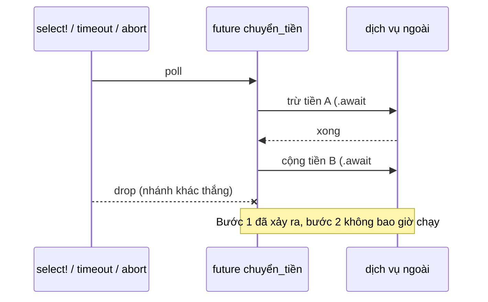
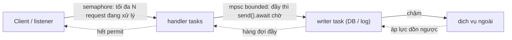
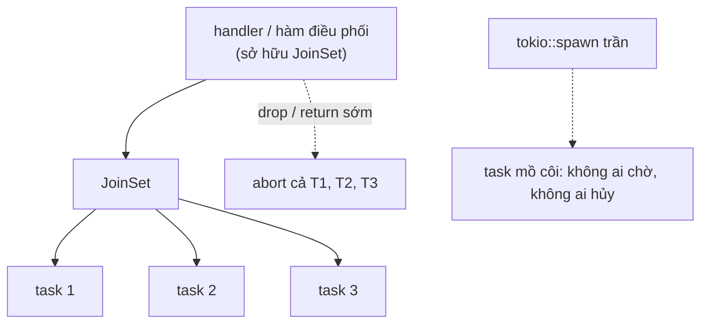
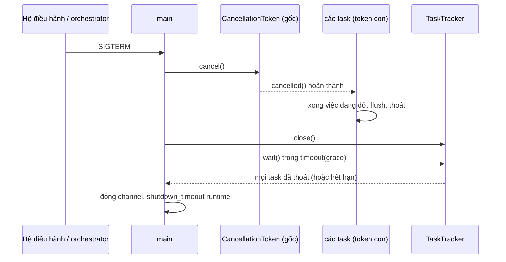

# P7 · Chương 09 — Async Rust trong production: cancellation, backpressure, blocking

> Chương này nói về **Tokio 1.53.2**, **tokio-util 0.7.18** và Rust 1.95.0. (Nhận xét của người soạn: 0.7.18 là phiên bản ghi trong `tokio-util/Cargo.toml` của tag `tokio-1.53.2`[^tu-pin]; repo này chưa dùng `tokio-util` trong `Cargo.lock`, nên đây là phiên bản người soạn chọn để đọc docs.) Phần `tower` dùng `tower-service` 0.3.3 và `tower` 0.5.2 (cũng là bản người soạn chọn để đọc docs; chương không khẳng định đây là bản mới nhất). Chương này **không** dạy lại runtime, scheduler, `spawn`, `spawn_blocking` hay `select!` từ đầu; những thứ đó đã ở [Chương 08 — Tokio](08-tokio.md). Ở đây chỉ hỏi: *khi dịch vụ chạy thật, cái gì hỏng, và hỏng ở đâu*.

## Bạn sẽ hiểu được gì

1. **Q1.** "Hủy" một việc async thực chất là gì, và vì sao nó làm vỡ invariant của code nhiều bước (cancellation safety)? → mục 1
2. **Q2.** `timeout` thực sự làm gì, và nó *không* làm gì (task đã spawn, `spawn_blocking`, phần việc phía xa)? → mục 2
3. **Q3.** Backpressure là gì; channel bounded/unbounded, `Semaphore`, `poll_ready` của tower khác nhau chỗ nào? → mục 3
4. **Q4.** Vì sao `tokio::spawn` rời rạc dễ rò task, và `JoinSet`/`AbortHandle`/`TaskTracker` giải quyết gì? → mục 4
5. **Q5.** Những kiểu chặn nào hay lọt vào code async, tránh bằng cách nào, và phát hiện bằng số đo nào? → mục 5
6. **Q6.** Graceful shutdown có cây `CancellationToken`, `TaskTracker` và hạn chót ra sao? → mục 6
7. **Q7.** Vì sao future `Send` bị phá khi giữ `MutexGuard` qua `.await`, và sửa thế nào? → mục 7

## Kiến thức cần trước

- [Chương 05 — Future, poll, Waker](05-future-poll-waker.md): future là state machine được poll, drop future là gì.
- [Chương 06 — async/await và Pin](06-async-await-pin.md): biến nào sống qua `.await` thì nằm trong state machine.
- [Chương 08 — Tokio](08-tokio.md): runtime, `spawn`, `JoinHandle`, `abort`, `spawn_blocking`, `select!`, mutex/channel/semaphore, ba phần của graceful shutdown. Chương này dẫn lại bằng mục, không giải thích lại.
- [P4 · Chương 04 — Condition variable và semaphore](../04-concurrency/04-condition-variable-va-semaphore.md): semaphore là gì ở mức hệ điều hành.

## 1. Hủy là drop future, và hệ quả cho invariant (Q1)

> **Trả lời ngắn.** Trong Tokio, "hủy" không phải là một ngoại lệ hay tín hiệu gửi vào code đang chạy: future bị hủy khi bị *drop*[^tokio-select-drop], và nó dừng ở đúng chỗ `.await` nó đang treo[^tokio-select-own]. Với task đã `spawn` bị `abort`, mọi biến cục bộ bị hủy bằng destructor (hàm `drop` của từng kiểu)[^tokio-cancel-drop]. Vì vậy code sau `.await` đó không bao giờ chạy, và hàm nhiều bước có thể bị cắt giữa chừng (suy luận của người soạn). Hàm "cancellation safe" là hàm mà việc drop rồi tạo lại nó là thao tác không có tác dụng[^tokio-select-def].

**Giải thích.**

Hình dung (nhận xét của người soạn): nhân viên ngân hàng đang làm lệnh chuyển tiền hai bước "trừ tiền tài khoản A" rồi "cộng tiền tài khoản B". Sếp gọi anh ta đi họp giữa hai bước. Nếu hai bước không nằm trong một giao dịch, tiền biến mất. Hủy trong async chính là tiếng gọi đó, và nó chỉ xảy ra *giữa hai bước* (tại `.await`), không bao giờ ở giữa một bước đồng bộ. *Invariant* (điều kiện phải luôn đúng giữa các bước; ở đây là tổng tiền không đổi) bị vỡ ở đúng khoảng giữa hai bước đó.

*Cơ chế.* Future chỉ tiến lên khi được poll; nó "inert" (không tự chạy)[^future-inert]. Chủ của future (một `select!`, một `timeout`, hay runtime khi `abort`) chỉ cần *thôi poll* rồi drop. Hủy luôn xảy ra tại một `.await`[^tokio-select-own]. Với task đã `spawn`, `abort` làm cùng việc: task dừng ở `.await` nó đã yield và mọi biến cục bộ bị hủy[^tokio-cancel-drop]; chi tiết `abort` ở [Chương 08, mục 5](08-tokio.md).

*Ai drop future của bạn.* Những chỗ quen thuộc: nhánh thua của `select!`[^tokio-select], `timeout` quá hạn[^tokio-timeout], `abort` hoặc tắt runtime[^tokio-cancel-rt], và `JoinSet` bị drop (mục 4). Một số framework web cũng có thể drop future của handler vào lúc kết nối đóng; điều này phụ thuộc framework, người soạn không có nguồn nên không khẳng định (suy luận của người soạn: hãy đọc docs framework bạn dùng, đừng giả định handler luôn chạy tới cuối).



```rust
// Minh họa, không phải code để chạy nguyên văn.
async fn chuyen_tien(a: Id, b: Id, so_tien: u64) -> Result<(), Error> {
    tru_tien(a, so_tien).await?;   // .await #1
    cong_tien(b, so_tien).await?;  // .await #2: hủy ở đây thì tiền đã bị trừ
    Ok(())
}
```

*Ba cách giữ invariant* (nhận xét của người soạn, dựa trên định nghĩa ở docs):

1. **Đưa việc quan trọng ra khỏi đường hủy.** Nếu hai bước phải đi liền nhau, đặt chúng vào một giao dịch phía dịch vụ (transaction DB), hoặc `spawn` chúng thành task riêng: drop `JoinHandle` chỉ tách task chứ không hủy nó[^tokio-jh-detach], task tiếp tục chạy và kết quả bị mất[^tokio-jh-drop]. Cái giá: không còn gì dừng task đó trừ `abort` hoặc tắt runtime.
2. **Giữ trạng thái ngoài future.** Docs định nghĩa cancel-safe là "drop rồi tạo lại là no-op" và nhắc rằng định nghĩa này sinh ra từ `select!` trong vòng lặp: không có tính chất đó thì bạn mất tiến độ mỗi khi một nhánh khác thắng và vòng lặp chạy lại[^tokio-select-def]. Ví dụ hay gặp là đọc đủ N byte: `read_exact` không an toàn[^tokio-select-safe]; giữ bộ đệm và số byte đã đọc *ngoài* future rồi lặp `read`.
3. **Dùng đúng hàm cancel-safe, hoặc dùng `&mut future` đã pin** để cùng một future sống qua nhiều vòng `select!`: docs nói cần future `Unpin`, đạt được bằng `Box::pin` hoặc pin trên stack[^sel-pin].

*Bảng: hàm nào mất gì khi bị drop giữa chừng.* Mỗi dòng đối chiếu với mục "Cancel safety" trong docs của chính method đó (Tokio 1.53.2, tokio-util 0.7.18); danh sách trong docs `select!` chỉ bổ sung và chính nó nói là không đầy đủ[^tokio-select-notexh].

| Hàm | Khi bị drop giữa chừng |
|---|---|
| `mpsc::Receiver::recv` | Cancel-safe: chưa có tin nào bị lấy ra khỏi channel[^recv-safe] |
| `mpsc::Sender::send` | Tin chắc chắn chưa được gửi, nhưng tin bị drop và mất[^send-cancel]; mất vị trí trong hàng đợi[^send-queue] |
| `mpsc::Sender::reserve` + `Permit::send` | Cách tránh mất tin: giữ chỗ trước rồi mới gửi[^send-reserve]; drop `Permit` trả chỗ lại cho channel[^reserve-drop]. Riêng `reserve().await` bị hủy thì mất vị trí trong hàng đợi[^reserve-queue] |
| `AsyncReadExt::read_exact` | Không cancel-safe: một phần dữ liệu có thể đã được đọc vào `buf` khi future bị drop[^read-exact-cancel]; docs `select!` xếp nó (cùng `read_to_end`, `read_to_string`, `write_all`) vào nhóm có thể mất dữ liệu[^tokio-select-safe] |
| `AsyncWriteExt::write_all` | Không cancel-safe: buffer có thể đã được ghi một phần, và lần gọi `write_all` sau bắt đầu lại từ đầu buffer[^write-all-cancel] (suy luận của người soạn: nếu gọi lại với cùng buffer, phần đã ghi sẽ bị ghi lặp) |
| `Mutex::lock` | Mất vị trí trong hàng đợi công bằng[^mutex-lock-cancel]; docs `select!` xếp vào nhóm không cancel-safe vì lý do này[^tokio-select-queue] |
| `Semaphore::acquire` | Mất vị trí trong hàng đợi công bằng[^sem-acq-cancel] |
| `Notify::notified` | Mất vị trí trong hàng đợi công bằng[^notified-cancel] |
| `JoinSet::join_next` | Cancel-safe: không task nào bị lấy ra khỏi set[^js-joinnext-safe] |
| `&mut JoinHandle<T>` đem await | Cancel-safe: không mất kết quả của task[^jh-mut-safe] |
| `CancellationToken::cancelled` | Cancel-safe[^ct-cancelled-safe] |
| `CancellationToken::run_until_cancelled(fut)` | Cancel-safe chỉ khi `fut` cancel-safe[^ct-run-safe] |

Docs cũng nhắc: hủy thứ không cancel-safe không nhất thiết là sai, ví dụ khi hủy task vì ứng dụng đang tắt thì mất dữ liệu đọc dở thường không quan trọng[^tokio-select-notwrong].

<details><summary>Đi sâu: <code>Drop</code> là đồng bộ, dọn dẹp async và vị trí của <code>.await</code> trong destructor</summary>

- `Drop::drop` có chữ ký `fn drop(&mut self)`, không phải `async`[^drop-sig]. Suy luận của người soạn: vì vậy destructor của future bị hủy không thể `.await`; việc dọn dẹp bất đồng bộ (đóng kết nối có handshake, flush có chờ) phải đi qua một đường *tường minh* như `async fn close(self)` hoặc một message gửi sang task quản lý tài nguyên, còn `Drop` chỉ làm phần đồng bộ và không chặn.
- Docs `tokio::task` nhắc rằng hàm đồng bộ bạn gọi từ async cũng chặn thread, "kể cả destructor của đối tượng bị hủy trong code async"[^tokio-sync-in-async]. Hệ quả: `Drop` nặng (đóng file lớn, `join` thread) cũng nằm trong mục 5.
- `JoinHandle` bảo đảm destructor của task đã chạy xong trước khi bạn quan sát được hoàn thành qua `await`, `is_finished`[^jh-dtor]. Nên muốn chắc chắn việc dọn của task bị `abort` đã xong, hãy `await` handle (hoặc `JoinSet::join_next`), đừng chỉ gọi `abort`[^tokio-abort-async].
- `abort` một task có thể không ra lỗi cancelled vì task có thể đã xong trước[^jh-abort-complete] (đã nêu ở [Chương 08, mục 5](08-tokio.md)); code của bạn phải xử lý cả `Ok` lẫn `Err(cancelled)`.

</details>

**Quay lại Q1:** hủy là drop future tại `.await`; mọi hàm nhiều bước phải hoặc cancel-safe, hoặc được che khỏi đường hủy (task riêng, transaction), hoặc giữ trạng thái ngoài future.

## 2. `timeout`: hạn chót không phải là hủy việc phía xa (Q2)

> **Trả lời ngắn.** `timeout(d, fut)` chờ `fut` tối đa `d`; quá hạn thì trả `Err(Elapsed)` và future *bị hủy* (bị drop)[^tokio-timeout], nên mọi điều ở mục 1 đều áp dụng. Nó chỉ drop thứ nó bọc: nếu bạn bọc một `JoinHandle`, task bên trong vẫn chạy tiếp (drop handle chỉ tách task)[^tokio-jh-detach]; `spawn_blocking` đã chạy thì không abort được (chưa chạy thì abort có thể chặn nó khởi động)[^tokio-csb-abort]. Và nó poll future trước khi xét hạn[^tokio-timeout-poll].

**Giải thích.**

Hình dung (nhận xét của người soạn): bạn gọi shipper và nói "10 phút nữa không thấy hàng thì tôi hủy đơn". Hủy đơn là việc *của bạn*; shipper ở ngoài đường có thể đã lấy hàng, và đơn bên kho đã được xử lý. `timeout` cũng thế: nó chỉ ngừng chờ, không có cách nào bảo dịch vụ phía xa dừng.

Từng điểm cần nhớ:

- **`timeout` là bọc một future.** Hết hạn thì trả `Err(Elapsed)` và future bị hủy[^tokio-timeout]; hủy chính `timeout` cũng chỉ là drop future, không cần dọn gì thêm[^to-cancel]. Có thể lấy lại future gốc bằng `Timeout::into_inner`[^to-into-inner].
- **Poll trước, kiểm hạn sau** (đã nêu ở [Chương 08, mục 7](08-tokio.md)). Nếu future không bao giờ yield giữa chừng thì nó có thể hoàn thành vượt hạn mà không lỗi[^tokio-timeout-poll]. Hạn chót không cứu được code chặn thread (mục 5). (Suy luận của người soạn: `Timeout` được poll bởi chính task đang chạy; khi future bên trong chiếm thread trong một lần `poll`, không có điểm nào để kiểm hạn trước khi lần `poll` đó trả về.)
- **Hoàn thành tức thì thì luôn thắng.** Nếu future hoàn thành ngay, `timeout` bảo đảm trả `Ok` dù hạn là bao nhiêu[^to-immediate].
- **Hạn tuyệt đối với `timeout_at`.** `timeout_at(deadline, fut)` đòi future xong trước một `Instant` cho trước[^to-at]. (Nhận xét của người soạn: với một request đi qua nhiều bước, tính hạn chót *một lần* ở cửa vào rồi truyền `Instant` xuống, thay vì mỗi bước tự đặt `timeout(5s)` rồi cộng dồn vượt cam kết với client.)
- **Timeout bọc một `JoinHandle` không hủy task.** `timeout(d, handle)` quá hạn chỉ drop `handle`, task vẫn chạy nền và kết quả mất[^tokio-jh-drop]. Muốn hủy thật, giữ `AbortHandle` hoặc spawn vào `JoinSet` (mục 4) rồi gọi `abort`.
- **Timeout bọc `spawn_blocking` còn yếu hơn:** closure đã chạy thì không dừng được, và có thể vẫn chiếm một thread của blocking pool[^tokio-csb-abort].
- **Timeout quanh hàm không cancel-safe thì mất dữ liệu:** `timeout(d, read_exact(..))` quá hạn là một lần hủy `read_exact` (không an toàn[^tokio-select-safe]); `timeout` quanh `send` làm tin bị drop[^send-cancel]; quanh `acquire` làm bạn mất chỗ trong hàng[^sem-acq-cancel].

*Hạn chót trong vòng `select!`.* Khi muốn cả một vòng lặp có hạn chót, tạo `sleep` *một lần*, pin nó, rồi đặt `&mut sleep` vào `select!` để các vòng sau không đặt lại đồng hồ; ví dụ trong docs `select!` dùng đúng mẫu này, và nhấn mạnh phải dùng reference đến future `Unpin`[^sel-pin]. Docs cũng cảnh báo mẫu sai dùng `if` precondition để tắt nhánh: cần cẩn thận kẻo bỏ lỡ giá trị[^sel-racy].

<details><summary>Đi sâu: <code>timeout</code> và <code>select!</code> khác nhau chỗ nào</summary>

- `select!` chạy các nhánh *đồng thời nhưng không song song* trên cùng task; nếu một nhánh chặn thread thì mọi nhánh khác đứng[^sel-runtime]. Muốn song song thực thụ, docs bảo `spawn` từng việc rồi đưa `JoinHandle` vào `select!`[^sel-runtime]. Điều này khớp với việc `timeout` không cứu được code chặn.
- Docs `select!` nói nhánh có `if` precondition `false` bị tắt, nhưng biểu thức future vẫn được tạo mà không poll[^sel-pre].
- Quy tắc thực dụng (nhận xét của người soạn): thứ gì bạn đặt trong `select!` hoặc `timeout` phải là thứ bạn chấp nhận bị drop ở mọi `.await` của nó; xem lại bảng ở mục 1.

</details>

**Quay lại Q2:** `timeout` = ngừng chờ + drop future bên trong; không dừng được task đã spawn, không dừng `spawn_blocking`, không dừng dịch vụ phía xa, và không cứu được future không bao giờ yield.

## 3. Backpressure: channel bounded, `Semaphore`, `poll_ready` (Q3)

> **Trả lời ngắn.** Backpressure là cơ chế để bên nhận chậm *làm bên gửi chậm theo*, thay vì hàng đợi phình ra vô hạn. Channel bounded của Tokio làm đúng việc này: đầy thì `send` chờ[^mpsc-bounded]; channel unbounded không có backpressure và có thể làm hết bộ nhớ[^unb-mem]. `Semaphore` giới hạn số việc chạy đồng thời[^tokio-sem]. Trong tower, cùng ý tưởng nằm ở `Service::poll_ready`: dịch vụ đầy thì trả `Pending`, caller chịu trách nhiệm hỏi sẵn sàng trước khi gọi[^tower-bp].

**Giải thích.**

Hình dung (nhận xét của người soạn): ống nước chảy vào bể. Nếu bể có van tràn biết đóng khi đầy (bounded), nước ngừng chảy từ nguồn; nếu bể là cái hố không đáy (unbounded), ống vẫn chảy cho tới khi nền nhà sập (hết RAM, process bị `abort`).



*Sơ đồ minh họa của người soạn, không phải kiến trúc bắt buộc.*

**Channel bounded và unbounded.** Module `mpsc` có hai biến thể: bounded có giới hạn số tin lưu trong channel, quá giới hạn thì gửi tiếp sẽ chờ tới khi có tin được nhận[^mpsc-bounded]. Unbounded có dung lượng vô hạn nên `send` luôn hoàn thành ngay[^mpsc-unb-always]. Khi channel bounded đầy, `send` bị từ chối và task được thông báo khi có chỗ trống; docs gọi đó là backpressure[^mpsc-bp]. `channel(buffer)` đòi buffer ít nhất 1[^ch-cap]. Với unbounded: nếu bên nhận chậm thì tin được đệm tùy ý[^unb-nobp], bộ nhớ khả dụng là cận ngầm duy nhất và có thể khiến process hết bộ nhớ và bị abort[^unb-mem]. Docs Tokio còn nói dung lượng channel là chìa khóa để dựng chương trình vững vì nó đóng vai trò chính trong xử lý backpressure[^tokio-mpsc-cap].

Ba cách gửi vào channel bounded, tùy điều bạn muốn khi đầy (nhận xét của người soạn):

| Muốn gì khi đầy | Dùng | Ghi chú |
|---|---|---|
| Chờ (đẩy áp lực ngược lên nguồn) | `send().await` | Mất tin nếu bị hủy[^send-cancel]; xếp hàng công bằng[^send-queue] |
| Từ chối ngay (load shedding: bỏ bớt việc khi quá tải) | `try_send` | Trả về ngay, với hai lỗi tách riêng: bên nhận đã đóng và buffer đầy[^trysend] |
| Chờ nhưng không để mất tin khi bị hủy | `reserve().await` rồi `permit.send(..)` | Giữ chỗ trước; drop `Permit` trả chỗ[^send-reserve][^reserve-drop]; bản thân `reserve` bị hủy vẫn mất vị trí xếp hàng[^reserve-queue] |

**`Semaphore`: giới hạn số việc đồng thời.** Semaphore giữ một tập permit (mỗi permit là một suất được phép chạy); khác mutex ở chỗ cho nhiều bên cùng truy cập[^tokio-sem]. Hết permit thì `acquire` chờ tới khi có permit bị drop[^sem-wait]; hàng đợi công bằng theo thứ tự yêu cầu[^tokio-sem-fair]. Docs có một ví dụ cho server: giới hạn số request xử lý cùng lúc, vì cho phép số request không giới hạn có thể dẫn tới denial-of-service (dịch vụ bị quá tải đến mức không phục vụ được ai)[^sem-ex-dos]. Mẫu: lấy permit *trước khi* spawn; permit lấy bằng `acquire_owned` để di chuyển được vào task, vì semaphore trong ví dụ nằm trong `Arc` chứ không phải biến global (docs nói nếu là global thì `acquire` là đủ)[^sem-owned]; permit nhả khi drop. Nền tảng semaphore ở [P4 · Chương 04](../04-concurrency/04-condition-variable-va-semaphore.md).

```rust
// Minh họa mẫu của docs Semaphore: giới hạn kết nối đang xử lý.
let sem = std::sync::Arc::new(tokio::sync::Semaphore::new(64));
loop {
    // Lấy permit TRƯỚC khi accept: hết permit thì không accept thêm,
    // kernel sẽ giữ kết nối trong backlog (suy luận của người soạn).
    let permit = sem.clone().acquire_owned().await.unwrap();
    let (sock, _) = listener.accept().await?;
    tokio::spawn(async move {
        handle(sock).await;
        drop(permit);
    });
}
```

Điểm tinh tế: ở đây `acquire_owned` đứng *trước* `accept`, nên khi quá tải, tải bị đẩy về hàng đợi của kernel thay vì bị đệm trong bộ nhớ process (suy luận của người soạn). Ví dụ của docs ghi chú rõ rằng nó lấy permit trước khi nhận socket kế tiếp[^sem-ex-acq], nhưng docs không bình luận về backlog. Hàng đợi của kernel cũng không vô hạn: accept queue dài tối đa `backlog` (bị cắt bởi `somaxconn`), đầy thì client có thể nhận `ECONNREFUSED` hoặc SYN bị bỏ để thử lại sau; cơ chế và số đo ở [P6 · Chương 07, mục 2](../06-networking/07-socket-va-kernel.md). (Giá trị backlog mà `TcpListener::bind` của Tokio đặt không nằm trong nguồn người soạn đã đọc, nên chương không khẳng định.)

**`poll_ready` của tower.** Trait `Service` của `tower-service` mô tả một hàm bất đồng bộ từ request sang response và là một trong các abstraction nền tảng của Tower[^tower-svc]. Giao diện `Service` (`tower-service` 0.3.3) tách "sẵn sàng" khỏi "gọi": gọi một service đang đầy lẽ ra phải ra lỗi, và caller có trách nhiệm bảo đảm service sẵn sàng trước khi gọi[^tower-bp]; `poll_ready` trả `Ready` nếu service nhận được request[^tower-ready], trả `Pending` và đánh thức task khi service hết đầy[^tower-pending]. Trước `call` phải có `Ready(Ok(()))`; service được phép panic nếu không[^tower-panic]. Điểm cần chú ý: `poll_ready` *có thể giữ tài nguyên dùng chung* cho lần `call` kế tiếp, nên implementation phải nhả tài nguyên đó nếu service bị drop trước `call`[^tower-reserve]; và khi clone service để chuyển vào future, bản gốc sẵn sàng không có nghĩa bản clone sẵn sàng[^tower-clone]. (Nhận xét của người soạn: đó chính là cùng ý với `mpsc::Sender::reserve`, tức "giữ chỗ rồi mới gửi".) Tower có sẵn các lớp dựng trên ý tưởng này: `ConcurrencyLimit` giới hạn số request đồng thời mà service bên dưới xử lý[^tower-climit], `LoadShed` bỏ request khi service bên trong chưa sẵn sàng[^tower-shed], `Buffer` đặt một mpsc buffer phía trước service[^tower-buffer].

<details><summary>Đi sâu: đóng channel và semaphore có kiểm soát; chọn cỡ buffer; gửi từ code đồng bộ</summary>

- **Đóng êm channel:** khi `Receiver` bị drop, mọi tin chưa đọc bị lấy khỏi channel và bỏ đi[^mpsc-drop-recv]. Docs khuyên bên nhận gọi `close` trước (chặn gửi thêm) rồi đọc cạn hàng đợi trước khi drop[^mpsc-clean]. Hết `Sender` và hết tin đệm thì `recv` trả `None`[^mpsc-disc]; hệ quả: một task còn giữ `Sender` clone (mục 4) làm `recv` không bao giờ trả `None`.
- **Đóng semaphore:** `Semaphore::close` ngăn cấp permit mới và đánh thức mọi bên đang chờ[^sem-close]; hữu ích khi tắt dịch vụ để các `acquire` đang chờ thoát thay vì treo.
- **Cỡ buffer** (nhận xét của người soạn): docs không cho con số. Buffer lớn chỉ dời lúc "đầy" sang muộn hơn và tăng độ trễ xếp hàng; buffer nhỏ cho áp lực ngược sớm. Chọn theo "chấp nhận trễ bao lâu" và đo (mục 5), không theo "cho khỏi lỗi".
- **Giữa code đồng bộ và async:** với channel bounded dùng `blocking_send`/`blocking_recv` ở phía đồng bộ[^blocking-chan]; `blocking_send` panic nếu gọi trong ngữ cảnh async[^blocking-send-panic]. Với unbounded, docs khuyên chọn loại channel khớp với phía *nhận*[^blocking-chan].
- **Vòng channel bounded có thể deadlock** (suy luận của người soạn, không có nguồn): nếu A gửi vào B còn B gửi lại vào A, và cả hai cùng đầy, không ai nhận được.
- Tham chiếu chéo mục 5: `spawn_blocking` có hàng đợi *không* có backpressure[^tokio-mbt-queue]; đó là nơi nên đặt `Semaphore` của bạn.

</details>

**Quay lại Q3:** backpressure = bên chậm làm bên nhanh chậm theo; dùng channel bounded cho truyền tin, `Semaphore` cho giới hạn đồng thời, `poll_ready` cho dịch vụ; unbounded chỉ khi biết chắc nguồn bị chặn bằng cách khác.

## 4. Structured concurrency và task leak: `JoinSet`, `AbortHandle`, `TaskTracker` (Q4)

> **Trả lời ngắn.** `tokio::spawn` tạo task độc lập: drop `JoinHandle` chỉ tách task[^tokio-jh-detach], và Tokio không bảo đảm task được spawn sẽ chạy tới khi hoàn thành[^tokio-spawn-lifecycle]. Không ai "sở hữu" task, nên task có thể rò, lỗi bị nuốt. `JoinSet` đặt task dưới một chủ: drop set thì mọi task bị abort ngay[^js-drop]. Khi chỉ cần *chờ* cả nhóm mà không giữ kết quả, `TaskTracker` của tokio-util có những tính năng riêng mà `JoinSet` thiếu[^tt-mem]; docs của nó khuyên chỉ dùng khi cần một trong các tính năng đó[^tt-unique].

**Giải thích.**

Hình dung (nhận xét của người soạn): thầu chính giao việc cho nhiều thầu phụ. "Structured concurrency" (cách gọi của người soạn cho quy ước, không phải thuật ngữ của docs Tokio) nghĩa là thầu phụ không được sống lâu hơn công trình của thầu chính: khi thầu chính rời đi, mọi thầu phụ đều đã xong hoặc đã bị gọi về. `tokio::spawn` trần không có quy ước đó: nó giao việc rồi cắt dây. Rust cũng không ép điều này; nó chỉ đòi `'static`, mà nguyên nhân thì ở [Chương 08, mục 3](08-tokio.md).

**Các kiểu rò task** (nhận xét của người soạn, mỗi kiểu kèm mẩu docs liên quan):

1. **Task nền không có lối thoát.** Vòng lặp `loop { rx.recv().await ... }` chạy mãi nếu channel không bao giờ đóng. Channel chỉ đóng khi *mọi* `Sender` bị drop và tin đệm đã đọc hết[^mpsc-disc]; chỉ cần một clone `Sender` nằm trong một task khác (hoặc trong chính task đang nhận) là `recv` không bao giờ trả `None`.
2. **Task giữ tài nguyên.** Task mang một `OwnedSemaphorePermit`, một kết nối DB, một lock; nếu task kẹt, tài nguyên kẹt theo. Permit chỉ nhả khi bị drop[^sem-wait].
3. **Lỗi bị nuốt.** Task panic thì chỉ `await` handle mới thấy `JoinError`[^tokio-task-panic]; handle đã drop thì không ai thấy (suy luận của người soạn từ việc kết quả bị mất khi drop handle[^tokio-jh-drop]).
4. **Kết quả tích tụ.** `JoinSet` giữ giá trị trả về của mọi task đã thêm; nếu bạn cứ thêm mà không bao giờ `join_next` thì kết quả chất lên, ngốn bộ nhớ dù hầu hết task đã xong[^tt-mem].
5. **Ranh giới runtime.** Tắt runtime (kể cả trả về từ `#[tokio::main]`) hủy mọi task ngay lập tức[^tokio-cancel-rt]. Không có "rò vĩnh viễn", nhưng có "việc bị cắt ngang" nếu bạn không `join` (mục 6).

**`JoinSet`.** Là tập hợp các task spawn trên runtime, mọi task phải cùng kiểu trả về `T`[^js-same-type]; các task trả về theo thứ tự hoàn thành, không theo thứ tự spawn[^js-unordered]. `spawn` trả `AbortHandle` để hủy từ xa một task riêng[^js-spawn-abort]. Điểm mấu chốt cho production: **drop `JoinSet` là abort toàn bộ**[^js-drop], tức là early-return (`?`) trong hàm đang giữ set tự động dọn các task con. Các thao tác chính:

| Thao tác | Ý nghĩa |
|---|---|
| `join_next().await` | Lấy kết quả task xong tiếp theo; cancel-safe nên đặt được trong `select!`[^js-joinnext-safe] |
| `abort_all()` | Abort, nhưng **không** gỡ task khỏi set; muốn chờ hủy xong phải `join_next` tới khi rỗng[^js-abortall] |
| `shutdown().await` | Tương đương `abort_all` rồi `join_next` tới hết; bỏ qua panic của các task đang tắt[^js-shutdown] |
| `join_all()` | Nếu một task lỗi `JoinError` thì **panic** và hủy các task còn lại[^js-joinall]; muốn xử lý lỗi kiểu khác phải tự lặp `join_next` |
| `detach_all()` | Gỡ task khỏi set mà không abort; chúng chạy tiếp ngay cả khi set bị drop[^js-detach] |

Drop một `AbortHandle` **không** abort task, chỉ bỏ quyền abort[^ah-drop]; ngược lại với `JoinSet`.

```rust
// Minh họa mẫu fail-fast: lỗi đầu tiên dừng cả nhóm.
let mut set = tokio::task::JoinSet::new();
for url in urls { set.spawn(fetch(url)); }

let mut ket_qua = Vec::new();
while let Some(res) = set.join_next().await {
    match res {
        Ok(Ok(body)) => ket_qua.push(body),
        Ok(Err(e))   => { set.shutdown().await; return Err(e); } // dừng và chờ dọn xong
        Err(join_err) => { set.shutdown().await; return Err(join_err.into()); }
    }
}
```



**`TaskTracker` (tokio-util).** Docs của nó nói `JoinSet` nhiều tính năng hơn, nên chỉ dùng `TaskTracker` khi cần một tính năng riêng[^tt-unique]: task xong thì giải phóng bộ nhớ ngay[^tt-mem]; thêm task không cần `&mut`; clone được để chia sẻ cho nhiều task[^tt-share]; và có trạng thái "đã đóng" để `wait` không hoàn thành sớm khi tracker còn trống[^tt-notclosed]. Đổi lại, **drop `TaskTracker` không abort** task[^tt-nodrop]. Docs chỉ định mục đích: `CancellationToken` báo tắt, `TaskTracker` chờ chúng tắt xong[^tt-purpose]. Chi tiết dùng ở mục 6.

<details><summary>Đi sâu: hàng đợi <code>spawn_blocking</code> trong JoinSet; <code>JoinHandle</code> và destructor; kết hợp với Semaphore</summary>

- `JoinSet` có cả `spawn_blocking`[^js-spawn-blocking], nhưng `abort` một task `spawn_blocking` không có tác dụng nếu nó đã chạy[^tokio-csb-abort]; `shutdown()` là `abort_all` rồi `join_next` tới hết[^js-shutdown], nên (suy luận của người soạn) vẫn phải chờ closure đó chạy xong.
- Khi `join_next` / `JoinHandle::await` cho bạn kết quả, destructor của task *đã chạy xong*[^jh-dtor]; đó là lý do `shutdown()` chờ được "đã dọn xong" chứ không chỉ "đã báo hủy".
- Giới hạn số task đồng thời trong một `JoinSet`: lấy permit từ `Semaphore` trước khi `spawn`, đưa permit vào task (mẫu ở mục 3). Nhờ vậy cả số task lẫn bộ nhớ kết quả có cận (nhận xét của người soạn).
- `JoinHandle` đã bị `abort` có thể vẫn trả `Ok` nếu task hoàn thành trước lúc hủy[^jh-abort-complete] (xem [Chương 08, mục 5](08-tokio.md)); không nên dựa vào "chắc chắn là `Err(cancelled)`".

</details>

**Quay lại Q4:** `spawn` trần là task mồ côi; hãy đặt task dưới một chủ (`JoinSet` khi cần kết quả và hủy theo scope, `TaskTracker` khi chỉ cần chờ), và nhớ hai dây tình cờ giữ task sống: clone `Sender` và permit.

## 5. Blocking trong async: phân loại, chọn công cụ, phát hiện (Q5)

> **Trả lời ngắn.** Task trên một worker chạy xen kẽ, nên một thao tác chặn làm đứng cả thread đó[^task-block]; việc đổi task chỉ xảy ra ở `.await`[^tokio-await-only]. Việc chặn đưa sang `spawn_blocking` (việc hữu hạn)[^csb-bounded], thread riêng (việc chạy rất lâu)[^tokio-csb-long] hoặc pool riêng như rayon[^tokio-rayon]. Phát hiện: theo dõi số đo của runtime, như thời gian bận của worker[^m-busy] và (cần `tokio_unstable`) thời gian poll trung bình[^m-poll-mean].

**Giải thích.**

[Chương 08, mục 4](08-tokio.md) đã giải thích *vì sao* chặn là xấu và so sánh `spawn_blocking`/`block_in_place`. Mục này đi tiếp: **cái gì thực tế hay bị chặn, chọn công cụ nào, và làm sao biết mình đang chặn.**

Hình dung (nhận xét của người soạn): đường một làn; một xe tải dừng bốc hàng chặn cả đoạn đường, dù mỗi xe sau chỉ cần đi 1 giây. `spawn_blocking` là làn bốc hàng riêng.

**Những thứ hay lọt vào code async mà không ai nhận ra** (nhận xét của người soạn):

- Client đồng bộ: driver DB sync, HTTP client blocking, SDK chỉ có API sync.
- `std::fs`, `std::net`, DNS qua `getaddrinfo` kiểu sync. (`tokio::fs` mặc định đã chạy trên `spawn_blocking`[^tokio-fs-always]; ngoại lệ io_uring thử nghiệm ở [chương 03, mục 6](03-kqueue-io-uring.md).)
- `std::thread::sleep`, `Mutex::lock` của std trên lock có contention cao.
- CPU nặng không có `.await`: băm mật khẩu, nén, parse JSON khổng lồ, regex xấu, serialize lớn.
- Destructor nặng: docs nhắc rằng hàm không-async bạn gọi từ code async cũng chặn, kể cả destructor[^tokio-sync-in-async].
- `block_on` lồng nhau: gọi `Runtime::block_on` trong ngữ cảnh async thì panic[^rt-blockon-panic]; `Handle::block_on` cũng panic khi gọi từ ngữ cảnh async như bên trong `block_on` hoặc hàm gắn `tokio::main`[^hblock-panic].

**Chọn công cụ** (docs cho từng dòng, bảng là tổng hợp của người soạn; so sánh chi tiết `spawn_blocking` với `block_in_place` ở [Chương 08, mục 4](08-tokio.md)):

| Loại việc | Công cụ | Điều kiện / cảnh báo |
|---|---|---|
| Việc chặn hữu hạn (gọi driver sync, đọc file qua `std`) | `spawn_blocking` | Dành cho việc chặn có giới hạn và rồi sẽ xong; mỗi lần gọi chiếm một thread của pool suốt thời gian chạy[^csb-bounded] |
| CPU nặng nhiều lần | `spawn_blocking` + `Semaphore`, hoặc pool riêng như rayon[^tokio-rayon] | Giới hạn mặc định của pool rất lớn[^csb-limit-large]; docs bảo dùng semaphore để giới hạn số phép tính song song[^csb-sem]; hàng đợi không có backpressure[^tokio-mbt-queue] |
| Vòng lặp nền chạy mãi (consumer sync, worker) | `thread::spawn` riêng | Docs: việc chạy vô hạn hoặc rất lâu nên dùng thread riêng[^tokio-csb-long]; nói chuyện với async bằng channel bounded và `blocking_send`/`blocking_recv`[^blocking-chan] |
| Chặn tại chỗ trên worker hiện tại | `block_in_place` | Chỉ multi-thread (panic trên current_thread[^bip-panic]); executor giao các task khác sang worker mới trước khi chặn[^tokio-bip]; code chạy đồng thời *trong cùng task* (như `join!`) bị treo[^tokio-bip-join] |
| Code sync trong `block_in_place` cần gọi lại async | `Handle::block_on` | Docs: code trong `block_in_place` có thể dùng `block_on` để vào lại ngữ cảnh async[^bip-reenter] |

Hai điều dễ vấp (nhận xét của người soạn): (1) chặn bằng `block_in_place` hay `spawn_blocking` đều **không hủy được** một khi đã chạy[^tokio-bip-cancel][^tokio-csb-abort], nên `timeout` không cứu bạn (mục 2); (2) khi runtime tắt, `spawn_blocking` đang chạy bị chờ vô hạn nếu không có `shutdown_timeout`[^tokio-csb-shutdown] (mục 6).

**Phát hiện.** Các trang docs dẫn ở đây không mô tả cơ chế tự động báo "đang bị chặn" (người soạn không khẳng định Tokio hoàn toàn không có cơ chế nào ngoài những trang này); đường thực tế là *đo*. `Handle::metrics()` trả một view cho biết runtime đang chạy ra sao[^rt-metrics], kiểu `RuntimeMetrics`:

- `worker_total_busy_duration(worker)`: thời gian worker đã bận; bắt đầu từ 0 khi runtime được tạo, tăng khi worker xử lý việc, không bao giờ giảm hay reset; nếu một worker bận nhiều, nó kiểm tra sự kiện vào ít hơn[^m-busy]. Trang docs của hàm này chỉ ghi điều kiện `target_has_atomic=64`, không ghi `tokio_unstable`.
- Các số sau, theo trang docs của từng hàm, chỉ có khi bật cờ build `tokio_unstable`. `worker_mean_poll_time(worker)` là trung bình mũ (exponentially weighted moving average, mẫu gần đây nặng hơn) của thời gian mỗi lần poll task, hiện chỉ có ở multi-thread runtime[^m-poll-mean]; `budget_forced_yield_count()` đếm số lần task bị ép nhường lại cho scheduler do cạn *coop budget* (hạn mức tự nguyện mà mỗi task có giữa hai lần phải nhường; xem [Chương 08, mục 4](08-tokio.md))[^m-forced]; `blocking_queue_depth()` đếm số tác vụ đang xếp trong blocking pool[^m-queue].

Cách đọc (suy luận của người soạn, docs chỉ định nghĩa từng số): poll time trung bình tăng vọt trong khi không đổi tải → có một task giữ worker quá lâu giữa hai `.await`; `blocking_queue_depth` > 0 kéo dài → blocking pool đã bão hòa nên việc xếp hàng làm trễ; một worker bận gần 100% còn các worker khác rảnh → chặn hoặc CPU nặng dồn về một chỗ. Dấu hiệu ngoài runtime: độ trễ đuôi (p99: mức mà 99% request nhanh hơn) tăng đồng loạt cho mọi endpoint, `sleep`/timer trễ hơn hạn.

<details><summary>Đi sâu: tắt runtime có blocking; <code>Handle::block_on</code> trên current-thread; thread riêng và dọn dẹp</summary>

- `Runtime::shutdown_timeout(d)` chờ tối đa `d` cho mọi việc đã spawn dừng[^rt-shutdown-timeout]. Nó không hủy việc chặn: chúng chỉ được phép tiếp tục chạy sau khi hàm trả về[^bip-shutdown].
- `Drop` của runtime chờ vô hạn các việc đang chạy[^tokio-runtime-shutdown]; docs Runtime còn mô tả `shutdown_background` cho trường hợp drop runtime từ bên trong runtime khác, với cái giá có thể rò việc chặn đang chạy[^rt-shutdown-bg].
- Trên current-thread runtime, `Handle::block_on` không điều khiển được I/O và timer: chỉ `Runtime::block_on` làm được, trừ khi có thread khác đang gọi nó[^tokio-driving-ct]; (nhận xét của người soạn) một lý do nữa để không chạy async trong `spawn_blocking` trừ khi bạn hiểu runtime đang là loại nào.
- Thread riêng giữ vòng lặp nền (consumer Kafka sync, v.v.) cần một đường tắt tường minh: nhận cờ/`CancellationToken` qua `is_cancelled` hoặc kênh, rồi thoát; chương này không có nguồn riêng cho điều đó (nhận xét của người soạn).

</details>

**Quay lại Q5:** đừng để worker bị chặn; phân loại việc (hữu hạn / lặp mãi / CPU), chọn `spawn_blocking` (kèm semaphore), thread riêng, hoặc rayon; và gắn đồng hồ đo để phát hiện khi chặn lọt vào.

## 6. Graceful shutdown ở production: cây token, tracker, hạn chót (Q6)

> **Trả lời ngắn.** [Chương 08, mục 8](08-tokio.md) đã nêu ba phần: biết khi nào tắt, báo tắt, chờ tắt xong. Ở production cần thêm: một **cây** `CancellationToken` (token cha hủy thì mọi token con bị hủy[^ct-child]), `TaskTracker` được `close` rồi `wait`[^tt-wait-both] và **một hạn chót** cho cả quá trình, vì task không chịu dừng thì `wait` không bao giờ trả về (suy luận của người soạn từ định nghĩa của `wait`). Hủy chỉ là *yêu cầu*: task phải tự lắng nghe `cancelled()`[^ct-intro].

**Giải thích.**

Hình dung (nhận xét của người soạn): đóng nhà hàng đúng giờ. Treo biển "ngừng nhận khách" (token cha), từng khu vực nhận biển và phục vụ nốt bàn đang ăn (token con), quản lý đứng ở cửa đếm khách còn trong quán (tracker), và có giờ chốt: quá 30 phút thì khóa cửa, ai chưa xong thì mời ra.

**`CancellationToken`** là token báo yêu cầu hủy cho một hoặc nhiều task[^ct-intro]. Những tính chất cần biết:

- `cancelled()` trả một future hoàn thành khi có yêu cầu hủy[^ct-cancelled-now]; nó cancel-safe[^ct-cancelled-safe], nên đặt được trong `select!` ở vòng lặp.
- `child_token()` tạo token tự bị hủy khi token hiện tại bị hủy; hủy con không hủy cha, khác với `clone`[^ct-child]. Dùng cho cây: gốc → server → từng kết nối.
- `cancel()` hủy token và mọi token con, đánh thức mọi task đang chờ. Không nguyên tử: thread khác chạy song song có thể thấy con này đã hủy trong khi con kia chưa; nhưng khi `cancel()` trả về thì mọi con đã hủy hết[^ct-cancel-atomic].
- `drop_guard()` tạo guard hủy token (và mọi con) khi bị drop, trừ khi được tháo[^ct-dropguard]. Hữu ích để một scope (ví dụ `main`) hủy cây khi thoát bất thường (nhận xét của người soạn).
- `run_until_cancelled(fut)` chạy `fut`; nếu token bị hủy thì trả `None` và `fut` bị drop[^ct-run]. Nếu token đã bị hủy từ trước thì trả `None` ngay; sau đó, khi hoàn thành và hủy đồng thời, nó thiên về hoàn thành[^ct-run-bias]. Nó chỉ cancel-safe nếu `fut` cancel-safe[^ct-run-safe], nên đừng bọc cả một hàm nhiều bước không cancel-safe.

**`TaskTracker`.** `wait` chờ cho tới khi tracker **vừa đã `close` vừa rỗng**[^tt-wait-both]; không `close` thì `wait` không hoàn thành dù tracker rỗng[^tt-notclosed]. Khi `wait` trả về, mọi task đã thoát và destructor của future đã chạy xong[^tt-wait-dtor]. `close` cho phép các `wait` hoàn thành nhưng không ngăn bạn spawn thêm task[^tt-close]. `track_future` đếm future là một task, và gỡ nó khi future *bị drop* chứ không phải khi `poll` trả `Ready`[^tt-track-future].

```rust
// Minh họa khung: token + tracker + hạn chót. Không chạy nguyên văn.
let token   = CancellationToken::new();
let tracker = TaskTracker::new();

// mỗi kết nối: token con, vòng lặp chỉ dùng nhận cancel-safe
tracker.spawn(serve(listener, token.child_token(), tracker.clone()));

signal_tat().await;          // ctrl_c / SIGTERM (xem Chương 08)
token.cancel();              // 1. báo tắt: dừng accept, bảo task dọn
tracker.close();             // 2. không đợi thêm task mới
if tokio::time::timeout(Duration::from_secs(25), tracker.wait()).await.is_err() {
    // 3. quá hạn: ghi log task nào còn sống; trả về main sẽ hủy phần còn lại
}
```

*Khung code trên và sơ đồ dưới là minh họa của người soạn; thứ tự từng bước dựa vào các tính chất đã nêu ở trên.*



**Thứ tự an toàn** (nhận xét của người soạn, mỗi bước dựa vào tính chất ở trên):

1. **Ngừng nhận việc mới** trước: vòng accept đặt `token.cancelled()` trong `select!`; sau bước này không có kết nối mới, nên số việc cần chờ chỉ giảm.
2. **Báo tắt** bằng `cancel()` ở gốc; các nhánh `child_token` nhận tự động.
3. **Cho task hoàn thành việc đang dở**: mỗi task kiểm tra token *giữa* các đơn vị công việc, không cắt ngang một đơn vị không cancel-safe (mục 1). Dùng `select!` với `biased;` để cancel được kiểm tra đầu tiên cũng được: `biased;` làm `select!` poll các nhánh theo thứ tự từ trên xuống[^tokio-select-biased], còn mặc định nó chọn ngẫu nhiên nhánh kiểm tra trước[^tokio-select-fair].
4. **`close()` rồi `wait()` trong một `timeout`** (mục 2): hết hạn thì ghi log, rồi chấp nhận để phần còn lại bị hủy khi runtime tắt[^tokio-cancel-rt].
5. **Xả channel**: bên nhận gọi `close`, đọc cạn rồi mới drop, để không mất tin đã đệm[^mpsc-clean].
6. **Tắt runtime có hạn chót** nếu có `spawn_blocking`/`block_in_place` (mục 5): không thì `Drop` chờ vô hạn[^tokio-csb-shutdown].

<details><summary>Đi sâu: chọn <code>JoinSet</code> hay <code>TaskTracker</code>; tắt khi bị hủy lần hai; cây token vs <code>watch</code></summary>

- Nếu bạn cần *kết quả* hoặc *lỗi* của từng task thì `JoinSet`; nếu chỉ cần chờ thì `TaskTracker` (clone được, không cần `&mut`, không tích kết quả[^tt-share][^tt-mem]; suy luận của người soạn: tiện khi task con phải spawn thêm task). Docs `TaskTracker` nói `JoinSet` nhiều tính năng hơn nên chỉ dùng `TaskTracker` khi cần một tính năng riêng của nó[^tt-unique].
- Docs `signal` gọi chủ đề signal là rất rắc rối[^tokio-signal-care]; một chiến lược hay gặp (nhận xét của người soạn): tín hiệu lần đầu bắt đầu tắt êm, tín hiệu lần hai thoát ngay.
- Trong 08, ví dụ chạy thử dùng `watch` thay token để chỉ cần crate `tokio`; `CancellationToken` thêm cây cha–con và `run_until_cancelled`, đổi lại cần thêm phụ thuộc `tokio-util`.
- Kubernetes: khi xóa pod, kubelet gửi `SIGTERM` kèm hạn grace; hết hạn thì gửi `KILL` cho tiến trình còn lại[^k8s-kill], và hạn mặc định là 30 giây[^k8s-default]. Nên (nhận xét của người soạn) thời gian grace bạn đặt trong `timeout` phải *nhỏ hơn* hạn này; chi tiết `SIGTERM` ở [Chương 08, mục 8](08-tokio.md).

</details>

**Quay lại Q6:** tắt êm = cây token (báo) + tracker `close`/`wait` (chờ) + hạn chót (thoát được dù task kẹt); hủy chỉ là yêu cầu nên mọi task phải tự lắng nghe.

## 7. `Send` và `!Send` qua `.await`: `MutexGuard` (Q7)

> **Trả lời ngắn.** `tokio::spawn` đòi future `Send` vì task có thể được gửi sang thread khác để chạy[^tokio-spawn-thread]; mọi giá trị *sống qua một `.await`* nằm trong future nên cũng phải `Send`. `std::sync::MutexGuard` cố ý là `!Send` vì trên pthreads phải nhả khóa ở đúng thread đã lấy nó[^std-guard-pthread]. Giữ nó qua `.await` thì future không còn `Send` và `spawn` không biên dịch. Sửa bằng cách cho guard chết trước `.await`, hoặc dùng mutex của Tokio nếu thật sự cần giữ qua `.await`.

**Giải thích.**

Hình dung (nhận xét của người soạn): chìa khóa phòng gắn tên người mượn. Nếu bạn đưa việc (future) cho nhân viên ca khác tiếp tục giữa chừng mà vẫn cầm chìa của ca trước, nhân viên mới không có quyền trả chìa; `!Send` là biển "chìa này không được trao tay".

*Chuỗi lập luận.*

1. Task có thể chạy trên thread hiện tại hoặc bị chuyển sang thread khác[^tokio-spawn-thread]; `Send` là "kiểu có thể chuyển qua ranh giới thread"[^std-send]; nên `spawn` đòi `F: Future + Send + 'static`[^tokio-spawn-sig].
2. Future của `async fn` là state machine (xem [chương 05](05-future-poll-waker.md), [06](06-async-await-pin.md)). Docs `spawn` nói: có thể dùng giá trị `!Send` trong task, miễn là chúng chỉ tồn tại *giữa* các lần `.await`[^tokio-spawn-send]. Ví dụ của docs: `Rc` trong một block không có `.await` thì được; giữ `Rc` qua `yield_now().await` thì không. Docs cảnh báo thông báo lỗi biên dịch khi giữ giá trị `!Send` qua `.await` là không thân thiện, dạng `cannot be sent between threads safely`[^tokio-spawn-rc-err].
3. `MutexGuard` của std: `!Send` "để tối đa tính di động giữa các nền tảng"; trên hệ dùng pthreads có yêu cầu phải nhả khóa ở thread đã lấy, nên guard không được `Send` để khỏi bị drop từ thread khác[^std-guard-nsend][^std-guard-pthread]. Sau `.await`, future có thể được poll tiếp trên thread khác; guard sẽ bị drop ở đó, vi phạm quy tắc trên (suy luận của người soạn từ hai nguồn).
4. Vì vậy compiler *chặn* mẫu này (suy luận của người soạn: chặn để bạn không giữ khóa qua `.await`). Ngay cả khi compiler không chặn vì task không bị chuyển giữa các thread, Tokio nói giữ guard std qua `.await` hầu như không bao giờ cho code đồng thời đúng vì dễ dẫn tới deadlock (các bên chờ nhau mãi)[^tokio-mutex-deadlock]. (Nhận xét của người soạn: lỗi `Send` là tính năng; đừng "sửa" bằng cách tìm kiểu guard `Send` để cho qua mặt compiler.)

*Cách sửa, từ ưu tiên cao xuống thấp* (nhận xét của người soạn):

```rust
// SAI: guard sống qua .await  => future !Send, spawn không biên dịch
async fn sai(m: &std::sync::Mutex<Vec<u32>>) {
    let g = m.lock().unwrap();
    gui_di(g.len()).await;
}

// ĐÚNG 1: rút dữ liệu ra trong scope ngắn, guard chết trước .await
async fn dung1(m: &std::sync::Mutex<Vec<u32>>) {
    let n = { let g = m.lock().unwrap(); g.len() };
    gui_di(n).await;
}
```

1. **Thu hẹp phạm vi guard** (như ví dụ trên và như ví dụ `Rc` trong docs `spawn`[^tokio-spawn-send]): copy/clone dữ liệu cần dùng ra rồi để guard chết trước `.await`. Dữ liệu thuần thì mutex std/`parking_lot` vẫn được khuyên dùng trong code async[^tokio-mutex-data].
2. **Cẩn thận với temporary.** Scrutinee (biểu thức ngay sau từ khóa `match`) không phải phạm vi temporary, nên temporary trong scrutinee có thể sống tới hết câu lệnh `match`[^ref-match-tmp]. `match m.lock().unwrap().get(&k) { Some(v) => dung(v).await, ... }` giữ guard qua `.await` dù bạn không viết `let g`. Tách thành `let v = m.lock().unwrap().get(&k).cloned();` rồi `match v` (suy luận của người soạn từ quy tắc Reference).
3. **Cần giữ khóa qua `.await`** (ví dụ tuần tự hóa truy cập kết nối DB): dùng `tokio::sync::Mutex`, thiết kế để guard được giữ qua `.await`[^tokio-mutex-diff], đổi lại đắt hơn[^tokio-mutex-prefer]. Docs còn gợi ý: thường tốt hơn là spawn một task quản lý tài nguyên I/O và dùng message passing[^tokio-mutex-pattern].
4. **Chấp nhận `!Send`:** chạy trên một thread bằng `LocalSet`/`spawn_local`, lập lịch future `!Send` cùng nhau trên một thread[^tokio-localset].

Không phải mọi future đều phải `Send`: `Handle::block_on` có chữ ký `block_on<F: Future>` không có ràng buộc `Send`[^hblock-sig] (suy luận của người soạn: vì future chạy ngay trên thread hiện tại, nó không rời thread).

<details><summary>Đi sâu: <code>Sync</code>, <code>Arc&lt;Mutex&lt;_&gt;&gt;</code> và <code>Send</code> của chính mutex; vì sao lỗi hiện ra ở chỗ <code>spawn</code></summary>

- `std::sync::MutexGuard` vẫn là `Sync` khi `T: Sync`; chỉ `Send` bị cấm[^std-guard-sync]. Còn `std::sync::Mutex<T>` là `Send` khi `T: Send`[^std-mutex-send], và docs nói `T` phải `Send` thì `Mutex<T>` mới `Sync`[^std-mutex-sync]; nên `Arc<Mutex<T>>` đưa vào task thì ổn, chỉ *guard* mới không đi qua `.await` (suy luận của người soạn từ các impl trên).
- Lỗi báo ở chỗ `spawn` chứ không ở chỗ giữ guard, vì ràng buộc `Send` nằm trên tham số của `spawn`[^tokio-spawn-sig] và compiler suy ra `Send` của future từ các biến sống qua `.await` (suy luận của người soạn). Docs `spawn` nói thông báo lỗi có thể "không thân thiện", kể cả dạng `cycle detected`[^tokio-spawn-rc-err].
- Ở ví dụ `Rc`, docs chỉ ra: ép `Rc` ở trong scope không có `.await` là cách làm cho nó "không sống qua `.await`"[^tokio-spawn-send].

</details>

**Quay lại Q7:** future `spawn`ed phải `Send`, nên biến sống qua `.await` phải `Send`; `MutexGuard` std là `!Send` vì quy tắc pthread, và cách sửa chuẩn là cho guard chết trước `.await` (hoặc dùng mutex Tokio/`LocalSet` khi thật sự cần).

## Liên hệ với Rust: checklist một dịch vụ Tokio (nhận xét của người soạn)

Đây là bản tổng hợp *của người soạn*; mỗi dòng trỏ về mục có nguồn.

| Câu hỏi khi review | Mục |
|---|---|
| Mọi thứ nằm trong `select!`/`timeout` có cancel-safe không, hoặc đã được che khỏi đường hủy? | 1, 2 |
| Mỗi lời gọi ra ngoài có hạn chót; hạn chót được tính một lần ở cửa vào? | 2 |
| Channel nào unbounded? Ai chặn nguồn? Có `Semaphore` ở cửa vào / trước `spawn_blocking` CPU? | 3 |
| Mọi `tokio::spawn` có chủ (`JoinSet`/`TaskTracker`) hay là mồ côi có chủ đích? Có clone `Sender` giữ channel sống? | 4 |
| Có `std::fs`, driver sync, CPU nặng không `.await` trong async? Đã có số đo poll time / blocking queue? | 5 |
| Có cây token, `close`+`wait` có hạn chót, `shutdown_timeout` khi dùng `spawn_blocking`? | 6 |
| Có guard std qua `.await`? `match` trên `lock()` trực tiếp? | 7 |

## Tóm tắt

- Hủy trong Tokio là drop future tại `.await`; destructor chạy, code sau `.await` không chạy[^tokio-cancel-drop]. Hàm cancel-safe là hàm drop-rồi-tạo-lại là no-op[^tokio-select-def].
- `mpsc::send` cancel: tin không được gửi nhưng bị mất; `reserve`+`Permit` để giữ tin[^send-cancel][^send-reserve]. `recv`, `join_next`, `&mut JoinHandle`, `cancelled` là cancel-safe[^recv-safe][^js-joinnext-safe][^jh-mut-safe][^ct-cancelled-safe]; `read_exact`, `write_all`, `Mutex::lock`, `Semaphore::acquire`, `Notify::notified` thì không[^read-exact-cancel][^write-all-cancel][^mutex-lock-cancel][^sem-acq-cancel][^notified-cancel].
- `timeout` poll trước xét hạn, drop future khi quá hạn[^tokio-timeout-poll][^tokio-timeout]; không dừng task đã spawn, `spawn_blocking`, hay dịch vụ phía xa.
- Bounded channel cho backpressure[^mpsc-bp]; unbounded có thể hết bộ nhớ[^unb-mem]; `Semaphore` giới hạn đồng thời[^tokio-sem]; `poll_ready` của tower là cùng ý tưởng ở tầng service[^tower-bp].
- `spawn` trần tách task; `JoinSet` drop = abort cả nhóm[^js-drop]; `TaskTracker` chỉ để chờ[^tt-nodrop].
- Blocking: `spawn_blocking` (hữu hạn) + semaphore; thread riêng (vô hạn)[^tokio-csb-long]; phát hiện bằng `RuntimeMetrics`[^m-busy][^m-poll-mean].
- Graceful shutdown: cây token (`child_token`), `close` + `wait` tracker, hạn chót, `shutdown_timeout`[^ct-child][^tt-wait-both][^rt-shutdown-timeout].
- Giữ `MutexGuard` std qua `.await` làm future `!Send`[^std-guard-pthread]; thu hẹp scope guard, cẩn thận temporary trong `match`[^ref-match-tmp].

## Câu hỏi tự kiểm tra

1. Hủy một future trong Tokio xảy ra ở đâu, và việc gì chắc chắn *không* xảy ra sau đó?
2. Tại sao `select!` trong vòng lặp với `read_exact` có thể làm mất dữ liệu, và sửa thế nào?
3. Nếu `send` trong `select!` thua nhánh khác, tin nhắn ở đâu? Cách nào tránh mất tin?
4. `timeout(Duration::from_secs(1), handle)` với `handle: JoinHandle<_>` quá hạn thì task bên trong ra sao?
5. Vì sao `timeout` không cứu được một task chặn thread bằng `std::thread::sleep`?
6. Khác nhau giữa `send().await`, `try_send` và `reserve().await` khi channel bounded đầy?
7. Vì sao trong ví dụ giới hạn kết nối của docs `Semaphore`, permit được lấy bằng `acquire_owned`?
8. `poll_ready` của `tower::Service` bảo đảm gì, và vì sao clone service có thể sai?
9. Drop `JoinSet`, drop `TaskTracker` và drop `AbortHandle` khác nhau ra sao? `abort_all` có gỡ task khỏi `JoinSet` không, và cần làm gì để chờ hủy xong?
10. Kể ba nguồn chặn khó thấy trong code async, và hai số đo runtime giúp phát hiện.
11. `tracker.wait()` không bao giờ trả về dù không còn task; nguyên nhân thường gặp là gì?
12. Vì sao `std::sync::MutexGuard` là `!Send`, và `match m.lock().unwrap().get(..) { .. .await .. }` có vấn đề gì?


<details><summary>Đáp án</summary>

1. Tại `.await` nơi future đang treo; biến cục bộ bị hủy bằng destructor và code sau `.await` không chạy[^tokio-cancel-drop][^tokio-select-own].
2. `read_exact` không cancel-safe, hủy giữa chừng có thể mất dữ liệu đã đọc[^tokio-select-safe]; docs định nghĩa cancel-safe là drop-rồi-tạo-lại là no-op, vòng lặp `select!` sẽ mất tiến độ[^tokio-select-def]. Sửa: lặp `read` với bộ đệm và số byte đã đọc giữ *ngoài* future.
3. Bảo đảm tin chưa được gửi, nhưng bị drop và mất[^send-cancel]. Dùng `reserve()` rồi `Permit::send`[^send-reserve]; drop `Permit` trả chỗ[^reserve-drop].
4. Quá hạn thì `handle` bị drop; drop `JoinHandle` chỉ tách task, task chạy tiếp nền, kết quả mất[^tokio-jh-detach][^tokio-jh-drop]. Muốn hủy phải `abort`.
5. `timeout` poll future trước khi xét hạn, nên future không yield có thể hoàn thành vượt hạn mà không lỗi[^tokio-timeout-poll]; (suy luận của người soạn) một lần `poll` bị `std::thread::sleep` chiếm thread thì không có điểm nào để kiểm hạn trước khi nó trả về. `select!` cũng vậy: các nhánh chạy trên cùng thread nên nhánh chặn làm các nhánh khác đứng[^sel-runtime].
6. `send().await` chờ tới khi có chỗ[^mpsc-bounded]; `try_send` trả ngay với lỗi đầy hoặc đóng[^trysend]; `reserve().await` chờ rồi giữ chỗ để gửi sau mà không mất tin khi bị hủy[^send-reserve].
7. Permit phải di chuyển qua ranh giới task (vào `tokio::spawn`), nên dùng `acquire_owned` trên `Arc<Semaphore>`; docs nói nếu semaphore là biến global thì `acquire` là đủ[^sem-owned].
8. Trả `Ready(Ok(()))` nghĩa là có thể gọi `call`[^tower-ready]; `Pending` + đánh thức khi hết đầy[^tower-pending]. Clone: bản gốc sẵn sàng không có nghĩa bản clone sẵn sàng; gọi mà chưa `poll_ready` có thể panic[^tower-clone][^tower-panic].
9. Drop `JoinSet` abort mọi task[^js-drop]; drop `TaskTracker` không abort[^tt-nodrop]; drop `AbortHandle` không abort, chỉ bỏ quyền abort[^ah-drop]. `abort_all` không gỡ task khỏi set: phải gọi `join_next` tới khi rỗng[^js-abortall], hoặc dùng `shutdown().await`[^js-shutdown].
10. Ví dụ (hai ví dụ đầu là nhận xét của người soạn): client DB sync, `std::fs`, destructor nặng[^tokio-sync-in-async], CPU không `.await`[^tokio-await-only]. Số đo: `worker_total_busy_duration`[^m-busy], `worker_mean_poll_time` (cần `tokio_unstable`)[^m-poll-mean]; ngoài ra `blocking_queue_depth`[^m-queue].
11. Quên gọi `close()`: `wait` chỉ hoàn thành khi tracker vừa đã đóng vừa rỗng[^tt-wait-both][^tt-notclosed].
12. Trên pthreads phải nhả khóa ở thread đã lấy, nên guard `!Send`[^std-guard-pthread]; trong `match`, temporary ở scrutinee có thể sống tới hết câu lệnh nên guard vẫn sống qua `.await`[^ref-match-tmp] (suy luận), làm future `!Send`.

</details>

## Đọc thêm

- [Chương 08 — Tokio](08-tokio.md), mục 4–5, 8: nền cho `spawn_blocking`, `abort`, `select!`, graceful shutdown cơ bản.
- [Chương 05 — Future, poll, Waker](05-future-poll-waker.md): vì sao drop future là hủy; waker và `poll_ready` cùng mô hình "Pending + đánh thức".
- [Chương 06 — async/await và Pin](06-async-await-pin.md): biến nào nằm trong state machine qua `.await` (cơ sở của `Send`).
- [P4 · Chương 04 — Condition variable và semaphore](../04-concurrency/04-condition-variable-va-semaphore.md): semaphore nguyên thủy ở mức hệ điều hành.
- [P4 · Chương 08 — Rust concurrency](../04-concurrency/08-rust-concurrency.md): `Send`/`Sync` ở mức thread.
- Docs Tokio `tokio::sync::mpsc`, `Semaphore`, `task::JoinSet`, `RuntimeMetrics` (bản 1.53.2); docs `tokio_util::sync::CancellationToken`, `task::TaskTracker` (0.7.18); `tower_service::Service` (0.3.3): mọi nguồn dẫn ở chú thích.

[^tokio-cancel-drop]: Tokio 1.53.2, module tokio::task, mục Cancellation — <https://docs.rs/tokio/1.53.2/tokio/task/index.html> — "When tasks are shut down, it will stop running at whichever .await it has yielded at. All local variables are destroyed by running their destructor."
[^tokio-select-def]: Tokio 1.53.2, macro select!, mục Cancellation safety — <https://docs.rs/tokio/1.53.2/tokio/macro.select.html> — "If you have a future that has not yet completed, then it must be a no-op to drop that future and recreate it."
[^future-inert]: Rust std 1.95.0, trait Future, mục Runtime characteristics — <https://doc.rust-lang.org/1.95.0/std/future/trait.Future.html> — "Futures alone are inert; they must be actively polled for the underlying computation to make progress"
[^tokio-select-own]: Tokio 1.53.2, macro select!, mục Cancellation safety — <https://docs.rs/tokio/1.53.2/tokio/macro.select.html> — "This is because when an asynchronous method is cancelled, that always happens at an .await."
[^tokio-select]: Tokio 1.53.2, macro select! — <https://docs.rs/tokio/1.53.2/tokio/macro.select.html> — "Waits on multiple concurrent branches, returning when the first branch completes, cancelling the remaining branches."
[^tokio-timeout]: Tokio 1.53.2, fn time::timeout — <https://docs.rs/tokio/1.53.2/tokio/time/fn.timeout.html> — "If the future completes before the duration has elapsed, then the completed value is returned. Otherwise, an error is returned and the future is canceled."
[^tokio-cancel-rt]: Tokio 1.53.2, module tokio::task, mục Cancellation — <https://docs.rs/tokio/1.53.2/tokio/task/index.html> — "Additionally, shutting down a Tokio runtime (e.g. by returning from #[tokio::main]) immediately cancels all tasks on it."
[^tokio-jh-detach]: Tokio 1.53.2, struct task::JoinHandle — <https://docs.rs/tokio/1.53.2/tokio/task/struct.JoinHandle.html> — "A JoinHandle detaches the associated task when it is dropped, which means that there is no longer any handle to the task, and no way to join on it."
[^tokio-jh-drop]: Tokio 1.53.2, struct task::JoinHandle, mục Cancel safety — <https://docs.rs/tokio/1.53.2/tokio/task/struct.JoinHandle.html> — "If a JoinHandle is dropped, then the task continues running in the background and its return value is lost."
[^tokio-select-safe]: Tokio 1.53.2, macro select!, mục Cancellation safety — <https://docs.rs/tokio/1.53.2/tokio/macro.select.html> — "The following methods are not cancellation safe and can lead to loss of data:"
[^sel-pin]: Tokio 1.53.2, macro select!, mục Examples — <https://docs.rs/tokio/1.53.2/tokio/macro.select.html> — "Using the same future in multiple select! expressions can be done by passing a reference to the future. Doing so requires the future to be Unpin. A future can be made Unpin by either using Box::pin or stack pinning."
[^recv-safe]: Tokio 1.53.2, mpsc::Receiver::recv, mục Cancel safety — <https://docs.rs/tokio/1.53.2/tokio/sync/mpsc/struct.Receiver.html> — "This method is cancel safe. If recv is used as a branch in tokio::select! and another branch completes first, it is guaranteed that no messages were received on this channel."
[^send-cancel]: Tokio 1.53.2, mpsc::Sender::send, mục Cancel safety — <https://docs.rs/tokio/1.53.2/tokio/sync/mpsc/struct.Sender.html> — "If send is used as a branch in tokio::select! and another branch completes first, then it is guaranteed that the message was not sent. However, in that case, the message is dropped and will be lost."
[^send-queue]: Tokio 1.53.2, mpsc::Sender::send, mục Cancel safety — <https://docs.rs/tokio/1.53.2/tokio/sync/mpsc/struct.Sender.html> — "This channel uses a queue to ensure that calls to send and reserve complete in the order they were requested. Cancelling a call to send makes you lose your place in the queue."
[^send-reserve]: Tokio 1.53.2, mpsc::Sender::send, mục Cancel safety — <https://docs.rs/tokio/1.53.2/tokio/sync/mpsc/struct.Sender.html> — "To avoid losing messages, use reserve to reserve capacity, then use the returned Permit to send the message."
[^reserve-drop]: Tokio 1.53.2, mpsc::Sender::reserve — <https://docs.rs/tokio/1.53.2/tokio/sync/mpsc/struct.Sender.html> — "Dropping Permit without sending a message releases the capacity back to the channel."
[^tokio-select-queue]: Tokio 1.53.2, macro select!, mục Cancellation safety — <https://docs.rs/tokio/1.53.2/tokio/macro.select.html> — "The following methods are not cancellation safe because they use a queue for fairness and cancellation makes you lose your place in the queue:"
[^js-joinnext-safe]: Tokio 1.53.2, JoinSet::join_next, mục Cancel safety — <https://docs.rs/tokio/1.53.2/tokio/task/struct.JoinSet.html> — "This method is cancel safe. If join_next is used as a branch in tokio::select! and another branch completes first, it is guaranteed that no tasks were removed from this JoinSet."
[^jh-mut-safe]: Tokio 1.53.2, struct task::JoinHandle, mục Cancel safety — <https://docs.rs/tokio/1.53.2/tokio/task/struct.JoinHandle.html> — "Awaiting a &mut JoinHandle\<T> is cancel safe. If it is used as a branch in tokio::select! and another branch completes first, then it is guaranteed that the output of the task is not lost."
[^ct-cancelled-safe]: tokio-util 0.7.18, CancellationToken::cancelled, mục Cancellation safety — <https://docs.rs/tokio-util/0.7.18/tokio_util/sync/struct.CancellationToken.html> — "This method is cancel safe."
[^tokio-select-notwrong]: Tokio 1.53.2, macro select!, mục Cancellation safety — <https://docs.rs/tokio/1.53.2/tokio/macro.select.html> — "Be aware that cancelling something that is not cancellation safe is not necessarily wrong."
[^tokio-sync-in-async]: Tokio 1.53.2, module tokio::task, mục Blocking and Yielding — <https://docs.rs/tokio/1.53.2/tokio/task/index.html> — "This includes destructors of objects destroyed in async code."
[^jh-dtor]: Tokio 1.53.2, struct task::JoinHandle — <https://docs.rs/tokio/1.53.2/tokio/task/struct.JoinHandle.html> — "It is guaranteed that the destructor of the spawned task has finished before task completion is observed via JoinHandle await, JoinHandle::is_finished or AbortHandle::is_finished."
[^tokio-abort-async]: Tokio 1.53.2, module tokio::task, mục Cancellation — <https://docs.rs/tokio/1.53.2/tokio/task/index.html> — "Be aware that calls to JoinHandle::abort just schedule the task for cancellation, and will return before the cancellation has completed."
[^jh-abort-complete]: Tokio 1.53.2, JoinHandle::abort — <https://docs.rs/tokio/1.53.2/tokio/task/struct.JoinHandle.html> — "Awaiting a cancelled task might complete as usual if the task was already completed at the time it was cancelled, but most likely it will fail with a cancelled JoinError."
[^tokio-csb-abort]: Tokio 1.53.2, fn task::spawn_blocking — <https://docs.rs/tokio/1.53.2/tokio/task/fn.spawn_blocking.html> — "Be aware that tasks spawned using spawn_blocking cannot be aborted because they are not async. If you call abort on a spawn_blocking task, then this will not have any effect, and the task will continue running normally. The exception is if the task has not started running yet; in that case, calling abort may prevent the task from starting."
[^tokio-timeout-poll]: Tokio 1.53.2, fn time::timeout — <https://docs.rs/tokio/1.53.2/tokio/time/fn.timeout.html> — "Note that the future is polled before the timeout is checked, so if the future does not yield during execution then it is possible for the future to complete and exceed the timeout without returning an error."
[^to-cancel]: Tokio 1.53.2, fn time::timeout, mục Cancellation — <https://docs.rs/tokio/1.53.2/tokio/time/fn.timeout.html> — "Cancelling a timeout is done by dropping the future. No additional cleanup or other work is required."
[^to-into-inner]: Tokio 1.53.2, fn time::timeout, mục Cancellation — <https://docs.rs/tokio/1.53.2/tokio/time/fn.timeout.html> — "The original future may be obtained by calling Timeout::into_inner."
[^to-immediate]: Tokio 1.53.2, fn time::timeout — <https://docs.rs/tokio/1.53.2/tokio/time/fn.timeout.html> — "If the provided future completes immediately, then the future returned from this function is guaranteed to complete immediately with an Ok variant no matter the provided duration."
[^to-at]: Tokio 1.53.2, fn time::timeout_at — <https://docs.rs/tokio/1.53.2/tokio/time/fn.timeout_at.html> — "Requires a Future to complete before the specified instant in time."
[^sem-acq-cancel]: Tokio 1.53.2, Semaphore::acquire, mục Cancel safety — <https://docs.rs/tokio/1.53.2/tokio/sync/struct.Semaphore.html> — "This method uses a queue to fairly distribute permits in the order they were requested. Cancelling a call to acquire makes you lose your place in the queue."
[^sel-racy]: Tokio 1.53.2, macro select!, mục Avoid racy if preconditions — <https://docs.rs/tokio/1.53.2/tokio/macro.select.html> — "Given that if preconditions are used to disable select! branches, some caution must be used to avoid missing values."
[^sel-runtime]: Tokio 1.53.2, macro select!, mục Runtime characteristics — <https://docs.rs/tokio/1.53.2/tokio/macro.select.html> — "if one branch blocks the thread, all other expressions will be unable to continue. If parallelism is required, spawn each async expression using tokio::spawn and pass the join handle to select!."
[^sel-pre]: Tokio 1.53.2, macro select! — <https://docs.rs/tokio/1.53.2/tokio/macro.select.html> — "If the precondition returns false, then the branch is disabled. The provided \<async expression> is still evaluated but the resulting future is never polled."
[^mpsc-bounded]: Tokio 1.53.2, module sync::mpsc — <https://docs.rs/tokio/1.53.2/tokio/sync/mpsc/index.html> — "The bounded variant has a limit on the number of messages that the channel can store, and if this limit is reached, trying to send another message will wait until a message is received from the channel."
[^unb-mem]: Tokio 1.53.2, fn sync::mpsc::unbounded_channel — <https://docs.rs/tokio/1.53.2/tokio/sync/mpsc/fn.unbounded_channel.html> — "Note that the amount of available system memory is an implicit bound to the channel. Using an unbounded channel has the ability of causing the process to run out of memory. In this case, the process will be aborted."
[^tokio-sem]: Tokio 1.53.2, struct sync::Semaphore — <https://docs.rs/tokio/1.53.2/tokio/sync/struct.Semaphore.html> — "A semaphore differs from a mutex in that it can allow more than one concurrent caller to access the shared resource at a time."
[^tower-bp]: tower-service 0.3.3, trait Service, mục Backpressure — <https://docs.rs/tower-service/0.3.3/tower_service/trait.Service.html> — "Calling a Service which is at capacity (i.e., it is temporarily unable to process a request) should result in an error. The caller is responsible for ensuring that the service is ready to receive the request before calling it."
[^mpsc-unb-always]: Tokio 1.53.2, module sync::mpsc — <https://docs.rs/tokio/1.53.2/tokio/sync/mpsc/index.html> — "An unbounded channel has an infinite capacity, so the send method will always complete immediately."
[^mpsc-bp]: Tokio 1.53.2, module sync::mpsc — <https://docs.rs/tokio/1.53.2/tokio/sync/mpsc/index.html> — "If the bounded channel is at capacity, the send is rejected and the task will be notified when additional capacity is available. In other words, the channel provides backpressure."
[^ch-cap]: Tokio 1.53.2, fn sync::mpsc::channel — <https://docs.rs/tokio/1.53.2/tokio/sync/mpsc/fn.channel.html> — "Once the buffer is full, attempts to send new messages will wait until a message is received from the channel. The provided buffer capacity must be at least 1."
[^unb-nobp]: Tokio 1.53.2, fn sync::mpsc::unbounded_channel — <https://docs.rs/tokio/1.53.2/tokio/sync/mpsc/fn.unbounded_channel.html> — "If the receiver falls behind, messages will be arbitrarily buffered."
[^tokio-mpsc-cap]: Tokio 1.53.2, module tokio::sync, mục mpsc channel — <https://docs.rs/tokio/1.53.2/tokio/sync/index.html> — "Properly setting this value is key in implementing robust programs as the channel capacity plays a critical part in handling back pressure."
[^trysend]: Tokio 1.53.2, mpsc::Sender::try_send — <https://docs.rs/tokio/1.53.2/tokio/sync/mpsc/struct.Sender.html> — "Compared with send, this function has two failure cases instead of one (one for disconnection, one for a full buffer)."
[^sem-wait]: Tokio 1.53.2, struct sync::Semaphore — <https://docs.rs/tokio/1.53.2/tokio/sync/struct.Semaphore.html> — "if no remaining permits are available, acquire (asynchronously) waits until an outstanding permit is dropped."
[^tokio-sem-fair]: Tokio 1.53.2, struct sync::Semaphore — <https://docs.rs/tokio/1.53.2/tokio/sync/struct.Semaphore.html> — "This Semaphore is fair, which means that permits are given out in the order they were requested."
[^sem-ex-dos]: Tokio 1.53.2, struct sync::Semaphore, mục Limit the number of incoming requests being handled at the same time — <https://docs.rs/tokio/1.53.2/tokio/sync/struct.Semaphore.html> — "Allowing an unbounded amount of requests to be processed could result in a denial-of-service, among many other issues."
[^sem-owned]: Tokio 1.53.2, struct sync::Semaphore, mục Limit the number of incoming requests being handled at the same time — <https://docs.rs/tokio/1.53.2/tokio/sync/struct.Semaphore.html> — "Permits must be acquired via Semaphore::acquire_owned to be movable across the task boundary. (Since our semaphore is not a global variable — if it was, then acquire would be enough.)"
[^sem-ex-acq]: Tokio 1.53.2, struct sync::Semaphore, mục Limit the number of incoming requests being handled at the same time — <https://docs.rs/tokio/1.53.2/tokio/sync/struct.Semaphore.html> — "Acquire permit before accepting the next socket."
[^tower-ready]: tower-service 0.3.3, trait Service, mục Backpressure — <https://docs.rs/tower-service/0.3.3/tower_service/trait.Service.html> — "Service::poll_ready returns Ready if the service expects that it is able to process a request."
[^tower-pending]: tower-service 0.3.3, Service::poll_ready — <https://docs.rs/tower-service/0.3.3/tower_service/trait.Service.html> — "If the service is at capacity, then Poll::Pending is returned and the task is notified when the service becomes ready again."
[^tower-panic]: tower-service 0.3.3, Service::call, mục Panics — <https://docs.rs/tower-service/0.3.3/tower_service/trait.Service.html> — "Implementations are permitted to panic if call is invoked without obtaining Poll::Ready(Ok(())) from poll_ready."
[^tower-reserve]: tower-service 0.3.3, Service::poll_ready — <https://docs.rs/tower-service/0.3.3/tower_service/trait.Service.html> — "Note that poll_ready may reserve shared resources that are consumed in a subsequent invocation of call."
[^tower-clone]: tower-service 0.3.3, trait Service, mục Be careful when cloning inner services — <https://docs.rs/tower-service/0.3.3/tower_service/trait.Service.html> — "Even though the original service is ready, the clone might not be."
[^tower-climit]: tower 0.5.2, struct limit::concurrency::ConcurrencyLimit — <https://docs.rs/tower/0.5.2/tower/limit/concurrency/struct.ConcurrencyLimit.html> — "Enforces a limit on the concurrent number of requests the underlying service can handle."
[^tower-shed]: tower 0.5.2, struct load_shed::LoadShed — <https://docs.rs/tower/0.5.2/tower/load_shed/struct.LoadShed.html> — "A Service that sheds load when the inner service isn’t ready."
[^tower-buffer]: tower 0.5.2, struct buffer::Buffer — <https://docs.rs/tower/0.5.2/tower/buffer/struct.Buffer.html> — "Adds an mpsc buffer in front of an inner service."
[^mpsc-clean]: Tokio 1.53.2, module sync::mpsc, mục Clean Shutdown — <https://docs.rs/tokio/1.53.2/tokio/sync/mpsc/index.html> — "To do this, the receiver first calls close, which will prevent any further messages to be sent into the channel. Then, the receiver consumes the channel to completion, at which point the receiver can be dropped."
[^mpsc-disc]: Tokio 1.53.2, module sync::mpsc, mục Disconnection — <https://docs.rs/tokio/1.53.2/tokio/sync/mpsc/index.html> — "Once all senders have been dropped and any remaining buffered values have been received, Receiver::recv returns None"
[^sem-close]: Tokio 1.53.2, Semaphore::close — <https://docs.rs/tokio/1.53.2/tokio/sync/struct.Semaphore.html> — "This prevents the semaphore from issuing new permits and notifies all pending waiters."
[^blocking-chan]: Tokio 1.53.2, module sync::mpsc, mục Communicating between sync and async code — <https://docs.rs/tokio/1.53.2/tokio/sync/mpsc/index.html> — "Instead of calling the async send or recv methods, in synchronous code you will need to use the blocking_send or blocking_recv methods."
[^blocking-send-panic]: Tokio 1.53.2, mpsc::Sender::blocking_send, mục Panics — <https://docs.rs/tokio/1.53.2/tokio/sync/mpsc/struct.Sender.html> — "This function panics if called within an asynchronous execution context."
[^tokio-mbt-queue]: Tokio 1.53.2, Builder::max_blocking_threads — <https://docs.rs/tokio/1.53.2/tokio/runtime/struct.Builder.html> — "Note that since the queue does not apply any backpressure, it could potentially grow unbounded."
[^tokio-spawn-lifecycle]: Tokio 1.53.2, fn task::spawn — <https://docs.rs/tokio/1.53.2/tokio/task/fn.spawn.html> — "There is no guarantee that a spawned task will execute to completion."
[^js-drop]: Tokio 1.53.2, struct task::JoinSet — <https://docs.rs/tokio/1.53.2/tokio/task/struct.JoinSet.html> — "When the JoinSet is dropped, all tasks in the JoinSet are immediately aborted."
[^tt-mem]: tokio-util 0.7.18, struct TaskTracker, mục Comparison to JoinSet — <https://docs.rs/tokio-util/0.7.18/tokio_util/task/task_tracker/struct.TaskTracker.html> — "A JoinSet keeps track of the return value of every inserted task. This means that if the caller keeps inserting tasks and never calls join_next, then their return values will keep building up and consuming memory, even if most of the tasks have already exited. This can cause the process to run out of memory. With a TaskTracker, this does not happen. Once tasks exit, they are immediately removed from the TaskTracker."
[^tokio-task-panic]: Tokio 1.53.2, module tokio::task — <https://docs.rs/tokio/1.53.2/tokio/task/index.html> — "if the spawned task panics, awaiting its JoinHandle will return a JoinError."
[^js-same-type]: Tokio 1.53.2, struct task::JoinSet — <https://docs.rs/tokio/1.53.2/tokio/task/struct.JoinSet.html> — "A collection of tasks spawned on a Tokio runtime. A JoinSet can be used to await the completion of some or all of the tasks in the set. The set is not ordered, and the tasks will be returned in the order they complete. All of the tasks must have the same return type T."
[^js-unordered]: Tokio 1.53.2, struct task::JoinSet — <https://docs.rs/tokio/1.53.2/tokio/task/struct.JoinSet.html> — "The set is not ordered, and the tasks will be returned in the order they complete."
[^js-spawn-abort]: Tokio 1.53.2, JoinSet::spawn — <https://docs.rs/tokio/1.53.2/tokio/task/struct.JoinSet.html> — "Spawn the provided task on the JoinSet, returning an AbortHandle that can be used to remotely cancel the task."
[^js-abortall]: Tokio 1.53.2, JoinSet::abort_all — <https://docs.rs/tokio/1.53.2/tokio/task/struct.JoinSet.html> — "This does not remove the tasks from the JoinSet. To wait for the tasks to complete cancellation, you should call join_next in a loop until the JoinSet is empty."
[^js-shutdown]: Tokio 1.53.2, JoinSet::shutdown — <https://docs.rs/tokio/1.53.2/tokio/task/struct.JoinSet.html> — "Calling this method is equivalent to calling abort_all and then calling join_next in a loop until it returns None."
[^js-joinall]: Tokio 1.53.2, JoinSet::join_all — <https://docs.rs/tokio/1.53.2/tokio/task/struct.JoinSet.html> — "If any tasks on the JoinSet fail with an JoinError, then this call to join_all will panic and all remaining tasks on the JoinSet are cancelled."
[^js-detach]: Tokio 1.53.2, JoinSet::detach_all — <https://docs.rs/tokio/1.53.2/tokio/task/struct.JoinSet.html> — "The tasks removed by this call will continue to run in the background even if the JoinSet is dropped."
[^ah-drop]: Tokio 1.53.2, struct task::AbortHandle — <https://docs.rs/tokio/1.53.2/tokio/task/struct.AbortHandle.html> — "Dropping an AbortHandle releases the permission to terminate the task — it does not abort the task."
[^tt-nodrop]: tokio-util 0.7.18, struct TaskTracker, mục Comparison to JoinSet — <https://docs.rs/tokio-util/0.7.18/tokio_util/task/task_tracker/struct.TaskTracker.html> — "Note that unlike JoinSet, dropping a TaskTracker does not abort the tasks."
[^tt-purpose]: tokio-util 0.7.18, struct TaskTracker — <https://docs.rs/tokio-util/0.7.18/tokio_util/task/task_tracker/struct.TaskTracker.html> — "The CancellationToken is used to signal to tasks that they should shut down, and the TaskTracker is used to wait for them to finish shutting down."
[^task-block]: Tokio 1.53.2, module tokio::task, mục Blocking and Yielding — <https://docs.rs/tokio/1.53.2/tokio/task/index.html> — "A blocking operation performed in a task running on a thread that is also running other tasks would block the entire thread, preventing other tasks from running."
[^tokio-await-only]: Tokio 1.53.2, crate tokio, mục CPU-bound tasks and blocking code — <https://docs.rs/tokio/1.53.2/tokio/index.html> — "this kind of swapping can only happen at .await points, so code that spends a long time without reaching an .await will prevent other tasks from running."
[^csb-bounded]: Tokio 1.53.2, fn task::spawn_blocking, mục When to use spawn_blocking vs dedicated threads — <https://docs.rs/tokio/1.53.2/tokio/task/fn.spawn_blocking.html> — "spawn_blocking is intended for bounded blocking work that eventually finishes. Each call occupies a thread from the runtime’s blocking thread pool for the duration of the task."
[^tokio-csb-long]: Tokio 1.53.2, fn task::spawn_blocking, mục When to use spawn_blocking vs dedicated threads — <https://docs.rs/tokio/1.53.2/tokio/task/fn.spawn_blocking.html> — "For workloads that run indefinitely or for extended periods (for example, background workers or persistent processing loops), prefer a dedicated thread created with thread::spawn."
[^tokio-rayon]: Tokio 1.53.2, crate tokio, mục CPU-bound tasks and blocking code — <https://docs.rs/tokio/1.53.2/tokio/index.html> — "If your code is CPU-bound and you wish to limit the number of threads used to run it, you should use a separate thread pool dedicated to CPU bound tasks."
[^m-busy]: Tokio 1.53.2, RuntimeMetrics::worker_total_busy_duration — <https://docs.rs/tokio/1.53.2/tokio/runtime/struct.RuntimeMetrics.html> — "Available on target_has_atomic=64 only. Returns the amount of time the given worker thread has been busy. The worker busy duration starts at zero when the runtime is created and increases whenever the worker is spending time processing work. Using this value can indicate the load of the given worker. If a lot of time is spent busy, then the worker is under load and will check for inbound events less often."
[^m-poll-mean]: Tokio 1.53.2, RuntimeMetrics::worker_mean_poll_time — <https://docs.rs/tokio/1.53.2/tokio/runtime/struct.RuntimeMetrics.html> — "Available on target_has_atomic=64 and tokio_unstable only. Returns the mean duration of task polls, in nanoseconds. This is an exponentially weighted moving average. Currently, this metric is only provided by the multi-threaded runtime."
[^tokio-fs-always]: Tokio 1.53.2, module tokio::fs — <https://docs.rs/tokio/1.53.2/tokio/fs/index.html> — "Currently, Tokio will always use spawn_blocking on all platforms, but it may be changed to use asynchronous file system APIs such as io_uring in the future."
[^rt-blockon-panic]: Tokio 1.53.2, Runtime::block_on, mục Panics — <https://docs.rs/tokio/1.53.2/tokio/runtime/struct.Runtime.html> — "This function panics if the provided future panics, or if called within an asynchronous execution context."
[^hblock-panic]: Tokio 1.53.2, Handle::block_on, mục Panics — <https://docs.rs/tokio/1.53.2/tokio/runtime/struct.Handle.html> — "It is called from within an asynchronous context, such as inside Runtime::block_on, Handle::block_on, or from a function annotated with tokio::main."
[^csb-limit-large]: Tokio 1.53.2, fn task::spawn_blocking — <https://docs.rs/tokio/1.53.2/tokio/task/fn.spawn_blocking.html> — "The thread limit is very large by default, because spawn_blocking is often used for various kinds of IO operations that cannot be performed asynchronously."
[^csb-sem]: Tokio 1.53.2, fn task::spawn_blocking — <https://docs.rs/tokio/1.53.2/tokio/task/fn.spawn_blocking.html> — "When running many CPU-bound computations, a semaphore or some other synchronization primitive should be used to limit the number of computations executed in parallel."
[^tokio-bip]: Tokio 1.53.2, fn task::block_in_place — <https://docs.rs/tokio/1.53.2/tokio/task/fn.block_in_place.html> — "Calling this function informs the executor that the currently executing task is about to block the thread, so the executor is able to hand off any other tasks it has to a new worker thread before that happens."
[^tokio-bip-join]: Tokio 1.53.2, fn task::block_in_place — <https://docs.rs/tokio/1.53.2/tokio/task/fn.block_in_place.html> — "any other code running concurrently in the same task will be suspended during the call to block_in_place."
[^bip-reenter]: Tokio 1.53.2, fn task::block_in_place — <https://docs.rs/tokio/1.53.2/tokio/task/fn.block_in_place.html> — "Code running inside block_in_place may use block_on to reenter the async context."
[^tokio-bip-cancel]: Tokio 1.53.2, fn task::block_in_place — <https://docs.rs/tokio/1.53.2/tokio/task/fn.block_in_place.html> — "Code running behind block_in_place cannot be cancelled."
[^tokio-csb-shutdown]: Tokio 1.53.2, fn task::spawn_blocking — <https://docs.rs/tokio/1.53.2/tokio/task/fn.spawn_blocking.html> — "runtime shutdown will wait indefinitely for all started spawn_blocking to finish running."
[^m-forced]: Tokio 1.53.2, RuntimeMetrics::budget_forced_yield_count — <https://docs.rs/tokio/1.53.2/tokio/runtime/struct.RuntimeMetrics.html> — "Available on target_has_atomic=64 and tokio_unstable only. Returns the number of times that tasks have been forced to yield back to the scheduler after exhausting their task budgets."
[^m-queue]: Tokio 1.53.2, RuntimeMetrics::blocking_queue_depth — <https://docs.rs/tokio/1.53.2/tokio/runtime/struct.RuntimeMetrics.html> — "Available on tokio_unstable only. Returns the number of tasks currently scheduled in the blocking thread pool, spawned using spawn_blocking."
[^rt-shutdown-timeout]: Tokio 1.53.2, Runtime::shutdown_timeout — <https://docs.rs/tokio/1.53.2/tokio/runtime/struct.Runtime.html> — "Shuts down the runtime, waiting for at most duration for all spawned work to stop."
[^bip-shutdown]: Tokio 1.53.2, fn task::block_in_place — <https://docs.rs/tokio/1.53.2/tokio/task/fn.block_in_place.html> — "Be aware that this will still not cancel the tasks — they are simply allowed to keep running after the method returns."
[^tokio-runtime-shutdown]: Tokio 1.53.2, struct Runtime, mục Shutdown — <https://docs.rs/tokio/1.53.2/tokio/runtime/struct.Runtime.html> — "The thread initiating the shutdown blocks until all spawned work has been stopped. This can take an indefinite amount of time. The Drop implementation waits forever for this."
[^rt-shutdown-bg]: Tokio 1.53.2, Runtime::shutdown_background — <https://docs.rs/tokio/1.53.2/tokio/runtime/struct.Runtime.html> — "Note however, that because we do not wait for any blocking tasks to complete, this may result in a resource leak"
[^tokio-driving-ct]: Tokio 1.53.2, Handle::block_on — <https://docs.rs/tokio/1.53.2/tokio/runtime/struct.Handle.html> — "When this is used on a current_thread runtime, only the Runtime::block_on method can drive the IO and timer drivers, but the Handle::block_on method cannot drive them. This means that, when using this method on a current_thread runtime, anything that relies on IO or timers will not work unless there is another thread currently calling Runtime::block_on on the same runtime."
[^ct-child]: tokio-util 0.7.18, CancellationToken::child_token — <https://docs.rs/tokio-util/0.7.18/tokio_util/sync/struct.CancellationToken.html> — "Creates a CancellationToken which will get cancelled whenever the current token gets cancelled. Unlike a cloned CancellationToken, cancelling a child token does not cancel the parent token."
[^tt-wait-both]: tokio-util 0.7.18, TaskTracker::wait — <https://docs.rs/tokio-util/0.7.18/tokio_util/task/task_tracker/struct.TaskTracker.html> — "Waits until this TaskTracker is both closed and empty."
[^ct-intro]: tokio-util 0.7.18, struct CancellationToken — <https://docs.rs/tokio-util/0.7.18/tokio_util/sync/struct.CancellationToken.html> — "A token which can be used to signal a cancellation request to one or more tasks."
[^ct-cancelled-now]: tokio-util 0.7.18, CancellationToken::cancelled — <https://docs.rs/tokio-util/0.7.18/tokio_util/sync/struct.CancellationToken.html> — "The future will complete immediately if the token is already cancelled when this method is called."
[^ct-cancel-atomic]: tokio-util 0.7.18, CancellationToken::cancel — <https://docs.rs/tokio-util/0.7.18/tokio_util/sync/struct.CancellationToken.html> — "Be aware that cancellation is not an atomic operation. It is possible for another thread running in parallel with a call to cancel to first receive true from is_cancelled on one child node, and then receive false from is_cancelled on another child node. However, once the call to cancel returns, all child nodes have been fully cancelled."
[^ct-dropguard]: tokio-util 0.7.18, CancellationToken::drop_guard — <https://docs.rs/tokio-util/0.7.18/tokio_util/sync/struct.CancellationToken.html> — "Returned guard will cancel this token (and all its children) on drop unless disarmed."
[^ct-run]: tokio-util 0.7.18, CancellationToken::run_until_cancelled — <https://docs.rs/tokio-util/0.7.18/tokio_util/sync/struct.CancellationToken.html> — "Runs a future to completion and returns its result wrapped inside of an Option unless the CancellationToken is cancelled. In that case the function returns None and the future gets dropped."
[^ct-run-bias]: tokio-util 0.7.18, CancellationToken::run_until_cancelled, mục Fairness — <https://docs.rs/tokio-util/0.7.18/tokio_util/sync/struct.CancellationToken.html> — "Calling this on an already-cancelled token directly returns None. For all subsequent polls, in case of concurrent completion and cancellation, this is biased towards the future completion."
[^ct-run-safe]: tokio-util 0.7.18, CancellationToken::run_until_cancelled, mục Cancellation safety — <https://docs.rs/tokio-util/0.7.18/tokio_util/sync/struct.CancellationToken.html> — "This method is only cancel safe if fut is cancel safe."
[^tt-wait-dtor]: tokio-util 0.7.18, TaskTracker::wait — <https://docs.rs/tokio-util/0.7.18/tokio_util/task/task_tracker/struct.TaskTracker.html> — "When a call to wait returns, it is guaranteed that all tracked tasks have exited and that the destructor of the future has finished running."
[^tt-close]: tokio-util 0.7.18, TaskTracker::close — <https://docs.rs/tokio-util/0.7.18/tokio_util/task/task_tracker/struct.TaskTracker.html> — "This allows wait futures to complete. It does not prevent you from spawning new tasks."
[^tt-track-future]: tokio-util 0.7.18, TaskTracker::track_future — <https://docs.rs/tokio-util/0.7.18/tokio_util/task/task_tracker/struct.TaskTracker.html> — "The task is removed from the collection when it is dropped, not when poll returns Poll::Ready."
[^tokio-select-fair]: Tokio 1.53.2, macro select!, mục Fairness — <https://docs.rs/tokio/1.53.2/tokio/macro.select.html> — "By default, select! randomly picks a branch to check first."
[^tokio-signal-care]: Tokio 1.53.2, module tokio::signal — <https://docs.rs/tokio/1.53.2/tokio/signal/index.html> — "Note that signal handling is in general a very tricky topic and should be used with great care."
[^tokio-spawn-thread]: Tokio 1.53.2, fn task::spawn — <https://docs.rs/tokio/1.53.2/tokio/task/fn.spawn.html> — "The spawned task may execute on the current thread, or it may be sent to a different thread to be executed."
[^std-guard-pthread]: Rust std 1.95.0, struct sync::MutexGuard — <https://doc.rust-lang.org/1.95.0/std/sync/struct.MutexGuard.html> — "On platforms that use POSIX threads (commonly referred to as pthreads) there is a requirement to release mutex locks on the same thread they were acquired."
[^std-send]: Rust std 1.95.0, trait Send — <https://doc.rust-lang.org/1.95.0/std/marker/trait.Send.html> — "Types that can be transferred across thread boundaries."
[^tokio-spawn-sig]: Tokio 1.53.2, fn task::spawn — <https://docs.rs/tokio/1.53.2/tokio/task/fn.spawn.html> — "F: Future + Send + 'static, F::Output: Send + 'static,"
[^tokio-spawn-send]: Tokio 1.53.2, fn task::spawn, mục Using !Send values from a task — <https://docs.rs/tokio/1.53.2/tokio/task/fn.spawn.html> — "The task supplied to spawn must implement Send. However, it is possible to use !Send values from the task as long as they only exist between calls to .await."
[^tokio-spawn-rc-err]: Tokio 1.53.2, fn task::spawn, mục Using !Send values from a task — <https://docs.rs/tokio/1.53.2/tokio/task/fn.spawn.html> — "Holding on to a !Send value across calls to .await will result in an unfriendly compile error message similar to:"
[^std-guard-nsend]: Rust std 1.95.0, struct sync::MutexGuard — <https://doc.rust-lang.org/1.95.0/std/sync/struct.MutexGuard.html> — "A MutexGuard is not Send to maximize platform portability."
[^tokio-mutex-deadlock]: Tokio 1.53.2, struct sync::Mutex, mục Which kind of mutex should you use? — <https://docs.rs/tokio/1.53.2/tokio/sync/struct.Mutex.html> — "this virtually never leads to correct concurrent code in practice as it can easily lead to deadlocks."
[^tokio-mutex-data]: Tokio 1.53.2, struct sync::Mutex, mục Which kind of mutex should you use? — <https://docs.rs/tokio/1.53.2/tokio/sync/struct.Mutex.html> — "If the value behind the mutex is just data, it’s usually appropriate to use a blocking mutex such as the one in the standard library or parking_lot."
[^ref-match-tmp]: Rust Reference 1.95.0, Destructors, mục Temporary scopes — <https://doc.rust-lang.org/1.95.0/reference/destructors.html> — "The scrutinee of a match expression is not a temporary scope, so temporaries in the scrutinee can be dropped after the match expression."
[^tokio-mutex-diff]: Tokio 1.53.2, struct sync::Mutex — <https://docs.rs/tokio/1.53.2/tokio/sync/struct.Mutex.html> — "lock is an async method so does not block, and the lock guard is designed to be held across .await points."
[^tokio-mutex-prefer]: Tokio 1.53.2, struct sync::Mutex, mục Which kind of mutex should you use? — <https://docs.rs/tokio/1.53.2/tokio/sync/struct.Mutex.html> — "The feature that the async mutex offers over the blocking mutex is the ability to keep it locked across an .await point. This makes the async mutex more expensive than the blocking mutex, so the blocking mutex should be preferred in the cases where it can be used."
[^tokio-mutex-pattern]: Tokio 1.53.2, struct sync::Mutex, mục Which kind of mutex should you use? — <https://docs.rs/tokio/1.53.2/tokio/sync/struct.Mutex.html> — "it is often better to spawn a task to manage the IO resource, and to use message passing to communicate with that task."
[^tokio-localset]: Tokio 1.53.2, struct task::LocalSet — <https://docs.rs/tokio/1.53.2/tokio/task/struct.LocalSet.html> — "In these cases, a local task set may be used to schedule one or more !Send futures to run together on the same thread."
[^hblock-sig]: Tokio 1.53.2, Handle::block_on — <https://docs.rs/tokio/1.53.2/tokio/runtime/struct.Handle.html> — "pub fn block_on\<F: Future>(&self, future: F) -> F::Output"
[^std-guard-sync]: Rust std 1.95.0, struct sync::MutexGuard — <https://doc.rust-lang.org/1.95.0/std/sync/struct.MutexGuard.html> — "impl\<T: ?Sized + Sync> Sync for MutexGuard\<'_, T>"
[^std-mutex-send]: Rust std 1.95.0, struct sync::Mutex — <https://doc.rust-lang.org/1.95.0/std/sync/struct.Mutex.html> — "impl\<T: ?Sized + Send> Send for Mutex\<T>"
[^tu-pin]: Repo tokio-rs/tokio, tag tokio-1.53.2, tokio-util/Cargo.toml — <https://raw.githubusercontent.com/tokio-rs/tokio/tokio-1.53.2/tokio-util/Cargo.toml> — "# - Create "tokio-util-0.7.x" git tag. version = "0.7.18" edition = "2021""
[^tokio-select-drop]: Tokio 1.53.2, macro select!, mục Cancellation safety — <https://docs.rs/tokio/1.53.2/tokio/macro.select.html> — "Cancellation safety describes what happens when a future is dropped before it completes."
[^tokio-select-notexh]: Tokio 1.53.2, macro select!, mục Cancellation safety — <https://docs.rs/tokio/1.53.2/tokio/macro.select.html> — "The lists in this section are not exhaustive."
[^tokio-select-biased]: Tokio 1.53.2, macro select!, mục Fairness — <https://docs.rs/tokio/1.53.2/tokio/macro.select.html> — "This will cause select to poll the futures in the order they appear from top to bottom."
[^reserve-queue]: Tokio 1.53.2, mpsc::Sender::reserve, mục Cancel safety — <https://docs.rs/tokio/1.53.2/tokio/sync/mpsc/struct.Sender.html> — "This channel uses a queue to ensure that calls to send and reserve complete in the order they were requested. Cancelling a call to reserve makes you lose your place in the queue."
[^read-exact-cancel]: Tokio 1.53.2, AsyncReadExt::read_exact, mục Cancel safety — <https://docs.rs/tokio/1.53.2/tokio/io/trait.AsyncReadExt.html> — "This method is not cancel safe. If the method is used as a branch in tokio::select! and another branch completes first, then some data may already have been read into buf."
[^write-all-cancel]: Tokio 1.53.2, AsyncWriteExt::write_all, mục Cancel safety — <https://docs.rs/tokio/1.53.2/tokio/io/trait.AsyncWriteExt.html> — "This method is not cancel safe. If it is used as a branch in tokio::select! and another branch completes first, then the provided buffer may have been partially written, but future calls to write_all will start over from the beginning of the buffer."
[^mutex-lock-cancel]: Tokio 1.53.2, Mutex::lock, mục Cancel safety — <https://docs.rs/tokio/1.53.2/tokio/sync/struct.Mutex.html> — "This method uses a queue to fairly distribute locks in the order they were requested. Cancelling a call to lock makes you lose your place in the queue."
[^notified-cancel]: Tokio 1.53.2, Notify::notified, mục Cancel safety — <https://docs.rs/tokio/1.53.2/tokio/sync/struct.Notify.html> — "This method uses a queue to fairly distribute notifications in the order they were requested. Cancelling a call to notified makes you lose your place in the queue."
[^drop-sig]: Rust std 1.95.0, trait ops::Drop — <https://doc.rust-lang.org/1.95.0/std/ops/trait.Drop.html> — "pub trait Drop { // Required method fn drop(&mut self); }"
[^tower-svc]: tower-service 0.3.3, trait Service — <https://docs.rs/tower-service/0.3.3/tower_service/trait.Service.html> — "An asynchronous function from a Request to a Response. The Service trait is a simplified interface making it easy to write network applications in a modular and reusable way, decoupled from the underlying protocol. It is one of Tower’s fundamental abstractions."
[^mpsc-drop-recv]: Tokio 1.53.2, module sync::mpsc, mục Disconnection — <https://docs.rs/tokio/1.53.2/tokio/sync/mpsc/index.html> — "If the Receiver handle is dropped, then messages can no longer be read out of the channel. In this case, all further attempts to send will result in an error. Additionally, all unread messages will be drained from the channel and dropped."
[^tt-unique]: tokio-util 0.7.18, struct TaskTracker, mục Comparison to JoinSet — <https://docs.rs/tokio-util/0.7.18/tokio_util/task/task_tracker/struct.TaskTracker.html> — "The JoinSet type has a lot more features than TaskTracker, so TaskTracker should only be used when one of its unique features is required:"
[^tt-share]: tokio-util 0.7.18, struct TaskTracker, mục Comparison to JoinSet — <https://docs.rs/tokio-util/0.7.18/tokio_util/task/task_tracker/struct.TaskTracker.html> — "A TaskTracker does not require mutable access to insert tasks. A TaskTracker can be cloned to share it with many tasks."
[^tt-notclosed]: tokio-util 0.7.18, struct TaskTracker, mục Comparison to JoinSet — <https://docs.rs/tokio-util/0.7.18/tokio_util/task/task_tracker/struct.TaskTracker.html> — "By not closing the TaskTracker, wait will be prevented from returning even if the TaskTracker is empty."
[^js-spawn-blocking]: Tokio 1.53.2, JoinSet::spawn_blocking — <https://docs.rs/tokio/1.53.2/tokio/task/struct.JoinSet.html> — "Spawn the blocking code on the blocking threadpool and store it in this JoinSet, returning an AbortHandle that can be used to remotely cancel the task."
[^bip-panic]: Tokio 1.53.2, fn task::block_in_place, mục Panics — <https://docs.rs/tokio/1.53.2/tokio/task/fn.block_in_place.html> — "This function panics if called from a current_thread runtime."
[^rt-metrics]: Tokio 1.53.2, Handle::metrics — <https://docs.rs/tokio/1.53.2/tokio/runtime/struct.Handle.html> — "Returns a view that lets you get information about how the runtime is performing."
[^k8s-kill]: Kubernetes docs, Pod Lifecycle, mục Termination of Pods — <https://kubernetes.io/docs/concepts/workloads/pods/pod-lifecycle/> — "Once the grace period has expired, the KILL signal is sent to any remaining processes, and the Pod is then deleted from the API Server."
[^k8s-default]: Kubernetes docs, Pod Lifecycle, mục Termination of Pods — <https://kubernetes.io/docs/concepts/workloads/pods/pod-lifecycle/> — "The default terminationGracePeriodSeconds setting is 30 seconds."
[^std-mutex-sync]: Rust std 1.95.0, struct sync::Mutex — <https://doc.rust-lang.org/1.95.0/std/sync/struct.Mutex.html> — "T must be Send for Mutex to be Sync."
