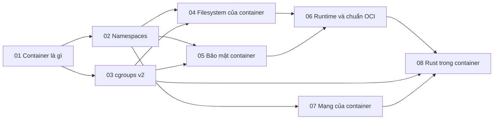

# P8 · Tổng quan — Container

> Trang này chỉ điều hướng: mục tiêu, bản đồ chương, thứ tự đọc, sách gốc và câu hỏi tổng hợp. Mọi khẳng định kỹ thuật có chú thích nằm trong từng chương; các lời khuyên về thứ tự đọc là của người soạn.

## Mục tiêu của phase

Phase này gỡ lớp bí ẩn của container: nó là process Linux bị bọc bởi namespaces, cgroups v2, filesystem gốc riêng và các lớp bảo mật. Sau đó đi tiếp lên runtime/OCI, mạng container và những điều cần biết khi chạy service Rust trong container. Mục tiêu là bạn giải thích được `OOMKilled`, CPU throttling, vì sao `docker stop` chậm và service A không gọi được service B.

## Bản đồ chương

Mũi tên nghĩa là chương đích dùng khái niệm của chương nguồn (nhận xét của người soạn về thứ tự học).

## Các chương

| Chương | Nội dung chính |
|---|---|
| [01 — Container là gì](01-container-la-gi.md) | Vì sao container không phải VM; container là gì trong kernel; Docker trên macOS là VM Linux; namespaces, cgroups, filesystem gốc; capabilities, seccomp, LSM; Docker/containerd/runc/OCI; `OOMKilled`, throttling, `docker stop`. |
| [02 — Namespaces](02-namespaces.md) | Tám loại namespace; `/proc/<pid>/ns` và inode; `clone`/`unshare`/`setns`/`nsenter`; PID namespace và PID 1; mount namespace, propagation; user namespace, `uid_map`, rootless; UTS, IPC, network, cgroup, time. |
| [03 — cgroups v2](03-cgroups-v2.md) | cgroup vs namespace; v1 vs v2 và unified hierarchy; no-internal-process, delegation; controller memory (`memory.events`), cpu (`cpu.weight` vs `cpu.max`), io, pids; PSI; `--memory`/`--cpus` thành file nào; `nproc` và `available_parallelism`. |
| [04 — Filesystem của container](04-filesystem-cua-container.md) | `chroot` và runtime container dùng gì thay; image ở mức byte (layer, manifest, config, digest, `diff_id`); content-addressable; overlayfs, copy-up, whiteout; writable layer vs volume, bind mount, tmpfs; layer cache và image lớn. |
| [05 — Bảo mật container](05-bao-mat-container.md) | Lớp phòng thủ giữa ứng dụng và kernel; root trong container vs host; capabilities mặc định của Docker, `--privileged`; `no_new_privs`; seccomp-bpf và profile mặc định; AppArmor/SELinux, `docker.sock`; `securityContext`, Pod Security Standards; checklist cho service Rust. |
| [06 — Runtime và chuẩn OCI](06-runtime-oci.md) | Chuỗi docker → dockerd → containerd → shim → runc; OCI bundle và `config.json`; vòng đời `create`/`start`/`kill`/`delete`; runc và shim; CRI; crun, gVisor, Kata; cgroup driver `systemd` vs `cgroupfs`; đọc exit 137 qua `docker inspect`. |
| [07 — Mạng của container](07-mang-container.md) | Network namespace và `127.0.0.1`; veth pair; Linux bridge; mô hình Docker (`docker0`, masquerade, `-p`/DNAT), user-defined network; mạng Kubernetes (Pod IP, Service, kube-proxy, CNI); VXLAN và MTU; chẩn đoán service A không gọi được B. |
| [08 — Rust trong container](08-rust-trong-container.md) | `available_parallelism` và Tokio với `--cpus`; glibc `malloc`, `MALLOC_ARENA_MAX` và RSS; PID 1 và `SIGTERM`, `--init`; graceful shutdown (`tokio::signal`, `signal-hook`); multi-stage build, musl vs glibc; `strip`/`lto`/`panic="abort"`; non-root, probe, log. |

## Thứ tự đọc

Đọc 01 → 08 theo số; 02, 03, 04 là ba trụ cột và có thể đọc theo thứ tự bất kỳ sau 01 (nhận xét của người soạn). Chương 08 đọc cuối vì nó dùng cgroups, signal/PID 1 và allocator từ các phase trước.

## Lộ trình đọc sách gốc

Các nguồn dưới đây đều là nguồn mà chương của phase đã dùng; mở đọc song song với chương tương ứng. Không bắt buộc: chương đã tự chứa phần cần thiết.

- [Linux kernel docs — Control Group v2](https://docs.kernel.org/admin-guide/cgroup-v2.html) — chương 03, 08.
- [OCI runtime-spec v1.2.0 — runtime.md](https://raw.githubusercontent.com/opencontainers/runtime-spec/v1.2.0/runtime.md) — chương 06.
- [OCI image-spec v1.1.0 — layer.md](https://raw.githubusercontent.com/opencontainers/image-spec/v1.1.0/layer.md) — chương 04.
- [Linux kernel v6.8 — overlayfs.rst](https://raw.githubusercontent.com/torvalds/linux/v6.8/Documentation/filesystems/overlayfs.rst) — chương 04.
- [Docker docs — Security](https://docs.docker.com/engine/security/) — chương 05.
- [Docker docs — Bridge network driver](https://docs.docker.com/engine/network/drivers/bridge/) — chương 07.
- [Kubernetes docs — Pod Security Standards](https://kubernetes.io/docs/concepts/security/pod-security-standards/) — chương 05.
- [Kubernetes docs — Resource Management for Pods and Containers](https://kubernetes.io/docs/concepts/configuration/manage-resources-containers/) — chương 03.
- [Kubernetes docs — Virtual IPs and Service Proxies](https://kubernetes.io/docs/reference/networking/virtual-ips/) — chương 07.

## Câu hỏi tổng hợp xuyên chương

Không có đáp án ở đây; mỗi câu trỏ về chương cần đọc lại.

1. `docker run --memory 256m --cpus 1.5` biến thành những file cgroup nào, và vì sao `nproc`/`available_parallelism` có thể cho kết quả khác nhau trong container? ([chương 03](03-cgroups-v2.md), [chương 08](08-rust-trong-container.md)).
2. Container thoát với exit 137: bạn phân biệt OOM kill và `SIGKILL` sau khi hết hạn `docker stop` bằng chứng cứ nào? ([chương 06](06-runtime-oci.md), [chương 03](03-cgroups-v2.md), [chương 08](08-rust-trong-container.md)).
3. Process Rust làm PID 1 nhận `SIGTERM`: PID namespace, signal và `--init` liên quan nhau ra sao? ([chương 02](02-namespaces.md), [chương 08](08-rust-trong-container.md); P1 [chương 05](../01-linux/05-signal.md)).
4. "Root trong container" có quyền gì trên host, và user namespace, capabilities, seccomp cùng thay đổi điều đó thế nào? ([chương 05](05-bao-mat-container.md), [chương 02](02-namespaces.md)).
5. Dữ liệu ghi vào writable layer sống bao lâu, và overlayfs đặt nó ở đâu trên đĩa? ([chương 04](04-filesystem-cua-container.md)).
6. Service A không gọi được service B: bạn lần theo namespace mạng, veth, bridge, NAT và DNS nội bộ theo thứ tự nào? ([chương 07](07-mang-container.md); P6 [chương 03](../06-networking/03-ip.md)).
7. Chạy Docker trên macOS khác chạy trên Linux ở điểm nào, và điều đó làm lab nào bị hạn chế? ([chương 01](01-container-la-gi.md)).

## Lab

Làm sau khi đã đọc lý thuyết:

- [Lab 08 — Containers từ bên trong](../labs/08-containers-lab.md) (mục Chuẩn bị của lab nói rõ quyền và môi trường Linux cần có)
