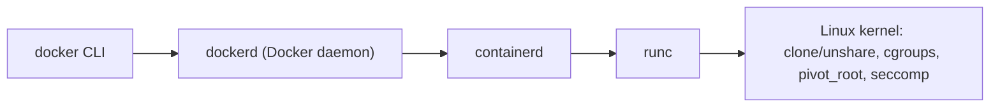

# P8 · Chương 01 — Container là gì

## Bạn sẽ hiểu được gì

1. **Q1.** Vì sao nói "container không phải VM", câu đó đúng đến đâu, và vì sao chạy Docker trên macOS thực ra là chạy container trong một VM Linux? → mục 2 và mục 4
2. **Q2.** Một container thực chất là gì trên Linux: nó có "tồn tại" như một đối tượng trong kernel không? → mục 3
3. **Q3.** Namespaces: process nhìn thấy gì? → mục 5
4. **Q4.** Cgroups: process dùng được bao nhiêu? → mục 6
5. **Q5.** Filesystem gốc riêng: process thấy cây thư mục nào? → mục 7
6. **Q6.** Capabilities, seccomp và LSM bổ sung gì cho bảo mật? → mục 8
7. **Q7.** Docker, containerd, runc, OCI là những thứ gì và đứng ở đâu trên bản đồ? → mục 10
8. **Q8.** Hiểu mô hình này giúp gì khi gặp `OOMKilled` (exit 137), CPU throttling, hay container không dừng khi `docker stop`? → mục 11

## Kiến thức cần trước

- [Process](../01-linux/03-process.md): PID, fork/exec, vai trò của PID 1.
- [Signal](../01-linux/05-signal.md): SIGTERM, SIGKILL, handler.
- [User, quyền, /proc, /sys](../01-linux/06-user-quyen-proc-sys.md): uid/gid, capabilities, `/proc`.
- [Page fault và swapping](../03-memory/04-page-fault-va-swapping.md): OOM killer.
- [Scheduling](../04-concurrency/02-scheduling.md): cpu.weight, cpu.max.

## 1. Vấn đề: chạy nhiều chương trình trên một máy mà không giẫm chân nhau

Một server chạy nhiều dịch vụ gặp bốn loại xung đột:

1. **Xung đột về tầm nhìn**: hai dịch vụ cùng muốn nghe cổng 8080, cùng muốn `/etc/app.conf` khác nhau, cùng thấy danh sách process của nhau.
2. **Xung đột về tài nguyên**: một dịch vụ rò rỉ bộ nhớ và kéo cả máy vào OOM; một dịch vụ khác ngốn hết CPU.
3. **Xung đột về phụ thuộc**: dịch vụ A cần libc/OpenSSL phiên bản này, dịch vụ B cần phiên bản khác.
4. **Xung đột về quyền**: một dịch vụ bị khai thác không nên chạm được các dịch vụ khác hay chính hệ điều hành.

Máy ảo (VM) giải quyết cả bốn bằng cách cho mỗi dịch vụ một "máy" riêng. Container giải quyết bằng cách khác: dùng chung một kernel, nhưng kernel được dạy cách **che bớt tầm nhìn** và **đặt trần tài nguyên** cho từng nhóm process. Phần còn lại của chương dựng lại ý này từng bước, kèm các thí nghiệm chạy thật.

## 2. Container không phải VM: cùng một kernel (Q1)

> **Trả lời ngắn.** Một VM là cả một hệ điều hành với kernel riêng[^docker-vm]. Container chỉ là một process bị cô lập cùng các file nó cần, và mọi container trên máy dùng chung một kernel[^docker-container]. Vì cgroups là một tính năng của kernel Linux[^cg-def], một VM Linux là cách hợp lý để có container trên Mac (suy luận của người soạn); Docker Desktop nói nó có một Linux VM chạy các container[^docker-vmm] (mục 4).

**Giải thích.**

Hình dung (nhận xét của người soạn): VM như thuê cho mỗi dịch vụ một căn nhà riêng, có móng riêng. Container như nhiều phòng trong cùng một tòa nhà: chung móng và hệ thống điện (kernel), chỉ khác vách ngăn.

Tài liệu của Docker mô tả sự khác biệt như sau: VM là cả một hệ điều hành với kernel, driver phần cứng, chương trình và ứng dụng riêng[^docker-vm]. Còn container chỉ đơn giản là một process bị cô lập cùng mọi file nó cần để chạy; nếu chạy nhiều container thì chúng dùng chung một kernel[^docker-container].

Hai câu này chứa toàn bộ điểm mấu chốt:

| | VM | Container |
|---|---|---|
| Kernel | Mỗi VM có kernel riêng[^docker-vm] | Mọi container chia sẻ kernel của host[^docker-container] |
| Đơn vị chạy | Cả một hệ điều hành[^docker-vm] | Một process bị cô lập cùng các file nó cần[^docker-container] |
| Ranh giới cách ly | Do một lớp ảo hóa (hypervisor) dựng (nhận xét của người soạn, xem phần Đi sâu) | Do chính kernel dựng bằng namespaces, cgroups…[^oci-linux] |

<details><summary>Đi sâu: VM cần một lớp ảo hóa riêng</summary>

Về dòng "ranh giới cách ly" của VM (nhận xét của người soạn): tài liệu Docker Desktop nói HyperKit là một hypervisor đời cũ xây trên Hypervisor.framework của macOS[^docker-hyperkit]. Đây là một ví dụ cho thấy VM cần một lớp phần mềm ảo hóa riêng ở dưới; container không cần lớp đó vì không khởi động kernel thứ hai (suy luận của người soạn).

</details>

**Quay lại Q1:** khác biệt cốt lõi là kernel: VM có kernel riêng, mọi container dùng chung kernel của host; vì thế trên Mac container phải chạy trong một VM Linux (mục 4).

## 3. Container trên Linux thực chất là gì (Q2)

> **Trả lời ngắn.** Không theo nghĩa một đối tượng duy nhất: kernel Linux không có system call `create_container()` hay đối tượng "container" riêng (nhận xét của người soạn). Đặc tả OCI mô tả container Linux được dựng từ nhiều tính năng kernel: namespaces, cgroups, capabilities, LSM, filesystem jails[^oci-linux]. Quan sát cho thấy process của container vẫn hiện trên host, chỉ khác là có thêm một PID ở bên trong[^pidns-layers].

**Giải thích.**

Hình dung (nhận xét của người soạn): nhìn từ trong phòng kính mờ, bạn tưởng mình ở một tòa nhà riêng; nhìn từ ngoài vẫn thấy từng người đi lại. Container là process được che bớt tầm nhìn, không phải một máy khác.

Một cách nghĩ hữu ích (nhận xét của người soạn): **không có system call `create_container()`**. Thứ ta gọi là "container" là một quy ước phía userspace: một process (hoặc cây process) được đặt vào một tập namespaces, một cgroup và một cây thư mục gốc riêng. Đặc tả runtime của OCI cũng mô tả theo hướng này: container trên Linux được dựng từ nhiều tính năng kernel như namespaces, cgroups, capabilities, LSM và filesystem jails[^oci-linux].

Thí nghiệm ở phần Đi sâu cho thấy cùng một process `sleep` có hai PID: 1 trong container và một số khác ngoài host, đúng như man page mô tả: một process có một PID ở mỗi tầng của hệ thống phân cấp PID namespace mà nó nhìn thấy[^pidns-layers]. Không có gì "bên trong" mà host không thấy: cách ly là chuyện che bớt tầm nhìn, không phải tách ra một máy khác (nhận xét của người soạn).

<details><summary>Đi sâu: quan sát PID, inode namespace và <code>--pid=host</code></summary>

**Quan sát: process trong container vẫn là process của host.**

Thí nghiệm này chạy trên máy của người soạn (macOS, Apple Silicon, Docker chạy qua colima). Khởi động một container chỉ chạy `sleep`:

```bash
docker run -d --rm --name demo alpine sleep 300
docker exec demo sh -c 'uname -sr; ps; cat /proc/1/cgroup'
```

Kết quả quan sát (một lần chạy):

```text
Linux 6.8.0-117-generic
PID   USER     TIME  COMMAND
    1 root      0:00 sleep 300
    7 root      0:00 sh -c uname -sr; ps; ...
   14 root      0:00 ps
0::/
```

Trong container, `sleep` là PID 1, và `ps` chỉ thấy vài process. Giờ nhìn từ **phía host Linux** — với colima, "host Linux" là VM mà `colima ssh` đưa vào:

```bash
colima ssh -- sh -c 'ps -eo pid,ppid,comm | grep sleep; \
  P=$(docker inspect -f "{{.State.Pid}}" demo); echo pid=$P; \
  sudo grep NSpid /proc/$P/status; cat /proc/$P/cgroup'
```

```text
  90443   90421 sleep
pid=90443
NSpid:	90443	1
0::/docker/52a60284ede94f4553e6500eb129ffc5f05f8821ebfc5a7c6f7bd727015e1c5c
```

Cùng một process `sleep` có **hai PID**: 1 ở trong container, 90443 ở ngoài; cha của nó (90421) là một process bình thường trên host. Đây đúng là điều man page mô tả: một process có một process ID ở mỗi tầng của hệ thống phân cấp PID namespace mà nó nhìn thấy được[^pidns-layers]; trường `NSpid` ở đây hiện đúng hai số, 90443 và 1 (quan sát). Ngoài ra process nằm trong một cgroup có tên chứa ID container.

So sánh các số inode namespace của cùng process nhìn từ trong và từ ngoài:

```text
trong container (/proc/self/ns)      host VM (/proc/90443/ns)      host VM (/proc/self/ns)
mnt  -> mnt:[4026532451]             mnt:[4026532451]              mnt:[4026531841]
pid  -> pid:[4026532456]             pid:[4026532456]              pid:[4026531836]
net  -> net:[4026532458]             net:[4026532458]              net:[4026531840]
uts  -> uts:[4026532454]             uts:[4026532454]              uts:[4026531838]
user -> user:[4026531837]            user:[4026531837]             user:[4026531837]
```

(Rút gọn từ kết quả thật.) Man page nói: nếu hai process ở cùng một namespace thì device ID và số inode của các symbolic link `/proc/pid/ns/xxx` của chúng sẽ giống nhau[^ns-link]. Vậy:

- `sleep` nhìn từ trong và từ ngoài **cùng namespaces** (cột 1 = cột 2) — nó là một process, chỉ có một tập namespaces.
- Tập đó **khác** tập của shell trên host (cột 3) ở các dòng được in: mnt, pid, net, uts (bản rút gọn không in các namespace còn lại như ipc, cgroup, time).
- Namespace `user` **giống** host (4026531837): container mặc định của Docker trong lần chạy này không dùng user namespace riêng (quan sát; cấu hình khác có thể khác).

Cuối cùng, nếu cho container dùng PID namespace của host (`--pid=host`; tài liệu Docker mô tả chế độ `host` là dùng PID namespace của host bên trong container[^docker-pidhost]), nó thấy các process của VM, kể cả `systemd` ở PID 1 (quan sát):

```bash
docker run --rm --pid=host alpine ps | head -4
```
```text
PID   USER     TIME  COMMAND
    1 root      0:03 {systemd} /sbin/init
    2 root      0:00 [kthreadd]
```

</details>

**Quay lại Q2:** container là process Linux thường được che bớt tầm nhìn; kernel không có đối tượng "container".

## 4. Docker trên macOS chạy trong một VM Linux (phần tiếp của Q1)

Mục này trả lời nửa sau của Q1; kết luận đã nằm trong Trả lời ngắn ở mục 2, dưới đây là bằng chứng quan sát.

**Giải thích.**

Hình dung (nhận xét của người soạn): mang một thiết bị chỉ chạy được trên điện Linux sang xứ dùng điện khác: bạn phải mang theo cả bộ đổi nguồn (VM Linux) rồi mới cắm vào.

Trên chính máy macOS đó:

```text
$ uname -sm                      # trên macOS
Darwin arm64
$ docker run --rm alpine uname -sr
Linux 6.8.0-117-generic
```

Container báo kernel Linux 6.8 trong khi host là Darwin (quan sát). Tài liệu Docker nói: Docker Desktop hỗ trợ nhiều Virtual Machine Manager (VMM) để chạy VM Linux nơi các container chạy[^docker-vmm]. Vì cgroups là một tính năng của kernel Linux[^cg-def], một VM Linux là cách hợp lý để có container trên Mac (suy luận của người soạn).

<details><summary>Đi sâu: HyperKit, Colima và hệ quả khi benchmark</summary>

Tài liệu Docker cũng nói: các bản Docker Desktop for Mac trước đây dùng HyperKit để chạy VM Linux[^docker-hyperkit]. Với Colima, quan sát là `colima ssh` đưa ta vào một Linux có kernel 6.8, trùng với kernel mà container báo — tức cũng có một VM Linux ở giữa (suy luận của người soạn). README của Colima liệt kê hỗ trợ nhiều container runtime[^colima-features].

Hệ quả thực tế (nhận xét của người soạn): khi benchmark container trên Mac, bạn đang đo VM + container; muốn xem hành vi kernel đúng nghĩa hãy nhìn bên trong VM hoặc trên Linux thật.

</details>

**Quay lại Q1 (nửa sau):** Docker trên Mac là container chạy trong một VM Linux, nên bên trong vẫn là kernel Linux.

## 5. Namespaces: process nhìn thấy gì (Q3)

> **Trả lời ngắn.** Một namespace bọc một tài nguyên toàn cục của hệ thống trong một lớp trừu tượng, để process bên trong thấy như mình có một bản riêng[^ns-def]. Mỗi loại namespace che một loại tài nguyên, ví dụ mount points, process IDs hay network devices[^ns-table-mnt][^ns-table-net]. Kernel vẫn chỉ có một.

**Giải thích.**

Hình dung (nhận xét của người soạn): cùng một tòa nhà, nhưng mỗi nhóm được phát một tấm bản đồ riêng đánh số phòng lại từ 1 và chỉ vẽ một số phòng; tòa nhà thật vẫn là một.

Man page `namespaces(7)`: một namespace bọc một tài nguyên toàn cục của hệ thống trong một lớp trừu tượng, khiến các process trong namespace đó thấy như chúng có một bản riêng, cô lập, của tài nguyên toàn cục ấy[^ns-def]. Kernel vẫn là một, tài nguyên toàn cục (bảng process, bảng mount, ngăn xếp mạng…) vẫn có thật; namespace chỉ cho mỗi nhóm process một **góc nhìn** riêng.

Linux có tám loại namespace trong bảng của man page. Chi tiết từng loại thuộc [Chương 02 — Namespaces](./02-namespaces.md); ở đây chỉ cần bản đồ:

| Namespace | Cờ clone | Cách ly cái gì |
|---|---|---|
| Mount | `CLONE_NEWNS` | Mount points |
| PID | `CLONE_NEWPID` | Process IDs |
| Network | `CLONE_NEWNET` | Network devices, stacks, ports, etc. |
| UTS | `CLONE_NEWUTS` | Hostname and NIS domain name |
| IPC | `CLONE_NEWIPC` | System V IPC, POSIX message queues |
| User | `CLONE_NEWUSER` | User and group IDs |
| Cgroup | `CLONE_NEWCGROUP` | Cgroup root directory |
| Time | `CLONE_NEWTIME` | Boot and monotonic clocks |

Cột "Cách ly cái gì" trích nguyên văn từ bảng của man page[^ns-table-mnt][^ns-table-net][^ns-table-uts][^ns-table-ipc]. Namespace mount đến từ rất sớm: `CLONE_NEWNS` có từ Linux 2.4.19[^ns-mount-since].

### Các API làm việc với namespace

Man page tóm tắt các cách làm việc với namespace: `clone(2)` với cờ `CLONE_NEW*` tạo process con và các namespace mới cho nó[^ns-clone]; `unshare(2)` đưa *chính process gọi* vào namespace mới (process gọi trở thành thành viên của các namespace đó[^ns-unshare]); `setns(2)` cho phép process gọi tham gia một namespace đã có[^ns-setns]; và `/proc/pid/ns/` là nơi mỗi process phơi ra các namespace của nó: mỗi process có một thư mục con `/proc/pid/ns/` chứa một mục cho mỗi namespace có thể thao tác bằng `setns(2)`[^ns-proc].

Việc `nsenter` là lệnh bao quanh `setns`, và việc `docker exec`/`docker run` thực chất gọi `setns` và `clone`/`unshare` kèm các cờ trên, là mô hình của người soạn (suy luận của người soạn, không có nguồn trực tiếp; [Chương 06](./06-runtime-oci.md) chỉ dẫn nguồn cho phần containerd–shim–runc).

<details><summary>Đi sâu: quyền tạo namespace, PID namespace và PID 1</summary>

**Quyền tạo namespace (quan sát trong lab).** Container lab của repo (`./labs/linux.sh`) chạy root nhưng **không có `CAP_SYS_ADMIN`**: `unshare --pid --fork --mount-proc --uts --ipc sh -c "ps -e"` và `unshare -u hostname x` đều báo `unshare: unshare failed: Operation not permitted`, còn `unshare -U` tạo được user namespace. Khớp man page: tạo namespace mới bằng `clone`/`unshare` trong đa số trường hợp cần `CAP_SYS_ADMIN`[^ns-priv] (ví dụ `CLONE_NEWUTS`[^unshare-cap]), ngoại lệ là user namespace. Danh sách capability của tiến trình trong lab, giải mã bằng `capsh --decode`, là: `chown, dac_override, fowner, fsetid, kill, setgid, setuid, setpcap, net_bind_service, net_admin, net_raw, sys_chroot, sys_ptrace, mknod, audit_write, setfcap` — không có `sys_admin`. Số `uid_map`, uid overflow 65534 và `unshare -Ur` được ghi đầy đủ ở [Chương 02, mục 3 và mục 6](./02-namespaces.md); điều kiện duy nhất cần nhớ ở đây là user namespace cho process không đặc quyền làm "root" bên trong[^userns-root] — nền của rootless container (nhận xét của người soạn; rootless thuộc [Chương 05](./05-bao-mat-container.md)).

Lưu ý: lab chạy với `--security-opt seccomp=unconfined`, nên `unshare -U` thành công ở đây là nhờ cả quy tắc kernel *và* việc seccomp bị tắt; trong container Docker mặc định, profile seccomp còn chặn cả `unshare -U` ([Chương 05, mục 5](./05-bao-mat-container.md)).

**PID namespace và PID 1.** Process đầu tiên trong namespace là "init" của namespace và là cha của mọi process mồ côi trong đó[^pidns-orphan] — tức (suy luận của người soạn) nó cần `wait()` để thu dọn như init thật. Init còn có luật signal riêng (chỉ nhận signal đã đăng ký handler, trừ `SIGKILL`/`SIGSTOP` từ namespace tổ tiên): luật đầy đủ ở [Chương 02, mục 4](./02-namespaces.md) và [P1 · Chương 05, mục 8](../01-linux/05-signal.md). Hệ quả đã đo: `docker stop -t 3` một container có PID 1 không đăng ký handler mất đúng ~3 giây và kết thúc exit 137 (bảng số đo ở [Chương 08, mục 3](./08-rust-trong-container.md); tài liệu Docker nói process chính nhận SIGTERM rồi SIGKILL sau grace period[^docker-stop]).

Một hệ quả nữa: nếu PID 1 của namespace chết, kernel kết thúc mọi process trong namespace đó bằng signal SIGKILL (man page `pid_namespaces(7)`)[^pidns-initdeath] — nên (suy luận của người soạn) container kết thúc theo process chính của nó.

</details>

**Quay lại Q3:** namespace cho mỗi nhóm process một góc nhìn riêng về tài nguyên toàn cục; PID namespace thêm một process init với quy tắc signal riêng.

## 6. cgroups: process dùng được bao nhiêu (Q4)

> **Trả lời ngắn.** Cgroups là tính năng kernel cho phép tổ chức process thành các nhóm phân cấp, rồi giới hạn và theo dõi mức dùng tài nguyên của từng nhóm[^cg-def]. Trong thí nghiệm bên dưới, `--memory 64m --cpus 0.5` hiện thành `memory.max = 67108864` và `cpu.max = 50000 100000` trong cgroup của container.

**Giải thích.**

Hình dung (nhận xét của người soạn): namespaces là vách ngăn che tầm nhìn, còn cgroup là đồng hồ điện của từng phòng: nó đo và cắt khi vượt mức.

Namespaces chỉ cho mỗi nhóm một góc nhìn riêng[^ns-def], không đặt trần dùng tài nguyên (suy luận của người soạn): một process trong namespace riêng vẫn có thể ăn hết RAM của host. Phần giới hạn do **control groups** đảm nhận: control groups, thường gọi là cgroups, là một tính năng của kernel Linux cho phép tổ chức process thành các nhóm phân cấp, rồi giới hạn và theo dõi mức dùng các loại tài nguyên của từng nhóm[^cg-def].

Kiến trúc theo man page `cgroups(7)`: việc nhóm được cài đặt trong phần lõi cgroup của kernel, còn theo dõi và giới hạn tài nguyên được cài đặt trong một tập subsystem theo từng loại tài nguyên (bộ nhớ, CPU, v.v.)[^cg-arch]. Giao diện là một pseudo-filesystem gọi là cgroupfs[^cg-fs]. Cgroup v2 chỉ có một cây phân cấp duy nhất, khác với v1[^cg-v2]; dòng `0::/` ở thí nghiệm đầu chương khớp với dạng của v2, trong đó trường hierarchy-ID của `/proc/pid/cgroup` mang giá trị 0[^cg-v2proc] (suy luận của người soạn: VM colima dùng cgroup v2). Chi tiết thuộc [Chương 03](./03-cgroups-v2.md); phần này đủ để đọc các con số.

Mỗi cgroup là một thư mục: cgroup con được tạo bằng cách tạo một thư mục con[^cg-create]. Trong cgroup v2 mọi process thuộc một và chỉ một cgroup[^cg-one]; file `cgroup.procs` khi đọc sẽ liệt kê PID của mọi process thuộc cgroup, mỗi dòng một PID[^cg-procs].

### `--memory`, `--cpus` thành file gì?

```bash
docker run -d --rm --name lim --memory 64m --cpus 0.5 --pids-limit 100 alpine sleep 300
docker exec lim sh -c 'cat /sys/fs/cgroup/memory.max /sys/fs/cgroup/cpu.max /sys/fs/cgroup/pids.max'
```
```text
67108864
50000 100000
100
```

- `--memory 64m` → `memory.max = 67108864` (= 64·1024·1024).
- `--cpus 0.5` → `cpu.max = 50000 100000`: theo tài liệu kernel, định dạng `$MAX $PERIOD` cho biết nhóm có thể dùng tối đa `$MAX` trong mỗi khoảng `$PERIOD`[^cg-cpumax]. Ở đây 50 000 µs trong mỗi chu kỳ 100 000 µs = nửa lõi.
- `--pids-limit 100` → `pids.max = 100`.

Từ phía host VM, cùng các giá trị đọc được ở `/sys/fs/cgroup/docker/<id>/memory.max` và `cpu.max` (quan sát: trùng nhau). Hay nói cách khác: **`docker run --memory` chỉ là ghi một số vào file của cgroup** (nhận xét của người soạn từ quan sát này; cơ chế ghi file do runtime làm — xem [Chương 06](./06-runtime-oci.md)). Cũng cần lưu ý: trong container, `/sys/fs/cgroup` là cgroup *của chính nó* và `/proc/1/cgroup` hiện `0::/` thay vì đường dẫn dài như host thấy. Tài liệu kernel nói gốc (cgroupns root) của một cgroup namespace là cgroup chứa process gọi `unshare(2)`[^cg-ns]; việc Docker cho container một cgroup namespace riêng là suy luận của người soạn từ quan sát này (xem hàng "Cgroup root directory" ở bảng mục 5).

<details><summary>Đi sâu: OOMKilled và CPU throttling ở mức cgroup</summary>

**OOMKilled: cơ chế**

Kernel docs `cgroup-v2` về `memory.max`: là cơ chế chính để giới hạn mức dùng bộ nhớ của một cgroup; khi đạt trần mà không thu hồi được, OOM killer được gọi trong cgroup đó[^cg-oom]. Phạm vi: nó sẽ không giết task nào ngoài cgroup này[^cg-oom-scope]. Kubernetes diễn đạt cùng ý ở mức hành vi: giới hạn bộ nhớ được kernel thực thi bằng các lần giết do hết bộ nhớ (OOM)[^k8s-mem].

Thí nghiệm (quan sát): container 32 MiB, bắt process giữ 100 MB trong bộ nhớ:

```bash
docker run --name oom --memory 32m --memory-swap 32m alpine \
  sh -c 'x=$(head -c 100000000 /dev/zero | tr "\0" a); echo ${#x}'
echo rc=$?; docker inspect -f 'oom={{.State.OOMKilled}} exit={{.State.ExitCode}}' oom
```
```text
rc=137
oom=true exit=137
```

Dòng `echo` không được in (shell chỉ báo `Killed`), process bị SIGKILL (137), và Docker ghi nhận `OOMKilled=true`. Điều đáng chú ý: **ứng dụng không nhận được lỗi `ENOMEM` nào để xử lý** trong trường hợp này (quan sát). Điều này khớp với tài liệu kernel: ở cấu hình mặc định, cấp phát thường (0-order) luôn thành công trừ khi OOM killer chọn chính task hiện tại làm nạn nhân[^cg-0order]. Đừng khái quát thành "không bao giờ có ENOMEM": tài liệu kernel nói chỉ một số kiểu cấp phát "không gọi OOM killer", có thể trả `-ENOMEM` về userspace[^cg-enomem]. Để debug (nhận xét của người soạn): xem `docker inspect` hoặc `kubectl describe pod` (reason `OOMKilled`), và trường `oom_kill` trong `memory.events` của cgroup, đếm số process của cgroup bị OOM killer giết[^cg-events] ([Chương 03](./03-cgroups-v2.md)). Quy trình đọc `State` để phân biệt OOM với hết thời gian dừng: [Chương 06, mục 9](./06-runtime-oci.md).

Lưu ý (nhận xét của người soạn): một runtime tự suy ra kích thước heap từ RAM của host có thể vượt trần cgroup; luôn đối chiếu `memory.max` với cấu hình của runtime.

**CPU throttling: cơ chế**

Giới hạn CPU khác giới hạn bộ nhớ: Kubernetes nói cpu limit được thực thi bằng CPU throttling[^k8s-cpu], tức nó không giết ai mà tạm dừng process (suy luận của người soạn: đến hết chu kỳ, theo định dạng `$MAX $PERIOD` của `cpu.max`). Kernel đếm điều này trong `cpu.stat` (các trường `nr_periods`, `nr_throttled`, `throttled_usec`; tài liệu nói các thống kê băng thông CFS này chỉ tính throttling do giới hạn của chính cgroup)[^cg-cpustat].

Thí nghiệm (quan sát): container giới hạn `--cpus 0.2` chạy một vòng lặp bận 3 giây (một thread), rồi đọc `cpu.stat`: `usage_usec 621536`, `nr_periods 31`, `nr_throttled 31`, `throttled_usec 2408025`. Trong 3 giây có 31 chu kỳ (suy luận của người soạn: mỗi chu kỳ ≈ 100 ms = 100 000 µs; `cpu.max` của container này không được in ra trong thí nghiệm), **cả 31 chu kỳ đều bị throttle**, tổng ~2,4 s bị chặn, và CPU dùng thực ~0,62 s ≈ 0,2 × 3 s. Với một thread, `throttled_usec` xấp xỉ thời gian tường bị chặn; với nhiều thread con số cộng theo từng thread nên có thể vượt thời gian tường (thí nghiệm 4 thread với số đo đầy đủ và cách đọc: [Chương 03, mục 5](./03-cgroups-v2.md)). Đây là điều khiến một service "chỉ dùng 20% CPU trung bình" vẫn có thể có latency đuôi cao: nó bị dừng ở cuối mỗi chu kỳ khi hết quota (suy luận của người soạn từ số liệu trên). Cơ chế chia quota cho run queue và throttle nằm ở [Chương 03, mục 5](./03-cgroups-v2.md); phần `cpu.weight`/`nice` của bộ lập lịch ở [Scheduling](../04-concurrency/02-scheduling.md).

</details>

**Quay lại Q4:** cgroup là thư mục chứa các file giới hạn (`memory.max`, `cpu.max`); chạm trần bộ nhớ thì OOM kill trong cgroup, chạm trần CPU thì bị throttle.

## 7. Filesystem gốc riêng (Q5)

> **Trả lời ngắn.** Process trong container thấy một cây thư mục `/` khác host nhờ đổi thư mục gốc; `pivot_root(2)` đổi root mount trong mount namespace của process gọi[^pivot], và man page nêu việc dựng root filesystem khi tạo container là một ứng dụng hiện đại của nó[^pivot-notes]. `chroot(2)` thì man page nói không nhằm dùng cho mục đích bảo mật[^chroot-sec].

**Giải thích.**

Hình dung (nhận xét của người soạn): image là bộ catalog nội thất, container là căn phòng được bày theo catalog đó; cửa chính `/` mở vào căn phòng chứ không mở vào cả tòa nhà.

Process trong container thấy `/` là một cây thư mục khác với host (ví dụ container chạy image `alpine` thấy `/bin/sh` nằm trong chính cây của image). Có hai lớp cơ chế (nhận xét của người soạn):

1. **Đổi thư mục gốc**: `chroot(2)` hoặc `pivot_root(2)`.
2. **Nội dung cây đó đến từ đâu**: các lớp (layer) của image, ghép lại (thường bằng overlayfs) — chi tiết và nguồn ở [Chương 04](./04-filesystem-cua-container.md).

Image là dữ liệu đầu vào (cây thư mục nhiều layer cùng metadata); container là đối tượng chạy. Một image sinh được nhiều container (nhận xét của người soạn; chi tiết Chương 04).

<details><summary>Đi sâu: <code>chroot</code> và <code>pivot_root</code> theo man page</summary>

**chroot không phải cách ly**

`chroot(2)`: đổi thư mục gốc của process gọi; nhưng man page nhấn mạnh: lời gọi này chỉ đổi một thành phần trong quá trình phân giải đường dẫn và không làm gì khác[^chroot-only], và nó không nhằm dùng cho bất kỳ mục đích bảo mật nào, không để sandbox hoàn toàn một process cũng không để hạn chế các system call về filesystem[^chroot-sec]. Man page cũng ghi chroot có mặt trong SVr4, 4.4BSD, SUSv2 (đánh dấu LEGACY) và không thuộc POSIX.1-2001[^chroot-std].

**pivot_root**

`pivot_root(2)`: đổi root mount trong mount namespace của process gọi; chính xác hơn, nó chuyển root mount sang thư mục `put_old` và biến `new_root` thành root mount mới[^pivot]. Khác với chroot, nó thao tác trên **mount namespace**: man page nói nó cho phép chuyển sang root filesystem mới đồng thời đặt root mount cũ vào một vị trí dưới `new_root`, từ đó về sau có thể gỡ mount (unmount)[^pivot-old], và nêu một ứng dụng hiện đại là dựng root filesystem khi tạo container[^pivot-notes]. Nếu root cũ đã được gỡ (umount), cây cũ không còn trong mount namespace đó để quay lại (suy luận của người soạn từ điểm trên; runtime có gỡ hay không là việc của runtime). Nó yêu cầu CAP_SYS_ADMIN trong user namespace sở hữu mount namespace của process gọi[^pivot-cap]. Cách runtime kết hợp mount namespace + pivot_root + layer thuộc [Chương 04](./04-filesystem-cua-container.md) và [Chương 06](./06-runtime-oci.md).

</details>

**Quay lại Q5:** root riêng đến từ việc đổi root mount (`pivot_root`) trong mount namespace, với nội dung cây thư mục lấy từ layer của image (nhận xét của người soạn; xem Chương 04); `chroot` không được thiết kế cho mục đích cách ly.

## 8. Lớp bảo mật bổ sung: capabilities, seccomp, LSM (Q6)

> **Trả lời ngắn.** Namespaces và cgroups nói về tầm nhìn và lượng, chưa nói về quyền. Capabilities chia đặc quyền của superuser thành các đơn vị bật/tắt độc lập[^caps]; seccomp lọc system call để thu hẹp bề mặt kernel lộ ra cho ứng dụng[^seccomp-surface]; LSM (Linux Security Modules) được OCI liệt kê cạnh namespaces và cgroups[^oci-linux].

**Giải thích.**

Hình dung (nhận xét của người soạn): cùng một căn phòng, nhưng nhân viên chỉ được phát vài chìa khóa lẻ chứ không phải chìa chủ.

Namespaces và cgroups nói về *tầm nhìn* và *lượng*, không nói về *quyền*. Ở lần chạy quan sát ở mục 3, container dùng chung user namespace với host, nên root trong container vẫn là uid 0 như root của host; nếu không giảm quyền thì nó có quyền rất rộng trên kernel dùng chung (suy luận của người soạn).

- **Capabilities**: từ Linux 2.2, Linux chia các đặc quyền vốn gắn với superuser thành những đơn vị riêng biệt gọi là capabilities, có thể bật/tắt độc lập[^caps]. Và capabilities là thuộc tính của từng thread[^caps-thread].
- **seccomp**: lọc system call. Tài liệu kernel giải thích động cơ: tập system call còn lại làm giảm tổng bề mặt kernel lộ ra cho ứng dụng[^seccomp-surface]. Bộ lọc là chương trình BPF, được biểu diễn dưới dạng chương trình Berkeley Packet Filter[^seccomp-bpf], và bộ lọc được kế thừa: nếu `fork`/`clone` được phép, mọi process con sẽ bị ràng buộc bởi cùng các bộ lọc system call như process cha[^seccomp-inherit]. Lab của repo chạy `seccomp=unconfined` nên không phản ánh mặc định của Docker.
- **LSM** (Linux Security Modules): đặc tả OCI liệt kê LSM cạnh namespaces và cgroups trong các tính năng kernel mà đặc tả runtime Linux dùng[^oci-linux]. AppArmor và SELinux là hai ví dụ phổ biến (nhận xét của người soạn); đặc tả runtime có trường `apparmorProfile` cho tên profile AppArmor của process[^oci-apparmor] và `selinuxLabel` cho nhãn SELinux[^oci-selinux]. [Chương 05](./05-bao-mat-container.md) mô tả cách cấu hình.

Ba lớp này cộng với namespace/cgroup làm container "an toàn hơn chạy trần" (nhận xét của người soạn), nhưng **không** đồng nghĩa với ranh giới kiểu VM: kernel vẫn dùng chung (mục 2)[^docker-container].

<details><summary>Đi sâu: capability của PID 1 trong container Docker mặc định</summary>

Quan sát: PID 1 của một container Docker mặc định có `CapEff = a80425fb`, giải mã bằng `capsh --decode` thành 14 capability: `chown, dac_override, fowner, fsetid, kill, setgid, setuid, setpcap, net_bind_service, net_raw, sys_chroot, mknod, audit_write, setfcap` — không có `sys_admin`, `net_admin`, `sys_ptrace`. (Là kết quả của cấu hình mặc định của Docker trong lần chạy này, không phải bảo đảm của kernel.) Vì không có `sys_admin`, root trong container này không tạo được namespace mới (trừ user namespace) theo quy tắc ở mục 5[^ns-priv] (nhận xét của người soạn; riêng việc seccomp mặc định của Docker cũng chặn `unshare` được bàn ở [Chương 05](./05-bao-mat-container.md)).

</details>

**Quay lại Q6:** capability của root trong container Docker mặc định bị giảm (quan sát ở phần Đi sâu) và seccomp có thể lọc syscall, nên nó yếu hơn root không bị hạn chế trên host; nhưng kernel vẫn dùng chung.

## 9. Lịch sử ngắn

Chỉ nêu những gì có nguồn:

- `chroot(2)` có mặt trong SVr4, 4.4BSD và SUSv2[^chroot-std] — ý tưởng đổi thư mục gốc cho một process đã có từ lâu (nhận xét của người soạn); man page nay nhắc rõ nó không phải cơ chế bảo mật (mục 7).
- FreeBSD có `jail(2)` trong bản 4.0-RELEASE: mục HISTORY của manual ghi lời gọi `jail()` xuất hiện trong FreeBSD 4.0[^freebsd-jail-hist], còn dòng NAME mô tả nó là giam process hiện tại và các hậu duệ của nó[^freebsd-jail]. Man page chroot(2) của Linux ghi rằng FreeBSD có system call `jail()` mạnh hơn[^chroot-jail] — jail là cơ chế của FreeBSD, không phải Linux.
- Trên Linux, `CLONE_NEWNS` (mount namespace) có từ Linux 2.4.19[^ns-mount-since]; người soạn không kể mốc của các cơ chế khác vì chưa có nguồn.

## 10. Bản đồ công cụ: Docker, containerd, runc, OCI (Q7)

> **Trả lời ngắn.** containerd là container runtime quản lý việc chuyển và lưu image, thực thi và giám sát container[^containerd-scope]. runc là CLI tool dựng và chạy container trên Linux theo đặc tả OCI[^runc]. Docker là nền tảng mở để phát triển, đóng gói và chạy ứng dụng[^docker-platform], đứng bên trên các thành phần đó (nhận xét của người soạn, dựa trên quan sát cờ `--containerd` ở [Chương 06](./06-runtime-oci.md); docs chưa dẫn trực tiếp).

**Giải thích.**

Hình dung (nhận xét của người soạn): Docker là nhà hàng, containerd là bếp trưởng điều phối, runc là người đứng bếp thật sự nấu một món, OCI là công thức chuẩn mà mọi bếp đọc được.

Đến đây ta biết container = process + namespaces + cgroup + root riêng. Ai làm việc dựng chúng? Bản đồ ở mức sơ lược (chi tiết ở [Chương 06 — Runtime và OCI](./06-runtime-oci.md)):



- **Docker**: nền tảng mở để phát triển, đóng gói và chạy ứng dụng[^docker-platform]; tài liệu nói nó tận dụng nhiều tính năng của kernel Linux và dùng công nghệ namespaces để tạo không gian làm việc cô lập gọi là container[^docker-ns].
- **containerd**: một container runtime chuẩn công nghiệp, nhấn mạnh sự đơn giản, bền vững và khả chuyển[^containerd], quản lý việc chuyển và lưu image, thực thi và giám sát container, gắn lưu trữ và mạng mức thấp[^containerd-scope].
- **runc**: là một công cụ CLI để tạo và chạy container trên Linux theo đặc tả OCI[^runc].
- **OCI** (Open Container Initiative): đặc tả chuẩn; runc tuân theo đặc tả OCI[^runc]. Phần Linux của runtime spec nêu rõ nó dựa trên các tính năng kernel đã nói[^oci-linux]. Nhờ chuẩn này, runtime và công cụ khác nhau đọc cùng một cấu hình (nhận xét của người soạn; [Chương 06](./06-runtime-oci.md) dẫn nguồn đặc tả OCI).

<details><summary>Đi sâu: mức chắc chắn của sơ đồ</summary>

Việc dockerd gọi containerd rồi runc là kiến trúc Docker Engine theo quan sát của người soạn — [Chương 06](./06-runtime-oci.md) dẫn nguồn cho đoạn containerd → containerd-shim → runc (sơ đồ trên đã lược shim) còn đoạn dockerd → containerd là quan sát, chưa có nguồn docs; sơ đồ là bản đồ định hướng, chưa phải khẳng định chi tiết từ chương này.

</details>

**Quay lại Q7:** Docker → containerd → runc → kernel là bản đồ định hướng; OCI là đặc tả chung để các công cụ đọc cùng một cấu hình.

## 11. Liên hệ backend (nhận xét của người soạn) (Q8)

> **Trả lời ngắn.** Vì container = process + giới hạn kernel (nhận xét của người soạn), ba sự cố khó hiểu trở nên dễ đọc: `OOMKilled` thường là cgroup chạm `memory.max`[^cg-oom]; latency đuôi tăng có thể là CPU throttling của `cpu.max`[^k8s-cpu] (suy luận của người soạn); deploy chậm đúng bằng grace period có thể là PID 1 không có handler SIGTERM[^pidns-ancestor][^docker-stop].

**Giải thích.**

Hình dung (nhận xét của người soạn): thay vì coi container là hộp đen, hãy coi nó là một process có đồng hồ điện (cgroup) và kính mờ (namespace); mỗi sự cố là một trong hai thứ đó phát tác.

Mô hình "container = process + giới hạn kernel" biến ba loại sự cố khó hiểu thành dễ đọc:

| Triệu chứng | Đọc theo mô hình | Dấu vết cần xem |
|---|---|---|
| Pod `OOMKilled`, exit 137 | Cgroup chạm `memory.max`, OOM killer chỉ giết trong cgroup đó[^cg-oom][^cg-oom-scope] | `docker inspect` (`OOMKilled`), `memory.events` |
| Latency đuôi tăng dù CPU trung bình thấp | CPU limit được thực thi bằng throttling[^k8s-cpu]; hết quota trong chu kỳ thì cgroup bị dừng đến chu kỳ sau (suy luận của người soạn từ `cpu.max`[^cg-cpumax]) | `cpu.stat`: `nr_throttled`, `throttled_usec` |
| Deploy chậm đúng bằng grace period, request cuối bị cắt | SIGTERM gửi từ ngoài namespace (host/runtime là namespace tổ tiên) chỉ tới được PID 1 nếu nó đã đăng ký handler[^pidns-ancestor] → hết grace period thì SIGKILL[^docker-stop] | thời gian `docker stop`, exit code 137, thử `--init`[^docker-init] |

Cũng từ đây: nếu một khẳng định bảo mật dựa trên "cách ly kiểu VM", hãy hỏi lại — kernel là dùng chung[^docker-container]. Cách đọc `docker inspect` để phân biệt OOM với hết thời gian dừng nằm ở [Chương 06, mục 9](./06-runtime-oci.md); số đo `docker stop`/`--init` ở [Chương 08, mục 3](./08-rust-trong-container.md).

<details><summary>Đi sâu: hai triệu chứng khác (suy luận của người soạn)</summary>

| Triệu chứng | Đọc theo mô hình | Dấu vết cần xem |
|---|---|---|
| Process zombie tích tụ | PID 1 là cha của mọi mồ côi[^pidns-orphan]; nếu nó không `wait()` thì zombie ở lại (suy luận của người soạn) | `ps` trong container, `--init` |
| "Thấy 64 core nhưng bị giới hạn 2" | Công cụ đọc `/proc/cpuinfo`/RAM của host, không đọc cgroup (suy luận của người soạn) | `cpu.max`, `memory.max` |

</details>

**Quay lại Q8:** đọc sự cố container bằng ba câu hỏi: cgroup nào chạm trần, process có nhận signal không, và công cụ đang đọc số của host hay của cgroup.

## 12. Liên hệ với Rust

Rust không có đặc quyền gì trong chương này: một binary Rust trong container là process Linux thường. Vài điểm thực hành (nhận xét của người soạn):

- Binary Rust làm PID 1 phải tự quyết định xử lý SIGTERM (hoặc dùng `--init`), vì quy tắc ở mục 5 áp dụng cho mọi ngôn ngữ. Việc đăng ký handler và tắt êm trong async runtime được bàn ở [Chương 08 — Rust trong container](./08-rust-trong-container.md).
- Một binary liên kết tĩnh (ví dụ musl) có thể chạy trong image gần như chỉ chứa chính nó, vì container chỉ cần cây thư mục chứa những gì process cần (mục 7; nhận xét của người soạn, số đo ở [Chương 08](./08-rust-trong-container.md)).

## Tóm tắt

- Container không phải VM: mọi container chia sẻ kernel của host; VM có kernel riêng[^docker-vm][^docker-container].
- Trên Linux, container là process thường được đặt trong namespaces, một cgroup và một cây thư mục gốc riêng; kernel không có đối tượng "container" riêng (nhận xét của người soạn).
- Namespace quyết định process *nhìn thấy gì*[^ns-def]; quan sát cho thấy cùng một process có hai PID (trong/ngoài) và vẫn hiện trên host.
- Cgroup quyết định *dùng được bao nhiêu*[^cg-def]: `--memory` → `memory.max`, `--cpus` → `cpu.max` (quan sát); vượt bộ nhớ → OOM kill trong cgroup (137)[^cg-oom], vượt CPU → throttling[^k8s-cpu].
- Filesystem gốc riêng nhờ `pivot_root`/mount namespace; `chroot` không phải cơ chế bảo mật[^chroot-sec].
- Capabilities, seccomp, LSM bổ sung lớp quyền: chia nhỏ đặc quyền của root[^caps], lọc system call[^seccomp-surface]; chúng không biến container thành ranh giới kiểu VM (nhận xét của người soạn).
- PID 1 trong PID namespace có quy tắc signal riêng và phải reap process mồ côi[^pidns-orphan][^pidns-sig].
- Docker Desktop chạy container trong một VM Linux[^docker-vmm]; colima theo cùng mô hình (quan sát); `uname` trong container báo Linux dù host là Darwin.
- Docker → containerd → runc → kernel là bản đồ; OCI là đặc tả chung.

## Câu hỏi tự kiểm tra

1. Hai khác biệt cốt lõi giữa container và VM về kernel là gì?
<details><summary>Đáp án</summary>

VM có kernel riêng, container chia sẻ kernel của host[^docker-vm][^docker-container].

</details>

2. Vì sao cùng một process `sleep` có PID 1 trong container nhưng PID 90443 trên host?
<details><summary>Đáp án</summary>

Process có một PID ở mỗi tầng của PID namespace mà nó nhìn thấy được[^pidns-layers]: 1 trong namespace của container, 90443 trong namespace của host VM; `NSpid` trong `/proc/pid/status` hiện cả hai (mục 3).

</details>

3. Làm sao kiểm tra hai process cùng namespace?
<details><summary>Đáp án</summary>

So sánh device/inode của symlink `/proc/pid/ns/<loại>`[^ns-link].

</details>

4. Namespace giới hạn tài nguyên không? Cgroup che tầm nhìn không?
<details><summary>Đáp án</summary>

Không cả hai: namespace chỉ cho góc nhìn riêng[^ns-def]; cgroup giới hạn và đo tài nguyên theo nhóm[^cg-def]. (Ngoại lệ liên quan: cgroup namespace che gốc cgroup.)

</details>

5. `docker run --memory 64m --cpus 0.5` trở thành giá trị nào trong cgroup?
<details><summary>Đáp án</summary>

`memory.max = 67108864`, `cpu.max = 50000 100000` (mục 6)[^cg-cpumax].

</details>

6. Container exit code 137 và `OOMKilled=true` nói lên điều gì?
<details><summary>Đáp án</summary>

Cgroup chạm `memory.max`, OOM killer kích hoạt trong cgroup đó[^cg-oom]; 137 = 128+9 (SIGKILL) theo quy ước 128+N của bash (nguồn và cách phân biệt với hết thời gian dừng ở [Chương 06, mục 9](./06-runtime-oci.md)). Trong thí nghiệm ở mục 6 ứng dụng không nhận `ENOMEM` mà bị SIGKILL, khớp với tài liệu kernel nói cấp phát thường thành công trừ khi OOM killer chọn chính task đó[^cg-0order]; tài liệu cũng lưu ý một số kiểu cấp phát vẫn có thể trả `-ENOMEM`[^cg-enomem].

</details>

7. Vì sao một service có CPU trung bình thấp vẫn bị throttle?
<details><summary>Đáp án</summary>

Giới hạn CPU được thực thi bằng throttling theo chu kỳ[^k8s-cpu]: hết quota là bị dừng đến chu kỳ sau; `nr_throttled` đếm điều đó[^cg-cpustat].

</details>

8. Vì sao `docker stop` có thể mất đúng thời gian grace period và kết thúc bằng 137?
<details><summary>Đáp án</summary>

SIGTERM do `docker stop` gửi từ ngoài namespace của container (namespace tổ tiên); PID 1 chỉ nhận signal nó đã đăng ký handler[^pidns-ancestor], nên SIGTERM không có tác dụng, sau grace period Docker gửi SIGKILL[^docker-stop].

</details>

9. `chroot` có đủ để cách ly một process không?
<details><summary>Đáp án</summary>

Không; man page nói rõ nó không dành cho mục đích bảo mật[^chroot-sec]. Man page `pivot_root` nêu một ứng dụng hiện đại của nó là dựng root filesystem khi tạo container[^pivot-notes], và nó thao tác trên mount namespace của process gọi[^pivot].

</details>

10. Trong lab của repo, vì sao `unshare -u` bị chặn nhưng `unshare -U` thì không?
<details><summary>Đáp án</summary>

Lab không có `CAP_SYS_ADMIN`; tạo namespace mới bằng `clone`/`unshare` trong đa số trường hợp cần nó, riêng user namespace thì từ Linux 3.8 không cần đặc quyền[^ns-priv]. User namespace cho phép process không đặc quyền làm "root" bên trong[^userns-root] (quan sát ở mục 5). Thêm một yếu tố: lab chạy `--security-opt seccomp=unconfined`; trong container Docker mặc định, seccomp còn chặn cả `unshare -U` ([Chương 05, mục 5](./05-bao-mat-container.md)).

</details>

11. Vì sao `uname -s` trong container trên Mac in `Linux`?
<details><summary>Đáp án</summary>

Docker Desktop chạy container trong một VM Linux[^docker-vmm]; với colima, quan sát cũng cho thấy một VM Linux ở giữa (mục 4).

</details>

12. Tại sao root trong container "yếu" hơn root trên host?
<details><summary>Đáp án</summary>

Trong quan sát ở mục 8 (cấu hình Docker mặc định), container có 14 capability và không có `sys_admin`; capability là các đơn vị đặc quyền bật/tắt độc lập[^caps], còn seccomp lọc syscall để thu hẹp bề mặt kernel[^seccomp-surface]. Đó là cấu hình mặc định của Docker, không phải bảo đảm của kernel.

</details>

## Đọc thêm

- [namespaces(7)](https://manpages.debian.org/bookworm/manpages/namespaces.7.en.html): bảng loại namespace, `/proc/pid/ns`, vòng đời namespace — nền cho Chương 02.
- [pid_namespaces(7)](https://manpages.debian.org/bookworm/manpages/pid_namespaces.7.en.html): đọc phần "The namespace init process" để hiểu PID 1.
- [cgroup v2 (kernel docs)](https://docs.kernel.org/admin-guide/cgroup-v2.html): `memory.max`, `cpu.max`, `cpu.stat`, `memory.events` — nền cho Chương 03.
- [pivot_root(2)](https://manpages.debian.org/bookworm/manpages-dev/pivot_root.2.en.html) và [chroot(2)](https://manpages.debian.org/bookworm/manpages-dev/chroot.2.en.html): phần NOTES về lý do không dùng chroot để cách ly.
- [capabilities(7)](https://manpages.debian.org/bookworm/manpages/capabilities.7.en.html): danh sách capability và quy tắc kế thừa — nền cho Chương 05.
- [OCI runtime-spec v1.2.0, config-linux](https://github.com/opencontainers/runtime-spec/blob/v1.2.0/config-linux.md): cấu hình namespaces/cgroups/seccomp mà runtime nhận — Chương 06.
- Chương tiếp: [02 — Namespaces](./02-namespaces.md).

[^docker-vm]: Docker Docs, What is a container — <https://docs.docker.com/get-started/docker-concepts/the-basics/what-is-a-container/> — "a VM is an entire operating system with its own kernel, hardware drivers, programs, and applications."
[^docker-container]: Docker Docs, What is a container — <https://docs.docker.com/get-started/docker-concepts/the-basics/what-is-a-container/> — "A container is simply an isolated process with all of the files it needs to run. If you run multiple containers, they all share the same kernel"
[^docker-hyperkit]: Docker Docs, Mac FAQs, What is HyperKit — <https://docs.docker.com/desktop/troubleshoot-and-support/faqs/macfaqs/> — "HyperKit is a legacy hypervisor built on top of Hypervisor.framework in macOS. Previous versions of Docker Desktop for Mac used HyperKit to run the Linux VM."
[^docker-vmm]: Docker Docs, Virtual Machine Manager — <https://docs.docker.com/desktop/features/vmm/> — "Docker Desktop supports multiple Virtual Machine Managers (VMMs) to power the Linux VM that runs containers."
[^colima-features]: Colima README v0.8.1, Features — <https://raw.githubusercontent.com/abiosoft/colima/v0.8.1/README.md> — "Support for multiple container runtimes"
[^oci-linux]: OCI runtime-spec v1.2.0, config-linux.md — <https://raw.githubusercontent.com/opencontainers/runtime-spec/v1.2.0/config-linux.md> — "The Linux container specification uses various kernel features like namespaces, cgroups, capabilities, LSM, and filesystem jails to fulfill the spec."
[^pidns-layers]: pid_namespaces(7), Debian bookworm — <https://manpages.debian.org/bookworm/manpages/pid_namespaces.7.en.html> — "A process has one process ID in each of the layers of the PID namespace hierarchy in which is visible"
[^ns-link]: namespaces(7), Debian bookworm — <https://manpages.debian.org/bookworm/manpages/namespaces.7.en.html> — "If two processes are in the same namespace, then the device IDs and inode numbers of their /proc/pid/ns/xxx symbolic links will be the same"
[^ns-def]: namespaces(7), Debian bookworm — <https://manpages.debian.org/bookworm/manpages/namespaces.7.en.html> — "A namespace wraps a global system resource in an abstraction that makes it appear to the processes within the namespace that they have their own isolated instance of the global resource."
[^ns-table-mnt]: namespaces(7), Debian bookworm, bảng loại namespace — <https://manpages.debian.org/bookworm/manpages/namespaces.7.en.html> — "Mount CLONE_NEWNS mount_namespaces(7) Mount points PID CLONE_NEWPID pid_namespaces(7) Process IDs"
[^ns-table-net]: namespaces(7), Debian bookworm, bảng loại namespace — <https://manpages.debian.org/bookworm/manpages/namespaces.7.en.html> — "Network CLONE_NEWNET network_namespaces(7) Network devices, stacks, ports, etc."
[^ns-table-uts]: namespaces(7), Debian bookworm, bảng loại namespace — <https://manpages.debian.org/bookworm/manpages/namespaces.7.en.html> — "Time CLONE_NEWTIME time_namespaces(7) Boot and monotonic clocks User CLONE_NEWUSER user_namespaces(7) User and group IDs UTS CLONE_NEWUTS uts_namespaces(7) Hostname and NIS domain name"
[^ns-table-ipc]: namespaces(7), Debian bookworm, bảng loại namespace — <https://manpages.debian.org/bookworm/manpages/namespaces.7.en.html> — "Cgroup CLONE_NEWCGROUP cgroup_namespaces(7) Cgroup root directory IPC CLONE_NEWIPC ipc_namespaces(7) System V IPC, POSIX message queues"
[^ns-mount-since]: clone(2), Debian bookworm — <https://manpages.debian.org/bookworm/manpages-dev/clone.2.en.html> — "CLONE_NEWNS (since Linux 2.4.19)"
[^ns-unshare]: namespaces(7), Debian bookworm — <https://manpages.debian.org/bookworm/manpages/namespaces.7.en.html> — "created for each flag, and the calling process is made a member of those namespaces."
[^ns-setns]: namespaces(7), Debian bookworm — <https://manpages.debian.org/bookworm/manpages/namespaces.7.en.html> — "The setns(2) system call allows the calling process to join an existing namespace."
[^ns-proc]: namespaces(7), Debian bookworm — <https://manpages.debian.org/bookworm/manpages/namespaces.7.en.html> — "Each process has a /proc/pid/ns/ subdirectory containing one entry for each namespace that supports being manipulated by setns(2):"
[^unshare-cap]: unshare(2), Debian bookworm — <https://manpages.debian.org/bookworm/manpages-dev/unshare.2.en.html> — "Use of CLONE_NEWUTS requires the CAP_SYS_ADMIN capability."
[^userns-root]: user_namespaces(7), Debian bookworm — <https://manpages.debian.org/bookworm/manpages/user_namespaces.7.en.html> — "a process can have a normal unprivileged user ID outside a user namespace while at the same time having a user ID of 0 inside the namespace"
[^pidns-orphan]: pid_namespaces(7), Debian bookworm — <https://manpages.debian.org/bookworm/manpages/pid_namespaces.7.en.html> — "This process becomes the parent of any child processes that are orphaned because a process that resides in this PID namespace terminated"
[^pidns-sig]: pid_namespaces(7), Debian bookworm — <https://manpages.debian.org/bookworm/manpages/pid_namespaces.7.en.html> — "This restriction applies even to privileged processes, and prevents other members of the PID namespace from accidentally killing the"
[^pidns-initdeath]: pid_namespaces(7), Debian bookworm — <https://manpages.debian.org/bookworm/manpages/pid_namespaces.7.en.html> — "the kernel terminates all of the processes in the namespace via a SIGKILL signal."
[^docker-stop]: Docker Docs, docker container stop — <https://docs.docker.com/reference/cli/docker/container/stop/> — "The main process inside the container will receive SIGTERM, and after a grace period, SIGKILL."
[^docker-init]: Docker Docs, docker container run — <https://docs.docker.com/reference/cli/docker/container/run/> — "Run an init inside the container that forwards signals and reaps processes"
[^cg-def]: cgroups(7), Debian bookworm — <https://manpages.debian.org/bookworm/manpages/cgroups.7.en.html> — "Control groups, usually referred to as cgroups, are a Linux kernel feature which allow processes to be organized into hierarchical groups whose usage of various types of resources can then be limited and monitored."
[^cg-arch]: cgroups(7), Debian bookworm — <https://manpages.debian.org/bookworm/manpages/cgroups.7.en.html> — "Grouping is implemented in the core cgroup kernel code, while resource tracking and limits are implemented in a set of per-resource-type subsystems (memory, CPU, and so on)."
[^cg-fs]: cgroups(7), Debian bookworm — <https://manpages.debian.org/bookworm/manpages/cgroups.7.en.html> — "The kernel's cgroup interface is provided through a pseudo-filesystem called cgroupfs."
[^cg-v2]: Linux kernel docs, Control Group v2 (không ghim phiên bản) — <https://docs.kernel.org/admin-guide/cgroup-v2.html> — "Unlike v1, cgroup v2 has only single hierarchy."
[^cg-procs]: Linux kernel docs, Control Group v2 (không ghim phiên bản) — <https://docs.kernel.org/admin-guide/cgroup-v2.html> — "When read, it lists the PIDs of all processes which belong to the cgroup one-per-line."
[^cg-cpumax]: Linux kernel docs, Control Group v2 (không ghim phiên bản), cpu.max — <https://docs.kernel.org/admin-guide/cgroup-v2.html> — "which indicates that the group may consume up to $MAX in each $PERIOD duration."
[^cg-oom]: Linux kernel docs, Control Group v2 (không ghim phiên bản), memory.max — <https://docs.kernel.org/admin-guide/cgroup-v2.html> — "the OOM killer is invoked in the cgroup."
[^cg-oom-scope]: Linux kernel docs, Control Group v2 (không ghim phiên bản), memory.oom.group — <https://docs.kernel.org/admin-guide/cgroup-v2.html> — "not going to kill any tasks outside of this cgroup"
[^cg-cpustat]: Linux kernel docs, Control Group v2 (không ghim phiên bản), cpu.stat — <https://docs.kernel.org/admin-guide/cgroup-v2.html> — "which account for only the processes under the fair-class scheduler: nr_periods nr_throttled throttled_usec nr_bursts burst_usec Note that the above five CFS bandwidth stats are non-hierarchical; they only account for throttling caused by this cgroup’s own bandwidth limit, not including throttling inherited from ancestor cgroups."
[^k8s-mem]: Kubernetes docs, Resource Management for Pods and Containers (không ghim) — <https://kubernetes.io/docs/concepts/configuration/manage-resources-containers/> — "memory limits are enforced by the kernel with out of memory (OOM) kills."
[^k8s-cpu]: Kubernetes docs, Resource Management for Pods and Containers (không ghim) — <https://kubernetes.io/docs/concepts/configuration/manage-resources-containers/> — "cpu limits are enforced by CPU throttling."
[^chroot-only]: chroot(2), Debian bookworm — <https://manpages.debian.org/bookworm/manpages-dev/chroot.2.en.html> — "This call changes an ingredient in the pathname resolution process and does nothing else."
[^chroot-sec]: chroot(2), Debian bookworm — <https://manpages.debian.org/bookworm/manpages-dev/chroot.2.en.html> — "it is not intended to be used for any kind of security purpose, neither to fully sandbox a process nor to restrict filesystem system calls."
[^chroot-std]: chroot(2), Debian bookworm — <https://manpages.debian.org/bookworm/manpages-dev/chroot.2.en.html> — "SVr4, 4.4BSD, SUSv2 (marked LEGACY). This function is not part of POSIX.1-2001."
[^pivot]: pivot_root(2), Debian bookworm — <https://manpages.debian.org/bookworm/manpages-dev/pivot_root.2.en.html> — "pivot_root() changes the root mount in the mount namespace of the calling process. More precisely, it moves the root mount to the directory put_old and makes new_root the new root mount."
[^pivot-notes]: pivot_root(2), Debian bookworm, NOTES — <https://manpages.debian.org/bookworm/manpages-dev/pivot_root.2.en.html> — "A modern use is to set up a root filesystem during the creation of a container."
[^cg-enomem]: Linux kernel docs, Control Group v2 (không ghim phiên bản), memory.max — <https://docs.kernel.org/admin-guide/cgroup-v2.html> — "Caller could retry them differently, return into userspace as -ENOMEM or silently ignore in cases like disk readahead."
[^pivot-cap]: pivot_root(2), Debian bookworm — <https://manpages.debian.org/bookworm/manpages-dev/pivot_root.2.en.html> — "The calling process must have the CAP_SYS_ADMIN capability in the user namespace that owns the caller's mount namespace."
[^caps]: capabilities(7), Debian bookworm — <https://manpages.debian.org/bookworm/manpages/capabilities.7.en.html> — "Starting with Linux 2.2, Linux divides the privileges traditionally associated with superuser into distinct units, known as capabilities, which can be independently enabled and disabled."
[^caps-thread]: capabilities(7), Debian bookworm — <https://manpages.debian.org/bookworm/manpages/capabilities.7.en.html> — "Capabilities are a per-thread attribute."
[^seccomp-surface]: Linux kernel docs, Seccomp BPF (không ghim phiên bản) — <https://docs.kernel.org/userspace-api/seccomp_filter.html> — "The resulting set reduces the total kernel surface exposed to the application."
[^seccomp-bpf]: Linux kernel docs, Seccomp BPF (không ghim phiên bản) — <https://docs.kernel.org/userspace-api/seccomp_filter.html> — "The filter is expressed as a Berkeley Packet Filter (BPF) program"
[^seccomp-inherit]: seccomp(2), Debian bookworm — <https://manpages.debian.org/bookworm/manpages-dev/seccomp.2.en.html> — "any child processes will be constrained to the same system call filters as the parent."
[^freebsd-jail-hist]: jail(2), FreeBSD 4.0-RELEASE Manual Pages, HISTORY — <https://man.freebsd.org/cgi/man.cgi?query=jail&sektion=2&manpath=FreeBSD+4.0-RELEASE> — "The jail() function call appeared in FreeBSD 4.0."
[^chroot-jail]: chroot(2), Debian bookworm, NOTES — <https://manpages.debian.org/bookworm/manpages-dev/chroot.2.en.html> — "FreeBSD has a stronger jail() system call."
[^freebsd-jail]: jail(2), FreeBSD 4.0-RELEASE Manual Pages — <https://man.freebsd.org/cgi/man.cgi?query=jail&sektion=2&manpath=FreeBSD+4.0-RELEASE> — "jail -- Imprison current process and future decendants."
[^docker-ns]: Docker Docs, Docker overview, The underlying technology (không ghim) — <https://docs.docker.com/get-started/docker-overview/> — "takes advantage of several features of the Linux kernel to deliver its functionality. Docker uses a technology called namespaces to provide the isolated workspace called the container."
[^containerd]: containerd README v2.0.0 — <https://raw.githubusercontent.com/containerd/containerd/v2.0.0/README.md> — "containerd is an industry-standard container runtime with an emphasis on simplicity, robustness, and portability."
[^containerd-scope]: containerd README v2.0.0 — <https://raw.githubusercontent.com/containerd/containerd/v2.0.0/README.md> — "image transfer and storage, container execution and supervision, low-level storage and network attachments"
[^runc]: runc README v1.2.0 — <https://raw.githubusercontent.com/opencontainers/runc/v1.2.0/README.md> — "is a CLI tool for spawning and running containers on Linux according to the OCI specification."
[^ns-clone]: namespaces(7), Debian bookworm, The namespaces API — <https://manpages.debian.org/bookworm/manpages/namespaces.7.en.html> — "If the flags argument of the call specifies one or more of the CLONE_NEW* flags listed above, then new namespaces are created for each flag, and the child process is made a member of those namespaces."
[^ns-priv]: namespaces(7), Debian bookworm, The namespaces API — <https://manpages.debian.org/bookworm/manpages/namespaces.7.en.html> — "Creation of new namespaces using clone(2) and unshare(2) in most cases requires the CAP_SYS_ADMIN capability, since, in the new namespace, the creator will have the power to change global resources that are visible to other processes that are subsequently created in, or join the namespace. User namespaces are the exception: since Linux 3.8, no privilege is required to create a user namespace."
[^pidns-ancestor]: pid_namespaces(7), Debian bookworm — <https://manpages.debian.org/bookworm/manpages/pid_namespaces.7.en.html> — "Likewise, a process in an ancestor namespace can—subject to the usual permission checks described in kill(2)—send signals to the "init" process of a child PID namespace only if the "init" process has established a handler for that signal."
[^cg-one]: Linux kernel docs, Control Group v2 (không ghim phiên bản) — <https://docs.kernel.org/admin-guide/cgroup-v2.html> — "cgroups form a tree structure and every process in the system belongs to one and only one cgroup."
[^cg-create]: Linux kernel docs, Control Group v2 (không ghim phiên bản), Basic Operations — <https://docs.kernel.org/admin-guide/cgroup-v2.html> — "A child cgroup can be created by creating a sub-directory:"
[^cg-v2proc]: cgroups(7), Debian bookworm, /proc/pid/cgroup — <https://manpages.debian.org/bookworm/manpages/cgroups.7.en.html> — "For the cgroups version 2 hierarchy, this field contains the value 0."
[^cg-ns]: Linux kernel docs, Control Group v2 (không ghim phiên bản), Cgroup Namespace — <https://docs.kernel.org/admin-guide/cgroup-v2.html> — "The ‘cgroupns root’ for a cgroup namespace is the cgroup in which the process calling unshare(2) is running."
[^cg-0order]: Linux kernel docs, Control Group v2 (không ghim phiên bản), memory.max — <https://docs.kernel.org/admin-guide/cgroup-v2.html> — "In default configuration regular 0-order allocations always succeed unless OOM killer chooses current task as a victim."
[^cg-events]: Linux kernel docs, Control Group v2 (không ghim phiên bản), memory.events — <https://docs.kernel.org/admin-guide/cgroup-v2.html> — "The number of processes belonging to this cgroup killed by any kind of OOM killer."
[^pivot-old]: pivot_root(2), Debian bookworm, NOTES — <https://manpages.debian.org/bookworm/manpages-dev/pivot_root.2.en.html> — "pivot_root() allows the caller to switch to a new root filesystem while at the same time placing the old root mount at a location under new_root from where it can subsequently be unmounted."
[^oci-apparmor]: OCI runtime-spec v1.2.0, config.md, Process — <https://raw.githubusercontent.com/opencontainers/runtime-spec/v1.2.0/config.md> — "specifies the name of the AppArmor profile for the process."
[^oci-selinux]: OCI runtime-spec v1.2.0, config.md, Process — <https://raw.githubusercontent.com/opencontainers/runtime-spec/v1.2.0/config.md> — "specifies the SELinux label for the process."
[^docker-platform]: Docker Docs, Docker overview — <https://docs.docker.com/get-started/docker-overview/> — "Docker is an open platform for developing, shipping, and running applications."
[^docker-pidhost]: Docker Docs, docker container run, PID settings — <https://docs.docker.com/reference/cli/docker/container/run/> — "'host': use the host's PID namespace inside the container"
