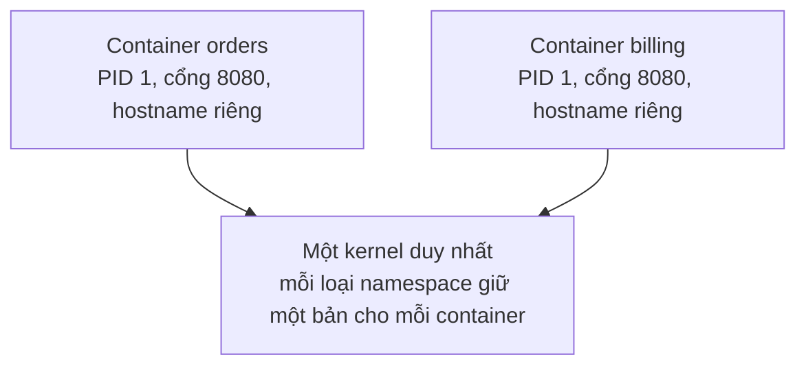

# P8 · Chương 02 — Namespaces

> **Môi trường thí nghiệm của cả chương.** Các khối `console` là quan sát một lần chạy trong **container `./labs/linux.sh` chạy trong VM Colima trên macOS**, kernel `6.8.0-117-generic`, user root với capability bị giảm: `CapEff = 0x00000000a80c35fb`. Giá trị này bằng 14 capability mặc định của Docker (`a80425fb`, giải mã ở [P8 · Chương 05, mục 3](05-bao-mat-container.md)) cộng `cap_net_admin` và `cap_sys_ptrace` do `labs/linux.sh` thêm (`--cap-add SYS_PTRACE --cap-add NET_ADMIN --cap-add NET_RAW`; `NET_RAW` vốn đã có trong tập mặc định). Lab còn chạy với **`--security-opt seccomp=unconfined`** (AppArmor để mặc định), nên container lab *không có seccomp* và khác container Docker mặc định. Tập capability **không có `cap_sys_admin`**, và các lệnh `mount` đã thử (tmpfs, bind, proc, đổi propagation) đều bị từ chối (mục 5). Vì vậy nhiều thí nghiệm phải đi qua user namespace (`unshare -Ur`) mới chạy được. Đó là giới hạn của lab, không phải hành vi chuẩn của Linux; không có kết quả nào ở đây là bảo đảm của tài liệu.

## Bạn sẽ hiểu được gì

1. **Q1.** Namespace là gì, gồm 8 loại nào, mỗi loại cô lập gì? → mục 1
2. **Q2.** Kernel ghi một process thuộc namespace nào ở đâu, và so sánh hai namespace bằng inode thế nào? → mục 2
3. **Q3.** `clone(2)`, `unshare(2)`, `setns(2)`, `nsenter(1)` khác nhau ra sao, và tạo namespace cần quyền gì? → mục 3
4. **Q4.** PID namespace: vì sao PID 1 đặc biệt, vì sao `unshare --pid` cần `--fork`, vì sao `ps` vẫn thấy cả host nếu không mount lại `/proc`? → mục 4
5. **Q5.** Mount namespace và propagation (shared subtree) hoạt động thế nào? → mục 5
6. **Q6.** User namespace: `uid_map`/`gid_map` ghi gì, "root trong namespace" có và không có quyền gì, rootless container dựa vào đâu? → mục 6
7. **Q7.** UTS, IPC, network, cgroup, time namespace mỗi loại cô lập gì? → mục 7

## Kiến thức cần trước

- [Process, PID 1, orphan/zombie](../01-linux/03-process.md) và [signal](../01-linux/05-signal.md): cần cho phần PID namespace.
- [User, quyền, capabilities, `/proc`](../01-linux/06-user-quyen-proc-sys.md): cần cho phần user namespace và cách đọc `/proc/<pid>/...`.
- [Container là gì](01-container-la-gi.md): bức tranh tổng thể. Nhắc ngắn: [cgroups v2](03-cgroups-v2.md), [filesystem](04-filesystem-cua-container.md), [bảo mật](05-bao-mat-container.md), [mạng](07-mang-container.md).

## 1. Namespace là gì, gồm 8 loại nào (Q1)

> **Trả lời ngắn.** Namespace bọc một tài nguyên toàn cục của kernel (PID, bảng mount, hostname, mạng...) trong một lớp trừu tượng, để process bên trong tưởng mình có bản cô lập riêng[^ns-def]. Linux có 8 loại: cgroup, IPC, network, mount, PID, time, user, UTS[^ns-table]. Namespace chỉ cô lập *tầm nhìn*; giới hạn mức dùng là việc của cgroup (nhận xét của người soạn).

**Giải thích.**

*Với service của bạn.* Hãy hình dung `orders`, một service viết bằng Rust, đóng gói thành container và chạy trên một host Linux cạnh container `billing`. Trong container, `orders` thấy mình là PID 1, nghe cổng 8080, có hostname riêng; `billing` bên cạnh cũng thấy y hệt như vậy, kể cả cổng 8080. Thế mà bên dưới chỉ có một kernel duy nhất. Ta sẽ bám theo `orders` suốt chương (đây là ví dụ giả định của người soạn, không phải code trong repo). Câu hỏi của mục này: kernel làm thế nào để hai container trên cùng một máy mà không giẫm chân nhau?

### 1.1 Một bộ tài nguyên toàn cục, nhiều bản riêng

Mặc định, mọi process trên một máy Linux dùng chung một bộ tài nguyên toàn cục: một không gian PID, một bảng mount, một hostname, một network stack[^ns-def]. Nếu cứ thế thì `orders` và `billing` không thể cùng bind cổng 8080, và process nào cũng thấy mọi process khác.

Namespace giải quyết chuyện này bằng cách bọc từng tài nguyên lại. Process trong một namespace thấy một bản riêng của tài nguyên, và thay đổi trên bản đó chỉ thành viên của namespace mới thấy[^ns-def]. Nhờ vậy nhiều "máy ảo nhẹ" chạy chung một kernel được, đó chính là ý tưởng của container ([chương 01](01-container-la-gi.md); nhận xét của người soạn).



(Sơ đồ minh họa của người soạn.)

Có hai chuyện namespace không làm. Nó không giới hạn mức dùng: `orders` vẫn có thể ăn hết CPU của máy nếu không có cgroup ([chương 03](03-cgroups-v2.md)). Nó cũng không phải cơ chế bảo mật hoàn chỉnh ([chương 05](05-bao-mat-container.md)). Namespace chỉ đổi cái process *nhìn thấy* (nhận xét của người soạn).

### 1.2 Tám loại

Linux hiện có 8 loại namespace, mỗi loại bọc một tài nguyên riêng. Cột "Cờ" trong bảng là giá trị truyền cho các API ở mục 3[^ns-table]; cột cuối ghi điều `orders` hưởng được từ loại đó (nhận xét của người soạn).

| Namespace | Cờ | Cô lập | Với `orders` |
|---|---|---|---|
| Cgroup | `CLONE_NEWCGROUP` | thư mục gốc của cgroup | thấy cây cgroup của mình như thể gốc |
| IPC | `CLONE_NEWIPC` | System V IPC, POSIX message queue | không thấy queue của `billing` |
| Network | `CLONE_NEWNET` | network device, stack, port... | cổng 8080 là của riêng nó |
| Mount | `CLONE_NEWNS` | các mount point | thấy cây thư mục của image |
| PID | `CLONE_NEWPID` | process ID | là PID 1 |
| Time | `CLONE_NEWTIME` | đồng hồ boot và monotonic | có thể có offset đồng hồ riêng |
| User | `CLONE_NEWUSER` | user ID và group ID | UID 0 bên trong có thể là user thường bên ngoài |
| UTS | `CLONE_NEWUTS` | hostname và NIS domain name | hostname riêng |

Container chỉ là một công dụng của namespace[^ns-containers]. Runtime ghép các namespace thành một container thế nào thì xem [chương 06](06-runtime-oci.md).

<details><summary>Đi sâu: OCI liệt kê gì, giới hạn số namespace</summary>

- Đặc tả OCI runtime cũng liệt kê đúng 8 loại này là kiểu namespace mà runtime "SHOULD" hỗ trợ[^oci-types].
- Số namespace có giới hạn: các file `/proc/sys/user/max_*_namespaces` đặt trần theo từng user, và khi chạm trần thì `clone(2)`/`unshare(2)` fail với `ENOSPC`[^ns-limits].

</details>

**Quay lại Q1:** namespace là lớp "bản riêng" của một tài nguyên toàn cục; có 8 loại, mỗi loại một tài nguyên, nhờ vậy `orders` và `billing` cùng kernel mà vẫn mỗi bên một cõi.

## 2. `/proc/<pid>/ns` và so sánh inode (Q2)

> **Trả lời ngắn.** Mỗi process có thư mục `/proc/<pid>/ns/`, mỗi namespace là một symlink trong đó[^ns-dir]. Nội dung symlink là loại và số inode, ví dụ `uts:[4026531838]`; hai process cùng namespace thì device ID và inode của symlink giống nhau, nên so sánh được bằng `readlink` hoặc `stat`[^ns-inode]. Namespace tồn tại tới khi không còn gì giữ nó[^ns-lifetime].

**Giải thích.**

*Với `orders`.* Giả sử bạn nghi `orders` và một sidecar đang dùng chung network namespace, hoặc đang cần biết `orders` có chạy trong user namespace hay không. Bạn không cần đoán: kernel ghi sẵn câu trả lời cho từng process trong `/proc/<pid>/ns/`.

### 2.1 Đọc namespace của một process

Thư mục `/proc/<pid>/ns/` có một entry cho mỗi namespace mà `setns(2)` thao tác được[^ns-dir]. Mỗi entry là symlink, và đích của nó là một chuỗi dạng `net:[4026532458]`, gồm loại namespace và số inode.

Điều ta dùng được ở đây: hai process ở cùng một namespace thì symlink tương ứng có cùng device ID và cùng inode, kiểm được bằng `st_dev`/`st_ino` từ `stat(2)`[^ns-inode]. Vậy muốn biết `orders` và sidecar có chung network namespace không, ta so `readlink /proc/<pid>/ns/net` của hai process; giống số thì chung.

### 2.2 Namespace sống bao lâu

Mặc định, namespace tự bị hủy khi process cuối cùng trong nó thoát hoặc rời đi[^ns-lifetime]. Nhưng có hai cách giữ nó sống mà không cần process nào ở trong. Cách thứ nhất là mở một file trong thư mục này để có file descriptor đại diện namespace: chừng nào fd còn mở, namespace còn sống, dù mọi process trong nó đã thoát[^ns-fd]. Cách thứ hai là bind mount một file trong thư mục này sang chỗ khác của filesystem, và namespace cũng sống tiếp[^ns-bind].

Hai cách này là thứ công cụ quản lý container dựa vào khi cần giữ namespace của một container sau khi process cuối cùng của nó đã thoát (suy luận của người soạn).

<details><summary>Đi sâu: pid_for_children, time_for_children, và thí nghiệm 1 — namespace của shell trong lab</summary>

Hai entry có tên lạ trong thư mục: `pid_for_children` và `time_for_children`. `/proc/pid/ns/pid` giữ nguyên suốt đời process (PID namespace của một process không bao giờ đổi), còn `pid_for_children` là namespace dành cho con sinh ra sau này, nên có thể khác vì đổi theo `unshare(2)`/`setns(2)`[^ns-pidchildren]. Time namespace cũng có cặp `time` / `time_for_children` tương tự[^ns-time-children].

```console
$ for n in /proc/self/ns/*; do echo $n $(readlink $n); done
/proc/self/ns/cgroup cgroup:[4026532457]
/proc/self/ns/ipc ipc:[4026532455]
/proc/self/ns/mnt mnt:[4026532451]
/proc/self/ns/net net:[4026532458]
/proc/self/ns/pid pid:[4026532456]
/proc/self/ns/pid_for_children pid:[4026532456]
/proc/self/ns/time time:[4026532518]
/proc/self/ns/time_for_children time:[4026532518]
/proc/self/ns/user user:[4026531837]
/proc/self/ns/uts uts:[4026532454]
```

Đọc kết quả: shell của lab nằm trong các namespace mà Docker tạo cho container, *trừ user namespace*. `/proc/self/uid_map` trong lab là `0 0 4294967295`, đúng dạng map của user namespace gốc[^user-initial]. Nói cách khác container lab **không dùng user namespace**; "root" ở đây là root thật của VM, bị bớt capability. Điều này quan trọng cho mục 6.

</details>

**Quay lại Q2:** namespace của process là các symlink trong `/proc/<pid>/ns/`; cùng số inode nghĩa là cùng namespace, và fd mở hay bind mount giữ namespace sống.

## 3. `clone`, `unshare`, `setns`, `nsenter` và quyền tạo namespace (Q3)

> **Trả lời ngắn.** `clone(2)` tạo process *mới* nằm sẵn trong namespace mới[^ns-clone]; `unshare(2)` chuyển process *đang chạy* sang namespace mới[^ns-unshare]; `setns(2)` cho process đang chạy vào namespace *đã có*[^ns-setns]. `unshare(1)` và `nsenter(1)` là hai lệnh shell làm việc tương tự (xem bảng). Tạo namespace hầu hết cần `CAP_SYS_ADMIN`[^ns-priv]. Riêng user namespace thì không[^ns-userexc].

**Giải thích.**

*Với `orders`.* Để `orders` có namespace riêng, runtime phải làm một trong hai việc: tạo namespace mới lúc dựng container, hoặc đưa một process vào namespace đã có, chẳng hạn khi bạn muốn chui vào container `orders` đang chạy để debug (nhận xét của người soạn). Linux có ba system call cho việc này, cùng hai lệnh shell bọc chúng. Mục này phân biệt các lựa chọn đó và nói ai được phép gọi chúng.

### 3.1 Ba system call và hai lệnh shell

Điểm khác nhau nằm ở chỗ *ai* được chuyển sang namespace. `clone` tạo một process con rồi đặt thẳng nó vào namespace mới. `unshare` chuyển chính process đang gọi, không cần tạo process nào. `setns` đưa process gọi vào một namespace đã tồn tại, xác định bằng fd của `/proc/pid/ns/*`.

| API / lệnh | Làm gì | Ghi chú |
|---|---|---|
| `clone(2)` + `CLONE_NEW*` | tạo process **mới** đã nằm trong namespace mới | namespace mới là của *con*[^ns-clone] |
| `unshare(2)` | chuyển process **đang chạy** vào namespace mới | không cần tạo process[^ns-unshare] |
| `setns(2)` | gia nhập namespace **đã có**, qua fd của `/proc/pid/ns/*` | fd cũng có thể là pidfd từ Linux 5.8[^setns-fd] |
| `unshare(1)` | tạo namespace mới rồi chạy một chương trình trong đó | làm việc tương tự `unshare(2)` |
| `nsenter(1)` | chạy chương trình trong namespace chỉ định bằng option | làm việc tương tự `setns(2)` |

`unshare(1)` tạo namespace mới rồi chạy chương trình bạn chỉ định[^unshare1-desc]. `nsenter(1)` chạy một chương trình trong các namespace bạn chọn bằng option dòng lệnh[^nsenter]. Mối liên hệ với `unshare(2)` và `setns(2)` là suy luận của người soạn: man page của hai lệnh chỉ liệt kê các syscall đó ở mục SEE ALSO.

### 3.2 Ai được tạo namespace

Tạo namespace mới bằng `clone(2)` hay `unshare(2)` trong hầu hết trường hợp đòi capability `CAP_SYS_ADMIN`, vì trong namespace mới người tạo có quyền đổi tài nguyên toàn cục mà process khác (sau này tạo ra trong, hoặc gia nhập, namespace đó) nhìn thấy[^ns-priv]. Man page `clone(2)` ghi lỗi tương ứng: `EPERM` khi một process không có `CAP_SYS_ADMIN` mà yêu cầu `CLONE_NEWCGROUP`, `CLONE_NEWIPC`, `CLONE_NEWNET`, `CLONE_NEWNS`, `CLONE_NEWPID` hay `CLONE_NEWUTS`[^clone-eperm]. Với `unshare(2)`, `CLONE_NEWTIME` cũng đòi `CAP_SYS_ADMIN`[^unshare-time] (time namespace hiện chỉ tạo được bằng `unshare(2)`, xem mục 7).

Ngoại lệ là user namespace: từ Linux 3.8, tạo nó không cần đặc quyền[^ns-userexc]. Ngoại lệ này mở ra một lối đi. Nếu `CLONE_NEWUSER` đi cùng các cờ `CLONE_NEW*` khác trong một lời gọi, kernel bảo đảm tạo user namespace **trước**, nên người gọi không đặc quyền vẫn dùng được cả tổ hợp[^user-first]. Vì thế `unshare -Ur --uts ...` chạy được còn `unshare --uts ...` thì không (vế sau khớp thí nghiệm 2 bên dưới). Đây cũng là nền để runtime dựng container mà không cần chạy bằng root: nó tạo user namespace trước, rồi dựng phần còn lại bên trong (suy luận của người soạn; mục 6 nói tiếp).

<details><summary>Đi sâu: ràng buộc của <code>setns</code>, OCI <code>path</code>, thí nghiệm 2 trong lab</summary>

Vài ràng buộc của `setns(2)` hay gặp:

- Đổi mount namespace đòi `CAP_SYS_CHROOT` và `CAP_SYS_ADMIN` trong user namespace của chính caller, cộng `CAP_SYS_ADMIN` trong user namespace sở hữu mount namespace đích[^setns-mnt].
- Process đa luồng không đổi được user namespace bằng `setns()`[^setns-multithread]. Cũng không dùng `setns()` để vào lại user namespace hiện tại, nhằm ngăn caller đã bỏ capability lấy lại chúng[^setns-reenter].
- Với PID namespace, `setns` (và `unshare`) không đổi PID namespace của chính caller mà chỉ ảnh hưởng *con sinh ra sau đó* (mục 4)[^pid-unshare].

OCI runtime-spec cho phép khai báo mảng `namespaces`, mỗi phần tử có `type` và `path` tùy chọn. Có `path` thì runtime đặt process vào namespace đó (cơ chế tương ứng là `setns`, suy luận của người soạn); không có thì tạo mới; loại không khai báo thì container kế thừa namespace của runtime[^oci-ns]. Vì vậy chia sẻ network namespace giữa hai container chỉ là *gia nhập* namespace có sẵn thay vì tạo mới (nhận xét của người soạn); xem [chương 06](06-runtime-oci.md).

**Thí nghiệm 2 — hầu hết `unshare` thường bị chặn** (lab không có `CAP_SYS_ADMIN`):

```console
$ unshare --uts true     # tương tự --ipc, --net, --mount, --cgroup, --time, --pid --fork
unshare: unshare failed: Operation not permitted
$ unshare --user true
$ echo $?
0
```

Cả bảy cờ khác user đều trả `EPERM` còn `--user` thành công, khớp quy tắc ở trên[^ns-userexc]. Đây không phải lỗi môi trường mà là hành vi đúng như docs của kernel[^clone-eperm]. Nhưng cần nhớ lab tắt seccomp: trong container Docker mặc định, profile seccomp còn chặn cả `unshare --user` (quan sát và JSON ghim ở [P8 · Chương 05, mục 5](05-bao-mat-container.md)), nên kết quả `--user` thành công ở đây không đúng cho container Docker thông thường. Để đi tiếp, ta dùng user namespace làm bàn đạp: `unshare -Ur` (mục 6) cho capability đầy đủ *bên trong* namespace mới, và từ đó tạo được các namespace khác do nó sở hữu.

</details>

**Quay lại Q3:** `clone` tạo con trong namespace mới, `unshare` chuyển chính caller, `setns` gia nhập namespace có sẵn; cần `CAP_SYS_ADMIN` trừ user namespace.

## 4. PID namespace (Q4)

> **Trả lời ngắn.** PID namespace cho mỗi nhóm process một không gian PID riêng bắt đầu từ 1[^pid-1]. Process đầu tiên trong đó là PID 1, đóng vai init và nhận nuôi process mồ côi[^pid-init]. Init được bảo vệ khỏi tín hiệu từ bên trong[^pid-sig]. Nó chết thì cả namespace bị giết[^pid-initdie]. `unshare(2)` không chuyển chính caller vào PID namespace mới nên `unshare --pid` cần `--fork`[^pid-unshare]; `/proc` thì phải mount lại để `ps` đúng[^pid-proc].

**Giải thích.**

*Với `orders`.* Trong container, `orders` là PID 1; nhìn từ host, cùng process đó mang một PID khác. Hai chuyện thường làm người ta bất ngờ: `docker stop` gửi `SIGTERM` mà `orders` không chịu tắt, và `ps` trong một PID namespace tự dựng tay lại liệt kê cả process của host. Cả hai đều có gốc từ cách PID namespace hoạt động; mục này đi lần lượt.

### 4.1 Mỗi namespace một dãy PID

PID namespace cô lập không gian số PID, nên hai process ở hai namespace khác nhau có thể cùng PID[^pid-def]. PID trong namespace mới bắt đầu từ 1, gần giống một máy độc lập[^pid-1]. Đó là lý do `orders` và `billing` đều thấy mình là PID 1.

PID namespace còn xếp thành cây, và một process chỉ nhìn thấy (gửi `kill`, đổi `nice`...) process trong namespace của nó và các hậu duệ[^pid-vis]. Vì vậy `orders` không thấy gì ngoài container của mình, còn host, là namespace tổ tiên, thấy được cả container. Hệ quả là một process có **một PID ở mỗi tầng** mà nó hiện ra[^pid-perlayer], tức PID 1 bên trong container và một số khác ở host.

### 4.2 PID 1 là init của namespace

Process đầu tiên tạo trong namespace mới (con sinh ra bằng `clone` với `CLONE_NEWPID`, hoặc con đầu tiên sau khi `unshare(CLONE_NEWPID)`) có PID 1 và đóng vai "init" của namespace: nó trở thành cha của mọi process mồ côi (orphan) do process trong namespace này kết thúc[^pid-init]. Với `orders` thì điều này có nghĩa: nếu `orders` spawn tiến trình con rồi con đó mồ côi, `orders` là người phải `wait` nó (reaper/zombie: [../01-linux/03-process.md](../01-linux/03-process.md)). Vì vậy hay thấy một init tí hon như `tini` làm PID 1 thay cho ứng dụng (suy luận của người soạn).

Init cũng là điểm yếu của cả namespace: nếu nó kết thúc, kernel giết mọi process còn lại trong namespace bằng `SIGKILL`[^pid-initdie]. Sau đó, `fork` vào namespace này trả `ENOMEM`[^pid-forkfail].

Để tránh ai đó vô tình giết init, kernel bảo vệ nó khỏi tín hiệu (luật đầy đủ kèm Kubernetes và graceful shutdown: [P1 · Chương 05, mục 8](../01-linux/05-signal.md)). Từ *bên trong* namespace, các process khác chỉ gửi được cho init những tín hiệu mà init đã cài signal handler, và luật này áp dụng cả cho process có đặc quyền[^pid-sig]. Từ namespace tổ tiên, như host, cũng chỉ gửi được tín hiệu init đã có handler[^pid-ancestor-handler]. Ngoại lệ là `SIGKILL` và `SIGSTOP`: khi gửi từ namespace tổ tiên, chúng được chuyển cưỡng bức[^pid-ancestor].

Bây giờ ta giải được chuyện `docker stop`. Nếu `orders` chưa cài handler cho `SIGTERM` thì tín hiệu đó không tới được nó, dù gửi từ host. Lệnh dừng container chỉ gửi `SIGTERM`, nên có thể không có tác dụng cho tới khi bị `SIGKILL` (suy luận của người soạn). Cách xử lý và số đo ở [chương 08, mục 3](08-rust-trong-container.md).

### 4.3 Vì sao `unshare --pid` cần `--fork`

Khi tự dựng namespace bằng tay, bạn sẽ vấp chuyện này trước tiên. `unshare(2)` với `CLONE_NEWPID` **không** chuyển caller vào namespace mới, vì làm thế sẽ đổi PID của chính caller (`getpid()`) và làm hỏng nhiều chương trình lẫn thư viện[^pid-unshare]. Chỉ con tạo sau đó nằm trong namespace mới, và con đầu tiên có PID 1[^unshare-newpid].

Vì vậy `unshare(1)` có option `--fork`, để chạy chương trình như một con của `unshare` thay vì chạy trực tiếp; man page ghi rõ nó hữu ích khi tạo PID namespace[^unshare1-fork]. Không có `--fork`, chương trình được `exec` thẳng trong namespace *cũ*, và con đầu tiên nó tạo mới thành init.

### 4.4 Vì sao `/proc` phải mount lại

`/proc` chỉ hiển thị các process thấy được trong PID namespace của process *đã mount* nó, kể cả khi người xem ở namespace khác[^pid-proc]. Bởi vậy, sau khi tạo PID namespace mà không mount lại, `ps` trong đó vẫn đọc `/proc` cũ và liệt kê cả process của host.

Cách sửa là mount một procfs mới. Nếu bạn đồng thời tạo mount namespace thì có thể mount thẳng đè lên `/proc` mà không cần đổi root[^pid-procmount]. `unshare --mount-proc` làm đúng việc này, và ngầm kéo theo mount namespace[^unshare1-mountproc].

<details><summary>Đi sâu: lồng nhau, <code>getppid</code>, <code>unshare</code> một lần, <code>readlink /proc/self</code>, thí nghiệm 3 và 4</summary>

- PID namespace lồng nhau tối đa 32 tầng từ Linux 3.7[^pid-nest]. Đổi PID namespace là một chiều: xuống namespace con được, lên tổ tiên thì không[^pid-oneway].
- Nếu một tổ tiên gần hơn đã gọi `prctl(PR_SET_CHILD_SUBREAPER)` thì nó nhận nuôi process mồ côi trước init[^pid-subreaper].
- Cha của init (nằm ngoài namespace) bị `getppid()` báo là 0[^pid-ppid0].
- Một process chỉ gọi `unshare(CLONE_NEWPID)` được **một lần**[^pid-once]. Nếu con đầu tiên kết thúc thì các `fork` về sau fail với `ENOMEM`[^pid-enomem].
- `readlink /proc/self` cho ra PID của caller trong PID namespace *của procfs mount*, tiện để biết PID mình ở namespace khác[^pid-self].
- Cùng một process hiện ra nhiều PID tùy chỗ nhìn. Trong lab, `unshare -Ur --pid --fork sleep 40` hiện ở namespace của lab với `unshare` là PID 32 và `sleep` là PID 34; bên trong namespace mới `sleep` là PID 1.

**Thí nghiệm 3 — PID namespace trong lab (có trả giá bằng user namespace).** `unshare --pid` trần bị chặn (thí nghiệm 2) nên ta thêm `-Ur`, và giữ nguyên propagation (`--propagation unchanged`) vì lab chặn mount (mục 5). `pid=1`: bash là init của namespace mới.

```console
$ unshare --user --map-root-user --pid --fork --propagation unchanged \
    bash -c 'echo pid=$$; readlink /proc/self; ls /proc | head -3; ps -e | wc -l'
pid=1
9
1
10
11
fatal library error, lookup self
0
```

- `readlink /proc/self` ra `9`, dù `$$` là 1: `/proc` vẫn là procfs của namespace cũ, nên hiển thị PID theo *namespace của procfs*[^pid-self]. `ls /proc` còn liệt kê PID `1`, `10`, `11`... của container lab và `ps` vỡ (`fatal library error, lookup self`). Đó là hậu quả cụ thể của việc quên mount lại `/proc`.
- Hai biến thể `--mount-proc` và `mount -t proc` thất bại trong lab (`cannot change /proc filesystem propagation: Permission denied`; `cannot mount proc read-only`), xem mục 5. **Lab này không chạy được ví dụ `ps` sạch của man page**; hãy thử `unshare --pid --fork --mount-proc ps -ef` trên máy có `CAP_SYS_ADMIN`.

**Thí nghiệm 4 — init bất tử trước `kill -9` từ bên trong.**

```console
$ unshare -Ur --pid --fork --propagation unchanged bash -c '
    kill -9 1; echo rc=$?
    trap "echo got TERM" TERM; kill -TERM $$; echo after'
rc=0
got TERM
after
```

`kill -9 1` (đích là chính bash, PID 1) trả `rc=0` nhưng bash **không chết**: tín hiệu không có handler không tới được init từ thành viên cùng namespace[^pid-sig]. `SIGKILL` chỉ được cưỡng bức khi gửi từ namespace tổ tiên[^pid-ancestor]. Sau `trap` cho `SIGTERM`, tín hiệu được giao ("got TERM"). Phần lồng nhiều tầng không có output được ghi lại ở đây nên không khẳng định kết quả; theo cơ chế, process đầu tiên của mỗi namespace mới có PID 1 trong namespace đó[^pid-init].

Một bài học về `unshare` không `--fork`:

```console
$ unshare -Ur --pid --propagation unchanged bash -c '
    (true); bash -c "echo child \$\$"'
bash: fork: Cannot allocate memory
```

Subshell `(true)` là con đầu tiên, thành init rồi kết thúc, nên `fork` kế tiếp trả `ENOMEM`[^pid-enomem].

</details>

**Quay lại Q4:** PID 1 là con đầu tiên của namespace (nên cần `--fork`), nó nhận orphan và chỉ nhận tín hiệu có handler từ bên trong, và `/proc` phải mount lại thì `ps` mới đúng; với `orders` làm PID 1, đó là lý do `SIGTERM` không có handler thì `docker stop` không dừng được nó.

## 5. Mount namespace (Q5)

> **Trả lời ngắn.** Mount namespace cho mỗi nhóm process một danh sách mount riêng[^mnt-def]. Namespace mới bắt đầu bằng bản *sao* danh sách của caller[^mnt-copy]. Từ đó mount/umount ở hai bên mặc định không ảnh hưởng nhau[^mnt-nopropagate]. Tính năng *propagation* (shared subtree) cho phép lan truyền có kiểm soát mount/umount giữa các mount trong cùng một nhóm peer[^mnt-shared-hist].

**Giải thích.**

*Với `orders`.* Khi `orders` mở `/etc/orders.toml` hay ghi log vào `/var/log`, nó đi qua cây thư mục của image chứ không phải cây của host. Cái làm nên cảnh đó là mount namespace: mỗi container có một danh sách mount riêng, và ta sẽ thấy danh sách đó được tạo ra thế nào, rồi khi nào mount ở một bên lan sang bên kia (cách dựng filesystem của container: [chương 04](04-filesystem-cua-container.md)).

### 5.1 Bản sao danh sách mount

Mount namespace cô lập danh sách mount mà process thấy: mỗi instance cho một cây thư mục đơn riêng[^mnt-def]. Các file `/proc/pid/mounts`, `mountinfo`, `mountstats` phản ánh mount namespace của pid đó[^mnt-proc].

Namespace mới không bắt đầu từ trống. Khi tạo bằng `unshare(2)`, danh sách mount của nó là bản sao danh sách của caller trước đó[^mnt-copy]. Sau đó các `mount`/`umount` ở một bên mặc định không ảnh hưởng bên kia[^mnt-nopropagate]. Nghĩa là mount thêm một thư mục bên trong container thì host mặc định không thấy (nhận xét của người soạn).

### 5.2 Propagation: khi nào mount lan sang bên kia

Cô lập hoàn toàn đôi khi *quá mức*: ví dụ cắm một đĩa quang mới mà phải mount riêng ở từng namespace mới dùng được. Vì thế từ Linux 2.6.15 có tính năng **shared subtree**, cho phép lan truyền có kiểm soát sự kiện `mount`/`umount` giữa các mount trong cùng một *peer group*, tức nhóm mount chia sẻ sự kiện với nhau[^mnt-shared-hist].

Kiểu propagation là thiết lập của từng mount point, không phải của cả namespace[^mnt-pertype]. Có bốn kiểu:

| Kiểu | Ý nghĩa |
|---|---|
| `MS_SHARED` | chia sẻ sự kiện với peer group; mount/umount ngay dưới nó lan sang các peer và ngược lại[^mnt-shared] |
| `MS_PRIVATE` | không có peer group, không lan truyền vào hay ra[^mnt-private] |
| `MS_SLAVE` | nhận sự kiện từ một peer group "master" nhưng không phát đi[^mnt-slave] |
| `MS_UNBINDABLE` | như private, và thêm: không thể bind mount[^mnt-unbindable] |

Muốn biết một mount đang ở kiểu nào, đọc trường tùy chọn trong `/proc/pid/mountinfo`: có thẻ `shared:X`, `master:X` hoặc `unbindable`, còn không có thẻ nào thì mount là private[^mnt-mountinfo].

Có một chi tiết ở phía công cụ: `unshare(1)` từ util-linux 2.27 tự đặt propagation thành private trong mount namespace mới, để namespace thực sự tách rời; tắt bằng `--propagation unchanged`[^unshare1-prop].

<details><summary>Đi sâu: ví dụ man page, mount trong user namespace, thí nghiệm 5 (mount bị chặn)</summary>

Ví dụ trong man page: sau khi `unshare -m --propagation unchanged`, một mount con tạo dưới mount shared `/mntS` được tạo là shared (kế thừa từ cha) và hiện ra ở namespace gốc, còn mount con tạo dưới mount private `/mntP` là private và không lan sang[^mnt-example].

Giữ `CAP_SYS_ADMIN` trong user namespace *sở hữu* mount namespace cho phép tạo bind mount và mount một số loại filesystem (`/proc`, `/sys`, `devpts`, `tmpfs`, `ramfs`, `mqueue`, `bpf`, `overlayfs` từ 5.11...)[^mnt-userns-fs]. Còn filesystem dựa trên block device thì chỉ làm được với `CAP_SYS_ADMIN` ở user namespace gốc[^mnt-block]. Đây là nền để rootless container tự dựng rootfs (nhận xét của người soạn).

**Thí nghiệm 5 — mount bị chặn trong lab:**

```console
$ unshare -Urm --propagation unchanged bash -c 'mount -t tmpfs none /mnt'
mount: /mnt: cannot mount none read-only.
$ unshare -Urm --propagation unchanged bash -c 'mount --bind /tmp /mnt'
mount: /mnt: bind /tmp failed.
$ unshare -Urm bash -c true       # propagation mặc định = private
unshare: cannot change root filesystem propagation: Permission denied
```

Ghi chép đúng kết quả: `unshare -Ur --mount` **tạo được** mount namespace nhưng các lệnh `mount` đã thử bên trong (đổi propagation mặc định của `unshare`, `tmpfs`, bind, `proc`) đều bị từ chối. Thí nghiệm này không tách riêng từng lớp chặn, nhưng quan sát ở [P8 · Chương 07, mục 2.3](07-mang-container.md) đã làm việc đó với một thao tác mount khác: với `SYS_ADMIN` + `NET_ADMIN` và AppArmor mặc định, `mount --make-shared /run/netns` vẫn lỗi, chỉ qua khi thêm `apparmor=unconfined`, còn thêm riêng `seccomp=unconfined` không đủ. Lab đã tắt seccomp và để AppArmor mặc định, nên nhiều khả năng profile AppArmor `docker-default` là lớp từ chối `mount` ở đây (suy luận của người soạn từ quan sát ở chương 07; chương này không đọc log denial). Ta không cố vượt chặn, nên phần mount namespace của chương này dựa vào man page, **không có kết quả `mount` thành công trong lab**.

</details>

**Quay lại Q5:** mount namespace là bản sao danh sách mount; mount/umount chỉ lan giữa các namespace khi mount thuộc cùng peer group shared, và `unshare` mặc định đặt private để tránh điều đó.

## 6. User namespace (Q6)

> **Trả lời ngắn.** User namespace cho process một bộ UID/GID và capability riêng: có thể là user thường bên ngoài nhưng UID 0 bên trong, toàn quyền cho thao tác *bên trong* namespace và không đặc quyền bên ngoài[^user-root]. `uid_map`/`gid_map` là bảng dịch UID giữa hai namespace[^user-mapfmt]. Mỗi file chỉ ghi được một lần[^user-once]. Đó là nền tảng của rootless container (nhận xét của người soạn).

**Giải thích.**

*Với `orders`.* Giả sử trong container `orders` chạy bằng UID 0. Nếu đó cũng là root thật của host thì một lỗ hổng cho phép thoát khỏi container sẽ cho kẻ tấn công quyền root trên host (nhận xét của người soạn). User namespace cho cách khác: bên trong, `orders` vẫn thấy mình là UID 0 và làm được việc cần quyền, nhưng nhìn từ host nó chỉ là một user thường. Mục này giải thích bảng dịch UID làm được điều đó thế nào, và quyền "root" ấy rộng đến đâu.

### 6.1 Cô lập những gì

User namespace cô lập các định danh và thuộc tính liên quan đến bảo mật, cụ thể là user ID, group ID, thư mục gốc, keyring và capabilities[^user-def]. Nhờ vậy một process có thể là user thường bên ngoài mà có UID 0 bên trong: toàn quyền cho thao tác *bên trong* namespace, không đặc quyền bên ngoài[^user-root]. User namespace lồng nhau được tối đa 32 tầng (từ Linux 3.11, vượt thì lỗi `EUSERS`), và mỗi process thuộc đúng một user namespace[^user-nest].

### 6.2 `uid_map` và `gid_map`

Namespace mới sinh ra **chưa có ánh xạ** UID/GID nào[^user-map-empty]. Muốn có, ta ghi vào hai file `/proc/pid/uid_map` và `gid_map` (từ Linux 3.5), đọc được và **ghi một lần**[^user-mapfile]. Ghi lần hai bị `EPERM`[^user-once].

Mỗi dòng của file là ánh xạ 1-1 một dải ID liên tiếp giữa hai namespace[^user-mapfmt]. Dòng gồm ba số: ID bắt đầu bên trong namespace của process `pid`, ID bắt đầu ở namespace bên kia, và độ dài dải. Namespace gốc có map giả `0 0 4294967295`[^user-initial].

Ví dụ: dòng `0 1000 1` nghĩa là UID 1000 bên ngoài là UID 0 bên trong, tức là `orders` thấy mình là root còn host thấy user 1000. Khi process truy cập file, kernel ánh xạ UID/GID của nó về namespace gốc để kiểm tra quyền[^user-file]. Còn ID chưa được ánh xạ thường hiện ra là *overflow ID*, mặc định 65534[^user-overflow].

### 6.3 Ai được ghi map

Quy tắc ghi map (tóm tắt): người ghi cần `CAP_SETUID`/`CAP_SETGID` trong namespace của pid, và các ID được ánh xạ phải có ánh xạ ở namespace cha. Với người ghi không có `CAP_SETUID`/`CAP_SETGID` trong namespace cha, quy tắc chặt hơn: chỉ được ghi **một dòng** ánh xạ chính EUID (GID) của nó ở namespace cha[^user-unpriv]. Người ghi này phải cùng EUID với người tạo namespace, và với `gid_map` phải ghi `deny` vào `/proc/pid/setgroups` trước[^user-setgroups].

Công cụ dòng lệnh làm sẵn việc này: `unshare --map-root-user` ánh xạ EUID/EGID hiện tại thành superuser trong namespace mới[^unshare1-maproot]. Nó cũng ngầm đặt `--setgroups=deny`[^unshare1-maproot2].

Một image thật hay có nhiều user, nên cần ánh xạ **nhiều UID**. Việc đó đòi người ghi có `CAP_SETUID` trong namespace cha (trường hợp (a) trong cùng mục man page)[^user-unpriv]. Với user thường, `newuidmap(1)` ghi `/proc/[pid]/uid_map` giúp dựa trên dải trong `/etc/subuid` (hoặc NSS subid) mà admin cấp cho user đó[^newuidmap]. Rootless Docker/Podman dựa vào cơ chế kiểu này (suy luận của người soạn; chi tiết rootless ở [chương 05](05-bao-mat-container.md)).

### 6.4 Root trong namespace có quyền gì, và không có gì

Process nhận capability **đầy đủ trong namespace mới**[^user-caps]. Đổi lại, nó **không có capability nào** ở namespace cha hoặc namespace trước đó, kể cả khi người tạo là root ngoài[^user-nocapparent].

Phạm vi quyền cũng hẹp: capability trong một user namespace chỉ cho phép thao tác trên tài nguyên **thuộc** các namespace mà user namespace đó quản lý[^user-scope]. Cơ chế là mỗi namespace không-phải-user ghi lại user namespace của người tạo ra nó làm owner[^user-owns], và khi bạn thao tác tài nguyên toàn cục của namespace đó, kernel kiểm quyền theo owner. Chẳng hạn khi `orders` muốn thêm một network device: được nếu network namespace thuộc user namespace của nó, không được nếu network namespace đó là của host (suy ra từ quy tắc trên; thí nghiệm 8 xác nhận).

Cuối cùng, nhiều thao tác đặc quyền chạm tài nguyên *không thuộc namespace nào*: đổi giờ hệ thống (`CAP_SYS_TIME`), nạp kernel module (`CAP_SYS_MODULE`), tạo device (`CAP_MKNOD`). Những thao tác này chỉ làm được ở user namespace gốc[^user-global]. Nghĩa là "root" của `orders` không sửa được giờ của host.

<details><summary>Đi sâu: capability kế thừa, <code>execve</code>, thí nghiệm 7 và 8</summary>

- Capability trong một user namespace có hiệu lực với mọi namespace con[^user-inherit]. Người sở hữu namespace (euid khớp) ở namespace cha có đầy đủ capability trong nó[^user-owner].
- Khi `execve`, capability tính lại như thường: trừ khi process có UID 0 trong namespace hoặc file có inheritable capability khác rỗng, process mất hết capability[^user-execve]. Suy ra (suy luận của người soạn): phải ghi map *trước* khi `exec`, để UID bên trong là 0 chứ không phải overflow ID.

**Thí nghiệm 7 — `unshare --user --map-root-user` rồi `id`:**

```console
$ unshare --user --map-root-user bash -c '
    id; cat /proc/self/uid_map /proc/self/gid_map; readlink /proc/self/ns/user
    grep Cap /proc/self/status'
uid=0(root) gid=0(root) groups=0(root)
         0          0          1
         0          0          1
user:[4026532521]
CapInh:	0000000000000000
CapPrm:	000001ffffffffff
CapEff:	000001ffffffffff
CapBnd:	000001ffffffffff
CapAmb:	0000000000000000
```

- `uid_map = 0 0 1`: map "0 trong ns ↔ 0 bên ngoài, dài 1". Vì ta *đã là* root thật trước đó nên trông không khác `id` ban đầu; điểm khác là `CapEff` nay là `1ffffffffff` (đủ capability trong namespace) so với `a80c35fb` bên ngoài. Trên máy với user 1000 thì `--map-root-user` ánh xạ EUID hiện tại thành 0 nên map sẽ là `0 1000 1`[^unshare1-maproot].
- Ta *lấy được* `cap_sys_admin` trong namespace dù ngoài lab không có, đúng như docs[^user-caps].
- Không `--map-root-user`:

```console
$ unshare --user bash -c 'id'
uid=65534(nobody) gid=65534(nogroup) groups=65534(nogroup)
```

Chưa có ánh xạ nên UID hiện là overflow 65534[^user-overflow].

**Thí nghiệm 8 — "root trong ns" làm được gì:**

```console
$ unshare -Ur --pid --fork --propagation unchanged bash -c '
    date -s 2020-01-01; chown 1:1 /tmp; ip link add dummy0 type dummy;
    unshare --net ip link add d0 type dummy; echo rc=$?'
date: cannot set date: Operation not permitted
chown: changing ownership of '/tmp': Invalid argument
RTNETLINK answers: Operation not permitted
rc=0
```

- `date -s`: `Operation not permitted` dù `CapEff` đầy đủ, vì `CAP_SYS_TIME` chỉ có tác dụng ở user namespace gốc[^user-global].
- `chown 1:1 /tmp`: `Invalid argument` (suy luận của người soạn: do UID/GID 1 không có ánh xạ, vì map chỉ có `0 0 1`).
- `ip link add dummy0` trong network namespace **của lab** (không thuộc user namespace mới): bị từ chối. Nhưng trong network namespace mới tạo bằng `unshare --net` (thuộc user namespace mới), `ip link add d0 type dummy` **thành công**: quyền chỉ áp dụng trên tài nguyên do namespace của mình sở hữu[^user-scope].

</details>

**Quay lại Q6:** `uid_map`/`gid_map` là bảng dịch ID ghi một lần; root trong user namespace đủ capability chỉ trên tài nguyên do namespace đó sở hữu, nên `orders` làm root trong container mà vẫn không đụng được vào host, và đó là nền của rootless container.

## 7. UTS, IPC, network, cgroup, time (Q7)

> **Trả lời ngắn.** UTS cô lập hostname và NIS domain name[^uts-def]. IPC cô lập System V IPC và POSIX message queue[^ipc-def]. Network cô lập device, stack, routing, firewall, port[^net-def]. Cgroup namespace ảo hóa *cách nhìn* cây cgroup[^cgns-def]. Time namespace ảo hóa đồng hồ monotonic và boottime[^time-def].

**Giải thích.**

*Với `orders`.* Năm loại còn lại đơn giản hơn PID, mount và user, mỗi loại bọc đúng một nhóm tài nguyên. Với `orders` thì mỗi loại ứng với một điều cụ thể: tên máy `orders` tự thấy, cổng 8080 của riêng nó, và việc nó không thấy IPC của `billing`. Ta đi lần lượt qua từng loại.

### 7.1 UTS: hostname

UTS namespace cô lập hai định danh: hostname và NIS domain name (đặt bằng `sethostname(2)`/`setdomainname(2)`, đọc bằng `uname(2)`...). Thay đổi chỉ thấy trong cùng namespace[^uts-def]. Namespace mới không bắt đầu trống: hostname và domain name được copy từ namespace của caller[^uts-copy]. Một điểm hay bị hỏi: `sethostname` chạy được trong user namespace vì kernel kiểm `CAP_SYS_ADMIN` trong user namespace sở hữu UTS namespace đó[^user-hostname].

### 7.2 IPC

IPC namespace cô lập System V IPC object và (từ Linux 2.6.30) POSIX message queue[^ipc-def]. Khi namespace bị hủy, mọi IPC object trong nó bị hủy theo[^ipc-destroy]. Vì vậy `orders` và `billing` không thấy message queue của nhau.

### 7.3 Network

Network namespace cô lập network device, stack IPv4/IPv6, bảng routing, firewall rule, `/proc/net`, `/sys/class/net`, port, và cả abstract UNIX socket namespace[^net-def]. Chính nó cho `orders` và `billing` cùng nghe cổng 8080 mà không xung đột. Một device vật lý chỉ ở đúng một network namespace, và cặp `veth` là "ống" nối hai namespace[^net-veth].

Nền tảng mạng (Ethernet, bridge, routing) ở [../06-networking/02-link-layer.md](../06-networking/02-link-layer.md); cách container dùng veth + bridge ở [chương 07](07-mang-container.md).

### 7.4 Cgroup

Cgroup namespace ảo hóa *cách nhìn* cgroup của process qua `/proc/pid/cgroup` và `mountinfo`[^cgns-def]. Cgroup hiện tại của process trở thành thư mục gốc của namespace mới[^cgns-root], nên `orders` thấy cây cgroup của mình như thể từ gốc. Nó không đặt giới hạn tài nguyên ([chương 03](03-cgroups-v2.md)).

### 7.5 Time

Time namespace ảo hóa hai đồng hồ: `CLOCK_MONOTONIC` (cùng `_COARSE`, `_RAW`) và `CLOCK_BOOTTIME`. Nó ảnh hưởng `clock_gettime`, `nanosleep`, `timerfd_settime`... và `/proc/uptime`[^time-def].

Cách tạo có một chỗ lạ: hiện chỉ có `unshare(2)` với `CLONE_NEWTIME`, và caller *không* được chuyển vào namespace mới, chỉ các con sau đó mới vào, để kịp đặt offset trước (theo man page bản hiện tại)[^time-create]. Offset (so với namespace gốc) xem tại `/proc/PID/timens_offsets`[^time-offsets].

<details><summary>Đi sâu: thí nghiệm 6 (hostname), IPC, network, cgroup, time trong lab</summary>

**Thí nghiệm 6 — đổi hostname:**

```console
$ unshare --uts bash -c 'hostname demo-ns'
unshare: unshare failed: Operation not permitted
$ unshare -Ur --uts bash -c 'hostname; hostname demo-ns; hostname; readlink /proc/self/ns/uts'
bf494ede10c9
demo-ns
uts:[4026532661]
$ hostname
bf494ede10c9
```

Lần đầu bị chặn (thí nghiệm 2). Lần hai, qua user namespace, hostname copy từ namespace cũ rồi đổi thành `demo-ns` chỉ trong namespace mới; host vẫn thấy tên cũ.

**IPC.** Trong lab, `unshare -Ur --ipc` rồi `ipcmk -Q` tạo một queue chỉ thấy bên trong; `ipcs -q` ở ngoài không có dòng nào.

**Network.**

```console
$ unshare -Ur --net bash -c 'ip link; ip link set lo up; ip -br a'
1: lo: <LOOPBACK> mtu 65536 qdisc noop state DOWN ...
lo               UNKNOWN        127.0.0.1/8 ::1/128
```

Namespace mới chỉ có `lo`, trạng thái DOWN cho tới khi bật. (`ip netns add` thất bại trong lab vì `mount --make-shared /run/netns` bị từ chối, cùng nguyên nhân thí nghiệm 5.)

**Cgroup.** Trong lab, `cat /proc/self/cgroup` in `0::/` vì shell đã ở trong cgroup namespace riêng; `unshare -Ur --cgroup` cho namespace mới và vẫn `0::/`.

**Time.**

```console
$ unshare -Ur --time --boottime 1000 --fork cat /proc/uptime; cat /proc/uptime
7843.04 27086.14
6843.04 27086.14
```

Chạy được trong lab: uptime trong time namespace lớn hơn host đúng 1000 giây (`boottime` offset 1000); `--monotonic 86400` ghi `monotonic 86400 0` vào `timens_offsets`.

</details>

**Quay lại Q7:** mỗi namespace còn lại ảo hóa đúng một nhóm tài nguyên: tên máy (UTS), IPC, mạng, cây cgroup, đồng hồ; với `orders`, đó là hostname, cổng 8080 và queue của riêng nó.

## Liên hệ với Rust

Nếu bạn tự viết launcher hay runtime cho `orders` bằng Rust, các system call trên đã có sẵn trong crate `nix`. Ghim phiên bản docs.rs `nix 0.29.0`, hai hàm cần dùng là `nix::sched::unshare(flags: CloneFlags) -> Result<()>` ("disassociate parts of the process execution context"), chỉ có khi bật feature `sched`[^nix-unshare], và `nix::sched::setns<Fd: AsFd>(fd: Fd, nstype: CloneFlags) -> Result<()>` ("reassociate thread with a namespace"), cũng cần feature `sched`[^nix-setns]. Chữ "thread" trong mô tả của `setns` đáng chú ý: nó cho thấy hàm tác động lên thread gọi, chứ không phải cả process.

Docs của `nix` chỉ trỏ tới `unshare(2)`/`setns(2)` cho chi tiết, nên theo suy luận của người soạn, ngữ nghĩa là của kernel đúng như hai man page đó. Chẳng hạn `unshare(CloneFlags::CLONE_NEWPID)` vẫn không đưa process hiện tại vào namespace mới (mục 4). Và vì `setns` tác động lên *thread* gọi, chương trình Rust đa luồng muốn đổi mount hoặc user namespace phải xử lý cẩn thận (mục 3). Người soạn không chạy code Rust nào cho chương này nên không khẳng định kết quả chạy; ví dụ runtime container viết bằng Rust ở [chương 08](08-rust-trong-container.md).

## Tóm tắt

- Namespace cô lập *tầm nhìn* vào tài nguyên toàn cục; 8 loại (cgroup, IPC, network, mount, PID, time, user, UTS), tạo bằng cờ `CLONE_NEW*`. `orders` và `billing` chung kernel nhưng mỗi bên một bản.
- Trạng thái ở `/proc/<pid>/ns/*`: cùng inode thì cùng namespace; giữ fd/bind mount để namespace sống không cần process.
- `clone` tạo con trong namespace mới, `unshare` chuyển chính caller, `setns` gia nhập namespace có sẵn; `unshare(1)`/`nsenter(1)` là hai lệnh shell làm việc tương tự.
- Tạo namespace cần `CAP_SYS_ADMIN` trong hầu hết trường hợp (man page nêu thế; `clone(2)` liệt kê 6 loại, `unshare(2)` thêm time), riêng user namespace thì không; đi kèm `CLONE_NEWUSER` thì user namespace được tạo trước.
- PID namespace: con đầu tiên là PID 1, nhận orphan, chết thì cả namespace bị `SIGKILL`, chỉ nhận tín hiệu có handler; `unshare --pid` cần `--fork`; `/proc` phải mount lại.
- Mount namespace sao chép danh sách mount; propagation (shared/private/slave/unbindable) quyết định mount event có lan giữa các namespace.
- User namespace: `uid_map`/`gid_map` ghi một lần; root trong namespace đủ capability *chỉ trên tài nguyên do nó sở hữu*, là nền của rootless container.
- Trong lab (không `CAP_SYS_ADMIN`, mount bị chặn) chỉ tạo được user namespace trực tiếp; các loại khác phải đi qua `-Ur`.

## Câu hỏi tự kiểm tra

1. Kiểm hai process có cùng network namespace bằng cách nào?
<details><summary>Đáp án</summary>

So sánh `readlink /proc/<pid>/ns/net` (hoặc `st_dev`/`st_ino`): man page nêu rằng process cùng namespace có device ID và inode giống nhau và ứng dụng có thể kiểm bằng `stat`[^ns-inode].

</details>

2. Vì sao `unshare --pid bash` không làm `bash` thành PID 1, còn `unshare --pid --fork bash` thì có?
<details><summary>Đáp án</summary>

`unshare(CLONE_NEWPID)` không chuyển caller vào namespace mới[^pid-unshare]. Chỉ con đầu tiên tạo sau đó mới là PID 1[^unshare-newpid]. `--fork` làm chương trình là con đó[^unshare1-fork].

</details>

3. Chuyện gì xảy ra nếu init của một PID namespace thoát?
<details><summary>Đáp án</summary>

Kernel `SIGKILL` mọi process còn lại trong namespace[^pid-initdie]; `fork` vào namespace đó sau này fail `ENOMEM`[^pid-forkfail].

</details>

4. `kill -9 1` từ trong container (khi PID 1 là ứng dụng không cài handler) có giết được PID 1 không? Còn từ host?
<details><summary>Đáp án</summary>

Từ bên trong thì không: tín hiệu không có handler bị chặn, kể cả privileged[^pid-sig]. Từ namespace tổ tiên thì `SIGKILL`/`SIGSTOP` được giao cưỡng bức[^pid-ancestor]. Thí nghiệm 4 xác nhận trường hợp bên trong.

</details>

5. `ps` trong PID namespace mới vẫn liệt kê process của host. Vì sao, và sửa thế nào?
<details><summary>Đáp án</summary>

`/proc` hiển thị theo PID namespace của process đã mount nó[^pid-proc]. Cần mount procfs mới (kèm mount namespace)[^pid-procmount]. `unshare --mount-proc` làm việc đó[^unshare1-mountproc].

</details>

6. Mount ở trong một mount namespace mới có hiện ra ở host không?
<details><summary>Đáp án</summary>

Mặc định không[^mnt-nopropagate]. Trừ khi mount cha là shared và nằm cùng peer group, khi đó mount/umount lan truyền[^mnt-shared]. `unshare(1)` mặc định đặt propagation thành private trong mount namespace mới để tránh điều đó[^unshare1-prop].

</details>

7. `uid_map` có dòng `0 1000 1` nghĩa là gì? Ghi lần hai thì sao?
<details><summary>Đáp án</summary>

UID 0 trong namespace ↔ UID 1000 ở namespace kia, dải dài 1[^user-mapfmt]. Ghi lần hai: `EPERM`[^user-once].

</details>

8. "Root trong user namespace" có đổi được giờ hệ thống của host không? Vì sao?
<details><summary>Đáp án</summary>

Không; `CAP_SYS_TIME` (và nạp module, tạo device) chỉ có tác dụng ở user namespace gốc vì tài nguyên đó không thuộc namespace nào[^user-global].

</details>

## Đọc thêm

- `namespaces(7)` và các trang `*_namespaces(7)` (<https://manpages.debian.org/bookworm/manpages/namespaces.7.en.html>): nguồn chính; mục `/proc/sys/user` và namespace lifetime.
- `user_namespaces(7)`, "User and group ID mappings": quy tắc ghi map và chương trình ví dụ `userns_child_exec`.
- `mount_namespaces(7)`, ví dụ MS_SHARED/MS_SLAVE: `mountinfo` thay đổi thế nào khi lan truyền.
- OCI runtime-spec `config-linux.md`: cách runtime khai báo namespace, xem [chương 06](06-runtime-oci.md); tiếp theo là [cgroups v2](03-cgroups-v2.md).

[^ns-def]: namespaces(7), DESCRIPTION — <https://manpages.debian.org/bookworm/manpages/namespaces.7.en.html> — "A namespace wraps a global system resource in an abstraction that makes it appear to the processes within the namespace that they have their own isolated instance of the global resource."
[^ns-table]: namespaces(7), Namespace types — <https://manpages.debian.org/bookworm/manpages/namespaces.7.en.html> — "The second column of the table shows the flag value that is used to specify the namespace type in various APIs."
[^oci-types]: OCI runtime-spec v1.2.0, config-linux.md, Namespaces — <https://github.com/opencontainers/runtime-spec/blob/v1.2.0/config-linux.md> — "type (string, REQUIRED) - namespace type. The following namespace types SHOULD be supported:"
[^ns-priv]: namespaces(7), The namespaces API — <https://manpages.debian.org/bookworm/manpages/namespaces.7.en.html> — "Creation of new namespaces using clone(2) and unshare(2) in most cases requires the CAP_SYS_ADMIN capability"
[^ns-userexc]: namespaces(7), The namespaces API — <https://manpages.debian.org/bookworm/manpages/namespaces.7.en.html> — "User namespaces are the exception: since Linux 3.8, no privilege is required to create a user namespace."
[^clone-eperm]: clone(2), ERRORS — <https://manpages.debian.org/bookworm/manpages-dev/clone.2.en.html> — "CLONE_NEWCGROUP, CLONE_NEWIPC, CLONE_NEWNET, CLONE_NEWNS, CLONE_NEWPID, or CLONE_NEWUTS was specified by an unprivileged process (process without CAP_SYS_ADMIN)."
[^ns-limits]: namespaces(7), The /proc/sys/user directory — <https://manpages.debian.org/bookworm/manpages/namespaces.7.en.html> — "Upon encountering these limits, clone(2) and unshare(2) fail with the error ENOSPC."
[^ns-dir]: namespaces(7), The /proc/[pid]/ns/ directory — <https://manpages.debian.org/bookworm/manpages/namespaces.7.en.html> — "Each process has a /proc/pid/ns/ subdirectory containing one entry for each namespace that supports being manipulated by setns(2)"
[^ns-inode]: namespaces(7), The /proc/[pid]/ns/ directory — <https://manpages.debian.org/bookworm/manpages/namespaces.7.en.html> — "If two processes are in the same namespace, then the device IDs and inode numbers of their /proc/pid/ns/xxx symbolic links will be the same"
[^ns-pidchildren]: namespaces(7), The /proc/[pid]/ns/ directory — <https://manpages.debian.org/bookworm/manpages/namespaces.7.en.html> — "This can change as a consequence of calls to unshare(2) and setns(2) (see pid_namespaces(7)), so the file may differ from /proc/pid/ns/pid."
[^ns-time-children]: namespaces(7), The /proc/[pid]/ns/ directory — <https://manpages.debian.org/bookworm/manpages/namespaces.7.en.html> — "This file is a handle for the time namespace of child processes created by this process."
[^ns-fd]: namespaces(7), The /proc/[pid]/ns/ directory — <https://manpages.debian.org/bookworm/manpages/namespaces.7.en.html> — "As long as this file descriptor remains open, the namespace will remain alive, even if all processes in the namespace terminate."
[^ns-bind]: namespaces(7), The /proc/[pid]/ns/ directory — <https://manpages.debian.org/bookworm/manpages/namespaces.7.en.html> — "Bind mounting (see mount(2)) one of the files in this directory to somewhere else in the filesystem keeps the corresponding namespace of the process specified by pid alive even if all processes currently in the namespace terminate."
[^ns-lifetime]: namespaces(7), Namespace lifetime — <https://manpages.debian.org/bookworm/manpages/namespaces.7.en.html> — "Absent any other factors, a namespace is automatically torn down when the last process in the namespace terminates or leaves the namespace."
[^ns-clone]: namespaces(7), The namespaces API — <https://manpages.debian.org/bookworm/manpages/namespaces.7.en.html> — "then new namespaces are created for each flag, and the child process is made a member of those namespaces."
[^ns-unshare]: namespaces(7), The namespaces API — <https://manpages.debian.org/bookworm/manpages/namespaces.7.en.html> — "The unshare(2) system call moves the calling process to a new namespace."
[^setns-fd]: setns(2), DESCRIPTION — <https://manpages.debian.org/bookworm/manpages-dev/setns.2.en.html> — "Since Linux 5.8, fd may refer to a PID file descriptor obtained from pidfd_open(2) or clone(2)."
[^nsenter]: nsenter(1), DESCRIPTION — <https://manpages.debian.org/bookworm/util-linux/nsenter.1.en.html> — "The nsenter command executes program in the namespace(s) that are specified in the command-line options"
[^setns-mnt]: setns(2), Mount namespaces — <https://manpages.debian.org/bookworm/manpages-dev/setns.2.en.html> — "Changing the mount namespace requires that the caller possess both CAP_SYS_CHROOT and CAP_SYS_ADMIN capabilities in its own user namespace and CAP_SYS_ADMIN in the user namespace that owns the target mount namespace."
[^setns-multithread]: setns(2), User namespaces — <https://manpages.debian.org/bookworm/manpages-dev/setns.2.en.html> — "A multithreaded process may not change user namespace with setns()."
[^setns-reenter]: setns(2), User namespaces — <https://manpages.debian.org/bookworm/manpages-dev/setns.2.en.html> — "It is not permitted to use setns() to reenter the caller's current user namespace."
[^user-first]: user_namespaces(7), Interaction of user namespaces and other types of namespaces — <https://manpages.debian.org/bookworm/manpages/user_namespaces.7.en.html> — "the user namespace is guaranteed to be created first, giving the child (clone(2)) or caller (unshare(2)) privileges over the remaining namespaces created by the call."
[^pid-def]: pid_namespaces(7), DESCRIPTION — <https://manpages.debian.org/bookworm/manpages/pid_namespaces.7.en.html> — "PID namespaces isolate the process ID number space, meaning that processes in different PID namespaces can have the same PID."
[^pid-1]: pid_namespaces(7), DESCRIPTION — <https://manpages.debian.org/bookworm/manpages/pid_namespaces.7.en.html> — "PIDs in a new PID namespace start at 1, somewhat like a standalone system"
[^pid-init]: pid_namespaces(7), The namespace init process — <https://manpages.debian.org/bookworm/manpages/pid_namespaces.7.en.html> — "This process becomes the parent of any child processes that are orphaned because a process that resides in this PID namespace terminated"
[^pid-subreaper]: pid_namespaces(7), Adoption of orphaned children — <https://manpages.debian.org/bookworm/manpages/pid_namespaces.7.en.html> — "unless one of the nearer ancestors of the parent employed the prctl(2) PR_SET_CHILD_SUBREAPER command to mark itself as the reaper of orphaned descendant processes"
[^pid-initdie]: pid_namespaces(7), The namespace init process — <https://manpages.debian.org/bookworm/manpages/pid_namespaces.7.en.html> — "the kernel terminates all of the processes in the namespace via a SIGKILL signal."
[^pid-sig]: pid_namespaces(7), The namespace init process — <https://manpages.debian.org/bookworm/manpages/pid_namespaces.7.en.html> — "This restriction applies even to privileged processes, and prevents other members of the PID namespace from accidentally killing the"
[^pid-ancestor]: pid_namespaces(7), The namespace init process — <https://manpages.debian.org/bookworm/manpages/pid_namespaces.7.en.html> — "SIGKILL or SIGSTOP are treated exceptionally: these signals are forcibly delivered when sent from an ancestor PID namespace."
[^pid-ancestor-handler]: pid_namespaces(7), The namespace init process — <https://manpages.debian.org/bookworm/manpages/pid_namespaces.7.en.html> — "send signals to the "init" process of a child PID namespace only if the "init" process has established a handler for that signal."
[^pid-nest]: pid_namespaces(7), Nesting PID namespaces — <https://manpages.debian.org/bookworm/manpages/pid_namespaces.7.en.html> — "Since Linux 3.7, the kernel limits the maximum nesting depth for PID namespaces to 32."
[^pid-vis]: pid_namespaces(7), Nesting PID namespaces — <https://manpages.debian.org/bookworm/manpages/pid_namespaces.7.en.html> — "a process can see (e.g., send signals with kill(2), set nice values with setpriority(2), etc.) only processes contained in its own PID namespace and in descendants of that namespace."
[^pid-perlayer]: pid_namespaces(7), Nesting PID namespaces — <https://manpages.debian.org/bookworm/manpages/pid_namespaces.7.en.html> — "A process has one process ID in each of the layers of the PID namespace hierarchy in which is visible"
[^pid-ppid0]: pid_namespaces(7), Nesting PID namespaces — <https://manpages.debian.org/bookworm/manpages/pid_namespaces.7.en.html> — "Calls to getppid(2) for such processes return 0."
[^pid-oneway]: pid_namespaces(7), Nesting PID namespaces — <https://manpages.debian.org/bookworm/manpages/pid_namespaces.7.en.html> — "Changing PID namespaces is a one-way operation."
[^pid-unshare]: pid_namespaces(7), setns(2) and unshare(2) semantics — <https://manpages.debian.org/bookworm/manpages/pid_namespaces.7.en.html> — "These calls do not, however, change the PID namespace of the calling process, because doing so would change the caller's idea of its own PID (as reported by getpid()), which would break many applications and libraries."
[^unshare-newpid]: unshare(2), DESCRIPTION — <https://manpages.debian.org/bookworm/manpages-dev/unshare.2.en.html> — "The calling process is not moved into the new namespace. The first child created by the calling process will have the process ID 1"
[^unshare1-fork]: unshare(1), OPTIONS — <https://manpages.debian.org/bookworm/util-linux/unshare.1.en.html> — "Fork the specified program as a child process of unshare rather than running it directly. This is useful when creating a new PID namespace."
[^pid-once]: pid_namespaces(7), setns(2) and unshare(2) semantics — <https://manpages.debian.org/bookworm/manpages/pid_namespaces.7.en.html> — "A process may call unshare(2) with the CLONE_NEWPID flag only once."
[^pid-enomem]: pid_namespaces(7), The namespace init process — <https://manpages.debian.org/bookworm/manpages/pid_namespaces.7.en.html> — "if the first child subsequently created by a fork(2) terminates, then subsequent calls to fork(2) fail with ENOMEM."
[^pid-proc]: pid_namespaces(7), /proc and PID namespaces — <https://manpages.debian.org/bookworm/manpages/pid_namespaces.7.en.html> — "only processes visible in the PID namespace of the process that performed the mount, even if the /proc filesystem is viewed from processes in other namespaces."
[^pid-procmount]: pid_namespaces(7), /proc and PID namespaces — <https://manpages.debian.org/bookworm/manpages/pid_namespaces.7.en.html> — "then it isn't necessary to change the root directory: a new procfs instance can be mounted directly over /proc."
[^unshare1-mountproc]: unshare(1), OPTIONS — <https://manpages.debian.org/bookworm/util-linux/unshare.1.en.html> — "Just before running the program, mount the proc filesystem at mountpoint (default is /proc). This is useful when creating a new PID namespace."
[^pid-self]: pid_namespaces(7), /proc and PID namespaces — <https://manpages.debian.org/bookworm/manpages/pid_namespaces.7.en.html> — "yields the process ID of the caller in the PID namespace of the procfs mount"
[^mnt-def]: mount_namespaces(7), DESCRIPTION — <https://manpages.debian.org/bookworm/manpages/mount_namespaces.7.en.html> — "Mount namespaces provide isolation of the list of mounts seen by the processes in each namespace instance."
[^mnt-copy]: mount_namespaces(7), DESCRIPTION — <https://manpages.debian.org/bookworm/manpages/mount_namespaces.7.en.html> — "If the namespace is created using unshare(2), the mount list of the new namespace is a copy of the mount list in the caller's previous mount namespace."
[^mnt-nopropagate]: mount_namespaces(7), DESCRIPTION — <https://manpages.debian.org/bookworm/manpages/mount_namespaces.7.en.html> — "will not (by default) affect the mount list seen in the other namespace"
[^mnt-shared-hist]: mount_namespaces(7), SHARED SUBTREES — <https://manpages.debian.org/bookworm/manpages/mount_namespaces.7.en.html> — "in order to make a newly loaded optical disk available in all mount namespaces, a mount operation was required in each namespace."
[^mnt-pertype]: mount_namespaces(7), SHARED SUBTREES — <https://manpages.debian.org/bookworm/manpages/mount_namespaces.7.en.html> — "The propagation type is a per-mount-point setting"
[^mnt-shared]: mount_namespaces(7), SHARED SUBTREES — <https://manpages.debian.org/bookworm/manpages/mount_namespaces.7.en.html> — "This mount shares events with members of a peer group."
[^mnt-private]: mount_namespaces(7), SHARED SUBTREES — <https://manpages.debian.org/bookworm/manpages/mount_namespaces.7.en.html> — "This mount is private; it does not have a peer group."
[^mnt-slave]: mount_namespaces(7), SHARED SUBTREES — <https://manpages.debian.org/bookworm/manpages/mount_namespaces.7.en.html> — "mount(2) and umount(2) events propagate into this mount from a (master) shared peer group."
[^mnt-unbindable]: mount_namespaces(7), SHARED SUBTREES — <https://manpages.debian.org/bookworm/manpages/mount_namespaces.7.en.html> — "This is like a private mount, and in addition this mount can't be bind mounted."
[^mnt-mountinfo]: mount_namespaces(7), SHARED SUBTREES — <https://manpages.debian.org/bookworm/manpages/mount_namespaces.7.en.html> — "If none of the above tags is present, then this is a private mount."
[^mnt-example]: mount_namespaces(7), MS_SHARED and MS_PRIVATE example — <https://manpages.debian.org/bookworm/manpages/mount_namespaces.7.en.html> — "From the above, it can be seen that /mntS/a was created as shared (inheriting this setting from its parent mount) and /mntP/b was created as a private mount."
[^unshare1-prop]: unshare(1), DESCRIPTION — <https://manpages.debian.org/bookworm/util-linux/unshare.1.en.html> — "unshare since util-linux version 2.27 automatically sets propagation to private in a new mount namespace to make sure that the new namespace is really unshared."
[^mnt-userns-fs]: user_namespaces(7), Effect of capabilities within a user namespace — <https://manpages.debian.org/bookworm/manpages/user_namespaces.7.en.html> — "allows that process to create bind mounts and mount the following types of filesystems:"
[^mnt-block]: user_namespaces(7), Effect of capabilities within a user namespace — <https://manpages.debian.org/bookworm/manpages/user_namespaces.7.en.html> — "Note, however, that mounting block-based filesystems can be done only by a process that holds CAP_SYS_ADMIN in the initial user namespace."
[^uts-def]: uts_namespaces(7), DESCRIPTION — <https://manpages.debian.org/bookworm/manpages/uts_namespaces.7.en.html> — "UTS namespaces provide isolation of two system identifiers: the hostname and the NIS domain name."
[^uts-copy]: uts_namespaces(7), DESCRIPTION — <https://manpages.debian.org/bookworm/manpages/uts_namespaces.7.en.html> — "the hostname and domain name of the new UTS namespace are copied from the corresponding values in the caller's UTS namespace."
[^user-hostname]: user_namespaces(7), Interaction of user namespaces and other types of namespaces — <https://manpages.debian.org/bookworm/manpages/user_namespaces.7.en.html> — "the kernel will determine which user namespace owns the process's UTS namespace, and check whether the process has the required capability (CAP_SYS_ADMIN) in that user namespace."
[^ipc-def]: ipc_namespaces(7), DESCRIPTION — <https://manpages.debian.org/bookworm/manpages/ipc_namespaces.7.en.html> — "IPC namespaces isolate certain IPC resources, namely, System V IPC objects (see sysvipc(7)) and (since Linux 2.6.30) POSIX message queues (see mq_overview(7))."
[^ipc-destroy]: ipc_namespaces(7), DESCRIPTION — <https://manpages.debian.org/bookworm/manpages/ipc_namespaces.7.en.html> — "all IPC objects in the namespace are automatically destroyed."
[^net-def]: network_namespaces(7), DESCRIPTION — <https://manpages.debian.org/bookworm/manpages/network_namespaces.7.en.html> — "Network namespaces provide isolation of the system resources associated with networking: network devices, IPv4 and IPv6 protocol stacks, IP routing tables, firewall rules"
[^net-veth]: network_namespaces(7), DESCRIPTION — <https://manpages.debian.org/bookworm/manpages/network_namespaces.7.en.html> — "A virtual network (veth(4)) device pair provides a pipe-like abstraction that can be used to create tunnels between network namespaces"
[^cgns-def]: cgroup_namespaces(7), DESCRIPTION — <https://manpages.debian.org/bookworm/manpages/cgroup_namespaces.7.en.html> — "Cgroup namespaces virtualize the view of a process's cgroups (see cgroups(7)) as seen via /proc/pid/cgroup and /proc/pid/mountinfo."
[^cgns-root]: cgroup_namespaces(7), DESCRIPTION — <https://manpages.debian.org/bookworm/manpages/cgroup_namespaces.7.en.html> — "its current cgroups directories become the cgroup root directories of the new namespace."
[^time-def]: time_namespaces(7), DESCRIPTION — <https://manpages.debian.org/bookworm/manpages/time_namespaces.7.en.html> — "Time namespaces virtualize the values of two system clocks:"
[^time-create]: time_namespaces(7), DESCRIPTION — <https://manpages.debian.org/bookworm/manpages/time_namespaces.7.en.html> — "This call creates a new time namespace but does not place the calling process in the new namespace."
[^time-offsets]: time_namespaces(7), /proc/PID/timens_offsets — <https://manpages.debian.org/bookworm/manpages/time_namespaces.7.en.html> — "Associated with each time namespace are offsets, expressed with respect to the initial time namespace, that define the values of the monotonic and boot-time clocks in that namespace."
[^user-def]: user_namespaces(7), DESCRIPTION — <https://manpages.debian.org/bookworm/manpages/user_namespaces.7.en.html> — "User namespaces isolate security-related identifiers and attributes, in particular, user IDs and group IDs (see credentials(7)), the root directory, keys (see keyrings(7)), and capabilities (see capabilities(7))."
[^user-root]: user_namespaces(7), DESCRIPTION — <https://manpages.debian.org/bookworm/manpages/user_namespaces.7.en.html> — "the process has full privileges for operations inside the user namespace, but is unprivileged for operations outside the namespace."
[^user-nest]: user_namespaces(7), Nested namespaces, namespace membership — <https://manpages.debian.org/bookworm/manpages/user_namespaces.7.en.html> — "The kernel imposes (since Linux 3.11) a limit of 32 nested levels of user namespaces."
[^user-map-empty]: user_namespaces(7), User and group ID mappings — <https://manpages.debian.org/bookworm/manpages/user_namespaces.7.en.html> — "When a user namespace is created, it starts out without a mapping of user IDs (group IDs) to the parent user namespace."
[^user-once]: user_namespaces(7), Defining user and group ID mappings — <https://manpages.debian.org/bookworm/manpages/user_namespaces.7.en.html> — "An attempt to write more than once to a uid_map file in a user namespace fails with the error EPERM."
[^user-mapfmt]: user_namespaces(7), User and group ID mappings — <https://manpages.debian.org/bookworm/manpages/user_namespaces.7.en.html> — "Each line in the uid_map file specifies a 1-to-1 mapping of a range of contiguous user IDs between two user namespaces."
[^user-initial]: user_namespaces(7), User and group ID mappings — <https://manpages.debian.org/bookworm/manpages/user_namespaces.7.en.html> — "This mapping tells us that the range starting at user ID 0 in this namespace maps to a range starting at 0 in the (nonexistent) parent namespace, and the length of the range is the largest 32-bit unsigned integer."
[^user-file]: user_namespaces(7), User and group ID mappings — <https://manpages.debian.org/bookworm/manpages/user_namespaces.7.en.html> — "When a process accesses a file, its user and group IDs are mapped into the initial user namespace for the purpose of permission checking and assigning IDs when creating a file."
[^user-overflow]: user_namespaces(7), Unmapped user and group IDs — <https://manpages.debian.org/bookworm/manpages/user_namespaces.7.en.html> — "the default value for the overflow user ID (group ID) is 65534."
[^user-unpriv]: user_namespaces(7), Defining user and group ID mappings — <https://manpages.debian.org/bookworm/manpages/user_namespaces.7.en.html> — "The data written to uid_map (gid_map) must consist of a single line that maps the writing process's effective user ID (group ID) in the parent user namespace to a user ID (group ID) in the user namespace."
[^user-setgroups]: user_namespaces(7), The /proc/[pid]/setgroups file — <https://manpages.debian.org/bookworm/manpages/user_namespaces.7.en.html> — "Writing the string deny prevents any process in the user namespace from employing setgroups(2)."
[^unshare1-maproot]: unshare(1), OPTIONS — <https://manpages.debian.org/bookworm/util-linux/unshare.1.en.html> — "Run the program only after the current effective user and group IDs have been mapped to the superuser UID and GID in the newly created user namespace."
[^unshare1-maproot2]: unshare(1), OPTIONS — <https://manpages.debian.org/bookworm/util-linux/unshare.1.en.html> — "This option implies --setgroups=deny and --user."
[^newuidmap]: newuidmap(1), DESCRIPTION — <https://manpages.debian.org/bookworm/uidmap/newuidmap.1.en.html> — "Subuid delegation can either be managed via /etc/subuid or through the configured NSS subid module."
[^user-caps]: user_namespaces(7), Capabilities — <https://manpages.debian.org/bookworm/manpages/user_namespaces.7.en.html> — "The child process created by clone(2) with the CLONE_NEWUSER flag starts out with a complete set of capabilities in the new user namespace."
[^user-nocapparent]: user_namespaces(7), Capabilities — <https://manpages.debian.org/bookworm/manpages/user_namespaces.7.en.html> — "On the other hand, that process has no capabilities in the parent (in the case of clone(2)) or previous (in the case of unshare(2) and setns(2)) user namespace"
[^user-inherit]: user_namespaces(7), Capabilities — <https://manpages.debian.org/bookworm/manpages/user_namespaces.7.en.html> — "If a process has a capability in a user namespace, then it has that capability in all child (and further removed descendant) namespaces as well."
[^user-owner]: user_namespaces(7), Capabilities — <https://manpages.debian.org/bookworm/manpages/user_namespaces.7.en.html> — "A process that resides in the parent of the user namespace and whose effective user ID matches the owner of the namespace has all capabilities in the namespace."
[^user-scope]: user_namespaces(7), Effect of capabilities within a user namespace — <https://manpages.debian.org/bookworm/manpages/user_namespaces.7.en.html> — "Having a capability inside a user namespace permits a process to perform operations (that require privilege) only on resources governed by that namespace."
[^user-owns]: user_namespaces(7), Interaction of user namespaces and other types of namespaces — <https://manpages.debian.org/bookworm/manpages/user_namespaces.7.en.html> — "the kernel records the user namespace of the creating process as the owner of the new namespace."
[^user-global]: user_namespaces(7), Effect of capabilities within a user namespace — <https://manpages.debian.org/bookworm/manpages/user_namespaces.7.en.html> — "Only a process with privileges in the initial user namespace can perform such operations."
[^user-execve]: user_namespaces(7), Capabilities — <https://manpages.debian.org/bookworm/manpages/user_namespaces.7.en.html> — "unless the process has a user ID of 0 within the namespace, or the executable file has a nonempty inheritable capabilities mask, the process will lose all capabilities."
[^oci-ns]: OCI runtime-spec v1.2.0, config-linux.md, Namespaces — <https://github.com/opencontainers/runtime-spec/blob/v1.2.0/config-linux.md> — "If a namespace type is not specified in the namespaces array, the container MUST inherit the runtime namespace of that type."
[^nix-unshare]: nix 0.29.0, nix::sched::unshare — <https://docs.rs/nix/0.29.0/nix/sched/fn.unshare.html> — "pub fn unshare(flags: CloneFlags) -> Result<()>"
[^nix-setns]: nix 0.29.0, nix::sched::setns — <https://docs.rs/nix/0.29.0/nix/sched/fn.setns.html> — "pub fn setns\<Fd: AsFd>(fd: Fd, nstype: CloneFlags) -> Result<()>"
[^unshare-time]: unshare(2), DESCRIPTION — <https://manpages.debian.org/bookworm/manpages-dev/unshare.2.en.html> — "Use of CLONE_NEWTIME requires the CAP_SYS_ADMIN capability."
[^mnt-proc]: mount_namespaces(7), DESCRIPTION — <https://manpages.debian.org/bookworm/manpages/mount_namespaces.7.en.html> — "correspond to the mount namespace in which the process with the PID pid resides."
[^user-mapfile]: user_namespaces(7), User and group ID mappings — <https://manpages.debian.org/bookworm/manpages/user_namespaces.7.en.html> — "(available since Linux 3.5) expose the mappings for user and group IDs inside the user namespace for the process pid."
[^ns-containers]: namespaces(7), DESCRIPTION — <https://manpages.debian.org/bookworm/manpages/namespaces.7.en.html> — "One use of namespaces is to implement containers."
[^ns-setns]: namespaces(7), The namespaces API — <https://manpages.debian.org/bookworm/manpages/namespaces.7.en.html> — "The setns(2) system call allows the calling process to join an existing namespace."
[^unshare1-desc]: unshare(1), DESCRIPTION — <https://manpages.debian.org/bookworm/util-linux/unshare.1.en.html> — "The unshare command creates new namespaces (as specified by the command-line options described below) and then executes the specified program."
[^pid-forkfail]: pid_namespaces(7), The namespace init process — <https://manpages.debian.org/bookworm/manpages/pid_namespaces.7.en.html> — "a subsequent fork(2) into this PID namespace fail with the error ENOMEM; it is not possible to create a new process in a PID namespace whose"
