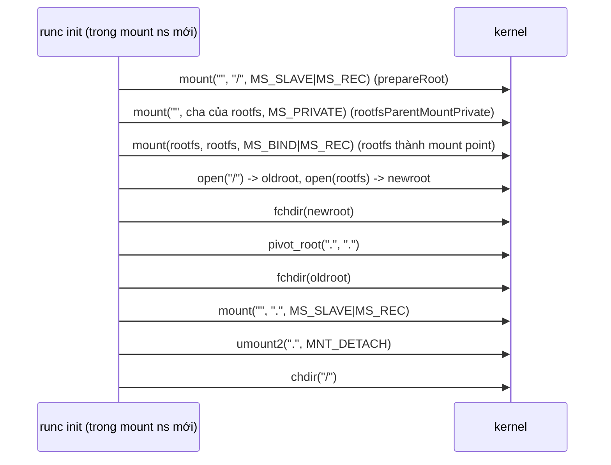

# P8 · Chương 04 — Filesystem của container

> Mọi khẳng định về kernel/syscall là về **Linux**. Môi trường thí nghiệm: máy macOS (Apple Silicon), Docker chạy trong VM **colima** (kernel Linux `6.8.0-117-generic`, `aarch64`, Docker Engine 29.5.2, đọc bằng `uname -r`/`docker version` lúc viết). Kết quả đánh dấu "quan sát" là một lần chạy trên cấu hình đó, không phải bảo đảm của tài liệu.

## Bạn sẽ hiểu được gì

1. **Q1.** Vì sao `chroot(2)` đổi được "thư mục gốc" mà man page vẫn nói nó **không** phải cơ chế bảo mật? Runtime container dùng gì thay, theo trình tự nào? → mục 1
2. **Q2.** Một **image** ở mức byte là gì: layer, manifest, config, digest, `diff_id` là những object nào, cái nào băm cái nào, vì sao digest của layer khác `diff_id`? → mục 2
3. **Q3.** "Content-addressable" nghĩa là gì và cho image những tính chất nào (kiểm chứng toàn vẹn, chia sẻ layer)? → mục 3
4. **Q4.** **overlayfs** ghép `lowerdir` và `upperdir` thành `merged` ra sao; copy-up, whiteout, opaque directory xảy ra khi nào và để lại dấu vết gì trên đĩa? → mục 4
5. **Q5.** Dữ liệu ghi vào "writable layer" sống bao lâu, khác gì volume, bind mount, tmpfs, rootfs read-only? → mục 5
6. **Q6.** Với một backend service: không nên ghi gì vào writable layer, vì sao image lớn gây đau, thứ tự lệnh trong Dockerfile ảnh hưởng layer cache thế nào? → mục 6

## Kiến thức cần trước

- [Chương 02 — Namespaces](02-namespaces.md), mục mount namespace: mỗi mount namespace có bảng mount riêng; shared subtree (propagation) quyết định thay đổi mount có lan sang namespace khác hay không.
- [Chương 01 — Container là gì](01-container-la-gi.md): container là process thường của host, cô lập bằng namespace và giới hạn bằng cgroup.
- File system, inode, page cache: [P5 · Chương 03](../05-storage/03-cai-dat-file-system.md) và [P5 · Chương 04](../05-storage/04-page-cache-va-direct-io.md). Phần tóm lược overlay của [P5 · Chương 07](../05-storage/07-raid-va-copy-on-write-fs.md) trỏ về chương này.

**Bài toán.** Chương 02 cho process một cái nhìn riêng về PID, mount table, hostname, nhưng process vẫn cần **file**: `/bin/sh`, thư viện C, `/etc/passwd`. Ứng dụng Rust build cho Debian bookworm phải chạy với đúng bộ file của bookworm dù host là Alpine hay Ubuntu (nhận xét của người soạn). Bài toán có hai nửa: **cô lập** (làm process thấy một cây thư mục khác làm `/` và không với tới cây của host, Q1) và **đóng gói, chia sẻ** (phân phối cây đó như image, dùng chung phần giống nhau cho hàng trăm container mà vẫn cho mỗi container ghi riêng; Q2–Q5).

## 1. `chroot`, `pivot_root` và trình tự trong runtime (Q1)

> **Trả lời ngắn.** `chroot` chỉ đổi điểm bắt đầu khi phân giải đường dẫn tuyệt đối của process và con cháu nó[^chroot-inherit]; man page nói thẳng nó không nhằm mục đích bảo mật nào[^chroot-purpose]. Runtime tham chiếu runc dùng `pivot_root`: đổi hẳn **root mount** của mount namespace và đặt root cũ vào chỗ gỡ (unmount) được[^pr-desc][^pr-unmount]; khi đã gỡ thì cây thư mục của host không còn trong mount table của container (suy luận của người soạn, thí nghiệm 2-C quan sát khớp).

**Giải thích.**

Hình dung (nhận xét của người soạn): `chroot` giống việc dán lại biển "cửa chính" lên một cánh cửa khác của tòa nhà. Người đứng ở cửa mới tính đường đi từ đây, nhưng hành lang cũ, chìa khóa đang cầm (fd) và chỗ đang đứng (cwd) vẫn còn nguyên. `pivot_root` giống việc gỡ cả khu cũ khỏi bản đồ của tầng này.

*`chroot`.* Gọi này đổi thư mục gốc của process; mọi đường dẫn bắt đầu bằng `/` được phân giải từ thư mục mới, và process con thừa kế root đó[^chroot-inherit]. Trên Linux cần capability `CAP_SYS_CHROOT` trong user namespace của process[^chroot-cap].

*Vì sao không phải cơ chế bảo mật.* Man page: lời gọi chỉ đổi một thành phần của quá trình phân giải đường dẫn và không làm gì khác; nó không dùng để sandbox hay hạn chế system call filesystem[^chroot-purpose]. Chính man page nêu các lối thoát:

- **Thư mục làm việc không đổi**: sau `chroot`, `.` có thể nằm ngoài cây gốc mới; superuser thoát "chroot jail" bằng `mkdir foo; chroot foo; cd ..`[^chroot-cwd].
- **fd đã mở không bị đóng**: một fd trỏ ra ngoài cây có thể cho truy cập file ngoài cây[^chroot-fd].
- **Thư mục bị di chuyển ra khỏi cây chroot**: kẻ tấn công `chdir` vào thư mục đó, chờ nó bị di chuyển ra, rồi mở `../../../etc/passwd`[^chroot-moved].

Ngoài ra, mount(2) ghi nhận bind mount có thể băng qua chroot jail[^mount-bind-chroot]. Nói gọn: `chroot` chỉ thay **một con trỏ** (root directory) của process và "không làm gì khác"[^chroot-purpose], nên mount table của host vẫn nằm nguyên trong cùng mount namespace (suy luận của người soạn từ câu đó). Đó là điểm `pivot_root` sửa.

*`pivot_root`.* Nó làm việc ở mức **mount**: chuyển root mount vào thư mục `put_old` và đặt `new_root` làm root mount mới[^pr-desc]. Nó đổi root và cwd của **mọi** process/thread cùng mount namespace nếu chúng đang trỏ vào root cũ[^pr-allprocs]; root cũ nằm dưới `new_root` và sau đó gỡ (unmount) được[^pr-unmount]. Man page nêu một công dụng: dựng root filesystem lúc tạo container[^pr-modern]. Đổi lại, nó đòi `CAP_SYS_ADMIN` trong user namespace sở hữu mount namespace đó[^pr-cap]. Thí nghiệm 2-C dưới đây quan sát kết quả: sau khi gỡ root cũ, `/host-secret` không còn thấy từ namespace này.

*Trình tự trong runc v1.2.5* (runtime tham chiếu; [chương 06](06-runtime-oci.md) nói kỹ hơn), chạy trong mount namespace mới của chương 02:

1. `prepareRoot` đặt propagation của `/` về `MS_SLAVE | MS_REC` (mặc định)[^runc-prep-slave], làm mount cha của rootfs thành private[^runc-parentpriv], rồi bind mount rootfs lên chính nó để rootfs thành một mount point[^runc-prep-bind].
2. `pivotRoot` gọi `pivot_root(".", ".")`: man page xác nhận `new_root` và `put_old` được phép là cùng một thư mục, khỏi tạo/xóa thư mục tạm[^pr-same]. Lời gọi này "stack" root cũ lên trên root mới tại `/`[^pr-stack]; runc ghi chú kết quả là `/` là root mới nhưng `/proc/self/cwd` là root cũ[^runc-dotdot].
3. runc chuyển root cũ sang `rslave` để việc unmount không lan ra host[^runc-rslave], rồi `umount2(".", MNT_DETACH)`[^runc-detach], rồi `chdir("/")`[^runc-chdir].
4. `finalizeRootfs` đặt các mount cần read-only[^runc-ro].

> **Hiểu lầm hay gặp**: "container dùng `chroot`". Trong mã runc, `NoPivotRoot` thì gọi `msMoveRoot`[^runc-nopivot]; nếu không và config có mount namespace thì gọi `pivotRoot`; còn lại mới `chroot()`[^runc-newns]. Tác giả runc ghi chú người dùng không nên dùng `--no-pivot` trừ hoàn cảnh đặc biệt[^runc-nopivot-warn].

<details><summary>Đi sâu: bảng ràng buộc của pivot_root, mã runc, thí nghiệm 1–2</summary>

**Ràng buộc của `pivot_root`** (man page; cột phải là suy luận của người soạn về hệ quả cho runtime):

| Ràng buộc | Hệ quả thực tế |
|---|---|
| `new_root` phải là mount point; path chưa là mount point thì bind mount nó lên chính nó[^pr-mountpoint] | runc bind mount rootfs lên chính nó trong `prepareRoot` |
| Mount cha của `new_root` và mount cha của root hiện tại không được `MS_SHARED`; các hạn chế này để `pivot_root` không lan thay đổi sang mount namespace khác[^pr-shared][^pr-nopropagate]. Vi phạm → `EINVAL`; mục ERRORS còn nêu cả chính mount tại `new_root` có propagation `MS_SHARED`[^pr-einval] | runc chuyển propagation sang slave/private trước |
| `new_root` và `put_old` không được nằm trên cùng mount với root hiện tại[^pr-notsame]. Vi phạm → `EBUSY`[^pr-ebusy] | Cần mount riêng cho rootfs |

Mã runc cho thấy thêm hai chi tiết: `prepareRoot` lấy `config.RootPropagation` nếu khác 0[^runc-rootprop], và `rootfsParentMountPrivate` có comment rằng `pivot_root` sẽ lỗi nếu mount cha còn shared[^runc-parentpriv]. Sơ đồ dưới đối chiếu với hàm `pivotRoot` của runc[^runc-dotdot][^runc-rslave][^runc-detach][^runc-chdir] và đã lược các bước mount `/proc`, `/dev`… vào rootfs:



`msMoveRoot` (nhánh `NoPivotRoot`) làm `mount(rootfs, "/", MS_MOVE)` rồi `chroot`[^runc-msmove]. Trong lab, container có `cap_sys_chroot` trong `CapEff` (đọc từ `capsh --print`) nên `chroot` chạy được.

**Thí nghiệm 1 (quan sát) — `chroot` đổi gốc nhưng không cô lập.** Trong container Alpine `--privileged` (để dùng `unshare`/`mount` ở thí nghiệm sau), dựng `/new` chỉ với busybox rồi chroot:

```sh
mkdir -p /new/bin /new/lib /new/proc /new/old
cp /bin/busybox /new/bin/; cp /lib/ld-musl-aarch64.so.1 /new/lib/
for c in sh ls cat mount umount head pivot_root; do ln -s busybox /new/bin/$c; done
echo "secret-of-host" > /host-secret
chroot /new /bin/ls /
chroot /new /bin/ls /host-secret
```

`ls /` trong chroot in `bin lib old proc`; `ls /host-secret` báo `No such file or directory`: đường dẫn bị phân giải trong cây mới. Nhưng đó chỉ chứng minh cơ chế đổi gốc; process vẫn ở nguyên mount namespace của host.

**Thí nghiệm 2 (quan sát) — chạy lại trình tự bằng `unshare` + `pivot_root`**, cùng `/new`:

```sh
# A. propagation của / là shared
unshare -m sh -c 'mount --make-rshared /; mount --bind /new /new; cd /new; pivot_root . old; echo exit=$?'
# B. new_root không phải mount point
unshare -m sh -c 'mount --make-rprivate /; cd /new; pivot_root . old; echo exit=$?'
# C. trình tự đúng, dạng pivot_root . .
unshare -m /bin/sh -c '
  mount --make-rprivate /; mount --bind /new /new; cd /new
  pivot_root . . ; echo pivot=$?
  umount -l . ; echo umount=$?
  ls /; mount -t proc proc /proc; head -4 /proc/self/mountinfo; ls /host-secret'
```

- **A**: `pivot_root: : Invalid argument` (`EINVAL`), khớp dòng `MS_SHARED` ở bảng.[^pr-einval]
- **B**: `pivot_root: : Resource busy` (`EBUSY`): `/new` chưa là mount point nên vẫn nằm trên mount của root hiện tại, khớp "new_root or put_old is on the current root mount".[^pr-ebusy] Man page cũng liệt kê `EINVAL` cho "new_root is not a mount point"; lần chạy này ra `EBUSY`, và thứ tự kiểm tra là chi tiết cài đặt kernel mà tôi không có nguồn để khẳng định.
- **C**: `pivot=0`, `umount=0`; `ls /` ra `bin lib old proc`; `mountinfo` chỉ còn root (bind mount của `/new` trên overlay) và `/proc`; `ls /host-secret` báo không tồn tại, còn từ host `/host-secret` vẫn nguyên. Cây của host không còn truy cập được từ mount namespace này, khác thí nghiệm 1.

</details>

**Quay lại Q1:** `chroot` chỉ đổi một con trỏ (thư mục gốc) và man page nói nó không dành cho mục đích bảo mật, nên không phải cơ chế cô lập; runc dùng `pivot_root` để thay root mount rồi gỡ root cũ.

## 2. Image ở mức byte: layer, config, manifest, digest (Q2)

> **Trả lời ngắn.** Image không phải một khối mà là vài file nhỏ tham chiếu nhau. Mỗi **layer** là một blob theo định dạng dựa trên tar, ghi các thay đổi so với layer dưới[^config-nometa]; **config** là JSON mô tả cả image và liệt kê hash của các layer (`diff_ids`)[^config-diffids]; **manifest** trỏ tới config và danh sách layer[^manifest-single]. Digest của layer (ghi trong manifest) và `diff_id` (ghi trong config) có thể khác nhau, vì `diff_id` luôn tính trên tar *chưa nén*[^config-diffid][^config-notconfuse].

**Giải thích.**

Hình dung (nhận xét của người soạn): image như một lô hàng gửi bưu điện. Mỗi thùng carton là một layer, mỗi thùng có mã vạch riêng. Phiếu mục lục (manifest) ghi mã vạch từng thùng theo thứ tự xếp, kèm mã vạch của phiếu thông số (config). Phiếu thông số ghi cách chạy và mã vạch của từng thùng *sau khi mở ra*.

*Layer.* Đặc tả OCI image-spec (đọc tag `v1.1.0`) định nghĩa layer là blob serialize một filesystem và các thay đổi của nó như file bị xóa[^layer-intro], theo định dạng dựa trên tar[^config-nometa]. Layer chỉ ghi **thay đổi**: thêm và sửa biểu diễn y hệt nhau trong tar[^layer-types]; xóa biểu diễn bằng **whiteout**, một file rỗng tên `.wh.` + basename của path cần xóa[^layer-wh]. Layer *được áp dụng* (apply) lên nhau, không chỉ giải nén như tar thường (chi tiết ở Đi sâu).

*Config.* Là JSON mô tả image: layer không mang cấu hình như biến môi trường hay lệnh mặc định; đó là thuộc tính của cả image[^config-nometa]. Trường `rootfs.diff_ids` là mảng hash nội dung các layer theo thứ tự từ đầu tới cuối[^config-diffids]. Trường `history` có mục `empty_layer` cho lệnh không sinh thay đổi filesystem[^config-empty].

*Manifest và descriptor.* Manifest cho một image với một kiến trúc/OS cụ thể: một `config` và danh sách `layers`[^manifest-single]. Cả hai là **descriptor** (con trỏ tới nội dung): config tham chiếu theo digest[^manifest-config-desc] và mỗi phần tử `layers` là một descriptor[^manifest-layers-desc], với các trường `mediaType`[^desc-mt], `digest` và `size`[^desc-size]. Layer nền nằm ở index 0 và các layer sau theo thứ tự stack[^manifest-order]. Với nhiều kiến trúc có image index ("fat manifest") trỏ tới các manifest riêng[^manifest-index].

*Cái nào băm cái nào.* `diff_id` là digest của tar không nén của layer[^config-diffid]. Digest trong manifest là digest của blob layer như được lưu/truyền, spec nói nó tính trên nội dung nén hoặc không nén, và cảnh báo đừng nhầm hai thứ[^config-notconfuse]. Thí nghiệm 3 (dưới) cho thấy với `alpine:3` blob là gzip nên hai hash khác nhau.

<details><summary>Đi sâu: quy tắc whiteout trong tar, ChainID, thí nghiệm 3–4</summary>

**Whiteout trong tar** (khác whiteout của overlayfs ở mục 4):

- Whiteout chỉ áp lên tài nguyên ở layer thấp hơn, không áp lên chính layer chứa nó[^layer-wh-lower]; sau khi áp, bản thân whiteout cũng bị ẩn[^layer-wh-hidden].
- **Opaque whiteout**: entry tên `.wh..wh..opq` nghĩa là mọi anh em của nó ở layer dưới bị ẩn[^layer-opq]. Spec yêu cầu implementation nên sinh explicit whiteout nhưng phải chấp nhận cả hai dạng[^layer-explicit].
- Khi áp một entry lên path đã tồn tại: nếu cả hai là thư mục thì thuộc tính được thay bằng của entry; mọi trường hợp khác thì xóa path rồi tạo lại[^layer-over].

**ChainID.** Một layer đứng riêng không nói gì về thứ tự áp dụng, nên spec định nghĩa ChainID để có tay cầm cho cả kết quả áp dụng một chuỗi changeset[^config-chainid-why]. Công thức: layer đầu có `ChainID = DiffID`, các layer sau là digest của (ChainID trước, một dấu cách, DiffID kế)[^config-chainid].

**Thí nghiệm 3 (quan sát) — mổ xẻ `alpine:3` bằng `docker save`:**

```sh
docker save alpine:3 -o a.tar && mkdir x && tar -xf a.tar -C x
cat x/index.json            # OCI image index
ls x/blobs/sha256           # các blob đặt tên theo digest
```

Docker 29.5.2 (containerd image store) cho ra một OCI layout gồm `oci-layout`, `index.json`, `manifest.json` (định dạng cũ của Docker) và `blobs/sha256/` với 15 blob. `index.json` trỏ tới một **image index** (`application/vnd.oci.image.index.v1+json`) chứa manifest cho nhiều kiến trúc và các attestation; blob đặt tên đúng digest của nó. Với `arm64`:

| Thành phần | Giá trị quan sát |
|---|---|
| manifest (`…manifest.v1+json`) | `e7a1a92a…`, trỏ config `1991bd78…` (627 byte) và **một** layer |
| `layers[0].mediaType` | `application/vnd.oci.image.layer.v1.tar+gzip` |
| `layers[0].digest` | `sha256:5de55e5e…`, 4 183 037 byte (gzip) |
| `config.rootfs.diff_ids[0]` | `sha256:b2848c02…` |

```sh
sha256sum x/blobs/sha256/5de55e5e…           # = 5de55e5e…, chính tên file (hash của bytes nén)
gzip -dc  x/blobs/sha256/5de55e5e… | shasum -a 256   # = b2848c02…, đúng diff_id
gzip -dc  x/blobs/sha256/5de55e5e… | wc -c            # 8 939 520 byte tar không nén
```

Layer digest (manifest) là hash của blob đang lưu (ở đây gzip), còn `diff_id` (config) là hash của tar chưa nén. Layer tar gồm `bin/busybox` (919 304 byte) và hàng loạt symlink `bin/ash → /bin/busybox`…. `docker image inspect alpine:3 --format '{{json .RootFS}}'` in `{"Layers":["sha256:b2848c02…"],"Type":"layers"}`: `RootFS.Layers` của Docker liệt kê **diff_id**, không phải digest trong manifest. Cùng lần chạy, `.Id` là digest của index (`sha256:28bd5fe8…`), không phải của config; đó là hành vi của containerd image store, tôi không kiểm tra thêm. Config blob `1991bd78…` có `history` hai mục: `ADD alpine-minirootfs-…tar.gz /` (sinh layer) và `CMD ["/bin/sh"]` với `"empty_layer": true`, đúng ngữ nghĩa trường `empty_layer`[^config-empty].

**Thí nghiệm 4 (quan sát) — `RootFS.Layers` của image lab.** `rust:1.95-bookworm` không có tag cục bộ (`docker image inspect` → `No such image`), tôi không pull nó. Thay vào đó đọc `rust-foundations-lab:1.95`, build `FROM rust:1.95-bookworm` (xem `labs/Dockerfile`):

```sh
docker image inspect rust-foundations-lab:1.95 --format '{{len .RootFS.Layers}} {{.Size}}'
docker history rust-foundations-lab:1.95 --format '{{.Size}}|{{.CreatedBy}}'
```

**8** layer, 561 919 680 byte. `docker history` có 10 dòng: 8 dòng có kích thước (12,3 kB `WORKDIR`; 19,5 MB `rustup component add clippy`; 107 MB `apt-get`; 547 MB, 592 MB, 200 MB, 52,3 MB cho các lệnh của image nền Rust; 155 MB `debian.sh`) và 2 dòng `0B` (`ENV`, `LABEL`) không sinh layer: lệnh đổi filesystem thành một layer, `ENV`/`LABEL` chỉ đổi config. Năm dòng cuối ("4 months ago") đến từ image nền, ba dòng đầu ("4 hours ago") do `labs/Dockerfile` thêm (suy luận của người soạn từ cột thời gian). Đáng nhớ: 547 MB toolchain Rust nằm trong **một** layer.

</details>

**Quay lại Q2:** image = manifest (trỏ config + layers) + config (`diff_ids`, history) + các layer tar; digest trong manifest băm blob đang lưu, `diff_id` băm tar chưa nén.

## 3. Content-addressable: định danh bằng nội dung (Q3)

> **Trả lời ngắn.** "Content-addressable" nghĩa là gọi một object bằng hash của chính nội dung nó[^desc-digest]. Nhờ vậy nội dung lấy từ nguồn không tin cậy vẫn kiểm tra được bằng cách băm lại[^desc-secure]; ID của image là hash của config, mà config chứa hash từng layer, nên đổi một layer là đổi ID image[^config-imageid]; và layer giống hệt nhau chỉ cần lưu một lần[^dk-shared-once].

**Giải thích.**

Hình dung (nhận xét của người soạn): giống Git, nơi tên của commit là hash của nội dung. Không ai "đặt tên" cho layer; tên *là* dấu vân tay của nội dung, nên hai bên cùng băm sẽ cùng một tên, và đổi một byte là ra tên khác.

1. Trường `digest` của descriptor là định danh nội dung, cho phép content addressability[^desc-digest]. Nội dung lấy từ nguồn không tin cậy nên được kiểm tra lại với digest trước khi dùng[^desc-verify]; nếu digest đến qua kênh an toàn, bạn kiểm chứng được nội dung từ nguồn không an toàn bằng cách băm lại[^desc-secure].
2. Mục tiêu đầu tiên của manifest spec là image content-addressable: hash config cho ra ID duy nhất của image[^manifest-goal]. Image ID là SHA256 của config JSON[^config-imageid-sha]; config chứa hash từng layer nên ID này làm image content-addressable[^config-imageid]. Config được coi là bất biến vì đổi nó sẽ đổi ImageID[^config-immutable].
3. Chia sẻ: Docker nói layer dùng chung giữa các image chỉ được lưu một lần và cũng được dùng chung khi push/pull lên registry (mô tả storage driver cổ điển, đường dẫn `/var/lib/docker/`)[^dk-shared-once]. Khi tạo image mới có chung các layer đầu, Docker đã có sẵn nên không pull lại[^dk-no-repull].

<details><summary>Đi sâu: giới hạn của "chung layer", <code>.Id</code> trên containerd store</summary>

- Hai image chỉ chung một layer khi blob của chúng có cùng digest, tức cùng bytes, tính cả cách nén (suy luận của người soạn từ định nghĩa digest là hash của bytes[^desc-digest] và việc `diff_id` khác digest nén[^config-notconfuse]).
- Docker mô tả `docker ps` `virtual size` là dữ liệu read-only của image cộng writable layer, và hai container từ cùng image chia sẻ 100% dữ liệu read-only[^dk-ps-size]; vì vậy (suy luận của người soạn) không cộng dồn virtual size của nhiều container được.
- Thí nghiệm 3 (mục 2): blob trong `blobs/sha256/` đặt tên đúng digest; `sha256sum` của blob nén ra đúng tên file. Cũng ở đó, `.Id` trên máy này là digest của index, không phải của config (hành vi containerd image store, chưa kiểm tra thêm) nên ví dụ "ID = hash config" của spec không tự thấy khi gõ `docker image inspect` ở đây.
- (Nhận xét của người soạn) Pull image mới mà một layer 547 MB đổi digest thì phải tải lại cả layer; đó là suy luận từ việc digest định danh cả blob, spec không nói về pull.

</details>

**Quay lại Q3:** digest là dấu vân tay của bytes; nhờ đó kiểm chứng được nội dung, ID image gắn chặt với mọi layer, và layer trùng bytes lưu một lần.

## 4. overlayfs: ghép layer thành một cây (Q4)

> **Trả lời ngắn.** overlayfs chồng một thư mục ghi được (`upperdir`) lên một hoặc nhiều thư mục `lowerdir` (không cần ghi được[^ov-lower-ro]) và cho ra một cây hợp nhất (`merged`). Tên có ở cả hai tầng thì tầng trên thắng, riêng thư mục thì được hợp nhất[^ov-hidden]. Sửa một file ở tầng dưới thì cả file được **copy-up** sang tầng trên trước[^ov-copyup]; xóa thì ghi một dấu **whiteout** ở tầng trên[^ov-whiteout]; thư mục được thay mới thì đánh dấu **opaque**[^ov-opaque].

**Giải thích.**

Hình dung (nhận xét của người soạn): xếp các tờ giấy bóng kính lên một tập bản vẽ. Nhìn từ trên xuống thấy bản hợp nhất. Muốn sửa nét vẽ ở tờ dưới, bạn không đụng tờ dưới mà chép nét đó lên tờ trên cùng rồi sửa ở đó (copy-up). Muốn xóa, bạn dán một miếng che lên (whiteout).

*Mô hình.* Tài liệu kernel v6.8 nói overlay ghép một filesystem upper và một filesystem lower; thực ra là hai *cây thư mục*, có thể cùng một filesystem[^ov-trees]. Khi tên có ở cả hai, object ở upper hiển thị; object ở lower bị ẩn, hoặc với thư mục thì được *merge*[^ov-hidden]. Mount:

```sh
mount -t overlay overlay -olowerdir=/lower,upperdir=/upper,workdir=/work /merged
```

- `lowerdir`: có thể nhiều tầng, ngăn cách bằng `:`, xếp từ **phải sang trái** (tầng phải cùng là đáy)[^ov-multi]. Lower không cần ghi được[^ov-lower-ro].
- `upperdir`: nơi mọi thay đổi được ghi. Upper thường ghi được, và khi đó filesystem chứa nó phải hỗ trợ xattr `trusted.*` và/hoặc `user.*` cùng `d_type` hợp lệ, nên NFS không phù hợp[^ov-upper-req].
- `workdir`: thư mục rỗng, cùng filesystem với `upperdir`[^ov-workdir].
- `merged`: điểm mount, cái process nhìn thấy.

Thư mục có ở cả hai tầng được merge; chỉ *danh sách tên* được hợp nhất, còn metadata và xattr lấy từ thư mục upper[^ov-dirs]. Docker dùng đúng từ vựng này (`lowerdir`, `upperdir`, `merged`)[^dk-ov-terms].

*Đọc.* File chỉ có ở lower được đọc thẳng, Docker nói overhead rất nhỏ[^dk-ov-read].

*Ghi và copy-up.* Khi file ở lower được truy cập theo cách cần quyền ghi (mở để ghi, đổi metadata…), nó được **copy_up** sang upper[^ov-copyup]. Quy trình: bảo đảm thư mục chứa nó (và cha) tồn tại ở upper, tạo object cùng metadata, copy data nếu là file, cuối cùng copy xattr[^ov-copyup-proc]. Sau copy-up, thao tác trên file đi thẳng vào upper[^ov-copyup-direct]. Điểm quyết định cho hiệu năng (Docker): overlay làm việc ở mức **file chứ không phải block**, nên copy-up copy cả file dù chỉ sửa một phần nhỏ[^dk-copyup-file]; chỉ xảy ra lần ghi đầu tiên[^dk-copyup-once].

*Xóa.* Để `rm`/`rmdir` không đụng lower, overlayfs ghi dấu xóa vào upper bằng whiteout và opaque directory[^ov-wh-why]. Whiteout là **character device 0/0** (hoặc file rỗng có xattr `trusted.overlay.whiteout`)[^ov-whiteout]; thấy nó ở upper thì tên tương ứng ở lower bị bỏ qua và chính whiteout cũng bị ẩn[^ov-whiteout-hide]. Thư mục opaque là thư mục có xattr `trusted.overlay.opaque = "y"`; thư mục cùng tên ở lower bị bỏ qua[^ov-opaque]. Docker mô tả cùng hành vi ở mức người dùng: xóa file → whiteout; xóa thư mục → opaque directory[^dk-wh][^dk-opq].

<details><summary>Đi sâu: copy-up chi tiết, thí nghiệm 5–6, giới hạn overlay, Docker overlay2 và containerd</summary>

**Copy-up chi tiết.** Tạo hard link cũng cần copy-up (symlink thì không)[^ov-hardlink]. Docker nói đổi quyền/owner cũng có thể gây copy-up và nhân đôi file[^dk-copyup-meta]. Kernel có tùy chọn `metacopy` chỉ copy metadata cho `chown/chmod`[^ov-metacopy], nhưng là tính năng bật/tắt; trên kernel của VM này tham số module `metacopy` đọc ra `N`.

**Thí nghiệm 5 (quan sát) — copy-up, whiteout, opaque trên container thật** (qua `colima ssh`: `upperdir` nằm trong VM):

```sh
docker run -d --name t alpine:3 sleep 600
docker exec t sh -c 'echo "# edited" >> /usr/lib/os-release; rm /etc/motd
                     rm -rf /etc/apk; mkdir /etc/apk; echo n > /etc/apk/new
                     echo x >> /usr/lib/libcrypto.so.3; chmod 700 /sbin/apk
                     mkdir /newdir; echo hi > /newdir/f'
docker exec t grep ' - overlay overlay' /proc/self/mountinfo   # lấy upperdir
colima ssh -- sudo find <upperdir> -printf '%p %y %s\n'
```

(`/etc/os-release` trong Alpine là symlink tới `../usr/lib/os-release` nên bản copy-up nằm ở `usr/lib/os-release`.) `mountinfo` (rút gọn) cho thấy đúng bốn tham số của mô hình trên:

```
overlay overlay rw,lowerdir=/var/lib/containerd/io.containerd.snapshotter.v1.overlayfs/snapshots/2777/fs:…/1558/fs,
upperdir=…/snapshots/2778/fs,workdir=…/snapshots/2778/work,nouserxattr
```

(Có hai thư mục trong `lowerdir` dù `alpine:3` chỉ có một layer; vai trò thư mục thứ hai tôi không xác định được.) Nội dung `upperdir`:

| Thao tác trong container | Thấy trong upperdir | Ý nghĩa |
|---|---|---|
| `echo >> /usr/lib/os-release` | `usr/lib/os-release`, 197 byte (bản gốc 188 byte) | copy-up cả file, rồi ghi |
| `echo x >> /usr/lib/libcrypto.so.3` | `usr/lib/libcrypto.so.3`, **4 533 146** byte (gốc 4 533 144 byte) | thêm 2 byte nhưng copy ~4,5 MB; `du -sh` upper = 4,6 MB |
| `chmod 700 /sbin/apk` | `sbin/apk`, 135 248 byte (cùng kích thước gốc) | đổi metadata cũng copy cả file khi không có `metacopy`, khớp lời Docker[^dk-copyup-meta] |
| `rm /etc/motd` | `etc/motd` loại **c** (character special), `rdev=0:0` | whiteout kiểu char device 0/0[^ov-whiteout] |
| `rm -rf /etc/apk; mkdir /etc/apk` | thư mục `etc/apk` có xattr `trusted.overlay.opaque = b'y'` | opaque directory[^ov-opaque] |
| `mkdir /newdir; echo hi > …` | `newdir/f` (3 byte) | file chỉ có ở upper |

`docker diff t` báo `C`/`A`/`D` cho từng đường dẫn (kể cả `D /etc/apk/world`, `D /etc/motd`…): đó là diff ở mức hệ file hợp nhất do Docker tính, không phải bố cục thô trên đĩa.

*Quan sát lệch tài liệu.* Doc kernel liệt kê trong mục hành vi không chuẩn rằng mở-để-ghi file đang thực thi ở lower **sẽ không** bị từ chối `ETXTBSY`[^ov-etxtbsy]. Khi thử `echo x >> /bin/busybox` (busybox đang chạy làm `sleep`) trên kernel `6.8.0-117-generic` thì nhận `Text file busy`. Tôi không điều tra nguyên nhân (kernel VM là bản đóng gói của Ubuntu, có thể khác bản `v6.8` gốc dùng để đọc doc; đây là phỏng đoán).

**Thí nghiệm 6 (quan sát) — tự mount overlay.** Trong container lab (`./labs/linux.sh`, không có `CAP_SYS_ADMIN`):

```sh
mkdir -p /tmp/o/{l,u,w,m}
mount -t overlay overlay -o lowerdir=/tmp/o/l,upperdir=/tmp/o/u,workdir=/tmp/o/w /tmp/o/m
```

Kết quả: `mount: /tmp/o/m: cannot mount overlay read-only.` `strace -e trace=mount`: lần đầu `mount(…, 0, …) = -1 EACCES`, thử lại với `MS_RDONLY` cũng `EACCES`. Hợp với việc `CapEff = a80c35fb` không chứa `cap_sys_admin`. `unshare -m` cũng không dùng được (`Operation not permitted`), xem thí nghiệm tương tự ở chương 02. Muốn mount phải `docker run --privileged` (container Debian bookworm, VM colima); dựng 2 lower, 1 upper trên tmpfs:

```sh
mount -t tmpfs tmpfs /mnt; cd /mnt; mkdir l1 l2 u w m
echo base > l1/a; echo lower2 > l2/b; echo "l2 wins" > l1/c; echo "l2 version" > l2/c
mkdir l1/d; echo x > l1/d/f1
mount -t overlay overlay -o lowerdir=l2:l1,upperdir=u,workdir=w m
```

- `ls m` → `a b c d`; `cat m/c` → `l2 version`: với tên trùng, lower **bên trái** (`l2`) thắng, khớp quy tắc xếp tầng[^ov-multi].
- `echo more >> m/a` rồi `ls -li l1/a u/a`: `l1/a` vẫn 5 byte (`base`), `u/a` 10 byte (`base\nmore`): copy-up. `cat m/a` ra cả hai dòng.
- `rm m/d/f1`: `u/d/f1` xuất hiện dạng `c---------` với `character special file 0:0`; `ls m/d` rỗng.
- `/proc/mounts`: `overlay /mnt/m overlay rw,relatime,lowerdir=l2:l1,upperdir=u,workdir=w,uuid=on,nouserxattr`; `workdir` sau mount có thư mục `work` mode `d---------` bên trong.

**Giới hạn** (chỉ điều tài liệu nói):

- **Inode number**: object không phải thư mục có thể báo `st_dev` của lower/upper; `st_ino` chỉ duy nhất khi kết hợp `st_dev`, và cả hai có thể đổi trong đời object[^ov-inode]. Khi mọi layer cùng filesystem, mọi object báo `st_dev` của overlay và `st_ino` của filesystem bên dưới[^ov-xino]. (Quan sát trên tmpfs: `stat` file lower `dev=50 ino=8`, cùng file qua merged `dev=52 ino=8`.)
- **Đổi tên thư mục**: khi `redirect_dir` tắt, `rename(2)` trên thư mục ở lower hoặc merged trả `EXDEV`[^ov-rename]; bật `redirect_dir` thì thư mục được copy-up (không kèm nội dung) và ghi xattr `trusted.overlay.redirect`[^ov-redirect]. Doc kernel nêu `mv(1)` xử lý `EXDEV` bằng cách copy đệ quy[^ov-mv]; Docker dặn ứng dụng phải tự xử lý `EXDEV` và quay về chiến lược `copy and unlink`[^dk-rename]. Quan sát: `os.rename('m/dd','m/dd3')` của Python → `errno 18 Cross-device link`; `mv` chạy được; mount lại với `redirect_dir=on` thì `rename` thành công và upper có `trusted.overlay.redirect = b'dd'`. Tham số module `redirect_dir` trên kernel VM này đọc ra `N`.
- **Sửa lower khi đang mount**: không được phép; hành vi undefined (không crash hay deadlock)[^ov-underlying].
- Các giới hạn POSIX khác trong mục "Non-standard behavior": `st_atime` không cập nhật cho file ở lower, `MAP_SHARED`, `ETXTBSY` (đã nói trên)[^ov-nonstd].

**Docker: `overlay2` và containerd snapshotter.** Tài liệu Docker mô tả `overlay2`: tối đa 128 lower layer natively[^dk-128] và nhiều container truy cập cùng một file chia sẻ một entry page cache[^dk-pagecache]. Docker nói Engine 29.0 trở lên dùng **containerd image store** làm mặc định cho cài mới, dùng snapshotter thay storage driver cổ điển[^dk-29]; snapshotter mặc định là `overlayfs`[^dk-snap]. Khớp quan sát: `docker info --format '{{.Driver}} {{.DriverStatus}}'` in `overlayfs [[driver-type io.containerd.snapshotter.v1]]`, layer nằm dưới `/var/lib/containerd/io.containerd.snapshotter.v1.overlayfs/snapshots/…`, không dưới `/var/lib/docker/overlay2/` như tài liệu `overlay2`. Tài liệu Docker không ghim phiên bản (đọc bản đang online lúc viết); khái niệm layer/lower/upper giống nhau, đường dẫn và lệnh thì khác[^dk-29].

</details>

**Quay lại Q4:** overlayfs chồng upper ghi được lên lower chỉ-đọc; ghi file lower thì copy-up cả file, xóa thì whiteout, thay thư mục thì opaque.

## 5. Writable layer, volume, bind mount, tmpfs, read-only (Q5)

> **Trả lời ngắn.** Mọi thứ container ghi vào cây thư mục của image nằm trong *writable layer*, và nó bị xóa cùng container[^dk-container-layer]. Dữ liệu cần sống lâu hơn container phải ra ngoài: **volume** (do Docker quản lý, còn sau khi container bị hủy)[^dk-vol-life], **bind mount** (gắn thư mục của host vào, ghi được mặc định)[^dk-bind-write]. **tmpfs** nằm trong RAM của host và mất khi container dừng[^dk-tmpfs]. `--read-only` cấm ghi vào rootfs trừ các volume chỉ định[^dk-ro].

**Giải thích.**

Hình dung (nhận xét của người soạn): thuê một máy tính ở quán net. Ghi vào ổ của máy (writable layer) thì trả máy là mất. Cắm USB của bạn (volume/bind mount) thì dữ liệu về nhà cùng bạn. RAM-disk (tmpfs) mất khi tắt máy. Khóa ổ cứng chỉ-đọc (`--read-only`) thì chỉ ghi được vào USB hoặc RAM-disk.

| Nơi ghi | Sống bao lâu | Điểm cần nhớ |
|---|---|---|
| Writable layer (`upperdir`) | Đến khi container bị xóa[^dk-container-layer] | Hợp với dữ liệu tạm sinh lúc chạy[^dk-ephemeral] |
| Volume | Ngoài vòng đời container; không tự xóa khi hết container dùng[^dk-vol-life][^dk-vol-keep] | Docker gọi là cơ chế được ưu tiên để persist dữ liệu[^dk-vol-pref] |
| Bind mount | Chính là file/thư mục của host[^dk-bind] | Ghi được mặc định, dùng `ro` để chặn[^dk-bind-write] |
| tmpfs | Mất khi container dừng[^dk-tmpfs] | Tính vào memory limit của container[^dk-tmpfs-mem] |

Container = image + một writable layer. Trong overlay, Docker gọi `upperdir` là phần của container và `lowerdir` là phần của image[^dk-ov-read], nên writable layer chính là `upperdir` của mục 4. Khác biệt chính giữa container và image là lớp writable trên cùng; khi container bị xóa lớp đó cũng bị xóa, image bên dưới không đổi[^dk-container-layer]. Volume ghi thẳng vào filesystem của host, không qua storage driver nên tránh overhead của union filesystem[^dk-vol-perf]. `--read-only` mount root filesystem ở chế độ chỉ đọc, chỉ cho ghi vào các volume được chỉ định[^dk-ro].

<details><summary>Đi sâu: thí nghiệm 7, volume/bind/tmpfs chi tiết, read-only ở tầng runc</summary>

**Thí nghiệm 7 (quan sát) — vòng đời:**

```sh
docker create --name a -v w-vol:/data alpine:3 sh -c 'echo layer > /layerfile; echo vol > /data/f; ls /layerfile /data/f'
docker start -a a; docker start -a a     # chạy hai lần
docker diff a                            # A /layerfile, A /data
docker rm a
docker run --rm -v w-vol:/data alpine:3 sh -c 'ls /data; ls /layerfile'
```

Chạy lại *cùng* container vẫn thấy `/layerfile` (writable layer sống qua stop/start); `docker diff` liệt kê `A /layerfile` và `A /data` (điểm mount); sau `docker rm`, container mới thấy `/data` còn `f`, còn `/layerfile` thì `No such file or directory`. Trong container `/data` là mount `ext4` với nguồn `/docker/volumes/w-vol/_data` trên `/dev/vdb1` của VM, không phải `overlay`.

**Volume.** Docker còn nói writable layer không còn sau khi container bị xóa và chỉ hợp với dữ liệu tạm sinh lúc chạy[^dk-ephemeral]. Volume là lựa chọn cho dữ liệu write-intensive[^dk-write-heavy]. Điểm trừ: không hợp khi cần truy cập file từ host vì volume do Docker quản lý hoàn toàn[^dk-vol-nothost]. Anonymous volume cũng persist sau khi xóa container, trừ khi tạo container bằng `--rm`[^dk-anon].

**Bind mount.** Có thể sửa/xóa file hệ thống quan trọng của host qua container[^dk-bind-write]. Một bẫy với dev trên macOS: bind mount được tạo trên **máy chạy daemon**, không phải máy chạy client[^dk-bind-daemon]; Docker nói Docker Desktop chạy daemon trong một Linux VM và có cơ chế riêng xử lý, còn thiết lập colima ở đây thì khác[^dk-desktop]. Quan sát: `docker run -v /tmp/w-p08-c04:/b:ro …` với `/tmp/w-p08-c04` là thư mục trên macOS: trong container `/b` là mount `ext4 /dev/root` và `touch /b/z` báo `Read-only file system`; trong VM colima xuất hiện thư mục `/tmp/w-p08-c04` rỗng, sở hữu bởi `root`: daemon (trong VM) tự tạo một thư mục cùng tên chứ không đọc thư mục macOS. (Với cấu hình colima này `$HOME` được chia sẻ vào VM nên `-v $PWD:/work` vẫn chạy; đường dẫn chia sẻ là cấu hình colima, ngoài phạm vi chương.)

**tmpfs.** Dữ liệu tmpfs **tính vào giới hạn memory** của container[^dk-tmpfs-mem] và một giá trị `size` lớn không nâng giới hạn đó[^dk-tmpfs-size]; vì vậy tmpfs đầy có thể dẫn tới OOM (suy luận của người soạn). Dữ liệu tmpfs có thể bị ghi ra swap[^dk-tmpfs-swap]. Docker khuyên dùng tmpfs cho dữ liệu trạng thái không cần giữ, để khỏi ghi vào writable layer[^dk-vol-tmpfs].

**Rootfs read-only.** Quan sát: `docker run --rm --read-only alpine:3 sh -c 'touch /x'` → `touch: /x: Read-only file system`; `mountinfo` cho root `ro,relatime - overlay overlay rw,lowerdir=…` (cờ per-mount là `ro`, option của superblock overlay vẫn `rw`). `/dev/shm` (tmpfs Docker gắn sẵn) vẫn ghi được; thêm `--tmpfs /tmp:rw,size=16m` thì `touch /tmp/x` thành công và `mountinfo` ghi `tmpfs … rw,nosuid,nodev,noexec,relatime … size=16384k`. Ở runtime, runc làm việc này trong `finalizeRootfs`: khi config bật `Readonlyfs` thì gọi `setReadonly`[^runc-readonlyfs], remount `/` với `MS_BIND|MS_REMOUNT|MS_RDONLY`[^runc-setro]; mount(2) cho phép dùng `MS_REMOUNT | MS_BIND | MS_RDONLY` để đổi cờ read-only của một mount mà không đổi filesystem bên dưới[^mount-remount].

</details>

**Quay lại Q5:** writable layer chết cùng container; dữ liệu bền ra volume, host path ra bind mount, dữ liệu tạm ra tmpfs, và `--read-only` buộc mọi chỗ ghi phải được chỉ định rõ.

## 6. Hệ quả cho backend engineer (Q6)

> **Trả lời ngắn.** Đừng ghi dữ liệu bền vào writable layer: nó mất khi container bị xóa[^dk-ephemeral], ghi chậm hơn volume[^dk-vol-perf] và container ghi nhiều thì tốn thêm chỗ[^dk-write-space]; log cũng nên ra stdout hoặc volume (nhận xét của người soạn). Image lớn tốn đĩa và thời gian pull (nhận xét của người soạn); multi-stage build giúp tách phần build khỏi phần cần chạy[^dk-multistage]. Mỗi layer đổi thì mọi layer sau nó phải build lại[^dk-cache2], nên đặt lệnh ít đổi lên trước (nhận xét của người soạn).

**Giải thích.** Mục này suy ra từ cơ chế ở trên; trích dẫn chỉ cho phần Docker nói, còn lại là nhận xét của người soạn.

Hình dung (nhận xét của người soạn): container như một instance stateless sau load balancer: bạn phải coi nó bị giết và dựng lại bất cứ lúc nào.

1. **Log và dữ liệu bền không vào writable layer.** Docker nói image nên sinh ra container "phù du" tối đa, tức dừng, hủy, dựng lại với thiết lập tối thiểu[^dk-bp-ephemeral] và writable layer mất khi container bị xóa (mục 5). Với service 12-factor, log ra stdout/stderr (nhận xét của người soạn; Docker dẫn Twelve-Factor ở cùng mục nhưng tôi không trích nguyên tắc log của nó); dữ liệu bền ra volume hoặc dịch vụ ngoài.
2. **Database trong container**: Docker nói ứng dụng write-intensive như database storage chịu overhead hiệu năng, nhất là khi dữ liệu có sẵn ở layer chỉ đọc[^dk-db-overhead]; khuyến nghị volume[^dk-write-heavy].
3. **Copy-up là chi phí ẩn của sửa file lớn**: ghi 2 byte vào file 4,5 MB tạo bản copy 4,5 MB (thí nghiệm 5). Docker nói file lớn, nhiều layer, cây thư mục sâu làm tác động rõ hơn[^dk-copyup-cost]. Trong dịch vụ thật, đó là một lần tăng latency ở lần ghi đầu (nhận xét của người soạn).
4. **Image lớn** tốn cả đĩa lẫn thời gian pull (nhận xét của người soạn). Docker gợi ý multi-stage build để chỉ giữ file cần chạy[^dk-multistage]. Xóa file ở layer sau chỉ thêm whiteout còn byte của layer dưới vẫn nằm trong image (suy luận của người soạn từ mục 2 và 4: layer là changeset, whiteout chỉ che), nên `rm -rf` trong một `RUN` riêng không thu nhỏ image.
5. **Layer cache khi build.** Docker: mỗi lệnh trong Dockerfile ví dụ của họ thành một layer[^dk-cache]; khi một layer đổi, mọi layer sau nó phải chạy lại, kể cả khi sẽ cho kết quả y hệt[^dk-cache2]. Hệ quả (nhận xét của người soạn): đặt lệnh ít đổi (cài package, tải dependency) lên trước, `COPY` mã nguồn xuống sau. Docker khuyên thêm `.dockerignore` để loại file không liên quan khỏi build[^dk-dockerignore] và luôn gộp `apt-get update` với `apt-get install` trong cùng một `RUN`[^dk-aptget].

<details><summary>Đi sâu: thí nghiệm 8–9 và ví dụ Rust</summary>

**Thí nghiệm 8 (quan sát):** container ghi 50 MiB vào `/var/log/app.log` → `docker ps -s` báo `52.4MB (virtual 61.8MB)` và `docker diff` có `A /var/log/app.log`. Theo Docker, `size` là dữ liệu của writable layer, `virtual` là dữ liệu read-only của image cộng writable layer[^dk-ps-size]; vậy 52.4MB là phần log, và Docker nói container ghi nhiều thì tốn thêm chỗ ở writable layer trên cùng[^dk-write-space].

**Thí nghiệm 9 (quan sát) — cache bị vô hiệu theo chuỗi.** Dockerfile bốn dòng:

```dockerfile
FROM alpine:3
RUN echo step1 > /s1
COPY app.txt /app.txt
RUN echo step3 > /s3
```

Build lần 1: cả ba bước `[2/4]`,`[3/4]`,`[4/4]` chạy. Lần 2 (không đổi gì): cả ba in `CACHED`. Sau `echo v2 > app.txt`, lần 3: `[2/4] RUN echo step1` vẫn `CACHED`, còn `[3/4] COPY` và `[4/4] RUN echo step3` **không** `CACHED` dù bước 4 không phụ thuộc `app.txt`: khớp lời Docker: layer sau vẫn phải chạy lại dù không build ra gì khác[^dk-cache2]. Image kết quả có 4 layer (`docker image inspect … {{len .RootFS.Layers}}` = 4: alpine + 3 lệnh).

**Ví dụ Rust** (nhận xét của người soạn, chưa chạy trong chương này): tách bước "copy `Cargo.toml`/`Cargo.lock` và build dependency" khỏi bước "copy `src/`" để dependency không bị biên dịch lại mỗi lần sửa mã. Dockerfile multi-stage đã build thật ở [chương 08 — Rust trong container](08-rust-trong-container.md), mục 5, chưa tách riêng bước build dependency.

</details>

**Quay lại Q6:** coi container là thứ dùng một lần: dữ liệu bền ra volume, image gọn bằng multi-stage, và sắp lệnh Dockerfile từ ít đổi tới hay đổi.

## Liên hệ với Rust

Chương này không có API Rust riêng. Hai điểm nối: image build từ `rust:*` chứa toàn bộ toolchain (image lab: 561 919 680 byte, một layer 547 MB cho toolchain, thí nghiệm 4), nên multi-stage build là cách giữ image chạy nhỏ (nhận xét của người soạn; mục 6, ý 4; Dockerfile multi-stage đã build thật ở [chương 08](08-rust-trong-container.md), mục 5); và `pivot_root`/`mount` là syscall Linux mà một runtime viết bằng Rust phải gọi qua FFI hoặc crate bọc libc (các crate cụ thể chương này không kiểm chứng).

## Tóm tắt

- `chroot(2)` chỉ đổi con trỏ root của process; man page nói nó không nhằm mục đích bảo mật, và cwd, fd mở sẵn là lối thoát. `pivot_root(2)` đổi **root mount** và cho phép gỡ hẳn root cũ; runc: propagation slave, bind rootfs lên chính nó, `pivot_root(".", ".")`, rslave, `umount2(".", MNT_DETACH)`.
- Image OCI = manifest (config + danh sách layer) + config (`rootfs.diff_ids`, history) + layer tar; mỗi object định danh bằng digest nên content-addressable. Digest layer trong manifest ≠ `diff_id` (tar chưa nén) khi blob được nén.
- Trong layer tar, xóa một path = whiteout `.wh.<tên>`, ẩn mọi con của một thư mục = `.wh..wh..opq`; whiteout chỉ che, không làm nhỏ image (suy luận của người soạn).
- overlayfs ghép `lowerdir` (phải→trái) với `upperdir` (+ `workdir`): ghi file lower → copy-up cả file; xóa → whiteout char device 0/0; thay thư mục → xattr opaque; rename thư mục lower → `EXDEV` khi `redirect_dir` tắt.
- Writable layer mất khi `docker rm`; volume sống ngoài vòng đời container; bind mount ghi được vào host mặc định; tmpfs tính vào memory limit; `--read-only` chặn ghi vào rootfs.
- Docker Engine 29+ dùng containerd image store với snapshotter `overlayfs` làm mặc định cho cài mới, không phải `overlay2` cổ điển.
- Backend: log và dữ liệu bền không vào writable layer; multi-stage cho image nhỏ; lệnh ít đổi lên trước để giữ layer cache.

## Câu hỏi tự kiểm tra

**1.** (Q1) Man page `chroot(2)` nói gì về mục đích bảo mật, và những lối thoát nào được nêu?
<details><summary>Đáp án</summary>

Nó chỉ đổi một thành phần của quá trình phân giải đường dẫn, không nhằm sandbox hay hạn chế system call filesystem.[^chroot-purpose] Lối thoát: cwd không đổi nên `mkdir foo; chroot foo; cd ..` thoát được;[^chroot-cwd] fd đã mở có thể cho truy cập ngoài cây;[^chroot-fd] thư mục bị di chuyển ra ngoài cây rồi mở `../../../etc/passwd`.[^chroot-moved]

</details>

**2.** (Q1) Vì sao `pivot_root` đòi `new_root` là mount point và mount cha không được `MS_SHARED`? runc làm gì để thỏa, và thí nghiệm 2-A/2-B quan sát gì?
<details><summary>Đáp án</summary>

Man page: `new_root` phải là path tới mount point; path chưa phải thì bind mount lên chính nó.[^pr-mountpoint] Mount cha của `new_root` và của root hiện tại không được `MS_SHARED` để `pivot_root` không lan thay đổi sang mount namespace khác;[^pr-shared][^pr-nopropagate] vi phạm → `EINVAL`.[^pr-einval] runc đặt propagation slave,[^runc-prep-slave] làm mount cha private,[^runc-parentpriv] rồi bind mount rootfs lên chính nó trong `prepareRoot`.[^runc-prep-bind] Thí nghiệm 2-A (propagation shared) in `Invalid argument`; 2-B (`/new` chưa là mount point) in `Resource busy`, và chương nói rõ thứ tự kiểm tra lỗi là chi tiết cài đặt chưa có nguồn.

</details>

**3.** (Q1) Giải thích `pivot_root(".", ".")` và vì sao theo sau là `umount2(".", MNT_DETACH)`.
<details><summary>Đáp án</summary>

`new_root` và `put_old` được phép là một thư mục, khỏi tạo/xóa thư mục tạm.[^pr-same] Lời gọi stack root cũ lên trên root mới tại `/`;[^pr-stack] khi umount `.`, việc phân giải `.` bắt đầu từ `new_root` rồi đi lên danh sách mount chồng tại `/`, kết quả là root cũ bị gỡ.[^pr-umount-dot] runc dùng `MNT_DETACH` vì (theo comment trong mã) nó cho phép gỡ `/proc/self/cwd`, chỗ cwd đang trỏ tới;[^runc-detach] trước đó chuyển root cũ sang rslave để việc unmount không lan ra host.[^runc-rslave]

</details>

**4.** (Q2) `diff_id` và layer digest khác nhau thế nào? Trong `alpine:3` giá trị nào đứng trong `RootFS.Layers` của Docker?
<details><summary>Đáp án</summary>

`diff_id` = digest của tar không nén;[^config-diffid] layer digest trong manifest có thể tính trên nội dung nén.[^config-notconfuse] Thí nghiệm 3: digest gzip `5de55e5e…` ≠ diff_id `b2848c02…`; `RootFS.Layers` in diff_id.

</details>

**5.** (Q2) Trong tar layer, biểu diễn xóa `/etc/my-app-config` thế nào? Còn xóa toàn bộ nội dung `bin/`?
<details><summary>Đáp án</summary>

Entry `etc/.wh.my-app-config` (`.wh.` + basename).[^layer-wh] Opaque whiteout `bin/.wh..wh..opq` ẩn mọi con của `bin/` ở layer dưới.[^layer-opq]

</details>

**6.** (Q3) Vì sao đổi một byte trong một layer làm đổi ID của image?
<details><summary>Đáp án</summary>

ID image là SHA256 của config JSON; config chứa hash từng layer.[^config-imageid-sha][^config-imageid]

</details>

**7.** (Q4) Container sửa 2 byte cuối một file 4,5 MB nằm ở layer image. Chuyện gì xảy ra ở upperdir và vì sao?
<details><summary>Đáp án</summary>

Copy-up: cả file được copy sang upper rồi mới ghi, vì overlay làm việc theo file chứ không theo block.[^dk-copyup-file] Thí nghiệm 5: upper có file 4 533 146 byte.

</details>

**8.** (Q4) `rm` một file ở lower, và `rm -r` rồi `mkdir` lại một thư mục ở lower, để lại gì trong upperdir?
<details><summary>Đáp án</summary>

File → char device 0/0 (whiteout);[^ov-whiteout] thư mục → thư mục mới có xattr `trusted.overlay.opaque=y`.[^ov-opaque]

</details>

**9.** (Q4) Vì sao `os.rename` một thư mục của lower qua mount overlay trả `EXDEV` còn `mv` vẫn chạy?
<details><summary>Đáp án</summary>

Khi `redirect_dir` tắt, overlayfs trả `EXDEV` cho rename thư mục ở lower/merged;[^ov-rename] `mv` xử lý bằng cách copy đệ quy;[^ov-mv] `redirect_dir=on` cho phép rename thật.[^ov-redirect]

</details>

**10.** (Q4) Docker 29+ có dùng `overlay2` mặc định không? Kiểm tra thế nào?
<details><summary>Đáp án</summary>

Với cài mới thì không; mặc định là containerd image store với snapshotter `overlayfs`.[^dk-29][^dk-snap] Kiểm tra bằng `docker info` (Driver = `overlayfs`, `driver-type io.containerd.snapshotter.v1`) và đường dẫn trong `mountinfo`.

</details>

**11.** (Q5, Q6) Chọn nơi lưu: (a) file upload của người dùng, (b) cache tạm sinh lại được, (c) config chỉ đọc. Vì sao?
<details><summary>Đáp án</summary>

(a) volume (ngoài vòng đời container, ghi thẳng filesystem host);[^dk-vol-life][^dk-vol-perf] (b) tmpfs nếu vừa memory limit, nhớ tmpfs tính vào limit;[^dk-tmpfs-mem] (c) bind mount `ro` hoặc bake vào image, kết hợp `--read-only` cho phần còn lại.[^dk-ro] (Phần chọn là nhận xét của người soạn.)

</details>

**12.** (Q6) Dockerfile có `COPY . .` rồi `RUN cargo install ...`: sửa một file nguồn nhỏ làm build lại cả `cargo install`. Vì sao và sửa thế nào?
<details><summary>Đáp án</summary>

`COPY . .` đổi thì mọi layer sau bị vô hiệu và chạy lại.[^dk-cache2] Sửa (nhận xét của người soạn): đặt bước ít đổi lên trước, copy riêng manifest dependency, và dùng `.dockerignore`.[^dk-dockerignore]

</details>

## Đọc thêm

- [Chương 02 — Namespaces](02-namespaces.md), mục mount namespace: bảng mount riêng và propagation, nền tảng của `pivot_root`.
- [Chương 05 — Bảo mật container](05-bao-mat-container.md), mục 6 (LSM, rootfs read-only với `--read-only`, `docker.sock`) và mục 3 (capabilities): các lớp bảo vệ khác ngoài đổi root và overlay.
- [Chương 06 — Runtime và chuẩn OCI](06-runtime-oci.md): runtime-spec, bundle, vòng đời container ở mức runtime.
- [Chương 08 — Rust trong container](08-rust-trong-container.md), mục 5: Dockerfile multi-stage đã build thật, nối với mục 6 của chương này.
- Doc kernel `overlayfs.rst` (v6.8): <https://raw.githubusercontent.com/torvalds/linux/v6.8/Documentation/filesystems/overlayfs.rst>: `metacopy`, `index`, `xino`, `nfs_export`, `verity` mà chương này bỏ qua.
- OCI image-spec v1.1.0 `layer.md`, `config.md`, `manifest.md`, `descriptor.md`: <https://github.com/opencontainers/image-spec/tree/v1.1.0>: đặc tả đầy đủ, gồm nhiều media type và image index.
- Docker docs "Storage drivers", "Volumes", "Bind mounts", "tmpfs", "Dockerfile best practices", "Build cache" (không ghim phiên bản): <https://docs.docker.com/engine/storage/drivers/>.
- `pivot_root(2)`, `chroot(2)`, `mount(2)` trên Debian bookworm: <https://manpages.debian.org/bookworm/manpages-dev/pivot_root.2.en.html>.
- Mã nguồn `libcontainer/rootfs_linux.go` của runc v1.2.5: <https://github.com/opencontainers/runc/blob/v1.2.5/libcontainer/rootfs_linux.go>: `prepareRoot`, `pivotRoot`, `msMoveRoot`, `setReadonly`.

[^chroot-inherit]: chroot(2), Debian bookworm manpages-dev 6.03-2, DESCRIPTION — <https://manpages.debian.org/bookworm/manpages-dev/chroot.2.en.html> — "chroot() changes the root directory of the calling process to that specified in path. This directory will be used for pathnames beginning with /. The root directory is inherited by all children of the calling process."
[^chroot-cap]: chroot(2), DESCRIPTION — <https://manpages.debian.org/bookworm/manpages-dev/chroot.2.en.html> — "Only a privileged process (Linux: one with the CAP_SYS_CHROOT capability in its user namespace) may call chroot()."
[^chroot-purpose]: chroot(2), DESCRIPTION — <https://manpages.debian.org/bookworm/manpages-dev/chroot.2.en.html> — "This call changes an ingredient in the pathname resolution process and does nothing else. In particular, it is not intended to be used for any kind of security purpose, neither to fully sandbox a process nor to restrict filesystem system calls."
[^chroot-cwd]: chroot(2), DESCRIPTION — <https://manpages.debian.org/bookworm/manpages-dev/chroot.2.en.html> — "This call does not change the current working directory, so that after the call '.' can be outside the tree rooted at '/'. In particular, the superuser can escape from a "chroot jail" by doing:"
[^chroot-fd]: chroot(2), DESCRIPTION — <https://manpages.debian.org/bookworm/manpages-dev/chroot.2.en.html> — "This call does not close open file descriptors, and such file descriptors may allow access to files outside the chroot tree."
[^mount-bind-chroot]: mount(2), Debian bookworm manpages-dev, DESCRIPTION (MS_BIND) — <https://manpages.debian.org/bookworm/manpages-dev/mount.2.en.html> — "Bind mounts may cross filesystem boundaries and span chroot(2) jails."
[^mount-remount]: mount(2), Debian bookworm manpages-dev, Remounting an existing mount — <https://manpages.debian.org/bookworm/manpages-dev/mount.2.en.html> — "particularly useful for setting or clearing the "read-only" flag on a mount without changing the underlying filesystem."
[^pr-desc]: pivot_root(2), Debian bookworm manpages-dev 6.03-2, DESCRIPTION — <https://manpages.debian.org/bookworm/manpages-dev/pivot_root.2.en.html> — "pivot_root() changes the root mount in the mount namespace of the calling process. More precisely, it moves the root mount to the directory put_old and makes new_root the new root mount."
[^pr-cap]: pivot_root(2), DESCRIPTION — <https://manpages.debian.org/bookworm/manpages-dev/pivot_root.2.en.html> — "The calling process must have the CAP_SYS_ADMIN capability in the user namespace that owns the caller's mount namespace."
[^pr-allprocs]: pivot_root(2), DESCRIPTION — <https://manpages.debian.org/bookworm/manpages-dev/pivot_root.2.en.html> — "pivot_root() changes the root directory and the current working directory of each process or thread in the same mount namespace to new_root if they point to the old root directory."
[^pr-modern]: pivot_root(2), NOTES — <https://manpages.debian.org/bookworm/manpages-dev/pivot_root.2.en.html> — "A modern use is to set up a root filesystem during the creation of a container."
[^pr-mountpoint]: pivot_root(2), DESCRIPTION — <https://manpages.debian.org/bookworm/manpages-dev/pivot_root.2.en.html> — "A path that is not already a mount point can be converted into one by bind mounting the path onto itself."
[^pr-shared]: pivot_root(2), DESCRIPTION — <https://manpages.debian.org/bookworm/manpages-dev/pivot_root.2.en.html> — "The propagation type of the parent mount of new_root and the parent mount of the current root directory must not be MS_SHARED"
[^pr-ebusy]: pivot_root(2), ERRORS — <https://manpages.debian.org/bookworm/manpages-dev/pivot_root.2.en.html> — "new_root or put_old is on the current root mount."
[^pr-einval]: pivot_root(2), ERRORS — <https://manpages.debian.org/bookworm/manpages-dev/pivot_root.2.en.html> — "Either the mount point at new_root, or the parent mount of that mount point, has propagation type MS_SHARED."
[^pr-same]: pivot_root(2), NOTES (pivot_root(".", ".")) — <https://manpages.debian.org/bookworm/manpages-dev/pivot_root.2.en.html> — "new_root and put_old may be the same directory. In particular, the following sequence allows a pivot-root operation without needing to create and remove a temporary directory:"
[^pr-stack]: pivot_root(2), NOTES — <https://manpages.debian.org/bookworm/manpages-dev/pivot_root.2.en.html> — "This sequence succeeds because the pivot_root() call stacks the old root mount point on top of the new root mount point at /."
[^runc-prep-slave]: runc v1.2.5, libcontainer/rootfs_linux.go, prepareRoot — <https://raw.githubusercontent.com/opencontainers/runc/v1.2.5/libcontainer/rootfs_linux.go> — "flag := unix.MS_SLAVE | unix.MS_REC"
[^runc-prep-bind]: runc v1.2.5, libcontainer/rootfs_linux.go, prepareRoot — <https://raw.githubusercontent.com/opencontainers/runc/v1.2.5/libcontainer/rootfs_linux.go> — "return mount(config.Rootfs, config.Rootfs, "bind", unix.MS_BIND|unix.MS_REC, "")"
[^runc-dotdot]: runc v1.2.5, libcontainer/rootfs_linux.go, pivotRoot — <https://raw.githubusercontent.com/opencontainers/runc/v1.2.5/libcontainer/rootfs_linux.go> — "What this results in is / being the new root but /proc/self/cwd being the old root."
[^runc-rslave]: runc v1.2.5, libcontainer/rootfs_linux.go, pivotRoot — <https://raw.githubusercontent.com/opencontainers/runc/v1.2.5/libcontainer/rootfs_linux.go> — "Make oldroot rslave to make sure our unmounts don't propagate to the"
[^runc-detach]: runc v1.2.5, libcontainer/rootfs_linux.go, pivotRoot — <https://raw.githubusercontent.com/opencontainers/runc/v1.2.5/libcontainer/rootfs_linux.go> — "Perform the unmount. MNT_DETACH allows us to unmount /proc/self/cwd."
[^runc-ro]: runc v1.2.5, libcontainer/rootfs_linux.go, finalizeRootfs — <https://raw.githubusercontent.com/opencontainers/runc/v1.2.5/libcontainer/rootfs_linux.go> — "finalizeRootfs sets anything to ro if necessary."
[^runc-setro]: runc v1.2.5, libcontainer/rootfs_linux.go, setReadonly — <https://raw.githubusercontent.com/opencontainers/runc/v1.2.5/libcontainer/rootfs_linux.go> — "flags := uintptr(unix.MS_BIND | unix.MS_REMOUNT | unix.MS_RDONLY)"
[^runc-nopivot]: runc v1.2.5, libcontainer/rootfs_linux.go, prepareRootfs — <https://raw.githubusercontent.com/opencontainers/runc/v1.2.5/libcontainer/rootfs_linux.go> — "if config.NoPivotRoot { err = msMoveRoot(config.Rootfs)"
[^layer-intro]: OCI image-spec v1.1.0, layer.md — <https://raw.githubusercontent.com/opencontainers/image-spec/v1.1.0/layer.md> — "This document describes how to serialize a filesystem and filesystem changes like removed files into a blob called a layer."
[^layer-types]: OCI image-spec v1.1.0, layer.md, Change Types — <https://raw.githubusercontent.com/opencontainers/image-spec/v1.1.0/layer.md> — "Additions and Modifications are represented the same in the changeset tar archive."
[^layer-wh]: OCI image-spec v1.1.0, layer.md, Whiteouts — <https://raw.githubusercontent.com/opencontainers/image-spec/v1.1.0/layer.md> — "A whiteout filename consists of the prefix .wh. plus the basename of the path to be deleted."
[^layer-wh-lower]: OCI image-spec v1.1.0, layer.md, Whiteouts — <https://raw.githubusercontent.com/opencontainers/image-spec/v1.1.0/layer.md> — "Whiteout files MUST only apply to resources in lower/parent layers."
[^layer-wh-hidden]: OCI image-spec v1.1.0, layer.md, Whiteouts — <https://raw.githubusercontent.com/opencontainers/image-spec/v1.1.0/layer.md> — "Once a whiteout is applied, the whiteout itself MUST also be hidden."
[^layer-opq]: OCI image-spec v1.1.0, layer.md, Opaque Whiteout — <https://raw.githubusercontent.com/opencontainers/image-spec/v1.1.0/layer.md> — "An opaque whiteout entry is a file with the name .wh..wh..opq indicating that all siblings are hidden in the lower layer."
[^layer-explicit]: OCI image-spec v1.1.0, layer.md, Opaque Whiteout — <https://raw.githubusercontent.com/opencontainers/image-spec/v1.1.0/layer.md> — "Implementations SHOULD generate layers using explicit whiteout files, but MUST accept both."
[^layer-over]: OCI image-spec v1.1.0, layer.md, Changeset over existing files — <https://raw.githubusercontent.com/opencontainers/image-spec/v1.1.0/layer.md> — "If the entry and the existing path are both directories, then the existing path's attributes MUST be replaced by those of the entry in the changeset."
[^manifest-order]: OCI image-spec v1.1.0, manifest.md, layers — <https://raw.githubusercontent.com/opencontainers/image-spec/v1.1.0/manifest.md> — "The array MUST have the base layer at index 0."
[^manifest-single]: OCI image-spec v1.1.0, manifest.md, Image Manifest — <https://raw.githubusercontent.com/opencontainers/image-spec/v1.1.0/manifest.md> — "an image manifest provides a configuration and set of layers for a single container image for a specific architecture and operating system."
[^manifest-goal]: OCI image-spec v1.1.0, manifest.md — <https://raw.githubusercontent.com/opencontainers/image-spec/v1.1.0/manifest.md> — "The first goal is content-addressable images, by supporting an image model where the image's configuration can be hashed to generate a unique ID for the image and its components."
[^manifest-index]: OCI image-spec v1.1.0, manifest.md — <https://raw.githubusercontent.com/opencontainers/image-spec/v1.1.0/manifest.md> — "The second goal is to allow multi-architecture images, through a "fat manifest" which references image manifests for platform-specific versions of an image."
[^config-nometa]: OCI image-spec v1.1.0, config.md, Terminology — <https://raw.githubusercontent.com/opencontainers/image-spec/v1.1.0/config.md> — "Layers do not have configuration metadata such as environment variables or default arguments - these are properties of the image as a whole rather than any particular layer."
[^config-diffids]: OCI image-spec v1.1.0, config.md, Properties — <https://raw.githubusercontent.com/opencontainers/image-spec/v1.1.0/config.md> — "An array of layer content hashes (DiffIDs), in order from first to last."
[^config-empty]: OCI image-spec v1.1.0, config.md, history — <https://raw.githubusercontent.com/opencontainers/image-spec/v1.1.0/config.md> — "It is set to true if this history item doesn't correspond to an actual layer in the rootfs section"
[^config-diffid]: OCI image-spec v1.1.0, config.md, Layer DiffID — <https://raw.githubusercontent.com/opencontainers/image-spec/v1.1.0/config.md> — "A layer DiffID is the digest over the layer's uncompressed tar archive and serialized in the descriptor digest format"
[^config-notconfuse]: OCI image-spec v1.1.0, config.md, Layer DiffID — <https://raw.githubusercontent.com/opencontainers/image-spec/v1.1.0/config.md> — "often referenced in the manifest, which are digests over compressed or uncompressed content."
[^config-chainid]: OCI image-spec v1.1.0, config.md, Layer ChainID — <https://raw.githubusercontent.com/opencontainers/image-spec/v1.1.0/config.md> — "The ChainID of an applied set of layers is defined with the following recursion:"
[^config-imageid]: OCI image-spec v1.1.0, config.md, ImageID — <https://raw.githubusercontent.com/opencontainers/image-spec/v1.1.0/config.md> — "that gets hashed references hashes of each layer in the image, this formulation of the ImageID makes images content-addressable."
[^config-immutable]: OCI image-spec v1.1.0, config.md, Image JSON — <https://raw.githubusercontent.com/opencontainers/image-spec/v1.1.0/config.md> — "This JSON is considered to be immutable, because changing it would change the computed"
[^desc-digest]: OCI image-spec v1.1.0, descriptor.md, Digests — <https://raw.githubusercontent.com/opencontainers/image-spec/v1.1.0/descriptor.md> — "The digest property of a Descriptor acts as a content identifier"
[^desc-verify]: OCI image-spec v1.1.0, descriptor.md, digest — <https://raw.githubusercontent.com/opencontainers/image-spec/v1.1.0/descriptor.md> — "Retrieved content SHOULD be verified against this digest when consumed via untrusted sources."
[^desc-secure]: OCI image-spec v1.1.0, descriptor.md, Digests — <https://raw.githubusercontent.com/opencontainers/image-spec/v1.1.0/descriptor.md> — "one can verify content from an insecure source by recalculating the digest independently, ensuring the content has not been modified."
[^ov-trees]: Linux kernel v6.8, Documentation/filesystems/overlayfs.rst, Upper and Lower — <https://raw.githubusercontent.com/torvalds/linux/v6.8/Documentation/filesystems/overlayfs.rst> — "It would be more correct to refer to an upper and lower 'directory tree' rather than 'filesystem' as it is quite possible for both directory trees to be in the same filesystem"
[^ov-hidden]: overlayfs.rst (v6.8), Upper and Lower — <https://raw.githubusercontent.com/torvalds/linux/v6.8/Documentation/filesystems/overlayfs.rst> — "the object in the 'upper' filesystem is visible while the object in the 'lower' filesystem is either hidden or, in the case of directories, merged with the 'upper' object."
[^ov-multi]: overlayfs.rst (v6.8), Multiple lower layers — <https://raw.githubusercontent.com/torvalds/linux/v6.8/Documentation/filesystems/overlayfs.rst> — "The specified lower directories will be stacked beginning from the rightmost one and going left."
[^ov-lower-ro]: overlayfs.rst (v6.8), Upper and Lower — <https://raw.githubusercontent.com/torvalds/linux/v6.8/Documentation/filesystems/overlayfs.rst> — "The lower filesystem does not need to be writable."
[^ov-upper-req]: overlayfs.rst (v6.8), Upper and Lower — <https://raw.githubusercontent.com/torvalds/linux/v6.8/Documentation/filesystems/overlayfs.rst> — "it must support the creation of trusted.* and/or user.* extended attributes, and must provide valid d_type in readdir responses, so NFS is not suitable."
[^ov-workdir]: overlayfs.rst (v6.8), Directories — <https://raw.githubusercontent.com/torvalds/linux/v6.8/Documentation/filesystems/overlayfs.rst> — "The "workdir" needs to be an empty directory on the same filesystem as upperdir."
[^ov-dirs]: overlayfs.rst (v6.8), Directories — <https://raw.githubusercontent.com/torvalds/linux/v6.8/Documentation/filesystems/overlayfs.rst> — "Only the lists of names from directories are merged. Other content such as metadata and extended attributes are reported for the upper directory only."
[^ov-copyup]: overlayfs.rst (v6.8), Non-directories — <https://raw.githubusercontent.com/torvalds/linux/v6.8/Documentation/filesystems/overlayfs.rst> — "the file is first copied from the lower filesystem to the upper filesystem (copy_up)."
[^ov-copyup-proc]: overlayfs.rst (v6.8), Non-directories — <https://raw.githubusercontent.com/torvalds/linux/v6.8/Documentation/filesystems/overlayfs.rst> — "The copy_up process first makes sure that the containing directory exists in the upper filesystem - creating it and any parents as necessary."
[^ov-hardlink]: overlayfs.rst (v6.8), Non-directories — <https://raw.githubusercontent.com/torvalds/linux/v6.8/Documentation/filesystems/overlayfs.rst> — "Note that creating a hard-link also requires copy_up, though of course creation of a symlink does not."
[^ov-metacopy]: overlayfs.rst (v6.8), Metadata only copy up — <https://raw.githubusercontent.com/torvalds/linux/v6.8/Documentation/filesystems/overlayfs.rst> — "overlayfs will only copy up metadata (as opposed to whole file), when a metadata specific operation like chown/chmod is performed."
[^ov-wh-why]: overlayfs.rst (v6.8), whiteouts and opaque directories — <https://raw.githubusercontent.com/torvalds/linux/v6.8/Documentation/filesystems/overlayfs.rst> — "In order to support rm and rmdir without changing the lower filesystem, an overlay filesystem needs to record in the upper filesystem that files have been removed."
[^ov-whiteout]: overlayfs.rst (v6.8), whiteouts and opaque directories — <https://raw.githubusercontent.com/torvalds/linux/v6.8/Documentation/filesystems/overlayfs.rst> — "A whiteout is created as a character device with 0/0 device number or as a zero-size regular file with the xattr "trusted.overlay.whiteout"."
[^ov-opaque]: overlayfs.rst (v6.8), whiteouts and opaque directories — <https://raw.githubusercontent.com/torvalds/linux/v6.8/Documentation/filesystems/overlayfs.rst> — "A directory is made opaque by setting the xattr "trusted.overlay.opaque" to "y". Where the upper filesystem contains an opaque directory, any directory in the lower filesystem with the same name is ignored."
[^ov-inode]: overlayfs.rst (v6.8), Overlay objects — <https://raw.githubusercontent.com/torvalds/linux/v6.8/Documentation/filesystems/overlayfs.rst> — "Similarly st_ino will only be unique when combined with st_dev, and both of these can change over the lifetime of a non-directory object."
[^ov-xino]: overlayfs.rst (v6.8), Overlay objects — <https://raw.githubusercontent.com/torvalds/linux/v6.8/Documentation/filesystems/overlayfs.rst> — "all objects will report an st_dev from the overlay filesystem and st_ino from the underlying filesystem."
[^ov-rename]: overlayfs.rst (v6.8), Non-standard behavior (redirect_dir) — <https://raw.githubusercontent.com/torvalds/linux/v6.8/Documentation/filesystems/overlayfs.rst> — "If this feature is disabled, then rename(2) on a lower or merged directory will fail with EXDEV ("Invalid cross-device link")."
[^ov-redirect]: overlayfs.rst (v6.8), renaming directories — <https://raw.githubusercontent.com/torvalds/linux/v6.8/Documentation/filesystems/overlayfs.rst> — "then the directory will be copied up (but not the contents). Then the "trusted.overlay.redirect" extended attribute is set to the path of the original location from the root of the overlay."
[^ov-underlying]: overlayfs.rst (v6.8), Changes to underlying filesystems — <https://raw.githubusercontent.com/torvalds/linux/v6.8/Documentation/filesystems/overlayfs.rst> — "Changes to the underlying filesystems while part of a mounted overlay filesystem are not allowed."
[^ov-nonstd]: overlayfs.rst (v6.8), Non-standard behavior — <https://raw.githubusercontent.com/torvalds/linux/v6.8/Documentation/filesystems/overlayfs.rst> — "POSIX mandates updating st_atime for reads. This is currently not done in the case when the file resides on a lower layer."
[^ov-etxtbsy]: overlayfs.rst (v6.8), Non-standard behavior — <https://raw.githubusercontent.com/torvalds/linux/v6.8/Documentation/filesystems/overlayfs.rst> — "If a file residing on a lower layer is being executed, then opening that file for write or truncating the file will not be denied with ETXTBSY."
[^dk-ov-terms]: Docker docs, OverlayFS storage driver, How the overlay2 driver works — <https://docs.docker.com/engine/storage/drivers/overlayfs-driver/> — "OverlayFS refers to the lower directory as lowerdir and the upper directory as upperdir. The unified view is exposed through its own directory called merged."
[^dk-ov-read]: Docker docs, OverlayFS storage driver, Reading files — <https://docs.docker.com/engine/storage/drivers/overlayfs-driver/> — "it is read from the image (lowerdir). This incurs very little performance overhead."
[^dk-copyup-file]: Docker docs, OverlayFS storage driver, Modifying files or directories — <https://docs.docker.com/engine/storage/drivers/overlayfs-driver/> — "OverlayFS works at the file level rather than the block level. This means that all OverlayFS copy_up operations copy the entire file, even if the file is large and only a small part of it's being modified."
[^dk-wh]: Docker docs, OverlayFS storage driver, Deleting files and directories — <https://docs.docker.com/engine/storage/drivers/overlayfs-driver/> — "When a file is deleted within a container, a whiteout file is created in the container (upperdir)."
[^dk-opq]: Docker docs, OverlayFS storage driver, Deleting files and directories — <https://docs.docker.com/engine/storage/drivers/overlayfs-driver/> — "When a directory is deleted within a container, an opaque directory is created within the container (upperdir)."
[^dk-rename]: Docker docs, OverlayFS storage driver, Renaming directories — <https://docs.docker.com/engine/storage/drivers/overlayfs-driver/> — "Your application needs to be designed to handle EXDEV and fall back to a "copy and unlink" strategy."
[^dk-128]: Docker docs, OverlayFS storage driver — <https://docs.docker.com/engine/storage/drivers/overlayfs-driver/> — "The overlay2 driver natively supports up to 128 lower OverlayFS layers."
[^dk-pagecache]: Docker docs, OverlayFS storage driver, Page caching — <https://docs.docker.com/engine/storage/drivers/overlayfs-driver/> — "Multiple containers accessing the same file share a single page cache entry for that file."
[^dk-29]: Docker docs, Storage drivers — <https://docs.docker.com/engine/storage/drivers/> — "Docker Engine 29.0 and later uses the containerd image store by default for fresh installations, which uses snapshotters instead of classic storage drivers."
[^dk-snap]: Docker docs, containerd image store — <https://docs.docker.com/engine/storage/containerd/> — "Docker Engine uses the overlayfs containerd snapshotter by default."
[^dk-container-layer]: Docker docs, Storage drivers, Container and layers — <https://docs.docker.com/engine/storage/drivers/> — "When the container is deleted, the writable layer is also deleted. The underlying image remains unchanged."
[^dk-ephemeral]: Docker docs, Storage drivers — <https://docs.docker.com/engine/storage/drivers/> — "The container's writable layer doesn't persist after the container is deleted, but is suitable for storing ephemeral data that is generated at runtime."
[^dk-copyup-meta]: Docker docs, Storage drivers, Copying makes containers efficient — <https://docs.docker.com/engine/storage/drivers/> — "Note that changing the metadata of files, for example, changing file permissions or ownership of a file, can also result in a copy_up operation, therefore duplicating the file to the writable layer."
[^dk-copyup-cost]: Docker docs, Storage drivers, Copying makes containers efficient — <https://docs.docker.com/engine/storage/drivers/> — "Large files, lots of layers, and deep directory trees can make the impact more noticeable."
[^dk-write-heavy]: Docker docs, Storage drivers — <https://docs.docker.com/engine/storage/drivers/> — "Use Docker volumes for write-intensive data, data that must persist beyond the container's lifespan, and data that must be shared between containers."
[^dk-vol-life]: Docker docs, Volumes, A volume's lifecycle — <https://docs.docker.com/engine/storage/volumes/> — "A volume's contents exist outside the lifecycle of a given container. When a container is destroyed, the writable layer is destroyed with it."
[^dk-vol-keep]: Docker docs, Volumes, A volume's lifecycle — <https://docs.docker.com/engine/storage/volumes/> — "When no running container is using a volume, the volume is still available to Docker and isn't removed automatically."
[^dk-vol-pref]: Docker docs, Volumes, When to use volumes — <https://docs.docker.com/engine/storage/volumes/> — "Volumes are the preferred mechanism for persisting data generated by and used by Docker containers."
[^dk-vol-perf]: Docker docs, Volumes, When to use volumes — <https://docs.docker.com/engine/storage/volumes/> — "This extra abstraction reduces performance as compared to using volumes, which write directly to the host filesystem."
[^dk-vol-nothost]: Docker docs, Volumes, When to use volumes — <https://docs.docker.com/engine/storage/volumes/> — "Volumes are not a good choice if you need to access the files from the host, as the volume is completely managed by Docker."
[^dk-vol-tmpfs]: Docker docs, Volumes, When to use volumes — <https://docs.docker.com/engine/storage/volumes/> — "consider using a tmpfs mount to avoid storing the data anywhere permanently, and to increase the container's performance by avoiding writing into the container's writable layer."
[^dk-anon]: Docker docs, Volumes, Named and anonymous volumes — <https://docs.docker.com/engine/storage/volumes/> — "Just like named volumes, anonymous volumes persist even if you remove the container that uses them, except if you use the --rm flag when creating the container"
[^dk-bind]: Docker docs, Bind mounts — <https://docs.docker.com/engine/storage/bind-mounts/> — "When you use a bind mount, a file or directory on the host machine is mounted from the host into a container."
[^dk-bind-write]: Docker docs, Bind mounts, Considerations and constraints — <https://docs.docker.com/engine/storage/bind-mounts/> — "Bind mounts have write access to files on the host by default."
[^dk-bind-daemon]: Docker docs, Bind mounts, Considerations and constraints — <https://docs.docker.com/engine/storage/bind-mounts/> — "Bind mounts are created to the Docker daemon host, not the client."
[^dk-tmpfs]: Docker docs, tmpfs mounts — <https://docs.docker.com/engine/storage/tmpfs/> — "As opposed to volumes and bind mounts, a tmpfs mount is temporary, and only persisted in the host memory."
[^dk-tmpfs-mem]: Docker docs, tmpfs mounts — <https://docs.docker.com/engine/storage/tmpfs/> — "Data on a tmpfs mount counts toward the container memory limit."
[^dk-tmpfs-swap]: Docker docs, tmpfs mounts — <https://docs.docker.com/engine/storage/tmpfs/> — "the temporary data may be written to a swap file, and thereby persisted to the filesystem."
[^dk-ro]: Docker docs, docker container run, --read-only — <https://docs.docker.com/reference/cli/docker/container/run/> — "The --read-only flag mounts the container's root filesystem as read only prohibiting writes to locations other than the specified volumes for the container."
[^dk-bp-ephemeral]: Docker docs, Building best practices, Create ephemeral containers — <https://docs.docker.com/build/building/best-practices/> — "The image defined by your Dockerfile should generate containers that are as ephemeral as possible."
[^dk-multistage]: Docker docs, Building best practices, Use multi-stage builds — <https://docs.docker.com/build/building/best-practices/> — "Multi-stage builds let you reduce the size of your final image, by creating a cleaner separation between the building of your image and the final output."
[^dk-dockerignore]: Docker docs, Building best practices, Exclude with .dockerignore — <https://docs.docker.com/build/building/best-practices/> — "To exclude files not relevant to the build, without restructuring your source repository, use a .dockerignore file."
[^dk-aptget]: Docker docs, Building best practices, apt-get — <https://docs.docker.com/build/building/best-practices/> — "Always combine RUN apt-get update with apt-get install in the same RUN statement."
[^dk-cache]: Docker docs, Build cache — <https://docs.docker.com/build/cache/> — "Each instruction in this Dockerfile translates to a layer in your final image."
[^dk-cache2]: Docker docs, Build cache — <https://docs.docker.com/build/cache/> — "Once a layer changes, then all downstream layers need to be rebuilt as well. Even if they wouldn't build anything differently, they still need to re-run."
[^chroot-moved]: chroot(2), DESCRIPTION — <https://manpages.debian.org/bookworm/manpages-dev/chroot.2.en.html> — "However, if a folder is moved out of the chroot directory, an attacker can exploit that to get out of the chroot directory as well."
[^pr-unmount]: pivot_root(2), NOTES — <https://manpages.debian.org/bookworm/manpages-dev/pivot_root.2.en.html> — "pivot_root() allows the caller to switch to a new root filesystem while at the same time placing the old root mount at a location under new_root from where it can subsequently be unmounted."
[^pr-nopropagate]: pivot_root(2), DESCRIPTION — <https://manpages.debian.org/bookworm/manpages-dev/pivot_root.2.en.html> — "These restrictions ensure that pivot_root() never propagates any changes to another mount namespace."
[^pr-notsame]: pivot_root(2), DESCRIPTION — <https://manpages.debian.org/bookworm/manpages-dev/pivot_root.2.en.html> — "new_root and put_old must not be on the same mount as the current root."
[^runc-parentpriv]: runc v1.2.5, libcontainer/rootfs_linux.go, rootfsParentMountPrivate — <https://raw.githubusercontent.com/opencontainers/runc/v1.2.5/libcontainer/rootfs_linux.go> — "pivot_root() will fail if parent mount is shared;"
[^runc-rootprop]: runc v1.2.5, libcontainer/rootfs_linux.go, prepareRoot — <https://raw.githubusercontent.com/opencontainers/runc/v1.2.5/libcontainer/rootfs_linux.go> — "if config.RootPropagation != 0 { flag = config.RootPropagation }"
[^runc-newns]: runc v1.2.5, libcontainer/rootfs_linux.go, prepareRootfs — <https://raw.githubusercontent.com/opencontainers/runc/v1.2.5/libcontainer/rootfs_linux.go> — "else if config.Namespaces.Contains(configs.NEWNS) {"
[^runc-nopivot-warn]: runc v1.2.5, libcontainer/rootfs_linux.go, msMoveRoot — <https://raw.githubusercontent.com/opencontainers/runc/v1.2.5/libcontainer/rootfs_linux.go> — "Users shouldn't be using --no-pivot except in exceptional circumstances,"
[^runc-msmove]: runc v1.2.5, libcontainer/rootfs_linux.go, msMoveRoot — <https://raw.githubusercontent.com/opencontainers/runc/v1.2.5/libcontainer/rootfs_linux.go> — "Move the rootfs on top of "/" in our mount namespace."
[^config-chainid-why]: OCI image-spec v1.1.0, config.md, Layer ChainID — <https://raw.githubusercontent.com/opencontainers/image-spec/v1.1.0/config.md> — "This ensures that we have handles referring to both the layer itself, as well as the result of the application of a series of changesets."
[^config-imageid-sha]: OCI image-spec v1.1.0, config.md, ImageID — <https://raw.githubusercontent.com/opencontainers/image-spec/v1.1.0/config.md> — "Each image's ID is given by the SHA256 hash of its \[configuration JSON\]\(#image-json\)."
[^manifest-config-desc]: OCI image-spec v1.1.0, manifest.md, Image Manifest Property Descriptions — <https://raw.githubusercontent.com/opencontainers/image-spec/v1.1.0/manifest.md> — "This REQUIRED property references a configuration object for a container, by digest."
[^manifest-layers-desc]: OCI image-spec v1.1.0, manifest.md, Image Manifest Property Descriptions — <https://raw.githubusercontent.com/opencontainers/image-spec/v1.1.0/manifest.md> — "Each item in the array MUST be a \[descriptor\]\(descriptor.md\)."
[^desc-mt]: OCI image-spec v1.1.0, descriptor.md, Properties — <https://raw.githubusercontent.com/opencontainers/image-spec/v1.1.0/descriptor.md> — "This REQUIRED property contains the media type of the referenced content."
[^desc-size]: OCI image-spec v1.1.0, descriptor.md, Properties — <https://raw.githubusercontent.com/opencontainers/image-spec/v1.1.0/descriptor.md> — "This REQUIRED property specifies the size, in bytes, of the raw content."
[^dk-shared-once]: Docker docs, Storage drivers, Sharing promotes smaller images — <https://docs.docker.com/engine/storage/drivers/> — "Shared image layers are only stored once in /var/lib/docker/ and are also shared when pushing and pulling an image to an image registry."
[^dk-no-repull]: Docker docs, Storage drivers, Sharing promotes smaller images — <https://docs.docker.com/engine/storage/drivers/> — "Docker already has all the layers from the first image, so it doesn't need to pull them again."
[^dk-ps-size]: Docker docs, Storage drivers, Container size on disk — <https://docs.docker.com/engine/storage/drivers/> — "size: the amount of data (on disk) that's used for the writable layer of each container. virtual size: the amount of data used for the read-only image data used by the container plus the container's writable layer size."
[^ov-whiteout-hide]: overlayfs.rst (v6.8), whiteouts and opaque directories — <https://raw.githubusercontent.com/torvalds/linux/v6.8/Documentation/filesystems/overlayfs.rst> — "When a whiteout is found in the upper level of a merged directory, any matching name in the lower level is ignored, and the whiteout itself is also hidden."
[^ov-mv]: overlayfs.rst (v6.8), renaming directories — <https://raw.githubusercontent.com/torvalds/linux/v6.8/Documentation/filesystems/overlayfs.rst> — "applications are usually prepared to handle this error (mv(1) for example recursively copies the directory tree)."
[^dk-copyup-once]: Docker docs, OverlayFS storage driver, Modifying files or directories — <https://docs.docker.com/engine/storage/drivers/overlayfs-driver/> — "The copy_up operation only occurs the first time a given file is written to."
[^dk-desktop]: Docker docs, Bind mounts, Considerations and constraints — <https://docs.docker.com/engine/storage/bind-mounts/> — "For Docker Desktop, the daemon runs inside a Linux VM, not directly on the native host. Docker Desktop has built-in mechanisms that transparently handle bind mounts, allowing you to share native host filesystem paths with containers running in the virtual machine."
[^dk-tmpfs-size]: Docker docs, tmpfs mounts, Limitations of tmpfs mounts — <https://docs.docker.com/engine/storage/tmpfs/> — "A large size= value does not raise that limit."
[^dk-db-overhead]: Docker docs, Storage drivers — <https://docs.docker.com/engine/storage/drivers/> — "Write-intensive applications, such as database storage, are impacted by a performance overhead, particularly if pre-existing data exists in the read-only layer."
[^dk-write-space]: Docker docs, Storage drivers, Container size on disk — <https://docs.docker.com/engine/storage/drivers/> — "Containers that write a lot of data consume more space than containers that don't."
[^pr-umount-dot]: pivot_root(2), NOTES — <https://manpages.debian.org/bookworm/manpages-dev/pivot_root.2.en.html> — "During the subsequent umount() call, resolution of "." starts with new_root and then moves up the list of mounts stacked at /, with the result that old root mount point is unmounted."
[^runc-chdir]: runc v1.2.5, libcontainer/rootfs_linux.go, pivotRoot — <https://raw.githubusercontent.com/opencontainers/runc/v1.2.5/libcontainer/rootfs_linux.go> — "Switch back to our shiny new root."
[^ov-copyup-direct]: overlayfs.rst (v6.8), Non-directories — <https://raw.githubusercontent.com/torvalds/linux/v6.8/Documentation/filesystems/overlayfs.rst> — "Once the copy_up is complete, the overlay filesystem simply provides direct access to the newly created file in the upper filesystem"
[^runc-readonlyfs]: runc v1.2.5, libcontainer/rootfs_linux.go, finalizeRootfs — <https://raw.githubusercontent.com/opencontainers/runc/v1.2.5/libcontainer/rootfs_linux.go> — "set rootfs ( / ) as readonly if config.Readonlyfs { if err := setReadonly(); err != nil {"
