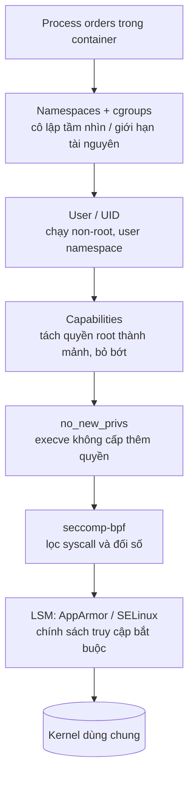

# P8 · Chương 05 — Bảo mật container

> Mọi khẳng định về kernel và syscall trong chương này là về **Linux**. Các bảng "quan sát" là kết quả một lần chạy `docker run` trên Docker Engine 29.5.2, kernel VM `6.8.0-117-generic` (aarch64), image lab Debian có `capsh` và `unshare`; đó không phải bảo đảm của tài liệu. Trang docs Docker và Kubernetes không ghim phiên bản (là bản đang online lúc viết); man page và kernel docs có ghim.

## Bạn sẽ hiểu được gì

1. **Q1.** Vì sao một lỗ hổng kernel có thể biến thành "thoát container", và những lớp phòng thủ nào đứng giữa ứng dụng và kernel? → mục 1
2. **Q2.** "Root trong container" khác "root trên host" ở đâu, và khi nào hai thứ này thực ra là một? → mục 2
3. **Q3.** Docker giữ lại những capability nào theo mặc định; `--cap-drop`, `--cap-add`, `--privileged` thay đổi gì; tự kiểm chứng bằng `/proc/self/status` thế nào? → mục 3
4. **Q4.** `no_new_privs` ngăn điều gì và không ngăn điều gì? → mục 4
5. **Q5.** seccomp-bpf lọc syscall ra sao (các action `KILL`, `ERRNO`, `TRACE`, `ALLOW`…), profile mặc định của Docker chặn gì, và vì sao `unshare` thất bại trong container thường nhưng chạy được khi tắt seccomp? → mục 5
6. **Q6.** AppArmor/SELinux là gì ở mức khái niệm, và vì sao rootfs read-only hay việc mount `docker.sock` đáng bận tâm? → mục 6
7. **Q7.** Các trường `securityContext` của Kubernetes và Pod Security Standards tương ứng với những cơ chế trên thế nào? → mục 7
8. **Q8.** Checklist tối thiểu nào áp dụng cho một service Rust chạy trong container? → mục 8

## Kiến thức cần trước

- Capabilities ở mức khái niệm, setuid, UID/GID: [Phase 1 · Chương 06](../01-linux/06-user-quyen-proc-sys.md).
- System call và ranh giới user/kernel: [Phase 1 · Chương 02](../01-linux/02-system-call.md).
- Namespaces (đặc biệt user namespace và PID namespace): [P8 · Chương 02](./02-namespaces.md). Giới hạn tài nguyên bằng cgroups: [P8 · Chương 03](./03-cgroups-v2.md).

## 1. Container dùng chung kernel: lớp phòng thủ nào đứng giữa? (Q1)

> **Trả lời ngắn.** Container thực chất là một process được cô lập, và các container chạy trên cùng một máy dùng chung một kernel[^share-kernel]. Vì vậy syscall của container nào cũng đi vào đúng kernel đó, và một lỗi kernel mà container gọi tới được có thể thành đường thoát khỏi container (suy luận của người soạn). Chính Docker cũng thừa nhận tập capability và mount mặc định có thể cô lập chưa đầy đủ, riêng rẽ hoặc khi kết hợp với lỗ hổng kernel[^docker-incomplete]. Cách đối phó là xếp nhiều lớp giảm thiểu giữa ứng dụng và kernel; chương này đi qua từng lớp.

**Giải thích.**

*Với service của bạn.* Hãy hình dung `orders`, một service HTTP viết bằng Rust, đóng thành image và chạy trong một container Docker cùng máy với vài container khác. Giả sử kẻ tấn công tìm được một lỗ hổng trong code hoặc dependency của `orders` và chạy được lệnh tùy ý bên trong container (nhận xét của người soạn: đây là kịch bản giả định, không phải sự cố có thật). Ta sẽ bám theo tình huống đó suốt chương và hỏi một câu: từ chỗ đứng ấy, kẻ tấn công với tới được gì của host, và mỗi lớp phòng thủ cắt bớt được gì? Mục này dựng phần nền, tức vì sao ranh giới của container không giống ranh giới của máy ảo.

Máy ảo chạy một hệ điều hành đầy đủ với kernel riêng. Container thì chỉ là một process cô lập, và các container cùng máy dùng chung kernel của host[^share-kernel]. Với `orders`, điều đó có nghĩa khi code của kẻ tấn công gọi `open`, `mount` hay `unshare`, bên trả lời là kernel của chính host. Nói cách khác, **bề mặt tấn công** (attack surface, tức tổng số chỗ kẻ tấn công có thể thử chạm vào) của container là toàn bộ giao diện syscall mà kernel mở ra cho process đó (nhận xét của người soạn). Docker cũng xếp "độ an toàn nội tại của kernel và phần hỗ trợ namespace/cgroup" là khu vực đầu tiên trong bốn khu vực cần xét khi đánh giá an ninh[^docker-four-areas].

Các lớp phòng thủ ở những mục sau đều làm cùng một việc: thu hẹp phần giao diện đó mà `orders` còn chạm tới được (nhận xét của người soạn). Ví dụ ở mục 5, Docker chặn cả họ syscall `io_uring` vì có lỗ hổng có thể bị khai thác để thoát container[^docker-tbl-iouring]. Nó cũng chặn `keyctl` vì keyring của kernel không được namespace hóa[^docker-tbl-keyctl].



Thứ tự trong hình chỉ để dễ nhìn, không phải thứ tự kernel đánh giá. Điều chắc chắn từ nguồn là danh sách LSM đang hoạt động phản ánh thứ tự kiểm tra: module capability luôn đứng đầu, rồi các LSM "minor", rồi LSM "major" (mục 6)[^lsm-checks].

Còn một nguyên tắc từ kernel docs về seccomp, áp dụng cho cả chương: lọc syscall không phải là sandbox. Nó là cơ chế giảm bề mặt kernel bị lộ, và là công cụ cho người xây sandbox; chính sách về hành vi nên kết hợp với các biện pháp hardening khác, có thể thêm một LSM[^seccomp-not-sandbox].

<details><summary>Đi sâu: phạm vi chương và thứ tự LSM</summary>

- Chương này dạy các **lớp giảm thiểu** mà kernel cung cấp và runtime bật lên. Nó không khẳng định lỗ hổng cụ thể nào vì chưa có nguồn cho từng lỗ hổng.
- Quy tắc xếp tầng LSM: module capability luôn có mặt, theo sau là số lượng tùy ý LSM "minor" và tối đa một LSM "major"[^lsm-order]. Danh sách đang hoạt động đọc được ở `/sys/kernel/security/lsm`[^lsm-checks].

</details>

**Quay lại Q1:** container và host chung một kernel, nên an ninh container là chuyện thu hẹp những gì kernel đó phơi ra cho process, chứ không phải một ranh giới cứng như hypervisor; với `orders`, mỗi lớp ở các mục sau cắt bớt thứ kẻ tấn công với tới được.

## 2. Root trong container và root trên host (Q2)

> **Trả lời ngắn.** Mặc định Docker *không* tách user namespace cho container[^docker-userns-default], nên UID 0 trong container chính là UID 0 của host về mặt định danh. Thứ làm nó yếu hơn root thật là các lớp hạn chế bao quanh chứ không phải con số UID: trước hết là capability bị cắt bớt[^docker-reduced-root]. Seccomp chặn thêm một phần syscall[^docker-seccomp-sane], và Docker còn nạp sẵn profile AppArmor cho container[^docker-apparmor]. Muốn UID 0 chỉ còn là "giả" thì dùng user namespace (`userns-remap`, rootless); rẻ nhất là chạy ứng dụng bằng user không phải root[^docker-nonroot].

**Giải thích.**

*Với service của bạn.* Giả sử process `orders` chạy với UID 0 trong container. Số 0 đó có nghĩa gì bên ngoài container? Nếu kẻ tấn công đang ở trong `orders`, đây là câu hỏi đầu tiên cần trả lời, vì nó quyết định "thoát container" là bước lên quyền root thật hay chỉ đáp xuống một UID vô hại. Mục này cho thấy mặc định là trường hợp thứ nhất, và những cách đổi sang trường hợp thứ hai.

Cách trả lời là nhìn vào `/proc/self/uid_map`, file cho biết UID bên trong một namespace ứng với UID nào bên ngoài. Trong container mặc định, file này là ánh xạ đồng nhất trên toàn dải UID (kết quả bên dưới là quan sát):

```text
$ docker run --rm <image> cat /proc/self/uid_map
         0          0 4294967295
```

`user_namespaces(7)` cho biết đây đúng là dạng ta thấy ở initial user namespace, tức namespace gốc của máy[^userns-initial-map]. Từ đó suy ra UID 0 trong container *là* UID 0 của initial user namespace (suy luận của người soạn).

Muốn UID 0 trong container thôi là root của host, cần user namespace để tách định danh. Với nó, một process có thể mang UID thường ở bên ngoài namespace nhưng UID 0 ở bên trong: toàn quyền với các thao tác trong namespace, không có quyền gì bên ngoài[^userns-isolate]. Lý do là một capability trong user namespace chỉ cho phép thao tác đặc quyền trên những tài nguyên do các namespace *sở hữu* (không tính user namespace) quản lý[^userns-owns].

Docker dùng ý tưởng này theo hai cách:

- **`userns-remap`**: daemon vẫn chạy bằng root, nhưng root trong container được ánh xạ vào dải UID phụ khai báo trong `/etc/subuid` và `/etc/subgid`. Nếu process cố leo thang ra ngoài namespace thì trên host nó chỉ là một UID cao, không đặc quyền[^docker-subuid].
- **Rootless mode**: chạy *cả daemon lẫn container* trong user namespace, bằng một user không phải root. Mục đích là giảm thiểu lỗ hổng tiềm tàng của daemon và container runtime[^rootless-purpose]. Về cơ chế, cả daemon lẫn container đều chạy bên trong một user namespace[^rootless-how].

Cách rẻ nhất thì không cần tính năng gì của Docker: cho `orders` chạy bằng user không đặc quyền. Docker gọi đó là cách tốt nhất để chặn leo thang đặc quyền từ trong container[^docker-nonroot].

<details><summary>Đi sâu: <code>--user 1000:1000</code> và <code>execve</code></summary>

- Quan sát (bảng mục 3): với `--user 1000:1000`, `CapEff` bằng 0 còn `CapBnd` vẫn là tập mặc định. Nghĩa là UID non-root thu hẹp nguy cơ chứ không xóa nó.
- Theo `capabilities(7)`, khi process có UID thực và hiệu dụng bằng 0 gọi `execve`, tập permitted mới được tính bằng inheritable OR bounding. Man page nói công thức này cũng áp dụng khi process UID khác 0 chạy một chương trình setuid-root không gắn file capabilities[^cap-root-exec]. Vậy user non-root vẫn có thể lấy lại capability (tối đa trong giới hạn bounding set) qua file setuid-root, và đó là lý do cần `no_new_privs` (mục 4); phần suy ra này là suy luận của người soạn từ man page.
- Initial user namespace không có parent, nhưng kernel vẫn cung cấp file ánh xạ "giả" cho nó cho nhất quán[^userns-initial].

</details>

**Quay lại Q2:** mặc định "root trong container" là root thật theo nghĩa UID, chỉ bị kìm bởi capability, seccomp và LSM; user namespace hoặc chạy non-root mới đổi được bản chất đó.

## 3. Capabilities trong container (Q3)

> **Trả lời ngắn.** Quyền root của Linux được chia thành nhiều "capability" riêng lẻ[^cap-divide]. Docker giữ lại một danh sách ngắn theo kiểu allowlist và bỏ phần còn lại[^docker-allowlist]. Danh sách mặc định đó chỉnh được bằng `--cap-add` và `--cap-drop`[^docker-default-list]; còn `--privileged` cho *tất cả* capability, mở mọi thiết bị host và nới AppArmor/SELinux[^docker-privileged]. Muốn tự kiểm chứng, đọc các trường `Cap*` trong `/proc/self/status`[^proc-cap].

**Giải thích.**

*Với service của bạn.* Kẻ tấn công trong `orders` đang có UID 0, nhưng UID 0 chỉ là cái tên. Việc nó làm được hay không (đổi chủ file, gửi signal cho mọi process, mount filesystem…) là do capability của container quyết định. Mục này xem Docker để lại cho `orders` những capability nào, và làm sao bạn tự đọc ra điều đó. Hãy nhớ `orders` nghe ở cổng 8080, và thường không cần capability nào cả (nhận xét của người soạn); mọi capability còn lại chỉ có ích cho kẻ tấn công.

Trước hết, capability là gì. Đặc quyền của superuser vốn là một khối; từ Linux 2.2, kernel chia khối đó thành các đơn vị riêng, và capability là thuộc tính của từng thread[^cap-divide]. Với mọi thao tác đặc quyền, kernel kiểm tra capability trong *effective set* của thread[^cap-effective]. Còn **bounding set** là cơ chế giới hạn những capability mà process có thể thu được qua `execve`[^cap-bounding]; runtime thu hẹp tập này để container không lấy lại quyền về sau (nhận xét của người soạn). Khái niệm năm tập capability đã có ở [P1·06 §3](../01-linux/06-user-quyen-proc-sys.md); ở đây chỉ nhắc đủ để đọc số.

Docker xử lý theo allowlist: mặc định bỏ hết capability trừ những cái cần[^docker-allowlist]. Tài liệu `docker run` cho tinh chỉnh bằng `--cap-add` và `--cap-drop` quanh một danh sách mặc định được giữ lại[^docker-default-list]. Danh sách có `NET_RAW`, dùng cho socket RAW và PACKET[^docker-net-raw]. Nó cũng có `NET_BIND_SERVICE`, cho phép bind cổng dưới 1024[^docker-net-bind]. Best practice của Docker là bỏ hết capability trừ những cái tiến trình thật sự cần[^docker-best-practice], tức `--cap-drop=ALL` rồi chỉ `--cap-add` thứ cần.

Có hai chỗ dễ nhầm khi thêm capability. Thứ nhất là `CAP_SYS_ADMIN`, một "túi tạp": trong phần dành cho người phát triển kernel, man page khuyên đừng chọn nó nếu tránh được và nói có thể gọi nó là "root mới" vì phạm vi quyền rất rộng[^cap-sysadmin]. Vì vậy `--cap-add=SYS_ADMIN` cấp một quyền rất rộng, gần với `--privileged` hơn vẻ ngoài (nhận xét của người soạn). Thứ hai là chính `--privileged`: nó không chỉ "thêm capability". Tài liệu Docker nói nó cho mọi capability, mở mọi thiết bị host và cấu hình lại AppArmor/SELinux để container gần như có quyền như process ngoài container[^docker-privileged].

<details><summary>Đi sâu: giải mã <code>CapEff</code>, bảng so sánh các chế độ</summary>

`CapEff` quan sát trong container mặc định là `00000000a80425fb`. `capsh --decode` giải ra đúng 14 capability (kết quả chạy thật): `cap_chown, cap_dac_override, cap_fowner, cap_fsetid, cap_kill, cap_setgid, cap_setuid, cap_setpcap, cap_net_bind_service, cap_net_raw, cap_sys_chroot, cap_mknod, cap_audit_write, cap_setfcap`. Những thứ **không** có: `CAP_SYS_ADMIN`, `CAP_NET_ADMIN`, `CAP_SYS_PTRACE`, `CAP_SYS_MODULE`, `CAP_SYS_TIME`…

Cách đọc các trường: `CapInh`, `CapPrm`, `CapEff` là mask hex của các tập inheritable, permitted, effective, còn `CapBnd` là bounding set[^proc-cap]. `Seccomp` là `0` (disabled), `1` (strict) hoặc `2` (filter)[^proc-seccomp]. `NoNewPrivs` là bit `no_new_privs` (trường này có trong `/proc` từ Linux 4.10)[^proc-nnp].

Lệnh dùng cho bảng:

```bash
docker run --rm [cờ] IMAGE bash -c \
  'grep -E "^(Cap|Seccomp|NoNewPrivs|Uid)" /proc/self/status'
```

Quan sát (mỗi dòng là một lần chạy):

| Chế độ | CapEff | CapBnd | Seccomp | NoNewPrivs |
|---|---|---|---|---|
| (mặc định) | `00000000a80425fb` | `00000000a80425fb` | 2 | 0 |
| `--cap-drop=ALL` | `0000000000000000` | `0000000000000000` | 2 | 0 |
| `--privileged` | `000001ffffffffff` | `000001ffffffffff` | 0 | 0 |
| `--security-opt no-new-privileges` | `00000000a80425fb` | `00000000a80425fb` | 2 | **1** |
| `--security-opt seccomp=unconfined` | `00000000a80425fb` | `00000000a80425fb` | **0** | 0 |
| `--user 1000:1000` | `0000000000000000` | `00000000a80425fb` | 2 | 0 |

`--privileged` cho `CapEff = 000001ffffffffff` (41 bit, toàn bộ capability của kernel đó, `cap_last_cap` = 40 theo quan sát) và `Seccomp: 0`. Tài liệu Docker không nêu riêng seccomp cho `--privileged`; `Seccomp: 0` chỉ là quan sát.

</details>

**Quay lại Q3:** Docker giữ 14 capability (`CapEff = a80425fb`), `--cap-drop=ALL` về 0, `--privileged` bật tất cả và còn mở thiết bị, nới LSM; với `orders`, 14 cái đó phần lớn là thừa.

## 4. `no_new_privs` (Q4)

> **Trả lời ngắn.** `no_new_privs` là một bit mà process tự đặt cho mình. Đã đặt thì không gỡ được, và từ đó `execve` hứa không cấp cho chương trình mới đặc quyền nào mà process chưa có[^nnp-mechanism]. Bit này bịt con đường "chạy chương trình setuid hoặc có file capabilities để lấy lại quyền"[^nnp-problem]. Nó không chặn các thay đổi đặc quyền không đi qua `execve`[^nnp-limits].

**Giải thích.**

*Với service của bạn.* Giả sử ta đã cắt capability và chạy `orders` bằng user thường, nhưng trong image còn sót một chương trình setuid-root (nhận xét của người soạn: giả định). Kẻ tấn công chỉ cần chạy chương trình đó là lấy lại quyền vừa bị tước. Mục này nói bit `no_new_privs` khóa con đường ấy thế nào, và nó khóa được tới đâu.

Gốc của vấn đề nằm ở `execve`: nó có thể cấp cho chương trình mới những đặc quyền mà process cha không có, rõ nhất là chương trình setuid/setgid và file capabilities[^nnp-problem]. `no_new_privs` (từ Linux 3.5) là cơ chế chung để cắt đường này[^nnp-since]. Task nào cũng đặt được bit, bit được thừa kế qua `fork`, `clone`, `execve` và không thể gỡ[^nnp-mechanism]. Khi bit đã đặt, bit setuid/setgid không còn đổi được uid/gid[^nnp-setuid]. Process tự đặt bằng `prctl(PR_SET_NO_NEW_PRIVS, 1, 0, 0, 0)`[^nnp-prctl].

Với container, runtime đặt bit giúp bạn. Docker bật bằng `--security-opt no-new-privileges`[^docker-nnp-flag], còn Kubernetes bằng `allowPrivilegeEscalation: false` (mục 7).

Ta thử trong một container root: tạo bản sao `id` mang bit setuid rồi chạy dưới UID 1000 bằng `setpriv`. Kết quả (quan sát):

| Chế độ | `NoNewPrivs` | `id -u` của file setuid-root chạy dưới UID 1000 |
|---|---|---|
| mặc định | 0 | **0** (setuid có tác dụng) |
| `--security-opt no-new-privileges` | 1 | **1000** (setuid bị vô hiệu) |

<details><summary>Đi sâu: giới hạn, tương tác với LSM và seccomp</summary>

- Giới hạn: `no_new_privs` không ngăn thay đổi đặc quyền không qua `execve`. Một task đủ quyền vẫn gọi được `setuid(2)` hoặc nhận `SCM_RIGHTS`[^nnp-limits].
- LSM: khi `no_new_privs` đặt, LSM cũng có thể không siết thêm ràng buộc lúc `exec`. Kernel docs cảnh báo điều này có thể cản sandbox dựa trên LSM nếu launcher đặt bit trước khi exec daemon[^nnp-lsm].
- Liên hệ seccomp: để cài filter bằng `SECCOMP_SET_MODE_FILTER`, thread phải có `CAP_SYS_ADMIN` trong user namespace của nó *hoặc* đã đặt `no_new_privs`[^seccomp-setmode]. Vì vậy hai cơ chế hay đi cùng nhau (nhận xét của người soạn).

</details>

**Quay lại Q4:** `no_new_privs` khóa con đường lấy lại quyền qua `execve` (setuid, file capabilities) và không bịt các đường đổi quyền khác; với `orders`, nó biến chương trình setuid sót trong image thành vô hại.

## 5. seccomp-bpf: lọc syscall (Q5)

> **Trả lời ngắn.** seccomp cho một process cài bộ lọc nhỏ (chương trình BPF) để xét từng syscall đến cùng đối số của nó[^kdoc-seccomp-intro]. Mỗi syscall nhận một action, chẳng hạn từ chối với `errno`[^act-errno], giết process hoặc cho chạy. Profile mặc định của Docker là allowlist: syscall nào không nằm trong danh sách được mở thì bị từ chối[^docker-seccomp-errno]. Nhiều syscall nhạy cảm như `unshare` hay `mount` chỉ được mở khi container có capability tương ứng[^moby-sysadmin] (đọc từ JSON ghim tag, xem Đi sâu). Vì thế `unshare` thất bại trong container thường và chạy được khi tắt seccomp.

**Giải thích.**

*Với service của bạn.* Capability chặn theo "loại việc"; nhưng kẻ tấn công trong `orders` còn có thể thử thẳng các syscall hiếm, ví dụ `unshare` để dựng namespace mới hay `io_uring`. Mục này cho thấy filter của seccomp chặn chúng thế nào, và giải thích một quan sát hay gây ngạc nhiên: `unshare -U` lỗi trong container Docker thường, trong khi kernel cho user thường làm việc đó.

Cái cần cắt là bề mặt kernel bị lộ, nên ta cắt hẳn các syscall không cần[^seccomp-not-sandbox]. Bộ lọc là chương trình BPF xét số syscall và đối số của nó[^kdoc-seccomp-intro]. Man page nói nó có thể được thiết kế để lọc tùy ý syscall và đối số[^seccomp-filter-args].

Filter cài một lần thì đi theo process mãi. Nếu filter cho phép `fork` hoặc `clone`, process con chịu cùng filter; nếu cho phép `execve`, filter được giữ qua `execve`[^seccomp-inherit]. Vì vậy filter do runtime cài trước khi `exec` ứng dụng áp dụng lên cả `orders` lẫn mọi process con cháu (suy luận của người soạn).

Với mỗi syscall, kết quả là một *action*. Nhiều filter có thể xếp chồng, và action thắng là action có ưu tiên cao nhất mà các filter trả về[^seccomp-precedence]. Phản ứng nặng nhất là giết cả process, kèm core dump[^act-kill-process]. Nhẹ hơn là giết riêng thread gọi syscall[^act-kill-thread]. Filter cũng có thể trả `errno` mà không chạy syscall[^act-errno], hoặc cho syscall chạy[^act-allow]. Bảng đầy đủ nằm ở phần Đi sâu.

Docker chọn kiểu allowlist. Profile mặc định chặn khoảng 44 trên hơn 300 syscall và được Docker mô tả là "khá bảo vệ mà vẫn tương thích rộng"[^docker-seccomp-sane]. Nó đặt `defaultAction` là `SCMP_ACT_ERRNO`, rồi ghi đè riêng cho từng syscall được phép; hiệu ứng là lỗi Permission Denied[^docker-seccomp-errno]. Nhiều khối trong profile còn có điều kiện `caps`: `unshare`, `mount`, `setns` chỉ được mở khi container có `CAP_SYS_ADMIN` (đọc từ JSON ghim, xem Đi sâu). Do đó thêm capability cũng mở luôn các syscall này trong seccomp.

Giờ quay lại câu hỏi `unshare`. Kernel cho process không đặc quyền tạo user namespace từ Linux 3.8[^userns-unpriv]. Nhưng bảng quan sát ở Đi sâu cho thấy trên máy thí nghiệm, `unshare -U` chạy được khi tắt seccomp hoặc khi có `SYS_ADMIN`. Vậy kernel không phải thủ phạm; chính filter của Docker chặn nó (suy luận của người soạn, khớp với JSON).

Muốn tắt seccomp thì dùng `--security-opt seccomp=unconfined`[^docker-unconfined]. Lưu ý: `./labs/linux.sh` của dự án chạy với cờ này và thêm `SYS_PTRACE`, `NET_ADMIN`, `NET_RAW` (xem `labs/linux.sh`), nên container lab **không có seccomp** và khác container Docker mặc định.

<details><summary>Đi sâu: action, cấu trúc JSON ghim tag, bảng thí nghiệm, đối chiếu docs</summary>

**Các action** (`seccomp(2)`; các dòng chính dưới đây giữ thứ tự ưu tiên giảm dần của man page, còn `TRAP`, `USER_NOTIF`, `LOG` xen giữa ở đoạn sau):

| Action | Hiệu ứng |
|---|---|
| `SECCOMP_RET_KILL_PROCESS` | kết thúc ngay process kèm core dump, syscall không chạy; mọi thread bị giết (từ Linux 4.14)[^act-kill-process] |
| `SECCOMP_RET_KILL_THREAD` (`SECCOMP_RET_KILL`) | giết thread gọi syscall; các thread khác tiếp tục[^act-kill-thread] |
| `SECCOMP_RET_ERRNO` | phần `SECCOMP_RET_DATA` được đưa cho user space làm `errno`, syscall không chạy[^act-errno] |
| `SECCOMP_RET_TRACE` | thông báo tracer dùng ptrace; nếu không có tracer, syscall không chạy và trả `ENOSYS`[^act-trace] |
| `SECCOMP_RET_ALLOW` | syscall được thực thi[^act-allow] |

Còn `TRAP` (gửi `SIGSYS` cho thread gọi, syscall không chạy[^act-trap]), `USER_NOTIF` (từ 5.0; chuyển syscall cho tiến trình giám sát ở user space quyết định[^act-usernotif]), `LOG` (từ 4.14; ghi log rồi cho syscall chạy[^act-log]); action không nhận ra được xử lý như kill[^act-unknown]. Cạm bẫy lớn nhất theo kernel docs: lọc theo số syscall mà không kiểm kiến trúc, nên "luôn kiểm giá trị arch"[^kdoc-arch].

**Cấu trúc profile.** Để khỏi dựa vào trí nhớ về JSON, phần này đọc trực tiếp file `profiles/seccomp/default.json` ở tag Moby `v28.0.0`. *Lưu ý ghim:* đây là snapshot của tag `v28.0.0`; engine bạn chạy (máy thí nghiệm là Docker 29.5.2) có thể dùng JSON khác, và trang docs Docker (không ghim) cập nhật theo bản mới nhất, nên cần đối chiếu theo phiên bản.

- Đầu file: `defaultAction: SCMP_ACT_ERRNO`, `defaultErrnoRet: 1` (EPERM, "Operation not permitted" theo `errno(3)`)[^moby-default]. Giá trị EPERM đối chiếu với `errno(3)`[^errno-eperm]. Tiếp theo là `archMap` liệt kê kiến trúc (x86-64, AArch64, MIPS, s390x, RISC-V…).
- `syscalls`: danh sách khối `names` + `action`. Khối đầu (352 tên) là `SCMP_ACT_ALLOW` vô điều kiện (đếm bằng script trên file đó); các khối sau là ngoại lệ có điều kiện.
- Điều kiện theo capability: khối `includes: caps: [CAP_SYS_ADMIN]` cho phép 23 syscall (gồm `unshare`, `mount`, `umount`, `umount2`, `setns`, `bpf`, `clone`, `clone3`, `perf_event_open`, `quotactl`, `sethostname`, `fsopen`/`fsmount`/`move_mount`…) **chỉ khi container có `CAP_SYS_ADMIN`**; tương tự `reboot` cần `CAP_SYS_BOOT`, `init_module`/`finit_module`/`delete_module` cần `CAP_SYS_MODULE`, `settimeofday`/`clock_settime` cần `CAP_SYS_TIME`, `ptrace` cần `CAP_SYS_PTRACE` (trừ kernel ≥ 4.8: khối `minKernel: 4.8` cho phép riêng `ptrace`, `process_vm_readv`, `process_vm_writev`). Hai syscall `bpf` và `perf_event_open` còn có **khối riêng** ở cuối file: `bpf` được mở khi container có `CAP_BPF`, `perf_event_open` được mở khi container có `CAP_PERFMON`[^moby-bpf-perf]. Nên `--cap-add PERFMON` (hoặc `BPF`) đủ để seccomp mặc định cho qua syscall tương ứng, không cần `SYS_ADMIN` hay tắt seccomp (đọc từ JSON `v28.0.0`; engine khác có thể khác). Cách dùng cho perf/eBPF: [P11 · Chương 01, mục 8](../11-do-dac-va-go-loi/01-perf-va-sampling-profiler.md).
- Điều kiện theo đối số: `socket` chỉ được phép nếu đối số 0 (domain) khác 40 (giá trị `AF_VSOCK`; suy luận của người soạn từ giá trị hằng số). `personality` chỉ cho vài giá trị. `clone` khi không có `CAP_SYS_ADMIN` chỉ được phép nếu cờ không chứa bit nào của mặt nạ `2114060288` (= `0x7E020000`; suy luận của người soạn từ giá trị các hằng số: đây là tổng 7 cờ `CLONE_NEWNS`, `CLONE_NEWCGROUP`, `CLONE_NEWUTS`, `CLONE_NEWIPC`, `CLONE_NEWUSER`, `CLONE_NEWPID`, `CLONE_NEWNET`; mặt nạ này không gồm `CLONE_NEWTIME`).
- `clone3` khi không có `CAP_SYS_ADMIN` trả `errnoRet: 38`, tức `ENOSYS`[^errno-enosys]. Lý do (suy luận của người soạn): `clone3` truyền cờ qua struct nên BPF không kiểm được cờ.
- Không có trong allowlist nên bị `ERRNO`: `keyctl`, `add_key`, `kexec_load`, `userfaultfd`, `swapon`, `pivot_root`, và cả họ `io_uring_*` (grep file: không có chuỗi `io_uring`).

**Đối chiếu bảng lý do của Docker** (trang không ghim): `keyctl`/`add_key`/`request_key` bị chặn vì keyring không namespaced[^docker-tbl-keyctl]; `mount` bị chặn, đã có `CAP_SYS_ADMIN` gác[^docker-tbl-mount]; `settimeofday` bị chặn vì thời gian không namespaced, còn có `CAP_SYS_TIME` gác[^docker-tbl-time]; họ `io_uring` bị chặn vì lỗ hổng có thể bị khai thác để thoát container[^docker-tbl-iouring]. Với `unshare`, bảng ghi chặn cloning namespace mới, có `CAP_SYS_ADMIN` gác, ngoại lệ cho `unshare --user`[^docker-tbl-unshare]. Với `clone`, bảng ghi ngoại lệ cho `CLONE_NEWUSER`[^docker-tbl-clone]. Cả hai ghi chú này **lệch với quan sát** bên dưới (`unshare -U` bị chặn ở container mặc định) và với JSON `v28.0.0` (`unshare` chỉ nằm trong khối `CAP_SYS_ADMIN`; mặt nạ `clone` ở trên gồm cả `CLONE_NEWUSER`, theo giá trị hằng số). Chương này chưa có nguồn để lý giải sự lệch đó (có thể do khác phiên bản giữa trang docs và JSON). Nhiều syscall vừa bị seccomp vừa bị capability chặn (phòng thủ nhiều lớp); với `keyctl` bảng chỉ nêu lý do keyring không namespaced, không nêu capability nào gác (suy luận của người soạn: ở đó seccomp là lớp bảo vệ chính).

**Quan sát thao tác đặc quyền** (cùng image; `unshare -U`, `unshare -m`, `mount -t tmpfs`, `chown 1:1 file`):

| Chế độ | `unshare -U` | `unshare -m` | `mount tmpfs` | `chown` |
|---|---|---|---|---|
| mặc định | **Operation not permitted** | Operation not permitted | permission denied | ok |
| `--cap-drop=ALL` | Operation not permitted | Operation not permitted | permission denied | **Operation not permitted** |
| `--cap-add SYS_ADMIN` | ok | `cannot change root filesystem propagation: Permission denied` | `cannot mount t read-only` | ok |
| `--security-opt seccomp=unconfined` | **ok** | Operation not permitted | `cannot mount t read-only` | ok |
| `--privileged` | ok | ok | ok | ok |
| `--user 1000:1000` | Operation not permitted | Operation not permitted | `must be superuser` | Operation not permitted |

Đối chiếu: (1) `unshare -U` chỉ chạy khi có `SYS_ADMIN` hoặc tắt seccomp, khớp JSON ghim, nơi `unshare` chỉ nằm trong khối `CAP_SYS_ADMIN`; kernel cho phép từ 3.8[^userns-unpriv]. Nói cách khác, việc `unshare -U` chạy được trong lab (xem [P8 · Chương 02](./02-namespaces.md)) không chỉ nhờ quy tắc kernel mà còn vì lab tắt seccomp (nhận xét của người soạn từ bảng trên). (2) `--cap-drop=ALL` làm `chown` lỗi vì mất `CAP_CHOWN`; `--user 1000:1000` có `CapEff` = 0 (mục 2). `unshare -m` vẫn lỗi khi chỉ tắt seccomp vì tạo mount namespace cần `CAP_SYS_ADMIN` trong user namespace của caller[^userns-unpriv]. (3) Với `--cap-add SYS_ADMIN` (seccomp cho phép `mount`), `mount -t tmpfs` vẫn thất bại; chỉ `--privileged` làm `mount` thành công. Chưa có log denial của kernel cho đúng lệnh này, nhưng quan sát ở [P8 · Chương 07, mục 2.3](./07-mang-container.md) cho thấy một thao tác mount khác (`mount --make-shared /run/netns`) vẫn lỗi khi có `SYS_ADMIN` với AppArmor mặc định và chỉ qua khi thêm `apparmor=unconfined` (thêm riêng `seccomp=unconfined` không đủ); nên nhiều khả năng profile AppArmor `docker-default` là lớp chặn ở đây (suy luận của người soạn từ quan sát đó).

</details>

**Quay lại Q5:** seccomp-bpf là bộ lọc syscall chạy trước kernel; profile Docker là allowlist `ERRNO`-mặc-định, và vì nó mở `unshare` chỉ khi có `CAP_SYS_ADMIN`, `unshare` thất bại trong container thường.

## 6. LSM (AppArmor/SELinux), rootfs read-only và `docker.sock` (Q6)

> **Trả lời ngắn.** LSM là khung để gắn thêm các kiểm tra an ninh vào kernel[^lsm-framework]. Module dùng khung này điển hình là AppArmor và SELinux, thuộc nhóm MAC (Mandatory Access Control, chính sách truy cập bắt buộc)[^lsm-mac]. Với AppArmor, chính sách đặt hạn chế vượt quá quyền DAC thông thường của Linux[^apparmor-policy]. Docker không thay thế các module này mà dùng chúng: nó nạp sẵn profile AppArmor `docker-default`[^docker-apparmor], còn Red Hat có chính sách SELinux cho Docker[^docker-templates]. Ngoài kernel, hai cấu hình khác cũng quyết định an ninh: `--read-only` chặn ghi vào rootfs[^docker-ro], còn mount `docker.sock` vào container ứng dụng tương đương trao quyền điều khiển daemon của host[^docker-sock-run].

**Giải thích.**

*Với service của bạn.* Giả sử kẻ tấn công trong `orders` đã đi qua hết capability và seccomp. Nó muốn hai thứ: thả một binary độc vào `/usr/bin` để chạy lại sau khi `orders` restart, và với tới daemon Docker của host. Mục này xem LSM, rootfs read-only và `docker.sock` liên quan thế nào tới hai việc đó.

LSM (Linux Security Modules) là khung gắn thêm các kiểm tra an ninh vào kernel. Dù tên là "module", chúng không phải kernel module nạp động mà được chọn lúc build[^lsm-framework]. Người dùng chính của khung này là các extension MAC: SELinux, Smack, Tomoyo, AppArmor[^lsm-mac]. Lớp này thêm một vòng kiểm soát nữa, với chính sách riêng, ngoài capability và seccomp (nhận xét của người soạn).

AppArmor chạy theo profile. Process nào không có profile thì ở trạng thái "unconfined", tương đương quyền DAC thường của Linux[^apparmor-unconfined]. Để AppArmor hạn chế được vượt quá DAC, policy phải được nạp từ user space[^apparmor-policy]. Với container, việc này Docker lo: nó tự sinh và nạp profile `docker-default`[^docker-apparmor].

Rootfs chỉ đọc thì là cấu hình của runtime. `--read-only` mount root filesystem của container ở chế độ chỉ đọc, chỉ cho ghi vào các volume được chỉ định[^docker-ro]. Với `orders`, hiệu quả là kẻ chiếm được process không thả được binary hay script vào `/usr/bin` hay `/etc` (nhận xét của người soạn). Quan sát: với `--read-only`, `touch /etc/x` và `touch /tmp/x` đều báo `Read-only file system`; thêm `--tmpfs /tmp` thì `touch /tmp/x` thành công. Cái giá là service cần ghi tạm phải khai báo rõ chỗ ghi (tmpfs hoặc volume).

Còn `docker.sock` là cửa sau lớn nhất. Daemon Docker cần quyền root trừ khi bật rootless[^docker-daemon-root], nên chỉ user tin cậy mới nên được điều khiển nó[^docker-daemon-trusted]. Lý do là Docker cho chia sẻ thư mục host với container mà không hạn chế quyền: ai điều khiển được daemon có thể chạy một container gắn `/` của host làm `/` của nó, rồi sửa filesystem host không giới hạn[^docker-host-mount]. Trang `docker run` nói thẳng rằng bind-mount socket Unix của Docker (cùng binary docker) là trao cho container toàn quyền tạo và thao tác trên daemon của host[^docker-sock-run]. Quan sát: mount `/var/run/docker.sock` vào container root rồi `curl --unix-socket … http://localhost/version` trả JSON phiên bản engine, còn `/containers/json` trả danh sách container của host. Nghĩa là nếu ai đó mount socket này vào `orders` cho tiện, kẻ tấn công trong `orders` điều khiển được cả daemon.

<details><summary>Đi sâu: LSM trong quan sát và giới hạn của chương</summary>

- Danh sách LSM đang hoạt động đọc ở `/sys/kernel/security/lsm`; thứ tự là thứ tự kiểm tra[^lsm-checks].
- Quan sát ở mục 5 (`--cap-add SYS_ADMIN` rồi `mount -t tmpfs` vẫn lỗi): [P8 · Chương 07, mục 2.3](./07-mang-container.md) đã thử tách từng lớp với một thao tác mount khác và thấy AppArmor mặc định là lớp chặn (hết lỗi khi `apparmor=unconfined`). Áp kết luận đó cho `mount -t tmpfs` là suy luận của người soạn vì chương này không đọc log denial của kernel.
- "Mount `docker.sock` tương đương root trên host" là hệ quả đọc từ hai đoạn docs trên; chương này không chạy một container đặc quyền để chứng minh.

</details>

**Quay lại Q6:** LSM thêm một lớp MAC sau capability và seccomp; rootfs read-only thu hẹp chỗ ghi; còn `docker.sock` là cửa sau tới quyền điều khiển host nên không bao giờ nên đưa vào container ứng dụng như `orders`.

## 7. Kubernetes: `securityContext` và Pod Security Standards (Q7)

> **Trả lời ngắn.** `securityContext` của Pod hoặc Container gom đúng các cơ chế đã học: capability, seccomp, AppArmor, chạy privileged hay không[^k8s-sc-list]. Riêng `allowPrivilegeEscalation` điều khiển trực tiếp bit `no_new_privs` (giá trị đảo)[^k8s-ape]. Pod Security Standards (PSS) gom các thiết lập đó thành ba cấp chính sách cộng dồn: Privileged, Baseline, Restricted[^pss-three].

**Giải thích.**

*Với service của bạn.* Khi `orders` chạy trên Kubernetes, bạn không gõ `docker run --cap-drop=ALL`; bạn khai `securityContext` trong Pod spec của Deployment, và cluster có thể dùng PSS để từ chối Pod không đạt chuẩn. Mục này đối chiếu từng trường YAML với cơ chế kernel ở các mục 3–6. Nội dung Kubernetes ở đây lấy từ kubernetes.io, **không ghim phiên bản**; tên trường có thể đổi theo phiên bản cluster.

Trang cấu hình security context liệt kê đúng những cơ chế ta vừa học: quyền privileged, capability ("cho process một số đặc quyền, không phải toàn bộ đặc quyền của root"), AppArmor và seccomp ("lọc syscall của process")[^k8s-sc-list]. Đi từng trường:

- **`allowPrivilegeEscalation`** điều khiển việc cờ `no_new_privs` có được đặt trên process của container hay không, với giá trị đảo: `true` thì `no_new_privs=false`, và bỏ trống thì mặc định `true`[^k8s-ape]. Trường này không nhất quán (không đặt được cùng) với container privileged hoặc container có `CAP_SYS_ADMIN`[^k8s-ape-conflict].
- **`capabilities`** thêm hoặc bớt capability theo tên **không có tiền tố `CAP_`**: thêm `CAP_SYS_TIME` thì ghi `SYS_TIME`[^k8s-cap-name].
- **`seccompProfile`** có `type` là `RuntimeDefault`, `Unconfined` hoặc `Localhost`[^k8s-seccomp].
- **`readOnlyRootFilesystem`** mount root filesystem của container chỉ đọc[^k8s-ro], tương đương `--read-only` (nhận xét của người soạn).

Ở tầng cluster, PSS có ba cấp: Privileged (không hạn chế), Baseline (hạn chế tối thiểu, ngăn leo thang đặc quyền đã biết) và Restricted (hạn chế chặt, theo thực hành hardening Pod hiện hành)[^pss-three].

<details><summary>Đi sâu: Baseline vs Restricted, ví dụ YAML</summary>

- **Baseline** cấm container privileged vì Pod privileged vô hiệu hóa phần lớn cơ chế bảo mật[^pss-priv]. Nó cũng cấm thêm capability ngoài một danh sách cho phép[^pss-baseline-caps]. Danh sách gồm 13 tên (`CHOWN`, `DAC_OVERRIDE`, `FOWNER`, `FSETID`, `KILL`, `SETGID`, `SETUID`, `SETPCAP`, `NET_BIND_SERVICE`, `SYS_CHROOT`, `MKNOD`, `SETFCAP`, `AUDIT_WRITE`)[^pss-baseline-list]; khác 14 capability mặc định của Docker ở chỗ **không có `NET_RAW`** (so sánh của người soạn).
- **Restricted** gồm Baseline và thêm bốn điều kiện:
  - `allowPrivilegeEscalation` phải là `false`[^pss-ape].
  - Phải chạy non-root[^pss-nonroot].
  - Seccomp phải đặt rõ: cả profile `Unconfined` lẫn việc không có profile đều bị cấm[^pss-seccomp].
  - Phải drop ALL capability và chỉ được thêm lại `NET_BIND_SERVICE`[^pss-caps].

Ví dụ rút gọn (nhận xét của người soạn, tổng hợp từ các trường trên; chưa `kubectl apply` thử):

```yaml
securityContext:
  runAsNonRoot: true
  allowPrivilegeEscalation: false
  readOnlyRootFilesystem: true
  capabilities:
    drop: ["ALL"]
  seccompProfile:
    type: RuntimeDefault
```

</details>

**Quay lại Q7:** `securityContext` là cách Kubernetes bật các cơ chế mục 3–6 cho từng container của `orders`; PSS Restricted đòi cả bộ: non-root, `allowPrivilegeEscalation: false`, drop ALL, seccomp tường minh.

## 8. Checklist tối thiểu cho service Rust (Q8)

> **Trả lời ngắn.** Chạy non-root, bỏ hết capability, bật `no_new_privs`, giữ seccomp mặc định, rootfs chỉ đọc, không mount `docker.sock`, không `--privileged`, và cập nhật kernel host. Mỗi mục dưới đây là khuyến nghị tổng hợp của người soạn từ cơ chế đã chú thích ở trên, không phải trích nguồn.

**Giải thích.**

*Với service của bạn.* Đây là bản gom lại cho `orders`: nếu kẻ tấn công đã vào được container, mỗi mục dưới đây giảm bớt thứ nó dùng được. Tư duy chung (nhận xét của người soạn): đừng cấp cho service một chùm chìa khóa rồi tìm cách giấu bớt; hãy bắt đầu từ chùm rỗng và chỉ thêm chìa khi service chứng minh được là cần.

Các bước (nhận xét của người soạn):

1. **Không chạy root.** Đặt `USER` non-root trong Dockerfile hoặc `runAsNonRoot: true` (mục 2, 7). Binary Rust không cần root để lắng nghe cổng cao: dùng cổng ≥ 1024 và để Service/Ingress map cổng. Theo bảng của Docker, bind cổng dưới 1024 cần `NET_BIND_SERVICE`[^docker-net-bind]. Tuy vậy ngưỡng này là sysctl `net.ipv4.ip_unprivileged_port_start`, tính theo từng network namespace: ở [P1 · Chương 06, mục 3](../01-linux/06-user-quyen-proc-sys.md), một container Docker đã đo đọc ra `0`, nên uid 1000 với `CapEff = 0` vẫn bind được cổng 80 (quan sát một lần chạy). Ta vẫn nên giữ khuyến nghị cổng ≥ 1024 vì không nên dựa vào sysctl đó.
2. **`--cap-drop=ALL`** (K8s: `capabilities.drop: [ALL]`), chỉ thêm lại thứ cần (mục 3, 7). Service HTTP bind cổng cao thường không cần capability nào.
3. **`no-new-privileges` / `allowPrivilegeEscalation: false`** (mục 4).
4. **Giữ seccomp mặc định.** Trong K8s đặt tường minh `seccompProfile.type: RuntimeDefault`, vì PSS Restricted cấm cả việc không có profile (mục 5, 7). Đừng dùng `seccomp=unconfined` ngoài lúc debug.
5. **Rootfs chỉ đọc**, ghi tạm vào `tmpfs` hoặc volume khai báo rõ (mục 6). Chú ý khi service ghi cache, file tạm hoặc socket.
6. **Không mount `docker.sock`**, không dùng `--privileged` cho service ứng dụng (mục 3, 6).
7. **Rootless / user namespace** khi hạ tầng cho phép (mục 2), để lỗ hổng thoát container đáp xuống một UID không đặc quyền của host.
8. **Cập nhật kernel và runtime của host.** Vì kernel dùng chung (mục 1), bản vá kernel là một phần an ninh của container; code Rust an toàn không bù lại được.

<details><summary>Đi sâu: vì sao mỗi mục dựa trên cơ chế nào</summary>

- Bước 1–2 dựa trên việc UID 0 mặc định là UID 0 thật (mục 2) và `CAP_NET_BIND_SERVICE` là capability mà bảng của Docker gắn với việc bind cổng dưới 1024[^docker-net-bind] (ngưỡng thực tế còn phụ thuộc sysctl của namespace, xem bước 1 ở trên).
- Bước 3–4 dựa trên `no_new_privs` và seccomp: filter được kế thừa qua `exec`[^seccomp-inherit], và PSS Restricted bắt buộc `allowPrivilegeEscalation: false`[^pss-ape]. Restricted cũng đòi seccomp đặt rõ[^pss-seccomp].
- Bước 8: chương này không khẳng định lỗ hổng kernel cụ thể nào; cơ sở duy nhất là việc container dùng chung kernel[^share-kernel].

</details>

**Quay lại Q8:** checklist là tổ hợp của các lớp mục 2–7: ít quyền nhất (non-root, drop ALL, `no_new_privs`), ít syscall nhất (seccomp), ít chỗ ghi nhất (rootfs read-only), và không đưa chìa khóa host (`docker.sock`, `--privileged`) cho container.

## Tóm tắt

- Container dùng chung kernel với host; mọi lớp trong chương này giảm bề mặt tấn công, không phải ranh giới cứng như hypervisor.
- Mặc định Docker không dùng user namespace: UID 0 trong container là UID 0 của initial user namespace; thứ làm nó yếu đi là capability, seccomp, LSM.
- Docker giữ 14 capability mặc định (CapEff `a80425fb`); `--cap-drop=ALL` về 0; `--privileged` bật toàn bộ, mở thiết bị, nới LSM.
- `no_new_privs` ngăn `execve` cấp thêm quyền (setuid, file capabilities) và không thể gỡ sau khi đặt; K8s điều khiển nó bằng `allowPrivilegeEscalation`.
- seccomp-bpf lọc syscall và đối số; filter được kế thừa qua fork/exec; profile Docker là allowlist `defaultAction: SCMP_ACT_ERRNO`, nhiều syscall chỉ mở khi có capability tương ứng.
- AppArmor/SELinux là LSM kiểu MAC bổ sung cho DAC; Docker có profile `docker-default` (AppArmor).
- `--read-only` chặn ghi vào rootfs; mount `docker.sock` trao toàn quyền thao tác daemon của host.
- K8s: `securityContext` gom các cơ chế này; PSS Restricted đòi drop ALL, non-root, `allowPrivilegeEscalation: false`, seccomp tường minh.

## Câu hỏi tự kiểm tra

1. Vì sao lỗ hổng trong một syscall hiếm dùng của kernel lại là vấn đề của container mà không phải của máy ảo?
<details><summary>Đáp án</summary>

Container dùng chung kernel với host[^share-kernel]. Docker xếp độ an toàn nội tại của kernel là khu vực đầu tiên cần xét[^docker-four-areas], và nói tập capability và mount mặc định có thể cô lập chưa đầy đủ, riêng rẽ hoặc khi kết hợp với lỗ hổng kernel[^docker-incomplete].

</details>

2. Trong `docker run` mặc định, `/proc/self/uid_map` cho thấy gì và nó ngụ ý gì về "root trong container"?
<details><summary>Đáp án</summary>

Quan sát `0 0 4294967295`, ánh xạ đồng nhất như initial user namespace[^userns-initial]. User namespace không được tách mặc định[^docker-userns-default], nên UID 0 là UID 0 thật, chỉ bị hạn chế bởi capability, seccomp và LSM[^docker-reduced-root].

</details>

3. `CapEff = 00000000a80425fb` gồm bao nhiêu capability và có `CAP_SYS_ADMIN` không?
<details><summary>Đáp án</summary>

14 capability (mục 3, Đi sâu); không có `CAP_SYS_ADMIN`. Bảng mặc định của Docker: [^docker-default-list], [^docker-net-raw].

</details>

4. `--privileged` khác chỉ cấp thêm capability ở điểm nào?
<details><summary>Đáp án</summary>

`--privileged` còn mở mọi thiết bị host và cấu hình lại AppArmor/SELinux[^docker-privileged]; quan sát thêm `Seccomp: 0`.

</details>

5. `no_new_privs` ngăn điều gì, và điều gì nó không ngăn?
<details><summary>Đáp án</summary>

Ngăn `execve` cấp thêm đặc quyền (setuid/file capabilities)[^nnp-setuid]. Nó không ngăn thay đổi đặc quyền không qua `execve`[^nnp-limits].

</details>

6. Kể các action seccomp và khác biệt giữa `KILL_PROCESS` và `KILL_THREAD`.
<details><summary>Đáp án</summary>

Xem bảng mục 5; `KILL_PROCESS` giết cả process[^act-kill-process]. `KILL_THREAD` chỉ giết thread gọi syscall[^act-kill-thread].

</details>

7. Vì sao `unshare -U` thất bại trong container mặc định dù kernel cho user thường tạo user namespace?
<details><summary>Đáp án</summary>

Theo man page, kernel cho phép từ Linux 3.8[^userns-unpriv]; profile seccomp mặc định (JSON `v28.0.0`) chỉ cho `unshare` khi có `CAP_SYS_ADMIN`. Bảng của Docker lại ghi ngoại lệ `unshare --user`[^docker-tbl-unshare], một chỗ lệch chưa lý giải được (mục 5, Đi sâu).

</details>

8. Vì sao profile seccomp Docker và capability phụ thuộc nhau?
<details><summary>Đáp án</summary>

Nhiều khối trong JSON dùng `includes: caps`, nên thêm capability sẽ mở syscall tương ứng (mục 5); bảng Docker ghi "đã có `CAP_SYS_ADMIN` gác" cho `mount`[^docker-tbl-mount].

</details>

9. Vì sao không nên mount `docker.sock` vào container ứng dụng?
<details><summary>Đáp án</summary>

Điều khiển daemon cho phép chạy container gắn `/` của host, sửa host không hạn chế[^docker-host-mount]. Vì vậy chỉ user tin cậy mới nên được điều khiển daemon[^docker-daemon-trusted]. Trang `docker run` nói bind-mount socket là trao toàn quyền thao tác daemon[^docker-sock-run].

</details>

10. `allowPrivilegeEscalation` của Kubernetes tương ứng với cơ chế nào của kernel, và PSS Restricted đòi gì về seccomp?
<details><summary>Đáp án</summary>

Nó điều khiển cờ `no_new_privs` (giá trị đảo)[^k8s-ape]. Restricted cấm cả `Unconfined` lẫn việc không đặt profile[^pss-seccomp].

</details>

11. Vì sao `seccompProfile.type: RuntimeDefault` nên được đặt tường minh trong K8s?
<details><summary>Đáp án</summary>

Vì PSS Restricted cấm việc không có profile[^pss-seccomp]; `RuntimeDefault` là một trong các giá trị hợp lệ của `type`[^k8s-seccomp].

</details>

## Đọc thêm

- [P1·06 — User, quyền, /proc, /sys](../01-linux/06-user-quyen-proc-sys.md): capabilities, setuid, `execve` ở mức khái niệm.
- [P8·02 — Namespaces](./02-namespaces.md): user namespace và các namespace khác chi tiết.
- `seccomp(2)` (<https://manpages.debian.org/bookworm/manpages-dev/seccomp.2.en.html>): đầy đủ action, flag, ví dụ BPF.
- Profile mặc định của Moby ghim tag (<https://raw.githubusercontent.com/moby/moby/v28.0.0/profiles/seccomp/default.json>): đọc trực tiếp cấu trúc allowlist.
- Pod Security Standards (<https://kubernetes.io/docs/concepts/security/pod-security-standards/>): chi tiết các control mỗi cấp (không ghim).


[^share-kernel]: Docker, What is a container — <https://docs.docker.com/get-started/docker-concepts/the-basics/what-is-a-container/> — "If you run multiple containers, they all share the same kernel, allowing you to run more applications on less infrastructure."
[^docker-four-areas]: Docker, Docker security — <https://docs.docker.com/engine/security/> — "The intrinsic security of the kernel and its support for namespaces and cgroups"
[^docker-incomplete]: Docker, Docker security, Linux kernel capabilities — <https://docs.docker.com/engine/security/> — "the default set of capabilities and mounts given to a container may provide incomplete isolation, either independently, or when used in combination with kernel vulnerabilities."
[^lsm-order]: Linux v6.8, Documentation/admin-guide/LSM/index.rst — <https://raw.githubusercontent.com/torvalds/linux/v6.8/Documentation/admin-guide/LSM/index.rst> — "The Linux capabilities modules will always be included. This may be followed by any number of "minor" modules and at most one "major" module."
[^seccomp-not-sandbox]: Linux kernel docs, Seccomp BPF — <https://docs.kernel.org/userspace-api/seccomp_filter.html> — "System call filtering isn’t a sandbox. It provides a clearly defined mechanism for minimizing the exposed kernel surface."
[^docker-userns-default]: Docker, Docker security — <https://docs.docker.com/engine/security/> — "This facility is available but not enabled by default."
[^userns-initial]: user_namespaces(7), Debian bookworm — <https://manpages.debian.org/bookworm/manpages/user_namespaces.7.en.html> — "The initial user namespace has no parent namespace, but, for consistency, the kernel provides dummy user and group ID mapping files for this namespace."
[^docker-reduced-root]: Docker, Docker security — <https://docs.docker.com/engine/security/> — "even if an intruder manages to escalate to root within a container, it is much harder to do serious damage, or to escalate to the host."
[^userns-isolate]: user_namespaces(7), Debian bookworm — <https://manpages.debian.org/bookworm/manpages/user_namespaces.7.en.html> — "a process can have a normal unprivileged user ID outside a user namespace while at the same time having a user ID of 0 inside the namespace"
[^userns-owns]: user_namespaces(7), Debian bookworm — <https://manpages.debian.org/bookworm/manpages/user_namespaces.7.en.html> — "Having a capability inside a user namespace permits a process to perform operations (that require privilege) only on resources governed by that namespace."
[^docker-subuid]: Docker, Isolate containers with a user namespace — <https://docs.docker.com/engine/security/userns-remap/> — "the process is running as an unprivileged high-number UID on the host"
[^rootless-purpose]: Docker, Rootless mode — <https://docs.docker.com/engine/security/rootless/> — "Rootless mode lets you run the Docker daemon and containers as a non-root user to mitigate potential vulnerabilities in the daemon and the container runtime."
[^rootless-how]: Docker, Rootless mode — <https://docs.docker.com/engine/security/rootless/> — "Rootless mode executes the Docker daemon and containers inside a user namespace."
[^docker-nonroot]: Docker, Isolate containers with a user namespace — <https://docs.docker.com/engine/security/userns-remap/> — "The best way to prevent privilege-escalation attacks from within a container is to configure your container's applications to run as unprivileged users."
[^cap-root-exec]: capabilities(7), Debian bookworm — <https://manpages.debian.org/bookworm/manpages/capabilities.7.en.html> — "the calculation of the process's new permitted capabilities simplifies to: P'(permitted) = P(inheritable) | P(bounding)"
[^cap-divide]: capabilities(7), Debian bookworm — <https://manpages.debian.org/bookworm/manpages/capabilities.7.en.html> — "Starting with Linux 2.2, Linux divides the privileges traditionally associated with superuser into distinct units, known as capabilities, which can be independently enabled and disabled. Capabilities are a per-thread attribute."
[^cap-effective]: capabilities(7), Debian bookworm — <https://manpages.debian.org/bookworm/manpages/capabilities.7.en.html> — "For all privileged operations, the kernel must check whether the thread has the required capability in its effective set."
[^cap-bounding]: capabilities(7), Debian bookworm — <https://manpages.debian.org/bookworm/manpages/capabilities.7.en.html> — "The capability bounding set is a mechanism that can be used to limit the capabilities that are gained during execve(2)."
[^cap-sysadmin]: capabilities(7), Debian bookworm — <https://manpages.debian.org/bookworm/manpages/capabilities.7.en.html> — "Don't choose CAP_SYS_ADMIN if you can possibly avoid it! A vast proportion of existing capability checks are associated with this capability (see the partial list above). It can plausibly be called "the new root""
[^docker-allowlist]: Docker, Docker security — <https://docs.docker.com/engine/security/> — "By default Docker drops all capabilities except those needed, an allowlist instead of a denylist approach."
[^docker-default-list]: Docker, docker run, Runtime privilege and Linux capabilities — <https://docs.docker.com/engine/containers/run/> — "By default, Docker has a default list of capabilities that are kept."
[^docker-net-raw]: Docker, docker run, Runtime privilege and Linux capabilities — <https://docs.docker.com/engine/containers/run/> — "Use RAW and PACKET sockets."
[^docker-best-practice]: Docker, Docker security — <https://docs.docker.com/engine/security/> — "The best practice for users would be to remove all capabilities except those explicitly required for their processes."
[^docker-privileged]: Docker, docker run, Runtime privilege and Linux capabilities — <https://docs.docker.com/engine/containers/run/> — "The --privileged flag gives all capabilities to the container. When the operator executes docker run --privileged, Docker enables access to all devices on the host, and reconfigures AppArmor or SELinux to allow the container nearly all the same access to the host as processes running outside containers on the host."
[^nnp-problem]: Linux kernel docs, No New Privileges Flag — <https://docs.kernel.org/userspace-api/no_new_privs.html> — "The execve system call can grant a newly-started program privileges that its parent did not have."
[^nnp-mechanism]: Linux kernel docs, No New Privileges Flag — <https://docs.kernel.org/userspace-api/no_new_privs.html> — "Any task can set no_new_privs. Once the bit is set, it is inherited across fork, clone, and execve and cannot be unset."
[^nnp-setuid]: Linux kernel docs, No New Privileges Flag — <https://docs.kernel.org/userspace-api/no_new_privs.html> — "For example, the setuid and setgid bits will no longer change the uid or gid"
[^nnp-prctl]: Linux kernel docs, No New Privileges Flag — <https://docs.kernel.org/userspace-api/no_new_privs.html> — "prctl(PR_SET_NO_NEW_PRIVS, 1, 0, 0, 0);"
[^nnp-limits]: Linux kernel docs, No New Privileges Flag — <https://docs.kernel.org/userspace-api/no_new_privs.html> — "Note that no_new_privs does not prevent privilege changes that do not involve execve()."
[^nnp-lsm]: Linux kernel docs, No New Privileges Flag — <https://docs.kernel.org/userspace-api/no_new_privs.html> — "Be careful, though: LSMs might also not tighten constraints on exec in no_new_privs mode."
[^proc-nnp]: proc(5), Debian bookworm — <https://manpages.debian.org/bookworm/manpages/proc.5.en.html> — "Value of the no_new_privs bit (since Linux 4.10, see prctl(2))."
[^kdoc-seccomp-intro]: Linux kernel docs, Seccomp BPF — <https://docs.kernel.org/userspace-api/seccomp_filter.html> — "Seccomp filtering provides a means for a process to specify a filter for incoming system calls. The filter is expressed as a Berkeley Packet Filter (BPF) program, as with socket filters"
[^seccomp-filter-args]: seccomp(2), Debian bookworm — <https://manpages.debian.org/bookworm/manpages-dev/seccomp.2.en.html> — "it can be designed to filter arbitrary system calls and system call arguments."
[^seccomp-inherit]: seccomp(2), Debian bookworm — <https://manpages.debian.org/bookworm/manpages-dev/seccomp.2.en.html> — "If fork(2) or clone(2) is allowed by the filter, any child processes will be constrained to the same system call filters as the parent. If execve(2) is allowed, the existing filters will be preserved across a call to execve(2)."
[^seccomp-precedence]: seccomp(2), Debian bookworm — <https://manpages.debian.org/bookworm/manpages-dev/seccomp.2.en.html> — "The return value for the evaluation of a given system call is the first-seen action value of highest precedence"
[^kdoc-arch]: Linux kernel docs, Seccomp BPF — <https://docs.kernel.org/userspace-api/seccomp_filter.html> — "Always check the arch value!"
[^act-kill-process]: seccomp(2), Debian bookworm — <https://manpages.debian.org/bookworm/manpages-dev/seccomp.2.en.html> — "This value results in immediate termination of the process, with a core dump."
[^act-kill-thread]: seccomp(2), Debian bookworm — <https://manpages.debian.org/bookworm/manpages-dev/seccomp.2.en.html> — "This value results in immediate termination of the thread that made the system call."
[^act-errno]: seccomp(2), Debian bookworm — <https://manpages.debian.org/bookworm/manpages-dev/seccomp.2.en.html> — "This value results in the SECCOMP_RET_DATA portion of the filter's return value being passed to user space as the errno value without executing the system call."
[^act-trace]: seccomp(2), Debian bookworm — <https://manpages.debian.org/bookworm/manpages-dev/seccomp.2.en.html> — "If there is no tracer present, the system call is not executed and returns a failure status with errno set to ENOSYS."
[^act-allow]: seccomp(2), Debian bookworm — <https://manpages.debian.org/bookworm/manpages-dev/seccomp.2.en.html> — "This value results in the system call being executed."
[^act-unknown]: seccomp(2), Debian bookworm — <https://manpages.debian.org/bookworm/manpages-dev/seccomp.2.en.html> — "If an action value other than one of the above is specified, then the filter action is treated as either SECCOMP_RET_KILL_PROCESS"
[^docker-seccomp-sane]: Docker, Seccomp security profiles — <https://docs.docker.com/engine/security/seccomp/> — "provides a sane default for running containers with seccomp and disables around 44 system calls out of 300+. It is moderately protective while providing wide application compatibility."
[^docker-seccomp-errno]: Docker, Seccomp security profiles — <https://docs.docker.com/engine/security/seccomp/> — "The profile works by defining a defaultAction of SCMP_ACT_ERRNO and overriding that action only for specific system calls. The effect of SCMP_ACT_ERRNO is to cause a Permission Denied error."
[^moby-default]: Moby v28.0.0, profiles/seccomp/default.json — <https://raw.githubusercontent.com/moby/moby/v28.0.0/profiles/seccomp/default.json> — "defaultAction": "SCMP_ACT_ERRNO", "defaultErrnoRet": 1, "archMap"
[^errno-eperm]: errno(3), Debian bookworm — <https://manpages.debian.org/bookworm/manpages-dev/errno.3.en.html> — "EPERM 1 Operation not permitted"
[^errno-enosys]: errno(3), Debian bookworm — <https://manpages.debian.org/bookworm/manpages-dev/errno.3.en.html> — "Function not implemented (POSIX.1-2001)."
[^docker-tbl-keyctl]: Docker, Seccomp security profiles — <https://docs.docker.com/engine/security/seccomp/> — "Prevent containers from using the kernel keyring, which is not namespaced."
[^docker-tbl-mount]: Docker, Seccomp security profiles — <https://docs.docker.com/engine/security/seccomp/> — "Deny mounting, already gated by CAP_SYS_ADMIN."
[^docker-tbl-unshare]: Docker, Seccomp security profiles — <https://docs.docker.com/engine/security/seccomp/> — "Deny cloning new namespaces for processes. Also gated by CAP_SYS_ADMIN, with the exception of unshare --user."
[^docker-tbl-time]: Docker, Seccomp security profiles — <https://docs.docker.com/engine/security/seccomp/> — "Time/date is not namespaced. Also gated by CAP_SYS_TIME."
[^docker-tbl-iouring]: Docker, Seccomp security profiles — <https://docs.docker.com/engine/security/seccomp/> — "Blocked due to security vulnerabilities that can be exploited to break out of containers."
[^docker-unconfined]: Docker, Seccomp security profiles — <https://docs.docker.com/engine/security/seccomp/> — "You can pass unconfined to run a container without the default seccomp profile."
[^lsm-framework]: Linux v6.8, Documentation/admin-guide/LSM/index.rst — <https://raw.githubusercontent.com/torvalds/linux/v6.8/Documentation/admin-guide/LSM/index.rst> — "The Linux Security Module (LSM) framework provides a mechanism for various security checks to be hooked by new kernel extensions."
[^lsm-mac]: Linux v6.8, Documentation/admin-guide/LSM/index.rst — <https://raw.githubusercontent.com/torvalds/linux/v6.8/Documentation/admin-guide/LSM/index.rst> — "Examples include SELinux, Smack, Tomoyo, and AppArmor."
[^apparmor-unconfined]: Linux v6.8, Documentation/admin-guide/LSM/apparmor.rst — <https://raw.githubusercontent.com/torvalds/linux/v6.8/Documentation/admin-guide/LSM/apparmor.rst> — "Tasks on the system that do not have a profile defined for them run in an unconfined state which is equivalent to standard Linux DAC permissions."
[^apparmor-policy]: Linux v6.8, Documentation/admin-guide/LSM/apparmor.rst — <https://raw.githubusercontent.com/torvalds/linux/v6.8/Documentation/admin-guide/LSM/apparmor.rst> — "For AppArmor to enforce any restrictions beyond standard Linux DAC permissions policy must be loaded into the kernel from user space"
[^docker-apparmor]: Docker, AppArmor security profiles for Docker — <https://docs.docker.com/engine/security/apparmor/> — "Docker expects to find an AppArmor policy loaded and enforced. Docker automatically generates and loads a default profile for containers named docker-default."
[^proc-cap]: proc(5), Debian bookworm — <https://manpages.debian.org/bookworm/manpages/proc.5.en.html> — "Masks (expressed in hexadecimal) of capabilities enabled in inheritable, permitted, and effective sets (see capabilities(7)). CapBnd Capability bounding set, expressed in hexadecimal"
[^proc-seccomp]: proc(5), Debian bookworm — <https://manpages.debian.org/bookworm/manpages/proc.5.en.html> — "Seccomp mode of the process (since Linux 3.8, see seccomp(2)). 0 means SECCOMP_MODE_DISABLED; 1 means SECCOMP_MODE_STRICT; 2 means SECCOMP_MODE_FILTER."
[^userns-unpriv]: user_namespaces(7), Debian bookworm — <https://manpages.debian.org/bookworm/manpages/user_namespaces.7.en.html> — "Starting in Linux 3.8, unprivileged processes can create user namespaces, and the other types of namespaces can be created with just the CAP_SYS_ADMIN capability in the caller's user namespace."
[^docker-ro]: Docker, docker container run — <https://docs.docker.com/reference/cli/docker/container/run/> — "The --read-only flag mounts the container's root filesystem as read only prohibiting writes to locations other than the specified volumes for the container."
[^docker-daemon-root]: Docker, Docker security — <https://docs.docker.com/engine/security/> — "This daemon requires root privileges unless you opt-in to Rootless mode"
[^docker-daemon-trusted]: Docker, Docker security — <https://docs.docker.com/engine/security/> — "only trusted users should be allowed to control your Docker daemon."
[^docker-host-mount]: Docker, Docker security — <https://docs.docker.com/engine/security/> — "you can start a container where the /host directory is the / directory on your host; and the container can alter your host filesystem without any restriction."
[^k8s-sc-list]: Kubernetes, Configure a Security Context for a Pod or Container (không ghim) — <https://kubernetes.io/docs/tasks/configure-pod-container/security-context/> — "Linux Capabilities: Give a process some privileges, but not all the privileges of the root user."
[^k8s-ape]: Kubernetes, Configure a Security Context for a Pod or Container (không ghim) — <https://kubernetes.io/docs/tasks/configure-pod-container/security-context/> — "This boolean value directly controls whether the no_new_privs flag gets set on the container process, though note that the value is inverted: if allowPrivilegeEscalation is true, then no_new_privs will be set to false."
[^k8s-ape-conflict]: Kubernetes, Configure a Security Context for a Pod or Container (không ghim) — <https://kubernetes.io/docs/tasks/configure-pod-container/security-context/> — "allowPrivilegeEscalation: false is inconsistent, and therefore cannot be set in combination, with a container that:"
[^k8s-cap-name]: Kubernetes, Configure a Security Context for a Pod or Container (không ghim) — <https://kubernetes.io/docs/tasks/configure-pod-container/security-context/> — "For example, to add CAP_SYS_TIME, include SYS_TIME in your list of capabilities."
[^k8s-seccomp]: Kubernetes, Configure a Security Context for a Pod or Container (không ghim) — <https://kubernetes.io/docs/tasks/configure-pod-container/security-context/> — "Valid options for type include RuntimeDefault, Unconfined, and Localhost."
[^k8s-ro]: Kubernetes, Configure a Security Context for a Pod or Container (không ghim) — <https://kubernetes.io/docs/tasks/configure-pod-container/security-context/> — "readOnlyRootFilesystem: Mounts the container's root filesystem as read-only."
[^pss-three]: Kubernetes, Pod Security Standards (không ghim) — <https://kubernetes.io/docs/concepts/security/pod-security-standards/> — "The Pod Security Standards define three different policies to broadly cover the security spectrum. These policies are cumulative and range from highly-permissive to highly-restrictive."
[^pss-priv]: Kubernetes, Pod Security Standards (không ghim) — <https://kubernetes.io/docs/concepts/security/pod-security-standards/> — "Privileged Pods disable most security mechanisms and must be disallowed."
[^pss-baseline-caps]: Kubernetes, Pod Security Standards (không ghim) — <https://kubernetes.io/docs/concepts/security/pod-security-standards/> — "Adding additional capabilities beyond those listed below must be disallowed."
[^pss-ape]: Kubernetes, Pod Security Standards (không ghim) — <https://kubernetes.io/docs/concepts/security/pod-security-standards/> — "Privilege escalation (such as via set-user-ID or set-group-ID file mode) should not be allowed."
[^pss-nonroot]: Kubernetes, Pod Security Standards (không ghim) — <https://kubernetes.io/docs/concepts/security/pod-security-standards/> — "Containers must be required to run as non-root users."
[^pss-seccomp]: Kubernetes, Pod Security Standards (không ghim) — <https://kubernetes.io/docs/concepts/security/pod-security-standards/> — "Both the Unconfined profile and the absence of a profile are prohibited."
[^pss-caps]: Kubernetes, Pod Security Standards (không ghim) — <https://kubernetes.io/docs/concepts/security/pod-security-standards/> — "Containers must drop ALL capabilities, and are only permitted to add back the NET_BIND_SERVICE capability."
[^lsm-checks]: Linux v6.8, Documentation/admin-guide/LSM/index.rst — <https://raw.githubusercontent.com/torvalds/linux/v6.8/Documentation/admin-guide/LSM/index.rst> — "The list reflects the order in which checks are made. The capability module will always be first, followed by any "minor" modules (e.g. Yama) and then the one "major" module (e.g. SELinux) if there is one configured."
[^seccomp-setmode]: seccomp(2), Debian bookworm — <https://manpages.debian.org/bookworm/manpages-dev/seccomp.2.en.html> — "either the calling thread must have the CAP_SYS_ADMIN capability in its user namespace, or the thread must already have the no_new_privs bit set."
[^act-trap]: seccomp(2), Debian bookworm — <https://manpages.debian.org/bookworm/manpages-dev/seccomp.2.en.html> — "This value results in the kernel sending a thread-directed SIGSYS signal to the triggering thread. (The system call is not executed.)"
[^docker-nnp-flag]: Docker, docker container run, --security-opt — <https://docs.docker.com/reference/cli/docker/container/run/> — "Disable container processes from gaining new privileges"
[^docker-sock-run]: Docker, docker container run, --read-only — <https://docs.docker.com/reference/cli/docker/container/run/> — "you give the container the full access to create and manipulate the host's Docker daemon."
[^docker-templates]: Docker, Docker security, Other kernel security features — <https://docs.docker.com/engine/security/> — "we ship a template that works with AppArmor and Red Hat comes with SELinux policies for Docker."
[^docker-net-bind]: Docker, docker run, Runtime privilege and Linux capabilities — <https://docs.docker.com/engine/containers/run/> — "Bind a socket to internet domain privileged ports (port numbers less than 1024)."
[^userns-initial-map]: user_namespaces(7), Debian bookworm — <https://manpages.debian.org/bookworm/manpages/user_namespaces.7.en.html> — "Looking at the uid_map file (gid_map is the same) from a shell in the initial namespace shows: $ cat /proc/$$/uid_map 0 0 4294967295"
[^nnp-since]: Linux kernel docs, No New Privileges Flag — <https://docs.kernel.org/userspace-api/no_new_privs.html> — "The no_new_privs bit (since Linux 3.5) is a new, generic mechanism to make it safe for a process to modify its execution environment in a manner that persists across execve."
[^act-usernotif]: seccomp(2), Debian bookworm — <https://manpages.debian.org/bookworm/manpages-dev/seccomp.2.en.html> — "SECCOMP_RET_USER_NOTIF (since Linux 5.0) Forward the system call to an attached user-space supervisor process to allow that process to decide what to do with the system call."
[^act-log]: seccomp(2), Debian bookworm — <https://manpages.debian.org/bookworm/manpages-dev/seccomp.2.en.html> — "SECCOMP_RET_LOG (since Linux 4.14) This value results in the system call being executed after the filter return action is logged."
[^moby-sysadmin]: Moby v28.0.0, profiles/seccomp/default.json — <https://raw.githubusercontent.com/moby/moby/v28.0.0/profiles/seccomp/default.json> — "unshare" ], "action": "SCMP_ACT_ALLOW", "includes": { "caps": [ "CAP_SYS_ADMIN"
[^moby-bpf-perf]: Moby v28.0.0, profiles/seccomp/default.json — <https://raw.githubusercontent.com/moby/moby/v28.0.0/profiles/seccomp/default.json> — "bpf" ], "action": "SCMP_ACT_ALLOW", "includes": { "caps": [ "CAP_BPF" ] } }, { "names": [ "perf_event_open" ], "action": "SCMP_ACT_ALLOW", "includes": { "caps": [ "CAP_PERFMON"
[^docker-tbl-clone]: Docker, Seccomp security profiles — <https://docs.docker.com/engine/security/seccomp/> — "Deny cloning new namespaces. Also gated by CAP_SYS_ADMIN for CLONE_* flags, except CLONE_NEWUSER."
[^pss-baseline-list]: Kubernetes, Pod Security Standards (không ghim) — <https://kubernetes.io/docs/concepts/security/pod-security-standards/> — "Allowed Values Undefined/nil AUDIT_WRITE CHOWN DAC_OVERRIDE FOWNER FSETID KILL MKNOD NET_BIND_SERVICE SETFCAP SETGID SETPCAP SETUID SYS_CHROOT"
