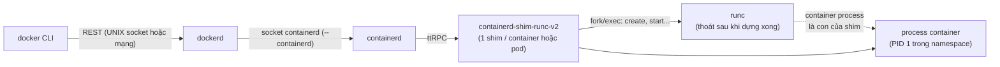
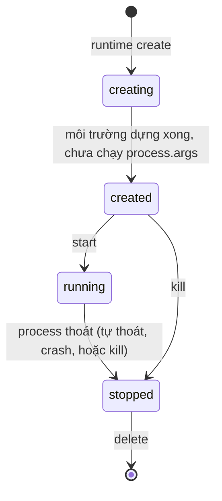
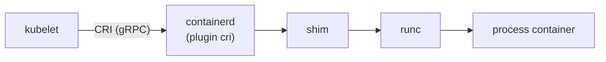

# P8 · Chương 06 — Runtime và chuẩn OCI

Chương 01–05 cho bạn biết container *là gì*: một process Linux bị cô lập bằng namespace, bị giới hạn bằng cgroup, và chỉ thấy một rootfs riêng. Chương này hỏi câu kế tiếp: ai gom các cơ chế đó lại, và theo đặc tả nào? Bạn sẽ thấy `docker run` không phải một lời gọi hệ thống duy nhất. Nó kéo theo cả một chuỗi tiến trình (dockerd, containerd, shim, runc), mỗi mắt xích lo một việc.

Về nguồn: mọi "quan sát" trong chương là kết quả chạy thật trên máy của người soạn (Colima, macOS Apple Silicon, VM Ubuntu 24.04 aarch64). Mọi "đặc tả" đều trích từ tài liệu đã ghim tag hoặc phiên bản (OCI, containerd, runc, crun, Kata). Riêng trang Docker, Kubernetes và gVisor không ghim được phiên bản, nên chú thích của chúng ghi kèm ngày tra.

## Bạn sẽ hiểu được gì

1. **Q1.** Chuỗi `docker` CLI → dockerd → containerd → containerd-shim → runc → process container: mỗi mắt xích làm gì, và bạn thấy chúng ở đâu trong `ps`? → mục 2
2. **Q2.** OCI *runtime bundle* gồm những gì; `config.json` có những trường chính nào (`process`, `root`, `mounts`, `linux.namespaces`, `linux.resources`, `linux.seccomp`)? → mục 3
3. **Q3.** Vòng đời `create` → `start` → `kill` → `delete` và các giá trị `status` của state theo đặc tả là gì? → mục 4
4. **Q4.** runc là gì, danh sách cài đặt của OCI runtime-spec xếp nó vào loại nào ("reference implementation"), và shim giải quyết vấn đề gì? → mục 5
5. **Q5.** CRI là gì, vì sao Kubernetes nói chuyện với containerd/CRI-O chứ không nói với runc? → mục 6
6. **Q6.** crun, gVisor (runsc), Kata khác runc ở đâu, chỉ theo đúng lời docs của từng dự án? → mục 7
7. **Q7.** cgroup driver `systemd` và `cgroupfs` khác gì, vì sao kubelet và runtime phải khớp nhau? → mục 8
8. **Q8.** Gặp "container exited 137", đọc `docker inspect` State thế nào để biết là OOM hay bị `SIGKILL` do hết thời gian dừng? → mục 9

## Kiến thức cần trước

- [Chương 01 — Container là gì](01-container-la-gi.md): container là process Linux bị cô lập, không phải VM.
- [Chương 02 — Namespaces](02-namespaces.md) và [Chương 03 — cgroups v2](03-cgroups-v2.md): hai cơ chế mà runtime cấu hình.
- [Chương 04 — Filesystem của container](04-filesystem-cua-container.md): image, layer, rootfs; chương này chỉ nhắc OCI image-spec ngắn.
- [P1 · Chương 05 — Signal](../01-linux/05-signal.md): `SIGTERM`/`SIGKILL`, PID 1.
- [P3 · Chương 04 — Page fault, swapping, OOM](../03-memory/04-page-fault-va-swapping.md): OOM killer.

## 1. Bối cảnh: vì sao cần chuẩn hóa ranh giới giữa các tầng (mục phụ trợ)

Xuyên suốt chương, ta bám theo `orders`, một service Rust (ví dụ giả định của người soạn, không phải code trong repo). Team build nó thành image, chạy thử trên laptop bằng `docker run`, rồi triển khai lên Kubernetes. Một image mà chạy ở ba nơi khác nhau thì giữa các tầng phần mềm phải có quy ước chung; chương này đi tìm quy ước đó. Các quan sát thật bên dưới dùng `alpine sleep 600` làm process của container, đóng vai `orders` (người soạn không chạy service này).

Ở các chương trước, ta tạo container bằng tay: `clone`/`unshare`, mount, ghi file cgroup. Team của `orders` cần nhiều hơn thế. Họ phải kéo image, giải layer thành rootfs, dựng network, giữ stdin/stdout, biết khi nào process thoát và dọn dẹp sau đó (nhận xét của người soạn). Mỗi việc ấy do một tầng phần mềm riêng lo, và Open Container Initiative (OCI) viết đặc tả cho ranh giới giữa các tầng để tầng nào cũng thay được (nhận xét của người soạn).

Có hai đặc tả liên quan. Đặc tả image nhắm tới việc tạo ra các công cụ tương thích với nhau để build, vận chuyển và chuẩn bị một container image cho việc chạy[^img-goal]. Đặc tả runtime định nghĩa phần *chạy*, tức các thao tác `create`/`start`/`kill`/`delete` ở mục 4. Chương này đi từ tầng thấp (đặc tả runtime, runc) lên tầng cao (containerd, Docker, Kubernetes).

## 2. Chuỗi tiến trình khi bạn gõ `docker run` (Q1)

> **Trả lời ngắn.** Lệnh `docker` chỉ là một client, nó gửi yêu cầu qua REST tới daemon dockerd[^dock-rest]. Trên máy quan sát, dockerd giao việc cho containerd, containerd giao cho một shim, shim gọi runc, và runc dựng container theo cấu hình được đưa vào[^cd-shim-runc]. Dựng xong thì runc thoát: trong `ps` chỉ còn shim và process container (quan sát).

**Giải thích.**

*Với `orders`.* Bạn gõ `docker run -d orders:1.4`, vài giây sau `orders` đang nghe cổng 8080. Giữa hai thời điểm đó, yêu cầu của bạn đi qua bốn chương trình trước khi tới process `orders`. Mục này đi theo từng chặng và chỉ ra bạn thấy mỗi chặng ở đâu trong `ps`.

### 2.1 Docker CLI → dockerd

Chặng đầu là lệnh `docker`, và nó không tự dựng container. Docker có kiến trúc client-server: client và daemon nói chuyện bằng REST API, qua UNIX socket hoặc qua mạng[^dock-rest]. Bên daemon, dockerd lắng nghe các yêu cầu Docker API rồi quản lý image, container, network và volume[^dock-daemon]. Vậy `docker run` chỉ là một yêu cầu gửi tới dockerd. Việc process `orders` không phải con của lệnh `docker` bạn gõ sẽ hiện ra ở 2.3 (suy luận của người soạn từ kiến trúc client-server). Trang docs này không ghim phiên bản, tra ngày 2026-10-11.

### 2.2 dockerd → containerd

Tiếp theo: dockerd có giao việc cho containerd không? Trang kiến trúc của Docker ở trên không nói điều này, nên mục này dựa vào **quan sát**. Trong VM Colima, `ps -ef` cho thấy dockerd được khởi động với một cờ trỏ thẳng tới socket của containerd:

```text
root  1135     1  /usr/bin/containerd
root  1217     1  /usr/bin/dockerd -H fd:// --containerd=/run/containerd/containerd.sock --host-gateway-ip=192.168.5.2
```

(Lệnh: `colima ssh -- ps -ef | grep -E 'containerd|runc|shim|dockerd'`, chỉ đọc.) Cũng trên máy đó, `docker info` báo Server Version 29.5.2, `containerd version: 193637f7ee8ae5f5aa5248f49e7baa3e6164966e`, `runc version: v1.3.5-0-g488fc13e`, `Default Runtime: runc` và `Runtimes: io.containerd.runc.v2 runc`. `io.containerd.runc.v2` là tên *runtime* trong containerd, và docs containerd nói rõ cách đổi tên đó thành tên binary shim: runtime tên `io.containerd.runc.v2` thì containerd gọi shim là `containerd-shim-runc-v2`[^cd-shim-name].

### 2.3 containerd → shim → runc → process

Chặng cuối là containerd, shim, runc. Docs runtime v2 của containerd (tag v2.1.0) mô tả shim lắng nghe trên socket các lệnh ttRPC từ containerd, rồi dùng `fork`/`exec` gọi một chương trình riêng, gọi là runtime engine, để chạy container[^cd-shim-listen]. Với runc, shim chạy binary `runc` thật và đưa cho nó cấu hình container. Từ đó runc tạo, khởi động, dừng container, thường qua `libcontainer` và các API hệ thống[^cd-shim-runc].

Để thấy tận mắt, người soạn chạy `docker run -d --name … alpine sleep 600` (`sleep` đóng vai process của `orders`) rồi xem `ps` trong VM. Kết quả rút gọn:

```text
root 97086     1  /usr/bin/containerd-shim-runc-v2 -namespace moby -id f96a5e78… -address /run/containerd/containerd.sock
root 97110 97086  sleep 600
```

Ba điều đọc được từ đó (quan sát một lần chạy, không phải bảo đảm của đặc tả):

1. Process container (`sleep`, PID 97110 trong namespace của VM) là **con của shim**, không phải con của dockerd hay containerd.
2. Shim có PPID là 1, nên nó không dính vào cây tiến trình của containerd. Docs containerd giải thích khá khớp: khi được gọi, shim tạo một process mới để lắng nghe lệnh ttRPC từ containerd, trả địa chỉ socket về cho containerd rồi thoát[^cd-shim-newproc]. Process mới đó mồ côi nên init (PID 1) nhận làm cha (suy luận của người soạn, khớp với PPID quan sát).
3. **Không có tiến trình `runc` nào còn sống.** README runc mô tả runc là một công cụ CLI[^runc-intro]. Còn việc runc chạy xong thì thoát và để process container tiếp tục dưới shim là **quan sát**, docs containerd không nói câu này. Lần `ps` đầu tiên (lúc hai container đang chạy sẵn) cũng chỉ thấy hai `containerd-shim-runc-v2`, không có `runc`.



<details><summary>Đi sâu: containerd tự mô tả thế nào, và nguồn của các mũi tên trong sơ đồ</summary>

- containerd tự giới thiệu là một container runtime chuẩn công nghiệp, nhấn mạnh sự đơn giản, bền vững và khả chuyển[^cd-readme]. Câu này lấy từ README tag v2.1.0, còn bản trên máy là một commit cụ thể (xem 2.2), nên ta chỉ dùng README làm mô tả khái niệm chứ không suy ra số phiên bản đang chạy.
- Mũi tên "REST" lấy từ Docker docs (2.1) và "ttRPC" từ docs containerd (2.3). Mũi tên dockerd → containerd là **quan sát** từ cờ `--containerd=...` ở 2.2. Chương này không kiểm tra giao thức dockerd dùng trên socket đó.

</details>

**Quay lại Q1:** với `orders`, runc chỉ dựng container rồi thoát; process `orders` sống dưới shim.

## 3. OCI runtime-spec: bundle (Q2)

> **Trả lời ngắn.** Bundle là một thư mục gồm `config.json` ở gốc và rootfs của container[^spec-bundle-config]. `config.json` khai báo chương trình cần chạy, thư mục gốc, các mount và namespace[^spec-ns-inherit]. Giới hạn tài nguyên khai qua cgroup[^spec-cgroups]. Ngoài ra còn có cấu hình seccomp, một cơ chế sandbox ứng dụng trong kernel Linux[^spec-seccomp].

**Giải thích.**

*Với `orders`.* Muốn chạy `orders`, runtime cần biết chạy lệnh nào, ở thư mục nào, thấy filesystem nào, được dùng bao nhiêu RAM. Tất cả nằm trong một thư mục theo chuẩn, gọi là bundle, do tầng trên chuẩn bị sẵn. Runtime chỉ đọc rồi dựng, không cần biết bundle đến từ Docker hay Kubernetes (nhận xét của người soạn). Phần này dùng đặc tả runtime-spec tag **v1.2.0**.

### 3.1 Bundle là gì

Đặc tả định nghĩa *filesystem bundle* là một tập file sắp xếp theo cách nhất định, chứa mọi dữ liệu và metadata để bất kỳ runtime tuân thủ nào cũng làm được mọi thao tác chuẩn trên nó[^spec-bundle-def]. Bundle có đúng hai phần. Phần thứ nhất là file `config.json`, bắt buộc nằm ở gốc thư mục bundle và tên phải đúng là `config.json`[^spec-bundle-config]. Phần thứ hai là rootfs của container, tức thư mục mà trường `root.path` trỏ tới, nếu `config.json` có đặt trường này[^spec-bundle-rootfs].

Đó là *hợp đồng* giữa tầng trên và tầng dưới (nhận xét của người soạn): containerd, hay bất kỳ ai, chuẩn bị một thư mục như vậy rồi nhờ runtime chạy. README runc có ví dụ tối giản gồm `runc create mycontainerid`, `runc start mycontainerid` và `runc delete mycontainerid` (dòng 287–299 README v1.3.5). Nếu chưa có `config.json`, `runc spec` sinh sẵn một bản mẫu để bạn sửa[^runc-spec].

### 3.2 Các trường chính của config.json

Bảng dưới tóm tắt các trường chính kèm nguồn. Cột "quan sát" là nội dung `config.json` thật mà containerd dựng cho một container Docker (đọc ở `/run/containerd/io.containerd.runtime.v2.task/moby/<id>/config.json` trong VM). Lưu ý `ociVersion` quan sát được là `1.3.0`, mới hơn bản đặc tả v1.2.0 mà chương này đọc, và chương không đối chiếu điểm khác biệt giữa hai bản.

| Trường | Đặc tả nói gì | Quan sát trong container `sleep 600` |
|---|---|---|
| `process` | `args` là chương trình và đối số; `cwd` là thư mục làm việc đặt cho chương trình[^spec-cwd] | `args = ['sleep','600']` |
| `root.path` | Đường dẫn tới root filesystem của container[^spec-root-path] | `path = /var/lib/docker/rootfs/overlayfs/<id>` (đường dẫn quan sát được; chương này không kiểm tra cách Docker tạo thư mục đó, chương 04 nói về overlayfs và containerd snapshotter) |
| `root.readonly` | Nếu `true` thì root filesystem phải chỉ đọc bên trong container, mặc định là `false`[^spec-root-ro] | (không quan sát) |
| `mounts` | Mỗi mục có `destination`: đích của mount point, là đường dẫn bên trong container[^spec-mount-dest] | `/proc`, `/dev`, `/dev/pts`, `/sys`, `/sys/fs/cgroup`, `/dev/mqueue`, `/dev/shm`, `/etc/resolv.conf`, `/etc/hostname`, `/etc/hosts` |
| `linux.namespaces` | Loại namespace nào không có trong mảng `namespaces` thì container phải thừa hưởng *runtime namespace* loại đó, tức namespace của chính runtime[^spec-ns-inherit] | `mount, network, time, uts, pid, ipc, cgroup`, **không có `user`**: container dùng chung user namespace với runtime (ở đây runtime chạy trong VM Colima; chương 02 nói về user namespace) |
| `linux.resources` | cgroup cung cấp các điều khiển (qua controller) để hạn chế tài nguyên cpu, memory, IO, pids, network và RDMA của container[^spec-cgroups] | với `--memory 20m`: `memory.limit = 20971520`, `memory.swap = 41943040`, `cgroupsPath = /docker/<id>` |
| `linux.seccomp` | seccomp là cơ chế sandbox ứng dụng trong kernel Linux[^spec-seccomp] | 14 khối `syscalls` (profile mặc định của Docker; nội dung chi tiết thuộc chương 05) |
| `linux.seccomp.defaultAction` | Hành động mặc định của seccomp[^spec-seccomp-default] | `defaultAction = SCMP_ACT_ERRNO` |

Một mẹo thực dụng (nhận xét của người soạn): `docker inspect` cho bạn `HostConfig`/`Config` của Docker, còn `config.json` là *bản dịch sang ngôn ngữ OCI* của chúng. Khi nghi ngờ "Docker thực sự cấu hình gì cho kernel", file này là sự thật gần kernel nhất mà người dùng thường đọc được.

### 3.3 Image-spec chỉ nhắc ngắn

Còn image thì sao? OCI có thêm *image format specification*, mô tả một OCI Image gồm image manifest, image index (tùy chọn), tập filesystem layer và configuration[^img-goal-2]. Trước khi gọi shim, containerd trải filesystem của container ra và tạo thông tin cấu hình cần thiết[^cd-shim-layout]. Vì vậy bước chuẩn bị rootfs và cấu hình nằm ở containerd chứ không phải ở runc (suy luận của người soạn; với Docker, người soạn chỉ quan sát file `config.json` do containerd dựng). Chi tiết layer và overlay xem [chương 04](04-filesystem-cua-container.md).

<details><summary>Đi sâu: <code>memory.limit</code> và <code>swap</code> trong <code>config.json</code></summary>

Hai điều đáng chú ý:

- Trường `memory.limit` của spec đặt giới hạn mức dùng bộ nhớ[^spec-mem-limit]. Con số 20971520 chính là 20 MiB truyền qua `--memory 20m`, nên suy ra (từ quan sát này) `docker run --memory` là cú pháp thân thiện của Docker, còn `config.json` mang con số đó dưới dạng trường `memory.limit`. Còn `swap = 41943040` thì gấp đôi: spec định nghĩa `swap` là giới hạn tổng mức dùng bộ nhớ + swap[^spec-swap], tức RAM + swap tối đa là 40 MiB. Quan sát chạy lại: trong container, `memory.swap.max` là `20971520`, khớp với 40 MiB − 20 MiB = 20 MiB swap. Docker chọn gấp đôi vì docs của nó nói: khi chỉ đặt `--memory` mà không đặt `--memory-swap`, container được dùng swap bằng đúng `--memory` nếu host có cấu hình swap[^dk-swap-default]. Ví dụ trong docs, `--memory=300m` thì tổng bộ nhớ + swap là 600m, cùng tỉ lệ 1 : 2 với quan sát ở đây. Muốn tắt swap thì đặt `--memory-swap` bằng `--memory`; chi tiết ở [Chương 03, mục 7](03-cgroups-v2.md).
- Spec mô tả *cái gì* nằm trong cấu hình; chương này không đọc source runc nên không khẳng định runc đổi từng trường thành lời gọi kernel nào. Riêng cặp `memory.limit = 20971520` trong `config.json` và `memory.max` = `20971520` đọc được trong container (mục 9) là hai quan sát khớp nhau. Các trường còn lại (namespace, mount, seccomp) tương ứng với cơ chế ở chương 02–05 theo suy luận của người soạn.

</details>

**Quay lại Q2:** với `orders`, bundle là `config.json` cộng rootfs, và `config.json` mô tả mọi thứ runtime cần dựng.

## 4. Vòng đời và state (Q3)

> **Trả lời ngắn.** Theo đặc tả, `status` của container là một trong bốn giá trị: `creating`, `created`, `running`, `stopped`[^spec-stopped]. `create` dựng môi trường nhưng chưa chạy chương trình của người dùng[^spec-lifecycle-2]. `start` mới chạy chương trình đó[^spec-start]. `kill` phải gửi signal chỉ định tới process container[^spec-kill]. Còn `delete` chỉ hợp lệ khi container đã `stopped`[^spec-delete].

**Giải thích.**

*Với `orders`.* Từ lúc runtime nhận bundle của `orders` tới lúc process thoát và được dọn đi, container đi qua một vòng đời cố định: dựng, chạy, dừng, xóa. Biết vòng đời này, bạn hiểu vì sao tầng trên chen được vào giữa, chẳng hạn dựng network cho `orders` trước khi code của nó chạy dòng đầu tiên. Bạn cũng hiểu vì sao `docker ps -a` vẫn còn container đã thoát.

`stopped` nghĩa là process của container đã thoát (bước 10 trong lifecycle)[^spec-stopped]. Runtime được thêm giá trị khác, nhưng chỉ để biểu diễn trạng thái mới chưa có trong danh sách trên[^spec-state-extra]. Ngoài `status`, state còn có `id` và `bundle`, đường dẫn tuyệt đối tới thư mục bundle[^spec-state-bundle]. Trường `pid` bắt buộc khi `status` là `created` hoặc `running` trên Linux[^spec-state-pid]. Cuối cùng là `annotations`, tùy chọn[^spec-state-annot].



Cạnh `created → stopped` có cơ sở trong spec. `kill` được phép với container ở `created` hoặc `running`[^spec-kill-state]. Bước 10 của lifecycle (process container thoát) có thể xảy ra do `kill`[^spec-step10]. Thêm nữa, `created` được định nghĩa là process chưa thoát và cũng chưa chạy chương trình do người dùng chỉ định[^spec-created]. Spec không vẽ sơ đồ trạng thái; sơ đồ trên là cách vẽ của người soạn từ các câu đó. Có một chi tiết hẹp hơn mà ta không khẳng định: spec không nói riêng việc process chết ở `created` vì lỗi nào khác ngoài `kill`.

Bốn thao tác chính:

- **create**: `process.args` chưa được áp dụng cho tới khi thao tác `start` kích hoạt[^spec-create]. Ở bước 2 của lifecycle, spec nói thẳng: các tài nguyên khai trong `config.json` phải được tạo, còn chương trình do người dùng chỉ định thì chưa được chạy[^spec-lifecycle-2]. Trên Linux hiểu là sau `create`, namespace, mount, cgroup đã dựng xong mà chương trình người dùng chưa chạy (suy luận của người soạn: spec chỉ nói "tài nguyên khai trong `config.json`", không liệt kê từng loại). Tách hai bước như vậy cho tầng trên chỗ chen vào. README runc nêu ví dụ network stack của container thường dựng sau `create` nhưng trước `start`[^runc-split]. Spec còn có các hook, trong đó bước 5 (`createContainer`) đứng trước bước 6 (`start`)[^spec-hook-order].
- **start**: phải chạy chương trình khai trong `process`[^spec-start].
- **kill**: phải gửi signal chỉ định tới process container[^spec-kill]. Thao tác này chỉ có tác dụng với container ở `created` hoặc `running`; ở trạng thái khác thì phải sinh lỗi[^spec-kill-state]. Spec chỉ bắt buộc *gửi* signal, còn process có chết hay không tùy signal nào được gửi (suy luận của người soạn). Chẳng hạn `SIGKILL` không thể bị bắt, chặn hay bỏ qua[^sig-uncatchable]; xem [P1 · Chương 05 — Signal](../01-linux/05-signal.md).
- **delete**: cố `delete` một container chưa `stopped` thì không có tác dụng với container và phải sinh lỗi[^spec-delete]. Hệ quả là `delete` chỉ dùng được sau khi container đã `stopped`. Ở tầng Docker, container đã thoát vẫn hiện trong `docker ps -a` với trạng thái "Exited" cho tới khi bị `docker rm` (nhận xét của người soạn; Docker giữ metadata riêng, không đồng nghĩa với state OCI của runc).

<details><summary>Đi sâu: hook trong vòng đời và <code>prestart</code> đã bị deprecated</summary>

Vòng đời đầy đủ còn có các hook (`prestart`, `createRuntime`, `createContainer`, `startContainer`, `poststart`, `poststop`) xen kẽ giữa các bước trên. Đó là điểm mở rộng của spec; cần chi tiết thứ tự thì đọc [runtime.md v1.2.0](https://github.com/opencontainers/runtime-spec/blob/v1.2.0/runtime.md). Riêng `prestart` đã bị spec ghi chú là deprecated, thay bằng ba loại hook `createRuntime`, `createContainer` và `startContainer` cho phép kiểm soát hook chi tiết hơn trong giai đoạn create và start[^spec-prestart-dep].

</details>

**Quay lại Q3:** `create` chưa chạy code của `orders`, `kill` phải gửi signal chỉ định, và `delete` chỉ khi `stopped`.

## 5. runc và shim: ai dựng, ai giữ (Q4)

> **Trả lời ngắn.** runc là công cụ dòng lệnh để dựng và chạy container theo đặc tả OCI[^runc-intro]. Nó cấp thấp, dành cho phần mềm cấp cao hơn chứ không cho người dùng cuối[^runc-lowlevel]. Danh sách cài đặt của runtime-spec ghi nó là "reference implementation" của OCI runtime[^spec-runc-ref]. Shim là tiến trình trung gian: containerd nói chuyện ttRPC với shim, và shim mới là bên gọi runc[^cd-shim-listen]. Nhờ lệnh `delete` của shim, containerd dọn được tài nguyên khi mất liên lạc[^cd-shim-delete].

**Giải thích.**

*Với `orders`.* Khi `docker run` tạo container cho `orders`, có hai vai trò khác nhau: người dựng, và người ở lại giữ container sau khi dựng xong. Mục này chỉ ra runc là người dựng, còn shim là người ở lại.

### 5.1 runc là gì

README runc (tag v1.3.5, trùng với bản `docker info` báo) tự mô tả: `runc` là công cụ CLI để tạo và chạy container trên Linux theo đặc tả OCI[^runc-intro]. Ngay sau đó nó nói rõ đối tượng dùng: runc là công cụ cấp thấp, không thiết kế cho người dùng cuối mà chủ yếu để phần mềm container cấp cao hơn dùng[^runc-lowlevel]. README cũng nói tầng trên thường chen việc cấu hình network vào giữa `create` và `start`[^runc-split]. Từ đó suy ra (suy luận của người soạn) tầng containerd/Docker lo phần còn lại như kéo image, log, network, còn runc chỉ nhận bundle và dựng container.

### 5.2 Shim để làm gì

Docs containerd nêu hai việc của shim. Việc thứ nhất là tách giao thức nói với containerd khỏi engine chạy container: ttRPC do một shim xử lý, còn engine bên dưới có thể khác nhau, miễn là cài đặt OCI runtime spec[^cd-shim-split]. Việc thứ hai là dọn dẹp khi containerd mất liên lạc. Lệnh `delete` của shim cho phép containerd dọn các tài nguyên khi không còn liên lạc được qua rpc[^cd-shim-delete]. Lệnh đó cũng được dùng khi containerd khởi động rồi kết nối lại với các shim[^cd-shim-reconnect].

Từ đây ta suy ra (suy luận của người soạn) rằng shim là tiến trình riêng, sống độc lập với vòng đời của daemon containerd. Vì thế containerd khởi động lại có thể *kết nối lại* với shim đang chạy thay vì phải giết container, nghĩa là `orders` không phải chết theo. Điều này chưa kiểm chứng: docs containerd tag v2.1.0 không có câu nào khẳng định trực tiếp "container sống tiếp khi containerd restart", và người soạn **không** restart containerd trên máy (ngoài phạm vi chỉ-đọc) nên không có quan sát riêng.

Số shim thì tùy cách chạy. Docs viết rằng shim runc v2 gom theo label do plugin CRI đặt, nên các container cùng pod Kubernetes do một shim xử lý[^cd-shim-pod]. Trên Docker (không qua CRI), người soạn quan sát hai container thì có hai shim, tức một shim mỗi container.

<details><summary>Đi sâu: nguồn của cụm "reference implementation", và thử runc trực tiếp</summary>

README runc v1.3.5 không dùng cụm "reference implementation". Cụm này đến từ trang `implementations.md` của runtime-spec v1.2.0, nơi `opencontainers/runc` được liệt kê là cài đặt tham chiếu của OCI runtime[^spec-runc-ref]; chương này không suy rộng thêm từ dòng đó. Còn một điều khác có nguồn: runc là runtime mặc định (`Default Runtime: runc`) trên máy quan sát, và là engine mà shim `containerd-shim-runc-v2` gọi[^cd-shim-runc].

Người soạn không thử runc trực tiếp (bundle + `runc run`) trong chương này, để giữ giới hạn chỉ-đọc cho dịch vụ đang chạy. README có mục "Using runc" để bạn làm theo trong môi trường riêng.

</details>

**Quay lại Q4:** runc dựng `orders` rồi thoát; shim ở lại giữa containerd và runc.

## 6. Chuẩn CRI: Kubernetes nói chuyện với runtime thế nào (Q5)

> **Trả lời ngắn.** CRI là giao diện plugin cho phép kubelet dùng nhiều loại runtime mà không phải biên dịch lại thành phần của cluster[^k8s-cri]. Kubernetes yêu cầu runtime tuân theo CRI[^k8s-cri-require]. runc là CLI cấp thấp theo OCI chứ không phải runtime nói CRI, nên kubelet làm việc với containerd hoặc CRI-O chứ không gọi runc trực tiếp (suy luận của người soạn). Trong containerd, plugin `cri` xử lý các request CRI của kubelet[^cd-cri].

**Giải thích.**

*Với `orders`.* Trên laptop bạn chạy `orders` bằng `docker run`. Trên cluster thì không ai gõ lệnh đó: kubelet của node nhận pod `orders` rồi phải tự nhờ một runtime chạy nó. Mục này trả lời kubelet nhờ bằng giao diện nào, và vì sao đó không phải runc.

Docs kubernetes.io (không ghim phiên bản, tra 2026-10-11, trang đang ở v1.37) nói CRI là một giao diện plugin giúp kubelet dùng nhiều loại container runtime mà không cần biên dịch lại các thành phần của cluster[^k8s-cri]. Giao thức chính của CRI là gRPC giữa kubelet và container runtime[^k8s-cri-grpc]. Kubernetes 1.37 yêu cầu dùng một runtime tuân theo CRI[^k8s-cri-require]. Trang đó cũng hướng dẫn cách dùng vài runtime phổ biến: containerd, CRI-O, Docker Engine, Mirantis Container Runtime[^k8s-common-rt].

Ghép với mục 5: runc tự mô tả là công cụ cấp thấp cho phần mềm cấp cao hơn[^runc-lowlevel], còn CRI là giao diện giữa kubelet và container runtime. Vậy kubelet nói chuyện với containerd hoặc CRI-O chứ không gọi runc trực tiếp (suy luận của người soạn từ hai nguồn đó).

Phía containerd, docs kiến trúc plugin CRI nói plugin `cri` nằm bên trong containerd, xử lý mọi request CRI từ kubelet và dùng các thành phần nội bộ của containerd để quản lý container và image[^cd-cri]. Vậy chuỗi trên một node Kubernetes dùng containerd là:



So với Docker, **dockerd được thay bằng plugin `cri` bên trong containerd**, còn phần dưới (shim → runc) giống hệt (nhận xét của người soạn, dựa trên các tài liệu đã trích). Nghĩa là từ shim trở xuống, `orders` trên cluster đi cùng đường với `orders` chạy bằng `docker run`.

<details><summary>Đi sâu: dockershim và RuntimeClass</summary>

Docs Kubernetes ghi dockershim đã bị gỡ khỏi dự án từ bản 1.24[^k8s-dockershim]. Vì sao image build bằng Docker vẫn chạy được trên containerd là suy luận của người soạn: image theo chuẩn OCI image-spec, còn runtime bên dưới vẫn là containerd/runc; chương này không kiểm chứng điểm đó. Với Kubernetes, `RuntimeClass` là một tính năng để chọn cấu hình container runtime[^k8s-rtclass]; mục này không đào sâu.

</details>

**Quay lại Q5:** kubelet nói CRI; containerd phục vụ bằng plugin `cri`, rồi vẫn là shim → runc.

## 7. Runtime thay thế: crun, gVisor, Kata (Q6)

> **Trả lời ngắn.** Vì đặc tả runtime chỉ là một giao diện, runc không phải lựa chọn duy nhất: docs của crun và gVisor đều tự nhận có runtime OCI. crun là runtime OCI viết bằng C[^crun-intro]. gVisor là một application kernel cài đặt giao diện giống Linux, chạy ở userspace[^gvisor-kernel]. Kata xây cài đặt chuẩn của các máy ảo (VM) nhẹ, nhằm giữ ưu điểm cô lập của VM[^kata-intro]. gVisor và Kata chọn ranh giới cô lập khác runc (suy luận của người soạn từ các mô tả đó).

**Giải thích.**

*Với `orders`.* Mặc định `orders` chạy bằng runc, nghĩa là dùng chung kernel với host và với mọi container khác trên node. Nếu team muốn tách `orders` ra chặt hơn thì sao? Vì runtime-spec là một giao diện, bên dưới shim có thể là runtime khác. Mô tả dưới đây chỉ lặp lại điều docs từng dự án nói; chương không so sánh hiệu năng hay độ an toàn ngoài những gì họ tự nêu.

- **crun**: runtime OCI nhanh, ít tốn bộ nhớ, viết hoàn toàn bằng C (lời của dự án)[^crun-intro]. Nó tuân theo các đặc tả OCI Container Runtime[^crun-oci]. Nguồn: README crun tag 1.19.
- **gVisor (runsc)**: một application kernel cài đặt giao diện giống Linux, viết bằng ngôn ngữ an toàn bộ nhớ (Go) và chạy ở userspace[^gvisor-kernel]. Đi kèm là một runtime OCI tên runsc[^gvisor-runsc]. Nguồn: gvisor.dev/docs (không ghim, tra 2026-10-11).
- **Kata Containers**: dự án nhằm xây cài đặt chuẩn của các máy ảo nhẹ (VM) mà dự án nói là có cảm giác và hiệu năng như container nhưng có ưu điểm cô lập và bảo mật của VM (lời của dự án)[^kata-intro]. Nguồn: README Kata tag 3.17.0.

Đọc lại cho gọn (suy luận của người soạn, từ chính các câu trên): crun cùng vai với runc, chỉ khác là viết bằng C. gVisor đổi *ranh giới cô lập*: docs gVisor nói các giao diện hệ thống vốn do kernel host cài đặt được chuyển vào một application kernel riêng cho mỗi sandbox, nhằm giảm rủi ro container escape[^gvisor-escape]. Kata dùng VM nhẹ, nên mỗi sandbox VM chạy kernel guest riêng (suy luận từ khái niệm VM, README không nói câu này).

Bài học chung (suy luận của người soạn): khi ai đó nói "container isolation", hãy hỏi *runtime nào*. runc và crun tạo container theo OCI trên Linux, cô lập bằng cơ chế kernel ở chương 02–05 và dùng chung kernel với host. gVisor đặt một application kernel ở userspace. Kata dùng VM.

<details><summary>Đi sâu: Kata cắm vào containerd ở tầng shim; RuntimeClass</summary>

README Kata liệt kê một thành phần do container manager chạy và cung cấp cài đặt containerd shimv2 runtime[^kata-shimv2]. Vậy (suy luận của người soạn) Kata cắm vào containerd ở tầng shim chứ không phải bằng cách thay binary runc; còn crun và runsc tự nhận là runtime OCI (xem trên). Trong Kubernetes, việc chọn runtime theo pod là chức năng RuntimeClass[^k8s-rtclass]. Cách cài và đánh đổi hiệu năng cần đọc docs từng dự án; chương này không đo.

</details>

**Quay lại Q6:** crun cùng vai với runc; gVisor và Kata đổi ranh giới cô lập của `orders`.

## 8. cgroup driver: systemd và cgroupfs (Q7)

> **Trả lời ngắn.** Runtime có hai cách đặt container vào cgroup: driver `cgroupfs` (làm việc trực tiếp với filesystem cgroup) và driver `systemd`. Kubernetes docs nhấn mạnh kubelet và runtime phải dùng cùng một driver và cấu hình giống nhau[^k8s-cgdrv-same]. Với cgroup v2, docs khuyên dùng driver `systemd`[^k8s-cgv2-systemd].

**Giải thích.**

*Với `orders`.* Giả sử pod `orders` có memory limit. Giới hạn đó rốt cuộc phải thành một cgroup trên node, và cả kubelet lẫn runtime đều làm việc với cgroup ấy. Nếu hai bên mỗi người một cách thì node sẽ có hai bộ quản lý cùng đụng vào cây cgroup. Mục này nói hai cách đó là gì và vì sao phải chọn khớp.

Để làm việc với control group, kubelet và container runtime cần dùng một cgroup driver, và điều then chốt là hai bên dùng cùng driver với cấu hình giống nhau[^k8s-cgdrv-same]. Có hai driver. `cgroupfs` là kubelet và runtime làm việc trực tiếp với filesystem cgroup để cấu hình cgroup. Driver còn lại là `systemd`. Với kubelet, `cgroupfs` là driver mặc định[^k8s-cgfs-default]. Nhưng docs không khuyến nghị nó khi init là systemd, vì systemd mong có đúng một bộ quản lý cgroup trên hệ thống[^k8s-cgfs-single]. Với cgroup v2, docs khuyên dùng driver `systemd` thay vì `cgroupfs`[^k8s-cgv2-systemd].

Docs cũng nêu hậu quả khi lệch nhau: trong một số trường hợp, node dùng `cgroupfs` cho kubelet và runtime nhưng dùng `systemd` cho các process còn lại sẽ trở nên bất ổn khi thiếu tài nguyên[^k8s-cg-unstable]. Trang docs (v1.37) còn mô tả một tính năng tự dò: khi feature gate `KubeletCgroupDriverFromCRI` bật và runtime hỗ trợ `RuntimeConfig` CRI RPC, kubelet tự phát hiện driver từ runtime và bỏ qua `cgroupDriver` trong cấu hình[^k8s-cg-autodetect]. Chương này không kiểm chứng tính năng đó.

<details><summary>Đi sâu: mặc định của Docker và quan sát trên máy Colima</summary>

Docker có quy tắc mặc định riêng: nếu bỏ tùy chọn `native.cgroupdriver` thì dùng `cgroupfs` trên host cgroup v1, và dùng `systemd` trên host cgroup v2 có systemd[^docker-cgdrv].

**Quan sát, có vẻ khác với mặc định trên**: VM Colima chạy cgroup v2 và PID 1 là `systemd`, nhưng `docker info` báo `Cgroup Driver: cgroupfs`, `Cgroup Version: 2`. Lý do là `/etc/docker/daemon.json` trong VM ghi tường minh `"exec-opts": ["native.cgroupdriver=cgroupfs"]`. Tức đây là cấu hình đặt tay chứ không phải mặc định. Và vì máy này không có kubelet, chuyện "kubelet và runtime phải khớp" chưa phát sinh. Trên cluster thật, bạn phải kiểm tra cả hai phía.

</details>

**Quay lại Q7:** kubelet và runtime phải khớp driver; cgroup v2 + systemd thì chọn `systemd`.

## 9. Liên hệ backend: debug "container exited 137" (Q8)

> **Trả lời ngắn.** Exit code 137 là 128 + 9, nghĩa là process bị `SIGKILL`[^bash-128]. Thủ phạm phổ biến thứ nhất là OOM killer khi cgroup chạm giới hạn bộ nhớ[^cg-memmax]. Thứ hai là runtime gửi `SIGKILL` sau thời gian gia hạn của `docker stop`[^docker-stop]. Trường `OOMKilled` trong `docker inspect` phân biệt hai trường hợp (quan sát ở thí nghiệm A và B).

**Giải thích.**

*Với `orders`.* Giả sử `orders` chết lúc nửa đêm, log chỉ có `exit code 137`, không có stack trace. Container biến mất mà không ai nhớ đã dừng nó. Việc đầu tiên là đọc ra con số 137 nói gì, sau đó dùng `docker inspect` để tìm ai gửi `SIGKILL`. Ba điều cần nắm:

1. Shell dùng quy ước: khi một lệnh kết thúc vì signal gây chết có số N, Bash dùng giá trị 128+N làm exit status[^bash-128]. `SIGKILL` mang số 9 ở mọi cột kiến trúc của bảng trong signal(7)[^sig-num-kill], nên 137 = 128 + 9: **process bị `SIGKILL`**. Quy ước này nói về bash; `docker inspect` cũng hiện 137 trong các thí nghiệm dưới đây (quan sát).
2. Có hai thủ phạm phổ biến gửi `SIGKILL`, và `docker inspect` phân biệt được chúng.
3. Cgroup có thể giết process khi vượt ngưỡng. Kernel doc cgroup v2 nói với `memory.max`, nếu mức dùng bộ nhớ của cgroup chạm giới hạn này và không giảm được thì OOM killer được gọi trong cgroup[^cg-memmax]. Cơ chế OOM killer nằm ở [P3 · OOM](../03-memory/04-page-fault-va-swapping.md); ở đây chỉ cần nhớ chuỗi `--memory 20m` (chương 03) → `memory.limit` trong `config.json` (mục 3.2) → `memory.max` của cgroup. Hai mắt xích cuối là quan sát chứ không phải điều khoản spec: trong container `--memory 20m`, `cat /sys/fs/cgroup/memory.max` in `20971520` (chạy lại ở vòng review).

### Thí nghiệm A — OOM

Người soạn chạy `docker run -d --memory 20m alpine sh -c 'tail /dev/zero'` (giải thích của người soạn: `/dev/zero` không có dòng mới nên `tail` phình bộ nhớ vô hạn, giống một service rò rỉ bộ nhớ). Sau 3 giây:

```text
docker inspect --format '{{json .State}}'
{"Status":"exited","Running":false, ... "OOMKilled":true,"Dead":false,"Pid":0,"ExitCode":137,
 "StartedAt":"2026-10-11T18:04:56.043…Z","FinishedAt":"2026-10-11T18:04:56.108…Z"}
```

`OOMKilled:true`, `ExitCode:137`, và khoảng `StartedAt`→`FinishedAt` chỉ ~65 ms: nó chết gần như ngay khi chạy vì giới hạn rất nhỏ.

### Thí nghiệm B — Hết thời gian dừng

Người soạn chạy `docker run -d alpine sleep 600` rồi `docker stop -t 1`. Sau đó:

```text
docker inspect -f '{{.State.ExitCode}} {{.State.OOMKilled}}'
137 false
```

Cũng là 137 nhưng `OOMKilled:false`. Docs `docker container stop` giải thích cơ chế dừng: tiến trình chính nhận `SIGTERM`, rồi sau một khoảng gia hạn thì nhận `SIGKILL`[^docker-stop]. `sleep` chạy làm PID 1 không đăng ký handler `SIGTERM` nên `SIGTERM` không giết được nó; PID 1 có luật signal riêng, đã phân tích với thí nghiệm ở [P1 · Chương 05 — Signal, mục 8](../01-linux/05-signal.md). Kết quả 137 sau `-t 1` là quan sát trên máy này (chạy lại ở vòng review: 137, `OOMKilled:false`, lệnh `docker stop -t 1` mất ~1,07 s). Còn việc `sleep` không phản hồi `SIGTERM` ở PID 1 thì dựa vào chương P1, người soạn không đo lại.

### Quy trình đọc State

| Quan sát trong `docker inspect` `.State` | Hướng điều tra |
|---|---|
| `ExitCode 137`, `OOMKilled true` | Vượt `memory.limit`: tăng giới hạn hoặc tìm rò rỉ; xem chương 03 và [P3](../03-memory/04-page-fault-va-swapping.md) |
| `ExitCode 137`, `OOMKilled false`, vừa có `docker stop`/rolling update | Quá thời gian dừng: app không xử lý `SIGTERM` (thường do PID 1 là shell hay không có handler), xem [P1 · signal](../01-linux/05-signal.md) |
| `ExitCode 137`, `OOMKilled false`, không ai dừng | Có thể có người hoặc hệ thống gửi `SIGKILL` (ví dụ OOM killer của *host* chứ không phải cgroup này); cần xem log kernel. Chương này chưa kiểm chứng trường hợp đó |
| `ExitCode 1…`, `OOMKilled false` | Lỗi chương trình; xem log |

(Nhận xét của người soạn: cột phải của cả bảng là hướng điều tra thực tế, không phải trích dẫn. Ở Kubernetes người soạn không có cluster để quan sát, nên chương này không nói cách `kubectl` hiển thị lý do thoát.)

<details><summary>Đi sâu: <code>State</code> của Docker so với <code>state</code> của OCI</summary>

`State` mà Docker trả về (có `Status`, `Pid`, `StartedAt`…) là mô hình của *Docker*, giàu hơn `state` tối giản của OCI (các trường nêu ở mục 4). Trường `OOMKilled` không nằm trong state OCI mà Docker bổ sung bằng cách theo dõi sự kiện từ tầng dưới (nhận xét của người soạn; cơ chế phát hiện cụ thể người soạn không đọc source nên không khẳng định).

</details>

**Quay lại Q8:** với `orders`, 137 = SIGKILL, còn `OOMKilled` cho biết nó vượt giới hạn bộ nhớ hay hết thời gian dừng.

## Tóm tắt

- `docker` chỉ là client. dockerd quản lý các đối tượng Docker; trên máy quan sát nó dùng containerd qua socket, rồi containerd dùng `containerd-shim-runc-v2` và runc để chạy process `orders`.
- Quan sát: process container là con của shim, và runc không còn sống sau khi dựng xong.
- OCI bundle = `config.json` + rootfs. `config.json` chứa `process`, `root`, `mounts`, `linux.namespaces`, `linux.resources`, `linux.seccomp`…; Docker `--memory 20m` hiện ra là `memory.limit = 20971520`.
- Vòng đời: `create` dựng môi trường nhưng chưa chạy `process.args`; `start` chạy; `kill` phải gửi signal chỉ định; `delete` chỉ hợp lệ khi `stopped`.
- runc là "low level tool" cho phần mềm cấp cao. Lệnh `delete` của shim giúp containerd dọn khi mất liên lạc, và được dùng khi containerd boot rồi kết nối lại với shim.
- Kubernetes yêu cầu runtime tuân CRI. containerd cung cấp qua plugin `cri`, sau đó vẫn là shim → runc.
- crun (C, OCI), gVisor (application kernel, runsc) và Kata (VM nhẹ) cắm thay runc nhờ chuẩn chung; gVisor và Kata chọn ranh giới cô lập khác runc (suy luận của người soạn).
- kubelet và runtime phải dùng chung cgroup driver; cgroup v2 + systemd thì docs khuyến nghị `systemd`. Máy Colima của người soạn cấu hình tay `cgroupfs`.
- Exit 137 = 128 + 9 (SIGKILL); `OOMKilled` trong `docker inspect` phân biệt OOM với hết thời gian dừng.

## Câu hỏi tự kiểm tra

1. Nêu thứ tự các thành phần từ `docker run` tới process container, và cho biết thành phần nào *không* còn tiến trình sống sau khi container đã chạy.
<details><summary>Đáp án</summary>

docker CLI → dockerd → containerd → containerd-shim-runc-v2 → runc → process. runc không còn sống: `ps` chỉ có shim và process container (quan sát mục 2.3), vì runc là CLI dựng container theo spec rồi thoát[^runc-intro].

</details>

2. Một OCI bundle gồm những gì, và `root.path` dùng để làm gì?
<details><summary>Đáp án</summary>

Bundle gồm `config.json` nằm ở gốc thư mục bundle[^spec-bundle-config]. Phần còn lại là rootfs của container, thư mục mà `root.path` trỏ tới[^spec-bundle-rootfs]. Trường `root.path` chỉ định đường dẫn tới root filesystem của container[^spec-root-path].

</details>

3. Sau `create` thì chương trình người dùng đã chạy chưa? Vì sao tách `create` khỏi `start` là hữu ích?
<details><summary>Đáp án</summary>

Chưa: `process.args` chỉ được áp dụng khi `start`[^spec-create]. Ở bước create, spec còn nói thẳng chương trình người dùng chỉ định chưa được chạy[^spec-lifecycle-2]. Tách như vậy để tầng trên chen bước chuẩn bị (hook, network) trước khi code người dùng chạy (suy luận của người soạn từ thứ tự lifecycle).

</details>

4. Có thể `delete` một container đang `running` không?
<details><summary>Đáp án</summary>

Không: `delete` container chưa `stopped` phải báo lỗi và không có tác dụng[^spec-delete].

</details>

5. Nếu `linux.namespaces` không liệt kê `user`, container có user namespace riêng không?
<details><summary>Đáp án</summary>

Không: loại namespace không được chỉ định thì container kế thừa namespace của runtime[^spec-ns-inherit]. Quan sát: `config.json` của container Docker mặc định không có `user`.

</details>

6. Shim giúp gì khi containerd bị mất kết nối hoặc khởi động lại?
<details><summary>Đáp án</summary>

Lệnh `delete` của shim cho containerd dọn tài nguyên khi mất liên lạc rpc[^cd-shim-delete]. Lệnh đó cũng được dùng khi containerd boot và kết nối lại với shim[^cd-shim-reconnect]. Việc container thực tế sống tiếp là suy luận, chưa tự kiểm chứng.

</details>

7. kubelet nói chuyện với runtime bằng giao diện nào, và containerd phục vụ giao diện đó bằng gì?
<details><summary>Đáp án</summary>

Bằng CRI[^k8s-cri]. Trong containerd, plugin `cri` xử lý request CRI của kubelet[^cd-cri].

</details>

8. gVisor và Kata cô lập khác runc thế nào, theo mô tả của chính họ?
<details><summary>Đáp án</summary>

gVisor là application kernel cài đặt giao diện giống Linux, chạy ở userspace[^gvisor-kernel]. Kata là VM nhẹ có ưu điểm cô lập của VM[^kata-intro]. runc là CLI tạo và chạy container trên Linux theo OCI[^runc-intro] (suy luận của người soạn: container runc dùng chung kernel với host).

</details>

9. Vì sao cluster dùng cgroup v2 và systemd nên cấu hình driver `systemd`?
<details><summary>Đáp án</summary>

Docs khuyến nghị dùng driver systemd với cgroup v2[^k8s-cgv2-systemd]. Driver cgroupfs không được khuyến nghị khi init là systemd[^k8s-cgfs-single]. Ngoài ra kubelet và runtime phải khớp driver[^k8s-cgdrv-same].

</details>

10. Container thoát với 137 và `OOMKilled:true`: bạn kết luận gì và đi đâu tiếp?
<details><summary>Đáp án</summary>

137 = 128 + 9, tức `SIGKILL`[^bash-128]. `OOMKilled:true` cho thấy vượt giới hạn bộ nhớ: cgroup OOM killer được gọi khi chạm `memory.max`[^cg-memmax]. Bước tiếp theo là xem `memory.limit` trong config và chương P3 về OOM.

</details>

11. Cùng 137 nhưng `OOMKilled:false` sau `docker stop`: nguyên nhân khả dĩ là gì?
<details><summary>Đáp án</summary>

Hết thời gian dừng nên runtime gửi `SIGKILL`[^docker-stop]. Hãy kiểm tra xử lý `SIGTERM` của PID 1 (P1 signal); quan sát ở thí nghiệm B.

</details>

12. Máy Colima báo `Cgroup Driver: cgroupfs` dù cgroup v2 và có systemd. Vì sao?
<details><summary>Đáp án</summary>

Mặc định của Docker trên host như vậy sẽ là systemd[^docker-cgdrv], nhưng `daemon.json` trong VM đặt tường minh `native.cgroupdriver=cgroupfs` (quan sát).

</details>

## Đọc thêm

- [runtime-spec v1.2.0 — runtime.md](https://github.com/opencontainers/runtime-spec/blob/v1.2.0/runtime.md): đầy đủ lifecycle, hooks, state.
- [runtime-spec v1.2.0 — config.md và config-linux.md](https://github.com/opencontainers/runtime-spec/blob/v1.2.0/config.md): toàn bộ trường của `config.json`.
- [runc v1.3.5 README](https://github.com/opencontainers/runc/blob/v1.3.5/README.md): cách dùng `runc spec/create/start/delete`, rootless, systemd.
- [containerd v2.1.0 — runtime v2 (shim)](https://github.com/containerd/containerd/blob/v2.1.0/core/runtime/v2/README.md): giao thức shim, `start`/`delete`.
- [Kubernetes — container runtimes](https://kubernetes.io/docs/setup/production-environment/container-runtimes/): CRI, cgroup driver.
- [Chương 05 — Bảo mật container](05-bao-mat-container.md): seccomp, capabilities mà `config.json` chỉ khai báo.
- [Chương 07 — Mạng container](07-mang-container.md): phần network namespace mà `config.json` chỉ khai báo.

[^img-goal]: OCI image-spec v1.1.0, spec.md — <https://raw.githubusercontent.com/opencontainers/image-spec/v1.1.0/spec.md> — "The goal of this specification is to enable the creation of interoperable tools for building, transporting, and preparing a container image to run."
[^img-goal-2]: OCI image-spec v1.1.0, spec.md — <https://raw.githubusercontent.com/opencontainers/image-spec/v1.1.0/spec.md> — "This specification defines an OCI Image, consisting of an \[image manifest\]\(manifest.md\), an \[image index\]\(image-index.md\) (optional), a set of \[filesystem layers\]\(layer.md\), and a \[configuration\]\(config.md\)."
[^dock-rest]: Docker docs, Docker overview — <https://docs.docker.com/engine/docker-overview/> — "The Docker client and daemon communicate using a REST API, over UNIX"
[^dock-daemon]: Docker docs, Docker overview — <https://docs.docker.com/engine/docker-overview/> — "The Docker daemon (dockerd) listens for Docker API requests and manages Docker"
[^cd-readme]: containerd v2.1.0, README — <https://raw.githubusercontent.com/containerd/containerd/v2.1.0/README.md> — "containerd is an industry-standard container runtime with an emphasis on simplicity, robustness, and portability."
[^cd-shim-listen]: containerd v2.1.0, runtime v2 README — <https://raw.githubusercontent.com/containerd/containerd/v2.1.0/core/runtime/v2/README.md> — "The runtime shim listens on the socket for ttRPC commands from containerd, and then invokes a separate program,"
[^cd-shim-runc]: containerd v2.1.0, runtime v2 README — <https://raw.githubusercontent.com/containerd/containerd/v2.1.0/core/runtime/v2/README.md> — "The shim then invokes the actual `runc` binary, passing it the container configuration, and the `runc` binary"
[^cd-shim-delete]: containerd v2.1.0, runtime v2 README — <https://raw.githubusercontent.com/containerd/containerd/v2.1.0/core/runtime/v2/README.md> — "This command allows containerd to delete any container resources created, mounted, and/or run by a shim when containerd can no longer communicate over rpc."
[^cd-shim-reconnect]: containerd v2.1.0, runtime v2 README — <https://raw.githubusercontent.com/containerd/containerd/v2.1.0/core/runtime/v2/README.md> — "This is also used when containerd boots and reconnects to shims."
[^cd-shim-pod]: containerd v2.1.0, runtime v2 README — <https://raw.githubusercontent.com/containerd/containerd/v2.1.0/core/runtime/v2/README.md> — "shim, grouping on the `io.kubernetes.cri.sandbox-id` label set by the CRI plugin."
[^spec-bundle-def]: OCI runtime-spec v1.2.0, bundle.md — <https://raw.githubusercontent.com/opencontainers/runtime-spec/v1.2.0/bundle.md> — "a set of files organized in a certain way, and containing all the necessary data and metadata for any compliant runtime to perform all standard operations against it."
[^spec-bundle-config]: OCI runtime-spec v1.2.0, bundle.md — <https://raw.githubusercontent.com/opencontainers/runtime-spec/v1.2.0/bundle.md> — "This REQUIRED file MUST reside in the root of the bundle directory and MUST be named `config.json`."
[^spec-bundle-rootfs]: OCI runtime-spec v1.2.0, bundle.md — <https://raw.githubusercontent.com/opencontainers/runtime-spec/v1.2.0/bundle.md> — "the directory referenced by \[`root.path`\]\(config.md#root\), if that property is set in `config.json`."
[^spec-cwd]: OCI runtime-spec v1.2.0, config.md — <https://raw.githubusercontent.com/opencontainers/runtime-spec/v1.2.0/config.md> — "is the working directory that will be set for the executable."
[^spec-root-path]: OCI runtime-spec v1.2.0, config.md — <https://raw.githubusercontent.com/opencontainers/runtime-spec/v1.2.0/config.md> — "Specifies the path to the root filesystem for the container."
[^spec-root-ro]: OCI runtime-spec v1.2.0, config.md — <https://raw.githubusercontent.com/opencontainers/runtime-spec/v1.2.0/config.md> — "If true then the root filesystem MUST be read-only inside the container, defaults to false."
[^spec-mount-dest]: OCI runtime-spec v1.2.0, config.md — <https://raw.githubusercontent.com/opencontainers/runtime-spec/v1.2.0/config.md> — "Destination of mount point: path inside container."
[^spec-ns-inherit]: OCI runtime-spec v1.2.0, config-linux.md — <https://raw.githubusercontent.com/opencontainers/runtime-spec/v1.2.0/config-linux.md> — "If a namespace type is not specified in the `namespaces` array, the container MUST inherit the \[runtime namespace\]\(glossary.md#runtime-namespace\) of that type."
[^spec-cgroups]: OCI runtime-spec v1.2.0, config-linux.md — <https://raw.githubusercontent.com/opencontainers/runtime-spec/v1.2.0/config-linux.md> — "cgroups provide controls (through controllers) to restrict cpu, memory, IO, pids, network and RDMA resources for the container."
[^spec-mem-limit]: OCI runtime-spec v1.2.0, config-linux.md — <https://raw.githubusercontent.com/opencontainers/runtime-spec/v1.2.0/config-linux.md> — "sets limit of memory usage"
[^spec-seccomp]: OCI runtime-spec v1.2.0, config-linux.md — <https://raw.githubusercontent.com/opencontainers/runtime-spec/v1.2.0/config-linux.md> — "Seccomp provides application sandboxing mechanism in the Linux kernel."
[^spec-seccomp-default]: OCI runtime-spec v1.2.0, config-linux.md — <https://raw.githubusercontent.com/opencontainers/runtime-spec/v1.2.0/config-linux.md> — "the default action for seccomp."
[^spec-stopped]: OCI runtime-spec v1.2.0, runtime.md — <https://raw.githubusercontent.com/opencontainers/runtime-spec/v1.2.0/runtime.md> — "`stopped`: the container process has exited (step 10 in the \[lifecycle\]\(#lifecycle\))"
[^spec-state-extra]: OCI runtime-spec v1.2.0, runtime.md — <https://raw.githubusercontent.com/opencontainers/runtime-spec/v1.2.0/runtime.md> — "Additional values MAY be defined by the runtime, however, they MUST be used to represent new runtime states not defined above."
[^spec-create]: OCI runtime-spec v1.2.0, runtime.md — <https://raw.githubusercontent.com/opencontainers/runtime-spec/v1.2.0/runtime.md> — "MUST NOT be applied until triggered by the \[`start`\]\(#start\) operation."
[^spec-lifecycle-2]: OCI runtime-spec v1.2.0, runtime.md — <https://raw.githubusercontent.com/opencontainers/runtime-spec/v1.2.0/runtime.md> — "the user-specified program (from \[`process`\]\(config.md#process\)) MUST NOT be run at this time."
[^spec-kill]: OCI runtime-spec v1.2.0, runtime.md — <https://raw.githubusercontent.com/opencontainers/runtime-spec/v1.2.0/runtime.md> — "This operation MUST send the specified signal to the container process."
[^spec-delete]: OCI runtime-spec v1.2.0, runtime.md — <https://raw.githubusercontent.com/opencontainers/runtime-spec/v1.2.0/runtime.md> — "Attempting to `delete` a container that is not \[`stopped`\]\(#state\) MUST have no effect on the container and MUST \[generate an error\]\(#errors\)."
[^runc-intro]: runc v1.3.5, README — <https://raw.githubusercontent.com/opencontainers/runc/v1.3.5/README.md> — "`runc` is a CLI tool for spawning and running containers on Linux according to the OCI specification."
[^runc-lowlevel]: runc v1.3.5, README — <https://raw.githubusercontent.com/opencontainers/runc/v1.3.5/README.md> — "Please note that runc is a low level tool not designed with an end user in mind. It is mostly employed by other higher level container software."
[^k8s-cri]: Kubernetes docs, Container Runtime Interface (CRI) (không ghim, tra 2026-10-11) — <https://kubernetes.io/docs/concepts/architecture/cri/> — "The CRI is a plugin interface which enables the kubelet to use a wide variety of container runtimes, without having a need to recompile the cluster components."
[^k8s-cri-require]: Kubernetes docs, Container Runtimes (không ghim, tra 2026-10-11) — <https://kubernetes.io/docs/setup/production-environment/container-runtimes/> — "Kubernetes 1.37 requires that you use a runtime that conforms with the Container Runtime Interface (CRI)."
[^cd-cri]: containerd v2.1.0, CRI plugin architecture — <https://raw.githubusercontent.com/containerd/containerd/v2.1.0/docs/cri/architecture.md> — "The `cri` plugin inside containerd handles all CRI service requests from the Kubelet and uses containerd internals to manage containers and container images."
[^crun-intro]: crun 1.19, README — <https://raw.githubusercontent.com/containers/crun/1.19/README.md> — "A fast and low-memory footprint OCI Container Runtime fully written in C."
[^crun-oci]: crun 1.19, README — <https://raw.githubusercontent.com/containers/crun/1.19/README.md> — "crun conforms to the OCI Container Runtime specifications"
[^gvisor-kernel]: gVisor docs (không ghim, tra 2026-10-11) — <https://gvisor.dev/docs/> — "It is an application kernel that implements a Linux-like interface. Unlike Linux, it is written in a memory-safe language (Go) and runs in userspace."
[^gvisor-runsc]: gVisor docs (không ghim, tra 2026-10-11) — <https://gvisor.dev/docs/> — "gVisor includes an Open Container Initiative (OCI) runtime called runsc"
[^kata-intro]: Kata Containers 3.17.0, README — <https://raw.githubusercontent.com/kata-containers/kata-containers/3.17.0/README.md> — "standard implementation of lightweight Virtual Machines (VMs) that feel and perform like containers, but provide the workload isolation and security advantages of VMs."
[^k8s-cgdrv-same]: Kubernetes docs, Container Runtimes (không ghim, tra 2026-10-11) — <https://kubernetes.io/docs/setup/production-environment/container-runtimes/> — "It's critical that the kubelet and the container runtime use the same cgroup driver and are configured the same."
[^k8s-cgfs-default]: Kubernetes docs, Container Runtimes (không ghim, tra 2026-10-11) — <https://kubernetes.io/docs/setup/production-environment/container-runtimes/> — "The cgroupfs driver is the default cgroup driver in the kubelet."
[^k8s-cgv2-systemd]: Kubernetes docs, Container Runtimes (không ghim, tra 2026-10-11) — <https://kubernetes.io/docs/setup/production-environment/container-runtimes/> — "the systemd cgroup driver instead of cgroupfs."
[^docker-cgdrv]: Docker docs, dockerd reference (không ghim, tra 2026-10-11) — <https://docs.docker.com/reference/cli/dockerd/> — "If you omit the native.cgroupdriver option, cgroupfs is used on cgroup v1 hosts, systemd is used on cgroup v2 hosts with systemd available."
[^bash-128]: GNU Bash Reference Manual, Exit Status — <https://www.gnu.org/software/bash/manual/html_node/Exit-Status.html> — "Bash uses the value 128+N as the exit status."
[^cg-memmax]: Linux kernel docs, Control Group v2 — <https://docs.kernel.org/admin-guide/cgroup-v2.html> — "this limit and can’t be reduced, the OOM killer is invoked in the cgroup."
[^docker-stop]: Docker docs, docker container stop (không ghim, tra 2026-10-11) — <https://docs.docker.com/reference/cli/docker/container/stop/> — "The main process inside the container will receive SIGTERM, and after a grace period, SIGKILL."
[^cd-shim-split]: containerd v2.1.0, runtime v2 README — <https://raw.githubusercontent.com/containerd/containerd/v2.1.0/core/runtime/v2/README.md> — "The ttRPC protocol can be handled via one runtime shim, while distinct runtime engine implementations can"
[^cd-shim-name]: containerd v2.1.0, runtime v2 README — <https://raw.githubusercontent.com/containerd/containerd/v2.1.0/core/runtime/v2/README.md> — "if the runtime name is `io.containerd.runc.v2`, containerd will invoke the shim as `containerd-shim-runc-v2`."
[^cd-shim-newproc]: containerd v2.1.0, runtime v2 README — <https://raw.githubusercontent.com/containerd/containerd/v2.1.0/core/runtime/v2/README.md> — "creates a new process to listen on a socket for ttRPC commands from containerd"
[^spec-created]: OCI runtime-spec v1.2.0, runtime.md — <https://raw.githubusercontent.com/opencontainers/runtime-spec/v1.2.0/runtime.md> — "the runtime has finished the \[create operation\]\(#create\) (after step 2 in the \[lifecycle\]\(#lifecycle\)), and the container process has neither exited nor executed the user-specified program"
[^spec-kill-state]: OCI runtime-spec v1.2.0, runtime.md — <https://raw.githubusercontent.com/opencontainers/runtime-spec/v1.2.0/runtime.md> — "Attempting to send a signal to a container that is neither \[`created` nor `running`\]\(#state\) MUST have no effect on the container and MUST \[generate an error\]\(#errors\)."
[^spec-step10]: OCI runtime-spec v1.2.0, runtime.md — <https://raw.githubusercontent.com/opencontainers/runtime-spec/v1.2.0/runtime.md> — "This MAY happen due to erroring out, exiting, crashing or the runtime's \[`kill`\]\(runtime.md#kill\) operation being invoked."
[^runc-split]: runc v1.3.5, README — <https://raw.githubusercontent.com/opencontainers/runc/v1.3.5/README.md> — "For example, the container's network stack is commonly set up after `create` but before `start`."
[^spec-prestart-dep]: OCI runtime-spec v1.2.0, config.md — <https://raw.githubusercontent.com/opencontainers/runtime-spec/v1.2.0/config.md> — "`prestart` hooks were deprecated in favor of `createRuntime`, `createContainer` and `startContainer` hooks, which allow more granular hook control during the create and start phase."
[^spec-swap]: OCI runtime-spec v1.2.0, config-linux.md — <https://raw.githubusercontent.com/opencontainers/runtime-spec/v1.2.0/config-linux.md> — "sets limit of memory+Swap usage"
[^kata-shimv2]: Kata Containers 3.17.0, README — <https://raw.githubusercontent.com/kata-containers/kata-containers/3.17.0/README.md> — "Main component run by a container manager and providing a containerd shimv2 runtime implementation."
[^k8s-rtclass]: Kubernetes docs, RuntimeClass (không ghim, tra 2026-10-11) — <https://kubernetes.io/docs/concepts/containers/runtime-class/> — "RuntimeClass is a feature for selecting the container runtime configuration."
[^sig-num-kill]: signal(7), Linux man-pages (Debian bookworm) — <https://manpages.debian.org/bookworm/manpages/signal.7.en.html> — "SIGKILL 9 9 9 9"
[^sig-uncatchable]: signal(7), Linux man-pages (Debian bookworm) — <https://manpages.debian.org/bookworm/manpages/signal.7.en.html> — "The signals SIGKILL and SIGSTOP cannot be caught, blocked, or ignored."
[^spec-state-bundle]: OCI runtime-spec v1.2.0, runtime.md — <https://raw.githubusercontent.com/opencontainers/runtime-spec/v1.2.0/runtime.md> — "(string, REQUIRED) is the absolute path to the container's bundle directory."
[^spec-state-pid]: OCI runtime-spec v1.2.0, runtime.md — <https://raw.githubusercontent.com/opencontainers/runtime-spec/v1.2.0/runtime.md> — "(int, REQUIRED when `status` is `created` or `running` on Linux, OPTIONAL on other platforms) is the ID of the container process."
[^spec-state-annot]: OCI runtime-spec v1.2.0, runtime.md — <https://raw.githubusercontent.com/opencontainers/runtime-spec/v1.2.0/runtime.md> — "(map, OPTIONAL) contains the list of annotations associated with the container."
[^spec-start]: OCI runtime-spec v1.2.0, runtime.md — <https://raw.githubusercontent.com/opencontainers/runtime-spec/v1.2.0/runtime.md> — "This operation MUST run the user-specified program as specified by \[`process`\]\(config.md#process\)."
[^spec-hook-order]: OCI runtime-spec v1.2.0, runtime.md — <https://raw.githubusercontent.com/opencontainers/runtime-spec/v1.2.0/runtime.md> — "The \[`createContainer` hooks\]\(config.md#createContainer-hooks\) MUST be invoked by the runtime."
[^spec-runc-ref]: OCI runtime-spec v1.2.0, implementations.md — <https://raw.githubusercontent.com/opencontainers/runtime-spec/v1.2.0/implementations.md> — "Reference implementation of OCI runtime"
[^runc-spec]: runc v1.3.5, README — <https://raw.githubusercontent.com/opencontainers/runc/v1.3.5/README.md> — "`runc` provides a `spec` command to generate a base template spec that you are then able to edit."
[^cd-shim-layout]: containerd v2.1.0, runtime v2 README — <https://raw.githubusercontent.com/containerd/containerd/v2.1.0/core/runtime/v2/README.md> — "containerd lays out the container's filesystem, and creates the necessary"
[^k8s-cri-grpc]: Kubernetes docs, Container Runtime Interface (CRI) (không ghim, tra 2026-10-11) — <https://kubernetes.io/docs/concepts/architecture/cri/> — "defines the main gRPC protocol for the communication between the node components kubelet and container runtime."
[^k8s-common-rt]: Kubernetes docs, Container Runtimes (không ghim, tra 2026-10-11) — <https://kubernetes.io/docs/setup/production-environment/container-runtimes/> — "This page provides an outline of how to use several common container runtimes with Kubernetes."
[^k8s-dockershim]: Kubernetes docs, Container Runtimes (không ghim, tra 2026-10-11) — <https://kubernetes.io/docs/setup/production-environment/container-runtimes/> — "Dockershim has been removed from the Kubernetes project as of release 1.24."
[^gvisor-escape]: gVisor docs (không ghim, tra 2026-10-11) — <https://gvisor.dev/docs/> — "are moved into a distinct, per-sandbox application kernel in order to minimize the risk of a container escape exploit."
[^k8s-cgfs-single]: Kubernetes docs, Container Runtimes (không ghim, tra 2026-10-11) — <https://kubernetes.io/docs/setup/production-environment/container-runtimes/> — "The cgroupfs driver is not recommended when systemd is the init system because systemd expects a single cgroup manager on the system."
[^k8s-cg-unstable]: Kubernetes docs, Container Runtimes (không ghim, tra 2026-10-11) — <https://kubernetes.io/docs/setup/production-environment/container-runtimes/> — "In some cases, nodes that are configured to use cgroupfs for the kubelet and container runtime, but use systemd for the rest of the processes become unstable under resource pressure."
[^k8s-cg-autodetect]: Kubernetes docs, Container Runtimes (không ghim, tra 2026-10-11) — <https://kubernetes.io/docs/setup/production-environment/container-runtimes/> — "with the KubeletCgroupDriverFromCRI feature gate enabled and a container runtime that supports the RuntimeConfig CRI RPC, the kubelet automatically detects the appropriate cgroup driver from the runtime, and ignores the cgroupDriver setting within the kubelet configuration."
[^dk-swap-default]: Docker docs, Resource constraints, --memory-swap details (không ghim) — <https://docs.docker.com/engine/containers/resource_constraints/> — "If --memory-swap is unset, and --memory is set, the container can use as much swap as the --memory setting, if the host has swap memory configured."
