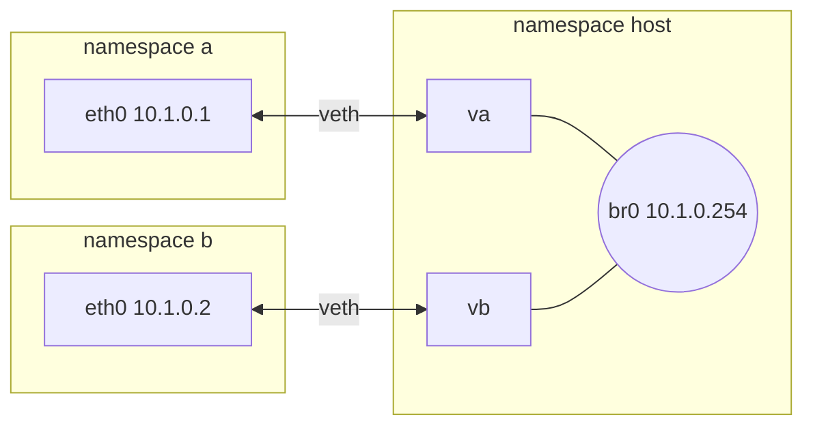
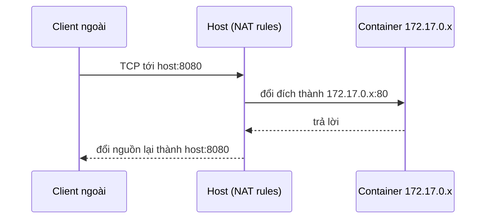
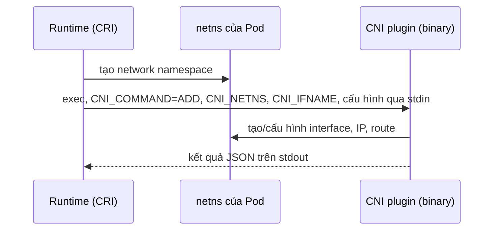

# P8 · Chương 07 — Mạng của container

## Bạn sẽ hiểu được gì

1. **Q1.** Network namespace cô lập những gì, và vì sao `127.0.0.1` trong container không phải `127.0.0.1` của host? → mục 2
2. **Q2.** Hai namespace nói chuyện với nhau bằng cách nào (veth pair)? → mục 3
3. **Q3.** Nhiều namespace chung một "switch" thế nào (Linux bridge)? → mục 4
4. **Q4.** Mô hình mạng của Docker gồm những mảnh nào: `docker0`, IP riêng, masquerade, `-p` (DNAT); mạng user-defined khác `bridge` mặc định ở đâu, `127.0.0.11` là gì; `--network host` và `--network none` làm gì với namespace? → mục 5
5. **Q5.** Mô hình mạng Kubernetes: Pod có IP riêng, container trong Pod chung namespace, Service ClusterIP và kube-proxy làm gì, CNI là gì? → mục 6
6. **Q6.** Vì sao overlay (VXLAN) đụng tới MTU? → mục 7
7. **Q7.** Khi service A không gọi được service B, nên nhìn từ đâu? → mục 8

## Kiến thức cần trước

- [Chương 01 — Container là gì](01-container-la-gi.md) và [Chương 02 — Namespaces](02-namespaces.md): khái niệm namespace nói chung.
- [P6·02 — Link layer](../06-networking/02-link-layer.md): switch và learning bridge (mục 4), MTU (mục 7), veth/bridge/vlan (mục 9).
- [P6·03 — IP](../06-networking/03-ip.md): định tuyến (mục 4), Path MTU Discovery (mục 6), NAT (mục 9).

## 1. Bối cảnh: mỗi container cần một "máy mạng" riêng (mục phụ trợ)

Hai container cùng chạy web server đều muốn nghe port 80. Nếu cả hai dùng chung bảng port của host, đứa thứ hai sẽ thất bại ở `bind()` (nhận xét của người soạn). Chương này trả lời: kernel tạo ra "máy mạng ảo" như thế nào, và các lớp trên (Docker, Kubernetes) lắp các máy ảo đó lại với nhau ra sao. Phần lớn chương là hệ quả của một cơ chế duy nhất của kernel — network namespace — cộng với hai thiết bị ảo quen thuộc từ P6: veth và bridge.

## 2. Network namespace (Q1)

> **Trả lời ngắn.** Network namespace cho mỗi nhóm process một bản riêng của tài nguyên mạng: device, ngăn xếp IPv4/IPv6, bảng route, luật firewall và cả bảng port[^nsns-isolate]. Vì mỗi namespace có bản riêng, `127.0.0.1` trong container là loopback của namespace đó chứ không phải của host, và hai namespace cùng bind được port 80.

**Giải thích.**

Hình dung (nhận xét của người soạn): mỗi namespace là một văn phòng có tổng đài và danh bạ nội bộ riêng — số máy lẻ 80 ở văn phòng này không đụng số 80 ở văn phòng kia.

### 2.1 Nó cô lập gì

`network_namespaces(7)` liệt kê: network namespace cô lập tài nguyên mạng gồm network device, ngăn xếp giao thức IPv4/IPv6, bảng routing IP, luật firewall, thư mục `/proc/net`, `/sys/class/net`, nhiều file dưới `/proc/sys/net`, port number (socket), và cả không gian tên abstract của UNIX domain socket[^nsns-isolate]. `ip-netns(8)` nói gọn hơn: một network namespace về mặt logic là thêm một bản của ngăn xếp mạng, với route, firewall rule và device riêng[^ipnetns-copy].

Hệ quả trực tiếp: hai namespace khác nhau có thể cùng bind port 80, cùng có một interface tên `eth0`, mỗi bên một bảng route riêng (suy luận của người soạn từ danh sách trên). Một tiến trình mặc định thừa kế network namespace từ cha, và lúc đầu mọi tiến trình dùng chung namespace mặc định của `init`[^ipnetns-inherit]. Khái niệm tạo namespace (`clone`/`unshare` với cờ `CLONE_NEWNET`) đã nói ở [chương 02](02-namespaces.md).

### 2.2 Vòng đời

- Một thiết bị vật lý chỉ sống trong đúng một network namespace. Khi namespace bị giải phóng (tiến trình cuối cùng thoát), thiết bị vật lý được trả về namespace khởi đầu[^nsns-phys].
- Thiết bị veth nằm trong namespace bị giải phóng thì bị hủy[^nsns-veth-destroy].
- Quy ước của `ip netns`: namespace có tên là một object tại `/run/netns/NAME`; mở file đó được file descriptor tham chiếu tới namespace, dùng với `setns(2)`, và giữ fd mở thì namespace còn sống[^ipnetns-fd]. Nói cách khác, một namespace có thể được giữ sống bởi một tham chiếu mà không cần tiến trình nào chạy bên trong (suy luận của người soạn từ câu trích).
- Với ứng dụng nhận biết network namespace, quy ước là tìm file cấu hình toàn cục ở `/etc/netns/NAME/` trước rồi mới tới `/etc/`; ví dụ `resolv.conf` riêng cho namespace dùng cho VPN[^ipnetns-etc]. Với ứng dụng không nhận biết netns, `ip netns exec` tự động hóa việc này bằng cách tạo mount namespace và bind mount các file cấu hình riêng của namespace vào vị trí quen thuộc trong `/etc`[^ipnetns-exec].

<details><summary>Đi sâu: quan sát namespace trống và điều kiện quyền để thử</summary>

### 2.3 Namespace trống trông thế nào — quan sát

Trong lab Linux (Docker, image `rust-foundations-lab:1.95`), thử `ip netns add a` và `unshare -n` bằng `./labs/linux.sh` (root, có `NET_ADMIN`, `NET_RAW` và `SYS_PTRACE` do `labs/linux.sh` thêm, seccomp tắt, AppArmor mặc định, nhưng không có `SYS_ADMIN`) đều **bị chặn**. Điều kiện quyền: `unshare(2)` nói dùng `CLONE_NEWNET` đòi capability `CAP_SYS_ADMIN`[^unshare-cap]; `ip netns add` còn phải mount `/run/netns` nên cần quyền mount (suy luận của người soạn từ thông báo lỗi `mount --make-shared /run/netns failed` bên dưới).

```text
mount --make-shared /run/netns failed: Permission denied     # ip netns add a
unshare: unshare failed: Operation not permitted             # unshare -n
```

Vì vậy thí nghiệm dưới đây chạy trong một `docker run` riêng với `--cap-add SYS_ADMIN --cap-add NET_ADMIN --security-opt seccomp=unconfined --security-opt apparmor=unconfined` (cùng image). Khi kiểm lại từng cờ trên engine này: `unshare -n` chạy được chỉ với `--cap-add SYS_ADMIN` (seccomp và AppArmor mặc định); `ip netns add` với `SYS_ADMIN`+`NET_ADMIN` mà còn profile AppArmor mặc định thì vẫn lỗi `mount --make-shared /run/netns failed`, và chỉ qua khi thêm `apparmor=unconfined` (thêm riêng `seccomp=unconfined` không đủ) — quan sát trên một engine, profile mặc định có thể khác ở máy bạn. `NET_ADMIN` cần cho việc tạo veth và cấu hình interface. Với quyền đó `ip netns add a` thành công (exit 0). Namespace mới tạo bằng `unshare -n bash -c "ip -br link; ip route"` chỉ có một interface:

```text
lo               DOWN           00:00:00:00:00:00 <LOOPBACK>
```

Không có route, và `lo` đang DOWN. Inode của namespace khác nhau: `readlink /proc/self/ns/net` cho `net:[4026532662]` ở namespace gốc của container, `net:[4026532725]` bên trong namespace `a`. Một namespace mới là một "máy không có card mạng". Muốn làm gì có ích thì phải nối nó vào đâu đó — đó là việc của veth.

Quan sát về `apparmor=unconfined` ở trên là bằng chứng trực tiếp duy nhất của giáo trình về việc AppArmor `docker-default` chặn thao tác mount; [P8 · Chương 02, mục 5](02-namespaces.md) và [P8 · Chương 05, mục 5](05-bao-mat-container.md) dẫn về đây khi giải thích vì sao `mount` thất bại trong lab dù seccomp đã tắt.

</details>

**Quay lại Q1:** network namespace là một bản riêng của cả ngăn xếp mạng, nên mỗi namespace có `lo`, route và bảng port riêng.

## 3. veth pair: sợi cáp ảo (Q2)

> **Trả lời ngắn.** veth là một cặp thiết bị Ethernet ảo luôn đi đôi: gói gửi ra một đầu được nhận ngay ở đầu kia[^veth-pair][^veth-immediate]. Đặt mỗi đầu vào một namespace thì hai namespace nói chuyện được với nhau[^veth-ns].

**Giải thích.**

Hình dung (nhận xét của người soạn): một sợi cáp mạng có hai đầu cắm vào hai văn phòng khác nhau.

`veth(4)`: veth là thiết bị Ethernet ảo, luôn được tạo thành cặp nối với nhau; tạo cặp bằng `ip link add <p1> type veth peer name <p2>`[^veth-pair]. Gói gửi ra một đầu được nhận ngay ở đầu kia; khi một đầu down thì link state của cả cặp down[^veth-immediate]. Đặt mỗi đầu vào một namespace thì hai namespace thông nhau[^veth-ns]. `network_namespaces(7)` mô tả cặp veth là một cơ chế giống đường ống (pipe) dùng để tạo tunnel giữa các namespace[^nsns-pipe].

<details><summary>Đi sâu: thí nghiệm hai namespace + một veth + ping</summary>

### 3.1 Thí nghiệm: hai namespace + một veth + ping

Trong container với `SYS_ADMIN` như trên, chạy:

```bash
ip netns add a; ip netns add b
ip link add va type veth peer name vb
ip link set va netns a; ip link set vb netns b
ip -n a addr add 10.0.0.1/24 dev va; ip -n b addr add 10.0.0.2/24 dev vb
ip -n a link set va up; ip -n b link set vb up; ip -n a link set lo up
ip netns exec a ip route
ip netns exec a ping -c2 -W1 10.0.0.2
ip netns exec a ping -c1 -W1 8.8.8.8
```

Kết quả đã chạy thật:

```text
10.0.0.0/24 dev va proto kernel scope link src 10.0.0.1
64 bytes from 10.0.0.2: icmp_seq=1 ttl=64 time=0.030 ms
64 bytes from 10.0.0.2: icmp_seq=2 ttl=64 time=0.031 ms
2 packets transmitted, 2 received, 0% packet loss
ping: connect: Network is unreachable        # tới 8.8.8.8, rc=2
```

Hai điểm đáng chú ý. Thứ nhất, route `10.0.0.0/24` do kernel tự thêm khi gán địa chỉ (`proto kernel`); namespace `a` không có default route, nên 8.8.8.8 là "Network is unreachable" — namespace không biết gì ngoài mạng nó có, đúng như một máy cô lập. Thứ hai, TTL 64 và RTT ~0.03 ms: gói đi thẳng qua phần mềm kernel giữa hai đầu veth, không qua card mạng nào (suy luận của người soạn từ mô tả "immediately received" của veth(4)[^veth-immediate]; mức RTT chỉ là một lần chạy).

</details>

**Quay lại Q2:** veth là sợi cáp ảo hai đầu; mỗi đầu đặt trong một namespace thì hai namespace thông nhau.

## 4. Linux bridge: switch ảo cho nhiều namespace (Q3)

> **Trả lời ngắn.** Linux bridge là phiên bản phần mềm của switch (P6·02 mục 4 và mục 9 giải thích và có nguồn). Mỗi container có một veth pair: một đầu trong namespace của container, đầu kia ở namespace host và cắm vào bridge; nhờ vậy nhiều namespace nói chuyện được với nhau qua cùng một bridge (mô hình này là nhận xét của người soạn, quan sát ở mục 4 và mục 5.1).

**Giải thích.**

Hình dung (nhận xét của người soạn): bridge là bộ chia cổng trong phòng máy, mỗi container một sợi cáp (veth) cắm vào đó.

Nối đúng hai namespace thì một veth đủ. Nhiều container thì cần một "switch" (nhận xét của người soạn). P6·02 đã giải thích switch học địa chỉ MAC nguồn rồi chuyển frame theo bảng — xem [mục 4 của chương link layer](../06-networking/02-link-layer.md) và danh sách thiết bị ảo ở mục 9 cùng chương; ở đây không lặp lại. Linux bridge là phiên bản phần mềm: một thiết bị `br0`, và `ip link set <dev> master br0` đặt `br0` làm master device của interface đó (enslave)[^iplink-master].

Mô hình thường gặp (nhận xét của người soạn; quan sát ở mục 4 và mục 5.1): mỗi container một veth pair; một đầu ở trong namespace của container (thường đổi tên thành `eth0`), đầu kia ở namespace host và được cắm vào bridge. Bản thân bridge có thể có IP — khi đó host cũng là một thành viên của LAN ảo và là gateway của nó (quan sát: `br0` có `10.1.0.254` ở thí nghiệm dưới; `docker0` có gateway `172.17.0.1` ở mục 5.1).



<details><summary>Đi sâu: thí nghiệm bridge <code>br0</code> với hai namespace</summary>

Thí nghiệm (cùng container `SYS_ADMIN`): tạo `br0` có địa chỉ `10.1.0.254/24`, hai namespace `a`, `b`, mỗi cái một veth, đầu host cắm `master br0`; gán `10.1.0.1` và `10.1.0.2` cho các `eth0` trong namespace. Kết quả quan sát:

- `ping` từ `a` tới `10.1.0.2` (qua bridge) và tới `10.1.0.254` (IP của bridge) đều 0% loss.
- `bridge link` liệt kê hai đầu host (`va`, `vb`) với `master br0 state forwarding`.
- Thêm `default via 10.1.0.254` vào `a` thì `ip route` của `a` có thêm dòng default đó. Muốn ra Internet thật còn cần định tuyến và NAT trên host (nhận xét của người soạn; xem mục 5.2 và P6·03 mục 9), mà image lab không có `iptables`/`nft` nên **không thử được ở đây**.

</details>

**Quay lại Q3:** bridge là switch phần mềm; mỗi container một veth, đầu host cắm vào bridge.

## 5. Mô hình mạng của Docker: bridge, user-defined, host, none (Q4)

> **Trả lời ngắn.** Docker nối container vào một software bridge có subnet riêng; container ra ngoài bằng masquerade[^dk-masq], còn `-p` ánh xạ port của host vào container bằng luật firewall thực hiện NAT[^dk-pub-nat]. Mạng user-defined thêm phân giải DNS tự động giữa container[^dk-udb-dns]; container ở mạng custom dùng DNS server nhúng của Docker, địa chỉ `127.0.0.11`[^dk-dns-copy][^dk-dns-embedded]. `--network host` dùng chung namespace với host, còn `--network none` chỉ tạo loopback[^dk-host-share][^dk-none].

**Giải thích.**

Hình dung (nhận xét của người soạn): Docker lắp đúng các mảnh ở mục 2–4 thành một tòa nhà — bridge là hành lang chung, masquerade là lễ tân đứng tên cả tòa khi gửi thư ra ngoài, `-p` là cửa sổ nhận thư mở riêng cho từng phòng.

Mọi thứ trong mục này là hành vi Docker (docs không ghim phiên bản; engine trên máy thí nghiệm là 29.5.2 và có thể khác bản của bạn). Đây là sự lắp ghép của mục 2–4.

### 5.1 Các mảnh

Docs mô tả bridge network có subnet IPv4 (và tùy chọn IPv6); mỗi container nối vào có interface với địa chỉ trong subnet đó. Mặc định: cho phép truy cập không hạn chế tới các container trong mạng từ host và từ container khác cùng mạng, và chặn truy cập từ container ở mạng khác và từ ngoài host[^dk-bridge-default]; dùng masquerading để container ra ngoài (mục 5.2)[^dk-masq]; hỗ trợ port publishing (mục 5.3)[^dk-pub-nat]. Về mặt triển khai, một bridge network dùng một software bridge[^dk-softbridge] — docs gọi nó là Linux bridge khi mô tả option đặt tên interface bridge[^dk-linuxbridge], tức là cùng loại với bridge ở mục 4. Khi Docker daemon khởi động, một mạng bridge mặc định (tên `bridge`) được tạo và container mới nối vào đó nếu không chỉ định khác[^dk-default-created]; docs nhắc tới bridge mặc định này dưới tên `docker0`[^dk-docker0].

Quan sát trên máy thí nghiệm: `docker network inspect bridge` cho subnet `172.17.0.0/16`, gateway `172.17.0.1`, và các option `com.docker.network.bridge.name=docker0`, `enable_ip_masquerade=true`, `enable_icc=true`, `driver.mtu=1500`. Một container thường (`docker run alpine ip addr`) có `lo` và `eth0@if619` với `172.17.0.6/16`. Với `--network host`, `ip addr` cho thấy namespace của máy chạy daemon (ở đây là VM của Colima, không phải macOS), trong đó có `docker0` và các `vethXXXX... master docker0` — các đầu host của veth pair, cắm vào bridge, đúng mô hình mục 4. Tên `@eth0` trong dòng `veth4d6d72c@eth0` là cách `ip` hiển thị peer theo ifindex, trong lúc quan sát từ namespace khác nên tên peer bị giải sai; chỉ đọc "có `master docker0`" là chắc (suy luận của người soạn).

### 5.2 Ra ngoài: masquerade

Container có IP riêng trong subnet của bridge (quan sát: `172.17.x.x`, mục 5.1). Docs nói container ra ngoài bằng masquerading, và thiết bị ở mạng ngoài của host chỉ thấy địa chỉ IP của Docker host[^dk-masq]; trang port publishing cũng nói các kết nối đi ra của container được masquerade bằng địa chỉ IP của Docker host[^dk-pub-masq]. Cơ chế NAT/masquerade là đề tài của [P6·03 mục 9](../06-networking/03-ip.md), vì sao kết nối *đến* khó cũng ở đó. Ở đây đủ nhớ (nhận xét của người soạn): container là client thì NAT làm việc trong suốt; container là server thì cần publish.

### 5.3 Vào trong: `-p` (DNAT)

Mặc định Docker chặn truy cập tới port chưa publish, còn port đã publish được ánh xạ vào địa chỉ của host. Để làm vậy nó dùng luật firewall thực hiện NAT, PAT và masquerading[^dk-pub-nat]. Ví dụ docs: `docker run -p 8080:80 ...` tạo ánh xạ giữa port 8080 trên mọi địa chỉ của host và port 80 của container[^dk-pub-example]. Về hướng gói đi vào: đổi địa chỉ đích (host:8080 → container:80) là destination NAT (DNAT). Trang port-publishing không dùng chữ DNAT, nhưng trang firewall-iptables của Docker (với backend iptables) nói: khi gói tới chain `DOCKER-USER` thì chúng đã qua một bộ lọc DNAT, nên các cờ iptables chỉ khớp được địa chỉ và port nội bộ của container[^dk-dnat]. Gateway mode mặc định là `nat`: luật NAT và masquerading được dựng cho từng port published[^dk-gw-nat].

Quan sát: `docker run -d --name w07web -p 18080:80 nginx:alpine` rồi `docker ps` hiện `0.0.0.0:18080->80/tcp, [::]:18080->80/tcp`, và từ macOS `curl localhost:18080` trả HTTP 200. Bên trong container `wget http://127.0.0.1:80` cũng thành công — nginx nghe trong chính namespace của nó.

Cảnh báo bảo mật từ docs: publish port "is insecure by default" — port không chỉ mở cho host mà cho cả bên ngoài[^dk-pub-insecure]. Thêm địa chỉ localhost vào cờ (`-p 127.0.0.1:8080:80`) thì chỉ Docker host truy cập được[^dk-pub-local].



(Sơ đồ là minh họa của người soạn cho nhận xét ở trên; tên và cách ghi luật cụ thể — iptables hay nftables — không quan sát được trong lab này.)

### 5.4 Mạng user-defined và DNS nhúng

Docs nói user-defined bridge ưu việt hơn bridge mặc định[^dk-default-created] và liệt kê nhiều khác biệt; ba khác biệt đáng chú ý ở đây: (1) chúng có phân giải DNS tự động giữa container theo tên hoặc alias, trong khi mạng `bridge` mặc định chỉ truy cập nhau bằng IP trừ khi dùng `--link` (docs coi là legacy)[^dk-udb-dns]; (2) cô lập tốt hơn: container không chỉ định `--network` đều vào bridge mặc định nên các stack không liên quan có thể nói chuyện với nhau, còn user-defined network là phạm vi mà chỉ container gắn vào nó mới giao tiếp được[^dk-udb-isolation]; (3) có thể nối/ngắt container khỏi mạng user-defined khi đang chạy[^dk-udb-live].

Về resolver: container mặc định dùng DNS server của host; container ở bridge mặc định nhận một *bản sao* `/etc/resolv.conf` của host, còn container ở mạng custom dùng DNS server nhúng của Docker[^dk-dns-copy]. Server nhúng chuyển tiếp truy vấn ngoài tới DNS của host, và địa chỉ của nó là `127.0.0.11`[^dk-dns-embedded].

### 5.5 `host` và `none`

| Chế độ | Namespace (suy ra từ docs và quan sát) | Hệ quả (theo Docker docs) |
|---|---|---|
| `bridge` | namespace riêng + veth vào bridge | có IP riêng; `-p` có tác dụng |
| `host` | dùng chung namespace của host | không có IP riêng; `-p` bị bỏ qua có cảnh báo |
| `none` | namespace riêng, không nối đâu | chỉ có loopback |

Với `host`, network stack của container không bị cô lập khỏi Docker host (dùng chung networking namespace) và container không được cấp IP riêng[^dk-host-share]; vì vậy port mapping không có tác dụng và `-p` bị bỏ qua kèm cảnh báo[^dk-host-p]. Ứng dụng bind port 80 là mở trên port 80 của host[^dk-host-80]. Với `none`, docs nói chỉ có thiết bị loopback được tạo[^dk-none]. Quan sát: `docker run --network none alpine ip addr` chỉ có `lo` với `127.0.0.1/8`; từ trong đó `wget http://127.0.0.1:80` bị `Connection refused` (không có gì nghe ở port đó, và cũng không có đường ra).

<details><summary>Đi sâu: quan sát mạng user-defined, <code>resolv.conf</code> và <code>127.0.0.11</code></summary>

Quan sát (`docker network create w07net`, hai container `alpine` `w07a`, `w07b` trong mạng đó):

```text
$ docker exec w07a cat /etc/resolv.conf
nameserver 127.0.0.11
options ndots:0
# Based on host file: '/etc/resolv.conf' (internal resolver)
# ExtServers: [host(192.168.5.1)]
$ docker exec w07a ping -c1 w07b
PING w07b (172.22.0.3): 56 data bytes ...
$ docker exec w07a ip route
default via 172.22.0.1 dev eth0
172.22.0.0/16 dev eth0 scope link  src 172.22.0.2
```

Ngược lại, container trên bridge mặc định có `nameserver 192.168.5.1` — bản sao của file host (đây là DNS của VM Colima, không phải IP quen thuộc nào của Docker). Và `wget http://w07web` từ `w07a` ban đầu lỗi `bad address 'w07web'` vì `w07web` chỉ ở mạng `bridge` mặc định; sau `docker network connect w07net w07web` thì truy cập thành công. Subnet user-defined (`172.22.0.0/16`) là subnet riêng, khác `172.17.0.0/16` của `docker0`; mỗi mạng user-defined có một bridge riêng — danh sách interface của `--network host` có thêm các `br-...`.

`127.0.0.11` là địa chỉ loopback (dải `127.0.0.0/8`), nên truy vấn DNS tới nó không rời khỏi namespace của container qua mạng (suy luận của người soạn từ quy tắc loopback ở [P6·02 mục 3, phần Đi sâu về loopback](../06-networking/02-link-layer.md)). Đã chốt bằng quan sát: trong container ở mạng user-defined, `ip route get 127.0.0.11` trả `local 127.0.0.11 dev lo src 127.0.0.1`, và `netstat -lnu`/`-lnt` thấy socket UDP và TCP đang nghe ngay trên `127.0.0.11:<port ngẫu nhiên>` trong namespace của container (tiến trình giữ socket là phía Docker daemon — chi tiết cơ chế này docs trích ở trên không mô tả, nên không khẳng định thêm).

</details>

**Quay lại Q4:** bridge + masquerade + `-p` cho container ra/vào; user-defined thêm DNS nhúng `127.0.0.11`; `host` bỏ cô lập, `none` chỉ có loopback.

## 6. Mạng Kubernetes (Q5)

> **Trả lời ngắn.** Mỗi Pod có một IP riêng trong cluster, và các container trong Pod dùng chung network namespace nên gọi nhau qua localhost[^k8s-model-pod]. Việc dựng network namespace cho Pod do phần mềm cấp hệ thống hiện thực CRI đảm nhiệm, và trên Linux hầu hết runtime dùng CNI để làm việc với phần hiện thực mạng Pod[^k8s-cni-cri][^k8s-cni-plugins]. Service cho một địa chỉ ổn định[^k8s-service-api], và kube-proxy cấu hình node để chuyển traffic tới các endpoint phía sau (thường là Pod)[^vips-watch].

**Giải thích.**

Hình dung (nhận xét của người soạn): Pod là một căn hộ có địa chỉ riêng, các container là người cùng nhà gọi nhau qua cửa trong; Service là số tổng đài cố định chuyển cuộc gọi tới căn hộ đang trực.

Chỉ một phần mô hình mạng do chính Kubernetes hiện thực; với phần còn lại Kubernetes định nghĩa API, còn chức năng do thành phần bên ngoài cung cấp[^k8s-cni-cri]. Tài liệu (không ghim phiên bản; trang kube-proxy đã trích nhắc phiên bản 1.37) liệt kê bốn bài toán: giao tiếp container-với-container trong một Pod (giải bằng Pod và localhost), Pod-với-Pod, Pod-với-Service, bên-ngoài-với-Service[^k8s-4problems].

### 6.1 Mỗi Pod một IP, chung namespace

Mô hình mạng: mỗi Pod có một địa chỉ IP duy nhất trong cả cluster; Pod có network namespace riêng, được chia sẻ bởi mọi container trong Pod, nên các tiến trình ở các container khác nhau của cùng Pod nói chuyện với nhau qua localhost[^k8s-model-pod]. Pod page nhắc lại: mỗi container trong Pod dùng chung network namespace, kể cả địa chỉ IP và port; trong Pod (và chỉ trong Pod) dùng localhost[^k8s-pod-shared]. Khi giao tiếp với bên ngoài Pod, các container phải phối hợp việc dùng port chung[^k8s-pod-ports].

Giữa các Pod, mô hình mạng đòi (trừ khi cố ý phân đoạn) mọi Pod nói chuyện được với mọi Pod khác, cùng node hay khác node, trực tiếp, không qua proxy hay NAT; riêng trên Windows, quy tắc này không áp dụng cho Pod dùng host network[^k8s-model-nonat].

Về mặt logic, namespace chung nghĩa là phải có một thứ *giữ* namespace sống trong khi các container ứng dụng đến và đi — cùng ý với "giữ fd mở thì namespace còn sống" ở mục 2.2 (suy luận của người soạn). Tài liệu Kubernetes mà tôi đã đọc nhắc tới "sandbox (pause) image" khi hướng dẫn cấu hình containerd và CRI-O[^k8s-pause-image], nhưng không giải thích vai trò của nó; vì vậy chương này **không khẳng định** pause container làm gì cụ thể. Chi tiết runtime xem [chương 06](06-runtime-oci.md).

Tin vui cho việc debug: container cùng Pod gọi nhau bằng `localhost:port` là đúng; hai Pod khác nhau thì không dùng `localhost` (docs chỉ cho phép dùng localhost trong Pod[^k8s-pod-shared]).

### 6.2 Ai dựng namespace và interface: CRI và CNI

Docs: việc setup network namespace của Pod do phần mềm cấp hệ thống hiện thực Container Runtime Interface đảm nhiệm[^k8s-cni-cri]; bản thân pod network do một pod network implementation quản lý; trên Linux hầu hết runtime dùng CNI để tương tác với implementation này, nên các implementation đó hay được gọi là CNI plugin[^k8s-cni-plugins]. Cluster networking page: mô hình được hiện thực bởi container runtime trên mỗi node, và các runtime phổ biến dùng CNI plugin để quản lý mạng và bảo mật[^k8s-cni-impl].

**CNI** (Container Networking Interface) có đặc tả riêng (đây là bản ghim tag `v1.2.0`). Spec định nghĩa: "container" là một *network isolation domain* mà công nghệ cô lập cụ thể không bị đặc tả ràng buộc (ví dụ network namespace hoặc máy ảo)[^cni-container]. Giao thức dựa trên việc runtime *thực thi một file nhị phân*[^cni-exec]. Tham số truyền qua biến môi trường, cấu hình qua stdin; plugin trả kết quả trên stdout, hoặc lỗi trên stderr, và cấu hình lẫn kết quả mã hóa bằng JSON[^cni-params]. CNI định nghĩa 5 thao tác: `ADD`, `DEL`, `CHECK`, `GC`, `VERSION`, truyền cho plugin qua biến môi trường `CNI_COMMAND`[^cni-ops]. Khi nhận `ADD`, spec nói plugin *nên* (should) tạo interface `CNI_IFNAME` trong container tại `CNI_NETNS`, hoặc chỉnh cấu hình interface đó[^cni-add] — nếu dùng network namespace thì `CNI_NETNS` là đường dẫn tới namespace, ví dụ `/run/netns/[nsname]`[^cni-netns], khớp với quy ước của `ip netns` ở mục 2.2. Runtime *phải* (must) chạy plugin trong *networking domain của runtime* (spec: trong đa số trường hợp, đó là root network namespace)[^cni-domain].

Nói cách khác: những gì ta tự gõ ở mục 3–4 (tạo veth, đặt vào namespace, gán IP, route) chính là công việc một CNI plugin kiểu "bridge" tự động hóa cho mỗi Pod (suy luận của người soạn: spec không nêu plugin cụ thể nào trong các đoạn đã trích).



### 6.3 Service, ClusterIP và kube-proxy

Pod đến rồi đi, IP đổi theo (nhận xét của người soạn). Service API cho một IP hoặc hostname ổn định, bên dưới là một nhóm Pod có thể thay đổi[^k8s-service-api]. Hiện thực "virtual IP" này do kube-proxy (trừ khi thay bằng thành phần khác) đảm nhiệm cho Service loại khác `ExternalName`[^vips-proxy]. Mỗi instance kube-proxy theo dõi control plane để biết Service và EndpointSlice thêm/bớt; với mỗi Service nó gọi API phù hợp mode để cấu hình node *bắt* traffic tới `clusterIP` và port của Service, rồi chuyển hướng tới một trong các endpoint (thường là Pod)[^vips-watch]. Một control loop giữ luật trên mỗi node đồng bộ với trạng thái Service và EndpointSlice mà API server nêu[^vips-loop].

Điểm cốt lõi: ClusterIP là địa chỉ *ảo* — không có interface nào mang nó như một host thật; nó chỉ tồn tại như điều kiện khớp trong luật chuyển gói trên mỗi node (suy luận của người soạn, dựa trên mô tả kube-proxy "bắt" traffic tới clusterIP rồi chuyển hướng ở trên).

Ở mode iptables, khi client kết nối tới virtual IP, luật iptables chạy, một backend được chọn (theo session affinity hoặc ngẫu nhiên) và gói được chuyển hướng tới backend mà không viết lại địa chỉ IP của client; với NodePort hay load balancer thì luồng cơ bản này vẫn chạy nhưng địa chỉ client bị thay đổi[^vips-flow].

<details><summary>Đi sâu: các mode của kube-proxy</summary>

Các mode của kube-proxy trên Linux: `iptables`, `ipvs`, `nftables`[^vips-modes]. Chi tiết theo docs:

| Mode | Điều docs nói |
|---|---|
| iptables | cấu hình luật chuyển gói qua API iptables của netfilter; với mỗi endpoint cài luật, mặc định chọn backend ngẫu nhiên[^vips-iptables] |
| ipvs | bị đánh dấu deprecated; docs bản đã đọc nêu lộ trình: tắt mặc định từ v1.40, gỡ hẳn ở v1.43[^vips-ipvs-dep] |
| nftables | cấu hình luật bằng nftables[^vips-modes] |

Docs còn ghi rằng nếu không chọn mode tường minh thì ở Kubernetes 1.37 mặc định là iptables, nhưng một bản tương lai sẽ đổi mặc định sang nftables[^vips-default] — đây là thông tin phụ thuộc phiên bản, hãy đọc lại docs của bản Kubernetes bạn chạy.

</details>

**Quay lại Q5:** Pod có IP riêng và chung namespace; CNI dựng mạng Pod; ClusterIP là IP ảo do kube-proxy hiện thực.

## 7. MTU và overlay (VXLAN) ở mức khái niệm (Q6)

> **Trả lời ngắn.** Overlay VXLAN bọc frame gốc trong thêm header ngoài nên gói trên dây to hơn gói gốc[^rfc7348-rec]. RFC nói VTEP không được phân mảnh gói VXLAN[^rfc7348-mtu] và khuyến nghị MTU của hạ tầng vật lý đủ lớn cho phần đóng gói thêm; Path MTU discovery chỉ là kỹ thuật khác có thể dùng thêm[^rfc7348-rec].

**Giải thích.**

Hình dung (nhận xét của người soạn): bọc một phong bì vào phong bì khác thì bưu kiện dày hơn; nếu hòm thư chỉ vừa phong bì cũ thì không nhét lọt.

Mạng Pod liên node cần hoặc định tuyến được thẳng, hoặc dùng **overlay**: bọc frame của Pod vào gói của mạng vật lý (nhận xét của người soạn). VXLAN (RFC 7348) là một cách: RFC nói nó cũng có thể gọi là một lược đồ tunnel để phủ (overlay) mạng Layer 2 lên trên mạng Layer 3[^rfc7348-tunnel]. Frame gốc được đóng gói thêm header ngoài, nên gói trên dây to hơn gói gốc (RFC nhắc tới kích thước frame lớn hơn do việc đóng gói[^rfc7348-rec]). RFC quy định VTEP không được (MUST NOT) phân mảnh gói VXLAN; router trung gian có thể phân mảnh gói đã đóng gói vì frame lớn hơn, và VTEP đích có thể (MAY) lặng lẽ bỏ các mảnh đó[^rfc7348-mtu]. Để bảo đảm gói đến đích mà không phân mảnh, RFC khuyến nghị (RECOMMENDED) đặt MTU của hạ tầng vật lý đủ lớn cho phần đóng gói thêm; các kỹ thuật khác như Path MTU discovery cũng có thể (MAY) dùng để đáp ứng yêu cầu đó[^rfc7348-rec].

<details><summary>Đi sâu: hệ quả cho MTU phía container và option MTU của Docker</summary>

Hệ quả thực tế (khái niệm): nếu mạng vật lý MTU 1500 mà interface của container cũng 1500 thì gói đầy đủ sau khi bọc sẽ vượt MTU; vì vậy MTU phía container thường phải nhỏ hơn (nhận xét của người soạn — mức giảm cụ thể phụ thuộc loại encapsulation, không nêu con số ở đây). Docs Docker liệt kê option `com.docker.network.driver.mtu` để đặt MTU của container[^dk-mtu-opt] (quan sát: `driver.mtu=1500` trên bridge mặc định). Docs cũng nói với bridge mặc định mọi container dùng chung các cài đặt như MTU và iptables rule, còn mỗi user-defined network tạo một bridge cấu hình được riêng[^dk-udb-config]. Nền tảng MTU, phân mảnh và DF nằm ở [P6·02 mục 7](../06-networking/02-link-layer.md); Path MTU Discovery ở [P6·03 mục 6](../06-networking/03-ip.md).

</details>

**Quay lại Q6:** đóng gói VXLAN làm gói to hơn, nên MTU phải đủ lớn hoặc MTU phía container phải nhỏ hơn.

## 8. Liên hệ backend: debug kết nối giữa hai service (Q7)

> **Trả lời ngắn.** Đi từng lớp theo mô hình: tên có ra đúng IP không, có route tới IP đó không, hai container có cùng mạng không, server có bind đúng địa chỉ và port không, và (với Kubernetes) Service có endpoint chưa. Gói lớn bị rớt còn gói nhỏ qua được thì nghi MTU/overlay. Mọi điều trong mục này là suy ra từ các mục trước (nhận xét của người soạn).

**Giải thích.**

Hình dung (nhận xét của người soạn): gọi điện không thông thì kiểm tra theo thứ tự — có đúng số không, có đường dây không, có cùng tổng đài không, đầu dây bên kia có nhấc máy không.

Mọi điều dưới đây là suy ra từ các mục trên và các thí nghiệm, không phải trích nguồn.

**Vì sao `localhost` trong container khác `localhost` của host.** Loopback là một interface *trong network namespace*; mỗi namespace có `lo` riêng (mục 2.1; quan sát ở mục 2.3: namespace mới chỉ có `lo`). Vì ngăn xếp IP và bảng port tách riêng theo namespace, cùng một địa chỉ `127.0.0.1:8000` ở hai namespace là hai ổ cắm khác nhau — chỉ namespace có tiến trình đang nghe mới nhận được kết nối (suy luận từ mục 2; chương này không có thí nghiệm riêng cho điểm đó). Từ đó:

- Ứng dụng trong container nghe `127.0.0.1` thì không ai ngoài namespace đó gọi được — kể cả `-p`, vì DNAT chuyển gói tới địa chỉ container, không phải loopback của nó. Cần bind `0.0.0.0` (hoặc IP của `eth0`). Đây là lỗi hay gặp với service dev "chạy được trên máy, container thì không" (nhận xét của người soạn).
- Container gọi `localhost:5432` mong tới Postgres trên host sẽ không ra host. Với `--network host`, `localhost` lại là của host (mục 5.5).
- Trong Pod, sidecar gọi app qua `localhost` là hợp lệ vì chung namespace (mục 6.1); giữa hai Pod phải dùng Service/DNS.

**Debug kết nối giữa hai service.** Đi từng lớp theo mô hình:

1. Tên có ra đúng IP không? Xem `/etc/resolv.conf` của container (mạng user-defined: `127.0.0.11`; bridge mặc định: bản sao của host) và tra tên từ bên trong container.
2. Có route/đường tới IP đó không? `ip route` trong namespace (như `Network is unreachable` ở mục 3.1 khi thiếu default route).
3. Hai container có *cùng mạng* không? `docker network inspect <net>` liệt kê các container và IP của mạng; khác mạng thì không thấy nhau (đã quan sát: `w07web` ở `bridge` không phân giải được từ `w07net`).
4. Server có bind đúng địa chỉ/port không (loopback hay `0.0.0.0`)? `ss -tln` trong namespace đích.
5. Với Kubernetes: Service có endpoint không (EndpointSlice), kube-proxy đã đồng bộ luật chưa — đây là các đối tượng mà docs nói kube-proxy theo dõi (mục 6.3).
6. Gói lớn bị rớt còn gói nhỏ qua được → nghi MTU/overlay (mục 7).

<details><summary>Đi sâu: vào đúng namespace của container để quan sát</summary>

`ip netns exec`/`nsenter -n` vào đúng namespace của container để chạy `ip`, `ss`, `tcpdump` là cách nhìn "từ góc của container" mà không cần cài công cụ vào image (nhận xét của người soạn; không thử `nsenter` trong lab này).

</details>

**Quay lại Q7:** debug theo lớp: DNS → route → cùng mạng → bind → (Service/endpoint) → MTU.

## Liên hệ với Rust

Chương này gần như không có API Rust riêng; điểm chạm là *địa chỉ bind*. `std::net::TcpListener::bind(addr)` tạo một `TcpListener` gắn với địa chỉ chỉ định[^rust-tcp-bind]; nếu địa chỉ là `127.0.0.1:8080` thì chỉ loopback của namespace hiện tại nhận được kết nối — hành vi này là của kernel (suy luận của người soạn từ mục 2), không phải của Rust. Viết service Rust chạy trong container nên cho cấu hình địa chỉ bind (thường `0.0.0.0:PORT`) thay vì hard-code `127.0.0.1` (nhận xét của người soạn). Phần Rust trong container nói ở [chương 08](08-rust-trong-container.md).

## Tóm tắt

- Network namespace cô lập device, giao thức IP, route, firewall, `/proc/net`, và bảng port; mỗi namespace có `lo` riêng.
- Namespace mới chỉ có `lo` (đang DOWN); veth pair là sợi cáp ảo nối hai namespace; Linux bridge là switch ảo nối nhiều veth.
- Docker bridge mặc định = `docker0` + veth cho mỗi container + subnet riêng (`172.17.0.0/16` khi quan sát) + masquerade ra ngoài + `-p` ánh xạ port host tới container qua NAT.
- User-defined network: DNS tự động theo tên qua server nhúng `127.0.0.11`; bridge mặc định chỉ nhận bản sao `resolv.conf` của host.
- `host` dùng chung namespace của host (và bỏ qua `-p`); `none` chỉ có loopback.
- Kubernetes: mỗi Pod một IP, container trong Pod chung namespace và gọi nhau bằng `localhost`; Pod–Pod không qua NAT theo mô hình mạng (trừ khi cố ý phân đoạn; Windows host-network là ngoại lệ).
- CNI: runtime exec plugin với `CNI_COMMAND`/`CNI_NETNS`/`CNI_IFNAME`; Service ClusterIP là IP ảo do kube-proxy hiện thực bằng iptables/ipvs/nftables.
- Overlay VXLAN bọc frame nên cần chú ý MTU.
- Thí nghiệm: `ip netns add`/`unshare -n` bị chặn khi chỉ có `NET_ADMIN`; cần `SYS_ADMIN`.

## Câu hỏi tự kiểm tra

1. Liệt kê ít nhất bốn loại tài nguyên mà network namespace cô lập.
<details><summary>Đáp án</summary>

Network device, ngăn xếp IPv4/IPv6, bảng routing, luật firewall, `/proc/net`, port (socket)[^nsns-isolate].

</details>

2. Điều gì xảy ra với veth nằm trong một namespace khi namespace đó bị giải phóng?
<details><summary>Đáp án</summary>

Chúng bị hủy[^nsns-veth-destroy].

</details>

3. Vì sao trong thí nghiệm mục 3.1 ping 8.8.8.8 báo "Network is unreachable"?
<details><summary>Đáp án</summary>

Namespace chỉ có route `10.0.0.0/24` do kernel thêm, không có default route (quan sát mục 3.1).

</details>

4. Hai namespace nối nhau qua bridge thay vì một veth trực tiếp — mỗi namespace cần mấy đầu veth và các đầu còn lại ở đâu?
<details><summary>Đáp án</summary>

Mỗi namespace một cặp veth; một đầu ở trong namespace, đầu kia ở namespace host cắm vào bridge (mục 4; mô tả veth: [^veth-ns]).

</details>

5. Docker làm gì để container ra Internet và để Internet vào được container qua `-p`?
<details><summary>Đáp án</summary>

Ra: masquerade, bên ngoài chỉ thấy IP host[^dk-masq]. Vào: luật firewall thực hiện NAT/PAT ánh xạ port host sang port container[^dk-pub-nat].

</details>

6. `-p 127.0.0.1:8080:80` khác `-p 8080:80` thế nào?
<details><summary>Đáp án</summary>

Dạng có 127.0.0.1 chỉ cho Docker host truy cập; dạng không có địa chỉ mở ra cả bên ngoài[^dk-pub-local][^dk-pub-insecure].

</details>

7. Container trong mạng user-defined có `nameserver` nào trong `resolv.conf`, và container ở bridge mặc định thì sao?
<details><summary>Đáp án</summary>

`127.0.0.11` (resolver nhúng) cho mạng custom; bản sao `resolv.conf` của host cho bridge mặc định[^dk-dns-copy][^dk-dns-embedded]. Quan sát: `192.168.5.1` trên máy thí nghiệm.

</details>

8. `docker run --network host -p 8080:80 ...` có tác dụng gì với `-p`?
<details><summary>Đáp án</summary>

Bị bỏ qua kèm cảnh báo, vì container dùng chung namespace và không có IP riêng[^dk-host-p].

</details>

9. Hai container trong cùng Pod gọi nhau thế nào, và hai Pod khác nhau?
<details><summary>Đáp án</summary>

Cùng Pod: `localhost` vì chung network namespace[^k8s-pod-shared]. Khác Pod: qua IP của Pod hoặc Service, không phải localhost; theo mô hình mạng, Pod–Pod không qua NAT (trừ khi cố ý phân đoạn; Windows host-network là ngoại lệ)[^k8s-model-nonat].

</details>

10. kube-proxy làm gì với ClusterIP?
<details><summary>Đáp án</summary>

Cấu hình node bắt traffic tới `clusterIP` và port rồi chuyển tới một endpoint, theo mode iptables/ipvs/nftables[^vips-watch][^vips-modes].

</details>

11. Plugin CNI nhận thông tin gì để thêm một container vào mạng?
<details><summary>Đáp án</summary>

Thao tác (`CNI_COMMAND=ADD`), đường dẫn namespace `CNI_NETNS`, tên interface `CNI_IFNAME`; cấu hình qua stdin, kết quả JSON qua stdout[^cni-params][^cni-add].

</details>

12. Vì sao overlay VXLAN gắn với chuyện MTU?
<details><summary>Đáp án</summary>

Đóng gói làm gói to hơn; RFC cấm VTEP phân mảnh gói VXLAN (MUST NOT)[^rfc7348-mtu], khuyến nghị (RECOMMENDED) MTU hạ tầng vật lý đủ lớn cho phần đóng gói thêm, và nói Path MTU discovery là kỹ thuật khác có thể (MAY) dùng để đáp ứng yêu cầu đó[^rfc7348-rec].

</details>

## Đọc thêm

- [`network_namespaces(7)`](https://manpages.debian.org/bookworm/manpages/network_namespaces.7.en.html): danh sách đầy đủ những gì namespace cô lập.
- [`veth(4)`](https://manpages.debian.org/bookworm/manpages/veth.4.en.html): cách tạo cặp và đưa hai đầu vào hai namespace.
- [`ip-netns(8)`](https://manpages.debian.org/bookworm/iproute2/ip-netns.8.en.html): quy ước `/run/netns` và `/etc/netns`.
- [Docker — Bridge network driver](https://docs.docker.com/engine/network/drivers/bridge/) và [Port publishing](https://docs.docker.com/engine/network/port-publishing/): chi tiết option, gateway mode.
- [Kubernetes — Virtual IPs and Service Proxies](https://kubernetes.io/docs/reference/networking/virtual-ips/): cách từng mode kube-proxy hoạt động.
- [CNI SPEC.md @ v1.2.0](https://github.com/containernetworking/cni/blob/v1.2.0/SPEC.md): định dạng cấu hình, các thao tác, kiểu kết quả.
- [RFC 7348](https://www.rfc-editor.org/rfc/rfc7348.html): định dạng VXLAN và phần về MTU.
- [P6·02 Link layer](../06-networking/02-link-layer.md), [P6·03 IP](../06-networking/03-ip.md): nền tảng bridge, MTU, NAT.

[^nsns-isolate]: network_namespaces(7), DESCRIPTION — <https://manpages.debian.org/bookworm/manpages/network_namespaces.7.en.html> — "Network namespaces provide isolation of the system resources associated with networking: network devices, IPv4 and IPv6 protocol stacks, IP routing tables, firewall rules, the /proc/net directory (which is a symbolic link to /proc/PID/net), the /sys/class/net directory, various files under /proc/sys/net, port numbers (sockets), and so on. In addition, network namespaces isolate the UNIX domain abstract socket namespace (see unix(7))."
[^nsns-phys]: network_namespaces(7), DESCRIPTION — <https://manpages.debian.org/bookworm/manpages/network_namespaces.7.en.html> — "A physical network device can live in exactly one network namespace. When a network namespace is freed (i.e., when the last process in the namespace terminates), its physical network devices are moved back to the initial network namespace (not to the namespace of the parent of the process)."
[^nsns-veth-destroy]: network_namespaces(7), DESCRIPTION — <https://manpages.debian.org/bookworm/manpages/network_namespaces.7.en.html> — "When a namespace is freed, the veth(4) devices that it contains are destroyed."
[^nsns-pipe]: network_namespaces(7), DESCRIPTION — <https://manpages.debian.org/bookworm/manpages/network_namespaces.7.en.html> — "A virtual network (veth(4)) device pair provides a pipe-like abstraction that can be used to create tunnels between network namespaces"
[^ipnetns-copy]: ip-netns(8), DESCRIPTION — <https://manpages.debian.org/bookworm/iproute2/ip-netns.8.en.html> — "A network namespace is logically another copy of the network stack, with its own routes, firewall rules, and network devices."
[^ipnetns-inherit]: ip-netns(8), DESCRIPTION — <https://manpages.debian.org/bookworm/iproute2/ip-netns.8.en.html> — "By default a process inherits its network namespace from its parent."
[^ipnetns-fd]: ip-netns(8), DESCRIPTION — <https://manpages.debian.org/bookworm/iproute2/ip-netns.8.en.html> — "By convention a named network namespace is an object at /run/netns/NAME that can be opened. The file descriptor resulting from opening /run/netns/NAME refers to the specified network namespace. Holding that file descriptor open keeps the network namespace alive."
[^ipnetns-etc]: ip-netns(8), DESCRIPTION — <https://manpages.debian.org/bookworm/iproute2/ip-netns.8.en.html> — "For applications that are aware of network namespaces, the convention is to look for global network configuration files first in /etc/netns/NAME/ then in /etc/. For example, if you want a different version of /etc/resolv.conf for a network namespace used to isolate your vpn you would name it /etc/netns/myvpn/resolv.conf."
[^veth-pair]: veth(4), DESCRIPTION — <https://manpages.debian.org/bookworm/manpages/veth.4.en.html> — "veth devices are always created in interconnected pairs. A pair can be created using the command: # ip link add \<p1-name> type veth peer name \<p2-name>"
[^veth-immediate]: veth(4), DESCRIPTION — <https://manpages.debian.org/bookworm/manpages/veth.4.en.html> — "Packets transmitted on one device in the pair are immediately received on the other device. When either device is down, the link state of the pair is down."
[^veth-ns]: veth(4), DESCRIPTION — <https://manpages.debian.org/bookworm/manpages/veth.4.en.html> — "A particularly interesting use case is to place one end of a veth pair in one network namespace and the other end in another network namespace, thus allowing communication between network namespaces."
[^dk-bridge-default]: Docker Docs, Bridge network driver — <https://docs.docker.com/engine/network/drivers/bridge/> — "A Docker bridge network has an IPv4 subnet and, optionally, an IPv6 subnet. Each container connected to the bridge network has a network interface with addresses in the network's subnets. By default, it: Allows unrestricted network access to containers in the network from the host, and from other containers connected to the same bridge network. Blocks access from containers in other networks and from outside the Docker host."
[^dk-softbridge]: Docker Docs, Bridge network driver — <https://docs.docker.com/engine/network/drivers/bridge/> — "In terms of Docker, a bridge network uses a software bridge which lets containers connected to the same bridge network communicate, while providing isolation from containers that aren't connected to that bridge network."
[^dk-default-created]: Docker Docs, Bridge network driver — <https://docs.docker.com/engine/network/drivers/bridge/> — "When you start Docker, a default bridge network (also called bridge) is created automatically, and newly-started containers connect to it unless otherwise specified. You can also create user-defined custom bridge networks. User-defined bridge networks are superior to the default bridge network."
[^dk-masq]: Docker Docs, Bridge network driver — <https://docs.docker.com/engine/network/drivers/bridge/> — "Uses masquerading to give containers external network access. Devices on the host's external networks only see the IP address of the Docker host."
[^dk-pub-masq]: Docker Docs, Port publishing and mapping — <https://docs.docker.com/engine/network/port-publishing/> — "Outgoing connections from the container will masquerade, using the Docker host's IP address."
[^dk-pub-nat]: Docker Docs, Port publishing and mapping — <https://docs.docker.com/engine/network/port-publishing/> — "By default, for both IPv4 and IPv6, the Docker daemon blocks access to ports that have not been published. Published container ports are mapped to host IP addresses. To do this, it uses firewall rules to perform Network Address Translation (NAT), Port Address Translation (PAT), and masquerading."
[^dk-pub-example]: Docker Docs, Port publishing and mapping — <https://docs.docker.com/engine/network/port-publishing/> — "For example, docker run -p 8080:80 [...] creates a mapping between port 8080 on any address on the Docker host, and the container's port 80."
[^dk-gw-nat]: Docker Docs, Port publishing and mapping — <https://docs.docker.com/engine/network/port-publishing/> — "The default is nat, NAT and masquerading rules are set up for each published container port."
[^dk-pub-insecure]: Docker Docs, Port publishing and mapping — <https://docs.docker.com/engine/network/port-publishing/> — "Publishing container ports is insecure by default."
[^dk-pub-local]: Docker Docs, Port publishing and mapping — <https://docs.docker.com/engine/network/port-publishing/> — "If you include the localhost IP address (127.0.0.1, or ::1) with the publish flag, only the Docker host can access the published container port."
[^dk-udb-dns]: Docker Docs, Bridge network driver — <https://docs.docker.com/engine/network/drivers/bridge/> — "User-defined bridges provide automatic DNS resolution between containers. Containers on the default bridge network can only access each other by IP addresses, unless you use the --link option, which is considered legacy. On a user-defined bridge network, containers can resolve each other by name or alias."
[^dk-udb-isolation]: Docker Docs, Bridge network driver — <https://docs.docker.com/engine/network/drivers/bridge/> — "User-defined bridges provide better isolation. All containers without a --network specified, are attached to the default bridge network. This can be a risk, as unrelated stacks/services/containers are then able to communicate. Using a user-defined network provides a scoped network in which only containers attached to that network are able to communicate."
[^dk-udb-live]: Docker Docs, Bridge network driver — <https://docs.docker.com/engine/network/drivers/bridge/> — "Containers can be attached and detached from user-defined networks on the fly."
[^dk-udb-config]: Docker Docs, Bridge network driver — <https://docs.docker.com/engine/network/drivers/bridge/> — "Each user-defined network creates a configurable bridge. If your containers use the default bridge network, you can configure it, but all the containers use the same settings, such as MTU and iptables rules."
[^dk-dns-copy]: Docker Docs, Networking overview, DNS services — <https://docs.docker.com/engine/network/> — "Containers use the same DNS servers as the host by default, but you can override this with --dns. By default, containers inherit the DNS settings as defined in the /etc/resolv.conf configuration file. Containers that attach to the default bridge network receive a copy of this file. Containers that attach to a custom network use Docker's embedded DNS server."
[^dk-dns-embedded]: Docker Docs, Networking overview, DNS services — <https://docs.docker.com/engine/network/> — "The embedded DNS server forwards external DNS lookups to the DNS servers configured on the host. The embedded DNS server address is 127.0.0.11."
[^dk-host-share]: Docker Docs, Host network driver — <https://docs.docker.com/engine/network/drivers/host/> — "that container's network stack isn't isolated from the Docker host (the container shares the host's networking namespace), and the container doesn't get its own IP-address allocated."
[^dk-host-p]: Docker Docs, Host network driver — <https://docs.docker.com/engine/network/drivers/host/> — "port mapping doesn't take effect, and the -p, --publish, -P, and --publish-all options are ignored, producing a warning instead"
[^dk-host-80]: Docker Docs, Host network driver — <https://docs.docker.com/engine/network/drivers/host/> — "if you run a container which binds to port 80 and you use host networking, the container's application is available on port 80 on the host's IP address."
[^dk-none]: Docker Docs, None network driver — <https://docs.docker.com/engine/network/drivers/none/> — "Within the container, only the loopback device is created."
[^k8s-4problems]: Kubernetes Docs, Cluster Networking — <https://kubernetes.io/docs/concepts/cluster-administration/networking/> — "There are 4 distinct networking problems to address: Highly-coupled container-to-container communications: this is solved by Pods and localhost communications. Pod-to-Pod communications: this is the primary focus of this document. Pod-to-Service communications: this is covered by Services. External-to-Service communications: this is also covered by Services."
[^k8s-model-pod]: Kubernetes Docs, Services, Load Balancing, and Networking — <https://kubernetes.io/docs/concepts/services-networking/> — "Each pod in a cluster gets its own unique cluster-wide IP address. A pod has its own private network namespace which is shared by all of the containers within the pod. Processes running in different containers in the same pod can communicate with each other over localhost."
[^k8s-model-nonat]: Kubernetes Docs, Services, Load Balancing, and Networking — <https://kubernetes.io/docs/concepts/services-networking/> — "All pods can communicate with all other pods, whether they are on the same node or on different nodes. Pods can communicate with each other directly, without the use of proxies or address translation (NAT). On Windows, this rule does not apply to host-network pods."
[^k8s-pod-shared]: Kubernetes Docs, Pods — <https://kubernetes.io/docs/concepts/workloads/pods/> — "Every container in a Pod shares the network namespace, including the IP address and network ports."
[^k8s-pod-ports]: Kubernetes Docs, Pods — <https://kubernetes.io/docs/concepts/workloads/pods/> — "When containers in a Pod communicate with entities outside the Pod, they must coordinate how they use the shared network resources (such as ports)."
[^k8s-pause-image]: Kubernetes Docs, Container Runtimes — <https://kubernetes.io/docs/setup/production-environment/container-runtimes/> — "Overriding the sandbox (pause) image"
[^k8s-cni-cri]: Kubernetes Docs, Services, Load Balancing, and Networking — <https://kubernetes.io/docs/concepts/services-networking/> — "Only a few parts of this model are implemented by Kubernetes itself. For the other parts, Kubernetes defines the APIs, but the corresponding functionality is provided by external components, some of which are optional: Pod network namespace setup is handled by system-level software implementing the Container Runtime Interface."
[^k8s-cni-impl]: Kubernetes Docs, Cluster Networking — <https://kubernetes.io/docs/concepts/cluster-administration/networking/> — "The most common container runtimes use Container Network Interface (CNI) plugins to manage their network and security capabilities."
[^k8s-service-api]: Kubernetes Docs, Services, Load Balancing, and Networking — <https://kubernetes.io/docs/concepts/services-networking/> — "lets you provide a stable (long lived) IP address or hostname for a service implemented by one or more backend pods, where the individual pods making up the service can change over time."
[^vips-proxy]: Kubernetes Docs, Virtual IPs and Service Proxies — <https://kubernetes.io/docs/reference/networking/virtual-ips/> — "The kube-proxy component is responsible for implementing a virtual IP mechanism for Services of type other than ExternalName."
[^vips-watch]: Kubernetes Docs, Virtual IPs and Service Proxies — <https://kubernetes.io/docs/reference/networking/virtual-ips/> — "Each instance of kube-proxy watches the Kubernetes control plane for the addition and removal of Service and EndpointSlice objects. For each Service, kube-proxy calls appropriate APIs (depending on the kube-proxy mode) to configure the node to capture traffic to the Service's clusterIP and port, and redirect that traffic to one of the Service's endpoints"
[^vips-modes]: Kubernetes Docs, Virtual IPs and Service Proxies — <https://kubernetes.io/docs/reference/networking/virtual-ips/> — "On Linux nodes, the available modes for kube-proxy are: iptables A mode where the kube-proxy configures packet forwarding rules using iptables. ipvs a mode where the kube-proxy configures packet forwarding rules using ipvs. nftables a mode where the kube-proxy configures packet forwarding rules using nftables."
[^vips-iptables]: Kubernetes Docs, Virtual IPs and Service Proxies — <https://kubernetes.io/docs/reference/networking/virtual-ips/> — "For each endpoint, it installs iptables rules which, by default, select a backend Pod at random."
[^vips-ipvs-dep]: Kubernetes Docs, Virtual IPs and Service Proxies — <https://kubernetes.io/docs/reference/networking/virtual-ips/> — "The ipvs proxy mode is deprecated. Support for ipvs mode will be disabled by default from Kubernetes v1.40 (you can re-enable it with the KubeProxyIPVS feature gate); ipvs mode will be fully removed in Kubernetes v1.43."
[^vips-default]: Kubernetes Docs, Virtual IPs and Service Proxies — <https://kubernetes.io/docs/reference/networking/virtual-ips/> — "then it will use the recommended default version. In Kubernetes 1.37, this is iptables, but a future version of Kubernetes will change the default to nftables."
[^vips-flow]: Kubernetes Docs, Virtual IPs and Service Proxies — <https://kubernetes.io/docs/reference/networking/virtual-ips/> — "When a client connects to the Service's virtual IP address the iptables rule kicks in. A backend is chosen (either based on session affinity or randomly) and packets are redirected to the backend without rewriting the client IP address. This same basic flow executes when traffic comes in through a type: NodePort Service, or through a load-balancer, though in those cases the client IP address does get altered."
[^cni-container]: CNI Specification v1.2.0, Overview — <https://raw.githubusercontent.com/containernetworking/cni/v1.2.0/SPEC.md> — "is a network isolation domain, though the actual isolation technology is not defined by the specification. This could be a [network namespace][namespaces] or a virtual machine, for example."
[^cni-exec]: CNI Specification v1.2.0, Execution Protocol — <https://raw.githubusercontent.com/containernetworking/cni/v1.2.0/SPEC.md> — "The CNI protocol is based on execution of binaries invoked by the container runtime."
[^cni-params]: CNI Specification v1.2.0, Execution Protocol — <https://raw.githubusercontent.com/containernetworking/cni/v1.2.0/SPEC.md> — "The runtime passes parameters to the plugin via environment variables and configuration. It supplies configuration via stdin. The plugin returns a \[result\]\(#Section-5-Result-Types\) on stdout on success, or an error on stderr if the operation fails. Configuration and results are encoded in JSON."
[^cni-ops]: CNI Specification v1.2.0, CNI operations — <https://raw.githubusercontent.com/containernetworking/cni/v1.2.0/SPEC.md> — "CNI defines 5 operations: `ADD`, `DEL`, `CHECK`, `GC`, and `VERSION`. These are passed to the plugin via the `CNI_COMMAND` environment variable."
[^cni-add]: CNI Specification v1.2.0, ADD — <https://raw.githubusercontent.com/containernetworking/cni/v1.2.0/SPEC.md> — "A CNI plugin, upon receiving an `ADD` command, should either - create the interface defined by `CNI_IFNAME` inside the container at `CNI_NETNS`, or - adjust the configuration of the interface defined by `CNI_IFNAME` inside the container at `CNI_NETNS`."
[^cni-domain]: CNI Specification v1.2.0, Execution Protocol — <https://raw.githubusercontent.com/containernetworking/cni/v1.2.0/SPEC.md> — "The runtime must execute the plugin in the runtime's networking domain. (For most cases, this means the root network namespace / `dom0`)."
[^rfc7348-tunnel]: RFC 7348, section 4 — <https://www.rfc-editor.org/rfc/rfc7348.html> — "Due to this encapsulation, VXLAN could also be called a tunneling scheme to overlay Layer 2 networks on top of Layer 3 networks."
[^rfc7348-mtu]: RFC 7348, section 4.3 — <https://www.rfc-editor.org/rfc/rfc7348.html> — "VTEPs MUST NOT fragment VXLAN packets. Intermediate routers may fragment encapsulated VXLAN packets due to the larger frame size. The destination VTEP MAY silently discard such VXLAN fragments."
[^rfc7348-rec]: RFC 7348, section 4.3 — <https://www.rfc-editor.org/rfc/rfc7348.html> — "To ensure end-to-end traffic delivery without fragmentation, it is RECOMMENDED that the MTUs (Maximum Transmission Units) across the physical network infrastructure be set to a value that accommodates the larger frame size due to the encapsulation. Other techniques like Path MTU discovery (see [RFC1191] and [RFC1981]) MAY be used to address this requirement as well."
[^unshare-cap]: unshare(2), CLONE_NEWNET — <https://manpages.debian.org/bookworm/manpages-dev/unshare.2.en.html> — "Use of CLONE_NEWNET requires the CAP_SYS_ADMIN capability."
[^dk-dnat]: Docker Docs, Packet filtering and firewalls (iptables) — <https://docs.docker.com/engine/network/firewall-iptables/> — "When packets arrive to the DOCKER-USER chain, they have already passed through a Destination Network Address Translation (DNAT) filter."
[^ipnetns-exec]: ip-netns(8), DESCRIPTION — <https://manpages.debian.org/bookworm/iproute2/ip-netns.8.en.html> — "ip netns exec automates handling of this configuration, file convention for network namespace unaware applications, by creating a mount namespace and bind mounting all of the per network namespace configure files into their traditional location in /etc."
[^iplink-master]: ip-link(8), ip link set — <https://manpages.debian.org/bookworm/iproute2/ip-link.8.en.html> — "master DEVICE set master device of the device (enslave device)."
[^dk-linuxbridge]: Docker Docs, Bridge network driver, Options — <https://docs.docker.com/engine/network/drivers/bridge/> — "com.docker.network.bridge.name Interface name to use when creating the Linux bridge."
[^dk-docker0]: Docker Docs, Bridge network driver, Options — <https://docs.docker.com/engine/network/drivers/bridge/> — "you can use them to configure the default docker0 bridge when starting the Docker daemon."
[^dk-mtu-opt]: Docker Docs, Bridge network driver, Options — <https://docs.docker.com/engine/network/drivers/bridge/> — "com.docker.network.driver.mtu 0 (no limit) Set the containers network Maximum Transmission Unit (MTU)."
[^k8s-cni-plugins]: Kubernetes Docs, Services, Load Balancing, and Networking — <https://kubernetes.io/docs/concepts/services-networking/> — "The pod network itself is managed by a pod network implementation. On Linux, most container runtimes use the Container Networking Interface (CNI) to interact with the pod network implementation, so these implementations are often called CNI plugins."
[^cni-netns]: CNI Specification v1.2.0, Parameters — <https://raw.githubusercontent.com/containernetworking/cni/v1.2.0/SPEC.md> — "If using network namespaces, then a path to the network namespace (e.g. `/run/netns/[nsname]`)"
[^vips-loop]: Kubernetes Docs, Virtual IPs and Service Proxies — <https://kubernetes.io/docs/reference/networking/virtual-ips/> — "A control loop ensures that the rules on each node are reliably synchronized with the Service and EndpointSlice state as indicated by the API server."
[^rust-tcp-bind]: Rust std 1.95.0, TcpListener::bind — <https://doc.rust-lang.org/1.95.0/std/net/struct.TcpListener.html> — "Creates a new TcpListener which will be bound to the specified address. The returned listener is ready for accepting connections."
