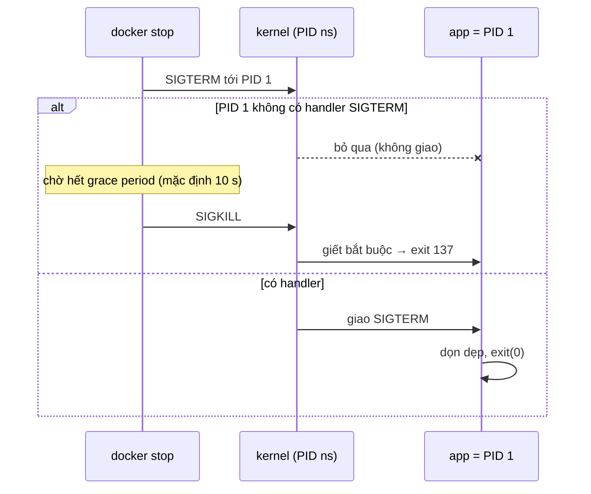
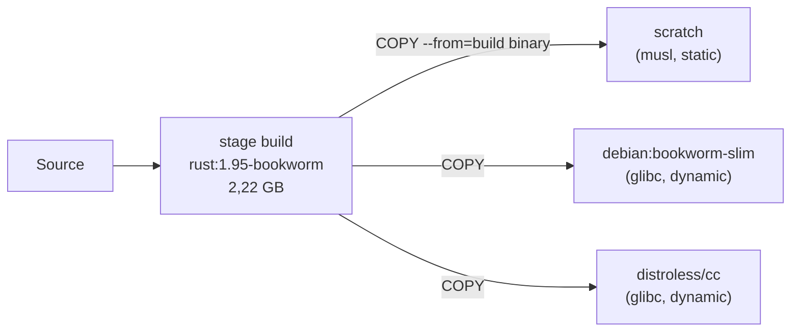

# P8 · Chương 08 — Rust trong container

## Bạn sẽ hiểu được gì

1. **Q1.** Với `docker run --cpus=1` trên máy 4 core, `available_parallelism()` và số worker mặc định của Tokio là bao nhiêu; đó là bảo đảm của docs hay chi tiết cài đặt? → mục 1
2. **Q2.** Vì sao service Rust dùng glibc `malloc` có thể phình RSS dù đã giới hạn CPU, và `MALLOC_ARENA_MAX` / `#[global_allocator]` đổi được gì? → mục 2
3. **Q3.** Vì sao process Rust làm PID 1 không chết khi nhận `SIGTERM`, `docker stop` mất bao lâu, và `--init` / handler thay đổi kết quả ra sao? → mục 3
4. **Q4.** Graceful shutdown bằng `tokio::signal` hay `signal-hook`; bẫy khi chỉ lắng nghe `ctrl_c`? → mục 4
5. **Q5.** Multi-stage build cho Rust; `scratch` + musl so với `debian-slim` / distroless + glibc nặng bao nhiêu (đo thật)? → mục 5
6. **Q6.** `strip`, `lto`, `panic = "abort"` làm binary nhỏ đi bao nhiêu và đánh đổi gì? → mục 6
7. **Q7.** Chạy non-root, probe của Kubernetes và logging ra stdout: mỗi thứ cần gì từ phía ứng dụng? → mục 7

## Kiến thức cần trước

- [P8·02 — Namespaces](02-namespaces.md): PID namespace và PID 1 ("init bất tử" trước tín hiệu không có handler).
- [P8·03 — cgroups v2](03-cgroups-v2.md): `cpu.max`, `memory.max`; chương đó đã có phần "Liên hệ với Rust" về `available_parallelism` — chương này dùng lại kết quả và mở rộng sang Tokio và allocator.
- [P1·05 — Signal](../01-linux/05-signal.md): disposition, handler, `SIGTERM` vs `SIGKILL`.
- [P3·06 — Heap allocator](../03-memory/06-heap-allocator.md): arena, `M_ARENA_MAX`, jemalloc/mimalloc.
- [P7·08 — Tokio](../07-io-async/08-tokio.md): multi-thread scheduler, graceful shutdown.

## 0. Môi trường và phạm vi

Chương này thuần Rust: mọi mục là "Liên hệ với Rust" của kiến thức container ở các chương 01–07. Các số đo đều chạy thật trong Docker Engine 29.5.2 chạy trong VM Linux của Colima trên máy Apple Silicon (cùng môi trường với các chương 01–07): VM Linux **aarch64, 4 vCPU, cgroup v2**, image lab `rust:1.95-bookworm` (rustc 1.95.0, glibc 2.36). Vì là aarch64 nên target musl là `aarch64-unknown-linux-musl`, không phải `x86_64-...`; kích thước trên x86-64 sẽ khác. Mọi con số là **quan sát của một lần chạy trên máy này**, không phải bảo đảm.

Tokio ghim `=1.53.2`; docs.docker.com, Docker Hub, kubernetes.io và README distroless **không ghim phiên bản** (là bản trang tại lúc soạn).

## 1. CPU: Rust và Tokio thấy mấy CPU trong container? (Q1)

> **Trả lời ngắn.** Trên Linux, `available_parallelism()` có đọc giới hạn cgroup: trong lần đo của chúng tôi nó trả 1 khi `--cpus=1` và làm tròn xuống (`--cpus=1.5` → 1). Docs nói nó có thể đếm dư khi không truy vấn được affinity mask hay cgroup fs, và còn nêu các giới hạn khác (phân tích đầy đủ ở [P8·03](03-cgroups-v2.md)); cách làm tròn là chi tiết cài đặt trong source[^rs-over][^rs-quota]. Số worker mặc định của Tokio là số core khả dụng theo docs[^tokio-default]; lần đo khớp `available_parallelism` vì source Tokio 1.53.2 gọi hàm đó[^tokio-src-numcpus], nhưng docs Tokio không hứa điều này.

**Giải thích.**

Hình dung (nhận xét của người soạn): tòa nhà có 4 phòng họp (4 core), nhưng công ty bạn chỉ được cấp ngân sách 100 ms phòng họp trong mỗi 100 ms. Kéo 64 người vào cùng lúc thì ngân sách cạn sau vài chục ms rồi cả đám đứng chờ đến kỳ sau. Số phòng (CPU của host) và ngân sách (quota) là hai con số khác nhau; runtime phải hỏi đúng con số thứ hai.

*Bước 1 — quota là băng thông, không phải số core.* Hết quota thì thread bị chặn đến period kế (throttled)[^bwc-throttle]; ví dụ tính quota cho 4 thread và số đo `nr_throttled` nằm ở [P8·03 mục 5](03-cgroups-v2.md). `nproc` và `getconf _NPROCESSORS_ONLN` không theo quota (đo ở bảng phần Đi sâu và mục 2). Chương trình tạo 64 thread vì thấy 64 core trong khi quota chỉ là 1 core sẽ bị throttle và (suy luận của người soạn) tăng tail latency; xem thêm [P4·02](../04-concurrency/02-scheduling.md).

*Bước 2 — `available_parallelism` làm gì.* Docs và source 1.95.0 đã được đọc ở [P8·03, phần Liên hệ với Rust](03-cgroups-v2.md); kết quả cần nhớ ở đây: trường hợp thường hàm **có** xét cgroup quota (docs chỉ nói nó có thể đếm dư khi `sched_getaffinity()` hay cgroup fs không truy vấn được, ví dụ do sandbox, và còn nêu các giới hạn khác nên không nên đọc thành "chỉ sai khi không đọc được")[^rs-over]; kết quả là `min(số CPU trong affinity mask, floor(quota/period))`, tối thiểu 1, làm tròn xuống là chi tiết cài đặt trong source, có thể đổi[^rs-quota]. Giá trị không được cache mà tính lại mỗi lần gọi[^rs-nocache] (nên đừng gọi trong hot path; còn quota đổi lúc runtime thì lần gọi sau thấy giá trị mới).

*Bước 3 — Tokio.* `Builder::worker_threads` đặt số worker thread mà Runtime dùng[^tokio-docs]; giá trị mặc định là số core khả dụng của hệ thống[^tokio-default] và biến môi trường `TOKIO_WORKER_THREADS` bị `worker_threads()` ghi đè[^tokio-env]. Docs không nhắc "cgroup", nên đọc docs thôi thì chưa biết "core khả dụng" có tính quota không. Source Tokio 1.53.2 (chi tiết cài đặt, không phải lời hứa) trả lời: khi không có `TOKIO_WORKER_THREADS`, `num_cpus()` gọi `std::thread::available_parallelism()`[^tokio-src-numcpus]. Ta kiểm lại bằng cách hỏi runtime (`Runtime::metrics().num_workers()`, API của Tokio 1.53.2) cạnh `available_parallelism`; số đo ở phần Đi sâu.

Hệ quả thực tế (dựa trên quan sát đó):

- `--cpus=1` → **một** worker thread (quan sát). Nếu worker duy nhất bị một task chặn (CPU nặng hoặc blocking I/O trên thread async) thì không còn worker nào chạy các task còn lại (suy luận của người soạn; cơ chế và số đo ở [P7·08 §4](../07-io-async/08-tokio.md)). Với quota 1 core, đưa blocking I/O sang `spawn_blocking` (nhận xét của người soạn).
- Pool khác của bạn (thread pool DB, thread pool tự viết, thư viện tự đo CPU) chỉ khớp quota nếu số luồng lấy từ `available_parallelism` hoặc từ cgroup; `nproc` thì không (bảng Đi sâu). Số kết nối DB tối đa theo `workers × k` cũng nên suy ra từ đó chứ không hard-code (nhận xét của người soạn).
- Quota là *băng thông*, không phải số core: thêm thread vượt quota không làm tăng tổng CPU time được cấp, chỉ làm quota cạn sớm hơn (suy luận của người soạn từ cơ chế throttle[^bwc-throttle]); phép tính minh họa và số đo `nr_throttled` ở [P8·03 §5](03-cgroups-v2.md).
- Docs của `available_parallelism` chỉ nói về CPU. Heap sizing/cache size phải tự đọc `memory.max` (xem [P8·03 §4 và §8](03-cgroups-v2.md)).

<details><summary>Đi sâu: bảng đo <code>available_parallelism</code> và <code>num_workers</code> theo cờ Docker</summary>

Chương trình 1 dòng `println!("{:?}", std::thread::available_parallelism())`, build bằng `rustc -O` một lần và chạy dưới các cờ khác nhau (cùng binary, cùng máy 4 vCPU). Bảng đo theo `--cpus` và `--cpuset-cpus` đã ghi ở [P8·03, phần Liên hệ với Rust](03-cgroups-v2.md) và lần đo ở đây cho cùng kết quả (không cờ → 4; `--cpus=1` → 1; `--cpus=2` → 2; `--cpus=1.5` → 1 vì làm tròn xuống: bạn xin 1,5 core nhưng pool mặc định chỉ có 1 thread; muốn 2 thì phải đặt tay, làm tròn xuống tránh throttle nhưng bỏ phí 0,5 core — nhận xét của người soạn). Hàng chỉ có ở đây là tổ hợp hai giới hạn:

| Lệnh `docker run` | `cpu.max` trong container | `cpuset.cpus.effective` | `nproc` | `available_parallelism()` |
|---|---|---|---|---|
| `--cpus=1 --cpuset-cpus=0-2` | `100000 100000` | `0-2` | 3 | `Ok(1)` |

Đọc bảng: `nproc` không đổi theo `--cpus` nhưng đổi theo `--cpuset-cpus` (ở đây 3), còn `available_parallelism` lấy nhỏ hơn giữa số CPU trong affinity (3) và quota (1) nên ra **1**.

Số worker của Tokio, in cạnh `available_parallelism`:

```rust
fn main() {
    let rt = tokio::runtime::Runtime::new().unwrap();
    println!("available_parallelism={:?} tokio num_workers={}",
        std::thread::available_parallelism(), rt.metrics().num_workers());
}
```

| Cờ | `available_parallelism` | `num_workers` (glibc build) | `num_workers` (musl build) |
|---|---|---|---|
| (không cờ) | `Ok(4)` | 4 | 4 |
| `--cpus=1` | `Ok(1)` | 1 | 1 |
| `--cpus=2` | `Ok(2)` | 2 | 2 |
| `--cpus=1 -e TOKIO_WORKER_THREADS=2` | `Ok(1)` | 2 | (không đo) |

Quan sát này chỉ nói *trên Tokio 1.53.2 và Rust 1.95.0*, số worker trùng `available_parallelism`. Lý do nằm ở source (chi tiết cài đặt, không phải lời hứa của docs): khi không có `TOKIO_WORKER_THREADS`, `num_cpus()` của Tokio gọi `std::thread::available_parallelism()`[^tokio-src-numcpus]; hàng cuối bảng cho thấy biến môi trường thắng.

</details>

**Quay lại Q1:** `available_parallelism()` theo quota cgroup (làm tròn xuống) và Tokio khớp nó vì source Tokio 1.53.2 gọi hàm đó; docs Tokio không hứa như vậy.

## 2. Bộ nhớ: arena của glibc đếm CPU của host (Q2)

> **Trả lời ngắn.** glibc cấp cho thread một *arena* (heap riêng) tới một giới hạn; mặc định giới hạn đó tính theo số core CPU *online* (8 lần trên 64-bit)[^glibc-arena-max]. Trong container số này là của host chứ không phải quota cgroup (quan sát ở phần Đi sâu: 32 arena = 8 × 4 dưới `--cpus=1`). Nhiều arena thì dùng nhiều bộ nhớ hơn[^mallopt-arena-tradeoff], mà bộ nhớ anonymous của process được tính vào cgroup[^cg-tracked], nên RSS phình có thể dẫn tới OOM-kill. `MALLOC_ARENA_MAX` chặn số arena[^glibc-arena-env]; `#[global_allocator]` thay hẳn allocator[^rs-global]; tác dụng thật phụ thuộc workload.

**Giải thích.**

Hình dung (nhận xét của người soạn): mỗi nhân viên được phát một kệ hàng riêng cho khỏi chen nhau, và số kệ cho phép tính theo số cửa của tòa nhà (CPU host) chứ không theo ngân sách thuê kho (quota). Kệ của người này trống chỗ thì người khác không được mượn, nên kho đầy dần.

Docs Rust không chỉ định allocator toàn cục mặc định[^alloc-global]. `System` là allocator do hệ điều hành cung cấp[^rs-system-def]; trên Unix nó dựa vào `malloc`[^rs-system]. Source std 1.95.0 (chi tiết cài đặt, có thể đổi) dùng `System` làm fallback khi chương trình không có `#[global_allocator]`[^rs-default-lib], nên trên image glibc (debian, `rust:*-bookworm`) cấp phát mặc định đi qua ptmalloc của glibc (suy luận của người soạn từ hai điều trên). glibc cho mỗi thread mới một arena riêng đến một giới hạn cấu hình được, sau đó các arena được dùng chung giữa nhiều thread[^glibc-arena-thread] ([P3·06 §7](../03-memory/06-heap-allocator.md)). Giới hạn mặc định, theo manual glibc, được xác định bằng số core online; trên 64-bit là **tám lần** số core online[^glibc-arena-max]. Trong container giới hạn này vẫn dựa trên CPU của host (quan sát ở phần Đi sâu); lý do là cgroup quota không đổi số core online (suy luận của người soạn).

Ba lựa chọn:

1. Đặt `MALLOC_ARENA_MAX` (biến môi trường; đổi mà không build lại)[^glibc-arena-env]. Đánh đổi: nhiều thread tranh một vài arena nên tăng contention khóa (nhận xét của người soạn, cơ chế ở [P3·06 §7](../03-memory/06-heap-allocator.md)).
2. Đăng ký allocator khác bằng `#[global_allocator]`, thuộc tính đăng ký allocator thay cho mặc định của thư viện chuẩn[^rs-global]. jemalloc và mimalloc có thiết kế đa luồng riêng, tài liệu và đánh đổi ở [P3·06 §9](../03-memory/06-heap-allocator.md); cách đăng ký trong Rust ở [P3·06 §10](../03-memory/06-heap-allocator.md) và [P3·08 §5](../03-memory/08-rust-va-bo-nho.md). Chương này không đo chúng, nên không khẳng định con số.
3. Build musl: libc là musl và cấp phát qua malloc của musl (suy luận của người soạn; chương này không đo hành vi đó), nên đừng suy ra "musl hết vấn đề arena" (đừng đồng nhất "đổi libc" với "giải quyết" khi chưa đo).

<details><summary>Đi sâu: thí nghiệm đếm arena và RSS dưới <code>--cpus=1</code></summary>

Chương trình (unsafe FFI tới `malloc_info`): N thread, mỗi thread cấp 20.000 khối nhỏ (200–584 byte), giữ lại 1/10 và giải phóng 9/10 (để lại lỗ hổng trong arena của chính nó), dừng ở barrier; main in số phần tử `<heap nr=...>` trong `malloc_info` và `VmRSS`. Chạy `--cpus=1 --memory=512m` trên host 4 vCPU (`getconf _NPROCESSORS_ONLN` = 4 trong container):

| Số thread | arena mặc định | RSS mặc định | `MALLOC_ARENA_MAX=1` | `MALLOC_ARENA_MAX=2` |
|---|---|---|---|---|
| 1 | 2 | 9.972 kB | 1 arena, 9.964 kB | 2 arena, 9.972 kB |
| 16 | 17 | 134.412 kB | 1 arena, 67.872 kB | 2 arena, 58.400 kB |
| 64 | 32 | 311.596 kB | 1 arena, 377.456 kB | 2 arena, 252.536 kB |

(Chạy lại 3 lần ở 16 thread: mặc định 134.416–134.424 kB; `ARENA_MAX=2` 65.496–79.032 kB.)

Đọc kết quả, trung thực:

- Số arena **không** theo quota `--cpus=1` mà theo CPU host: 64 thread dừng ở **32 = 8 × 4**, đúng công thức của manual (arena đếm cả main arena trong `malloc_info`; ta chỉ dùng con số 32 để khớp 8×4, không suy rộng hơn).
- Ở 16 thread, mặc định tốn khoảng 2× RSS so với `ARENA_MAX=2` trong workload này. Nguyên nhân có thể là mỗi thread có arena riêng nên lỗ hổng của arena này không dùng lại được cho thread khác (giải thích của người soạn; ta không đo từng arena).
- Ở 64 thread, `ARENA_MAX=1` lại **tệ hơn** (377 MB). Workload tổng hợp này không đủ để kết luận "ít arena luôn nhỏ hơn"; hiệu ứng phụ thuộc mẫu cấp/giải phóng. Muốn kết luận cho service của bạn phải đo service của bạn.
- Hiệu ứng nguy hiểm trên host lớn: máy 64 core cho tới 512 arena (8 × 64) trong khi pod chỉ có quota 2 core (suy luận từ công thức; **không đo được** ở đây vì chỉ có 4 vCPU). Bộ nhớ anonymous được tính vào cgroup[^cg-tracked] (xem [P8·03 §4](03-cgroups-v2.md)), nên RSS phình có thể dẫn đến OOM-kill chứ không chỉ chậm.

</details>

**Quay lại Q2:** số arena glibc theo CPU của host chứ không theo quota, nên RSS có thể phình trong container; `MALLOC_ARENA_MAX` hoặc allocator khác là đòn bẩy, nhưng phải đo workload của bạn.

## 3. PID 1 và signal (Q3)

> **Trả lời ngắn.** Process đầu tiên trong PID namespace là "init" của namespace đó, và kernel chỉ giao cho nó những signal mà nó đã tự đặt handler (trừ `SIGKILL`/`SIGSTOP` từ namespace tổ tiên)[^pid-sig][^pid-anc-handler][^pid-anc]. Rust std không cài handler `SIGTERM` (đọc `SigCgt` của một chương trình thử, xem Đi sâu), nên app Rust làm PID 1 mà không tự đăng ký handler sẽ bỏ qua `SIGTERM`; `docker stop` chờ hết grace period (10 giây mặc định) rồi `SIGKILL`[^docker-stop][^docker-timeout]. `--init` làm app chết ngay nhưng không graceful; chỉ handler `SIGTERM` mới cho graceful.

**Giải thích.**

Hình dung (nhận xét của người soạn): PID 1 như bảo vệ tòa nhà được giao quy tắc "chỉ nghe lệnh ghi trong sổ tay riêng của mình": ai gọi "đóng cửa" (`SIGTERM`) mà sổ tay chưa có mục đó thì anh ta lờ đi; chỉ lệnh cưỡng chế từ ban quản lý bên ngoài (`SIGKILL`) mới có hiệu lực.

*Bước 1 — kernel chặn signal tới init.* Luật đầy đủ nằm ở [P8·02 mục 4](02-namespaces.md) và [P1·05 mục 8](../01-linux/05-signal.md); tóm tắt: thành viên khác trong namespace chỉ gửi được signal mà init đã đặt handler, kể cả process có đặc quyền[^pid-sig]; process ở namespace tổ tiên (như daemon Docker ở host) cũng chỉ gửi được signal mà init có handler[^pid-anc-handler], ngoại lệ là `SIGKILL` và `SIGSTOP`, được cưỡng bức giao[^pid-anc]. Hệ quả: `SIGTERM` mặc định có hành động "Term", nhưng với PID 1 không handler thì **bị bỏ qua**. Docker: tiến trình chính trong container nhận `SIGTERM`, rồi sau grace period nhận `SIGKILL`[^docker-stop]; mặc định grace period là 10 giây trên Linux[^docker-timeout].



*Bước 2 — đo `docker stop`.* Mỗi dòng: `docker run -d`, chờ 1 giây, đo thời gian `docker stop` (gồm overhead của lệnh), đọc exit code.


| Chương trình (PID 1 trừ khi ghi) | Thời gian `docker stop` | Exit code | Log |
|---|---|---|---|
| vòng lặp `sleep`, **không** handler | **10,02 s** | 137 | `pid=1 up` |
| như trên, `--stop-timeout 3` | 3,06 s | 137 | |
| như trên, `docker run --init` | 0,11 s | 143 | `pid=7 up` |
| chỉ `tokio::signal::ctrl_c()` (lắng nghe SIGINT) | **10,00 s** | 137 | |
| như trên, `--init` | 0,09 s | 143 | |
| `tokio::signal::unix::signal(SignalKind::terminate())`, drain 200 ms | 0,30 s | **0** | `got SIGTERM, draining` / `bye` |

Đọc: 137 = 128 + 9 (`SIGKILL`) và 143 = 128 + 15 (`SIGTERM`) theo quy ước 128+N của bash khi lệnh chết vì signal N[^bash-128]; cột Exit code ở đây là giá trị Docker báo (quan sát). Hàng 3: với `--init`, app không còn là PID 1 (là PID 7) nên không có đặc cách của init; README của tini nói với tini thì `SIGTERM` kết thúc process ngay cả khi bạn không cài handler[^tini-sigterm], khớp với exit 143. Docker mô tả `--init` là cho phép init process làm PID 1 để thực hiện trách nhiệm của init như reap zombie, và binary `docker-init` mặc định chạy bằng tini[^docker-init]. Hàng 4/5 là bẫy thật: **chỉ xử lý `ctrl_c` (SIGINT) trên PID 1 không cứu được `docker stop`** vì `docker stop` gửi SIGTERM mặc định[^docker-stop].

Trên Kubernetes cùng cơ chế: kubelet thường nhờ runtime gửi TERM tới main process của mỗi container với grace period (nhiều runtime tôn trọng `STOPSIGNAL` trong image và có thể gửi signal khác)[^k8s-term], hết grace period thì gửi KILL cho process còn lại[^k8s-kill]. Một app Rust PID 1 không handler sẽ chịu trọn grace period (mặc định `terminationGracePeriodSeconds` là 30 giây[^k8s-grace-default]) rồi bị kill, và mọi request đang dở bị đứt (suy luận của người soạn từ cơ chế PID 1 ở trên).

*Bước 3 — hai cách sửa.*

1. **Cài handler `SIGTERM` trong app** (mục 4). Cách chính; PID 1 có handler thì nhận signal bình thường (đo hàng cuối bảng).
2. **`docker run --init`** (hoặc `tini` trong image). Trong Kubernetes cách thường gặp là đặt tini vào `ENTRYPOINT` của image (nhận xét của người soạn; chương này không đối chiếu pod spec). Đáng dùng thêm khi app *fork* con (reap zombie, chương [P1·03](../01-linux/03-process.md) và [P1·05 §7](../01-linux/05-signal.md)). Nhưng nó không thay handler: nếu app không bắt `SIGTERM`, app chết ngay (exit 143) và **không graceful**.

Bẫy kèm: entrypoint dạng shell (`ENTRYPOINT ./app` hoặc `sh -c`) khiến shell là PID 1 và có thể không chuyển signal; dùng dạng exec (`ENTRYPOINT ["/app"]`) hoặc `exec ./app`. Chương này không đo bẫy shell nên chỉ nêu như lưu ý (nhận xét của người soạn).

<details><summary>Đi sâu: Rust có tự cài handler <code>SIGTERM</code> không? Đọc <code>SigIgn</code>/<code>SigCgt</code></summary>

Không (trong chương trình thử này). Đọc `/proc/1/status` của một process Rust 1.95.0 chỉ ngủ vòng lặp, chạy PID 1 trong container:

```
SigIgn:	0000000000001000
SigCgt:	0000000000000440
```

Bit (số signal − 1): `0x1000` = bit 12 = signal 13 = `SIGPIPE` bị bỏ qua (runtime Rust trên Unix đặt handler `SIGPIPE` thành `SIG_IGN`[^rs-sigpipe]); `0x440` = bit 6 và bit 10 = signal 7 (`SIGBUS`) và 11 (`SIGSEGV`) có handler (std dùng cho phát hiện stack overflow[^rs-so]; cách giải mã bit là số học của người soạn). `SIGTERM` = signal 15 = bit 14 = `0x4000`: **không có** trong `SigCgt`. Đúng như kỳ vọng, `docker exec <c> kill -TERM 1` xong, container vẫn `Running=true` (quan sát).

</details>

**Quay lại Q3:** PID 1 chỉ nhận signal mà nó có handler, Rust không tự cài handler `SIGTERM`, nên phải tự bắt `SIGTERM` (mục 4); `--init` chỉ làm app chết ngay, không làm nó graceful.

## 4. Graceful shutdown bằng Rust (Q4)

> **Trả lời ngắn.** Bắt `SIGTERM` (signal mà `docker stop` gửi mặc định[^docker-stop]) bằng `tokio::signal::unix::signal(SignalKind::terminate())` trong code async, hoặc `signal-hook` cho code không async; sau đó drain rồi để `main` trả về. Bẫy: chỉ `await signal::ctrl_c()` (SIGINT[^tokio-ctrlc][^tokio-nodefault]) không cứu được `docker stop` trên PID 1.

**Giải thích.**

Hình dung (nhận xét của người soạn): nhân viên trực chỉ chờ chuông điện thoại bàn (SIGINT, ngồi gõ Ctrl+C ở máy dev) trong khi ban quản lý báo giờ đóng cửa bằng loa (SIGTERM); không nghe loa thì chỉ còn bị đuổi cưỡng chế.

`signal::ctrl_c()` hoàn tất khi process nhận thông báo "ctrl-c"[^tokio-ctrlc]; để bắt `SIGTERM` dùng `signal::unix::signal(SignalKind::terminate())`, trong đó `SignalKind::terminate()` đại diện signal SIGTERM, được gửi trên Unix để yêu cầu process tắt[^tokio-term]. Ví dụ ta đã chạy (current_thread):

```rust
use tokio::signal::unix::{signal, SignalKind};
#[tokio::main(flavor = "current_thread")]
async fn main() {
    println!("pid={} up", std::process::id());
    let mut term = signal(SignalKind::terminate()).unwrap();
    term.recv().await;
    println!("got SIGTERM, draining");
    tokio::time::sleep(std::time::Duration::from_millis(200)).await;
    println!("bye");
}
```

Kết quả trong bảng ở mục 3 (0,30 s, exit 0). Trong service thật, `recv()` đứng trong `select!` với `ctrl_c` (cho phát triển cục bộ), rồi phát tín hiệu hủy cho các task và chờ chúng xong; phần cấu trúc "biết lúc nào tắt, báo tắt, chờ tắt" đã nằm ở [P7·08 §8](../07-io-async/08-tokio.md), chương này không lặp. Ba điều cần ghi trong ngữ cảnh container:

- Phải có `SIGTERM`, không chỉ `ctrl_c` (bảng mục 3).
- Docs Tokio cảnh báo: khi một handler signal đã đăng ký thì handler libc bên dưới không bao giờ bị hủy đăng ký[^tokio-noreset]; với `ctrl_c`, docs nói rõ thả `Signal` không phục hồi hành vi mặc định[^tokio-nodefault]. Suy luận của người soạn: sau khi bạn bắt `SIGTERM`, *chính bạn* phải thoát; nếu code tắt bị treo, `docker stop` vẫn chờ hết grace period rồi `SIGKILL`.
- Đặt thời hạn cho giai đoạn drain nhỏ hơn grace period (nhận xét của người soạn); sau thời hạn thì thoát bằng mã khác 0 thay vì treo.

<details><summary>Đi sâu: <code>signal-hook</code> cho code không async, và <code>process::exit</code></summary>

**`signal-hook`.** Crate `signal-hook` 0.4.5 (docs.rs ghim) tự mô tả là thư viện cho xử lý signal Unix dễ hơn và an toàn[^sh-lib]. Lý do signal khó: là tài nguyên toàn cục[^sh-global], và theo POSIX tập hàm gọi được trong handler rất hạn chế[^sh-hard] (xem async-signal-safety ở [P1·05 §6](../01-linux/05-signal.md)). Module `flag` đặt cờ atomic khi signal đến và cho phép bảo đảm ứng dụng tắt ở lần Ctrl+C thứ hai nếu nó kẹt trong graceful shutdown do lần đầu yêu cầu[^sh-flag]. Module này kiểu *poll*: cờ không chặn để chờ, nên hợp với vòng lặp có điểm kiểm tra định kỳ[^sh-poll]. Ta không chạy ví dụ `signal-hook` trong chương này, nên không có số đo kèm.

**Thoát bằng `process::exit`?** `std::process::exit` không chạy destructor của stack hiện tại hay thread khác[^rs-exit]; docs khuyến nghị trả `ExitCode`/`Result` từ `main` thay vì gọi `exit`[^rs-exit-ret]. Với shutdown có flush (WAL, buffer, kết nối DB), hãy để `main` trả về bình thường sau khi các task hoàn tất (nhận xét của người soạn).

</details>

**Quay lại Q4:** bắt `SIGTERM` (không chỉ `ctrl_c`), drain có thời hạn, rồi để `main` trả về.

## 5. Image: multi-stage, musl vs glibc, kích thước (Q5)

> **Trả lời ngắn.** Dùng multi-stage: stage build giữ toolchain nặng, stage cuối chỉ copy binary vào[^docker-multi]. Với cùng một binary Tokio nhỏ, image `scratch` + musl đo được 824 kB, distroless/cc 48,3 MB và debian-slim 137 MB (quan sát một lần chạy, aarch64, `docker images`); chênh lệch chủ yếu đến từ base image chứ không từ binary.

**Giải thích.**

Hình dung (nhận xét của người soạn): bạn chuyển nhà bằng cách mang đúng chiếc ghế sofa (binary) sang nhà mới, chứ không khiêng cả xưởng mộc (toolchain). Nhà mới có thể là căn phòng trống (`scratch`), phòng có sẵn điện nước (distroless) hoặc cả chung cư đầy đủ tiện nghi (debian-slim).

Docker mô tả multi-stage: mỗi `FROM` mở một stage mới, bạn chọn copy artifact từ stage này sang stage khác và bỏ lại mọi thứ không muốn có trong image cuối[^docker-multi]. Với `FROM scratch`, stage mới lấy image `scratch` làm base[^docker-scratch], nên chỉ có những gì `COPY --from` mang vào (quan sát: image `scratch` của ta chỉ có đúng một lớp `COPY`). Rust hợp với mô hình này: toolchain nặng (image build `rust:1.95` hiển thị **2,22 GB** trên máy này) chỉ ở stage build; stage chạy chỉ cần một binary. Docker Hub liệt kê cho image `rust` các biến thể `slim`[^hub-rust] (không ghim tag: trang hiển thị 1.99 lúc soạn, ta dùng `rust:1.95-bookworm` để khớp toolchain của bộ giáo trình).



*Static (musl) hay dynamic (glibc).*

Reference của Rust: mỗi target có chế độ C runtime mặc định; thường target link động theo mặc định nhưng có ngoại lệ link tĩnh, trong đó liệt kê `x86_64-unknown-linux-musl`[^rs-static]; docs lấy `x86_64-unknown-linux-musl` làm ví dụ target đi kèm cả hai runtime để người dùng chọn[^rs-crt] (qua `-C target-feature=+crt-static` / `-crt-static`, cú pháp có trong cùng mục Linkage của Reference). Chúng ta chạy với `aarch64-unknown-linux-musl` (đã `rustup target add` trong container build) và `file` báo kết quả `statically linked`; bảng rustc book về tier-2 có `aarch64-unknown-linux-musl` đi kèm musl 1.2.5[^rustc-musl]. Danh sách trong Reference chỉ nêu x86_64, nhưng source target spec 1.95.0 của chính `aarch64-unknown-linux-musl` cũng đặt `crt_static_default = true` (kèm FIXME của team compiler)[^rs-a64-musl-crt] — nên kết quả static trên aarch64 khớp mặc định của target (chi tiết cài đặt, có thể đổi), không chỉ là quan sát; phần musl/static đầy đủ ở [P11·06 mục 7](../11-do-dac-va-go-loi/06-elf-linker-loader.md).

Kết quả đo: base image mới là thứ quyết định kích thước; binary glibc còn *nhỏ hơn* binary musl khoảng 65 kB (có thể vì musl build kèm libc tĩnh: suy luận của người soạn). Lớp distroless/cc có sẵn CA bundle và tzdata mà `scratch` không có; nếu app Rust gọi HTTPS ra ngoài, trên `scratch` bạn phải tự `COPY` CA bundle (nhận xét của người soạn).

Lựa chọn (nhận xét của người soạn): `scratch` nhỏ nhất, attack surface nhỏ nhất, nhưng không shell để `docker exec` debug, không CA, không `/etc/passwd`/tzdata; distroless/cc vừa phải (glibc + CA + tzdata, không shell); `debian-slim` dễ debug (có shell, `apt`) nhưng to hơn nhiều và nhiều package hơn để vá. Static musl còn cho phép image chạy mọi nơi không cần khớp glibc (suy luận của người soạn), nhưng bạn chuyển sang malloc của musl (xem mục 2).

<details><summary>Đi sâu: Dockerfile đã build và bảng đo kích thước</summary>

Dockerfile đã build thật (stage chạy dùng UID số, không cần `adduser` vì `scratch` không có `/etc/passwd`; xem mục 7):

```dockerfile
FROM rust:1.95-bookworm AS build
RUN rustup target add aarch64-unknown-linux-musl
WORKDIR /app
COPY Cargo.toml Cargo.lock ./
COPY src ./src
RUN cargo build --release --target aarch64-unknown-linux-musl --bin handler

FROM scratch
COPY --from=build /app/target/aarch64-unknown-linux-musl/release/handler /handler
USER 10001:10001
ENTRYPOINT ["/handler"]
```

Hai biến thể còn lại giống hệt, chỉ khác `cargo build --release` (glibc) và stage cuối `FROM debian:bookworm-slim` hoặc `FROM gcr.io/distroless/cc-debian12:nonroot`. Distroless tự mô tả: image chỉ chứa ứng dụng và dependency lúc chạy, không có package manager, shell hay chương trình nào khác của một bản phân phối Linux chuẩn[^distroless].

*Đo kích thước (app Tokio có `signal`, `time`, `rt-multi-thread`).*

| Image | `docker images` SIZE | Lớp chứa binary (`docker history`) | Binary |
|---|---|---|---|
| `scratch` + musl (static) | **824 kB** | 537 kB | 528.592 B |
| `debian:bookworm-slim` + glibc | **137 MB** (base đơn lẻ: 138 MB) | 483 kB | 463.632 B |
| `distroless/cc-debian12:nonroot` + glibc | **48,3 MB** | 483 kB | 463.632 B |
| (stage build) `rust:1.95` | 2,22 GB | — | — |

Đọc kỹ: (1) binary Rust glibc *nhỏ hơn* binary musl 65 kB trong thí nghiệm này (có thể vì musl build kèm libc tĩnh: suy luận của người soạn); chênh nhỏ so với phần base image. (2) Khác biệt lớn đến từ base image: `docker history` của slim có một lớp Debian 108 MB, so với ~0 của scratch (tổng SIZE 137 MB; ta không phân rã phần còn lại. Base đơn lẻ đo 138 MB, lớn hơn 137 MB của image đã thêm binary; ta không giải thích được chênh 1 MB này). (3) Lớp distroless/cc gồm libc6 24,1 MB, libssl3 5,94 MB, tzdata 4,24 MB, libstdc++6 2,39 MB, CA certs 319 kB, v.v. (cũng từ `docker history`): có sẵn CA bundle và tzdata, thứ mà `scratch` không có (quan sát: `scratch` chỉ có đúng một lớp `COPY`). (4) Dùng `docker save | wc -c` thì ra 299.520 B (scratch), 28.383.744 B (slim) và 9.246.720 B (distroless) — số nén khác với cột SIZE; so sánh luôn cùng một thước đo.

</details>

**Quay lại Q5:** multi-stage cho phép chỉ giữ binary ở stage cuối; kích thước image do base quyết định (scratch+musl 824 kB so với slim 137 MB trong lần đo này).

## 6. Profile release: `strip`, `lto`, `panic` (Q6)

> **Trả lời ngắn.** Trong lần đo của chúng tôi, `strip = true` ăn gần hết: binary Tokio từ 4.808.416 B còn 594.712 B; thêm `lto` và `panic = "abort"` còn 463.632 B. Cái giá: `strip` bỏ symbol, `lto` kéo dài link time[^cargo-lto], và `panic = "abort"` kết thúc process khi panic[^cargo-panic], tức đổi ngữ nghĩa chứ không chỉ tối ưu kích thước (nhận xét của người soạn).

**Giải thích.**

Hình dung (nhận xét của người soạn): `strip` như gỡ nhãn tên khỏi mọi ngăn kéo (nhỏ hơn nhưng mất tên khi debug), `lto` như cho cả nhà kho được sắp xếp lại một lượt (tốn thêm thời gian), `panic = "abort"` như bỏ hẳn quy trình dọn dẹp khi sự cố, chỉ còn "tắt điện cả tòa".

Cargo book: `strip` nhận `none`/`debuginfo`/`symbols`, mặc định `none`[^cargo-strip]; `strip = true` tương đương `"symbols"`[^cargo-strip-bool]. `lto = true` hay `"fat"` cố tối ưu qua mọi crate trong đồ thị phụ thuộc[^cargo-lto-fat], với giá là link lâu hơn[^cargo-lto]. `panic = "abort"` kết thúc process khi panic[^cargo-panic]. Cái giá của `strip`: bỏ symbol, backtrace/profiler mất tên hàm (cần giữ file symbol riêng nếu muốn symbolicate; nhận xét của người soạn). **`panic = "abort"` đổi hành vi**: panic trong một task Tokio không còn bị chặn bởi `catch_unwind`/`JoinHandle` mà giết cả process; với service chạy nhiều request trên cùng process đó là thay đổi ngữ nghĩa (suy luận của người soạn từ định nghĩa "terminate the process"). Cargo book cũng lưu ý test, benchmark, build script và proc macro bỏ qua cài đặt `panic`[^cargo-panic-tests].

<details><summary>Đi sâu: bảng kích thước từng cờ và cấu hình đã dùng</summary>

Đo trên bin Tokio ở mục 5 (glibc, aarch64), bật từng cờ cộng dồn:

| Profile release | Kích thước binary |
|---|---|
| mặc định (strip=false, lto=false, unwind) | 4.808.416 B |
| + `strip = true` | 594.712 B |
| + `strip` + `lto = true` | 529.168 B |
| + `strip` + `lto` + `panic = "abort"` | 463.632 B |
| chỉ `lto = true` | 2.603.784 B |
| chỉ `panic = "abort"` | 4.685.136 B |

`strip` ăn gần hết (−88%), `lto` và `abort` mỗi cái thêm vài chục kB cho chương trình nhỏ này.

Cấu hình đã dùng:

```toml
[profile.release]
strip = true
lto = true
panic = "abort"
codegen-units = 1
```

(`codegen-units = 1` không thay đổi kích thước trong lần đo này: 463.632 B ở cả bản có và không có; chỉ giữ cho tối ưu hóa.)

</details>

**Quay lại Q6:** `strip` thu nhỏ nhiều nhất, `lto` vừa phải và đổi lại link lâu, còn `panic = "abort"` là thay đổi hành vi chứ không chỉ kích thước.

## 7. Vận hành: non-root, probe, log (Q7)

> **Trả lời ngắn.** Non-root: đặt `USER` với UID số trong Dockerfile[^docker-user]. Probe: app phải phơi endpoint riêng cho liveness (còn sống không, nếu hỏng thì restart[^k8s-live]) và readiness (sẵn sàng nhận traffic chưa[^k8s-ready]). Log: ghi ra stdout/stderr, Kubernetes và Docker đọc từ đó[^k8s-log].

**Giải thích.**

Hình dung (nhận xét của người soạn): nhà hàng cần đầu bếp không giữ chìa khóa két (non-root), biển "Đang mở/Đang dọn" cho khách (readiness), chuông hỏi "bếp còn sống không" (liveness), và mọi bill in ra một cửa sổ chung để quản lý đọc (stdout).

*Non-root.* `USER` đặt user (tên hoặc UID) và tùy chọn group (hoặc GID) làm user mặc định cho phần còn lại của stage[^docker-user]. Trong `scratch` không có `/etc/passwd` để tạo user, nên dùng UID số (`USER 10001:10001`) mà không cần tên. Lý do an ninh và `--cap-drop`, rootless, seccomp ở [P8·05](05-bao-mat-container.md).

*Probe.* Liveness probe phát hiện và xử lý các app rơi vào trạng thái hỏng mà chỉ restart mới hồi phục[^k8s-live]. Readiness probe dành cho app tạm thời chưa phục vụ được (ví dụ nạp dữ liệu lúc khởi động, phụ thuộc dịch vụ ngoài)[^k8s-ready-def]; pod chưa ready thì không nhận traffic qua Service[^k8s-ready]. Cho Rust service, nên đưa `/healthz` (chỉ kiểm process còn sống) khác `/readyz` (kiểm pool DB, cache đã nạp) (nhận xét của người soạn). Khi nhận `SIGTERM`, đổi `/readyz` thành lỗi *trước khi* ngừng nhận kết nối là mẫu thường dùng (nhận xét của người soạn).

*Log ra stdout.* Kubernetes: cách phổ biến nhất cho ứng dụng container là ghi ra standard output và standard error[^k8s-log]; `docker logs --follow` stream tiếp từ STDOUT và STDERR của container[^docker-logs]. Ta thấy điều đó trực tiếp: các dòng `println!` của chương trình ví dụ hiện trong `docker logs`. Với Rust: ghi stdout/stderr (ví dụ crate `tracing` + subscriber ra stdout; chương này không dùng nên không chạy), không tự quản lý file log xoay vòng trong container (nhận xét của người soạn). Ghi log đồng bộ trong async hot path có thể chặn worker thread (xem [P7·08 §4](../07-io-async/08-tokio.md)); dùng writer không chặn (nhận xét của người soạn, chưa đo).

<details><summary>Đi sâu: quan sát UID, <code>preStop</code>, probe trên <code>scratch</code></summary>

- Trong cả ba image thử, `USER` (hoặc `:nonroot` của distroless) cho PID 1 chạy UID **10001** (scratch, slim) hoặc **65532** (distroless), quan sát bằng `docker top`; cả ba vẫn dừng đúng (0,29–0,32 s, exit 0). `USER 10001:10001` trên `scratch` chạy bình thường (quan sát).
- Nếu một container của Pod có `preStop` hook và `terminationGracePeriodSeconds` khác 0, kubelet chạy hook đó bên trong container khi Pod bị tắt[^k8s-prestop].
- Probe lệnh `exec` cần binary trong image: trên `scratch` không có shell, nên dùng probe HTTP/TCP của kubelet thay vì `curl` (nhận xét của người soạn).

</details>

**Quay lại Q7:** non-root bằng UID số, hai endpoint probe khác nhau, và log ra stdout/stderr.

## Liên hệ với Rust (tổng hợp)

Cả chương là phần Rust. Bốn quyết định nên đưa vào checklist cho một service Rust container hóa:

1. Đặt kích thước mọi pool từ `available_parallelism()` (đã tính quota, làm tròn xuống) thay vì hard-code, nhớ rằng nó tính lại mỗi lần gọi (nhận xét của người soạn).
2. Bắt `SIGTERM` (không chỉ `ctrl_c`), có thời hạn drain < grace period; thêm `--init`/tini nếu app tạo process con.
3. Chọn libc/allocator có chủ đích: đo RSS của chính service dưới `--memory`, thử `MALLOC_ARENA_MAX` hoặc allocator khác.
4. Multi-stage, `USER` số, profile release; đo kích thước image bằng cùng một thước đo.

## Tóm tắt

- Trên Linux cgroup v2, `available_parallelism()` = min(affinity, ⌊quota/period⌋), tối thiểu 1 (source 1.95.0; chi tiết cài đặt); `--cpus=1.5` → 1 (đo); docs cảnh báo nó có thể overcount khi không đọc được cgroup/affinity[^rs-over][^rs-quota].
- Tokio 1.53.2: docs nói số worker mặc định là số core khả dụng của hệ thống[^tokio-default]; đo cho thấy nó khớp `available_parallelism` (1 khi `--cpus=1`) vì source gọi hàm đó[^tokio-src-numcpus]; `TOKIO_WORKER_THREADS` ghi đè.
- glibc: giới hạn mặc định 8 × số core online (64-bit) arena[^glibc-arena-max]; đo 32 arena ở 64 thread trong `--cpus=1` trên host 4 vCPU, tức theo CPU host chứ không theo quota; tác dụng lên RSS phụ thuộc workload.
- PID 1 không handler thì `SIGTERM` (gửi từ ngoài namespace, như `docker stop`) bị bỏ qua[^pid-anc-handler]; `docker stop` chờ 10,02 s rồi `SIGKILL` (exit 137). Rust std không cài handler `SIGTERM` (đọc `SigCgt`).
- `--init` làm app chết ngay (143, 0,11 s) nhưng không graceful; chỉ handler `SIGTERM` mới cho graceful (0,30 s, exit 0). Chỉ bắt `ctrl_c` không đủ.
- Multi-stage: scratch+musl 824 kB; distroless/cc 48,3 MB; debian-slim 137 MB (cùng binary Tokio nhỏ); chênh lệch đến từ base image.
- Profile release: `strip` giảm 4,8 MB → 595 kB; thêm `lto` và `panic=abort` còn 464 kB; `panic=abort` đổi ngữ nghĩa panic.
- Chạy non-root bằng UID số; probe liveness/readiness là việc của app phơi endpoint; log ra stdout/stderr.

## Câu hỏi tự kiểm tra

1. Container `--cpus=1.5` trên host 4 core: `nproc`, `available_parallelism()` và `num_workers` của Tokio mặc định là bao nhiêu? Vì sao có số 1?
<details><summary>Đáp án</summary>

`nproc` = 4 (không đổi theo `--cpus`), `available_parallelism` = 1 và Tokio có 1 worker trong thí nghiệm. Lý do: `quota()` làm tròn xuống[^rs-quota] (chi tiết ở [P8·03](03-cgroups-v2.md)); bảng đo ở mục 1 và ở P8·03 cho `--cpus=1.5` → `Ok(1)`. Tokio khớp vì source 1.53.2 gọi `available_parallelism()`[^tokio-src-numcpus], không phải vì lời hứa của docs[^tokio-default].

</details>

2. Khi nào `available_parallelism` có thể trả quá lớn so với quota?
<details><summary>Đáp án</summary>

Khi sched_getaffinity hoặc cgroup fs không truy vấn được, ví dụ do sandbox[^rs-over]; source cũng ghi cgroup v2 ở mountpoint không chuẩn là chưa được phủ[^rs-notcovered] ([P8·03](03-cgroups-v2.md)).

</details>

3. Vì sao 64 thread trong container `--cpus=1` trên host 4 vCPU cho 32 arena?
<details><summary>Đáp án</summary>

Giới hạn mặc định là 8 × số core online (host)[^glibc-arena-max]; 8 × 4 = 32, không liên quan quota.

</details>

4. `MALLOC_ARENA_MAX=1` luôn giảm RSS?
<details><summary>Đáp án</summary>

Không: ở 16 thread RSS giảm (134 → 68 MB) nhưng ở 64 thread tăng (311 → 377 MB) trong thí nghiệm; cần đo workload thật.

</details>

5. Giải thích vì sao PID 1 không handler không chết khi `docker stop`.
<details><summary>Đáp án</summary>

Signal tới init của PID namespace chỉ được giao nếu init có handler cho nó (trừ SIGKILL/SIGSTOP từ namespace tổ tiên)[^pid-sig][^pid-anc-handler][^pid-anc]; `SIGTERM` bị bỏ, Docker chờ 10 s rồi SIGKILL[^docker-stop][^docker-timeout]; đo 10,02 s, exit 137.

</details>

6. Với `--init`, app không handler chết ngay. Vì sao đó vẫn chưa phải graceful shutdown?
<details><summary>Đáp án</summary>

App không còn là PID 1 nên `SIGTERM` có hành động mặc định "kill" và dừng ngay (exit 143, 0,11 s); request dở bị cắt vì không có bước drain. Cần handler để drain.

</details>

7. Vì sao chương trình chỉ `await signal::ctrl_c()` vẫn mất 10 s khi `docker stop`?
<details><summary>Đáp án</summary>

`ctrl_c` là SIGINT[^tokio-ctrlc]; `docker stop` gửi SIGTERM mặc định[^docker-stop]; PID 1 không có handler SIGTERM → bị bỏ qua; đo 10,00 s, exit 137.

</details>

8. Image scratch+musl, slim, distroless: thứ tự kích thước và nguyên nhân chính?
<details><summary>Đáp án</summary>

824 kB < 48,3 MB < 137 MB; binary chỉ chênh ~65 kB, phần còn lại là lớp base (libc, tzdata, CA... hoặc cả Debian 108 MB) theo `docker history`.

</details>

9. Trong profile release, cờ nào thu nhỏ nhiều nhất và cờ nào đổi hành vi chương trình?
<details><summary>Đáp án</summary>

`strip` (4,8 MB → 595 kB)[^cargo-strip]; `panic = "abort"` đổi hành vi panic (terminate process)[^cargo-panic].

</details>

10. Vì sao nên dùng `USER 10001:10001` trong `scratch`?
<details><summary>Đáp án</summary>

`USER` nhận UID/GID[^docker-user]; `scratch` không có `/etc/passwd` nên không có tên user; quan sát PID 1 chạy UID 10001.

</details>

11. Liveness và readiness khác nhau thế nào, app Rust phục vụ ra sao?
<details><summary>Đáp án</summary>

Liveness để restart app hỏng[^k8s-live]; readiness để pod chưa sẵn sàng không nhận traffic[^k8s-ready]. App phơi hai endpoint khác nhau (khuyến nghị của người soạn).

</details>

## Đọc thêm

- [P8·03 — cgroups v2](03-cgroups-v2.md), mục 5, 8 và phần Liên hệ với Rust: `cpu.max`, throttling, vì sao runtime phải đọc cgroup.
- [P8·02 — Namespaces](02-namespaces.md), mục 4: PID namespace và thí nghiệm init bất tử.
- [P1·05 — Signal](../01-linux/05-signal.md), mục 8: `SIGTERM` vs `SIGKILL`, graceful shutdown ở mức quy ước.
- [P7·08 — Tokio](../07-io-async/08-tokio.md), mục 8: cấu trúc shutdown với `CancellationToken`/`TaskTracker`.
- [P3·06 — Heap allocator](../03-memory/06-heap-allocator.md), mục 7, 9 và 10: arena, jemalloc/mimalloc, global allocator.
- [P8·05 — Bảo mật container](05-bao-mat-container.md): non-root, capabilities, seccomp.

[^tokio-docs]: Tokio 1.53.2 docs.rs, Builder — <https://docs.rs/tokio/1.53.2/tokio/runtime/struct.Builder.html> — "Sets the number of worker threads the Runtime will use."
[^bwc-throttle]: Linux kernel docs, CFS Bandwidth Control — <https://docs.kernel.org/scheduler/sched-bwc.html> — "Throttled threads will not be able to run again until the next period when the quota is replenished."
[^rs-over]: Rust std 1.95.0, thread::available_parallelism, Limitations — <https://doc.rust-lang.org/1.95.0/std/thread/fn.available_parallelism.html> — "It may overcount the amount of parallelism available when limited by a process-wide affinity mask or cgroup quotas"
[^rs-nocache]: Rust std 1.95.0, thread::available_parallelism, Limitations — <https://doc.rust-lang.org/1.95.0/std/thread/fn.available_parallelism.html> — "therefore the value is not cached and instead recomputed every time this function is called."
[^rs-quota]: Rust source 1.95.0, library/std/src/sys/thread/unix.rs, mod cgroups — <https://raw.githubusercontent.com/rust-lang/rust/1.95.0/library/std/src/sys/thread/unix.rs> — "Returns cgroup CPU quota in core-equivalents, rounded down or usize::MAX if the quota cannot be determined or is not set."
[^tokio-default]: Tokio 1.53.2 docs.rs, Builder::worker_threads, Default — <https://docs.rs/tokio/1.53.2/tokio/runtime/struct.Builder.html> — "The default value is the number of cores available to the system."
[^tokio-env]: Tokio 1.53.2 docs.rs, Builder::worker_threads — <https://docs.rs/tokio/1.53.2/tokio/runtime/struct.Builder.html> — "This will override the value read from environment variable TOKIO_WORKER_THREADS."
[^rs-system]: Rust std 1.95.0, alloc::System — <https://doc.rust-lang.org/1.95.0/std/alloc/struct.System.html> — "This is based on malloc on Unix platforms and HeapAlloc on Windows, plus related functions."
[^glibc-arena-max]: glibc manual 2.36, Malloc Tunable Parameters, M_ARENA_MAX — <https://sourceware.org/glibc/manual/2.36/html_node/Malloc-Tunable-Parameters.html> — "meaning that the limit on the number of arenas is determined by the number of CPU cores online. For 32-bit systems the limit is twice the number of cores online and on 64-bit systems, it is eight times the number of cores online."
[^rs-global]: Rust std 1.95.0, alloc::GlobalAlloc — <https://doc.rust-lang.org/1.95.0/std/alloc/trait.GlobalAlloc.html> — "A memory allocator that can be registered as the standard library’s default through the #[global_allocator] attribute."
[^rs-system-def]: Rust std 1.95.0, alloc::System — <https://doc.rust-lang.org/1.95.0/std/alloc/struct.System.html> — "The default memory allocator provided by the operating system."
[^rs-sigpipe]: rust-lang/rust tag 1.95.0, library/std/src/rt.rs — <https://raw.githubusercontent.com/rust-lang/rust/1.95.0/library/std/src/rt.rs> — "Since 2014, the Rust runtime on Unix has set the `SIGPIPE` handler to"
[^rs-so]: rust-lang/rust tag 1.95.0, library/std/src/sys/pal/unix/stack_overflow.rs — <https://raw.githubusercontent.com/rust-lang/rust/1.95.0/library/std/src/sys/pal/unix/stack_overflow.rs> — "Signal handler for the SIGSEGV and SIGBUS handlers."
[^pid-sig]: Debian manpages, pid_namespaces(7) — <https://manpages.debian.org/bookworm/manpages/pid_namespaces.7.en.html> — "Only signals for which the "init" process has established a signal handler can be sent to the "init" process by other members of the PID namespace."
[^pid-anc]: Debian manpages, pid_namespaces(7) — <https://manpages.debian.org/bookworm/manpages/pid_namespaces.7.en.html> — "SIGKILL or SIGSTOP are treated exceptionally: these signals are forcibly delivered when sent from an ancestor PID namespace."
[^pid-anc-handler]: Debian manpages, pid_namespaces(7) — <https://manpages.debian.org/bookworm/manpages/pid_namespaces.7.en.html> — "send signals to the "init" process of a child PID namespace only if the "init" process has established a handler for that signal."
[^bash-128]: GNU Bash Reference Manual, Exit Status — <https://www.gnu.org/software/bash/manual/html_node/Exit-Status.html> — "Bash uses the value 128+N as the exit status."
[^rs-a64-musl-crt]: rust-lang/rust tag 1.95.0, compiler/rustc_target/src/spec/targets/aarch64_unknown_linux_musl.rs — <https://raw.githubusercontent.com/rust-lang/rust/1.95.0/compiler/rustc_target/src/spec/targets/aarch64_unknown_linux_musl.rs> — "FIXME(compiler-team#422): musl targets should be dynamically linked by default. base.crt_static_default = true;"
[^docker-stop]: Docker docs, docker container stop — <https://docs.docker.com/reference/cli/docker/container/stop/> — "The main process inside the container will receive SIGTERM, and after a grace period, SIGKILL."
[^docker-timeout]: Docker docs, docker container stop, --timeout — <https://docs.docker.com/reference/cli/docker/container/stop/> — "the Daemon determines the default, and is 10 seconds for Linux containers"
[^docker-init]: Docker docs, docker container run, --init — <https://docs.docker.com/reference/cli/docker/container/run/> — "This docker-init binary, included in the default installation, is backed by tini."
[^k8s-term]: Kubernetes docs, Pod Lifecycle (không ghim), Termination of Pods — <https://kubernetes.io/docs/concepts/workloads/pods/pod-lifecycle/> — "to attempt to stop the containers in the pod by first sending a TERM (aka. SIGTERM) signal, with a grace period timeout, to the main process in each container."
[^k8s-kill]: Kubernetes docs, Pod Lifecycle (không ghim) — <https://kubernetes.io/docs/concepts/workloads/pods/pod-lifecycle/> — "Once the grace period has expired, the KILL signal is sent to any remaining processes"
[^tokio-ctrlc]: Tokio 1.53.2 docs.rs, signal::ctrl_c — <https://docs.rs/tokio/1.53.2/tokio/signal/fn.ctrl_c.html> — "Completes when a “ctrl-c” notification is sent to the process."
[^tokio-term]: Tokio 1.53.2 docs.rs, SignalKind::terminate — <https://docs.rs/tokio/1.53.2/tokio/signal/unix/struct.SignalKind.html> — "Represents the SIGTERM signal. On Unix systems this signal is sent to issue a shutdown of the process."
[^tokio-noreset]: Tokio 1.53.2 docs.rs, signal::unix::signal — <https://docs.rs/tokio/1.53.2/tokio/signal/unix/fn.signal.html> — "Once a signal handler is registered with the process the underlying libc signal handler is never unregistered."
[^tokio-nodefault]: Tokio 1.53.2 docs.rs, signal::ctrl_c — <https://docs.rs/tokio/1.53.2/tokio/signal/fn.ctrl_c.html> — "Even if this Signal instance is dropped, subsequent SIGINT deliveries will end up captured by Tokio, and the default platform behavior will NOT be reset."
[^sh-hard]: signal-hook 0.4.5 docs.rs — <https://docs.rs/signal-hook/0.4.5/signal_hook/> — "According to the POSIX standard, the set of functions one may call inside a signal handler is limited to very few of them."
[^sh-flag]: signal-hook 0.4.5 docs.rs, crate docs — <https://docs.rs/signal-hook/0.4.5/signal_hook/> — "making sure application shuts down on the second CTRL+C if it got stuck in graceful shutdown requested by the first."
[^sh-poll]: signal-hook 0.4.5 docs.rs, module flag — <https://docs.rs/signal-hook/0.4.5/signal_hook/flag/index.html> — "The flags in this module allow for polling if a signal arrived since the previous poll."
[^rs-exit]: Rust std 1.95.0, process::exit — <https://doc.rust-lang.org/1.95.0/std/process/fn.exit.html> — "no destructors on the current stack or any other thread’s stack will be run."
[^rs-exit-ret]: Rust std 1.95.0, process::exit — <https://doc.rust-lang.org/1.95.0/std/process/fn.exit.html> — "preferably, simply return a type implementing Termination (such as ExitCode or Result) from the main function and avoid this function altogether"
[^sh-lib]: signal-hook 0.4.5 docs.rs — <https://docs.rs/signal-hook/0.4.5/signal_hook/> — "Library for easier and safe Unix signal handling"
[^sh-global]: signal-hook 0.4.5 docs.rs — <https://docs.rs/signal-hook/0.4.5/signal_hook/> — "They are a global resource."
[^docker-multi]: Docker docs, Multi-stage builds (không ghim) — <https://docs.docker.com/build/building/multi-stage/> — "You can selectively copy artifacts from one stage to another, leaving behind everything you don't want in the final image."
[^docker-scratch]: Docker docs, Multi-stage builds (không ghim) — <https://docs.docker.com/build/building/multi-stage/> — "The second FROM instruction starts a new build stage with the scratch image as its base."
[^hub-rust]: Docker Hub, official image rust (không ghim, trang hiển thị tag lúc soạn) — <https://hub.docker.com/_/rust> — "1-slim-bookworm, 1.99-slim-bookworm, 1.99.0-slim-bookworm, slim-bookworm"
[^rs-static]: Rust Reference 1.95.0, Linkage, C runtime — <https://doc.rust-lang.org/1.95.0/reference/linkage.html> — "Typically targets are linked dynamically by default, but there are exceptions which are static by default such as:"
[^rs-crt]: Rust Reference 1.95.0, Linkage, C runtime — <https://doc.rust-lang.org/1.95.0/reference/linkage.html> — "the x86_64-pc-windows-msvc and x86_64-unknown-linux-musl targets typically come with both runtimes and the user selects which one they’d like."
[^rustc-musl]: rustc book 1.95.0, Platform Support — <https://doc.rust-lang.org/1.95.0/rustc/platform-support.html> — "ARM64 Linux with musl 1.2.5"
[^distroless]: GoogleContainerTools/distroless README (nhánh main, không ghim) — <https://raw.githubusercontent.com/GoogleContainerTools/distroless/main/README.md> — "They do not contain package managers, shells or any other programs you would expect to find in a standard Linux distribution."
[^cargo-strip]: Cargo book 1.95.0, Profiles, strip — <https://doc.rust-lang.org/1.95.0/cargo/reference/profiles.html> — "Possible string values of strip are "none", "debuginfo", and "symbols". The default is "none"."
[^cargo-strip-bool]: Cargo book 1.95.0, Profiles, strip — <https://doc.rust-lang.org/1.95.0/cargo/reference/profiles.html> — "strip = true is equivalent to strip = "symbols"."
[^cargo-lto-fat]: Cargo book 1.95.0, Profiles, lto — <https://doc.rust-lang.org/1.95.0/cargo/reference/profiles.html> — "Performs “fat” LTO which attempts to perform optimizations across all crates within the dependency graph."
[^cargo-lto]: Cargo book 1.95.0, Profiles, lto — <https://doc.rust-lang.org/1.95.0/cargo/reference/profiles.html> — "LTO can produce better optimized code, using whole-program analysis, at the cost of longer linking time."
[^cargo-panic]: Cargo book 1.95.0, Profiles, panic — <https://doc.rust-lang.org/1.95.0/cargo/reference/profiles.html> — ""abort": Terminate the process upon panic."
[^cargo-panic-tests]: Cargo book 1.95.0, Profiles, panic — <https://doc.rust-lang.org/1.95.0/cargo/reference/profiles.html> — "Tests, benchmarks, build scripts, and proc macros ignore the panic setting."
[^docker-user]: Docker docs, Dockerfile reference, USER (không ghim) — <https://docs.docker.com/reference/dockerfile/> — "The USER instruction sets the user name (or UID) and optionally the user group (or GID) to use as the default user and group for the remainder of the current stage."
[^k8s-live]: Kubernetes docs, Configure Liveness, Readiness and Startup Probes (không ghim) — <https://kubernetes.io/docs/tasks/configure-pod-container/configure-liveness-readiness-startup-probes/> — "Many applications running for long periods of time eventually transition to broken states, and cannot recover except by being restarted. Kubernetes provides liveness probes to detect and remedy such situations."
[^k8s-ready]: Kubernetes docs, Configure Liveness, Readiness and Startup Probes (không ghim) — <https://kubernetes.io/docs/tasks/configure-pod-container/configure-liveness-readiness-startup-probes/> — "A pod with containers reporting that they are not ready does not receive traffic through Kubernetes Services."
[^k8s-ready-def]: Kubernetes docs, Configure Liveness, Readiness and Startup Probes (không ghim) — <https://kubernetes.io/docs/tasks/configure-pod-container/configure-liveness-readiness-startup-probes/> — "Sometimes, applications are temporarily unable to serve traffic."
[^k8s-prestop]: Kubernetes docs, Pod Lifecycle (không ghim) — <https://kubernetes.io/docs/concepts/workloads/pods/pod-lifecycle/> — "If one of the Pod's containers has defined a preStop hook and the terminationGracePeriodSeconds in the Pod spec is not set to 0, the kubelet runs that hook inside of the container."
[^k8s-log]: Kubernetes docs, Logging Architecture (không ghim) — <https://kubernetes.io/docs/concepts/cluster-administration/logging/> — "The easiest and most adopted logging method for containerized applications is writing to standard output and standard error streams."
[^docker-logs]: Docker docs, docker container logs — <https://docs.docker.com/reference/cli/docker/container/logs/> — "The docker logs --follow command will continue streaming the new output from the container's STDOUT and STDERR."
[^rs-notcovered]: Rust 1.95.0 source, library/std/src/sys/thread/unix.rs — <https://raw.githubusercontent.com/rust-lang/rust/1.95.0/library/std/src/sys/thread/unix.rs> — "cgroup v2 in non-standard mountpoints"
[^tokio-src-numcpus]: Tokio 1.53.2, source loom/std/mod.rs, fn num_cpus — <https://raw.githubusercontent.com/tokio-rs/tokio/tokio-1.53.2/tokio/src/loom/std/mod.rs> — "Err(std::env::VarError::NotPresent) => { std::thread::available_parallelism().map_or(1, NonZeroUsize::get) }"
[^mallopt-arena-tradeoff]: mallopt(3), Linux man-pages (Debian bookworm) — <https://manpages.debian.org/bookworm/manpages-dev/mallopt.3.en.html> — "The more arenas you have, the lower the per-thread contention, but the higher the memory usage."
[^glibc-arena-env]: glibc manual 2.36, Malloc Tunable Parameters, M_ARENA_MAX — <https://sourceware.org/glibc/manual/2.36/html_node/Malloc-Tunable-Parameters.html> — "This parameter can also be set for the process at startup by setting the environment variable MALLOC_ARENA_MAX to the desired value."
[^glibc-arena-thread]: glibc 2.36, malloc/malloc.c (malloc_chunk details) — <https://raw.githubusercontent.com/bminor/glibc/glibc-2.36/malloc/malloc.c> — "each thread receives its own arena (up to a configurable limit, after which arenas are reused for multiple threads)"
[^cg-tracked]: Linux kernel v6.8, Control Group v2, Memory — <https://raw.githubusercontent.com/torvalds/linux/v6.8/Documentation/admin-guide/cgroup-v2.rst> — "Userland memory - page cache and anonymous memory."
[^alloc-global]: Rust std 1.95.0, module `std::alloc` — <https://doc.rust-lang.org/1.95.0/std/alloc/index.html> — "Currently the default global allocator is unspecified."
[^rs-default-lib]: Rust source 1.95.0, library/std/src/alloc.rs, mod __default_lib_allocator — <https://raw.githubusercontent.com/rust-lang/rust/1.95.0/library/std/src/alloc.rs> — "use super::{GlobalAlloc, Layout, System}; // These magic symbol names are used as a fallback for implementing the"
[^tini-sigterm]: tini README (tag v0.19.0), Why Tini? — <https://raw.githubusercontent.com/krallin/tini/v0.19.0/README.md> — "with Tini, `SIGTERM` properly terminates your process even if you didn't explicitly install a signal handler for it."
[^k8s-grace-default]: Kubernetes docs, Pod Lifecycle (không ghim), Termination of Pods — <https://kubernetes.io/docs/concepts/workloads/pods/pod-lifecycle/> — "The default terminationGracePeriodSeconds setting is 30 seconds."
