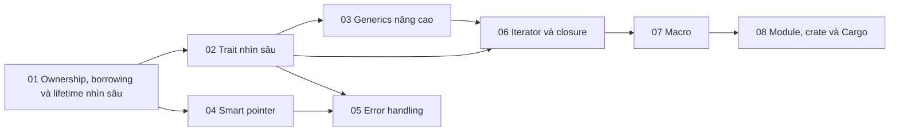

# P9 · Tổng quan — Rust language sâu

> Trang này chỉ điều hướng: mục tiêu, bản đồ chương, thứ tự đọc, sách gốc và câu hỏi tổng hợp. Mọi khẳng định kỹ thuật có chú thích nằm trong từng chương; các lời khuyên về thứ tự đọc là của người soạn.

## Mục tiêu của phase

Phase này đi sâu các phần của ngôn ngữ Rust mà người học hay chạm giới hạn: ownership/borrowing/lifetime, trait, generics nâng cao, smart pointer, error handling, iterator và closure, macro, module/crate/Cargo. Chương nào cũng trỏ về cơ chế bên dưới ở P3, P4, P7 hoặc P10 khi cần. Đọc phase này để biết cách dùng đúng ngôn ngữ; đọc P10 để biết compiler làm gì.

## Bản đồ chương

Mũi tên nghĩa là chương đích dùng khái niệm của chương nguồn (nhận xét của người soạn về thứ tự học).

## Các chương

| Chương | Nội dung chính |
|---|---|
| [01 — Ownership, borrowing và lifetime nhìn sâu](01-ownership-borrowing-lifetime.md) | E0507 và move ra khỏi index; reborrow; lifetime thật sự là gì; NLL; đọc và sửa E0499/E0502/E0505/E0506/E0597/E0716; ba luật elision, `T: 'static` vs `&'static T`; `clone`, `take`/`replace`. |
| [02 — Trait nhìn sâu](02-trait.md) | Trait là hợp đồng hành vi; associated type vs generic parameter; supertrait, bound, `where`, `impl Trait`; blanket impl, E0119; orphan rule, coherence, newtype; điều kiện của `dyn Trait`; auto trait; `Deref`, `AsRef`, `From`. |
| [03 — Generics nâng cao](03-generics-nang-cao.md) | Trait bound và type inference, turbofish; const generics; GAT và `LendingIterator`; `for<'a>` (HRTB); `PhantomData`; `Sized` và `?Sized`; `impl Trait` ở return position; generic vs `dyn`. |
| [04 — Smart pointer](04-smart-pointer.md) | Smart pointer khác reference, `Deref` và `Drop` làm nên "tính smart"; deref coercion; thứ tự drop, `mem::drop`; `Box` (kiểu đệ quy, trait object, giá trị lớn, `Box<dyn Error>`, `Pin<Box<T>>`); `Rc`/`Weak` dựng cây cha–con, `Arc`; interior mutability: `Cell`, `RefCell`, `BorrowMutError`, `Rc<RefCell<T>>`, `OnceCell`/`LazyCell`; `Cow`; tự viết guard bằng `Deref`/`DerefMut`/`Drop`. |
| [05 — Error handling](05-error-handling.md) | `panic!` vs `Result`; `?` và `From`; `std::error::Error` và `source()`; `Box<dyn Error + Send + Sync>`; `thiserror` vs `anyhow`; `RUST_BACKTRACE`; unwind/abort, `catch_unwind`, panic hook; `main() -> Result`. |
| [06 — Iterator và closure](06-iterator-va-closure.md) | Closure bắt biến và edition 2021; `Fn`/`FnMut`/`FnOnce`; closure trong bộ nhớ, `impl Fn` vs `Box<dyn Fn>`, `fn` pointer; `for`, `iter`/`into_iter`, adapter lười, `collect`; "zero-cost" của iterator; sửa collection khi duyệt. |
| [07 — Macro](07-macro.md) | Vì sao có macro; `macro_rules!`, fragment, repetition; hygiene, `$crate`, phạm vi; ba loại procedural macro; `syn`/`quote`; thời điểm expand và cách xem; `vec!`, `println!`, `#[derive]`, `#[tokio::main]`; serde, sqlx và cái giá của macro. |
| [08 — Module, crate và Cargo](08-module-crate-cargo.md) | Package/crate/module và `mod foo;`; `pub(...)` và E0603; `use`, `pub use`, prelude, `crate::`/`self::`/`super::`; `#[cfg]`; caret, SemVer, `Cargo.lock`; feature additive và unification; workspace, profile; `build.rs`, edition. |

## Thứ tự đọc

Đọc theo nhu cầu: 01 → 02 là nền, sau đó chọn nhánh bạn đang vướng. Nhánh kiểu: 03 → 06 (generics, closure), 04 → 05 (smart pointer, lỗi), 07 → 08 (macro, build). Chương 01 nên đọc trước P10 chương 05 và 06 (nhận xét của người soạn).

## Lộ trình đọc sách gốc

Các nguồn dưới đây đều là nguồn mà chương của phase đã dùng; mở đọc song song với chương tương ứng. Không bắt buộc: chương đã tự chứa phần cần thiết.

- [The Rust Book — References and Borrowing](https://doc.rust-lang.org/1.95.0/book/ch04-02-references-and-borrowing.html) — chương 01.
- [The Rust Book — Validating References with Lifetimes](https://doc.rust-lang.org/1.95.0/book/ch10-03-lifetime-syntax.html) — chương 01.
- [The Rust Book — Traits: Defining Shared Behavior](https://doc.rust-lang.org/1.95.0/book/ch10-02-traits.html) — chương 02.
- [The Rust Book — Advanced Traits](https://doc.rust-lang.org/1.95.0/book/ch20-02-advanced-traits.html) — chương 02.
- [The Rust Book — RefCell\<T> and the Interior Mutability Pattern](https://doc.rust-lang.org/1.95.0/book/ch15-05-interior-mutability.html) — chương 04.
- [The Rust Book — Rc\<T>, the Reference Counted Smart Pointer](https://doc.rust-lang.org/1.95.0/book/ch15-04-rc.html) — chương 04.
- [The Rust Book — Recoverable Errors with Result](https://doc.rust-lang.org/1.95.0/book/ch09-02-recoverable-errors-with-result.html) — chương 05.
- [The Rust Book — Advanced Functions and Closures](https://doc.rust-lang.org/1.95.0/book/ch20-04-advanced-functions-and-closures.html) — chương 06.
- [The Rust Book — Macros](https://doc.rust-lang.org/1.95.0/book/ch20-05-macros.html) — chương 07.
- [The Rust Book — Packages and Crates](https://doc.rust-lang.org/1.95.0/book/ch07-01-packages-and-crates.html) — chương 08.
- [The Rust Reference — Traits](https://doc.rust-lang.org/1.95.0/reference/items/traits.html) — chương 02.
- [The Rust Reference — Closure types](https://doc.rust-lang.org/1.95.0/reference/types/closure.html) — chương 06.
- [The Rust Reference — Macros by example](https://doc.rust-lang.org/1.95.0/reference/macros-by-example.html) — chương 07.
- [The Rust Reference — Visibility and privacy](https://doc.rust-lang.org/1.95.0/reference/visibility-and-privacy.html) — chương 08.
- [The Rustonomicon — Lifetimes](https://doc.rust-lang.org/1.95.0/nomicon/lifetimes.html) — chương 01.

## Câu hỏi tổng hợp xuyên chương

Không có đáp án ở đây; mỗi câu trỏ về chương cần đọc lại.

1. Lỗi E0499/E0502/E0597 xuất hiện khi bạn giữ tham chiếu qua một lần gọi: lifetime, NLL và lỗi borrow checker liên quan ra sao, và chương nào ở P10 giải thích compiler làm gì? ([chương 01](01-ownership-borrowing-lifetime.md); P10 [chương 06](../10-rust-internals/06-borrow-checker.md)).
2. Khi nào chọn generic (static dispatch) và khi nào chọn `dyn Trait`? ([chương 03](03-generics-nang-cao.md), [chương 02](02-trait.md); P10 [chương 03](../10-rust-internals/03-dst-fat-pointer-vtable.md), [chương 04](../10-rust-internals/04-monomorphization.md)).
3. `Rc<RefCell<T>>` và `Arc<Mutex<T>>` khác nhau chỗ nào, và `Send`/`Sync` nằm ở đâu trong sự khác biệt đó? ([chương 04](04-smart-pointer.md), [chương 02](02-trait.md); P4 [chương 08](../04-concurrency/08-rust-concurrency.md)).
4. Closure truyền vào `thread::spawn` hay `tokio::spawn` cần những trait nào, và `move` đổi điều gì? ([chương 06](06-iterator-va-closure.md), [chương 01](01-ownership-borrowing-lifetime.md); P4 [chương 08](../04-concurrency/08-rust-concurrency.md)).
5. `?` làm gì với kiểu lỗi, và vì sao `Box<dyn Error + Send + Sync>` hay xuất hiện trong code đa luồng? ([chương 05](05-error-handling.md), [chương 02](02-trait.md)).
6. Một derive macro hay `macro_rules!` thực chất sinh ra gì, và khác generic ở đâu? ([chương 07](07-macro.md), [chương 03](03-generics-nang-cao.md)).
7. Feature của Cargo và profile release (`lto`, `panic`) ảnh hưởng thế nào tới binary bạn deploy? ([chương 08](08-module-crate-cargo.md); P8 [chương 08](../08-containers/08-rust-trong-container.md)).

## Lab

Làm sau khi đã đọc lý thuyết:

- [Lab 09 — Rust language](../labs/09-rust-language-lab.md) (lab dạng điền code cho test chạy qua: test đỏ khi bạn chưa làm bài là chủ ý; mục Chuẩn bị của lab nói cách xem lời giải mẫu)
