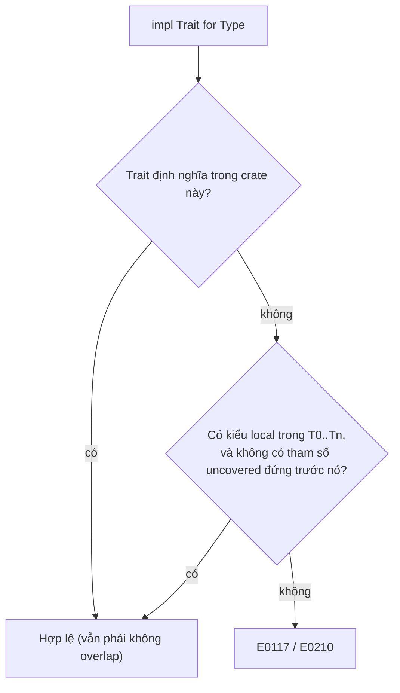

# P9 · Chương 02 — Trait nhìn sâu

## Bạn sẽ hiểu được gì

1. **Q1.** Trait là "hợp đồng hành vi" theo nghĩa chính xác nào, và khác interface của Java/Go ở đâu? → mục 1
2. **Q2.** Khi nào dùng associated type, khi nào dùng generic parameter trên trait (`Iterator`, `Add`, `From` chọn gì, vì sao)? → mục 2
3. **Q3.** Supertrait, bound, `where`, `impl Trait` và `#[derive]` đặt ràng buộc gì lên kiểu? → mục 3
4. **Q4.** Blanket impl (`impl<T: Display> ToString for T`) hoạt động ra sao và vì sao dễ gây xung đột (E0119)? → mục 4
5. **Q5.** Orphan rule và coherence thực sự cấm gì (E0117, E0210), và newtype vượt qua bằng cách nào? → mục 5
6. **Q6.** Một trait phải thỏa điều kiện gì để dùng làm `dyn Trait` (E0038), và `where Self: Sized` cứu được gì? → mục 6
7. **Q7.** `Send`/`Sync`/`Unpin` là auto trait nghĩa là gì? → mục 7
8. **Q8.** `Deref` coercion, `AsRef`/`Borrow`, `From`/`Into`/`TryFrom`, `Default`, `Display`/`Debug` khác nhau ở đâu? → mục 8

## Kiến thức cần trước

Bạn đã đọc Rust Book tới phần generics, trait và lifetime, và đã viết `struct`, `enum`, `impl` thông thường. Ownership và lifetime ôn ở [01-ownership-borrowing-lifetime](01-ownership-borrowing-lifetime.md). Cơ chế vtable chi tiết (layout, fat pointer) nằm ở P10·03; chương này chỉ nói *hợp đồng* của `dyn Trait`, không mổ bộ nhớ. Generics và monomorphization nâng cao: [03-generics-nang-cao](03-generics-nang-cao.md); closure và iterator: [06-iterator-va-closure](06-iterator-va-closure.md).

Ví dụ xuyên suốt chương là `orders`, một REST service viết bằng Rust. Handler nhận request, gọi tầng repository để đọc và ghi đơn hàng (Postgres khi chạy thật, `HashMap` trong bộ nhớ khi test), gom lỗi từ nhiều nơi về một kiểu `OrderError`, rồi ghi log. Đây là ví dụ giả định của người soạn, không phải code trong repo, và mỗi mục sẽ mở đầu bằng việc trait ở mục đó giải quyết gì cho `orders`. (Tên trùng với service ở Phase 1, nhưng ở đây ta nhìn từ phía code Rust.)

Mọi ví dụ biên dịch bằng `rustc 1.95.0 --edition 2024`; các thông điệp lỗi dán nguyên văn từ lần chạy thật (đã lược bớt cảnh báo không liên quan) và là *quan sát* một lần chạy, không phải bảo đảm của tài liệu.

---

## 1. Trait là gì: hợp đồng hành vi (Q1)

> **Trả lời ngắn.** Trait là một giao diện trừu tượng mà nhiều kiểu có thể cài đặt[^tr-intro]. Nó gồm hàm, kiểu và hằng liên kết[^assoc-kinds], chứ không có trường dữ liệu như struct (nhận xét của người soạn). Muốn một kiểu cài trait thì viết một khối `impl` riêng[^tr-impls]; khối này có thể nằm xa chỗ định nghĩa kiểu, khác với `class` của Java (nhận xét của người soạn).

**Giải thích.**

*Với service `orders`.* Handler của `GET /orders/42` cần tìm một đơn hàng, nhưng nó không nên biết đơn đó nằm trong Postgres hay trong một `HashMap` của bài test. Điều handler thật sự cần chỉ là "một thứ tìm được và lưu được `Order`". Trait cho phép viết đúng điều đó thành một khai báo, rồi mỗi nơi lưu trữ tự đứng ra đáp ứng. Mục này xem trait gồm những gì và khác interface của Java, Go ở điểm nào.

### 1.1 Trait gồm những gì

Đây là trait mà handler của `orders` dựa vào, cùng một nơi lưu trữ trong bộ nhớ (ví dụ minh họa của người soạn):

```rust
trait OrderRepo {
    fn find(&self, id: u64) -> Option<Order>;
    fn save(&self, order: Order);
}

struct MemRepo(Mutex<HashMap<u64, Order>>);

impl OrderRepo for MemRepo {
    fn find(&self, id: u64) -> Option<Order> { self.0.lock().unwrap().get(&id).cloned() }
    fn save(&self, order: Order) { self.0.lock().unwrap().insert(order.id, order); }
}
// PgRepo cài OrderRepo tương tự, bằng truy vấn Postgres.
```

Mọi thứ khai báo trong trait gọi chung là *associated item*, gồm hàm (kể cả method), kiểu và hằng[^assoc-kinds]. `OrderRepo` mới chỉ có hàm; kiểu và hằng xuất hiện ở mục 2 và ở 1.2. Trait không có trường dữ liệu. Dữ liệu nằm trong struct (ở đây `MemRepo` giữ cái `HashMap`), còn trait chỉ nói kiểu đó phải làm được gì (nhận xét của người soạn).

Hành vi được gắn vào kiểu bằng `impl OrderRepo for MemRepo`, một khối `impl` riêng[^tr-impls]. Vì là khối riêng nên nó không cần nằm cạnh chỗ định nghĩa `MemRepo` (nhận xét của người soạn), và nhờ vậy bạn thêm được hành vi cho cả những kiểu đã có sẵn, với giới hạn là orphan rule ở mục 5.

Trong mọi trait còn có một tham số kiểu ngầm tên `Self`, chính là kiểu đang cài trait[^tr-self]. Trong `OrderRepo`, `Self` là `MemRepo` ở impl này và là `PgRepo` ở impl kia.

### 1.2 Default method và associated const

Handler hay hỏi "đơn này đã có chưa". Thay vì bắt mỗi repo tự viết hàm `exists`, trait có thể cho sẵn một *default method*, tức hàm có thân ngay trong trait. Thân đó gọi được các method khác của cùng trait, kể cả method chưa có thân mặc định[^book-default]. Thêm vào `OrderRepo` một dòng:

```rust
    fn exists(&self, id: u64) -> bool { self.find(id).is_some() }
```

Từ lúc đó `MemRepo` và `PgRepo` có `exists` mà không phải viết gì. Đây là mẫu thiết kế quen thuộc: trait chỉ đòi người cài vài hàm lõi, phần còn lại sinh ra từ chúng. `Iterator` làm đúng như vậy: `next` là method bắt buộc[^iter-next], còn các adapter còn lại do trait cung cấp sẵn (nhận xét của người soạn; xem chương 06).

Hằng cũng vào được trait. Associated const là hằng gắn với một kiểu[^assoc-const]. Trong trait, hằng có thể không có giá trị (mỗi impl phải tự cung cấp) hoặc có giá trị mặc định mà impl ghi đè được[^assoc-const-default].

### 1.3 So với interface của Java và Go

Nếu bạn quen Java thì default method không có gì lạ: nó "cấp implementation mặc định" cho lớp cài interface mà không override[^jls-default]. Điểm khác nằm ở chỗ gắn. Lớp Java khai báo `implements` ngay khi định nghĩa lớp, còn Rust gắn bằng khối `impl` có thể đứng ngoài (nhận xét của người soạn).

Go đi hướng ngược lại. Một kiểu *thỏa* interface nếu nó nằm trong type set của interface đó[^go-impl], nghĩa là việc thỏa được xác định từ chính kiểu, không cần khai báo `implements` (nhận xét của người soạn). Rust nằm giữa hai cách (nhận xét của người soạn): gắn tường minh như Java, nhưng khai báo đó có thể ở ngoài định nghĩa kiểu.

<details><summary>Đi sâu: ví dụ gom thành phần trait và bảng so sánh</summary>

Ví dụ gom hàm bắt buộc, default method và associated const vào một trait (đã chạy; in `4 sides, area 4.0`):

```rust
trait Shape {
    const SIDES: u32;                       // associated const
    fn area(&self) -> f64;                  // bắt buộc
    fn describe(&self) -> String {          // default method
        format!("{} sides, area {:.1}", Self::SIDES, self.area())
    }
}
struct Sq(f64);
impl Shape for Sq {
    const SIDES: u32 = 4;
    fn area(&self) -> f64 { self.0 * self.0 }
}
// Sq(2.0).describe() == "4 sides, area 4.0"
```

Reference có ví dụ `ConstantIdDefault` với `Struct::ID == 1` và `OtherStruct::ID == 5` cho hằng có giá trị mặc định bị ghi đè[^assoc-const-default]. Hệ quả: trait có associated const **không** dyn compatible (mục 6).

| | Rust trait | Java interface | Go interface |
|---|---|---|---|
| Gắn vào kiểu | `impl Trait for Type`, có thể nằm ngoài định nghĩa kiểu | lớp khai báo `implements` khi định nghĩa | không khai báo; kiểu thỏa nếu có đủ method |
| Default method | có | có[^jls-default] | không (nhận xét của người soạn) |

Các ô Go/Java ngoài hai trích dẫn trên là nhận xét của người soạn từ kinh nghiệm chung, không phải trích nguồn.

</details>

**Quay lại Q1:** trait là hợp đồng gồm hàm, kiểu và hằng, không có dữ liệu, và gắn vào kiểu bằng một `impl` riêng; trong `orders`, `OrderRepo` cho handler biết nó cần gì mà không lộ ra Postgres hay `HashMap`.

---

## 2. Associated type hay generic parameter? (Q2)

> **Trả lời ngắn.** Hai cách này khác nhau ở số lần một kiểu được cài trait. Với associated type, mỗi kiểu chỉ cài trait *một lần*, nên người gọi không phải ghi chú kiểu[^book-assoc-once]. Với generic parameter trên trait, một kiểu cài được trait nhiều lần, mỗi lần với một kiểu cụ thể khác[^book-generic-multi]. Từ đó ra quy tắc chọn (suy ra của người soạn): kiểu phụ thuộc mà `Self` quyết định duy nhất thì dùng associated type; cần cài nhiều lần với các kiểu khác nhau thì dùng generic parameter. `Iterator::Item` thuộc loại đầu, `From<T>` thuộc loại sau (phân loại của người soạn).

**Giải thích.**

*Với service `orders`.* `orders` gặp hai bài toán trông giống nhau nhưng khác bản chất. Bài thứ nhất: `OrderStream` đọc đơn hàng từ DB và trả ra từng `Order` một. Thứ đi ra khỏi nó chỉ có một loại, luôn là `Order`. Bài thứ hai: `OrderError` phải nhận lỗi từ nhiều nguồn, `io::Error` khi đọc file, `ParseIntError` khi parse id trên URL, mà vẫn là một kiểu duy nhất. Ở bài này một kiểu có nhiều quan hệ, mỗi nguồn lỗi một quan hệ. Bài đầu hợp với associated type, bài sau hợp với generic parameter, và mục này giải thích vì sao.

### 2.1 Hai cú pháp, một khác biệt cốt lõi

Khi trait cần nhắc tới một kiểu chưa biết trước, có hai cách viết:

```rust
trait Container { type Item; fn first(&self) -> Option<&Self::Item>; }   // associated type
trait Conv<T>   { fn conv(&self) -> T; }                                    // generic parameter
```

Khác biệt nằm ở số lần cài đặt. Trait có generic parameter thì cài được nhiều lần, mỗi lần đổi kiểu cụ thể[^book-generic-multi]. Trait có associated type thì không cài hai lần cho cùng một kiểu được, nên người gọi khỏi phải ghi chú kiểu[^book-assoc-once]. Trong `orders`, hai bài toán ở trên rơi vào hai bên:

```rust
impl Iterator for OrderStream { type Item = Order; /* ... */ }    // một Item duy nhất
impl From<io::Error> for OrderError { /* ... */ }                  // nhiều bản: mỗi nguồn lỗi một impl
impl From<ParseIntError> for OrderError { /* ... */ }
```

`From<T>` mang tham số `T` nên `OrderError` cài được hai bản trên. Còn nếu `Iterator` là `Iterator<T>` và `OrderStream` cài được hai bản với hai `T`, thì vòng `for order in stream` sẽ không biết phải lấy kiểu nào; associated type chặn việc đó ngay từ đầu (suy luận của người soạn).

Rút lại thành quy tắc chọn (suy ra từ hai điều trên):

| Câu hỏi | Chọn |
|---|---|
| Với mỗi `Self`, kiểu phụ thuộc *duy nhất* và do `Self` quyết định? (`Iterator::Item`, `Deref::Target`, `Add::Output`) | associated type |
| Một `Self` có thể có nhiều quan hệ với các kiểu khác nhau? (`From<T>`, `Add<Rhs>`, `PartialEq<Rhs>`) | generic parameter |

### 2.2 Dùng cả hai trong một trait: `Add`

Một số trait cần cả hai. `Add<Rhs = Self>` trong std có `Rhs` là generic và `type Output` là associated[^add-sig]. Theo cơ chế vừa nói (diễn giải của người soạn): `Rhs` là generic nên một kiểu cài được `Add` với nhiều `Rhs` khác nhau; `Output` là associated nên với `Self` và `Rhs` cho trước chỉ có đúng một `Output`. `Rhs` mặc định là `Self` nhưng không bắt buộc[^add-rhs]. Cũng nhờ có trait đứng sau mà toán tử mới overload được[^ops].

<details><summary>Đi sâu: thí nghiệm E0119, hợp đồng của associated type, overload <code>+</code></summary>

Với generic parameter, cùng một `X` cài hai lần và người gọi chọn bằng kiểu mong đợi (đã chạy):

```rust
struct X;
impl Conv<i32>    for X { fn conv(&self) -> i32 { 1 } }
impl Conv<String> for X { fn conv(&self) -> String { "s".into() } }
let a: i32 = X.conv();      // 1
let s: String = X.conv();   // "s"
```

Với associated type, cài lần hai cho cùng kiểu bị từ chối vì hai impl chồng lấn (kể cả khi `Item` khác nhau; đã chạy):

```text
error[E0119]: conflicting implementations of trait `Container` for type `Vec<i32>`
2 | impl Container for Vec<i32> { type Item = i32; }
  | --------------------------- first implementation here
3 | impl Container for Vec<i32> { type Item = u8; }
  | ^^^^^^^^^^^^^^^^^^^^^^^^^^^ conflicting implementation for `Vec<i32>`
```

Associated type là một phần hợp đồng của trait: người cài *phải* cung cấp kiểu đó[^book-assoc-contract]. Reference đặt thêm giới hạn: không định nghĩa associated type trong inherent impl, và trait không được cho nó giá trị mặc định[^assoc-type-restr].

`TryFrom` dùng associated type `Error`, hợp lý theo quy tắc trên vì với `(Self, T)` cho trước, kiểu lỗi là duy nhất (suy luận của người soạn).

Overload `+` (đã chạy):

```rust
struct Meters(f64);
impl Add for Meters { type Output = Meters; fn add(self, o: Meters) -> Meters { Meters(self.0 + o.0) } }
// (Meters(1.0) + Meters(2.5)).0 == 3.5
```

</details>

**Quay lại Q2:** associated type là một kiểu duy nhất do `Self` quyết định (`OrderStream` chỉ trả `Order`); generic parameter là nhiều quan hệ cho cùng một `Self` (`OrderError` nhận lỗi từ nhiều nguồn).

---

## 3. Supertrait, bound, `where`, `impl Trait`, `derive` (Q3)

> **Trả lời ngắn.** Supertrait là ràng buộc trên `Self`: ai cài trait con phải đã cài trait cha[^book-super]. Bound ràng buộc tham số generic và viết được trong mệnh đề `where`[^bounds-where]. `impl Trait` ở vị trí tham số khai báo một kiểu ẩn danh[^impl-param]. Ở vị trí trả về, nó đứng thay cho một kiểu cụ thể, và người gọi chỉ dùng được các method mà trait khai báo[^impl-ret]. Còn `#[derive]` với `PartialEq` và `Clone` sinh ra impl có bound đặt lên *tham số kiểu*[^derive-bound].

**Giải thích.**

*Với service `orders`.* Code của `orders` đầy những chỗ phải nói "kiểu này làm được việc X": hàm `handle` cần một repo, hàm log cần một thứ in được, `AppState` cần clone được để chia cho các handler. Trait là công cụ để nói điều đó, và có năm cách viết, mỗi cách đặt ràng buộc ở một chỗ khác nhau. Cuối mục có một cái bẫy của `derive` mà bạn dễ vấp khi viết `AppState`.

### 3.1 Supertrait: ràng buộc trên `Self`

Giả sử `orders` có thêm trait `AuditedRepo` cho những repo ghi lịch sử, và repo nào như vậy cũng phải là một `OrderRepo`:

```rust
trait AuditedRepo: OrderRepo {
    fn audit_line(&self, id: u64) -> String { format!("order {id} exists: {}", self.exists(id)) }
}
```

Dòng đầu là cú pháp rút gọn của `trait AuditedRepo where Self: OrderRepo`[^bounds-short]. Supertrait không kế thừa dữ liệu hay implementation như `extends` trong Java. Nó chỉ cho phép default method của trait con (ở đây `audit_line`) gọi method của trait cha (`exists`); đó là phần việc mà trait con "dựa vào" trait cha[^book-super] (nhận xét của người soạn).

### 3.2 Bound và `where`: ràng buộc trên tham số generic

Hàm `fn handle<R: OrderRepo>(repo: &R, id: u64)` đặt bound lên tham số `R`: nó chỉ nhận kiểu đã cài `OrderRepo`. Bound không bắt buộc phải viết ngay trong dấu `<>`; mệnh đề `where` nhận bound trên bất kỳ kiểu nào[^bounds-where]. Lý do chính là dễ đọc: nhồi quá nhiều bound vào `<>` làm chữ ký hàm rối[^book-where]. Có trường hợp chỉ `where` mới viết được, đó là khi bound đặt trên kiểu không phải tham số trần, như `where Vec<T>: Debug` hay `where Self: Sized` (suy ra của người soạn từ việc dạng rút gọn chỉ có cho vài trường hợp thông dụng).

### 3.3 `impl Trait` ở tham số và ở kiểu trả về

Ở vị trí tham số, `fn log_order(o: &impl Display)` gần như tương đương `fn log_order<T: Display>(o: &T)`. Có một khác biệt quan sát được: dạng `impl Trait` **không chỉ định được bằng turbofish** (`::<…>`). Vì vậy đổi qua lại giữa hai dạng có thể là breaking change cho người gọi, do số generic argument thay đổi[^impl-breaking].

Ở vị trí trả về, hàm trả một "kiểu trừu tượng" thay cho kiểu cụ thể, và người gọi chỉ dùng được method mà trait khai báo[^impl-ret]. Chữ then chốt là *một kiểu cụ thể duy nhất*, do hàm chọn: Reference đòi mọi giá trị trả về phải cùng một kiểu cụ thể[^impl-ret-same]. Hàm trả hai kiểu khác nhau tùy nhánh `if` bị rustc từ chối với E0308 (quan sát một lần chạy, nhận xét của người soạn). Muốn chọn kiểu theo runtime thì phải dùng `Box<dyn Display>`, tức trait object (mục 6), và chấp nhận dynamic dispatch.

### 3.4 `derive` đặt bound lên tham số kiểu

`#[derive(Clone)]` cho struct generic không xét từng field xem có clone được không. Nó đặt bound lên **tham số kiểu**. Với `PartialEq`, derive cho `Foo<T>` sinh impl với điều kiện `T: PartialEq`[^derive-bound]. Với `Clone`, derive cho struct generic "thêm bound Clone lên tham số generic"[^clone-derive]. Hệ quả là `W<NoClone>` không `.clone()` được, dù `W` có thể chẳng *giữ* thứ gì cần clone `T`.

Với `orders`, cái bẫy trông như sau (suy luận của người soạn từ cơ chế trên; ví dụ tương tự ở Đi sâu cũng báo E0599):

```rust
#[derive(Clone)]
struct AppState<R> { repo: Arc<R> }   // derive đòi R: Clone, dù Arc<R> luôn clone được
```

`Arc<R>` clone được với mọi `R`, nhưng derive không biết điều đó. Kết quả: nếu `MemRepo` không `Clone` thì `AppState<MemRepo>` cũng không `.clone()` được (đã thử biên dịch trên macOS với `rustc 1.95.0`: E0599 `the method clone exists for struct AppState<MemRepo>, but its trait bounds were not satisfied`). Cách thoát là viết tay `impl<R> Clone for AppState<R>` để bỏ bound thừa.

<details><summary>Đi sâu: trait upcasting, các thí nghiệm lỗi và bẫy <code>PhantomData</code> (đã chạy)</summary>

Liên quan tới supertrait và trait object: trait object cài đặt cả supertrait của base trait[^tobj-impls]. Coercion `dyn T → dyn U` khi `U` là supertrait của `T` được phép, gọi là trait upcasting[^coerce-upcast]. Tính năng này ổn định từ Rust 1.86[^relnotes-upcast].

Supertrait cho default method dùng method của trait cha:

```rust
trait Named { fn name(&self) -> String; }
trait Greeter: Named { fn greet(&self) -> String { format!("hi {}", self.name()) } }
```

Upcasting: `let d: &dyn Dog = &D; let an: &dyn Animal = d;` biên dịch được với 1.95.0 (edition 2024) và `an.n()` trả `"d"`. Release notes ghi mục Language của 1.86.0 là "ổn định upcasting trait object lên supertrait"[^relnotes-upcast]. Trước 1.86 phải tự viết hàm `as_animal(&self) -> &dyn Animal` trong trait (nhận xét của người soạn, không kiểm trên toolchain cũ).

Turbofish với `impl Trait`:

```rust
fn a(x: impl Into<String>) -> String { x.into() }
fn b<T: Into<String>>(x: T) -> String { x.into() }
b::<&str>("hi");   // OK
a::<&str>("hi");   // lỗi
```
```text
error[E0107]: function takes 0 generic arguments but 1 generic argument was supplied
  = note: `impl Trait` cannot be explicitly specified as a generic argument
```

Trả hai kiểu theo nhánh:

```rust
fn pick(b: bool) -> impl Display { if b { 1 } else { "x" } }
```
```text
error[E0308]: `if` and `else` have incompatible types
  | expected because of this ... expected integer, found `&str`
help: you could change the return type to be a boxed trait object
```

Derive đặt bound lên tham số:

```rust
struct NoClone;
#[derive(Clone)] struct W<T>(T);
W(NoClone).clone();
```
```text
error[E0599]: the method `clone` exists for struct `W<NoClone>`, but its trait bounds were not satisfied
  = help: consider manually implementing the trait to avoid undesired bounds
```

Gợi ý "manually implementing the trait to avoid undesired bounds" là chính rustc nói. (Nhận xét của người soạn: bẫy kinh điển là `struct Handle<T>(Arc<Inner>, PhantomData<T>)` — derive `Clone` đòi `T: Clone` dù không clone `T` nào; viết tay `impl<T> Clone` để bỏ bound. Ví dụ `Handle<T>` với `PhantomData<T>` đã chạy: `.clone()` trên `Handle<NoClone>` báo E0599 với ghi chú "type parameter would need to implement `Clone`" và gợi ý "consider manually implementing the trait to avoid undesired bounds".)

</details>

**Quay lại Q3:** supertrait và bound là ràng buộc trên `Self` và trên tham số generic; `impl Trait` là cách viết ngắn với đúng một kiểu cụ thể; `derive` đặt bound lên tham số kiểu, nên `#[derive(Clone)] struct AppState<R>` đòi `R: Clone`.

---

## 4. Blanket impl (Q4)

> **Trả lời ngắn.** Blanket impl là một lần `impl` phủ *mọi* kiểu thỏa bound, và std dùng nó khắp nơi[^blanket]. Ví dụ: mọi kiểu `Display` tự có `ToString`. Vì phủ rộng nên hai blanket impl, hoặc một blanket với một impl cụ thể, rất dễ chồng lấn và bị rustc từ chối (E0119).

**Giải thích.**

*Với service `orders`.* Giả sử bạn bọc id đơn hàng trong `struct OrderId(u64)` và cài `Display` cho nó để in vào log. Ngay sau đó `order_id.to_string()` dùng được, dù bạn không viết dòng nào cho `ToString`. Chuyện này do một blanket impl trong std; mục này xem nó viết thế nào, nó đặt ra thói quen gì cho code của bạn, và vì sao cùng cơ chế đó lại dễ gây xung đột.

### 4.1 `ToString` cho mọi kiểu `Display`

Source `alloc/src/string.rs` tag 1.95.0 có đúng dòng `impl<T: fmt::Display + ?Sized> ToString for T {`[^tostring-src]. Đọc từ trái sang: với mọi `T` mà `T: Display`, `T` cài `ToString`. Chữ `?Sized` nới một ràng buộc ngầm: tham số kiểu (trừ `Self` trong trait) mặc định phải `Sized`[^sized-default], nên cần `?Sized` để cả `str` dùng được `.to_string()`.

Hệ quả cho bạn: **cài `Display`, đừng cài `ToString`**. Docs của `Display` khuyên đúng như vậy[^display-prefer]. Ở mức API công khai chỉ có một blanket impl `ToString`, nên nếu bạn cài thêm `ToString` riêng cho `OrderId` vốn đã có `Display` thì sẽ E0119 (suy luận của người soạn từ ví dụ chồng lấn ngay dưới, chưa chạy riêng cho `ToString`).

### 4.2 Khi hai impl chồng lấn

Vì một blanket impl phủ cả một lớp kiểu, nó dễ đụng impl khác. Thí nghiệm: cài `T1` cho mọi `T`, rồi cài thêm cho `i32` (đã chạy):

```text
error[E0119]: conflicting implementations of trait `T1` for type `i32`
2 | impl<T> T1 for T {}
  | ---------------- first implementation here
3 | impl T1 for i32 {}
  | ^^^^^^^^^^^^^^^ conflicting implementation for `i32`
```

Trong `orders` cũng vậy: nếu bạn viết `impl<T: Debug> Loggable for T {}` rồi muốn ghi riêng một cách log cho `OrderId` bằng `impl Loggable for OrderId {}`, hai impl đè lên nhau như ở thí nghiệm trên (suy luận của người soạn). Đây cũng là lý do orphan rule (mục 5) phải tồn tại: blanket impl phủ rộng nên rất dễ đụng impl của crate khác.

<details><summary>Đi sâu: <code>ToString</code> bên trong dùng specialization nội bộ</summary>

Impl `ToString` chỉ gọi `<Self as SpecToString>::spec_to_string(self)`[^tostring-spec]. `SpecToString` là trait *private* trong `string.rs`: có impl mặc định `default fn` cho mọi `T: Display` cùng impl chuyên biệt cho một số kiểu, trong đó có `char`[^tostring-spec-char]. Đây là chi tiết cài đặt của alloc 1.95.0 (suy ra từ từ khóa `default fn` trong mã nguồn: std dùng tính năng specialization nội bộ), có thể đổi, không phải hợp đồng.

`From<T> for U` kéo theo `Into<U> for T` cũng qua một blanket impl (mục 8)[^from-prefer].

</details>

**Quay lại Q4:** blanket impl là một impl cho mọi kiểu thỏa bound (`ToString` cho mọi `Display`, kể cả `OrderId` của bạn); mạnh nhưng dễ chồng lấn (E0119).

---

## 5. Orphan rule, coherence và newtype (Q5)

> **Trả lời ngắn.** Bạn chỉ được cài một trait cho một kiểu nếu trait *hoặc* ít nhất một kiểu trong impl là của crate bạn[^orphan]. Luật này tồn tại để hai crate không thể cài cùng trait cho cùng kiểu theo cách xung đột, làm hỏng build khi cập nhật dependency[^orphan-why]. Muốn cài trait ngoài cho kiểu ngoài, hãy bọc kiểu ngoài trong một newtype local[^newtype-getaround].

**Giải thích.**

*Với service `orders`.* Cuối mỗi ngày `orders` muốn in cả một lô đơn hàng ra log, và cách tự nhiên là `impl Display for Vec<Order>`. Rustc từ chối: `Display` thuộc std, `Vec` cũng thuộc std, không có gì ở đó là của `orders` (suy ra của người soạn từ thí nghiệm E0117 với `Vec<i32>` ở Đi sâu). Mục này giải thích luật đứng sau lời từ chối đó, rồi cách vòng qua bằng một newtype.

### 5.1 Luật và lý do tồn tại

Tình huống luật này ngăn là: hai crate khác nhau cùng cài một trait cho cùng một kiểu. Khi cả hai vào chung một dự án, compiler không biết chọn impl nào, và chỉ một lần cập nhật dependency cũng đủ làm build vỡ[^orphan-why]. Orphan rule chặn từ gốc: chỉ chủ của *trait* hoặc chủ của *kiểu* mới được viết impl.

Reference gọi một impl là *incoherent* khi orphan rule không thỏa hoặc khi có các impl chồng lấn[^incoherent]; chồng lấn là E0119 (mục 4). Luật cũng có lợi cho tác giả thư viện: họ thêm impl mới cho trait của mình mà không sợ làm vỡ code downstream[^orphan-lib]. Book xếp orphan rule vào thuộc tính gọi là coherence, và nói quy tắc này bảo đảm code của người khác không phá được code của bạn, và ngược lại[^book-orphan].

### 5.2 Dạng đầy đủ: kiểu local và tham số uncovered

Đó là bản dễ nhớ. Bản chính xác: với `impl<P1..=Pn> Trait<T1..=Tn> for T0`, impl hợp lệ khi `Trait` là local, hoặc ít nhất một trong `T0..=Tn` là kiểu local[^orphan-def]. Thêm một điều kiện: không có tham số kiểu *uncovered* (tham số trần, không được kiểu nào khác bọc) đứng trước kiểu local đầu tiên. Luật chỉ hạn chế *chỗ xuất hiện* của tham số uncovered[^uncovered]. Có một ngoại lệ gọi là "fundamental": `T` trong `Box<T>` không tính là covered, và `Box<LocalType>` được coi là local[^fundamental].



### 5.3 Hai mã lỗi E0117 và E0210

Error index mô tả E0117 là vi phạm khi kiểu cài trait là foreign *và* mọi tham số của trait (nếu có) cũng foreign[^e0117]. E0210 thì liên quan tới *tham số kiểu*: một kiểu local phải xuất hiện trước mọi chỗ dùng tham số kiểu[^e0210]. Nói gọn (suy luận của người soạn từ hai nguồn trên và các lần chạy ở Đi sâu): E0117 là không có kiểu local và không dính tham số uncovered nào; E0210 là có tham số uncovered ở chỗ bị cấm.

### 5.4 Newtype: bọc kiểu ngoài thành kiểu local

Cách thoát là bọc kiểu ngoài trong một struct local rồi cài trait lên chính wrapper đó[^newtype-getaround]. Với `orders`: `struct OrderBatch(Vec<Order>)`, rồi `impl Display for OrderBatch`. Book nói pattern này không tốn chi phí runtime, vì wrapper bị loại bỏ ở lúc biên dịch[^newtype-cost].

### 5.5 Khi hai trait cùng có method trùng tên

Chuyện này không thuộc orphan rule nhưng hay gặp khi nhiều trait cùng cài cho một kiểu. Hai trait cùng có method `f` cho một kiểu thì `S.f()` mơ hồ và rustc báo E0034 (chạy thật). Khi gọi method trùng tên, bạn phải chỉ cho Rust biết dùng cái nào[^book-fq]: `A::f(&S)` hoặc `<S as B>::f(&S)`, gọi là fully qualified syntax (đã chạy, in `A` rồi `B`).

<details><summary>Đi sâu: lỗi E0117/E0210 dán nguyên văn và ví dụ newtype</summary>

**E0117** — trait ngoài, kiểu ngoài:

```rust
impl std::fmt::Display for Vec<i32> { /* ... */ }
```
```text
error[E0117]: only traits defined in the current crate can be implemented for types defined outside of the crate
  |                            `Vec` is not defined in the current crate
  = note: impl doesn't have any local type before any uncovered type parameters
  = note: define and implement a trait or new type instead
```

`impl<T> Display for Vec<T>` cũng E0117 (đã chạy): `T` được `Vec` che nên không phải tham số uncovered.

**E0210** — trait ngoài, kiểu là tham số trần `T`:

```rust
impl<T> Display for T { /* ... */ }
```
```text
error[E0210]: type parameter `T` must be used as the type parameter for some local type (e.g., `MyStruct<T>`)
  = note: implementing a foreign trait is only possible if at least one of the types for which it is implemented is local
```

Có kiểu local nhưng đứng sau tham số trần cũng E0210 (đã chạy, `struct L;`):

```rust
impl<T> AsRef<L> for T { fn as_ref(&self) -> &L { loop {} } }
```
```text
error[E0210]: type parameter `T` must be covered by another type when it appears before the first local type (`L`)
```

Newtype (đã chạy):

```rust
struct W(Vec<String>);
impl fmt::Display for W {
    fn fmt(&self, f: &mut fmt::Formatter) -> fmt::Result { write!(f, "[{}]", self.0.join(", ")) }
}
// println!("{}", W(vec!["a".into(), "b".into()]));  →  [a, b]
```

</details>

**Quay lại Q5:** orphan rule đòi trait hoặc một kiểu phải là local (và tham số trần không đứng trước kiểu local); `impl Display for Vec<Order>` bị chặn, còn `OrderBatch(Vec<Order>)` là lối thoát không tốn runtime.

---

## 6. Trait object và dyn compatibility (Q6)

> **Trả lời ngắn.** `dyn Trait` (trait object) là một giá trị "ẩn kiểu", chỉ còn biết nó cài những trait nào[^tobj-intro]. Gọi method trên nó đi qua một bảng hàm lúc chạy[^tobj-virtual]. Chỉ trait *dyn compatible* mới làm được base của trait object[^dyn-intro]. Trait mất dyn compatibility nếu có associated const[^dyn-const]. Nó cũng mất nếu có method trả `Self` hay method generic mà không đánh dấu `where Self: Sized`[^dyn-fns]. Còn `where Self: Sized` đặt trên từng method thì làm method đó non-dispatchable (không gọi được qua trait object) mà trait vẫn hợp lệ[^dyn-fns].

**Giải thích.**

*Với service `orders`.* Lúc khởi động, `orders` đọc config rồi chọn repo: Postgres khi chạy thật, `MemRepo` khi chạy local hoặc test. Kiểu cụ thể chỉ được biết lúc chạy, nên không viết được `fn main` sinh ra kiểu duy nhất cho cả hai trường hợp (suy luận của người soạn). Đây là chỗ `Box<dyn OrderRepo>` vào cuộc:

```rust
let repo: Box<dyn OrderRepo> = if cfg.use_pg { Box::new(PgRepo::connect()) } else { Box::new(MemRepo::default()) };
```

(Ví dụ minh họa của người soạn.) Nhưng không phải trait nào cũng làm được `dyn`. Mục này nói trait cần thỏa gì, và vì sao một method thêm vào tưởng vô hại như `fn dup(&self) -> Self` lại làm hỏng cả trait.

### 6.1 `dyn Trait` là gì

Một con trỏ tới trait object gồm con trỏ tới giá trị và con trỏ tới vtable ("virtual method table") của kiểu cụ thể đó[^tobj-vtable]. Gọi method trên trait object là virtual dispatch lúc chạy[^tobj-virtual]. Book đối chiếu hai cách: generic cho static dispatch nhờ monomorphization (mỗi kiểu cụ thể một bản mã), còn trait object buộc phải dynamic dispatch[^book-dyn]. Đổi lại, `Box<dyn OrderRepo>` cho phép chọn repo lúc chạy. Layout vtable và fat pointer thuộc [P10·03 mục 2 và 4](../10-rust-internals/03-dst-fat-pointer-vtable.md).

### 6.2 Điều kiện để trait dyn compatible

*Dyn compatible* là tên mới của khái niệm trước đây gọi là object safety[^dyn-formerly]. Theo Reference, trait phải thỏa năm điều sau:

- Mọi supertrait phải dyn compatible.
- `Sized` không được là supertrait[^dyn-sized].
- Không có associated const[^dyn-const].
- Không có associated type generic (GAT)[^dyn-gat].
- Mọi associated function hoặc dispatchable từ trait object, hoặc được đánh dấu non-dispatchable tường minh[^dyn-fns].

`OrderRepo` ở mục 1 chỉ có `find`, `save` và `exists`, cả ba đều nhận `&self`, nên thỏa hết.

Vì sao method trả `Self` hoặc method generic không vào được vtable? Vtable là một bảng hàm cố định cho một kiểu cụ thể. Qua trait object `Self` đã bị xóa kiểu, còn method generic không phải một hàm mà là cả họ hàm, mỗi kiểu tham số một bản. Phần giải thích từ góc vtable nằm ở [P10·03 mục 5](../10-rust-internals/03-dst-fat-pointer-vtable.md).

### 6.3 Lối thoát: `where Self: Sized`

Method có `where Self: Sized` là non-dispatchable tường minh: không gọi được qua trait object, nhưng cũng không làm trait mất dyn compatibility[^dyn-fns]. Nếu `OrderRepo` cần `fn dup(&self) -> Self`, ghi thêm `where Self: Sized` là `Box<dyn OrderRepo>` vẫn dùng được cho phần còn lại (suy ra của người soạn từ quy tắc trên và thí nghiệm ở Đi sâu).

Cần phân biệt kỹ: `Sized` làm *supertrait* (`trait E: Sized`) thì làm trait mất dyn compatibility[^dyn-sized], còn `where Self: Sized` đặt trên *từng method* thì không.

### 6.4 Thêm auto trait vào trait object

Thường một trait object chỉ cho một trait, nhưng auto trait thì thêm được làm bound bổ sung: `Box<dyn Debug + Send + UnwindSafe>` hợp lệ[^auto-tobj]. Đó là lý do bạn thấy `Box<dyn Error + Send + Sync>` khắp backend async (nhận xét của người soạn).

<details><summary>Đi sâu: dispatchable function, ba lỗi E0038, ví dụ <code>where Self: Sized</code></summary>

Hàm dispatchable phải không có tham số kiểu, là method chỉ dùng `Self` ở receiver, và có receiver hợp lệ (`&self`, `&mut self`, `Box<Self>`, `Rc<Self>`, `Arc<Self>`, `Pin<P>`). Nó cũng không được trả opaque type, tức `async fn`[^dyn-async] hay `-> impl Trait`[^dyn-rpit], và không có bound `where Self: Sized`. Hàm non-dispatchable thì *phải* có `where Self: Sized`[^dyn-fns]. Hệ quả (suy luận của người soạn từ quy tắc này): hàm không có `self` (như `fn d() {}`) mà thiếu `where Self: Sized` làm trait mất dyn compatibility. Ngoài ra `AsyncFn`, `AsyncFnMut`, `AsyncFnOnce` không dyn-compatible[^dyn-asyncfn].

Ba trường hợp **E0038** chạy thật (rustc 1.95.0):

```rust
trait Cl { fn dup(&self) -> Self; }          fn f(_: &dyn Cl) {}
```
```text
error[E0038]: the trait `Cl` is not dyn compatible
1 | trait Cl { fn dup(&self) -> Self; }
  |                             ^^^^ ...because method `dup` references the `Self` type in its return type
```
```rust
trait G { fn g<T>(&self, t: T); }            fn f(_: &dyn G) {}
```
```text
error[E0038]: the trait `G` is not dyn compatible
  |      ^ ...because method `g` has generic type parameters
```
```rust
trait K { const N: u32; fn f(&self); }       fn g(_: &dyn K) {}
```
```text
error[E0038]: the trait `K` is not dyn compatible
  |             ^ ...because it contains associated const `N`
```

Lối thoát `where Self: Sized` (đã chạy):

```rust
trait Cl { fn dup(&self) -> Self where Self: Sized; fn id(&self) -> u8; }
struct A; impl Cl for A { fn dup(&self) -> A { A } fn id(&self) -> u8 { 1 } }
let b: Box<dyn Cl> = Box::new(A);   // OK
b.id();                             // 1  (b.dup() không gọi được qua dyn)
```

</details>

**Quay lại Q6:** `dyn Trait` đòi trait dyn compatible, tức không trả `Self`, không có generic method, không có associated const; `where Self: Sized` loại riêng từng method, nên `Box<dyn OrderRepo>` vẫn dùng được.

---

## 7. Auto trait: `Send`, `Sync`, `Unpin` (Q7)

> **Trả lời ngắn.** Auto trait là trait mà compiler tự cài cho một kiểu khi không có impl tường minh hay impl âm, theo quy tắc cấu trúc: nhìn chung kiểu ghép cài trait nếu các thành phần của nó cũng cài[^auto-builtin]. `Send` nghĩa là kiểu chuyển được qua ranh giới thread[^send]. `Sync` nghĩa là `&T` là `Send`[^sync]. Vì tự động nên lỗi hiện *ở nơi dùng bound*, không phải ở nơi định nghĩa kiểu (suy luận của người soạn).

**Giải thích.**

*Với service `orders`.* `orders` giao mỗi request cho một worker thread, nên mọi thứ handler mang theo phải chuyển được sang thread khác. Thường bạn không viết `impl Send for ...` cho struct nào của mình, vậy ai quyết định struct đó chuyển được? Compiler, theo quy tắc cấu trúc của auto trait. Mục này xem quy tắc đó, và vì sao một `Rc` lọt vào handler lại làm cả struct mất `Send`.

### 7.1 Auto trait là gì

Reference liệt kê năm auto trait: `Send`, `Sync`, `Unpin`, `UnwindSafe`, `RefUnwindSafe`[^auto-list]. Compiler cài chúng theo cấu trúc kiểu: ví dụ `&T`, `&mut T`, `*const T`, `*mut T`, `[T; n]`, `[T]` cài trait nếu `T` cài[^auto-builtin]. Với struct, enum, tuple thì xét theo field (xem trang Reference đó). Nói cách khác, nếu mọi field của `Order` đều `Send` thì `Order` tự `Send`, và chỉ cần một field không `Send` (như `Rc`) là cả struct mất `Send`.

### 7.2 `Send`, `Sync`, `Unpin` nghĩa là gì

| Trait | Ý nghĩa (theo std docs) |
|---|---|
| `Send` | kiểu có thể chuyển qua ranh giới thread[^send]; ví dụ non-Send mà docs nêu là `Rc` |
| `Sync` | `T` là `Sync` khi và chỉ khi `&T` là `Send`[^sync] |
| `Unpin` | cài `Unpin` cho `T` nghĩa là `T` "không quan tâm" việc bị pin[^unpin] |

Với backend: nếu gặp `E0277 ... cannot be sent between threads safely` khi `spawn` một future, thường nghĩa là có kiểu non-Send đang được giữ qua điểm `.await` (nhận xét của người soạn).

### 7.3 Marker trait

*Marker trait* (cách gọi thông dụng, nhận xét của người soạn) là trait không có method, chỉ gắn một tính chất lên kiểu: `Copy`, `Eq`, `Send`… `Copy` có supertrait `Clone`, nên mọi kiểu `Copy` phải `Clone`[^clone-copy].

<details><summary>Đi sâu: lỗi E0277 và <code>unsafe impl Send</code></summary>

`fn need<T: Send>(_: T)` gọi với `Rc::new(1)` (đã chạy):

```text
error[E0277]: `Rc<{integer}>` cannot be sent between threads safely
  = help: the trait `Send` is not implemented for `Rc<{integer}>`
note: required by a bound in `need`
```

và `is_sync::<Cell<i32>>()` cho `` `Cell<i32>` cannot be shared between threads safely``. Cài tay cho kiểu chứa raw pointer là `unsafe impl Send for Raw {}` (đã chạy, biên dịch được) — `unsafe` vì chính bạn cam kết điều compiler không suy ra được (nhận xét của người soạn); docs hiển thị `Send` là `pub unsafe auto trait`[^send].

</details>

**Quay lại Q7:** `Send`/`Sync`/`Unpin` do compiler suy theo cấu trúc; một thành phần non-Send làm cả kiểu non-Send, và lỗi hiện ở chỗ cần bound (như khi giao handler cho worker thread).

---

## 8. Họ trait chuẩn: `Deref`, `AsRef`/`Borrow`, `From`/`Into`/`TryFrom`, `Default`, `Display`/`Debug` (Q8)

> **Trả lời ngắn.** `Deref` cho compiler *âm thầm* đổi `&Wrapper` thành `&Inner`[^deref-warn]. `AsRef` là chuyển tham chiếu rẻ[^asref]. `Borrow` thêm cam kết `Eq`/`Ord`/`Hash` tương đương[^borrow-eq]. `From` cho chuyển đổi không thất bại, `TryFrom` cho chuyển đổi có thể lỗi[^tryfrom]. `Display` cho người dùng cuối[^display-derive]. `Debug` cho lập trình viên[^debug-prog].

**Giải thích.**

*Với service `orders`.* Các trait ở mục này là những thứ `orders` dùng hằng ngày mà thường không để ý. Handler nhận id dạng `&str` mà vẫn tra được trong `HashMap<String, Order>` (`Borrow`). Hàm nhận `&str` mà vẫn truyền được `&String` (`Deref`). Dấu `?` đổi `io::Error` thành `OrderError` (`From`). Config có sẵn giá trị mặc định (`Default`). Dòng log in `{}` hay `{:?}` (`Display`, `Debug`). Mục này nói mỗi trait hứa gì và chỗ nào dễ nhầm.

### 8.1 `Deref` và deref coercion

Deref coercion chuyển một tham chiếu tới kiểu cài `Deref` thành tham chiếu tới kiểu khác[^book-deref]. Reference liệt kê dạng `&T` hoặc `&mut T` thành `&U` nếu `T: Deref<Target = U>`[^coerce-deref]. Từ `String: Deref<Target = str>` và `Box<T>: Deref<Target = T>`, ta suy ra `&String → &str` và `&Box<T> → &T` (suy ra của người soạn); đó là lý do hàm nhận `&str` chấp nhận `&String`. Chiều mutability chỉ đi một hướng: `&mut T → &U` được (theo Reference ở trên), còn tham chiếu bất biến không bao giờ coerce thành khả biến[^book-deref-mut].

Mặt trái của sự tiện lợi là compiler *âm thầm* chèn lời gọi `Deref::deref`[^deref-warn]. Vì vậy std docs đặt điều kiện cho việc cài `Deref`: giá trị phải "hành xử trong suốt như kiểu đích" và `deref` phải rẻ[^deref-when]. Method này cũng không nên bất ngờ thất bại[^deref-fail]. (Nhận xét của người soạn: dùng `Deref` để "kế thừa" method từ newtype kiểu `struct Dao(PgPool)` là cám dỗ OOP phổ biến; docs đặt tiêu chí là *hành xử trong suốt như kiểu đích*, không phải tiện lợi.)

### 8.2 `AsRef` và `Borrow`

`AsRef` là chuyển tham chiếu sang tham chiếu một cách rẻ[^asref]. Docs cảnh báo đừng dùng `as_ref` chỉ để dereference, vì đã có deref coercion[^asref-deref]. `Borrow<Q>` có chữ ký gần giống nhưng thêm một cam kết về ngữ nghĩa: `Eq`, `Ord`, `Hash` phải tương đương giữa bản mượn và bản sở hữu[^borrow-eq]. Đó chính là điều `HashMap<String, V>::get(&str)` cần (suy luận của người soạn: băm `&str` phải rơi vào cùng bucket với băm `String`, nên handler của `orders` tra id bằng `&str` mà không cần tạo `String`). Còn nếu code generic chỉ cần tham chiếu tới một kiểu liên quan, docs khuyên thường nên dùng `AsRef<T>` vì nhiều kiểu cài được nó an toàn hơn[^borrow-asref].

| | `AsRef<T>` | `Borrow<T>` |
|---|---|---|
| Hứa gì | chuyển tham chiếu rẻ | + `Eq`/`Ord`/`Hash` tương đương với bản sở hữu |
| Dùng khi | tham số hàm linh hoạt | khóa tra cứu trong map/set |

### 8.3 `From`, `Into`, `TryFrom`

Khi cần cài chuyển đổi, docs khuyên cài `From` chứ đừng cài `Into`, vì `From` tự sinh ra `Into` nhờ một blanket impl trong std[^from-prefer]. Ngược lại, khi viết bound cho hàm generic thì nên dùng `Into`[^into-bound]. `Into` mang một hợp đồng: không được thất bại, và nếu chuyển đổi có thể lỗi thì dùng `TryInto`[^into-nofail]. `TryFrom` dành cho chuyển đổi đơn giản, an toàn nhưng có thể thất bại có kiểm soát[^tryfrom].

Với backend, `From` còn có một công dụng nữa. Theo Book, toán tử `?` đưa giá trị lỗi qua `From::from`[^q-from]. Cho nên khi bạn cài `From<io::Error> for OrderError` (như ở mục 2), `?` trong handler tự đổi `io::Error` thành `OrderError` (chi tiết ở chương 05).

### 8.4 `Default`

`#[derive(Default)]` dùng được nếu mọi field cài `Default`[^default-derive]. Kết hợp với struct update syntax, bạn viết được `Cfg { port: 8080, ..Default::default() }` để chỉ ghi đè vài trường của config.

### 8.5 `Display` và `Debug`

`Display` hướng tới người dùng cuối nên không derive được[^display-derive]. `Debug` hướng tới ngữ cảnh debug của lập trình viên[^debug-prog]. Nó derive được khi mọi field là `Debug`[^debug-derive]. Trong `orders`: thông báo trả cho client dùng `Display`, còn log nội bộ để lần lỗi dùng `Debug` (nhận xét của người soạn).

<details><summary>Đi sâu: ví dụ chạy được của <code>Deref</code>, <code>AsRef</code>, <code>TryFrom</code>, <code>Default</code>, <code>Debug</code></summary>

`Deref` (đã chạy; in `hello rust`):

```rust
struct MyBox<T>(T);
impl<T> Deref for MyBox<T> { type Target = T; fn deref(&self) -> &T { &self.0 } }
fn hello(s: &str) { println!("hello {s}"); }
hello(&MyBox(String::from("rust")));   // &MyBox<String> → &String → &str
```

`AsRef`: `fn takes<T: AsRef<str>>(t: T) -> usize { t.as_ref().len() }` chạy với `"ab"` → 2 và `String::from("abc")` → 3. `Borrow`: `h.get("k")` trên `HashMap<String,i32>` → `Some(1)` (đã chạy).

`TryFrom` (đã chạy):

```rust
struct Even(u32);
impl TryFrom<u32> for Even {
    type Error = String;
    fn try_from(v: u32) -> Result<Self, String> {
        if v % 2 == 0 { Ok(Even(v)) } else { Err(format!("{v} odd")) }
    }
}
// Even::try_from(3).err() == Some("3 odd");  `let r: Result<Even, _> = 4u32.try_into();` → `Ok(Even(4))`
```

`Celsius → Fahr` qua `From` + `.into()` cho `212` với 100.0 (đã chạy). `Cfg::default()` in `Cfg { port: 0, host: "", tags: [] }` (đã chạy). Với chuỗi `a"b`, `{:?}` in `"a\"b"` còn `{}` in `a"b` (đã chạy).

</details>

**Quay lại Q8:** `Deref` đổi kiểu âm thầm nên cài thận trọng, `AsRef` và `Borrow` khác nhau ở cam kết tương đương, `From` nên cài thay cho `Into`, và `Display`/`Debug` dành cho hai đối tượng đọc khác nhau.

---

## Liên hệ với Rust (backend)

- **Repository và service.** Một `trait UserRepo { async fn … }` trong backend đóng vai interface của Java. Nếu cần `Box<dyn UserRepo>` thì trait phải qua kiểm tra dyn compatibility của mục 6. Hàm dispatchable không được là `async fn`[^dyn-async], nên trait có `async fn` mà không kèm `where Self: Sized` thì không dùng làm `dyn` được (suy luận của người soạn từ quy tắc đó, không chạy thử). Nếu dùng generic `R: UserRepo` thì có static dispatch, đổi lại kiểu cụ thể lan khắp type signature. (Nhận xét của người soạn)
- **Error handling.** `From` + `Display` + `Debug` + `Error` là bộ khung của thư viện lỗi. Trait `Error` có supertrait `Debug + Display`[^error-super]; chi tiết ở chương 05.

## Tóm tắt

- Trait = hợp đồng gồm hàm/kiểu/hằng, không có dữ liệu; gắn vào kiểu bằng `impl` tường minh và có thể có default method.
- Associated type khi `Self` quyết định kiểu duy nhất; generic parameter khi một `Self` có nhiều quan hệ. Cài hai lần cho cùng kiểu với associated type → E0119.
- `impl Trait` tham số = tham số kiểu ẩn danh (không turbofish); trả về = một kiểu cụ thể giấu tên (hai nhánh hai kiểu → E0308).
- `derive` đặt bound lên tham số generic, không lên field.
- Blanket impl (`ToString for T: Display`) mạnh nhưng dễ overlap (E0119).
- Orphan rule: trait hoặc ít nhất một kiểu phải local; vi phạm → E0117/E0210; newtype là cách vượt, không tốn runtime.
- `dyn Trait` yêu cầu dyn compatibility: không associated const, không `Self: Sized` supertrait, method trả `Self`/generic phải kèm `where Self: Sized` — vi phạm thì lỗi E0038; `where Self: Sized` làm method non-dispatchable (không gọi được qua `dyn`) mà trait vẫn hợp lệ.
- `Send`/`Sync`/`Unpin` là auto trait; lỗi báo ở nơi dùng bound (E0277).
- `Deref` coercion âm thầm — chỉ cài khi trong suốt; `Borrow` cam kết Eq/Ord/Hash tương đương, `AsRef` thì không.

## Câu hỏi tự kiểm tra

1. Vì sao `Iterator` dùng associated type `Item` còn `From` dùng generic `T`?
<details><summary>Đáp án</summary>

Associated type: một kiểu chỉ cài trait một lần nên `Item` duy nhất.[^book-assoc-once] Generic parameter cho phép cài nhiều lần với tham số khác nhau.[^book-generic-multi] `From<T>` cần nhiều nguồn chuyển đổi cho cùng một đích (như `OrderError` nhận cả `io::Error` lẫn `ParseIntError`).

</details>

2. Chương trình `impl Display for Vec<i32>` lỗi mã gì và vì sao?
<details><summary>Đáp án</summary>

E0117 (mục 5): cả trait và kiểu đều ngoài crate; orphan rule.[^orphan]

</details>

3. `impl<T> Display for T` lỗi mã gì, khác E0117 chỗ nào?
<details><summary>Đáp án</summary>

E0210: kiểu là tham số trần `T` không nằm trong kiểu local (mục 5); luật về tham số uncovered.[^uncovered]

</details>

4. Newtype giải quyết orphan rule thế nào và có tốn runtime không?
<details><summary>Đáp án</summary>

Bọc kiểu ngoài vào struct local rồi cài trait lên wrapper.[^newtype-getaround] Book nói không có runtime penalty.[^newtype-cost]

</details>

5. Kể ba lý do trait không dyn compatible, kèm mã lỗi.
<details><summary>Đáp án</summary>

Method trả `Self` và method generic (cả hai khi không kèm `where Self: Sized`) làm trait mất dyn compatibility[^dyn-fns]. Associated const cũng vậy[^dyn-const]. Cả ba đều là E0038 (mục 6; mã lỗi là kết quả chạy rustc 1.95.0 ở mục 6).

</details>

6. `where Self: Sized` trên method làm gì với dyn compatibility?
<details><summary>Đáp án</summary>

Method trở thành non-dispatchable (không gọi qua `dyn` được), trait vẫn dyn compatible.[^dyn-fns]

</details>

7. `Rc<i32>` truyền vào `fn need<T: Send>` lỗi gì?
<details><summary>Đáp án</summary>

E0277 "cannot be sent between threads safely"; `Rc` là ví dụ non-Send của docs.[^send]

</details>

8. `AsRef` và `Borrow` khác nhau ở cam kết nào?
<details><summary>Đáp án</summary>

`Borrow` hứa Eq/Ord/Hash tương đương giữa bản mượn và bản sở hữu.[^borrow-eq]

</details>

9. Vì sao nên cài `From` thay vì `Into`?
<details><summary>Đáp án</summary>

Blanket impl cho `Into` tự có từ `From`.[^from-prefer]

</details>

10. `#[derive(Clone)] struct W<T>(T)` với `T` không Clone thì sao?
<details><summary>Đáp án</summary>

`W<T>: Clone` chỉ khi `T: Clone` (derive thêm bound lên tham số);[^clone-derive] E0599 như mục 3.

</details>

## Đọc thêm

- [Rust Reference — Traits](https://doc.rust-lang.org/1.95.0/reference/items/traits.html): đặc tả đầy đủ dyn compatibility và dispatchable function.
- [Rust Reference — Implementations](https://doc.rust-lang.org/1.95.0/reference/items/implementations.html): orphan rules dạng hình thức và các ví dụ.
- [Rust Book — Advanced Traits](https://doc.rust-lang.org/1.95.0/book/ch20-02-advanced-traits.html): associated type vs generic, fully qualified syntax, newtype.
- [std::borrow::Borrow](https://doc.rust-lang.org/1.95.0/std/borrow/trait.Borrow.html): đoạn về Eq/Ord/Hash và so sánh với `AsRef`.
- [std::ops::Deref](https://doc.rust-lang.org/1.95.0/std/ops/trait.Deref.html): khi nào nên và không nên cài `Deref`.

[^tr-intro]: Rust Reference, Traits — <https://doc.rust-lang.org/1.95.0/reference/items/traits.html> — "A trait describes an abstract interface that types can implement."
[^assoc-kinds]: Rust Reference, Associated Items — <https://doc.rust-lang.org/1.95.0/reference/items/associated-items.html> — "Specifically, there are associated functions (including methods), associated types, and associated constants."
[^tr-impls]: Rust Reference, Traits — <https://doc.rust-lang.org/1.95.0/reference/items/traits.html> — "Traits are implemented for specific types through separate implementations."
[^tr-self]: Rust Reference, Traits — <https://doc.rust-lang.org/1.95.0/reference/items/traits.html> — "All traits define an implicit type parameter Self that refers to"
[^book-default]: Rust Book, ch10-02 Traits — <https://doc.rust-lang.org/1.95.0/book/ch10-02-traits.html> — "Default implementations can call other methods in the same trait, even if those other methods don’t have a default implementation."
[^assoc-const]: Rust Reference, Associated Items — <https://doc.rust-lang.org/1.95.0/reference/items/associated-items.html> — "Associated constants are constants associated with a type."
[^assoc-const-default]: Rust Reference, Associated Items — <https://doc.rust-lang.org/1.95.0/reference/items/associated-items.html> — "trait ConstantIdDefault { const ID: i32 = 1; }"
[^jls-default]: Java Language Specification SE 21, ch9 Interfaces — <https://docs.oracle.com/javase/specs/jls/se21/html/jls-9.html> — "provides a default implementation for any class that implements the interface without overriding the method."
[^go-impl]: Go Specification, Implementing an interface — <https://go.dev/ref/spec> — "A type T implements an interface I if T is not an interface and is an element of the type set of I"
[^book-generic-multi]: Rust Book, ch20-02 Advanced Traits — <https://doc.rust-lang.org/1.95.0/book/ch20-02-advanced-traits.html> — "when a trait has a generic parameter, it can be implemented for a type multiple times, changing the concrete types of the generic type parameters each time."
[^book-assoc-once]: Rust Book, ch20-02 Advanced Traits — <https://doc.rust-lang.org/1.95.0/book/ch20-02-advanced-traits.html> — "With associated types, we don’t need to annotate types, because we can’t implement a trait on a type multiple times."
[^add-sig]: std docs, Add — <https://doc.rust-lang.org/1.95.0/std/ops/trait.Add.html> — "pub trait Add\<Rhs = Self> { type Output; // Required method fn add(self, rhs: Rhs) -> Self::Output; }"
[^book-assoc-contract]: Rust Book, ch20-02 Advanced Traits — <https://doc.rust-lang.org/1.95.0/book/ch20-02-advanced-traits.html> — "Associated types also become part of the trait’s contract: Implementors of the trait must provide a type"
[^assoc-type-restr]: Rust Reference, Associated Items — <https://doc.rust-lang.org/1.95.0/reference/items/associated-items.html> — "Associated types cannot be defined in inherent implementations nor can they be given a default implementation in traits."
[^book-super]: Rust Book, ch20-02 Advanced Traits — <https://doc.rust-lang.org/1.95.0/book/ch20-02-advanced-traits.html> — "The trait your trait definition is relying on is called a supertrait of your trait."
[^bounds-short]: Rust Reference, Trait and lifetime bounds — <https://doc.rust-lang.org/1.95.0/reference/trait-bounds.html> — "In trait declarations as supertraits: trait Circle : Shape {} is equivalent to trait Circle where Self : Shape {}."
[^tobj-impls]: Rust Reference, Trait object types — <https://doc.rust-lang.org/1.95.0/reference/types/trait-object.html> — "Trait objects implement the base trait, its auto traits, and any supertraits of the base trait."
[^coerce-upcast]: Rust Reference, Type coercions — <https://doc.rust-lang.org/1.95.0/reference/type-coercions.html> — "dyn T to dyn U, when U is one of T’s supertraits."
[^bounds-where]: Rust Reference, Trait and lifetime bounds — <https://doc.rust-lang.org/1.95.0/reference/trait-bounds.html> — "Bounds can be provided on any type in a where clause."
[^book-where]: Rust Book, ch10-02 Traits — <https://doc.rust-lang.org/1.95.0/book/ch10-02-traits.html> — "Using too many trait bounds has its downsides."
[^impl-param]: Rust Reference, Impl trait type — <https://doc.rust-lang.org/1.95.0/reference/types/impl-trait.html> — "Functions can use impl followed by a set of trait bounds to declare a parameter as having an anonymous type."
[^impl-breaking]: Rust Reference, Impl trait type — <https://doc.rust-lang.org/1.95.0/reference/types/impl-trait.html> — "Changing a parameter from either one to the other can constitute a breaking change for the callers of a function, since this changes the number of generic arguments."
[^impl-ret]: Rust Reference, Impl trait type — <https://doc.rust-lang.org/1.95.0/reference/types/impl-trait.html> — "These types stand in for another concrete type where the caller may only use the methods declared by the specified Trait."
[^blanket]: Rust Book, ch10-02 Traits — <https://doc.rust-lang.org/1.95.0/book/ch10-02-traits.html> — "Implementations of a trait on any type that satisfies the trait bounds are called blanket implementations and are used extensively in the Rust standard library."
[^tostring-src]: Rust source 1.95.0, library/alloc/src/string.rs — <https://raw.githubusercontent.com/rust-lang/rust/1.95.0/library/alloc/src/string.rs> — "impl\<T: fmt::Display + ?Sized> ToString for T {"
[^sized-default]: Rust Reference, Special types and traits — <https://doc.rust-lang.org/1.95.0/reference/special-types-and-traits.html> — "Type parameters (except Self in traits) are Sized by default, as are associated types."
[^display-prefer]: std docs, Display — <https://doc.rust-lang.org/1.95.0/std/fmt/trait.Display.html> — "Prefer implementing the Display trait for a type, rather than ToString."
[^incoherent]: Rust Reference, Implementations — <https://doc.rust-lang.org/1.95.0/reference/items/implementations.html> — "A trait implementation is considered incoherent if either the orphan rules check fails or there are overlapping implementation instances."
[^orphan]: Rust Reference, Implementations — <https://doc.rust-lang.org/1.95.0/reference/items/implementations.html> — "The orphan rule states that a trait implementation is only allowed if either the trait or at least one of the types in the implementation is defined in the current crate."
[^orphan-why]: Rust Reference, Implementations — <https://doc.rust-lang.org/1.95.0/reference/items/implementations.html> — "two crates could implement the same trait for the same type in incompatible ways, creating a situation where adding or updating a dependency could break compilation due to conflicting implementations."
[^orphan-lib]: Rust Reference, Implementations — <https://doc.rust-lang.org/1.95.0/reference/items/implementations.html> — "The orphan rule enables library authors to add new implementations to their traits without fear that they’ll break downstream code."
[^book-orphan]: Rust Book, ch10-02 Traits — <https://doc.rust-lang.org/1.95.0/book/ch10-02-traits.html> — "This rule ensures that other people’s code can’t break your code and vice versa."
[^orphan-def]: Rust Reference, Implementations — <https://doc.rust-lang.org/1.95.0/reference/items/implementations.html> — "At least one of the types T0..=Tn must be a local type."
[^uncovered]: Rust Reference, Implementations — <https://doc.rust-lang.org/1.95.0/reference/items/implementations.html> — "Only the appearance of uncovered type parameters is restricted."
[^fundamental]: Rust Reference, Implementations — <https://doc.rust-lang.org/1.95.0/reference/items/implementations.html> — "The T in Box\<T> is not considered covered, and Box\<LocalType> is considered local."
[^newtype-getaround]: Rust Book, ch20-02 Advanced Traits — <https://doc.rust-lang.org/1.95.0/book/ch20-02-advanced-traits.html> — "It’s possible to get around this restriction using the newtype pattern"
[^newtype-cost]: Rust Book, ch20-02 Advanced Traits — <https://doc.rust-lang.org/1.95.0/book/ch20-02-advanced-traits.html> — "There is no runtime performance penalty for using this pattern, and the wrapper type is elided at compile time."
[^book-fq]: Rust Book, ch20-02 Advanced Traits — <https://doc.rust-lang.org/1.95.0/book/ch20-02-advanced-traits.html> — "When calling methods with the same name, you’ll need to tell Rust which one you want to use."
[^tobj-intro]: Rust Reference, Trait object types — <https://doc.rust-lang.org/1.95.0/reference/types/trait-object.html> — "A trait object is an opaque value of another type that implements a set of traits."
[^tobj-vtable]: Rust Reference, Trait object types — <https://doc.rust-lang.org/1.95.0/reference/types/trait-object.html> — "a virtual method table, often just called a vtable"
[^tobj-virtual]: Rust Reference, Trait object types — <https://doc.rust-lang.org/1.95.0/reference/types/trait-object.html> — "Calling a method on a trait object results in virtual dispatch at runtime"
[^book-dyn]: Rust Book, ch18-02 Trait Objects — <https://doc.rust-lang.org/1.95.0/book/ch18-02-trait-objects.html> — "When we use trait objects, Rust must use dynamic dispatch."
[^dyn-intro]: Rust Reference, Traits — <https://doc.rust-lang.org/1.95.0/reference/items/traits.html> — "A dyn-compatible trait can be the base trait of a trait object."
[^dyn-formerly]: Rust Reference, Traits — <https://doc.rust-lang.org/1.95.0/reference/items/traits.html> — "Note This concept was formerly known as object safety."
[^dyn-sized]: Rust Reference, Traits — <https://doc.rust-lang.org/1.95.0/reference/items/traits.html> — "Sized must not be a supertrait. In other words, it must not require Self: Sized."
[^dyn-const]: Rust Reference, Traits — <https://doc.rust-lang.org/1.95.0/reference/items/traits.html> — "It must not have any associated constants."
[^dyn-async]: Rust Reference, Traits — <https://doc.rust-lang.org/1.95.0/reference/items/traits.html> — "Not be an async fn (which has a hidden Future type)."
[^dyn-fns]: Rust Reference, Traits — <https://doc.rust-lang.org/1.95.0/reference/items/traits.html> — "All associated functions must either be dispatchable from a trait object or be explicitly non-dispatchable"
[^auto-tobj]: Rust Reference, Special types and traits — <https://doc.rust-lang.org/1.95.0/reference/special-types-and-traits.html> — "Auto traits may be added as an additional bound to any trait object, even though normally only one trait is allowed."
[^auto-list]: Rust Reference, Special types and traits — <https://doc.rust-lang.org/1.95.0/reference/special-types-and-traits.html> — "The Send, Sync, Unpin, UnwindSafe, and RefUnwindSafe traits are auto traits."
[^auto-builtin]: Rust Reference, Special types and traits — <https://doc.rust-lang.org/1.95.0/reference/special-types-and-traits.html> — "&T, &mut T, *const T, *mut T, [T; n], and [T] implement the trait if T does."
[^send]: std docs, Send — <https://doc.rust-lang.org/1.95.0/std/marker/trait.Send.html> — "Types that can be transferred across thread boundaries."
[^sync]: std docs, Sync — <https://doc.rust-lang.org/1.95.0/std/marker/trait.Sync.html> — "a type T is Sync if and only if &T is Send."
[^unpin]: std docs, Unpin — <https://doc.rust-lang.org/1.95.0/std/marker/trait.Unpin.html> — "Implementing the Unpin trait for T expresses the fact that T is pinning-agnostic"
[^clone-copy]: std docs, Clone — <https://doc.rust-lang.org/1.95.0/std/clone/trait.Clone.html> — "Since Clone is a supertrait of Copy, any type that implements Copy must also implement Clone."
[^ops]: std docs, std::ops — <https://doc.rust-lang.org/1.95.0/std/ops/index.html> — "Only operators backed by traits can be overloaded."
[^add-rhs]: std docs, Add — <https://doc.rust-lang.org/1.95.0/std/ops/trait.Add.html> — "Note that Rhs is Self by default, but this is not mandatory."
[^book-deref]: Rust Book, ch15-02 Deref — <https://doc.rust-lang.org/1.95.0/book/ch15-02-deref.html> — "Deref coercion converts a reference to a type that implements the Deref trait into a reference to another type."
[^coerce-deref]: Rust Reference, Type coercions — <https://doc.rust-lang.org/1.95.0/reference/type-coercions.html> — "&T or &mut T to &U if T implements Deref\<Target = U>."
[^book-deref-mut]: Rust Book, ch15-02 Deref — <https://doc.rust-lang.org/1.95.0/book/ch15-02-deref.html> — "Immutable references will never coerce to mutable references."
[^deref-warn]: std docs, Deref — <https://doc.rust-lang.org/1.95.0/std/ops/trait.Deref.html> — "The compiler will silently insert calls to Deref::deref."
[^deref-when]: std docs, Deref — <https://doc.rust-lang.org/1.95.0/std/ops/trait.Deref.html> — "a value of the type transparently behaves like a value of the target type; the implementation of the deref function is cheap"
[^deref-fail]: std docs, Deref — <https://doc.rust-lang.org/1.95.0/std/ops/trait.Deref.html> — "This trait’s method should never unexpectedly fail."
[^asref]: std docs, AsRef — <https://doc.rust-lang.org/1.95.0/std/convert/trait.AsRef.html> — "Used to do a cheap reference-to-reference conversion."
[^asref-deref]: std docs, AsRef — <https://doc.rust-lang.org/1.95.0/std/convert/trait.AsRef.html> — "However, AsRef::as_ref should not be used for the sole purpose of dereferencing"
[^borrow-eq]: std docs, Borrow — <https://doc.rust-lang.org/1.95.0/std/borrow/trait.Borrow.html> — "In particular Eq, Ord and Hash must be equivalent for borrowed and owned values: x.borrow() == y.borrow() should give the same result as x == y."
[^borrow-asref]: std docs, Borrow — <https://doc.rust-lang.org/1.95.0/std/borrow/trait.Borrow.html> — "it is often better to use AsRef\<T> as more types can safely implement it."
[^from-prefer]: std docs, From — <https://doc.rust-lang.org/1.95.0/std/convert/trait.From.html> — "One should always prefer implementing From over Into because implementing From automatically provides one with an implementation of Into thanks to the blanket implementation in the standard library."
[^into-bound]: std docs, Into — <https://doc.rust-lang.org/1.95.0/std/convert/trait.Into.html> — "Prefer using Into over From when specifying trait bounds on a generic function"
[^into-nofail]: std docs, Into — <https://doc.rust-lang.org/1.95.0/std/convert/trait.Into.html> — "Note: This trait must not fail. If the conversion can fail, use TryInto."
[^tryfrom]: std docs, TryFrom — <https://doc.rust-lang.org/1.95.0/std/convert/trait.TryFrom.html> — "Simple and safe type conversions that may fail in a controlled way under some circumstances."
[^default-derive]: std docs, Default — <https://doc.rust-lang.org/1.95.0/std/default/trait.Default.html> — "This trait can be used with #[derive] if all of the type’s fields implement Default."
[^display-derive]: std docs, Display — <https://doc.rust-lang.org/1.95.0/std/fmt/trait.Display.html> — "Display is similar to Debug, but Display is for user-facing output, and so cannot be derived."
[^debug-prog]: std docs, Debug — <https://doc.rust-lang.org/1.95.0/std/fmt/trait.Debug.html> — "Debug should format the output in a programmer-facing, debugging context."
[^debug-derive]: std docs, Debug — <https://doc.rust-lang.org/1.95.0/std/fmt/trait.Debug.html> — "This trait can be used with #[derive] if all fields implement Debug."
[^derive-bound]: Rust Reference, Derive — <https://doc.rust-lang.org/1.95.0/reference/attributes/derive.html> — "The PartialEq derive macro emits an implementation of PartialEq for Foo\<T> where T: PartialEq."
[^clone-derive]: std docs, Clone — <https://doc.rust-lang.org/1.95.0/std/clone/trait.Clone.html> — "For a generic struct, #[derive] implements Clone conditionally by adding bound Clone on generic parameters."
[^relnotes-upcast]: Rust RELEASES.md tại tag 1.95.0, Version 1.86.0, Language — <https://raw.githubusercontent.com/rust-lang/rust/1.95.0/RELEASES.md> — "Stabilize upcasting trait objects to supertraits."
[^tostring-spec]: Rust source 1.95.0, library/alloc/src/string.rs — <https://raw.githubusercontent.com/rust-lang/rust/1.95.0/library/alloc/src/string.rs> — "\<Self as SpecToString>::spec_to_string(self)"
[^tostring-spec-char]: Rust source 1.95.0, library/alloc/src/string.rs — <https://raw.githubusercontent.com/rust-lang/rust/1.95.0/library/alloc/src/string.rs> — "impl SpecToString for char { #[inline] fn spec_to_string(&self) -> String {"
[^e0117]: Rust error index, E0117 — <https://doc.rust-lang.org/1.95.0/error_codes/E0117.html> — "all of the parameters being passed to the trait (if there are any) are also foreign."
[^e0210]: Rust error index, E0210 — <https://doc.rust-lang.org/1.95.0/error_codes/E0210.html> — "A type local to your crate must appear before any use of any type parameters."
[^dyn-gat]: Rust Reference, Traits — <https://doc.rust-lang.org/1.95.0/reference/items/traits.html> — "It must not have any associated types with generics."
[^dyn-rpit]: Rust Reference, Traits — <https://doc.rust-lang.org/1.95.0/reference/items/traits.html> — "Not have a return position impl Trait type (fn example(&self) -> impl Trait)."
[^dyn-asyncfn]: Rust Reference, Traits — <https://doc.rust-lang.org/1.95.0/reference/items/traits.html> — "The AsyncFn, AsyncFnMut, and AsyncFnOnce traits are not dyn-compatible."
[^iter-next]: std docs, Iterator — <https://doc.rust-lang.org/1.95.0/std/iter/trait.Iterator.html> — "// Required method fn next(&mut self) -> Option\<Self::Item>;"
[^error-super]: std docs, Error — <https://doc.rust-lang.org/1.95.0/std/error/trait.Error.html> — "pub trait Error: Debug + Display {"
[^q-from]: Rust Book, ch09-02 Recoverable Errors — <https://doc.rust-lang.org/1.95.0/book/ch09-02-recoverable-errors-with-result.html> — "Error values that have the ? operator called on them go through the from function, defined in the From trait in the standard library"
[^impl-ret-same]: Rust Reference, Impl trait type — <https://doc.rust-lang.org/1.95.0/reference/types/impl-trait.html> — "Each possible return value from the function must resolve to the same concrete type."
