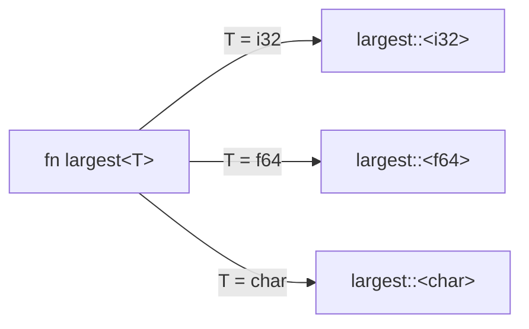

# P9 · Chương 03 — Generics nâng cao

## Bạn sẽ hiểu được gì

1. **Q1.** Trait bound cho phép gì và cấm gì trong thân hàm generic, nó ảnh hưởng thế nào tới type inference, và khi nào bắt buộc dùng turbofish `::<>`? → mục 1
2. **Q2.** Const generics cho phép những kiểu nào, và vì sao `[u8; N + 1]` bị từ chối? → mục 2
3. **Q3.** GAT (generic associated type) giải quyết bài toán gì mà `Iterator` thường không làm được? Viết được `LendingIterator` thế nào? → mục 3
4. **Q4.** `for<'a>` (higher-ranked trait bound, HRTB) là gì và vì sao closure nhận reference hay chạm tới nó? → mục 4
5. **Q5.** `PhantomData` dùng ở mức người dùng ra sao (typed ID, đơn vị đo, type state)? → mục 5
6. **Q6.** `Sized` mặc định là gì, và `?Sized` dùng khi nào? → mục 6
7. **Q7.** `impl Trait` ở return position khác generic thường chỗ nào, và giới hạn của nó là gì? → mục 7
8. **Q8.** Khi nào chọn generic (static dispatch) và khi nào chọn `dyn`? → mục 8

## Kiến thức cần trước

- Rust Book tới generics/traits/lifetimes.
- [Chương 01 — Ownership, borrowing, lifetime](./01-ownership-borrowing-lifetime.md) và [Chương 02 — Trait](./02-trait.md) (trait object, dyn compatibility chỉ nhắc lại ở đây).
- Chi tiết monomorphization và variance nằm ở P10: [Chương 04 — Monomorphization](../10-rust-internals/04-monomorphization.md), [Chương 05 — Variance và dropck](../10-rust-internals/05-variance-va-dropck.md). Chương này chỉ dùng ở mức người dùng.

Mọi ví dụ trong chương được biên dịch và chạy bằng `rustc 1.95.0`, edition 2024, trên macOS aarch64. Thông điệp lỗi trích nguyên văn từ trình biên dịch; chúng có thể đổi chữ ở phiên bản khác (đó là quan sát, không phải bảo đảm).

Xuyên suốt chương ta bám theo `orders`, một HTTP service viết bằng Rust (ví dụ giả định của người soạn, không phải code trong repo). Mỗi request nó đọc tham số từ query string, tra user và order theo ID, chạy một chuỗi handler rồi trả kết quả. Mỗi mục dưới đây mở đầu bằng một chỗ trong `orders` mà tính năng của mục đó giải quyết được.

## 1. Trait bound, hợp đồng và type inference (Q1)

> **Trả lời ngắn.** Trong thân hàm generic, bạn chỉ được dùng những gì bound hứa, nên thiếu bound thì lỗi hiện ngay ở chỗ định nghĩa hàm (quan sát qua lỗi E0369 bên dưới). Bound cũng không *chọn* kiểu hộ bạn: khi tham số kiểu chỉ xuất hiện ở kiểu trả về (như `parse`, `collect`) thì trình biên dịch đòi bạn nói rõ. Có ba cách nói rõ (cách chia ba là tổng hợp của người soạn): annotation trên biến, turbofish `::<>`[^turbofish], hoặc để ngữ cảnh khác ép kiểu.

**Giải thích.**

*Với service `orders`.* Handler của `orders` đọc `?qty=5` từ query string và cần một số nguyên; ngoài ra service có vài hàm tiện ích generic, kiểu như tìm giá lớn nhất trong một lát giá. Hai việc này cho ta hai nửa của Q1: bound cho phép gì trong thân hàm, và vì sao một mình `"5".parse()` chưa đủ để compiler biết bạn muốn số nguyên loại nào.

*Bước 1: generic ở đâu, bound đặt ở đâu.* Generics cho một định nghĩa dùng được với nhiều kiểu. Chỗ đặt bound quyết định phạm vi của nó: trên hàm, bound áp cho mọi lời gọi; trên `impl`, chỉ những kiểu thỏa bound mới có method; và có thể viết thêm `impl` riêng cho một kiểu cụ thể.

```rust
fn largest<T: PartialOrd + Copy>(xs: &[T]) -> T {
    let mut m = xs[0];
    for &x in xs { if x > m { m = x; } }
    m
}

struct Pair<T> { a: T, b: T }
impl<T: PartialOrd + std::fmt::Debug> Pair<T> {   // impl chung: chỉ khi T có bound
    fn max(&self) -> &T { if self.a > self.b { &self.a } else { &self.b } }
}
impl Pair<f64> {                                   // impl chuyên cho một kiểu cụ thể
    fn norm(&self) -> f64 { (self.a * self.a + self.b * self.b).sqrt() }
}
```

Chạy `largest(&[3, 9, 2])` ra `9`, `largest(&[1.5, 0.2])` ra `1.5`, `Pair{a:1,b:5}.max()` ra `5`, `Pair{a:3.0,b:4.0}.norm()` ra `5`. Khi khai báo tham số generic, lifetime phải đứng trước, còn type và const xen kẽ thế nào cũng được[^order].

*Bước 2: trong thân hàm, bound là hợp đồng.* Hàm chỉ được dùng những gì bound hứa. Bỏ `PartialOrd` khỏi `largest`, lỗi nằm ngay trong định nghĩa chứ không đợi tới chỗ gọi:

```text
error[E0369]: binary operation `>` cannot be applied to type `T`
help: consider restricting type parameter `T` with trait `PartialOrd`
```

Chỗ này khác template C++ (nhận xét của người soạn): Rust kiểm tra thân generic đúng một lần theo bound, không chờ tới lúc thay kiểu cụ thể vào.

*Bước 3: bound không chọn kiểu.* Phần này là mô hình của người soạn rút ra từ các lỗi dưới đây, không phải câu trích. Inference chỉ dựa vào các ràng buộc gom được từ ngữ cảnh. Bound như `FromStr` hay `FromIterator<_>` là một **ràng buộc**, không phải một **lựa chọn**; thiếu thông tin thì compiler dừng lại và báo lỗi thay vì đoán. Chính Book dùng tình huống `parse` không có annotation để minh họa lỗi này[^book-e0284].

```rust
let x = "5".parse().unwrap();
println!("{}", x);
```

```text
error[E0284]: type annotations needed
 --> e_infer.rs:1:18
  |       ^       ----- type must be known at this point
  = note: cannot satisfy `<_ as FromStr>::Err == _`
help: consider giving `x` an explicit type
```

`collect()` mà không biết đích cũng vướng y như vậy:

```text
error[E0283]: type annotations needed
  = note: cannot satisfy `_: FromIterator<i32>`
note: required by a bound in `collect`
help: consider giving `v` an explicit type
```

Hai trường hợp có chung nguyên nhân (suy luận của người soạn từ hai thông báo trên): tham số trả về (`F` của `parse`, `B` của `collect`) chỉ xuất hiện ở return type, không có đối số nào kéo nó ra.

*Bước 4: ba cách bổ sung thông tin.* Với `qty` của `orders`, bạn chọn cách nào tùy chỗ dùng (bảng là gợi ý của người soạn):

| Cách | Ví dụ | Khi nào hợp |
|---|---|---|
| Annotation trên biến | `let x: i32 = "5".parse().unwrap();` | Biến được dùng nhiều lần |
| Turbofish | `"5".parse::<i32>()` | Ngay trong chuỗi gọi, không có biến trung gian |
| Ngữ cảnh khác | truyền `x` vào hàm nhận `i32` | Kiểu suy ra ngược từ nơi dùng |

Turbofish là cú pháp `::<>` trong expression. Dấu `::` bắt buộc đứng trước `<` để compiler không nhầm với toán tử so sánh nhỏ hơn[^turbofish]. Phần nào suy ra được thì để `_`: `collect::<Vec<_>>()`, `Vec::<u8>::new()`. Ví dụ đã chạy: `[(1,"a")].into_iter().collect::<HashMap<_,_>>()` ra `{1: "a"}`.

<details><summary>Đi sâu: E0283 hay E0284, và bound là một phần API</summary>

- Hai mã lỗi khác nhau vì thông báo `cannot satisfy` có dạng khác nhau: ở `parse` là ràng buộc projection `<_ as FromStr>::Err == _`, ở `collect` là ràng buộc trait `_: FromIterator<i32>` (suy luận của người soạn từ nội dung hai thông báo trên).
- Error index mô tả E0283 chung chung: compiler không suy ra được kiểu và đòi annotation[^e0283]. E0284 là trường hợp compiler không suy ra rõ ràng được kiểu trả về của hàm hay method generic theo kiểu trả về, và mô tả đó lấy `collect` làm ví dụ[^e0284]. Nhưng khi chạy `collect` ở 1.95.0 ta nhận E0283 (quan sát), nên đừng dựa vào mã lỗi để suy ra nguyên nhân.
- Một lưu ý cho thư viện (nhận xét của người soạn, dựa trên lỗi E0283 ở trên): suy luận kiểu chạy xuyên thân hàm nhưng chữ ký hàm phải đầy đủ, nên thêm một bound mới vào hàm công khai có thể làm hỏng inference ở những chỗ gọi. Hãy coi chữ ký generic là một phần API.

</details>

**Quay lại Q1:** bound là hợp đồng kiểm ngay trong thân hàm và chỉ ràng buộc, không chọn kiểu; khi tham số chỉ nằm ở return type thì bạn phải nói rõ bằng annotation hoặc turbofish.

## 2. Const generics và giới hạn của chúng (Q2)

> **Trả lời ngắn.** Const generics cho phép tham số là một *giá trị* hằng (điển hình là độ dài mảng), nhưng chỉ với số nguyên, `char` và `bool`[^constty]. Trong kiểu hoặc biểu thức lặp mảng, tham số const chỉ được đứng một mình (`N` hoặc `{N}`) chứ không được kết hợp với biểu thức khác, nên `[u8; N + 1]` bị từ chối[^conststand].

**Giải thích.**

*Với service `orders`.* Giả sử `orders` đọc request vào một buffer có độ dài cố định, `[u8; N]`, và muốn hàm xử lý buffer biết `N` ngay lúc biên dịch để khỏi cấp phát heap. Có tham số const thì độ dài trở thành một phần của kiểu: `[u8; 512]` và `[u8; 4096]` là hai kiểu khác nhau, và một hàm viết một lần chạy được cho cả hai. Mục này nói tham số const nhận được kiểu gì và vì sao không viết được `N + 1`.

*Cơ bản.* Ví dụ dưới dùng mảng số nguyên và ma trận cho gọn:

```rust
fn sum<const N: usize>(a: [i32; N]) -> i32 { a.iter().sum() }

struct Matrix<const R: usize, const C: usize>([[i32; C]; R]);
impl<const R: usize, const C: usize> Matrix<R, C> {
    fn transpose(&self) -> Matrix<C, R> {
        let mut o = [[0; R]; C];
        for i in 0..R { for j in 0..C { o[j][i] = self.0[i][j]; } }
        Matrix(o)
    }
}
```

`sum([1,2,3,4])` ra `10`; `Matrix([[1,2,3],[4,5,6]]).transpose().0` ra `[[1, 4], [2, 5], [3, 6]]`. `Matrix<2,3>` và `Matrix<3,2>` là hai kiểu khác nhau, nên nhân ma trận sai kích thước thành lỗi biên dịch (nhận xét của người soạn: đây là lợi ích chính so với `Vec<Vec<_>>`).

Khi truyền đối số const vào một path, đối số đó phải là `_` (để compiler suy ra) hoặc một biểu thức const đúng kiểu. Biểu thức phải đặt trong `{}`, trừ khi nó chỉ là một đường dẫn một đoạn hoặc một literal[^constarg].

*Kiểu được phép.* Reference liệt kê đủ: `u8…u128`, `usize`, `i8…i128`, `isize`, `char`, `bool`, ngoài ra không có gì[^constty]. Thử `f64`:

```text
error: `f64` is forbidden as the type of a const generic parameter
  = note: the only supported types are integers, `bool`, and `char`
```

*Chỉ được đứng một mình.* Trong một kiểu hoặc biểu thức lặp mảng, tham số const chỉ xuất hiện *độc lập* (`N` hoặc `{N}`), không kết hợp với biểu thức khác[^conststand]. Vì vậy không viết được kiểu trả về `[u8; N + 1]`:

```text
error: generic parameters may not be used in const operations
  = help: const parameters may only be used as standalone arguments here, i.e. `N`
```

Người đã quen C++ hay vấp ở đây (nhận xét của người soạn): `N + 1` trong kiểu bị chặn ở 1.95.0, như lỗi trên cho thấy. Cách hay dùng (nhận xét của người soạn, không phải câu trích) là thêm một tham số const riêng, `<const N: usize, const M: usize>`, rồi để người gọi khớp quan hệ giữa hai số.

<details><summary>Đi sâu: giá trị phải là hằng, tham số const "không dùng", exhaustiveness, ví dụ trong std</summary>

- **Giá trị phải là hằng lúc biên dịch.** Error index E0435 mô tả lỗi dùng một giá trị không hằng trong biểu thức hằng[^e0435]; ví dụ `let n: usize = 5; let v: [u8; n] = [0; n];` rơi vào loại lỗi này (suy luận của người soạn từ ví dụ của error index).
- **Tham số const được phép "không dùng"**, khác tham số kiểu và lifetime[^constunused]. Ngược lại, `struct Baz<T>;` bị từ chối ở ví dụ của cùng đoạn Reference đó; xem mục 5.
- **Không có suy luận từ độ phủ.** Khi giải trait bound, compiler không xét tính *đầy đủ* của các impl theo giá trị const: dù đã impl cho cả `true` lẫn `false`, bound với `const B: bool` chung vẫn lỗi[^constexh].
- Std dùng const generics rộng rãi: `[T; N]` có `map`[^arr-map] và `TryFrom<&[T]>` (với `T: Copy`)[^arr-tryfrom]. Ví dụ đã chạy: `<[i32;3]>::try_from(&b[..3]).unwrap()` ra `[1, 2, 3]`.
- `Default` cho mảng thì không generic theo `N`: std docs liệt kê từng `impl<T> Default for [T; 32]`, `[T; 31]`… (xem trang `array` trong std 1.95.0), nên đừng giả định `[T; N]: Default` cho mọi `N`[^arr-default].

</details>

**Quay lại Q2:** tham số const nhận số nguyên, `char`, `bool`; vì chỉ được đứng một mình trong kiểu, `N + 1` bị từ chối và bạn phải dùng thêm một tham số const riêng.

## 3. GAT và LendingIterator (Q3)

> **Trả lời ngắn.** `Iterator` không thể trả về phần tử *mượn từ chính iterator*, vì kiểu `Item` cố định cho cả impl nên không gắn được với lần mượn `&mut self` của từng lần gọi `next` (suy luận của người soạn từ chữ ký trait, có lỗi biên dịch minh họa bên dưới). GAT cho phép kiểu liên kết có tham số generic, ở đây là lifetime[^gat-ref], nhờ đó `next` trả được item mượn từ `self`[^gat-lend]. Tính năng này stable từ Rust 1.65[^rel165].

**Giải thích.**

*Với service `orders`.* Giả sử `orders` đọc một luồng bản ghi đơn hàng vào một buffer dùng lại, và muốn đưa cho caller từng bản ghi dưới dạng `&mut` trỏ thẳng vào buffer, không copy ra `Vec` mới. Mỗi bản ghi mượn từ buffer, mà buffer lại nằm trong iterator. `Iterator` chuẩn không diễn đạt được điều đó. Ví dụ dưới thu gọn bài toán thành cửa sổ trượt `&mut [T]` trên một lát, vì lỗi cũng như lời giải y hệt.

*Vấn đề.* `Iterator::Item` là một kiểu duy nhất cho cả impl, nên không thể phụ thuộc vào lifetime của `&mut self` trong `next` (suy luận của người soạn từ chữ ký trait; chứng cứ là lỗi dưới đây). Hệ quả là iterator không trả được tham chiếu mượn từ chính nó, chẳng hạn các cửa sổ `&mut` chồng lấn. Thử viết `Iterator` cho cửa sổ trượt:

```rust
pub struct W<'s, T> { s: &'s mut [T], pos: usize }
impl<'s, T> Iterator for W<'s, T> {
    type Item = &'s mut [T];
    fn next(&mut self) -> Option<Self::Item> {
        let r = &mut self.s[self.pos..self.pos + 2]; self.pos += 1; Some(r)
    }
}
```

```text
error: lifetime may not live long enough
  = method was supposed to return data with lifetime `'s` but it is returning data with lifetime `'1`
```

Compiler từ chối là hợp lý (suy luận của người soạn): nếu cho qua, caller giữ được hai cửa sổ chồng lấn cùng lúc, tức hai `&mut` alias nhau. Ngược lại, `slice::chunks_mut` hợp lệ vì các chunk **không** chồng lấn; ta đã chạy thử và giữ hai chunk cùng lúc vẫn biên dịch được.

*GAT là lời giải.* Kiểu liên kết được phép có tham số generic và where clause; cái tên chung là generic associated types, GAT[^gat-ref]. Khi tham số đó là lifetime, `next` được phép trả về một item mượn từ `self`[^gat-lend]. Blog chính thức của dự án đã thông báo GAT sẽ stable ở 1.65 trước khi bản này phát hành[^gat-blog].

```rust
trait LendingIterator {
    type Item<'a> where Self: 'a;
    fn next<'a>(&'a mut self) -> Option<Self::Item<'a>>;
}

struct Windows<'s, T> { s: &'s mut [T], pos: usize, n: usize }
impl<'s, T> LendingIterator for Windows<'s, T> {
    type Item<'a> = &'a mut [T] where Self: 'a;
    fn next<'a>(&'a mut self) -> Option<&'a mut [T]> {
        if self.pos + self.n > self.s.len() { return None; }
        let r = &mut self.s[self.pos..self.pos + self.n];
        self.pos += 1;
        Some(r)
    }
}
```

Dùng thử: với `v = [1,2,3,4]`, vòng `while let Some(x) = w.next() { x[1] += x[0]; }` biến `v` thành `[1, 3, 6, 10]`. Mỗi cửa sổ thấy kết quả ghi của cửa sổ trước, đúng thứ `Iterator` không cho phép. Lifetime `'a` của `Item<'a>` bị buộc vào lần mượn `&'a mut self`, nên bạn không giữ được phần tử cũ khi gọi `next` lần nữa; borrow checker kiểm tra điều này (xem [chương 01](./01-ownership-borrowing-lifetime.md)).

<details><summary>Đi sâu: vì sao <code>where Self: 'a</code> bắt buộc, và giới hạn còn lại ở 1.95.0</summary>

- **`where Self: 'a` bắt buộc.** Bỏ mệnh đề này khỏi khai báo trait:

  ```text
  error: missing required bound on `Item`
    = help: add the required where clause: `where Self: 'a`
    = note: this bound is currently required to ensure that impls have maximum flexibility
  ```

  Reference giải thích: mệnh đề này cần để tối đa hóa các định nghĩa impl cho phép; quy tắc có thể được nới trong tương lai[^gat-where].
- **Giới hạn HRTB trên GAT.** Blog stabilization đã nêu trước rằng `for<'a> I::Item<'a>: Debug` hiện *ngầm buộc* `I::Item<'a>` outlive `'static`[^gat-limit]. Ta kiểm lại ở 1.95.0 với hàm `print_items<I>(it: I) where I: LendingIterator, for<'a> I::Item<'a>: Debug` gọi trên `WindowsMut` mượn biến cục bộ:

  ```text
  error[E0597]: `v` does not live long enough
    = note: due to a current limitation of the type system, this implies a `'static` lifetime
  ```

  Vậy giới hạn này **vẫn còn ở 1.95.0** (quan sát một lần biên dịch). Hệ quả thực tế (nhận xét của người soạn): viết thuật toán generic trên `LendingIterator` với bound HRTB lên `Item` còn khó, và trait `LendingIterator` bạn phải tự định nghĩa như ở trên.

</details>

**Quay lại Q3:** GAT cho `Item<'a>` phụ thuộc lần mượn `&'a mut self`, nhờ đó `LendingIterator` trả được cửa sổ chồng lấn mà `Iterator` không làm được.

## 4. Higher-ranked trait bound: `for<'a>` (Q4)

> **Trả lời ngắn.** `for<'a>` đọc là "với mọi lifetime `'a`": bound phải đúng cho *mọi* lifetime chứ không chỉ một lifetime cố định[^hrtb-ref]. Bạn cần nó khi hàm nhận một closure rồi tự truyền vào đó reference có lifetime ngắn hơn mọi lifetime mà chữ ký hàm nêu tên được[^hrtb-need]. Bạn đã dùng nó ngầm mỗi lần viết `Fn(&str) -> &str`, vì elision mở rộng chữ ký đó thành `for<'a> Fn(&'a str) -> &'a str`[^elide-expand].

**Giải thích.**

*Với service `orders`.* Giả sử `orders` có một hàm nhận closure của bạn, tự lấy path của request làm một `String` cục bộ rồi gọi closure trên `&path`. Path sống ngắn hơn hàm, và hàm chỉ nhận closure `F`, không biết trước lifetime nào sẽ được truyền vào. Chỗ này là nơi `for<'a>` xuất hiện, và cũng là nơi closure khai báo rời hay dính lỗi lạ.

*Vấn đề.* Bound `F: Fn(&str) -> &str` nghe đơn giản, nhưng "reference có lifetime nào?" Hàm không biết trước lifetime của dữ liệu mà nó sẽ truyền vào closure trong thân. Lời giải là một HRTB: bound đúng với *mọi* lifetime[^hrtb-ref]. Reference minh họa rằng chỉ bound bậc cao mới dùng được khi tham chiếu sống ngắn hơn mọi tham số lifetime của hàm[^hrtb-need].

*Bạn đã dùng nó mà không thấy.* Lifetime elision áp dụng cả trong chữ ký `Fn`, function pointer và closure trait[^elide-fn]. Reference có ví dụ `dyn Fn(&str) -> &str` được mở rộng thành `dyn for<'a> Fn(&'a str) -> &'a str`[^elide-expand]. Vì vậy hai cách viết dưới đây tương đương:

```rust
fn call_with_ref<F>(f: F) -> usize where F: for<'a> Fn(&'a str) -> &'a str {
    let s = String::from("hello world");
    f(&s).len()
}
```

`call_with_ref(|s| s.split(' ').next().unwrap())` ra `5`. Viết `F: Fn(&str) -> &str` là tương đương nhờ elision: `call(|s| s)` với `fn call<F: Fn(&str) -> &str>` ở dưới ra `2`, và `call_with_ref(|s| &s[1..])` ra `10` (đã chạy).

*Khi nào gặp: closure nhận reference.* Bẫy kinh điển là *suy luận chữ ký closure*. Nếu bạn khai báo closure riêng rồi mới truyền, lúc định nghĩa nó chưa có chữ ký kỳ vọng nào để bám:

```rust
fn call<F: Fn(&str) -> &str>(f: F) -> usize { f("ab").len() }
fn main() {
    let f = |s| s;
    println!("{}", call(f));
}
```

```text
error: implementation of `Fn` is not general enough
  = note: closure with signature `fn(&'2 str) -> &str` must implement `Fn<(&'1 str,)>`, for any lifetime `'1`...
  = note: ...but it actually implements `Fn<(&'2 str,)>`, for some specific lifetime `'2`
```

Thông báo lỗi nói thẳng: bound đòi "mọi lifetime", còn closure chỉ được suy ra cho "một lifetime cụ thể". Truyền closure **inline** thì chạy được, `call(|s| s)` ra `2` (đã chạy), vì closure được định nghĩa ngay tại chỗ có kỳ vọng `for<'a>` (suy luận của người soạn). Chỉ annotate tham số không cứu được closure tách rời: `let f = |s: &str| s; call(f)` vẫn bị `error: lifetime may not live long enough` (đã chạy). Cách sửa thực tế là truyền closure inline; và đúng lúc bạn tách closure ra biến để dùng lại ở nhiều nơi là lúc hay chạm lỗi này (nhận xét của người soạn).

Điều ngược lại cũng cho thấy vì sao `for<'a>` phải tồn tại. Nếu gán một lifetime cụ thể, `F: Fn(&'a str) -> &'a str` với `'a` là tham số của hàm, thì thân hàm không thể truyền `&s` của biến cục bộ:

```text
error[E0597]: `s` does not live long enough
```

Nomicon dùng đúng loại tình huống này (struct `Closure` với `Fn(&(u8,u16)) -> &u8`) để nói rằng việc đó cần đến HRTB[^nomicon-hrtb].

<details><summary>Đi sâu: hai vị trí đặt <code>for&lt;'a&gt;</code></summary>

`where for<'a> F: Fn(&'a T)` và `F: for<'a> Fn(&'a T)` khác nhau chỉ ở phạm vi lifetime: dạng sau chỉ phủ tới hết trait đó[^hrtb-trait]. Reference có ví dụ hai dạng này tương đương cho `call_on_ref_zero`.

</details>

**Quay lại Q4:** `for<'a>` nghĩa là "với mọi lifetime"; elision tự sinh nó trong `Fn(&T) -> &U`, và closure khai báo rời có thể bị suy ra cho một lifetime cụ thể nên báo "not general enough".

## 5. `PhantomData` ở mức người dùng (Q5)

> **Trả lời ngắn.** Rust từ chối tham số kiểu không dùng trong field nào. `PhantomData<T>` là kiểu kích thước 0, dùng để báo cho trình biên dịch rằng kiểu của bạn hành xử như có chứa `T`[^phantom-doc]. Nhờ vậy bạn "gắn nhãn" được cho kiểu (ID, đơn vị, trạng thái) mà không tốn byte nào[^phantom-size].

**Giải thích.**

*Với service `orders`.* Trong `orders`, ID của user và ID của order đều là `u64`, nên truyền nhầm ID order vào hàm tra user vẫn biên dịch được và chỉ sai lúc chạy. Bạn muốn compiler bắt lỗi này mà không phải trả thêm byte nào. `PhantomData` làm được việc đó; cùng cách ấy mã hóa được đơn vị đo, và cả trạng thái của một connection tới database.

Trước hết là lý do `PhantomData` cần tới. Tham số kiểu không xuất hiện trong field nào bị từ chối:

```rust
struct Id<T>(u64);
```

```text
error[E0392]: type parameter `T` is never used
  = help: consider removing `T`, referring to it in a field, or using a marker such as `PhantomData`
```

`PhantomData<T>` là field "đánh dấu" rằng kiểu hành xử như có `T`[^phantom-doc], còn kích thước của nó bằng 0[^phantom-size].

*Typed ID.* Mỗi loại ID được một tham số kiểu riêng, dù bên trong vẫn là một `u64`:

```rust
use std::marker::PhantomData;
struct Id<T> { raw: u64, _m: PhantomData<fn() -> T> }
impl<T> Clone for Id<T> { fn clone(&self) -> Self { *self } }
impl<T> Copy for Id<T> {}
struct User; struct Order;
fn load_user(_: Id<User>) {}
```

Truyền `Id<Order>` cho `load_user`:

```text
error[E0308]: mismatched types
  = note: expected struct `Id<User>`
             found struct `Id<Order>`
```

`size_of::<Id<User>>()` và `size_of::<Id<Order>>()` đều bằng `8`: an toàn kiểu **không tốn byte** (đã chạy).

*Đơn vị đo.* Cùng kỹ thuật, bây giờ dùng cho số đo, chẳng hạn khối lượng hàng trong đơn:

```rust
struct Meters; struct Feet;
struct Len<U>(f64, PhantomData<U>);
impl<U> std::ops::Add for Len<U> {
    type Output = Len<U>;
    fn add(self, o: Self) -> Self { Len(self.0 + o.0, PhantomData) }
}
```

`(Len::<Meters>(1.0, PhantomData) + Len(2.0, PhantomData)).0` ra `3`. Cộng `Len<Meters>` với `Len<Feet>` thì bị `error[E0308]: mismatched types` (`expected Len<Meters>, found Len<Feet>`, đã chạy), vì `Add` chỉ định nghĩa cho cùng một `U`.

*Type state pattern.* Cách thứ ba mã hóa *trạng thái* vào tham số kiểu, để method chỉ tồn tại ở trạng thái hợp lệ. Với connection của `orders` tới DB, `send` chỉ gọi được khi connection đang mở:

```rust
struct Open; struct Closed;
struct Conn<S> { name: String, _s: PhantomData<S> }
impl Conn<Closed> {
    fn new(n: &str) -> Self { Conn { name: n.into(), _s: PhantomData } }
    fn open(self) -> Conn<Open> { Conn { name: self.name, _s: PhantomData } }
}
impl Conn<Open> {
    fn send(&self, m: &str) -> String { format!("{} <- {}", self.name, m) }
    fn close(self) -> Conn<Closed> { Conn { name: self.name, _s: PhantomData } }
}
```

`Conn::new("db").open().send("ping")` ra `db <- ping`. Gọi `send` trên `Conn<Closed>` (thông báo dưới đây là của lần chạy với tên struct rút gọn `C`):

```text
error[E0599]: no method named `send` found for struct `C<Closed>` in the current scope
  = note: the method was found for
          - `C<Open>`
```

Cơ chế dựa vào việc `self` bị **move** khi chuyển trạng thái: `open(self)` tiêu thụ `Conn<Closed>` nên bản cũ không dùng lại được (nhận xét của người soạn, hệ quả từ ownership, xem [chương 01](./01-ownership-borrowing-lifetime.md)). Ở backend, đây là cách bảo đảm "connection phải được authenticated trước khi query" mà không cần kiểm tra lúc chạy. Cái giá (suy luận của người soạn): số impl tăng, kiểu trạng thái lộ ra trong API, và bạn không lưu được nhiều connection ở các trạng thái khác nhau trong cùng một `Vec` nếu không dùng enum hoặc `dyn`.

<details><summary>Đi sâu: vì sao <code>PhantomData&lt;fn() -&gt; T&gt;</code> và <code>Clone</code>/<code>Copy</code> viết tay</summary>

- Thử `#[derive(Clone, Copy)]` rồi dùng `Id<NoClone>` ở chỗ cần `Copy` (đã chạy):

  ```text
  error[E0277]: the trait bound `Id<NoClone>: Copy` is not satisfied
  note: required for `Id<NoClone>` to implement `Copy`
  ```

- Quan sát: derive đòi `T: Copy`, trong khi marker `User`/`Order` thường không cần implement gì; impl tay bỏ bound đó. Hành vi này có trong docs: `#[derive]` trên struct generic thêm bound `Clone` lên tham số generic[^derive-bound]. Docs `Clone` còn dùng ví dụ `Generate<T>(fn() -> T)` để cho thấy bản derive có bound `T: Copy`/`T: Clone` không cần thiết[^derive-unnec].
- `PhantomData<T>` được tính như sở hữu `T` cho variance, drop check và auto trait[^phantom-ref]. Bảng trong Nomicon ghi `PhantomData<fn() -> T>` là covariant theo `T`, `Send + Sync`, và không còn ràng buộc drop check kiểu "owns T"[^nomicon-phantom]; đó là lý do ví dụ dùng dạng này. Docs của `PhantomData` lưu ý thêm: hiện tại việc thêm trường `PhantomData<T>` để báo kiểu của bạn sở hữu dữ liệu `T` chỉ áp dụng "trong những trường hợp rất hiếm", và tương tác chính xác với drop check có thể đổi trong tương lai[^phantom-std]. Chi tiết ở [P10·05](../10-rust-internals/05-variance-va-dropck.md).

</details>

**Quay lại Q5:** `PhantomData` là field kích thước 0 cho phép mã hóa ID, đơn vị và trạng thái vào kiểu; lỗi bị bắt lúc biên dịch mà không tốn byte.

## 6. `Sized` mặc định và `?Sized` (Q6)

> **Trả lời ngắn.** Tham số kiểu mặc định bị buộc phải có kích thước biết lúc biên dịch (`Sized`)[^sized-default]. Viết `?Sized` là nới bound ngầm đó[^qsized], để hàm nhận được cả `str`, `[T]`, `dyn Trait` khi chúng đứng sau con trỏ.

**Giải thích.**

*Với service `orders`.* `orders` có một hàm ghi log generic, nhận `&T` với `T: Debug`. Bạn gọi nó với một `&str` lấy từ query string và compiler từ chối, dù `str` rõ ràng in được. Lý do nằm ở một bound mà bạn không viết ra: mọi tham số kiểu đều ngầm có `T: Sized`, tức kích thước phải biết lúc biên dịch. `str` và `[T]` thì không: chúng chỉ đi qua con trỏ như `&str` (chi tiết ở [P10·03](../10-rust-internals/03-dst-fat-pointer-vtable.md)).

Quên điều này và truyền `&str`:

```rust
fn show<T: std::fmt::Debug>(t: &T) {}
show("abc");
```

```text
error[E0277]: the size for values of type `str` cannot be known at compilation time
  = help: the trait `Sized` is not implemented for `str`
note: required by an implicit `Sized` bound in `show`
```

Sửa bằng `fn show<T: ?Sized + Debug>(t: &T) -> String { format!("{:?}", t) }`: `show("str")` ra `"str"` và `show(&[1,2][..])` ra `[1, 2]`. Quy tắc áp dụng (nhận xét của người soạn): nếu hàm chỉ chạm `T` sau một con trỏ (`&T`, `Box<T>`), hãy cân nhắc `?Sized` để nhận được `str`, `[T]`, `dyn Trait`.

<details><summary>Đi sâu: phạm vi của <code>?Sized</code>, <code>PhantomData</code>, và DST</summary>

- `?Sized` chỉ dùng được để nới bound cho tham số kiểu hoặc associated type, không dùng cho kiểu khác[^qsized].
- `Sized` mặc định áp dụng cho tham số kiểu *trừ `Self` trong trait*, và cho associated type[^sized-default].
- `PhantomData<T>` bản thân cũng khai báo `T: ?Sized`[^phantom-qsized], nên đặt nó trong struct không ép `T` phải `Sized`.
- Chi tiết DST và fat pointer: [P10·03](../10-rust-internals/03-dst-fat-pointer-vtable.md).

</details>

**Quay lại Q6:** `T` mặc định là `Sized`; thêm `?Sized` khi hàm chỉ chạm `T` qua con trỏ và bạn muốn nhận `str`, `[T]` hoặc `dyn`.

## 7. `impl Trait` ở return position (Q7)

> **Trả lời ngắn.** `impl Trait` xuất hiện ở hai nơi: ở tham số, nó chỉ là cách viết gọn của một tham số kiểu ẩn danh; ở kiểu trả về, nó là một kiểu trừu tượng[^impl-both]. Ở vị trí trả về, chính *hàm* chọn kiểu cụ thể chứ không phải người gọi[^impl-diff]. Giới hạn lớn nhất là mọi nhánh trả về phải cùng một kiểu cụ thể[^impl-single].

**Giải thích.**

*Với service `orders`.* Một hàm của `orders` trả về luồng ID các đơn cần xử lý, thực chất là một chuỗi adapter `filter`, `map`… Bạn không muốn viết tên kiểu dài ngoằng của chuỗi đó vào chữ ký, cũng không muốn `Box` nó chỉ để giấu tên. `impl Iterator<Item = ...>` ở kiểu trả về giải quyết cả hai, với điều kiện hàm chỉ trả về đúng một kiểu cụ thể.

Khác biệt cốt lõi với generic thường là ai chọn kiểu: với tham số generic, *người gọi* chọn; với `impl Trait` ở kiểu trả về, *hàm* chọn[^impl-diff]. Ví dụ rút gọn:

```rust
fn evens() -> impl Iterator<Item = u32> { (0..10).filter(|x| x % 2 == 0) }
```

`evens().collect::<Vec<_>>()` ra `[0, 2, 4, 6, 8]`. Chữ ký chỉ lộ `Iterator` như một bound trên kiểu trả về, thay vì tên cả chuỗi adapter và closure[^impl-closures]. Cách này còn tránh được các nhược điểm của boxed trait object[^impl-nobox].

**Mọi nhánh phải cùng một kiểu cụ thể**[^impl-single]. Hàm dưới trả `1` ở nhánh này, `"a"` ở nhánh kia, nên bị từ chối:

```rust
pub fn f(b: bool) -> impl std::fmt::Display { if b { 1 } else { "a" } }
```

```text
error[E0308]: `if` and `else` have incompatible types
help: you could change the return type to be a boxed trait object
```

Lối thoát là `Box<dyn Display>`, trả được kiểu khác nhau nhưng tốn một lần cấp phát heap và dispatch động (nhận xét của người soạn). Book cũng nói như vậy: chỉ dùng `impl Trait` khi trả về một kiểu duy nhất[^book-impl-single].

<details><summary>Đi sâu: capture lifetime và edition 2024</summary>

- Return-position `impl Trait` tự động capture mọi tham số generic trong phạm vi, kể cả lifetime[^impl-capture].
- Trước edition 2024, lifetime generic không xuất hiện trong bound của kiểu trả về *không* được capture tự động với hàm tự do và method của inherent impl[^impl-2024].
- Ví dụ của chương dùng edition 2024 nên không dính chuyện này. Reference còn có cách điều khiển tường minh tập tham số được capture, bằng bound `use<..>`[^impl-use].

</details>

**Quay lại Q7:** `impl Trait` ở return để *hàm* chọn một kiểu cụ thể duy nhất và giấu tên nó; cần nhiều kiểu thì dùng `Box<dyn Trait>` hoặc enum.

## 8. Generic hay `dyn`? (Q8)

> **Trả lời ngắn.** Generic được biên dịch thành mã riêng cho từng kiểu (monomorphization), nên gọi hàm là gọi thẳng và không tốn chi phí runtime riêng cho generics[^mono-cost]. `dyn Trait` thì bắt buộc dùng dynamic dispatch, tức tra bảng lúc chạy[^dyn-must]. Việc tra bảng này chặn luôn inline[^dyn-inline]; đổi lại, `dyn` cho phép nhiều kiểu cụ thể nằm chung một collection.

**Giải thích.**

*Với service `orders`.* `orders` chạy mỗi request qua một chuỗi handler: xác thực, validate, ghi đơn, ghi log. Câu hỏi thiết kế là viết chuỗi đó bằng generic (mỗi handler là một kiểu, compiler biết hết lúc biên dịch) hay lưu trong `Vec<Box<dyn Handler>>` (đăng ký lúc chạy, kiểu lẫn lộn). Mục này đặt hai chi phí cạnh nhau để bạn chọn.

*Static dispatch và monomorphization.* Compiler *monomorphize*: biến code generic thành code cụ thể bằng cách điền các kiểu thực tế được dùng lúc biên dịch[^mono]. Vì vậy Book nói ta "không trả chi phí runtime cho generics"[^mono-cost]. Code sau monomorphization là static dispatch: compiler biết chính xác method nào được gọi[^static].



Quan sát trực tiếp: biên dịch `largest` (đánh dấu `#[inline(never)]`) và gọi với `i32`, `f64`, `char` ở chế độ debug. `nm m | grep largest` ra **ba** symbol khác nhau (`...largest17h06f6...`, `...17h5ac3...`, `...17hf2bd...`), mỗi kiểu một bản (quan sát một lần chạy; ở `-O` compiler có thể inline hết nên symbol biến mất, và ta đã thấy `nm` không còn symbol nào). Mỗi kiểu thêm một bản mã máy, nên generic làm tăng thời gian biên dịch và kích thước binary (suy luận của người soạn từ quan sát này). Cơ chế monomorphization nằm ở [P10·04](../10-rust-internals/04-monomorphization.md).

*Dynamic dispatch.* Trait object bắt buộc dùng dynamic dispatch, Book nói rõ điều này[^dyn-must]. Chi phí là phải tra bảng lúc chạy và mất khả năng inline[^dyn-inline]. Bù lại, một hàm duy nhất phục vụ được nhiều kiểu cụ thể trong cùng một collection:

```rust
let v: Vec<Box<dyn Display>> = vec![Box::new(1), Box::new("a"), Box::new(2.5)];
```

In ra `1`, `a`, `2.5`. Con trỏ `&dyn Display` có kích thước `16` byte, so với `8` cho `&i32` (đã chạy trên aarch64), vì mỗi con trỏ tới trait object gồm một con trỏ tới instance của `T` và một vtable[^to-ptr]. Chi tiết ở [P10·03 mục 2 và 4](../10-rust-internals/03-dst-fat-pointer-vtable.md).

*So sánh.* Bảng so sánh generic với `dyn` (dispatch, số bản mã, thời gian biên dịch, kích thước binary, inline, collection hỗn hợp), có nguồn cho từng ô, nằm ở [P10·04 mục 3](../10-rust-internals/04-monomorphization.md); mục này chỉ giữ quy tắc chọn. Thêm một tiêu chí thuộc góc API (nhận xét của người soạn): generic làm lộ tham số kiểu ra API công khai, còn `dyn` thì không.

**Quy tắc ngón tay cái (nhận xét của người soạn):**

- Hot path, kiểu biết lúc biên dịch → generic.
- Plugin hoặc handler đăng ký lúc chạy, collection kiểu hỗn hợp → `dyn`.
- Thư viện công khai muốn giảm việc tham số kiểu lan ra ngoài → `dyn` ở ranh giới, generic bên trong.
- Trong `orders`, handler lưu trong `Vec<Box<dyn Handler>>` tốn một lần gọi gián tiếp mỗi handler, thường nhỏ so với thời gian I/O của request; hãy đo trước khi tối ưu.

Book ch18 thảo luận đầy đủ chủ đề này[^dyn-must].

<details><summary>Đi sâu: dyn compatibility</summary>

Trait chỉ dùng làm `dyn` được khi mọi hàm liên kết hoặc dispatchable, hoặc được đánh dấu non-dispatchable tường minh. Hàm dispatchable không được có type parameter (lifetime thì được) và không được dùng `Self` ngoài receiver[^dyn-compat]; còn hàm non-dispatchable cần bound `where Self: Sized`[^dyn-nondisp]. Danh sách điều kiện đầy đủ và các lần chạy `E0038` (trả `Self`, method generic, associated const) nằm ở [P9·02 mục 6](02-trait.md); lý do theo góc vtable nằm ở [P10·03 mục 5](../10-rust-internals/03-dst-fat-pointer-vtable.md).

</details>

**Quay lại Q8:** generic = nhiều bản mã, gọi tĩnh, inline được; `dyn` = một bản mã, gọi qua vtable, hợp với collection hỗn hợp nhưng phải thỏa dyn compatibility.

## Liên hệ với Rust

Toàn bộ chương là Rust. Phần std liên quan trực tiếp: `PhantomData` (`core::marker`), `Sized`, `FromStr`/`FromIterator` (nguồn gốc lỗi inference), `[T; N]` (const generics). Những thứ còn giới hạn ở 1.95.0 trong chương: biểu thức const tổng quát trong kiểu (`N + 1`), kiểu const ngoài danh sách (`f64`), HRTB trên GAT.

## Tóm tắt

- Bound là hợp đồng kiểm ngay trong thân generic; thiếu bound là lỗi ở định nghĩa.
- Inference không chọn kiểu giúp bạn khi tham số chỉ xuất hiện ở return type (`parse`, `collect`): dùng annotation hoặc turbofish `::<>`.
- Const generics: chỉ số nguyên, `bool`, `char`; trong kiểu/array repeat tham số const chỉ đứng một mình, không `N + 1`.
- GAT (stable từ 1.65) cho phép `type Item<'a>` phụ thuộc lần mượn `&'a mut self`, nên viết được `LendingIterator`; `where Self: 'a` bắt buộc; bound `for<'a> I::Item<'a>: Debug` vẫn ngầm đòi `'static` ở 1.95.0.
- `for<'a>` = "với mọi lifetime"; elision trong `Fn(&T) -> &U` tự sinh ra nó; closure khai báo rời có thể không "general enough".
- `PhantomData` mang thông tin kiểu mà không tốn byte (typed ID, đơn vị, type state).
- Tham số kiểu là `Sized` ngầm; `?Sized` để nhận `str`, `[T]`, `dyn`.
- `impl Trait` ở return: một kiểu cụ thể duy nhất, hàm chọn kiểu; cần nhiều kiểu → `Box<dyn Trait>` hoặc enum.
- Generic = monomorphization = static dispatch, nhiều bản mã; `dyn` = vtable, một bản mã, ít cơ hội inline.

## Câu hỏi tự kiểm tra

1. Vì sao `let x = "5".parse().unwrap();` không biên dịch, và có ba cách sửa nào?
<details><summary>Đáp án</summary>

Tham số kiểu đích chỉ xuất hiện ở return type; compiler báo E0284 `type annotations needed` (Book có đúng ví dụ này [^book-e0284]). Sửa bằng annotation `let x: i32`, turbofish `parse::<i32>()` [^turbofish], hoặc dùng `x` ở nơi ép kiểu (cách thứ ba là quan sát/suy luận của người soạn, không có câu trích riêng).

</details>

2. Tại sao `fn f<const N: usize>() -> [u8; N + 1]` bị từ chối?
<details><summary>Đáp án</summary>

Tham số const trong kiểu chỉ được đứng độc lập, không kết hợp biểu thức [^conststand]; lỗi thật: "generic parameters may not be used in const operations".

</details>

3. Kiểu nào được dùng làm tham số const?
<details><summary>Đáp án</summary>

Các số nguyên, `char`, `bool`; `f64` bị từ chối [^constty].

</details>

4. Vì sao `Iterator` không viết được cửa sổ `&mut` chồng lấn nhưng `LendingIterator` viết được?
<details><summary>Đáp án</summary>

`Iterator::Item` cố định cho cả impl nên không thể gắn với lần mượn `&mut self`; GAT `Item<'a>` cho phép `next` trả item mượn từ `self` [^gat-ref] [^gat-lend]. Lỗi thật khi thử bằng `Iterator`: "lifetime may not live long enough".

</details>

5. Giải thích `where Self: 'a` trên GAT.
<details><summary>Đáp án</summary>

Bắt buộc ("missing required bound on `Item`"); Reference giải thích để tối đa hóa các impl hợp lệ [^gat-where].

</details>

6. `F: Fn(&str) -> &str` thực chất là bound gì? Vì sao `let f = |s| s; call(f)` lỗi?
<details><summary>Đáp án</summary>

Elision mở rộng thành `for<'a> Fn(&'a str) -> &'a str` [^elide-expand]; closure khai báo rời được suy luận cho một lifetime cụ thể nên "not general enough" (lỗi thật ở mục 4).

</details>

7. Làm sao có `Id<User>` và `Id<Order>` khác kiểu mà không tốn bộ nhớ?
<details><summary>Đáp án</summary>

Dùng `PhantomData` [^phantom-doc]; kích thước 0 [^phantom-size]; đã đo `size_of` đều là 8.

</details>

8. Khi nào cần `?Sized`?
<details><summary>Đáp án</summary>

Khi hàm chỉ dùng `T` sau con trỏ và muốn nhận `str`/`[T]`/`dyn`; mặc định `T: Sized` [^sized-default], nới bằng `?Sized` [^qsized].

</details>

9. Vì sao hàm `-> impl Display` không trả được `1` hoặc `"a"` tùy nhánh? Lựa chọn thay thế?
<details><summary>Đáp án</summary>

Mọi nhánh phải cùng một kiểu cụ thể [^impl-single]; dùng `Box<dyn Display>` (hoặc enum; nhận xét của người soạn).

</details>

10. So sánh generic và `dyn` về dispatch, kích thước binary, collection hỗn hợp.
<details><summary>Đáp án</summary>

Xem so sánh ở [P10·04 mục 3](../10-rust-internals/04-monomorphization.md) (tổng hợp của người soạn); nguồn cho phần dispatch: [^mono-cost], [^static], [^dyn-must], [^dyn-inline].

</details>

11. Vì sao trait có method `fn f<X>(&self, x: X)` không dùng làm `dyn` được?
<details><summary>Đáp án</summary>

Hàm dispatchable không được có type parameter [^dyn-compat], trừ khi đánh dấu `where Self: Sized` [^dyn-nondisp]; lỗi thật E0038.

</details>

12. Type state pattern ngăn lỗi gọi `send` trên connection đóng như thế nào?
<details><summary>Đáp án</summary>

`send` chỉ có trong `impl Conn<Open>`; gọi trên `Conn<Closed>` cho E0599 (lỗi thật ở mục 5).

</details>

## Đọc thêm

- [Reference — Generic parameters](https://doc.rust-lang.org/1.95.0/reference/items/generics.html): danh sách đầy đủ giới hạn của const generics.
- [Reference — Associated items, GAT](https://doc.rust-lang.org/1.95.0/reference/items/associated-items.html): quy tắc where clause bắt buộc.
- [Nomicon — Higher-Rank Trait Bounds](https://doc.rust-lang.org/1.95.0/nomicon/hrtb.html): desugar closure có HRTB.
- [Blog — GATs stabilization](https://blog.rust-lang.org/2022/10/28/gats-stabilization/): ví dụ LendingIterator và các hạn chế ban đầu.
- [Book ch10-01](https://doc.rust-lang.org/1.95.0/book/ch10-01-syntax.html) và [ch18-02](https://doc.rust-lang.org/1.95.0/book/ch18-02-trait-objects.html): monomorphization và dynamic dispatch.
- [P10·04 Monomorphization](../10-rust-internals/04-monomorphization.md), [P10·05 Variance và dropck](../10-rust-internals/05-variance-va-dropck.md): chi tiết nội bộ.

[^order]: Rust Reference, Generic parameters — <https://doc.rust-lang.org/1.95.0/reference/items/generics.html> — "The order of generic parameters is restricted to lifetime parameters and then type and const parameters intermixed."
[^book-e0284]: Rust Book, ch03-02 Data types — <https://doc.rust-lang.org/1.95.0/book/ch03-02-data-types.html> — "error[E0284]: type annotations needed"
[^turbofish]: Rust Reference, Paths — <https://doc.rust-lang.org/1.95.0/reference/paths.html> — "The :: token is required before the opening < for generic arguments to avoid ambiguity with the less-than operator."
[^constarg]: Rust Reference, Generic parameters — <https://doc.rust-lang.org/1.95.0/reference/items/generics.html> — "The argument must either be an inferred const or be a const expression of the type ascribed to the const parameter. The const expression must be a block expression (surrounded with braces) unless it is a single path segment (an IDENTIFIER) or a literal"
[^constty]: Rust Reference, Generic parameters — <https://doc.rust-lang.org/1.95.0/reference/items/generics.html> — "The only allowed types of const parameters are u8, u16, u32, u64, u128, usize, i8, i16, i32, i64, i128, isize, char and bool."
[^conststand]: Rust Reference, Generic parameters — <https://doc.rust-lang.org/1.95.0/reference/items/generics.html> — "As a further restriction, const parameters may only appear as a standalone argument inside of a type or array repeat expression."
[^constunused]: Rust Reference, Generic parameters — <https://doc.rust-lang.org/1.95.0/reference/items/generics.html> — "Unlike type and lifetime parameters, const parameters can be declared without being used inside of a parameterized item"
[^constexh]: Rust Reference, Generic parameters — <https://doc.rust-lang.org/1.95.0/reference/items/generics.html> — "When resolving a trait bound obligation, the exhaustiveness of all implementations of const parameters is not considered when determining if the bound is satisfied."
[^gat-ref]: Rust Reference, Associated items — <https://doc.rust-lang.org/1.95.0/reference/items/associated-items.html> — "Associated types may include generic parameters and where clauses; these are often referred to as generic associated types, or GATs."
[^rel165]: Rust RELEASES.md tại tag 1.95.0, mục Version 1.65.0 (2022-11-03) — <https://raw.githubusercontent.com/rust-lang/rust/1.95.0/RELEASES.md> — "Stabilize generic associated types (GATs)"
[^gat-blog]: Rust Blog, Generic associated types to be stable in Rust 1.65 — <https://blog.rust-lang.org/2022/10/28/gats-stabilization/> — "As of Rust 1.65, which is set to release on November 3rd, generic associated types (GATs) will be stable"
[^gat-where]: Rust Reference, Associated items, Required where clauses on GATs — <https://doc.rust-lang.org/1.95.0/reference/items/associated-items.html> — "In a few words, these where clauses are required in order to maximize the allowed definitions of the associated type in impls."
[^gat-limit]: Rust Blog, Generic associated types to be stable in Rust 1.65 — <https://blog.rust-lang.org/2022/10/28/gats-stabilization/> — "the for\<'a> I::Item\<'a>: Debug currently implies that I::Item\<'a> must outlive 'static."
[^hrtb-ref]: Rust Reference, Trait and lifetime bounds — <https://doc.rust-lang.org/1.95.0/reference/trait-bounds.html> — "Trait bounds may be higher ranked over lifetimes. These bounds specify a bound that is true for all lifetimes."
[^hrtb-need]: Rust Reference, Trait and lifetime bounds — <https://doc.rust-lang.org/1.95.0/reference/trait-bounds.html> — "Only a higher-ranked bound can be used here, because the lifetime of the reference is shorter than any possible lifetime parameter on the function:"
[^hrtb-trait]: Rust Reference, Trait and lifetime bounds — <https://doc.rust-lang.org/1.95.0/reference/trait-bounds.html> — "the only difference is the scope of the lifetime parameter, which extends only to the end of the following trait instead of the whole bound."
[^elide-fn]: Rust Reference, Lifetime elision — <https://doc.rust-lang.org/1.95.0/reference/lifetime-elision.html> — "lifetime arguments can be elided in function item, function pointer, and closure trait signatures."
[^nomicon-hrtb]: Rustonomicon, Higher-Rank Trait Bounds — <https://doc.rust-lang.org/1.95.0/nomicon/hrtb.html> — "This job requires The Magic of Higher-Rank Trait Bounds (HRTBs)."
[^phantom-doc]: std docs, PhantomData — <https://doc.rust-lang.org/1.95.0/std/marker/struct.PhantomData.html> — "Adding a PhantomData\<T> field to your type tells the compiler that your type acts as though it stores a value of type T"
[^phantom-size]: std docs, PhantomData — <https://doc.rust-lang.org/1.95.0/std/marker/struct.PhantomData.html> — "size_of::\<PhantomData\<T>>() == 0"
[^phantom-std]: Rust std docs 1.95.0, `PhantomData` — <https://doc.rust-lang.org/1.95.0/std/marker/struct.PhantomData.html> — "adding a field of type PhantomData\<T> indicates that your type owns data of type T in very rare circumstances."
[^phantom-ref]: Rust Reference, Special types and traits — <https://doc.rust-lang.org/1.95.0/reference/special-types-and-traits.html> — "std::marker::PhantomData\<T> is a zero-sized, minimum alignment, type that is considered to own a T for the purposes of variance, drop check, and auto traits."
[^phantom-qsized]: std docs, PhantomData — <https://doc.rust-lang.org/1.95.0/std/marker/struct.PhantomData.html> — "pub struct PhantomData\<T> where T: ?Sized;"
[^sized-default]: Rust Reference, Special types and traits — <https://doc.rust-lang.org/1.95.0/reference/special-types-and-traits.html> — "Type parameters (except Self in traits) are Sized by default, as are associated types."
[^qsized]: Rust Reference, Trait and lifetime bounds — <https://doc.rust-lang.org/1.95.0/reference/trait-bounds.html> — "? is only used to relax the implicit Sized trait bound for type parameters or associated types."
[^impl-both]: Rust Reference, Impl trait type — <https://doc.rust-lang.org/1.95.0/reference/types/impl-trait.html> — "It can appear in two sorts of places: argument position (where it can act as an anonymous type parameter to functions), and return position (where it can act as an abstract return type)."
[^impl-diff]: Rust Reference, Impl trait type — <https://doc.rust-lang.org/1.95.0/reference/types/impl-trait.html> — "With impl Trait, unlike with a generic type parameter, the function chooses the return type, and the caller cannot choose the return type."
[^impl-closures]: Rust Reference, Impl trait type — <https://doc.rust-lang.org/1.95.0/reference/types/impl-trait.html> — "Returning impl Iterator means that a function only exposes the Iterator trait as a bound on its return type"
[^impl-single]: Rust Reference, Impl trait type — <https://doc.rust-lang.org/1.95.0/reference/types/impl-trait.html> — "Each possible return value from the function must resolve to the same concrete type."
[^book-impl-single]: Rust Book, ch10-02 Traits — <https://doc.rust-lang.org/1.95.0/book/ch10-02-traits.html> — "However, you can only use impl Trait if you’re returning a single type."
[^impl-capture]: Rust Reference, Impl trait type — <https://doc.rust-lang.org/1.95.0/reference/types/impl-trait.html> — "Return-position impl Trait abstract types automatically capture all in-scope generic parameters, including generic type, const, and lifetime parameters"
[^impl-2024]: Rust Reference, Impl trait type — <https://doc.rust-lang.org/1.95.0/reference/types/impl-trait.html> — "Before the 2024 edition, on free functions and on associated functions and methods of inherent impls, generic lifetime parameters that do not appear in the bounds of the abstract return type are not automatically captured."
[^mono]: Rust Book, ch10-01 Generic data types — <https://doc.rust-lang.org/1.95.0/book/ch10-01-syntax.html> — "Monomorphization is the process of turning generic code into specific code by filling in the concrete types that are used when compiled."
[^mono-cost]: Rust Book, ch10-01 Generic data types — <https://doc.rust-lang.org/1.95.0/book/ch10-01-syntax.html> — "we pay no runtime cost for using generics."
[^static]: Rust Book, ch18-02 Trait objects — <https://doc.rust-lang.org/1.95.0/book/ch18-02-trait-objects.html> — "The code that results from monomorphization is doing static dispatch, which is when the compiler knows what method you’re calling at compile time."
[^dyn-must]: Rust Book, ch18-02 Trait objects — <https://doc.rust-lang.org/1.95.0/book/ch18-02-trait-objects.html> — "When we use trait objects, Rust must use dynamic dispatch."
[^dyn-inline]: Rust Book, ch18-02 Trait objects — <https://doc.rust-lang.org/1.95.0/book/ch18-02-trait-objects.html> — "This lookup incurs a runtime cost that doesn’t occur with static dispatch. Dynamic dispatch also prevents the compiler from choosing to inline a method’s code, which in turn prevents some optimizations"
[^dyn-compat]: Rust Reference, Traits (dyn compatibility) — <https://doc.rust-lang.org/1.95.0/reference/items/traits.html> — "Dispatchable functions must: Not have any type parameters (although lifetime parameters are allowed). Be a method that does not use Self except in the type of the receiver."
[^dyn-nondisp]: Rust Reference, Traits (dyn compatibility) — <https://doc.rust-lang.org/1.95.0/reference/items/traits.html> — "Explicitly non-dispatchable functions require: Have a where Self: Sized bound (receiver type of Self (i.e. self) implies this)."
[^e0283]: rustc error index, E0283 — <https://doc.rust-lang.org/1.95.0/error_codes/E0283.html> — "The compiler could not infer a type and asked for a type annotation."
[^e0284]: rustc error index, E0284 — <https://doc.rust-lang.org/1.95.0/error_codes/E0284.html> — "This error occurs when the compiler is unable to unambiguously infer the return type of a function or method which is generic on return type, such as the collect method for Iterators."
[^arr-map]: std docs, primitive type array — <https://doc.rust-lang.org/1.95.0/std/primitive.array.html> — "Returns an array of the same size as self, with function f applied to each element"
[^arr-tryfrom]: std docs, primitive type array — <https://doc.rust-lang.org/1.95.0/std/primitive.array.html> — "Tries to create an array [T; N] by copying from a slice &[T]."
[^arr-default]: std docs, primitive type array — <https://doc.rust-lang.org/1.95.0/std/primitive.array.html> — "impl\<T> Default for [T; 32]"
[^gat-lend]: Rust Blog, Generic associated types to be stable in Rust 1.65 — <https://blog.rust-lang.org/2022/10/28/gats-stabilization/> — "Fundamentally, this version of the trait allows the next function to return an item that borrows from self."
[^derive-bound]: std docs, Clone — <https://doc.rust-lang.org/1.95.0/std/clone/trait.Clone.html> — "For a generic struct, #[derive] implements Clone conditionally by adding bound Clone on generic parameters."
[^impl-nobox]: Rust Reference, Impl trait type — <https://doc.rust-lang.org/1.95.0/reference/types/impl-trait.html> — "which also avoids the drawbacks of using a boxed trait object."
[^to-ptr]: Rust Reference, Trait object types — <https://doc.rust-lang.org/1.95.0/reference/types/trait-object.html> — "a pointer to an instance of a type T that implements SomeTrait"
[^elide-expand]: Rust Reference, Lifetime elision — <https://doc.rust-lang.org/1.95.0/reference/lifetime-elision.html> — "type FunPtr2 = for\<'a> fn(&'a str) -> &'a str; // expanded type FunTrait1 = dyn Fn(&str) -> &str; // elided type FunTrait2 = dyn for\<'a> Fn(&'a str) -> &'a str; // expanded"
[^derive-unnec]: std docs, Clone — <https://doc.rust-lang.org/1.95.0/std/clone/trait.Clone.html> — "the auto-derived implementations will have unnecessary T: Copy and T: Clone bounds:"
[^impl-use]: Rust Reference, Impl trait type — <https://doc.rust-lang.org/1.95.0/reference/types/impl-trait.html> — "The set of generic parameters captured by a return-position impl Trait abstract type may be explicitly controlled with a use<..> bound."
[^e0435]: rustc error index, E0435 — <https://doc.rust-lang.org/1.95.0/error_codes/E0435.html> — "A non-constant value was used in a constant expression."
[^nomicon-phantom]: Rustonomicon, PhantomData — <https://doc.rust-lang.org/1.95.0/nomicon/phantom-data.html> — "PhantomData\<fn() -> T> - covariant Send + Sync allowed"
