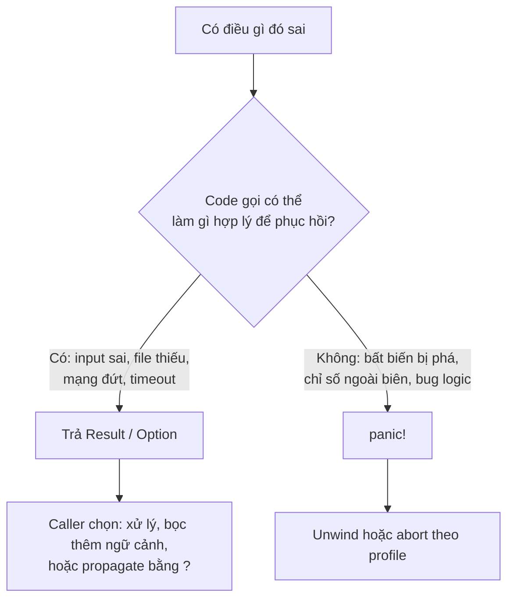

# P9 · Chương 05 — Error handling

## Bạn sẽ hiểu được gì

1. **Q1.** Khi nào dùng `panic!` và khi nào trả `Result` — và tiêu chí đó nằm ở đâu trong tài liệu chính thức? → mục 1
2. **Q2.** `?` thực sự làm gì: nó gọi `From::from` ở đâu, vì sao `Option` và `Result` không trộn được, và phần "desugar" nào của nó chưa stable? → mục 2
3. **Q3.** Trait `std::error::Error` đòi hỏi gì, `source()` tạo ra chain lỗi ra sao, và quy tắc "đừng in lỗi con hai lần" là gì? → mục 3
4. **Q4.** Vì sao `Box<dyn Error>` không qua được `thread::spawn` còn `Box<dyn Error + Send + Sync>` thì được? → mục 4
5. **Q5.** Khi nào dùng `thiserror` (thư viện), khi nào dùng `anyhow` (ứng dụng), và `context`, `{:#}` của `anyhow` hoạt động thế nào? → mục 5
6. **Q6.** `RUST_BACKTRACE` và `RUST_LIB_BACKTRACE` khác nhau ở đâu? → mục 6
7. **Q7.** Panic là unwind hay abort; `catch_unwind` dùng đúng chỗ nào; `panic = "abort"` đổi gì; panic hook làm gì? → mục 7
8. **Q8.** `fn main() -> Result<...>` kết thúc process với exit code nào và in gì ra stderr? → mục 8

Mục 9 là mục phụ trợ: `io::Error`, `ErrorKind` và mẫu ánh xạ lỗi sang HTTP status.

## Kiến thức cần trước

- Rust Book đến generics/traits/lifetimes (vòng đời `Box<dyn Trait>` xem [Chương 02 — Trait](02-trait.md) và [Chương 04 — Smart pointer](04-smart-pointer.md)).
- `io::Error` và `errno`: [P1 · Chương 07](../01-linux/07-rust-tren-giao-dien-he-thong.md) (mục 3).
- Thread và `Send`/`Sync` ở mức khái niệm: [P4 · Chương 08](../04-concurrency/08-rust-concurrency.md).

Bạn đã viết backend đủ lâu để quen với exception, HTTP 4xx/5xx và log lỗi; chương này cho thấy Rust làm những việc đó bằng kiểu dữ liệu thay vì `throw`/`catch`. Ví dụ xuyên suốt là `orders`, một HTTP service viết bằng Rust: thread pool nhận request `POST /orders`, mỗi request đi qua handler `create_order` để đọc `qty` trong body, đọc cấu hình rồi ghi đơn vào database. Đây là ví dụ giả định của người soạn, không phải code trong repo.

Mọi kết quả chạy trong chương được chạy bằng `rustc 1.95.0` / `cargo 1.95.0`, edition 2024, trên macOS aarch64; ví dụ có crate dùng `thiserror 2.0.21` và `anyhow 1.0.104` (đúng bản được trích docs.rs). Đó là *quan sát* một lần chạy, không phải bảo đảm của tài liệu.

---

## 1. Hai hệ thống lỗi: panic và Result (Q1)

> **Trả lời ngắn.** `panic!` dành cho bug đã bị phát hiện trong chương trình: một giả định hay bất biến bị phá vỡ[^book-badstate]. `Result` dành cho thất bại có thể lường trước của một phép tính, để code gọi tự quyết định xử lý[^book-expected]. Dữ liệu từ bên ngoài (request body, file người dùng) sai là thất bại lường trước, nên là `Result` (suy luận của người soạn từ ví dụ "parser được đưa dữ liệu sai dạng" của Book).

**Giải thích.**

*Với service `orders`.* Trong `create_order`, hai chuyện có thể hỏng nhìn qua giống nhau nhưng bản chất khác hẳn. Chuyện thứ nhất: client gửi `qty = "abc"`. Việc này xảy ra hằng ngày và không phải lỗi của `orders`; handler chỉ cần trả 4xx. Chuyện thứ hai: code ở tầng dưới giả định danh sách `items` đã được kiểm tra là không rỗng, nhưng nhờ một bug nào đó nó lại rỗng. Lúc này chính chương trình đã sai, và tiếp tục chạy chỉ làm hỏng thêm. Ngôn ngữ có exception thường gộp cả hai vào `throw`; Rust tách thành hai hệ thống bổ sung cho nhau, mỗi bên một vai.

### 1.1 Tiêu chí của Book

Rust Book (ch09-03) trả lời câu "khi nào dùng cái nào" bằng ba tiêu chí:

- **Nên panic** khi code có thể rơi vào "bad state", tức một giả định, bảo đảm, hợp đồng hay bất biến đã bị phá vỡ[^book-badstate]. Từ điểm đó code phía sau dựa vào việc nó không ở trạng thái xấu, thay vì kiểm tra lại ở mọi bước. Đây là trường hợp danh sách `items` rỗng ở trên.
- **Nên trả `Result`** khi thất bại là điều có thể xảy ra. Book lấy ví dụ một parser nhận dữ liệu sai dạng; trả `Result` báo rằng thất bại là khả năng được dự kiến và code gọi phải tự quyết định xử lý[^book-expected]. Đây là trường hợp `qty = "abc"`.
- **Ví dụ, prototype, test**: dùng `unwrap`/`expect` là phù hợp. Trong test, `panic!` chính là cách đánh dấu test fail, nên gọi `unwrap` hay `expect` là đúng điều cần xảy ra[^book-proto].

Docs của macro `panic!` cũng nói cùng ý theo hướng khác: `panic!` dùng để tạo ra lỗi biểu diễn một bug đã bị phát hiện[^panic-bug], còn `Result` dành cho các kiểu lỗi biểu diễn một kiểu thất bại lường trước của phép tính đó[^result-anticipated].



(Sơ đồ là tóm tắt của người soạn từ các tiêu chí trên.)

### 1.2 Hệ quả cho `orders`

Giả sử `create_order` parse `qty` bằng `unwrap` thay vì trả `Result`. Mỗi body sai dạng khi đó làm panic một thread trong pool, và client độc hại chỉ cần gửi đủ nhiều body như vậy là hạ gục dần worker (nhận xét của người soạn). Trả `Result` cho phép handler trả 4xx có kiểm soát, và thread vẫn sống để nhận request kế tiếp; phần ánh xạ lỗi sang status nằm ở mục 9.

<details><summary>Đi sâu: unwrap/expect, combinator của Result/Option, collect, must_use</summary>

`unwrap` và `expect` thực chất là panic có điều kiện: docs `panic!` nói `unwrap` của cả `Option` lẫn `Result` gọi `panic!` khi gặp `None` hoặc `Err`[^panic-unwrap]. `expect` cho chọn thông điệp; Book khuyên dùng `expect` với thông điệp tốt để thể hiện ý đồ và dễ lần ra nguồn panic[^book-expect]. Chạy thật, `Err("bad".into()).expect("config must load")` in `config must load: "bad"` (thông điệp `expect`, rồi giá trị `Err` bằng `Debug`).

`Result<T, E>` và `Option<T>` là enum thường; "ngôn ngữ" xử lý lỗi của Rust là tập method trên chúng:

| Method | Làm gì (theo docs) | Dùng khi |
|---|---|---|
| `map` | áp hàm lên giá trị `Ok`, để nguyên `Err`[^res-map] | biến đổi giá trị thành công |
| `map_err` | áp hàm lên giá trị `Err`, để nguyên `Ok`[^res-maperr] | đổi/bọc kiểu lỗi |
| `and_then` | gọi `op` nếu `Ok`, ngược lại trả `Err` của `self`[^res-andthen] | nối các bước đều có thể fail |
| `ok_or` | `Option` → `Result`: `Some(v)`→`Ok(v)`, `None`→`Err(err)`[^opt-okor] | biến "thiếu" thành lỗi có tên |
| `ok` | `Result<T,E>` → `Option<T>`[^res-ok] | bỏ qua chi tiết lỗi |

Chạy thật (`parse` là `str::parse::<i32>`): `parse("42").map(|n| n * 2)` → `Ok(84)`; `parse("x").map(|n| n * 2)` → `Err(ParseIntError { kind: InvalidDigit })`; `None::<i32>.ok_or("missing")` → `Err("missing")`; `parse("z").map_err(|e| e.to_string())` → `Err("invalid digit found in string")`.

Idiom với iterator: `collect` vào `Result<Vec<_>, _>` dừng ở lỗi đầu tiên, vào `Option<Vec<_>>` thì dừng ở `None` đầu tiên. Chạy thật: `["1","2","x","4"].iter().map(|s| s.parse::<i32>()).collect::<Result<Vec<_>,_>>()` cho `Err(ParseIntError { kind: InvalidDigit })`, còn `[Some(1), Some(2)].into_iter().collect::<Option<Vec<i32>>>()` cho `Some([1, 2])` (cơ chế `FromIterator`: [Chương 06 — Iterator và closure](06-iterator-va-closure.md)).

Bẫy hay gặp: bỏ quên `Result`. Chạy thật với `fn g() -> Result<i32,String>` rồi gọi `g();` cho `warning: unused `Result` that must be used` kèm ghi chú ``this `Result` may be an `Err` variant, which should be handled`` (quan sát với rustc 1.95.0).

</details>

**Quay lại Q1:** bug đã phát hiện thì `panic!`, thất bại lường trước (kể cả dữ liệu ngoài sai) thì `Result`.

---

## 2. Toán tử `?` (Q2)

> **Trả lời ngắn.** `?` gặp `Err` thì trả lỗi ra khỏi cả hàm như một lệnh `return`[^book-q]. Trước khi trả, lỗi đi qua `From::from` để đổi sang kiểu lỗi ở return type của hàm[^book-from]. `?` chỉ dùng được khi return type tương thích với giá trị bị `?`[^book-compat], nên `Option` và `Result` không trộn ngầm được. Phần desugar chính thức dựa trên trait `Try`, mà hiện chưa stable[^ref-try-unstable].

**Giải thích.**

*Với service `orders`.* `create_order` có ba bước đều có thể thất bại: parse `qty`, đọc cấu hình, ghi đơn vào database. Mỗi bước trả một `Result` với kiểu lỗi riêng (`ParseIntError`, `io::Error`...), còn handler muốn trả ra ngoài một kiểu lỗi duy nhất. Nếu viết tay thì sau mỗi bước phải có một `match` rồi `return Err(e)` kèm đổi kiểu. `?` gói đúng đoạn lặp đó vào một ký tự.

### 2.1 `?` làm gì

Không có `?`, propagate lỗi là một `match` với `return Err(e)`. `?` thay `match` đó: nhánh `Ok` lấy giá trị ra, nhánh `Err` trả lỗi sớm[^book-q]. Điểm khác lớn nhất so với `match` tay là bước chuyển kiểu: lỗi bị `?` đi qua hàm `from` của trait `From`, và đó là chỗ kiểu `ParseIntError` biến thành kiểu lỗi của hàm bạn[^book-from].

```rust
fn f(s: &str) -> Result<i32, AppError> {
    let n: i32 = s.parse()?;   // ParseIntError -> AppError qua impl From<ParseIntError> for AppError
    if n < 0 { return Err(AppError::Neg(n)); }
    Ok(n)
}
```

(Ở đây `s` là trường `qty` lấy từ request của `orders`.)

### 2.2 Ba lỗi biên dịch hay gặp

1. **`?` ngoài hàm trả `Result`/`Option`.** `?` chỉ dùng được trong hàm có return type tương thích với giá trị bị `?`[^book-compat]. Dùng trong `fn main()` trả `()` cho `error[E0277]: the `?` operator can only be used in a function that returns `Result` or `Option``.
2. **Trộn `Option` và `Result`.** Hai kiểu này không đổi ngầm cho nhau. Trong hàm trả `Result`, `v.first()?` cho `error[E0277]: the `?` operator can only be used on `Result`s, not `Option`s, in a function that returns `Result`` kèm gợi ý ``use `.ok_or(...)?` ``. Nên dùng `ok_or` / `ok_or_else` làm cầu nối (bảng ở mục 1).
3. **Thiếu `impl From<A> for B`.** Chạy thật với `fn f() -> Result<(), B> { g()?; ... }` (`g` trả `Result<_, A>`):

```
error[E0277]: `?` couldn't convert the error to `B`
  = note: the question mark operation (`?`) implicitly performs a conversion on the error value using the `From` trait
```

Trong `orders`, lỗi thứ ba là lỗi bạn sẽ gặp nhiều nhất: thêm một bước mới vào handler với kiểu lỗi mới, và compiler đòi bạn nói rõ lỗi đó trở thành gì trong `AppError` (nhận xét của người soạn).

<details><summary>Đi sâu: định nghĩa hình thức theo Reference, và phần chưa stable</summary>

Reference định nghĩa biểu thức `?` ("try propagation expression") là: dùng giá trị biểu thức bên trong và **trait `Try`** để quyết định sinh ra giá trị nào hoặc trả giá trị nào cho caller[^ref-try]. Reference ghi rõ: *trait `Try` hiện chưa stable nên không thể implement cho kiểu của người dùng*[^ref-try-unstable], và phần desugar được viết là "hiện **gần tương đương** với":

```rust
#![feature(try_trait_v2)]            // chỉ nightly
match core::ops::Try::branch(expr) {
    core::ops::ControlFlow::Continue(val) => val,
    core::ops::ControlFlow::Break(residual) =>
        return core::ops::FromResidual::from_residual(residual),
}
```

Đoạn này nằm sau câu giới thiệu "roughly equivalent" của Reference[^ref-try-equiv]. Hệ quả: (1) dùng `?` được trên `Result`, `Option`, `ControlFlow` (Reference có ví dụ cho `Option` và `ControlFlow`); (2) bạn **không** tự làm một kiểu "của mình" dùng được với `?` trên stable — đừng dựa vào chi tiết `Try`/`FromResidual`, vì chúng có thể đổi trước khi stable.

</details>

**Quay lại Q2:** `?` = trả sớm cả hàm + đổi lỗi qua `From::from`; cầu nối `Option` → `Result` là `ok_or`; `Try` chưa stable.

---

## 3. Trait `std::error::Error` và chain lỗi (Q3)

> **Trả lời ngắn.** Muốn implement `Error` chỉ cần có `Debug` và `Display`[^err-req]; mọi method khác có sẵn mặc định. Lỗi tầng cao bọc lỗi tầng thấp thì lộ nguyên nhân qua `Error::source()`[^err-source]. Lỗi con phải nằm **hoặc** ở `source()` **hoặc** trong `Display` của lỗi ngoài, không cả hai[^err-both].

**Giải thích.**

*Với service `orders`.* Khi `qty = "abc"`, lỗi sinh ra ở hai tầng. Tầng thấp là `ParseIntError` với thông điệp `invalid digit found in string`. Tầng cao là `AppError` của handler, báo "không đọc được request". Log của `orders` nên cho thấy cả hai, theo thứ tự từ ngoài vào trong, để người trực ca biết cả chuyện gì hỏng lẫn nó hỏng ở đâu. Trait `Error` cho cả hai tầng một giao diện chung để đi dọc từ lỗi ngoài vào lỗi gốc.

### 3.1 `Error` đòi gì, và quy ước thông điệp

Để một kiểu là `Error` bạn chỉ cần cho nó `Debug` và `Display`; còn lại đã có mặc định[^err-req]. Docs nêu thêm quy ước: thông điệp lỗi thường là câu ngắn, viết thường, không có dấu câu ở cuối[^err-style]. Vì vậy bạn thấy `invalid digit found in string` chứ không phải `Invalid digit.`.

### 3.2 `source()` và chain lỗi

Khi một module phải báo lỗi gây ra bởi lỗi của module cấp thấp hơn, nó cho phép truy cập lỗi đó qua `Error::source()`[^err-source]. Gọi `source()` lặp đi lặp lại, bạn đi từ lỗi ngoài cùng tới lỗi gốc; đó là "chain lỗi". Với `orders`, `AppError::source()` trả `ParseIntError`, và `ParseIntError` không còn nguyên nhân nào dưới nó.

Quy tắc dễ vi phạm nhất: với kiểu lỗi bọc một lỗi con, lỗi con nên **hoặc** được `source()` trả về, **hoặc** được in trong `Display` của lỗi ngoài, nhưng không cả hai[^err-both]. Lý do thực tế (suy luận của người soạn): công cụ in chain (`anyhow`, logger) in từng mắt xích, nên nếu `Display` của `AppError` đã nhét lỗi con vào thông điệp thì dòng log sẽ in lỗi con hai lần.

<details><summary>Đi sâu: ví dụ đầy đủ (chạy thật), lỗi ngoài không in lỗi con</summary>

```rust
#[derive(Debug)]
enum AppError { Parse(ParseIntError), Neg(i32) }

impl From<ParseIntError> for AppError {
    fn from(e: ParseIntError) -> Self { AppError::Parse(e) }
}
impl fmt::Display for AppError {
    fn fmt(&self, f: &mut fmt::Formatter<'_>) -> fmt::Result {
        match self { AppError::Parse(_) => write!(f, "parse error"),
                     AppError::Neg(n)   => write!(f, "negative: {n}") }
    }
}
impl std::error::Error for AppError {
    fn source(&self) -> Option<&(dyn std::error::Error + 'static)> {
        match self { AppError::Parse(e) => Some(e), AppError::Neg(_) => None }
    }
}
```

Đi dọc chain:

```rust
let e = f("abc").unwrap_err();
let mut cur: Option<&dyn std::error::Error> = Some(&e);
while let Some(x) = cur { println!("chain: {x}"); cur = x.source(); }
```

Kết quả: `chain: parse error` rồi `chain: invalid digit found in string`. `println!("{e:?}")` cho `Parse(ParseIntError { kind: InvalidDigit })`.

</details>

**Quay lại Q3:** `Error` = `Debug + Display` (+ `source()` tùy chọn); lỗi con ở `source()` hoặc `Display`, không cả hai.

---

## 4. `Box<dyn Error>` và vì sao cần `Send + Sync` (Q4)

> **Trả lời ngắn.** `thread::spawn` đòi kiểu trả về `T: Send + 'static`[^spawn-bound]. `Box<dyn Error>` trần không đáp ứng (compiler báo E0277, xem phần đi sâu), nên phải ghi rõ `Box<dyn Error + Send + Sync>`, kiểu mà std cung cấp sẵn phép chuyển từ mọi lỗi `Error + Send + Sync`[^box-from]. Vì sao `dyn Error` trần không bảo đảm `Send` — kiểu cụ thể bên trong có thể không `Send` — là suy luận của người soạn.

**Giải thích.**

*Với service `orders`.* Sau khi ghi đơn, `orders` gửi mail xác nhận trong một thread nền: `thread::spawn` chạy hàm `send_confirmation() -> Result<(), Box<dyn Error>>`, rồi thread cha `join` để lấy kết quả. Code này không biên dịch, và lý do nằm ở hai chữ `Send` và `Sync` mà `Box<dyn Error>` không có.

### 4.1 Vì sao `Box<dyn Error>` tiện

`Box<dyn Error>` tiện vì nó nhận được *bất kỳ* lỗi nào. Book nói dùng nó làm kiểu lỗi của `main` là được phép, vì nó cho trả sớm mọi giá trị `Err`, và chữ ký vẫn đúng khi sau này bạn thêm code trả một loại lỗi khác[^book-boxdyn]. Cơ sở kỹ thuật là std có `impl<'a, E: Error + 'a> From<E> for Box<dyn Error + 'a>` (và bản `Send + Sync`); docs mô tả phép chuyển một kiểu `Error + Send + Sync` thành box của `dyn Error + Send + Sync`[^box-from]. Std còn có `From<String>` cho các box này[^box-from-string], và `From<&str>` tương tự trong danh sách impl của `Box`. Nhờ đó `?` đổi mọi lỗi thành `Box<dyn Error>`, và `Err("plain str")?` cũng được. Chạy thật: `fn h() -> Result<(), Box<dyn Error>> { Err("plain str")?; Ok(()) }` trả `Err("plain str")`.

### 4.2 Vì sao qua thread thì không được

`dyn Error` trần **không** `Send` (quan sát từ compiler, xem phần đi sâu), trong khi `thread::spawn` đòi kiểu trả về `T: Send + 'static`[^spawn-bound]. `Send` là các kiểu có thể chuyển qua ranh giới thread[^send]; `Sync` là các kiểu cho phép chia sẻ tham chiếu giữa các thread một cách an toàn[^sync]. Suy luận của người soạn: một `dyn Error` trần có thể đang chứa `Rc` hay thứ gì khác không `Send`, mà compiler không thể nhìn xuyên qua trait object để biết, nên bạn phải ghi rõ cam kết đó trong kiểu.

Khuyến nghị của người soạn: hàm nào có thể bị gọi qua thread hay async thì dùng `Box<dyn Error + Send + Sync>` hoặc `anyhow::Error`, vì `anyhow::Error` vốn đã đòi lỗi bên trong là `Send + Sync + 'static`[^anyhow-send].

<details><summary>Đi sâu: thông báo lỗi thật, cách sửa và downcast</summary>

Chạy thật:

```rust
fn work() -> Result<(), Box<dyn Error>> { Err("x".into()) }
fn main() { let h = std::thread::spawn(|| work()); let _ = h.join(); }
```

```
error[E0277]: `dyn std::error::Error` cannot be sent between threads safely
  = help: the trait `Send` is not implemented for `dyn std::error::Error`
...
note: required by a bound in `spawn`
    T: Send + 'static,
```

Sửa bằng `Box<dyn Error + Send + Sync>`: cùng chương trình in `Err("x")`. Lấy lại lỗi cụ thể bằng `b.downcast_ref::<ParseIntError>()` → `Some(ParseIntError { kind: InvalidDigit })` (chạy thật). Cái giá của `Box<dyn Error>`: kiểu bị xóa, không `match` theo variant được — nên thư viện thường định nghĩa enum lỗi riêng (mục 5).

</details>

**Quay lại Q4:** `dyn Error` trần không đảm bảo `Send`, còn `spawn` đòi `Send`; thêm `+ Send + Sync`.

---

## 5. Thiết kế kiểu lỗi: `thiserror` cho thư viện, `anyhow` cho ứng dụng (Q5)

> **Trả lời ngắn.** Thư viện cần enum lỗi có variant rõ ràng để caller phân biệt; `thiserror` sinh sẵn `Display`, `From`, `source()` cho enum đó[^te-display]. Ứng dụng thường chỉ cần báo lỗi kèm ngữ cảnh; `anyhow::Error` là kiểu lỗi trait object cho việc đó[^an-intro], và `context` thêm "đang làm gì" vào lỗi[^an-context]. Cách chia này là nhận xét của người soạn.

**Giải thích.**

*Với service `orders`.* Giả sử `orders` tách thành hai lớp: crate `orders-store`, thư viện nội bộ truy cập database, và binary `orders-api` chứa handler và `main`. Hai lớp này cần hai kiểu lỗi khác nhau. `orders-api` phải phân biệt được "đơn không tồn tại" (trả 404) với "database hỏng" (trả 500, có thể retry), nên lỗi của `orders-store` phải là một enum có variant rõ ràng. Ngược lại ở `main`, khi không đọc được file cấu hình thì chỉ còn việc ghi log kèm lý do rồi thoát; ở đó không ai cần `match` theo variant (nhận xét của người soạn).

### 5.1 `thiserror`: enum lỗi cho thư viện

`thiserror 2.0.21` cung cấp derive macro cho trait `std::error::Error`[^te-intro]. Docs khẳng định kết quả tương đương với tự viết impl bằng tay, nên chuyển qua lại giữa hai cách không phải breaking change[^te-equal]. Các thuộc tính chính:

- `#[error("...")]` sinh `Display`[^te-display]; trong chuỗi dùng được tên field (`{id}`) hoặc chỉ số (`{0}`).
- `#[from]` sinh `impl From` cho variant đó, nên `?` đổi được lỗi nguồn thành variant. Variant này không được có field nào khác ngoài lỗi nguồn (và có thể một backtrace)[^te-from]. `#[from]` ngầm có nghĩa field đó cũng là `#[source]`[^te-fromsource].
- `#[source]` (hoặc field tên `source`) làm `source()` trả field đó[^te-source].
- `#[error(transparent)]` chuyển tiếp `source` và `Display` thẳng tới lỗi bên trong, hợp cho variant "lỗi khác"[^te-transparent].

### 5.2 `anyhow`: lỗi cho ứng dụng

`anyhow::Error` (bản 1.0.104) là kiểu lỗi dạng trait object, và hàm có thể fail thì dùng `anyhow::Result<T>` làm return type[^an-intro]. Phần hay dùng nhất là trait `Context`, thêm `context` / `with_context` lên `Result`. Docs khuyên gắn ngữ cảnh để người điều tra hiểu bước cấp cao nào đang chạy, vì lỗi cấp thấp như "No such file or directory" rất khó debug khi thiếu ngữ cảnh[^an-context]. `with_context` nhận closure và chỉ chạy closure đó khi có lỗi[^an-lazy]; ở handler của `orders` nó rẻ hơn `context` trên đường thành công vì không phải dựng chuỗi ngữ cảnh trước (suy luận của người soạn).

Khi hiển thị, `anyhow::Error` có ba dạng:

- `{}` chỉ in lớp ngoài cùng[^an-display].
- `{:#}` in thêm các nguyên nhân[^an-alt].
- `{:?}` in dạng "Caused by" (ví dụ đầu ra trong docs[^an-caused]), kèm backtrace nếu đã bắt được[^an-debug-bt].

Dạng `{:?}` cũng là thứ bạn nhận được khi **trả lỗi từ `fn main`** thay vì tự in[^an-debug].

### 5.3 Ghép hai lớp

Mẫu phổ biến (nhận xét của người soạn): thư viện nội bộ như `orders-store` dùng enum `thiserror`, còn tầng `main` và handler của `orders-api` dùng `anyhow`. `anyhow` nhận mọi lỗi có impl `std::error::Error`; nó không đóng gói sẵn derive nên docs gợi ý tự viết impl hoặc dùng crate như `thiserror`[^an-thiserror]. Docs `thiserror` còn minh họa variant `#[error(transparent)] Other(#[from] anyhow::Error)` cho nhóm "lỗi khác"[^te-transparent].

<details><summary>Đi sâu: ví dụ chạy thật của thiserror, anyhow, kích thước, macro</summary>

```rust
use thiserror::Error;
#[derive(Error, Debug)]
enum StoreError {
    #[error("record {id} not found")]
    NotFound { id: u64 },
    #[error("invalid number")]
    Parse(#[from] std::num::ParseIntError),
    #[error("io failed on {path}")]
    Io { path: String, #[source] source: std::io::Error },
    #[error(transparent)]
    Other(#[from] std::fmt::Error),
}
```

| Lời gọi | Kết quả thật |
|---|---|
| `load("0")` | `Err(NotFound { id: 0 })` |
| `load("zz")`: `Display` / `source()` | `invalid number` / `Some("invalid digit found in string")` |
| `Io{..}`: `Display` / `source()` | `io failed on /etc/x` / `permission denied` |
| `StoreError::from(fmt::Error)`: `Display` / `source().is_some()` | `an error occurred when formatting an argument` / `false` |

Dòng cuối là hiệu ứng của `transparent`: `Display` và `source()` đều chuyển tiếp sang lỗi bên trong.

**Kích thước.** `anyhow::Error` đòi lỗi bên trong `Send`, `Sync`, `'static`[^anyhow-send], và biểu diễn là *narrow pointer* — đúng một từ (word) thay vì hai như `Box<dyn Error>`[^an-narrow]. Chạy thật: `size_of::<anyhow::Error>() = 8`, `size_of::<Box<dyn std::error::Error>>() = 16` (aarch64) — khớp với mô tả.

**Context.**

```rust
fn read(p: &str) -> Result<String> {
    std::fs::read_to_string(p).with_context(|| format!("reading config {p}"))
}
let e = read("/nonexistent/app.toml").unwrap_err();
```

Đầu ra thật của bốn cách hiển thị:

```
Display : reading config /nonexistent/app.toml
Alt     : reading config /nonexistent/app.toml: No such file or directory (os error 2)
Debug   :
reading config /nonexistent/app.toml

Caused by:
    No such file or directory (os error 2)
```

Với `fn main() -> anyhow::Result<()>` chạy thật, stderr là:

```
Error: loading config

Caused by:
    No such file or directory (os error 2)
```

và exit code là 1. `e.chain()` đi qua từng mắt xích, `e.root_cause()` trả mắt xích sâu nhất, và `e.downcast_ref::<std::io::Error>().map(|e| e.kind())` cho `Some(NotFound)` — downcast xuyên qua context (docs: hỗ trợ downcast theo giá trị, tham chiếu chung hoặc mutable[^an-downcast]).

**Macro.** `bail!` là cú pháp tắt cho early return với lỗi[^an-bail]; chạy thật: `ensure!(!s.is_empty(), "empty input")` cho `empty input`, `bail!("bad literal {}", s)` cho `bad literal bad`.

</details>

**Quay lại Q5:** thư viện → enum `thiserror` để caller phân biệt; ứng dụng → `anyhow` với `context`; `{:#}` hiện cả chuỗi nguyên nhân.

---

## 6. Backtrace: `RUST_BACKTRACE` và `RUST_LIB_BACKTRACE` (Q6)

> **Trả lời ngắn.** `RUST_BACKTRACE` bật backtrace cho cả panic lẫn error; `RUST_LIB_BACKTRACE` chỉ bật cho error (`Backtrace::capture`, `anyhow`)[^an-bt-cfg]. Nếu `RUST_LIB_BACKTRACE` đã đặt thì nó thắng `RUST_BACKTRACE` khi `capture` quyết định có bắt hay không[^bt-env]. Không biến nào được đặt thì `Backtrace::capture()` không làm gì[^bt-capture].

**Giải thích.**

*Với service `orders`.* Một lỗi `orders` trả ra thường chỉ cho bạn biết *cái gì* hỏng ("No such file or directory"). Khi điều tra sự cố, bạn còn muốn biết *code nào* đã sinh ra lỗi đó, và đó là việc của backtrace, tức dấu vết các lời gọi hàm lúc lỗi xảy ra. Phần này trả lời hai câu hỏi thực tế: bật backtrace cho panic hay cho lỗi `Result`, và việc bật có làm chậm service không.

### 6.1 `Backtrace::capture` và hai biến môi trường

`Backtrace::capture()` bắt stack backtrace của thread hiện tại. Nó là **noop** (không làm gì) nếu cả `RUST_BACKTRACE` lẫn `RUST_LIB_BACKTRACE` đều không được đặt, và chỉ bắt thật khi một trong hai được bật[^bt-capture]. Lý do là việc bắt backtrace có thể tốn bộ nhớ và chậm; các biến môi trường cho phép bạn dùng `capture` thoải mái trong code và chỉ chịu chi phí khi bật biến[^bt-slow]. Muốn bỏ qua biến môi trường thì dùng `Backtrace::force_capture`[^bt-force].

Luật ưu tiên: `RUST_LIB_BACKTRACE=0` thì `capture` không bao giờ bắt, giá trị khác bật; `RUST_BACKTRACE` chỉ được xét khi `RUST_LIB_BACKTRACE` không đặt[^bt-env]. Docs cảnh báo thêm rằng trạng thái biến được **cache** khi backtrace đầu tiên được tạo, nên đổi biến lúc chạy có thể không có tác dụng[^bt-cache].

### 6.2 Panic và error

Backtrace của **panic** (do hook mặc định in) được Book hướng dẫn bật bằng `RUST_BACKTRACE`, đặt giá trị bất kỳ trừ `0`[^book-bt]. Backtrace của **error** thì phụ thuộc thư viện: với `anyhow` (Rust ≥ 1.65), backtrace được bắt và in kèm lỗi nếu lỗi gốc chưa có backtrace riêng[^an-bt]. Tóm lại, `RUST_BACKTRACE` mở cả hai; muốn riêng error thì dùng `RUST_LIB_BACKTRACE=1`, muốn riêng panic thì `RUST_BACKTRACE=1` kèm `RUST_LIB_BACKTRACE=0` (bảng ở phần Đi sâu).

Còn chuyện chi phí: mỗi `anyhow::Error` được tạo ra sẽ bắt backtrace khi biến được bật, nên nếu `orders` sinh lỗi liên tục trên đường nóng (ví dụ mỗi request sai dạng là một lỗi), hãy cân nhắc tắt ở production (nhận xét của người soạn).

<details><summary>Đi sâu: bảng quan sát và ba cấu hình của anyhow</summary>

Chạy thật chương trình `println!("{:?}", Backtrace::capture().status())`:

| Môi trường | `capture().status()` | `force_capture().status()` |
|---|---|---|
| không đặt | `Disabled` | `Captured` |
| `RUST_BACKTRACE=1` | `Captured` | `Captured` |
| `RUST_BACKTRACE=1 RUST_LIB_BACKTRACE=0` | `Disabled` | `Captured` |
| `RUST_LIB_BACKTRACE=1` | `Captured` | `Captured` |

Kiểm chứng, theo ba cấu hình của docs `anyhow`[^an-bt-cfg]: `format!("{:?}", anyhow!("x")).contains("Stack backtrace")` là `false` khi không đặt biến, `true` với `RUST_BACKTRACE=1` hoặc `RUST_LIB_BACKTRACE=1`, `false` với `RUST_BACKTRACE=1 RUST_LIB_BACKTRACE=0`.

</details>

**Quay lại Q6:** `RUST_BACKTRACE` = cả panic và error; `RUST_LIB_BACKTRACE` = riêng error và được ưu tiên hơn.

---

## 7. Panic: unwind hay abort (Q7)

> **Trả lời ngắn.** Mặc định cho phần lớn target là *unwind*: runtime đi ngược stack và gọi `drop` cho các đối tượng còn sống[^ref-drop]. Chọn `panic = "abort"` thì process bị abort và không phục hồi được[^ref-strategy]; `drop` không chạy (quan sát ở phần đi sâu). `catch_unwind` chỉ bắt được unwinding panic[^cu-abort] và không phải cơ chế try/catch tổng quát[^cu-trycatch]. Panic hook chạy trước cả hai giá trị `panic` của Cargo (`unwind` và `abort`)[^hook-intro].

**Giải thích.**

*Với service `orders`.* Một handler của `orders` panic giữa chừng, chẳng hạn vì `items` rỗng ở mục 1. Có ba câu hỏi nối nhau. Thread đó chết thế nào, và những thứ nó đang giữ (kết nối database, `Mutex` của cache) có được dọn không? Cả process có chết theo không? Và ta can thiệp được ở điểm nào? Mục này đi lần lượt qua *unwind* và *abort* (hai chiến lược chọn lúc build), `catch_unwind` và panic hook.

### 7.1 Unwind và abort

Khi `panic!` xảy ra, hook được gọi trước, rồi runtime chọn một trong hai chiến lược. `unwind` giải phóng stack và có thể phục hồi; `abort` dừng cả process và không thể phục hồi[^ref-strategy]. Chiến lược mặc định cho phần lớn target là unwind[^ref-default].

Unwind nghĩa là Rust đi ngược lên stack và dọn dữ liệu của từng hàm nó đi qua[^book-unwind]. Cụ thể hơn, mọi đối tượng còn sống trong các frame đó mà implement `Drop` sẽ được gọi `drop`[^ref-drop]. Với `orders`, nhờ vậy guard của kết nối database hay của `Mutex` được trả lại trước khi thread chết. Còn `abort` dừng ngay, không dọn gì (quan sát ở phần Đi sâu).

Panic trong **một thread** chỉ làm thread đó unwind, và `JoinHandle::join` trả `Err` với tham số đã đưa vào `panic!`[^join-err]. Một `Mutex` mà thread panic đang giữ bị **poisoned**[^mutex-poison] (chạy thật: `is_poisoned()` → `true`). Nếu `orders` có một cache bọc trong `Mutex`, cache đó sẽ mang dấu poisoned sau khi một handler panic lúc đang giữ khóa.

### 7.2 `catch_unwind`

`catch_unwind` chạy một closure và bắt nguyên nhân của unwinding panic nếu có[^cu-intro]. Docs nói rõ **không khuyến nghị** dùng nó làm cơ chế try/catch tổng quát; với hàm thất bại thường xuyên thì `Result` hợp hơn[^cu-trycatch]. Hàm này cũng không bắt được panic trong build `abort`[^cu-abort]. Closure phải thỏa `UnwindSafe`, ràng buộc dùng để mã hóa khái niệm exception safety vào hệ kiểu[^cu-unwindsafe]; lý do, ví dụ không-unwind-safe và mối liên hệ với poisoning xem [P10 · Chương 08, mục 3](../10-rust-internals/08-panic-abi-ffi.md). Chỗ dùng hợp lý (nhận xét của người soạn): ranh giới FFI, thread pool, framework, tức nơi bạn không muốn một panic lan ra ngoài lớp bao.

### 7.3 Panic hook

`panic::set_hook` đăng ký hook thay thế hook trước đó. Hook được gọi khi thread panic, **trước** khi panic runtime chạy, nên nó chạy được với cả runtime abort lẫn unwind[^hook-intro]. Hook mặc định in thông điệp ra stderr, kèm backtrace nếu được yêu cầu[^hook-default]. Hook là tài nguyên toàn cục[^hook-global], nên đặt một lần lúc khởi động. Chỗ dùng (nhận xét của người soạn): đổi thông điệp panic của `orders` thành một dòng JSON cho hệ thống log, trước khi thread hoặc process chết. Về `take_hook` và `resume_unwind`: [P10 · Chương 08, mục 3](../10-rust-internals/08-panic-abi-ffi.md).

### 7.4 Chọn gì cho server

Với server (nhận xét của người soạn): `abort` hợp mô hình "crash rồi để Kubernetes khởi động lại"; `unwind` hợp khi một thread worker panic không nên kéo cả process chết.

<details><summary>Đi sâu: quan sát drop, panic = "abort" trong Cargo, payload của catch_unwind, ví dụ hook</summary>

Chạy thật: chương trình tạo hai biến `D("a")`, `D("b")` có `Drop` in tên rồi `panic!("die")`:

```
thread 'main' (134928542) panicked at src/bin/h_drop.rs:6:5:
die
note: run with `RUST_BACKTRACE=1` environment variable to display a backtrace
drop b
drop a
```

(Thứ tự drop ngược với khai báo, và process thoát với mã 101 theo quan sát của người soạn.) Lúc build với `panic = "abort"` thì `drop` **không** chạy: in thông điệp panic rồi process bị `SIGABRT` (shell báo `Abort trap: 6`, exit 134 trên macOS) — quan sát với rustc 1.95.0.

**`panic = "abort"` trong Cargo.** Cargo bọc cờ `-C panic` bằng key `panic` với hai giá trị `unwind` và `abort`[^cargo-panic]; test, benchmark, build script và proc macro **bỏ qua** cài đặt này[^cargo-ignored]. Lý do tối ưu của `abort`, ràng buộc đồ thị crate và `immediate-abort` của rustc xem [P10 · Chương 08, mục 2](../10-rust-internals/08-panic-abi-ffi.md); bảng mặc định profile xem [P9·08 mục 7](08-module-crate-cargo.md).

```toml
[profile.release]
panic = "abort"
```

Hệ quả khi bật (suy luận từ các nguồn trên + chạy thật ở trên): không còn `drop`, `catch_unwind`, hay mutex poisoning do panic.

**Payload của `catch_unwind`.** Bắt panic từ `v[3]` trên `Vec` rỗng (chạy thật): `Err(payload)` với `payload.downcast_ref::<String>()` là `Some("index out of bounds: the len is 0 but the index is 3")`. Thông điệp panic vẫn được hook mặc định in ra stderr — docs xác nhận hook tùy biến, nếu có, được gọi trước khi panic bị bắt[^cu-hook]. Với `panic!("static")` payload là `&str`; với `panic!("boom {}", 1)` kết quả quan sát là payload cũng là `&str` chứ không phải `String`. Docs `panic!` nói payload là `&str` hoặc `String` và loại nào là không đặc tả, có thể đổi[^panic-payload] — nên đừng downcast cứng một kiểu; thử cả hai (hoặc dùng `PanicHookInfo::payload_as_str` trong hook).

**Hook.** Ví dụ chạy thật:

```rust
panic::set_hook(Box::new(|info| {
    let loc = info.location().unwrap();
    eprintln!("HOOK: {} at line {}", info.payload_as_str().unwrap_or("?"), loc.line());
}));
let _ = panic::catch_unwind(|| { panic!("custom"); });
```

in `HOOK: custom at line 15`. Hook chạy cả trong build `abort`[^hook-intro].

</details>

**Quay lại Q7:** mặc định unwind (drop chạy), `abort` dừng ngay, `catch_unwind` chỉ bắt unwind và không thay `Result`, hook chạy trước cả hai.

---

## 8. `main` trả `Result` và `Termination` (Q8)

> **Trả lời ngắn.** `main` có thể trả mọi kiểu implement `Termination`[^book-term]. Khi `main` trả `Err`, std in `Error: ` kèm giá trị lỗi dạng `Debug` ra stderr rồi trả `ExitCode::FAILURE`[^term-src]. Docs gọi đó là mã "canonical" cho kết thúc không thành công trên nền tảng hiện tại[^exit-failure] (quan sát trên macOS: mã 1). Muốn mã khác thì dùng `ExitCode`[^exitcode].

**Giải thích.**

*Với service `orders`.* Lúc khởi động, `main` của `orders` đọc cấu hình, kết nối database rồi mở cổng. Nếu file cấu hình thiếu, `main` phải kết thúc và báo cho môi trường chạy (systemd, Kubernetes) biết là thất bại, bằng exit code khác 0 chứ không bằng thông điệp văn bản. Câu hỏi của mục này: Rust biến một `Result` trả từ `main` thành exit code và dòng stderr như thế nào?

### 8.1 `Termination`

`main` có thể trả mọi kiểu implement `std::process::Termination`, một trait có hàm `report` trả `ExitCode`[^book-term]. Lý do cần trait này: C-main chỉ hỗ trợ trả số nguyên, nên mọi kiểu đều phải đổi thành số nguyên; mặc định trả `EXIT_SUCCESS` khi thành công và `EXIT_FAILURE` khi lỗi[^term-int]. Với `Result`, std có `impl<T: Termination, E: Debug> Termination for Result<T, E>`[^term-result].

### 8.2 Nhánh `Err` in bằng `Debug`

Nhánh `Err` in lỗi bằng **`Debug`**, không phải `Display`[^term-src]. Vì vậy với `Box<dyn Error>`, thứ bạn thấy trên stderr là dạng `Debug` thô. `anyhow::Result` cho dạng "Caused by" dễ đọc hơn nhiều (mục 5), vì `Debug` của `anyhow::Error` được thiết kế như vậy[^an-debug].

### 8.3 Muốn exit code khác 1

`ExitCode` được dự định chỉ để thư viện chuẩn tiêu thụ (qua `Termination::report()`). Std có sẵn `SUCCESS`, `FAILURE` và `From<u8>` để dựng mã tùy ý[^exitcode].

<details><summary>Đi sâu: quan sát thật và source std 1.95.0</summary>

Hành vi quan sát với `fn main() -> Result<(), Box<dyn Error>>` và `"abc".parse::<i32>()?`:

```
Error: ParseIntError { kind: InvalidDigit }
```

trên stderr, exit code 1. Trong source std 1.95.0, `report` in `"Error: {err:?}"` rồi trả `ExitCode::FAILURE`[^term-src] (chi tiết cài đặt, có thể đổi). Chạy thật `fn main() -> ExitCode { ExitCode::from(42) }` thoát với mã 42.

</details>

**Quay lại Q8:** `Err` từ `main` → stderr `Error: {Debug}` và `ExitCode::FAILURE` (quan sát: mã 1); muốn mã khác thì trả `ExitCode`.

---

## 9. `io::Error`, `ErrorKind` và ánh xạ sang HTTP (mục phụ trợ)

> **Trả lời ngắn.** `io::Error` là kiểu lỗi chuẩn của thao tác I/O; bạn phân nhánh theo `ErrorKind` chứ không so chuỗi. Ở biên handler, gom việc đổi lỗi thành HTTP status vào một hàm trên enum lỗi miền để compiler nhắc khi thêm variant (nhận xét của người soạn).

**Giải thích.**

*Với service `orders`.* Lỗi của `orders` đi từ database và file hệ thống lên tới handler, và ở biên handler nó phải thành một HTTP status: đơn không có thì 404, không đủ quyền đọc file thì 403, dữ liệu sai thì 422, còn lại 500. Mục này nói hai nửa của việc đó: đọc đúng `io::Error` ở tầng I/O, rồi đổi lỗi miền sang status ở biên.

### 9.1 `io::Error` và `ErrorKind`

`io::Error` là kiểu lỗi cho các thao tác I/O (`Read`, `Write`, `Seek`...). Phần lớn lỗi đến từ hệ điều hành, nhưng bạn cũng tự tạo được với một thông điệp và một `ErrorKind`[^io-error]. `ErrorKind` là danh sách các nhóm lỗi I/O chung. Docs cảnh báo danh sách này sẽ lớn thêm và **không** nên match đầy đủ[^ek-grow]. Vì enum có `#[non_exhaustive]`, khi `match` bạn buộc phải có nhánh `_`[^ek-nonexh]. `ErrorKind::Other` là "lỗi tùy biến không thuộc loại nào khác"[^ek-other]. Chi tiết `errno` → `ErrorKind`: [P1 · Chương 07, mục 3](../01-linux/07-rust-tren-giao-dien-he-thong.md).

### 9.2 Enum lỗi miền và HTTP status

Điểm thiết kế (nhận xét của người soạn): `Display` của lỗi trả cho client phải an toàn (không lộ chi tiết nội bộ), còn chi tiết đi theo `source()` vào log. Hàm `status()` trên enum lỗi miền không có nhánh `_`, nên khi thêm một variant mới compiler buộc bạn chọn status cho nó.

<details><summary>Đi sâu: quan sát io::Error và mẫu ApiError</summary>

Chạy thật trên macOS: `File::open("/nonexistent")` cho Debug `Os { code: 2, kind: NotFound, message: "No such file or directory" }`, `raw_os_error()` = `Some(2)`, Display `No such file or directory (os error 2)`; `io::Error::other(fmt::Error)` hiển thị `an error occurred when formatting an argument`; `ErrorKind::TimedOut.into()` có Display `timed out`, Debug `Kind(TimedOut)`. (`code: 2` là `ENOENT` trên macOS; đây là quan sát của một nền tảng.) Cách phân nhánh đúng:

```rust
match std::fs::read("/nonexistent") {
    Err(e) if e.kind() == ErrorKind::NotFound         => println!("-> 404"),
    Err(e) if e.kind() == ErrorKind::PermissionDenied => println!("-> 403"),
    _ => println!("other"),
}
```

(in `-> 404`). Mẫu ánh xạ lỗi sang HTTP ở biên handler — enum lỗi miền + một hàm `status()`. Chạy thật:

```rust
#[derive(Error, Debug)]
enum ApiError {
    #[error("user {0} not found")]      NotFound(u64),
    #[error("invalid input: {0}")]      Invalid(String),
    #[error("database error")]          Db(#[source] std::io::Error),
}
impl ApiError {
    fn status(&self) -> u16 { match self {
        ApiError::NotFound(_) => 404, ApiError::Invalid(_) => 422, ApiError::Db(_) => 500 } }
}
```

Output: `404 user 7 not found`, `422 invalid input: age`, `500 database error`.

</details>

**Quay lại mục 9:** phân nhánh theo `ErrorKind` (luôn có `_`), còn enum lỗi miền của bạn thì match đầy đủ để compiler giữ bạn trung thực.

---

## Tóm tắt

- `panic!` biểu diễn bug đã phát hiện; `Result` biểu diễn thất bại lường trước. Dữ liệu bên ngoài sai → `Result`.
- `?` = trả sớm cả hàm + đổi lỗi qua `From::from`; desugar chính thức dựa trên trait `Try` **chưa stable**. `Option`/`Result` không trộn ngầm; cầu nối là `ok_or`.
- `Error` chỉ đòi `Debug + Display`; lỗi con nằm ở `source()` *hoặc* `Display`, không cả hai.
- `Box<dyn Error>` không `Send` (E0277 ở `thread::spawn`); dùng `+ Send + Sync` hoặc `anyhow::Error`.
- Thư viện: enum `thiserror`. Ứng dụng: `anyhow` (`context`, `{:#}`, Debug có "Caused by").
- `Backtrace::capture` noop nếu không bật biến; `RUST_LIB_BACKTRACE` ưu tiên hơn `RUST_BACKTRACE`.
- Panic mặc định unwind; `panic = "abort"` bỏ unwinding; `catch_unwind` không phải try/catch.
- `main` trả `Err` → stderr `Error: {Debug}`, `ExitCode::FAILURE` (quan sát: mã 1); `ExitCode` cho mã tuỳ ý. `ErrorKind` là `non_exhaustive`.

---

## Câu hỏi tự kiểm tra

1. Một hàm parse JSON từ request body của `orders` gặp dữ liệu sai. Trả `Result` hay `panic!`? Tiêu chí nào của Book áp dụng?
<details><summary>Đáp án</summary>

Trả `Result`: lỗi dự kiến là khả năng thường xảy ra mà caller phải tự quyết định xử lý[^book-expected]. `panic!` dành cho bad state/bất biến bị phá[^book-badstate].

</details>

2. Vì sao tự implement `Try` cho kiểu của bạn để dùng với `?` trên stable là không được? Reference viết gì về desugar?
<details><summary>Đáp án</summary>

`Try` chưa stable, không implement được cho kiểu người dùng[^ref-try-unstable]. Desugar chỉ là "roughly equivalent" đoạn `match` với `Try::branch`/`FromResidual`[^ref-try-equiv].

</details>

3. Một `AppError` bọc `ParseIntError` và `Display` in cả lỗi con, đồng thời `source()` trả lỗi con. Vi phạm gì?
<details><summary>Đáp án</summary>

Quy tắc của docs `Error`: lỗi con hoặc ở `source()` hoặc ở `Display`, không cả hai[^err-both]. Kết quả là lỗi con xuất hiện hai lần khi in chain.

</details>

4. Vì sao đoạn dùng `thread::spawn(|| work())` với `work() -> Result<(), Box<dyn Error>>` không biên dịch? Sửa?
<details><summary>Đáp án</summary>

`dyn Error` không `Send`, mà `spawn` yêu cầu `T: Send + 'static` (E0277 trong mục 4). Dùng `Box<dyn Error + Send + Sync>`[^box-from].

</details>

5. `RUST_BACKTRACE=1 RUST_LIB_BACKTRACE=0`: panic có backtrace không? `anyhow::Error` có không?
<details><summary>Đáp án</summary>

Panic có, error không[^an-bt-cfg]. `capture().status()` là `Disabled` (bảng mục 6), vì `RUST_BACKTRACE` chỉ được xét khi `RUST_LIB_BACKTRACE` không đặt[^bt-env].

</details>

6. Với `panic = "abort"`, `catch_unwind` và `Drop` ra sao? Lợi ích?
<details><summary>Đáp án</summary>

`catch_unwind` chỉ bắt unwinding panic[^cu-abort]. `drop` không chạy (quan sát mục 7). Lợi ích: optimizer có thể giảm kích thước và tăng tốc độ[^ref-abort-opt].

</details>

7. Vì sao `match` trên `ErrorKind` cần nhánh `_`, nhưng `match` trên enum lỗi miền của bạn thì nên liệt kê đầy đủ?
<details><summary>Đáp án</summary>

`ErrorKind` là `#[non_exhaustive]` nên bắt buộc nhánh wildcard[^ek-nonexh]. Danh sách của nó còn tăng nên không nên match đầy đủ[^ek-grow]. Enum của bạn kiểm soát được variant, nên không dùng `_` để compiler nhắc khi thêm variant (nhận xét của người soạn).

</details>

8. `?` làm hai việc gì khi gặp `Err`? Thiếu `impl From` thì sao?
<details><summary>Đáp án</summary>

Trả sớm cả hàm[^book-q], và đổi lỗi qua `From::from`[^book-from]. Thiếu `From` thì gặp E0277 "`?` couldn't convert the error to `B`" (mục 2).

</details>

9. `fn main() -> Result<(), Box<dyn Error>>` trả `Err`: stderr in gì, exit code là gì, và in bằng `Debug` hay `Display`?
<details><summary>Đáp án</summary>

`Error: {err:?}` — `Debug`, rồi trả `ExitCode::FAILURE` (quan sát: mã 1)[^term-src]. Với `anyhow::Error` thì `Debug` là dạng "Caused by"[^an-caused].

</details>

10. `with_context` khác `context` ở điểm nào và vì sao quan trọng ở đường nóng?
<details><summary>Đáp án</summary>

`with_context` nhận closure, được tính lười, chỉ khi có lỗi[^an-lazy]. Nhờ đó không tốn công dựng chuỗi ngữ cảnh khi thành công (suy luận của người soạn).

</details>

---

## Đọc thêm

- [Rust Book ch09](https://doc.rust-lang.org/1.95.0/book/ch09-00-error-handling.html) — ba mục 9.1–9.3 là nền tảng của chương này.
- [Reference — try propagation expression](https://doc.rust-lang.org/1.95.0/reference/expressions/operator-expr.html) — định nghĩa hình thức của `?` và ghi chú `Try` chưa stable.
- [std::error::Error](https://doc.rust-lang.org/1.95.0/std/error/trait.Error.html) — quy ước `source()`, `Display`, ví dụ chain.
- [std::panic](https://doc.rust-lang.org/1.95.0/std/panic/index.html) và [`catch_unwind`](https://doc.rust-lang.org/1.95.0/std/panic/fn.catch_unwind.html) — phần Notes về foreign exception.
- [Reference — panic](https://doc.rust-lang.org/1.95.0/reference/panic.html) — hai chiến lược panic và ràng buộc khi link crate khác chiến lược.
- [thiserror 2.0.21](https://docs.rs/thiserror/2.0.21/thiserror/) và [anyhow 1.0.104](https://docs.rs/anyhow/1.0.104/anyhow/) — thuộc tính `#[backtrace]`, `Context`, định dạng hiển thị.
- [Cargo Book — profiles, panic](https://doc.rust-lang.org/1.95.0/cargo/reference/profiles.html) — cài đặt `panic` theo profile.
- [P10 · Chương 08 — panic, ABI, FFI](../10-rust-internals/08-panic-abi-ffi.md) — cơ chế unwind ở tầng thấp và panic qua ranh giới FFI.

[^panic-bug]: Rust std, macro `panic!` (When to use panic! vs Result) — <https://doc.rust-lang.org/1.95.0/std/macro.panic.html> — "The panic! macro is used to construct errors that represent a bug that has been detected in your program."
[^result-anticipated]: Rust std, macro `panic!` (When to use panic! vs Result) — <https://doc.rust-lang.org/1.95.0/std/macro.panic.html> — "error types that represent an anticipated runtime failure mode of that computation, Err(E)."
[^book-badstate]: Rust Book, ch09-03 To panic! or Not to panic! — <https://doc.rust-lang.org/1.95.0/book/ch09-03-to-panic-or-not-to-panic.html> — "a bad state is when some assumption, guarantee, contract, or invariant has been broken"
[^book-expected]: Rust Book, ch09-03 To panic! or Not to panic! — <https://doc.rust-lang.org/1.95.0/book/ch09-03-to-panic-or-not-to-panic.html> — "returning a Result indicates that failure is an expected possibility that the calling code must decide how to handle."
[^book-proto]: Rust Book, ch09-03 To panic! or Not to panic! — <https://doc.rust-lang.org/1.95.0/book/ch09-03-to-panic-or-not-to-panic.html> — "Because panic! is how a test is marked as a failure, calling unwrap or expect is exactly what should happen."
[^panic-unwrap]: Rust std, macro `panic!` — <https://doc.rust-lang.org/1.95.0/std/macro.panic.html> — "Both implementations call panic! when they are set to None or Err variants."
[^book-expect]: Rust Book, ch09-02 Recoverable Errors with Result — <https://doc.rust-lang.org/1.95.0/book/ch09-02-recoverable-errors-with-result.html> — "Using expect instead of unwrap and providing good error messages can convey your intent and make tracking down the source of a panic easier."
[^res-map]: Rust std, `Result` — <https://doc.rust-lang.org/1.95.0/std/result/enum.Result.html> — "Maps a Result\<T, E> to Result\<U, E> by applying a function to a contained Ok value, leaving an Err value untouched."
[^res-maperr]: Rust std, `Result` — <https://doc.rust-lang.org/1.95.0/std/result/enum.Result.html> — "Maps a Result\<T, E> to Result\<T, F> by applying a function to a contained Err value, leaving an Ok value untouched."
[^res-andthen]: Rust std, `Result::and_then` — <https://doc.rust-lang.org/1.95.0/std/result/enum.Result.html> — "Calls op if the result is Ok, otherwise returns the Err value of self."
[^opt-okor]: Rust std, `Option::ok_or` — <https://doc.rust-lang.org/1.95.0/std/option/enum.Option.html> — "Transforms the Option\<T> into a Result\<T, E>, mapping Some(v) to Ok(v) and None to Err(err)."
[^res-ok]: Rust std, `Result::ok` — <https://doc.rust-lang.org/1.95.0/std/result/enum.Result.html> — "Converts from Result\<T, E> to Option\<T>."
[^book-q]: Rust Book, ch09-02 The ? Operator Shortcut — <https://doc.rust-lang.org/1.95.0/book/ch09-02-recoverable-errors-with-result.html> — "the Err will be returned from the whole function as if we had used the return keyword so that the error value gets propagated to the calling code."
[^book-from]: Rust Book, ch09-02 The ? Operator Shortcut — <https://doc.rust-lang.org/1.95.0/book/ch09-02-recoverable-errors-with-result.html> — "Error values that have the ? operator called on them go through the from function, defined in the From trait in the standard library, which is used to convert values from one type into another."
[^ref-try]: Rust Reference, expr.try — <https://doc.rust-lang.org/1.95.0/reference/expressions/operator-expr.html> — "The try propagation expression uses the value of the inner expression and the Try trait to decide whether to produce a value, and if so, what value to produce, or whether to return a value to the caller, and if so, what value to return."
[^ref-try-unstable]: Rust Reference, expr.try — <https://doc.rust-lang.org/1.95.0/reference/expressions/operator-expr.html> — "The Try trait is currently unstable, and thus cannot be implemented for user types."
[^ref-try-equiv]: Rust Reference, expr.try — <https://doc.rust-lang.org/1.95.0/reference/expressions/operator-expr.html> — "The try propagation expression is currently roughly equivalent to:"
[^book-compat]: Rust Book, ch09-02 Where to Use the ? Operator — <https://doc.rust-lang.org/1.95.0/book/ch09-02-recoverable-errors-with-result.html> — "The ? operator can only be used in functions whose return type is compatible with the value the ? is used on."
[^err-req]: Rust std, trait `Error` — <https://doc.rust-lang.org/1.95.0/std/error/trait.Error.html> — "Implementing the Error trait only requires that Debug and Display are implemented too."
[^err-style]: Rust std, trait `Error` — <https://doc.rust-lang.org/1.95.0/std/error/trait.Error.html> — "Error messages are typically concise lowercase sentences without trailing punctuation:"
[^err-source]: Rust std, trait `Error` (Error source) — <https://doc.rust-lang.org/1.95.0/std/error/trait.Error.html> — "If one module must report an error that is caused by an error from a lower-level module, it can allow accessing that error via Error::source()."
[^err-both]: Rust std, trait `Error` (Error source) — <https://doc.rust-lang.org/1.95.0/std/error/trait.Error.html> — "the underlying error should be either returned by the outer error’s Error::source(), or rendered by the outer error’s Display implementation, but not both."
[^book-boxdyn]: Rust Book, ch09-02 — <https://doc.rust-lang.org/1.95.0/book/ch09-02-recoverable-errors-with-result.html> — "Using ? on a Result value in a main function with the error type Box\<dyn Error> is allowed because it allows any Err value to be returned early."
[^box-from]: Rust std, `Box` (impl From\<E> for Box\<dyn Error + Sync + Send>) — <https://doc.rust-lang.org/1.95.0/std/boxed/struct.Box.html> — "Converts a type of Error + Send + Sync into a box of dyn Error + Send + Sync."
[^send]: Rust std, trait `Send` — <https://doc.rust-lang.org/1.95.0/std/marker/trait.Send.html> — "Types that can be transferred across thread boundaries."
[^sync]: Rust std, trait `Sync` — <https://doc.rust-lang.org/1.95.0/std/marker/trait.Sync.html> — "Types for which it is safe to share references between threads."
[^anyhow-send]: anyhow 1.0.104, struct `Error` — <https://docs.rs/anyhow/1.0.104/anyhow/struct.Error.html> — "Error requires that the error is Send, Sync, and 'static."
[^te-intro]: thiserror 2.0.21, crate docs — <https://docs.rs/thiserror/2.0.21/thiserror/> — "This library provides a convenient derive macro for the standard library’s std::error::Error trait."
[^te-equal]: thiserror 2.0.21, crate docs — <https://docs.rs/thiserror/2.0.21/thiserror/> — "switching from handwritten impls to thiserror or vice versa is not a breaking change."
[^te-display]: thiserror 2.0.21, crate docs — <https://docs.rs/thiserror/2.0.21/thiserror/> — "A Display impl is generated for your error if you provide #[error("...")] messages on the struct or each variant of your enum, as shown above in the example."
[^te-from]: thiserror 2.0.21, crate docs — <https://docs.rs/thiserror/2.0.21/thiserror/> — "The variant using #[from] must not contain any other fields beyond the source error (and possibly a backtrace — see below)."
[^te-fromsource]: thiserror 2.0.21, crate docs — <https://docs.rs/thiserror/2.0.21/thiserror/> — "The #[from] attribute always implies that the same field is #[source], so you don’t ever need to specify both attributes."
[^te-source]: thiserror 2.0.21, crate docs — <https://docs.rs/thiserror/2.0.21/thiserror/> — "The Error trait’s source() method is implemented to return whichever field has a #[source] attribute or is named source, if any."
[^te-transparent]: thiserror 2.0.21, crate docs — <https://docs.rs/thiserror/2.0.21/thiserror/> — "Errors may use error(transparent) to forward the source and Display methods straight through to an underlying error without adding an additional message."
[^an-intro]: anyhow 1.0.104, crate docs — <https://docs.rs/anyhow/1.0.104/anyhow/> — "This library provides anyhow::Error, a trait object based error type for easy idiomatic error handling in Rust applications."
[^an-narrow]: anyhow 1.0.104, struct `Error` — <https://docs.rs/anyhow/1.0.104/anyhow/struct.Error.html> — "Error is represented as a narrow pointer — exactly one word in size instead of two."
[^an-context]: anyhow 1.0.104, crate docs — <https://docs.rs/anyhow/1.0.104/anyhow/> — "Attach context to help the person troubleshooting the error understand where things went wrong."
[^an-display]: anyhow 1.0.104, struct `Error` (Display representations) — <https://docs.rs/anyhow/1.0.104/anyhow/struct.Error.html> — "only the outermost underlying error or context is printed, not any of the lower level causes."
[^an-alt]: anyhow 1.0.104, struct `Error` (Display representations) — <https://docs.rs/anyhow/1.0.104/anyhow/struct.Error.html> — "To print causes as well using anyhow’s default formatting of causes, use the alternate selector “{:#}”."
[^an-debug]: anyhow 1.0.104, struct `Error` (Display representations) — <https://docs.rs/anyhow/1.0.104/anyhow/struct.Error.html> — "Note that this is the representation you get by default if you return an error from fn main instead of printing it explicitly yourself."
[^an-downcast]: anyhow 1.0.104, crate docs — <https://docs.rs/anyhow/1.0.104/anyhow/> — "Downcasting is supported and can be by value, by shared reference, or by mutable reference as needed."
[^an-bail]: anyhow 1.0.104, crate docs — <https://docs.rs/anyhow/1.0.104/anyhow/> — "A bail! macro is provided as a shorthand for the same early return."
[^an-thiserror]: anyhow 1.0.104, crate docs — <https://docs.rs/anyhow/1.0.104/anyhow/> — "We do not bundle a derive(Error) macro but you can write the impls yourself or use a standalone macro like thiserror."
[^bt-capture]: Rust std, `Backtrace::capture` — <https://doc.rust-lang.org/1.95.0/std/backtrace/struct.Backtrace.html> — "This function will be a noop if the RUST_BACKTRACE or RUST_LIB_BACKTRACE backtrace variables are both not set."
[^bt-force]: Rust std, `Backtrace::force_capture` — <https://doc.rust-lang.org/1.95.0/std/backtrace/struct.Backtrace.html> — "This function behaves the same as capture except that it ignores the values of the RUST_BACKTRACE and RUST_LIB_BACKTRACE environment variables, always capturing a backtrace."
[^bt-env]: Rust std, module `backtrace` (Environment Variables) — <https://doc.rust-lang.org/1.95.0/std/backtrace/index.html> — "RUST_BACKTRACE - if RUST_LIB_BACKTRACE is not set, then this variable is consulted with the same rules of RUST_LIB_BACKTRACE."
[^bt-cache]: Rust std, module `backtrace` (Environment Variables) — <https://doc.rust-lang.org/1.95.0/std/backtrace/index.html> — "the state of environment variables is cached once the first backtrace is created, so altering RUST_LIB_BACKTRACE or RUST_BACKTRACE at runtime might not actually change how backtraces are captured."
[^bt-slow]: Rust std, `Backtrace::capture` — <https://doc.rust-lang.org/1.95.0/std/backtrace/struct.Backtrace.html> — "Capturing a backtrace can be both memory intensive and slow, so these environment variables allow liberally using Backtrace::capture and only incurring a slowdown when the environment variables are set."
[^an-bt]: anyhow 1.0.104, crate docs — <https://docs.rs/anyhow/1.0.104/anyhow/> — "If using Rust ≥ 1.65, a backtrace is captured and printed with the error if the underlying error type does not already provide its own."
[^an-bt-cfg]: anyhow 1.0.104, crate docs — <https://docs.rs/anyhow/1.0.104/anyhow/> — "If you want panics and errors to both have backtraces, set RUST_BACKTRACE=1; If you want only errors to have backtraces, set RUST_LIB_BACKTRACE=1; If you want only panics to have backtraces, set RUST_BACKTRACE=1 and RUST_LIB_BACKTRACE=0."
[^an-lazy]: anyhow 1.0.104, trait `Context` (with_context) — <https://docs.rs/anyhow/1.0.104/anyhow/trait.Context.html> — "Wrap the error value with additional context that is evaluated lazily only once an error does occur."
[^book-bt]: Rust Book, ch09-01 — <https://doc.rust-lang.org/1.95.0/book/ch09-01-unrecoverable-errors-with-panic.html> — "setting the RUST_BACKTRACE environment variable to any value except 0."
[^ref-strategy]: Rust Reference, panic — <https://doc.rust-lang.org/1.95.0/reference/panic.html> — "unwind — unwinds the stack and is potentially recoverable. abort –– aborts the process and is non-recoverable."
[^ref-default]: Rust Reference, panic — <https://doc.rust-lang.org/1.95.0/reference/panic.html> — "The default for most targets is unwind."
[^book-unwind]: Rust Book, ch09-01 — <https://doc.rust-lang.org/1.95.0/book/ch09-01-unrecoverable-errors-with-panic.html> — "By default, when a panic occurs, the program starts unwinding, which means Rust walks back up the stack and cleans up the data from each function it encounters."
[^ref-drop]: Rust Reference, panic — <https://doc.rust-lang.org/1.95.0/reference/panic.html> — "live objects in those frames that implement Drop will have their drop methods called."
[^join-err]: Rust std, `JoinHandle::join` — <https://doc.rust-lang.org/1.95.0/std/thread/struct.JoinHandle.html> — "If the associated thread panics, Err is returned with the parameter given to panic!"
[^mutex-poison]: Rust std, `Mutex` (Poisoning) — <https://doc.rust-lang.org/1.95.0/std/sync/struct.Mutex.html> — "a mutex becomes poisoned if it recognizes that the thread holding it has panicked."
[^cargo-panic]: Cargo Book, Profiles (panic) — <https://doc.rust-lang.org/1.95.0/cargo/reference/profiles.html> — "The panic setting controls the -C panic flag which controls which panic strategy to use."
[^ref-abort-opt]: Rust Reference, panic — <https://doc.rust-lang.org/1.95.0/reference/panic.html> — "When compiling code with the abort panic strategy, the optimizer may assume that unwinding across Rust frames is impossible, which can result in both code-size and runtime speed improvements."
[^cargo-ignored]: Cargo Book, Profiles (panic) — <https://doc.rust-lang.org/1.95.0/cargo/reference/profiles.html> — "Tests, benchmarks, build scripts, and proc macros ignore the panic setting."
[^cu-intro]: Rust std, `catch_unwind` — <https://doc.rust-lang.org/1.95.0/std/panic/fn.catch_unwind.html> — "Invokes a closure, capturing the cause of an unwinding panic if one occurs."
[^cu-trycatch]: Rust std, `catch_unwind` — <https://doc.rust-lang.org/1.95.0/std/panic/fn.catch_unwind.html> — "It is not recommended to use this function for a general try/catch mechanism. The Result type is more appropriate to use for functions that can fail on a regular basis."
[^cu-abort]: Rust std, `catch_unwind` (Notes) — <https://doc.rust-lang.org/1.95.0/std/panic/fn.catch_unwind.html> — "This function only catches unwinding panics, not those that abort the process."
[^cu-hook]: Rust std, `catch_unwind` (Notes) — <https://doc.rust-lang.org/1.95.0/std/panic/fn.catch_unwind.html> — "If a custom panic hook has been set, it will be invoked before the panic is caught, before unwinding."
[^cu-unwindsafe]: Rust std, `catch_unwind` — <https://doc.rust-lang.org/1.95.0/std/panic/fn.catch_unwind.html> — "The purpose of this bound is to encode the concept of exception safety in the type system."
[^panic-payload]: Rust std, macro `panic!` — <https://doc.rust-lang.org/1.95.0/std/macro.panic.html> — "(Whether a particular invocation contains the payload at type &str or String is unspecified and can change.)"
[^hook-intro]: Rust std, `set_hook` — <https://doc.rust-lang.org/1.95.0/std/panic/fn.set_hook.html> — "The panic hook is invoked when a thread panics, but before the panic runtime is invoked. As such, the hook will run with both the aborting and unwinding runtimes."
[^hook-default]: Rust std, `set_hook` — <https://doc.rust-lang.org/1.95.0/std/panic/fn.set_hook.html> — "The default hook, which is registered at startup, prints a message to standard error and generates a backtrace if requested."
[^hook-global]: Rust std, `set_hook` — <https://doc.rust-lang.org/1.95.0/std/panic/fn.set_hook.html> — "The panic hook is a global resource."
[^book-term]: Rust Book, ch09-02 — <https://doc.rust-lang.org/1.95.0/book/ch09-02-recoverable-errors-with-result.html> — "The main function may return any types that implement the std::process::Termination trait, which contains a function report that returns an ExitCode."
[^term-int]: Rust std, trait `Termination` — <https://doc.rust-lang.org/1.95.0/std/process/trait.Termination.html> — "The C-main function only supports returning integers. So, every type implementing the Termination trait has to be converted to an integer."
[^term-result]: Rust std, trait `Termination` — <https://doc.rust-lang.org/1.95.0/std/process/trait.Termination.html> — "impl\<T: Termination, E: Debug> Termination for Result\<T, E>"
[^exitcode]: Rust std, `ExitCode` — <https://doc.rust-lang.org/1.95.0/std/process/struct.ExitCode.html> — "The standard library provides the canonical SUCCESS and FAILURE exit codes as well as From\<u8> for ExitCode for constructing other arbitrary exit codes."
[^io-error]: Rust std, `io::Error` — <https://doc.rust-lang.org/1.95.0/std/io/struct.Error.html> — "Errors mostly originate from the underlying OS, but custom instances of Error can be created with crafted error messages and a particular value of ErrorKind."
[^ek-grow]: Rust std, `io::ErrorKind` — <https://doc.rust-lang.org/1.95.0/std/io/enum.ErrorKind.html> — "This list is intended to grow over time and it is not recommended to exhaustively match against it."
[^ek-nonexh]: Rust std, `io::ErrorKind` — <https://doc.rust-lang.org/1.95.0/std/io/enum.ErrorKind.html> — "when matching against variants of non-exhaustive enums, an extra wildcard arm must be added to account for any future variants."
[^term-src]: Rust source 1.95.0, library/std/src/process.rs, impl Termination for Result — <https://raw.githubusercontent.com/rust-lang/rust/1.95.0/library/std/src/process.rs> — "io::attempt_print_to_stderr(format_args_nl!("Error: {err:?}"));"
[^ek-other]: Rust std, `io::ErrorKind::Other` — <https://doc.rust-lang.org/1.95.0/std/io/enum.ErrorKind.html> — "A custom error that does not fall under any other I/O error kind."
[^spawn-bound]: Rust std, `thread::spawn` — <https://doc.rust-lang.org/1.95.0/std/thread/fn.spawn.html> — "The Send constraint is because the closure will need to be passed by value from the thread where it is spawned to the new thread."
[^box-from-string]: Rust std, `Box` (impl From\<String> for Box\<dyn Error + Send + Sync>) — <https://doc.rust-lang.org/1.95.0/std/boxed/struct.Box.html> — "Converts a String into a box of dyn Error + Send + Sync."
[^an-debug-bt]: anyhow 1.0.104, struct `Error` (Display representations) — <https://docs.rs/anyhow/1.0.104/anyhow/struct.Error.html> — "The Debug format “{:?}” includes your backtrace if one was captured."
[^an-caused]: anyhow 1.0.104, struct `Error` (Display representations) — <https://docs.rs/anyhow/1.0.104/anyhow/struct.Error.html> — "Caused by: No such file or directory (os error 2)"
[^exit-failure]: Rust std, `ExitCode::FAILURE` — <https://doc.rust-lang.org/1.95.0/std/process/struct.ExitCode.html> — "The canonical ExitCode for unsuccessful termination on this platform."
