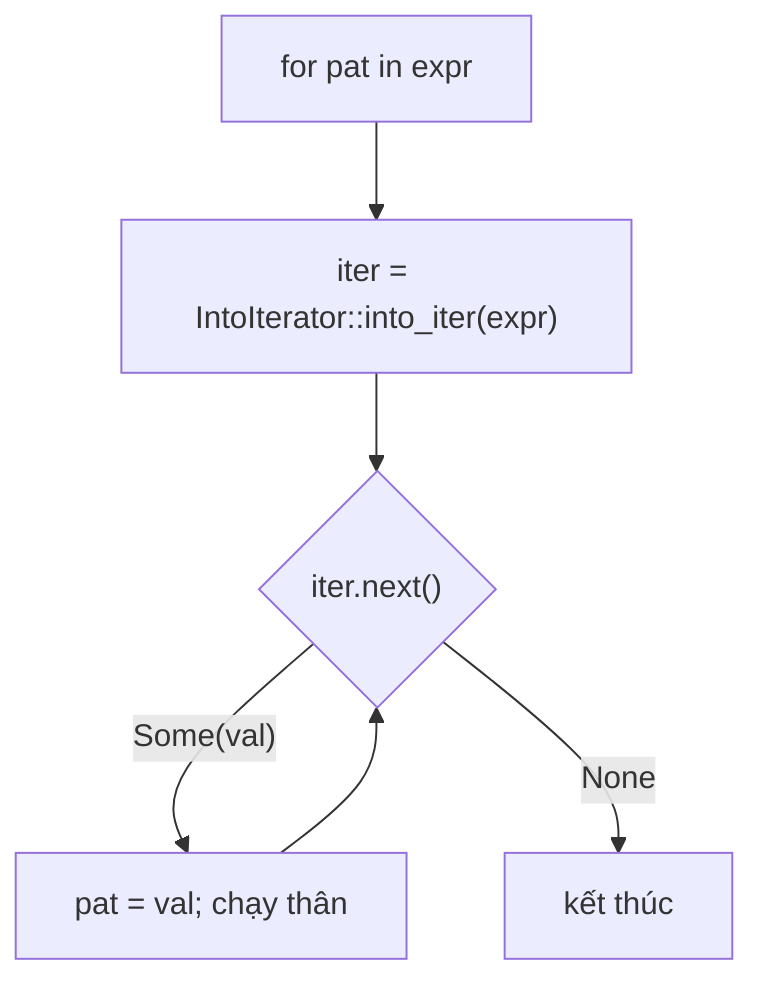

# P9 · Chương 06 — Iterator và closure

## Bạn sẽ hiểu được gì

1. **Q1.** Closure bắt biến theo cách nào (`&`, `&mut`, move), compiler chọn ra sao, và từ edition 2021 nó bắt chính xác tới từng field thế nào? → mục 1
2. **Q2.** `Fn`/`FnMut`/`FnOnce` quan hệ ra sao, vì sao trait của closure do *thân closure* quyết định chứ không do `move`? → mục 2
3. **Q3.** Closure trong bộ nhớ là gì (`size_of_val` đo ra bao nhiêu), khi nào trả `impl Fn`, khi nào `Box<dyn Fn>`, và `fn` pointer khác closure chỗ nào? → mục 3
4. **Q4.** `for` được dịch thành gì; `iter`/`iter_mut`/`into_iter` khác nhau ra sao; adapter lười khác consumer thế nào; `collect` chọn kiểu đích bằng cách nào? → mục 4
5. **Q5.** Book khẳng định gì về "zero-cost" của iterator, và khẳng định đó đúng đến đâu? → mục 5
6. **Q6.** Vì sao sửa collection khi đang duyệt bị chặn lúc biên dịch, và sửa thế nào cho đúng? → mục 6

## Kiến thức cần trước

- [Chương 01 — Ownership, borrowing, lifetime](01-ownership-borrowing-lifetime.md): move, `&`/`&mut`, quy tắc một-ghi-hoặc-nhiều-đọc.
- [Chương 02 — Trait](02-trait.md) và [Chương 03 — Generics nâng cao](03-generics-nang-cao.md): trait bound, associated type, `impl Trait`, monomorphization ở mức khái niệm.
- [Chương 04 — Smart pointer](04-smart-pointer.md): `Box`, trait object `dyn Trait` ở mức dùng được.

Mọi ví dụ trong chương được biên dịch và chạy bằng `rustc 1.95.0 --edition 2024` trên macOS aarch64; output dán lại là quan sát thật của một lần chạy. Các con số kích thước là của nền tảng này (con trỏ 8 byte).

## 1. Closure bắt biến thế nào (Q1)

> **Trả lời ngắn.** Closure là một giá trị có kiểu ẩn danh, gần như một struct chứa những thứ nó dùng từ môi trường xung quanh[^cl-intro]. Compiler chọn cách bắt *nhẹ nhất* mà thân closure còn chạy được: chỉ đọc thì mượn chung, ghi thì mượn `&mut`, cần sở hữu thì move[^cl-prec]; từ khóa `move` ép bắt theo giá trị[^ce-move]. Từ edition 2021, closure bắt riêng từng field mà nó dùng chứ không bắt cả biến[^ed-disjoint-2021].

**Giải thích.**

Hình dung (nhận xét của người soạn): bạn nhờ đồng nghiệp xử lý một việc và đưa kèm một phong bì. Nếu việc chỉ cần *xem* tài liệu, bạn ghi địa chỉ chỗ để tài liệu (mượn). Nếu cần *sửa tại chỗ*, bạn ghi địa chỉ kèm quyền sửa (mượn `&mut`). Nếu cần *giữ luôn*, bạn đưa bản gốc (move). Phong bì chính là struct ẩn danh của closure.

*Bước 1 — closure là struct.* Hàm thường (`fn`) không nhìn thấy biến cục bộ của nơi gọi (nhận xét của người soạn), nhưng nhiều API cần "một đoạn code kèm ít dữ liệu ngữ cảnh": callback xử lý request, comparator của `sort_by`, predicate của `filter`. Closure gói cả hai. Mỗi biểu thức closure có một kiểu duy nhất, ẩn danh[^ce-unique], nên hai closure giống hệt về chữ vẫn là hai kiểu khác nhau (hệ quả ở mục 3).

*Bước 2 — bốn chế độ bắt.* Reference liệt kê: mượn chung (ImmBorrow), mượn chung đặc biệt "duy nhất" (UniqueImmBorrow — không viết ra được trong code, xem phần Đi sâu), mượn `&mut` (MutBorrow) và move giá trị vào closure (ByValue)[^cl-modes]. Với mỗi biến, compiler lấy chế độ đầu tiên trong danh sách còn tương thích với cách thân closure dùng nó, và lựa chọn này không phụ thuộc code xung quanh như lifetime của biến[^cl-prec]. Không có `move`, closure ưu tiên mượn chung và chỉ nâng lên khi cần[^ce-infer].

*Bước 3 — giá trị `Copy` là trường hợp hay gây bối rối.* Giá trị `Copy` bị "move" vào thân closure vẫn được bắt bằng mượn chung, tức là bằng một tham chiếu chứ không phải bản copy[^cl-copy]. Ví dụ `|| a` với `a: u8` có kích thước 8 byte, không phải 1 (bảng ở mục 3).

*Bước 4 — `move`.* Với `move`, mọi thứ bị bắt bằng move (hoặc copy nếu là `Copy`)[^ce-move], thường để bảo đảm closure có lifetime `'static`[^ce-static]; Reference cũng nêu mục đích tiêu biểu là để closure sống lâu hơn giá trị gốc, như khi trả về closure hay đưa sang thread mới[^cl-move-usage]. Nếu đường dẫn đi qua một tham chiếu thì chính tham chiếu được move vào, vì không được move field ra khỏi một tham chiếu[^cl-moveref]. Dùng lại biến sau khi move: `let c = move || s.len(); println!("{}", s);` cho `error[E0382]: borrow of moved value: `s`` (đã chạy).

*Bước 5 — closure giữ borrow đến lần dùng cuối.* `let mut c = || v.push(4); println!("{:?}", v); c();` cho `error[E0502]: cannot borrow `v` as immutable because it is also borrowed as mutable` (đã chạy); đây là quy tắc ở chương 01[^b-borrow].

*Bước 6 — bắt tách rời field (disjoint capture).* Ở Rust 2018 trở về trước, closure bắt cả biến dù chỉ dùng một field[^ed-disjoint]; từ Rust 2021 chính xác hơn: thường chỉ bắt các field nó dùng, và trong một số trường hợp có thể bắt nhiều hơn[^ed-disjoint-2021]. Reference mô tả bằng *capture path*: một biến cộng thêm các phép chiếu (field, chỉ số tuple, dereference), và closure mượn hoặc move đường dẫn đó (có thể bị cắt bớt theo quy tắc ở phần Đi sâu)[^cl-path].

**Thí nghiệm** (đã chạy): closure sửa `p.a` trong khi code ngoài đọc `p.b`.

```rust
struct P { a: String, b: String }
fn main(){ let mut p = P { a: "x".into(), b: "y".into() };
    let mut ca = || p.a.push('1');
    println!("{}", p.b);
    ca(); }
```

Biên dịch được với edition 2021/2024 (in `x1 y`); với `--edition 2018` lỗi thật: `error[E0502]: cannot borrow `p.b` as immutable because it is also borrowed as mutable`, chú thích "first borrow occurs due to use of `p` in closure".

<details><summary>Đi sâu: thứ tự chế độ, cắt capture path, mảng, drop order</summary>

- **Thứ tự mạnh–yếu.** Khi một đường dẫn và tổ tiên của nó cùng bị bắt, tổ tiên lấy chế độ lớn nhất theo thứ tự `ImmBorrow < UniqueImmBorrow < MutBorrow < ByValue`[^cl-shared-prefix].
- **UniqueImmBorrow** là loại borrow đặc biệt, không dùng được ở chỗ nào khác trong ngôn ngữ và không viết ra được; nó xuất hiện khi sửa referent của một `&mut` (ví dụ `let x = &mut b; ... *x = true;` trong closure)[^cl-unique].
- **Capture path bị cắt** ở dereference ngoài cùng-phải của tham chiếu chung[^cl-trunc], ở dereference con trỏ thô[^cl-raw], ở truy cập field của union[^cl-union] và ở field của struct `repr(packed)`[^cl-packed]. Bạn không cần thuộc; chỉ cần biết là có để hiểu vì sao đôi khi closure bắt nhiều hơn dự đoán.
- **Mảng và slice không bị bắt từng phần**: toàn bộ mảng/slice luôn bị bắt dù dùng chỉ số hay sub-slice[^cl-array]. Vì thế closure đọc `arr[0]` bắt `&arr` chứ không phải `&arr[0]` (xem `c5` ở mục 3).
- **Drop order**: khi closure bắt một field theo giá trị, field đó gắn với lifetime của closure nên các field rời của cùng một struct có thể bị drop ở thời điểm khác nhau[^cl-drop].
- **Rủi ro khi lên edition 2021.** Edition Guide cảnh báo thay đổi này có thể làm thứ tự drop đổi hoặc ảnh hưởng việc closure có implement `Send`/`Clone` hay không; `cargo fix` chèn `let _ = &a;` để ép bắt cả biến khi phát hiện khả năng đó[^ed-disjoint-risk].
- Reference minh họa kiểu closure bằng closure sửa hai field của `rect`: struct sinh ra (chỉ để minh họa) có hai field `&'a mut`, mỗi cái trỏ vào một *field con*, rồi `FnOnce` được implement cho nó với thân closure làm thân `call_once`[^cl-intro].

</details>

**Quay lại Q1:** closure bắt mỗi thứ theo mức nhẹ nhất thân nó cho phép (đọc → `&`, ghi → `&mut`, sở hữu → move), `move` ép move/copy tất cả, và từ 2021 chỉ bắt đúng field được dùng.

## 2. `Fn`, `FnMut`, `FnOnce` (Q2)

> **Trả lời ngắn.** Ba trait này xếp lồng nhau: closure gọi được nhiều lần mà không sửa gì (`Fn`) cũng gọi được như `FnMut` và `FnOnce`[^std-fnonce]. Closure thuộc trait nào do *thân closure làm gì* với giá trị bắt được quyết định, không do việc có viết `move` hay không[^cl-move-note]. Closure move giá trị bắt được ra khỏi thân thì chỉ gọi được một lần (`FnOnce`)[^b-fntraits].

**Giải thích.**

Hình dung (nhận xét của người soạn): một cái máy bán nước. `Fn` là máy chỉ *đọc* bảng giá, bấm bao nhiêu lần cũng được và nhiều người bấm cùng lúc cũng được. `FnMut` là máy *đếm xu* trong thùng: bấm nhiều lần được nhưng mỗi lần đổi trạng thái nên phải có một người bấm tại một thời điểm. `FnOnce` là phiếu quà tặng *đổi một lần rồi hủy*.


*Quan hệ trait.* Trong std: `pub trait Fn<Args>: FnMut<Args>` (và tương tự `FnMut` có supertrait `FnOnce`)[^std-fn-def]. Do đó bất kỳ `Fn` hoặc `FnMut` nào cũng dùng được ở chỗ cần `FnOnce`[^std-fnonce]. Nói theo tập hợp: closure thỏa `Fn` ⊂ thỏa `FnMut` ⊂ thỏa `FnOnce`; *bound* càng lỏng (`FnOnce`) thì càng nhiều closure thỏa.

*Compiler chọn trait nào.* Mọi closure đều implement `FnOnce`[^cl-fnonce]; closure không move giá trị bắt được ra khỏi thân thì implement thêm `FnMut`; closure không sửa cũng không move thì implement thêm `Fn`[^cl-calltraits]. Book diễn đạt: closure tự động implement một, hai hoặc cả ba trait một cách cộng dồn tùy thân closure xử lý giá trị bắt được ra sao[^b-fntraits].

| Thân closure | Capture mode | Trait implement |
|---|---|---|
| chỉ đọc, hoặc không bắt gì | ImmBorrow | `Fn` + `FnMut` + `FnOnce` |
| ghi / gọi method `&mut` | MutBorrow | `FnMut` + `FnOnce` |
| move giá trị ra khỏi thân (`drop(s)`, trả `s`) | ByValue | chỉ `FnOnce` |

*`move` không quyết định trait.* Reference nói rõ closure `move` vẫn có thể là `Fn` hay `FnMut`, vì trait do việc closure *làm gì* với giá trị bắt được quyết định chứ không do cách bắt[^cl-move-note]. Chạy thật: `call_fn(move || s.len())` với `fn call_fn<F: Fn() -> usize>(f: F) -> usize { f() + f() }` và `s = "abc"` in `6`.

*Chọn bound khi viết API.* Std khuyên: `FnOnce` khi chỉ cần gọi một lần[^std-fnonce-use]; `Fn` khi cần gọi lặp lại mà không đổi state, ví dụ gọi đồng thời[^std-fn-use]. Nguyên tắc (nhận xét của người soạn): chọn bound *lỏng nhất* mà thân hàm còn chạy được. `Iterator::map` gọi closure nhiều lần và cho phép đổi state nên nhận `FnMut`[^std-map].

<details><summary>Đi sâu: các lỗi khi bound không khớp, Send/Sync/Clone/Copy của closure</summary>

Đã chạy:

```rust
fn call_fn<F: Fn()>(f: F) { f(); }
fn main(){ let mut n=0; call_fn(|| n+=1); }
```

```text
error[E0594]: cannot assign to `n`, as it is a captured variable in a `Fn` closure
```

```rust
fn call_mut<F: FnMut()>(mut f: F) { f(); }
fn main(){ let s=String::new(); let c = move || drop(s); call_mut(c); }
```

```text
error[E0525]: expected a closure that implements the `FnMut` trait, but this closure only implements `FnOnce`
```

Gọi trực tiếp closure `FnOnce` hai lần: `let c = || drop(s); c(); c();` → `error[E0382]: use of moved value: `c`` với ghi chú "`c` moved due to this call" — vì `call_once` nhận `self` by value.

Closure có `Send`/`Sync`/`Clone`/`Copy` hay không tùy các giá trị nó bắt; ví dụ nó là `Send` nếu mọi giá trị bắt theo `&` là `Sync` và mọi giá trị bắt theo `&mut`, copy hoặc move là `Send`[^cl-traits]. Chi tiết thuộc chương đồng thời (P4).

</details>

**Quay lại Q2:** `Fn ⊂ FnMut ⊂ FnOnce` về tập closure thỏa; trait của closure do thân nó làm gì với biến bắt được quyết định, không do `move`.

## 3. Closure trong bộ nhớ, `impl Fn` hay `Box<dyn Fn>`, `fn` pointer (Q3)

> **Trả lời ngắn.** Vì closure gần như là một struct chứa thứ nó bắt[^cl-intro], kích thước của nó đo được: không bắt gì thì 0 byte, bắt một `String` theo move thì 24 byte (đo trên aarch64). Trả closure về thì mặc định dùng `impl Fn`; chỉ cần `Box<dyn Fn>` khi nhiều closure khác nhau phải chung một kiểu, vì mỗi closure là một kiểu riêng[^b-retclosure]. `fn` pointer là một kiểu (không phải trait) và chỉ tạo được từ hàm hoặc closure không bắt gì[^fnptr-coerce].

**Giải thích.**

Hình dung (nhận xét của người soạn): `impl Fn` là bạn giao thẳng một cái phong bì có kích thước đúng bằng nội dung; `Box<dyn Fn>` là bạn đưa một *phiếu nhận hàng* cùng địa chỉ kho — người nhận đi lấy hàng, chấp nhận thêm một bước, nhưng mọi phiếu trông giống nhau nên xếp chung một ngăn được.

*Kích thước.* Nếu closure là struct chứa thứ nó bắt thì kích thước bằng tổng các thứ đó (cộng padding nếu cần — suy luận của người soạn từ các số đo, không phải bảo đảm của ngôn ngữ). Bảng đo ở phần Đi sâu cho 0 byte khi không bắt gì và 100 byte khi move một mảng 100 byte: không có "header" ẩn nào. Reference chỉ nói kiểu closure "gần như tương đương" một struct[^cl-intro], nên (suy luận của người soạn) đừng dựa vào bố cục cụ thể của nó. Hệ quả (nhận xét của người soạn): closure truyền cho hàm generic không cần cấp phát heap, nó chỉ là một struct trên stack.

*`impl Fn` hay `Box<dyn Fn>` khi trả về.* Closure biểu diễn bằng trait nên không trả "trực tiếp"; thường dùng `impl Trait`, ví dụ `fn returns_closure() -> impl Fn(i32) -> i32`[^b-retclosure-impl]. Nhưng mỗi lần trả `impl Trait`, Rust tạo một opaque type riêng, nên hai hàm cùng trả `impl Fn(i32) -> i32` cho hai kiểu khác nhau; muốn đặt chúng chung một `Vec` thì cần trait object[^b-traitobj]. Thí nghiệm: hai nhánh `if` trả hai closure khác nhau cùng `impl Fn` cho `error[E0308]: `if` and `else` have incompatible types` (đã chạy); `Box<dyn Fn(i32) -> i32>` thì được.

Nhận xét của người soạn: trong backend, bảng route/middleware/hook đăng ký lúc chạy là chỗ điển hình cần `Box<dyn Fn>`; hàm tiện ích generic nhận callback thì dùng `impl Fn` hoặc tham số generic để tránh chi phí.

*Function pointer `fn`.* Khác closure, `fn` là một kiểu chứ không phải trait; function pointer implement cả ba trait nên luôn truyền được vào chỗ cần closure[^b-fnptr]; chỉ nên nhận `fn` khi giao tiếp với code ngoài không có closure (như C)[^b-fnptr-c]. Function pointer tạo được bằng coercion từ function item và từ closure *không bắt gì* (và không async)[^fnptr-coerce]. Tên hàm có *function item type* riêng, kích thước 0 byte[^fnitem-zst]; truyền tên hàm cho generic `F: Fn` là zero-cost, còn ép về `fn` thì thành con trỏ thật (suy luận của người soạn từ kích thước đo ở dưới). Book cũng cho thấy dùng tên hàm hoặc enum constructor thay closure, như `.map(ToString::to_string)`, và nói chúng biên dịch ra cùng code với bản closure[^b-fnptr-map].

<details><summary>Đi sâu: số đo size_of_val và các thí nghiệm</summary>

Thí nghiệm (aarch64, edition 2024):

```rust
use std::mem::size_of_val;
fn main() {
    let a = 1u8; let b = 2u64; let s = String::from("hi"); let arr = [0u8; 100];
    let c0 = || 1;
    let c1 = || a;
    let c2 = || (a, b);
    let c3 = || s.len();
    let s2 = s.clone(); let c4 = move || s2.len();
    let c5 = || arr.len() + arr[0] as usize;
    let c6 = move || arr.len() + arr[0] as usize;
    println!("c0={} c1={} c2={} c3={} c4={} c5={} c6={}",
        size_of_val(&c0), size_of_val(&c1), size_of_val(&c2),
        size_of_val(&c3), size_of_val(&c4), size_of_val(&c5), size_of_val(&c6));
}
```

Output thật (cùng chương trình có thêm vài dòng in khác):

```text
c0=0 c1=8 c2=16 c3=8 c4=24 c5=8 c6=100
```

| Closure | Bắt gì | Kích thước | Giải thích |
|---|---|---|---|
| `c0 = \|\| 1` | không gì | 0 | không có field nào |
| `c1 = \|\| a` (`a: u8`) | `&a` | 8 | `u8` là `Copy` nên bắt bằng ImmBorrow, tức một tham chiếu 8 byte[^cl-copy] |
| `c2` | `&a`, `&b` | 16 | hai tham chiếu |
| `c3 = \|\| s.len()` | `&s` | 8 | `len` chỉ cần `&String` |
| `c4 = move \|\| s2.len()` | `s2: String` | 24 | chứa cả `String` (ptr+cap+len) |
| `c5` | `&arr` | 8 | tham chiếu tới mảng 100 byte (mảng không bắt từng phần[^cl-array]) |
| `c6 = move` | `arr` | 100 | chứa cả mảng |

`impl Fn` so với `Box<dyn Fn>`:

```rust
fn make_adder(n: i32) -> impl Fn(i32) -> i32 { move |x| x + n }
fn make_boxed(n: i32) -> Box<dyn Fn(i32) -> i32> { Box::new(move |x| x + n) }
// size_of_val(&make_adder(1)) = 4,  size_of_val(&make_boxed(1)) = 16
```

`impl Fn` ở đây chính là struct một `i32` (4 byte), không indirection. `Box<dyn Fn>` đo ra 16 byte: quan sát là hai từ 8 byte; đó là con trỏ dữ liệu cộng con trỏ vtable theo cách trait object được biểu diễn, chi tiết thuộc chương vtable của P10 (P10·03). Đổi lại bạn trả một lần cấp phát heap và một lần gọi gián tiếp (suy luận của người soạn từ cơ chế trait object).

Tập hợp handler hỗn tạp (đã chạy, in `[20, 11]`):

```rust
fn double(x: i32) -> i32 { x * 2 }
let fs: Vec<Box<dyn Fn(i32)->i32>> = vec![Box::new(double), Box::new(|x| x+1)];
println!("{:?}", fs.iter().map(|f| f(10)).collect::<Vec<_>>());
```

Function pointer: `let fp: fn(i32)->i32 = |x| x+100;` → `fp(1) = 101` (đã chạy); closure có bắt thì không ép được:

```rust
let n = 5;
let g: fn(i32)->i32 = move |x| x+n;
```

```text
error[E0308]: mismatched types
  expected fn pointer, found closure
```

Đo: `size_of_val(&(double as fn(i32)->i32)) = 8`, `size_of_val(&double) = 0`.

</details>

**Quay lại Q3:** closure là struct chứa đúng thứ nó bắt (0–100 byte trong các ví dụ đo); trả `impl Fn` khi chỉ có một closure, `Box<dyn Fn>` khi cần nhiều closure cùng kiểu, `fn` chỉ khi không bắt gì hoặc giao tiếp C.

## 4. Iterator: `for`, ba dạng duyệt, lười và `collect` (Q4)

> **Trả lời ngắn.** Iterator là mọi thứ có hàm `next` trả `Some(phần tử)` đến khi hết thì trả `None`[^it-trait]. `for x in e` chỉ là cú pháp rút gọn: gọi `into_iter` rồi gọi `next` lặp lại đến khi `None`[^lp-intro]. `iter()` / `iter_mut()` / `into_iter()` cho phần tử kiểu `&T` / `&mut T` / `T`[^it-three]. Các adapter như `map` chỉ *dựng* iterator mới và lười, còn consumer như `sum`, `collect` mới thật sự chạy[^it-lazy]; `collect` chọn kiểu đích theo kiểu bạn yêu cầu[^std-collect].

**Giải thích.**

Hình dung (nhận xét của người soạn): dây chuyền đóng gói. `next` là việc "băng chuyền đẩy ra một món"; adapter là các trạm gắn thêm trên băng chuyền (soi, lọc, gắn nhãn) nhưng băng chuyền chưa quay cho đến khi có người *đứng cuối dây* (consumer) kéo món ra. Món đi qua trạm nào là trạm đó chạy, không có kho trung gian.

*Giao thức `next`.* Lõi của trait chỉ có một method bắt buộc:

```rust
trait Iterator {
    type Item;
    fn next(&mut self) -> Option<Self::Item>;
}
```

`next` trả `Some(item)` khi còn phần tử và `None` khi hết[^it-trait]; trait chỉ đòi cài `next`[^b-next], mọi method khác có sẵn cài đặt mặc định xây trên `next`. Vì `next` nhận `&mut self`, duyệt là *thay đổi trạng thái* iterator nên biến iterator phải `mut`. Sau khi `next` trả `None`, gọi lại có thể trả `Some` trở lại tùy iterator[^it-next-none].

*Ba dạng duyệt.* `iter()` duyệt `&T`, `iter_mut()` duyệt `&mut T`, `into_iter()` duyệt `T` (sở hữu)[^it-three]. Nếu collection `C` có `iter()` thì thường cũng có `impl IntoIterator for &C` gọi `iter()`, và `&mut C` ↔ `iter_mut()`; nhờ vậy viết được `for x in &v` và `for x in &mut v`[^it-byref]. `for x in v` (không `&`) tiêu thụ `v` vì `into_iter` nhận `self` by value[^it-consume].

*`for` được dịch thành gì.* Reference: `for` là cấu trúc lặp trên phần tử do một implementation của `IntoIterator` cung cấp[^lp-intro]; tương đương một `loop` chứa `match` (code desugar ở phần Đi sâu). `match` ngoài cùng tồn tại để các temporary trong biểu thức bên phải `in` không bị drop trước khi vòng lặp kết thúc[^lp-desugar]; nghĩa là `for x in make_guard().iter()` giữ `make_guard()` sống suốt vòng lặp (suy luận của người soạn từ quy tắc trên).



Vì mọi `Iterator` cũng là `IntoIterator` (trả về chính nó), cả iterator lẫn collection đều đứng được bên phải `in`[^it-forloop].

*Adapter lười, consumer ăn hết.* Chỉ tạo iterator thì chưa làm gì; không có gì xảy ra cho đến khi gọi `next`[^it-lazy]. Book gọi method trên `Iterator` mà *không* tiêu thụ iterator, trả về iterator khác, là *iterator adapter*[^b-adapter-def]; method gọi `next` và dùng cạn iterator là *consuming adapter* (consumer), ví dụ `sum`[^b-adapter]. Compiler cảnh báo nếu bạn dựng adapter mà bỏ phí kết quả[^it-lazy-warn].

| Loại | Ví dụ | Trả về | Chạy closure ngay? |
|---|---|---|---|
| Adapter | `map`, `filter`, `take`, `enumerate`, `zip`, `chain`, `skip`, `inspect` | iterator mới | không |
| Consumer | `collect`, `sum`, `count`, `fold`, `for_each`, `find`, `last` | giá trị cuối | có |

Bound của adapter chính là các `Fn*` ở mục 2: `map` nhận `F: FnMut(Self::Item) -> B`[^std-map] nên closure được giữ state thay đổi; `find` nhận `&Item` và vì nhiều iterator vốn duyệt tham chiếu nên đối số thành tham chiếu đôi[^std-find-ref] — lý do bạn thấy `|&&x|` khi lọc `iter()` của `Vec<i32>`. Lười cũng cho phép *ngắt sớm*: `find` dừng xử lý ngay khi closure trả `true`[^std-find].

*`collect` và `FromIterator`.* Iterator không biết container đích; kiểu đích do kiểu bạn yêu cầu `collect` trả về quyết định[^std-collect], nên cần chú thích kiểu hoặc turbofish `collect::<Vec<_>>()` để giúp suy luận kiểu[^std-turbofish]. Trait `FromIterator<A>` có hàm `from_iter` dựng kiểu đó từ một iterator[^std-fromiter]. `collect` còn dựng được kiểu không phải collection thông thường: iterator các `Result<T, E>` gom được thành `Result<Collection<T>, E>`[^std-collect-result]; `Result` gặp `Err` đầu tiên thì dừng lấy phần tử và trả `Err` đó[^std-result-fi], `Option` tương tự với `None`[^std-option-fi]. Mẫu này (nhận xét của người soạn) là cách gọn để "parse cả batch, fail ở dòng lỗi đầu tiên" — liên hệ [Chương 05 — Error handling](05-error-handling.md).

<details><summary>Đi sâu: code desugar, thí nghiệm lười/ngắt sớm, collect, iterator tự viết, DoubleEnded/ExactSize</summary>

**Desugar của `for`** (theo Reference, rút gọn nhãn):

```rust
{
    let result = match IntoIterator::into_iter(iter_expr) {
        mut iter => loop {
            let mut next;
            match Iterator::next(&mut iter) {
                Option::Some(val) => next = val,
                Option::None => break,
            };
            let PATTERN = next;
            let () = { /* thân vòng lặp */ };
        },
    };
    result
}
```

Tự tay desugar trên `&v` (đã chạy, in `10 20 30`):

```rust
let v = vec![10, 20, 30];
let mut it = IntoIterator::into_iter(&v);
loop { match it.next() { Some(x) => print!("{x} "), None => break } }
```

Một số method như `nth`, `fold` có thể được ghi đè nếu iterator tính hiệu quả hơn mà không cần gọi `next`[^it-override].

**Ba dạng duyệt** (đã chạy trên `Vec<String>`):

```rust
let mut w = vec![String::from("a"), String::from("b")];
for s in w.iter() { let _: &String = s; }          // &String
for s in w.iter_mut() { s.push('!'); }              // &mut String
for s in w.clone() { let _: String = s; }           // String (into_iter, tiêu thụ bản sao)
println!("{:?}", w);                                // ["a!", "b!"]
```

**Lười** — closure trong `map` chưa chạy khi mới tạo (đã chạy):

```rust
let v = vec![10, 20, 30];
let m = v.iter().map(|x| { println!("map {x}"); x * 2 });
println!("created, nothing printed yet");
let r: Vec<i32> = m.collect();
println!("{:?}", r);
```

```text
created, nothing printed yet
map 10
map 20
map 30
[20, 40, 60]
```

**Ngắt sớm** — `find` dừng khi gặp phần tử khớp, các phần tử sau không bị chạm (đã chạy):

```rust
let f = v.iter().inspect(|x| println!("saw {x}")).find(|&&x| x == 20);
```

```text
saw 10
saw 20
Some(20)
```

Iterator vô hạn dùng được nếu có adapter chặn: `(0..).step_by(2).take(3)` → `[0, 2, 4]` (đã chạy). Docs cảnh báo method trên iterator vô hạn có thể không bao giờ kết thúc, như `min`[^it-infinity].

**`fold` và `by_ref`.** `fold(init, f)` gọi closure `FnMut(B, Item) -> B` cho mỗi phần tử và trả accumulator cuối[^std-fold]; `(1..=4).fold(String::new(), |acc, x| format!("{acc}{x}"))` ra `1234` (đã chạy). `by_ref` mượn iterator để dùng method lấy-ownership (như `take`) mà vẫn dùng lại iterator gốc sau đó[^std-by-ref]. Ví dụ:

```rust
let mut it = 1..10;
let first: Vec<_> = it.by_ref().take(3).collect();
// first = [1, 2, 3], it.collect() = [4, 5, 6, 7, 8, 9]  (đã chạy)
```

**`collect` vào `Result`, `Option`, `HashMap`** (đã chạy):

```rust
let ok:  Result<Vec<i32>, _> = "1 2 3".split(' ').map(str::parse::<i32>).collect();
let bad: Result<Vec<i32>, _> = "1 x 3".split(' ').map(str::parse::<i32>).collect();
println!("{:?} {:?}", ok, bad);
let o: Option<Vec<i32>> = vec![Some(1), None].into_iter().collect();
println!("{:?}", o);
```

```text
Ok([1, 2, 3]) Err(ParseIntError { kind: InvalidDigit })
None
```

Ví dụ trong docs của `collect` cho danh sách `Result` có hai lỗi và chú thích kết quả là lỗi đầu tiên[^std-collect-first]. `HashMap` cũng implement `FromIterator<(K, V)>`[^std-hashmap-fi], ví dụ:

```rust
let hm: HashMap<&str, usize> = ["a", "bb"].iter().map(|s| (*s, s.len())).collect();
// khi sắp xếp các cặp: [("a", 1), ("bb", 2)]  (đã chạy)
```

**Collection của bạn.** Để `for x in &bag`, `for x in bag` và `.collect::<Bag>()` cùng chạy, implement `IntoIterator for &Bag`, `IntoIterator for Bag` và `FromIterator<u32> for Bag` (đã chạy với `struct Bag(Vec<u32>)` trả `self.0.iter()` / `self.0.into_iter()`; `(1..=3).collect::<Bag>()` rồi duyệt cho `1 2 3`, `sum` ra `6`). Kiểu `IntoIter` bắt buộc là `Iterator<Item = Self::Item>`[^std-intoiter].

**Iterator tự viết.** Hai bước: tạo struct giữ trạng thái, rồi implement `Iterator` cho nó[^it-impl]. Ví dụ đếm ngược (đã chạy):

```rust
struct Countdown(u32);
impl Iterator for Countdown {
    type Item = u32;
    fn next(&mut self) -> Option<u32> {
        if self.0 == 0 { None } else { self.0 -= 1; Some(self.0 + 1) }
    }
}
println!("{:?}", Countdown(3).collect::<Vec<_>>());
// [3, 2, 1]
println!("{}", Countdown(5).zip(Countdown(5).skip(1)).map(|(a,b)| a*b).filter(|x| x%3==0).sum::<u32>());
// 18
```

Kiểm tay: `Countdown(5)` = 5,4,3,2,1; `skip(1)` = 4,3,2,1; tích từng cặp 20,12,6,2; chia hết cho 3 là 12 và 6 → 18. Chỉ định nghĩa `next` mà toàn bộ adapter dùng được[^b-next]. `size_of_val(&Countdown(1)) = 4` (đã chạy).

`size_hint(&self) -> (usize, Option<usize>)` mặc định `(0, None)`, đúng cho mọi iterator[^it-sizehint]; docs dùng nó để tối ưu như dự trữ chỗ nhưng không được tin nó để bỏ bounds check trong unsafe[^it-sizehint-use]. Quan sát (đã chạy): `(0..10).filter(|x| x%2==0).size_hint()` là `(0, Some(10))`, còn `v.iter().map(|x| x+1).size_hint()` là `(3, Some(3))`.

**`DoubleEndedIterator` / `ExactSizeIterator`.** `DoubleEndedIterator` thêm `next_back`; hai đầu cùng làm việc trên một dãy và không giao nhau, duyệt xong khi chúng gặp nhau ở giữa[^std-dei]. Nó là nền của `rev()`, vốn chỉ dùng được với iterator hai đầu[^std-rev]; ví dụ `v.iter().rev().collect::<Vec<_>>()` ra `[30, 20, 10]` (đã chạy). Với `let mut r = 1u8..=5;`: `r.next_back()` → `Some(5)`, `r.next()` → `Some(1)`, `r.len()` → `3`. `ExactSizeIterator` cung cấp `len()`[^std-esi-len]; khi implement thì `size_hint` phải trả đúng kích thước[^std-esi]. Không phổ quát: `let mut r = 1..=5; r.len()` (kiểu `RangeInclusive<i32>`) cho

```text
error[E0277]: the trait bound `std::ops::RangeInclusive<i32>: ExactSizeIterator` is not satisfied
```

còn `1u8..=5` thì được — thông báo lỗi liệt kê `RangeInclusive<u8>`, `<i8>`, `<u16>`, `<i16>` là các kiểu có impl (quan sát từ lần chạy này). Docs giải thích `Chain` không phải `ExactSizeIterator` ngay cả khi hai vế đều exact: dãy dài ra có thể vượt `usize::MAX`[^std-esi-chain].

**Trait object cho iterator.** Hàm trả iterator mặc định dùng `impl Iterator<Item = u32>`; khi các nhánh trả kiểu khác nhau thì `Box<dyn Iterator<Item = u32>>` (đã chạy với nhánh `Box::new(0..3)` / `Box::new([7,8].into_iter())`) — cùng lý do "mỗi closure/adapter một kiểu" ở mục 1 và 3.

</details>

**Quay lại Q4:** `for` = `into_iter` + `next` đến `None`; `iter`/`iter_mut`/`into_iter` cho `&T`/`&mut T`/`T`; adapter chỉ dựng, consumer mới chạy; `collect` quyết định kiểu đích theo kiểu bạn yêu cầu.

## 5. Zero-cost abstraction: Book nói gì, asm cho thấy gì (Q5)

> **Trả lời ngắn.** Book chạy một benchmark so vòng `for` với iterator và kết luận hai bản có hiệu năng tương tự[^b-bench]. Book nói iterator được biên dịch xuống code *gần như* giống code mức thấp viết tay[^b-zerocost], và "trong nhiều trường hợp" ra cùng assembly[^b-sameasm]. Đó là phát biểu có giới hạn ("gần như", "nhiều trường hợp"), không phải "luôn luôn".

**Giải thích.**

Hình dung (nhận xét của người soạn): thuê dịch viên giỏi — bạn viết văn trôi chảy bằng ngôn ngữ cao, bản dịch ra cũng gọn như người viết tay thẳng bằng ngôn ngữ đích; nhưng "giỏi" không có nghĩa "mọi văn bản".

Book ch13.4 tìm một từ trong *Sherlock Holmes* bằng vòng `for` và bằng iterator, ra 19.620.300 ns/iter và 19.234.900 ns/iter[^b-bench-num], kết luận hai bản có hiệu năng tương tự[^b-bench]. Book nói rõ benchmark chỉ để có cảm nhận chung chứ không nhằm chứng minh hai bản tương đương[^b-bench-note]. Kết luận của Book: iterator, dù là abstraction cấp cao, được biên dịch xuống gần như cùng code như khi bạn tự viết mức thấp, và là một zero-cost abstraction[^b-zerocost]. Book còn nêu các tối ưu như loop unrolling và bỏ bounds check áp dụng cho code iterator[^b-sameasm]. Chương này chỉ khẳng định đúng mức đó.

Điều này **không** chứng minh mọi chuỗi iterator đều miễn phí: ở build debug (không `-O`) các lớp adapter là các lời gọi hàm thật (suy luận của người soạn; chương này không đo), và chuỗi adapter dài kèm `Box<dyn Iterator>` có chi phí gọi gián tiếp (suy luận của người soạn).

<details><summary>Đi sâu: tự soi asm một trường hợp</summary>

Quan sát của người soạn (một trường hợp, một compiler, một kiến trúc — không phải bảo đảm): hai hàm cộng gấp đôi các phần tử `u32`:

```rust
pub fn sum_loop(v: &[u32]) -> u32 { let mut s = 0u32; for i in 0..v.len() { s = s.wrapping_add(v[i] * 2); } s }
pub fn sum_iter(v: &[u32]) -> u32 { v.iter().map(|x| x * 2).fold(0u32, |a, b| a.wrapping_add(b)) }
```

Biên dịch `rustc 1.95.0 --edition 2024 -O --crate-type=lib --emit=asm -C overflow-checks=off` (aarch64-apple-darwin). Kết quả: hai hàm sinh ra cùng khung lệnh — rẽ nhánh theo độ dài, vòng lặp vector hóa NEON (`ldp q4, q5` / `add.4s` / `addv.4s`), rồi vòng scalar cho phần dư (`ldr w11, [x9], #4` / `add w8, w8, w11, lsl #1`); khi `diff` hai đoạn asm (sau đổi tên nhãn) thì chỉ khác thứ tự vài lệnh `mov`/`sub`/`add` và tên thanh ghi ở vòng scalar. Không có lệnh `bl` (không gọi hàm) trong cả hai. Tức là closure `|x| x * 2` và adapter `map` biến mất hoàn toàn, và bounds check của `v[i]` cũng không còn ở bản vòng lặp tối ưu.

</details>

**Quay lại Q5:** Book hứa code biên dịch ra gần như giống code viết tay và, trong nhiều trường hợp, cùng assembly — một trường hợp asm aarch64 đã khớp, nhưng đó không phải bảo đảm cho mọi chuỗi iterator.

## 6. Sửa collection khi đang duyệt (Q6)

> **Trả lời ngắn.** Iterator trên collection giữ một borrow của collection đó suốt vòng lặp; gọi `push` cần mượn `&mut` cùng lúc nên vi phạm quy tắc "không có `&mut` khi còn `&`"[^b-borrow]. Compiler từ chối lúc biên dịch (E0502). Cách sửa: tách hai pha, duyệt `iter_mut()` nếu chỉ sửa tại chỗ, hoặc dùng `retain`/`drain` nếu cần xóa.

**Giải thích.**

Hình dung (nhận xét của người soạn): bạn đang đọc danh sách khách hàng đưa cho bạn từng người một, mà có người chen vào thêm tên giữa chừng — danh sách đang cầm bị đổi dưới tay. Rust không cho phép, và chặn ngay ở khâu biên dịch thay vì để runtime phát hiện (Java ném `ConcurrentModificationException` lúc chạy — nhận xét của người soạn, chương này không dẫn nguồn Java cho hành vi đó).

*Cơ chế.* `for x in &v` tạo iterator giữ `&Vec`; vì `for` gọi `next` ở mỗi vòng, borrow đó sống suốt vòng lặp (mục 4). `v.push` cần `&mut v`, mà đang còn `&v` nên bị chặn[^b-borrow]. Tương tự (đã chạy), `let x = it.next(); drop(v); println!("{:?}", x)` với `it = v.iter()` cho `E0505: cannot move out of `v` because it is borrowed`.

*Cách sửa* (nhận xét của người soạn): thu thập chỉ số/giá trị cần đổi vào `Vec` riêng rồi áp dụng sau vòng lặp; duyệt `iter_mut()` nếu chỉ sửa phần tử tại chỗ; hoặc `retain`/`drain` nếu cần xóa — API của collection được viết để thỏa quy tắc borrow.

<details><summary>Đi sâu: thông báo lỗi đầy đủ</summary>

Chạy thật:

```rust
fn main(){ let mut v = vec![1,2,3]; for x in &v { if *x==2 { v.push(4); } } }
```

```text
error[E0502]: cannot borrow `v` as mutable because it is also borrowed as immutable
 --> e1.rs:1:62
  |
1 | fn main(){ let mut v = vec![1,2,3]; for x in &v { if *x==2 { v.push(4); } } }
  |                                              --              ^^^^^^^^^ mutable borrow occurs here
  |                                              |
  |                                              immutable borrow occurs here
  |                                              immutable borrow later used here
```

</details>

**Quay lại Q6:** `for x in &v` giữ `&v` đến hết vòng, nên `v.push` (cần `&mut`) bị chặn lúc biên dịch; sửa bằng hai pha, `iter_mut`, `retain` hoặc `drain`.

## 7. Liên hệ backend: pipeline log và so với Java Stream

Ví dụ xử lý log theo dòng — parse, bỏ dòng hỏng, đếm lỗi theo method (đã chạy):

```rust
let log = "GET 200\nPOST 500\nGET 404\nGET 200\nbad line\nPOST 201";
let parsed: Vec<(&str, u16)> = log.lines()
    .filter_map(|l| { let (m, c) = l.split_once(' ')?; Some((m, c.parse().ok()?)) })
    .collect();
// [("GET", 200), ("POST", 500), ("GET", 404), ("GET", 200), ("POST", 201)]
let mut by: HashMap<&str, Vec<u16>> = HashMap::new();
for (m, c) in &parsed { by.entry(m).or_default().push(*c); }
let mut e: Vec<_> = by.iter()
    .map(|(m, cs)| (*m, cs.iter().filter(|&&c| c >= 400).count())).collect();
e.sort();
// [("GET", 1), ("POST", 1)]
```

Dòng `bad line` bị bỏ vì `?` trong closure trả `Option` thoát sớm cho dòng đó. Dữ liệu không bị sao chép: `&str` trỏ vào chuỗi gốc (lifetime ràng buộc `parsed` với `log`, chương 01).

So với Java Stream (nhận xét của người soạn, có đối chiếu docs Java): Javadoc nói các thao tác trung gian luôn lười và việc duyệt nguồn chỉ bắt đầu khi thao tác kết thúc chạy[^jv-lazy] — khớp với adapter/consumer của Rust. Khác biệt: `collect(self)` của Rust move iterator nên dùng lại là lỗi biên dịch (E0382), còn Java Stream sau thao tác kết thúc được coi là đã tiêu thụ và không dùng lại được[^jv-consumed].

`Iterator::next` là lời gọi đồng bộ trả giá trị ngay (nhận xét của người soạn), nên không dùng để duyệt nguồn bất đồng bộ (socket, file async); với nguồn đó dùng `Stream` của hệ async (chương I/O async, P7).

## Tóm tắt

- Closure có kiểu duy nhất ẩn danh, giống struct chứa giá trị bắt được; `size_of_val` đo ra 0 (không bắt), 8 (một tham chiếu), 24 (một `String` move), 100 (mảng 100 byte move).
- Chế độ bắt: compiler chọn mức nhẹ nhất thân closure cho phép (ImmBorrow < UniqueImmBorrow < MutBorrow < ByValue); `move` ép bắt theo giá trị.
- Edition 2021 bắt từng field (disjoint capture); mảng/slice thì bắt nguyên.
- `Fn ⊂ FnMut ⊂ FnOnce` về tập closure thỏa; trait closure implement do thân closure *làm gì* với biến bắt, không do `move`.
- Trả closure: `impl Fn` (một kiểu, không heap) khi chỉ có một closure; `Box<dyn Fn>` khi cần nhiều closure khác nhau chung một kiểu. Closure không bắt gì ép được về `fn`; có bắt thì không.
- `for` = `into_iter` + `next` đến `None`; `for x in &v` dùng `IntoIterator for &Vec`.
- Adapter lười, consumer chạy thật và có thể ngắt sớm; `collect` chọn kiểu đích theo kiểu bạn yêu cầu, gom được vào `Result`/`Option`/`HashMap`.
- Iterator tự viết chỉ cần `next`; thêm `size_hint`, `DoubleEndedIterator`, `ExactSizeIterator` khi có thể.
- Book khẳng định iterator biên dịch ra gần như cùng code với vòng lặp tay; một trường hợp asm aarch64 đã khớp (không phải bảo đảm chung).
- Sửa collection khi đang duyệt là E0502 lúc biên dịch.

## Câu hỏi tự kiểm tra

1. Closure `|| a` với `a: u8` có kích thước bao nhiêu và vì sao không phải 1?
<details><summary>Đáp án</summary>

8 byte (đo thật trên aarch64): `u8` là `Copy` nên được bắt bằng ImmBorrow, tức là một tham chiếu.[^cl-copy]

</details>

2. Closure `move || s.len()` (với `s: String`) implement trait nào trong `Fn`/`FnMut`/`FnOnce`?
<details><summary>Đáp án</summary>

Cả ba: trait do thân closure quyết định (chỉ đọc), không do `move`.[^cl-move-note]

</details>

3. Vì sao `call_mut(move || drop(s))` lỗi E0525?
<details><summary>Đáp án</summary>

Thân move `s` ra khỏi closure nên chỉ implement `FnOnce`; `call_mut` đòi `FnMut`.[^b-fntraits][^cl-calltraits]

</details>

4. Đoạn code sửa `p.a` trong closure rồi đọc `p.b` biên dịch ở edition 2021 nhưng lỗi ở 2018. Vì sao?
<details><summary>Đáp án</summary>

2018 bắt cả biến `p`; 2021 chỉ bắt `p.a` (disjoint capture).[^ed-disjoint]

</details>

5. Khi nào bắt buộc dùng `Box<dyn Fn>` thay vì `impl Fn`?
<details><summary>Đáp án</summary>

Khi cần nhiều closure khác nhau cùng một kiểu (nhánh `if` trả closure khác nhau, `Vec` các handler): mỗi `impl Fn` là một opaque type riêng.[^b-retclosure]

</details>

6. Closure nào ép được thành `fn`?
<details><summary>Đáp án</summary>

Chỉ closure không bắt gì từ môi trường (và không async).[^fnptr-coerce]

</details>

7. Viết lại `for x in v { body }` thành `loop`/`match`.
<details><summary>Đáp án</summary>

`match IntoIterator::into_iter(v) { mut iter => loop { match Iterator::next(&mut iter) { Some(x) => { body } None => break } } }`.[^lp-desugar]

</details>

8. `v.iter().map(|x| println!("{x}"));` in gì? Vì sao?
<details><summary>Đáp án</summary>

Không in gì: adapter lười, chưa có consumer; compiler cảnh báo.[^it-lazy-warn]

</details>

9. `collect::<Result<Vec<_>, _>>()` trên chuỗi có một phần tử lỗi trả gì?
<details><summary>Đáp án</summary>

`Err` chứa lỗi đầu tiên (ví dụ chạy: `Err(ParseIntError { kind: InvalidDigit })`).[^std-result-fi]

</details>

10. Vì sao `for x in &v { v.push(1) }` không biên dịch?
<details><summary>Đáp án</summary>

`&v` giữ borrow chung suốt vòng lặp; `push` cần `&mut` — E0502.[^b-borrow]

</details>

11. Book hứa gì về hiệu năng iterator so với vòng `for`?
<details><summary>Đáp án</summary>

Biên dịch ra gần như cùng code, và trong nhiều trường hợp cùng assembly; benchmark của Book cho thấy hiệu năng tương đương, không phải bảo đảm cho mọi chuỗi.[^b-zerocost][^b-sameasm]

</details>

12. `RangeInclusive<i32>` có `len()` không?
<details><summary>Đáp án</summary>

Không: nó không implement `ExactSizeIterator` (E0277 chạy thật); `RangeInclusive<u8>` thì có. Docs chỉ nêu `ExactSizeIterator` cung cấp `len()` khi implement trait này.[^std-esi-len]

</details>

## Đọc thêm

- [Reference — Closure types](https://doc.rust-lang.org/1.95.0/reference/types/closure.html): toàn bộ quy tắc capture path, cắt đường dẫn, drop order; đọc để hiểu các trường hợp biên của mục 1.
- [Edition Guide — Disjoint capture in closures](https://doc.rust-lang.org/1.95.0/edition-guide/rust-2021/disjoint-capture-in-closures.html): vì sao 2021 đổi và rủi ro khi migrate.
- [Reference — Iterator loops](https://doc.rust-lang.org/1.95.0/reference/expressions/loop-expr.html): desugar chính thức của `for`.
- [std::iter](https://doc.rust-lang.org/1.95.0/std/iter/index.html): ba dạng duyệt, tự cài `Iterator`, laziness, vô hạn.
- [Rust Book 13.1–13.4](https://doc.rust-lang.org/1.95.0/book/ch13-01-closures.html) và [20.4](https://doc.rust-lang.org/1.95.0/book/ch20-04-advanced-functions-and-closures.html): closure, iterator, hiệu năng, function pointer, trả closure.
- [P10·03 mục 4](../10-rust-internals/03-dst-fat-pointer-vtable.md) (vtable, lời gọi `dyn`) và [P10·04 mục 4–5](../10-rust-internals/04-monomorphization.md) (closure và monomorphization, iterator zero-cost): cách `dyn Fn` được gọi và vì sao `impl Fn` inline được.

[^cl-intro]: Rust Reference, Closure types — <https://doc.rust-lang.org/1.95.0/reference/types/closure.html> — "A closure type is approximately equivalent to a struct which contains the captured values."
[^ce-unique]: Rust Reference, Closure expressions — <https://doc.rust-lang.org/1.95.0/reference/expressions/closure-expr.html> — "Each closure expression has a unique, anonymous type."
[^cl-copy]: Rust Reference, Closure types, Copy values — <https://doc.rust-lang.org/1.95.0/reference/types/closure.html> — "Values that implement Copy that are moved into the closure are captured with the ImmBorrow mode."
[^cl-modes]: Rust Reference, Closure types, Capture modes — <https://doc.rust-lang.org/1.95.0/reference/types/closure.html> — "Move (ByValue) — The place expression is captured by moving the value into the closure."
[^cl-prec]: Rust Reference, Closure types, Capture modes — <https://doc.rust-lang.org/1.95.0/reference/types/closure.html> — "Place expressions from the environment are captured from the first mode that is compatible with how the captured value is used inside the closure body."
[^ce-infer]: Rust Reference, Closure expressions — <https://doc.rust-lang.org/1.95.0/reference/expressions/closure-expr.html> — "preferring to capture by shared reference"
[^cl-shared-prefix]: Rust Reference, Closure types, Shared prefix — <https://doc.rust-lang.org/1.95.0/reference/types/closure.html> — "the strict weak ordering: ImmBorrow < UniqueImmBorrow < MutBorrow < ByValue"
[^cl-unique]: Rust Reference, Closure types, Unique immutable borrows in captures — <https://doc.rust-lang.org/1.95.0/reference/types/closure.html> — "Captures can occur by a special kind of borrow called a unique immutable borrow, which cannot be used anywhere else in the language and cannot be written out explicitly."
[^b-borrow]: Rust Book, References and Borrowing — <https://doc.rust-lang.org/1.95.0/book/ch04-02-references-and-borrowing.html> — "We also cannot have a mutable reference while we have an immutable one"
[^ce-move]: Rust Reference, Closure expressions — <https://doc.rust-lang.org/1.95.0/reference/expressions/closure-expr.html> — "A closure can be forced to capture its environment by copying or moving values by prefixing it with the move keyword."
[^cl-moveref]: Rust Reference, Closure types, Capturing references in move contexts — <https://doc.rust-lang.org/1.95.0/reference/types/closure.html> — "Because it is not allowed to move fields out of a reference, move closures will only capture the prefix of a capture path that runs up to, but not including, the first dereference of a reference."
[^ed-disjoint]: Rust Edition Guide, Disjoint capture in closures — <https://doc.rust-lang.org/1.95.0/edition-guide/rust-2021/disjoint-capture-in-closures.html> — "In Rust 2018 and before, closures capture entire variables, even if the closure only uses one field."
[^cl-path]: Rust Reference, Closure types, Capture precision — <https://doc.rust-lang.org/1.95.0/reference/types/closure.html> — "A capture path is a sequence starting with a variable from the environment followed by zero or more place projections from that variable."
[^cl-trunc]: Rust Reference, Closure types, Capture precision — <https://doc.rust-lang.org/1.95.0/reference/types/closure.html> — "The capture path is truncated at the rightmost dereference in the capture path if the dereference is applied to a shared reference."
[^cl-array]: Rust Reference, Closure types, Wildcard pattern bindings — <https://doc.rust-lang.org/1.95.0/reference/types/closure.html> — "Partial captures of arrays and slices are not supported; the entire slice or array is always captured even if used with wildcard pattern matching, indexing, or sub-slicing."
[^cl-drop]: Rust Reference, Closure types, Drop order — <https://doc.rust-lang.org/1.95.0/reference/types/closure.html> — "it is possible for disjoint fields of a composite types to be dropped at different times."
[^ed-disjoint-risk]: Rust Edition Guide, Disjoint capture in closures — <https://doc.rust-lang.org/1.95.0/edition-guide/rust-2021/disjoint-capture-in-closures.html> — "This can cause things to be dropped at different times or affect whether closures implement traits like Send or Clone."
[^std-fn-def]: std::ops::Fn — <https://doc.rust-lang.org/1.95.0/std/ops/trait.Fn.html> — "pub trait Fn\<Args>: FnMut\<Args>"
[^std-fnonce]: std::ops::FnOnce — <https://doc.rust-lang.org/1.95.0/std/ops/trait.FnOnce.html> — "Since both Fn and FnMut are subtraits of FnOnce, any instance of Fn or FnMut can be used where a FnOnce is expected."
[^cl-calltraits]: Rust Reference, Closure types, Call traits and coercions — <https://doc.rust-lang.org/1.95.0/reference/types/closure.html> — "A closure which does not mutate or move out of any captured variables implements Fn, indicating that it can be called by shared reference."
[^b-fntraits]: Rust Book, Closures — <https://doc.rust-lang.org/1.95.0/book/ch13-01-closures.html> — "A closure that moves captured values out of its body will only implement FnOnce and none of the other Fn traits because it can only be called once."
[^cl-move-note]: Rust Reference, Closure types, Call traits and coercions — <https://doc.rust-lang.org/1.95.0/reference/types/closure.html> — "This is because the traits implemented by a closure type are determined by what the closure does with captured values, not how it captures them."
[^std-fn-use]: std::ops::Fn — <https://doc.rust-lang.org/1.95.0/std/ops/trait.Fn.html> — "Use Fn as a bound when you want to accept a parameter of function-like type and need to call it repeatedly and without mutating state"
[^std-map]: std::iter::Iterator, map — <https://doc.rust-lang.org/1.95.0/std/iter/trait.Iterator.html> — "by means of its argument: something that implements FnMut."
[^cl-traits]: Rust Reference, Closure types, Other traits — <https://doc.rust-lang.org/1.95.0/reference/types/closure.html> — "A closure is Send if all values captured by non-unique immutable reference are Sync, and all values captured by unique immutable or mutable reference, copy, or move are Send."
[^b-retclosure]: Rust Book, Advanced Functions and Closures — <https://doc.rust-lang.org/1.95.0/book/ch20-04-advanced-functions-and-closures.html> — "whenever we return an impl Trait, Rust creates a unique opaque type"
[^b-fnptr]: Rust Book, Advanced Functions and Closures — <https://doc.rust-lang.org/1.95.0/book/ch20-04-advanced-functions-and-closures.html> — "Function pointers implement all three of the closure traits (Fn, FnMut, and FnOnce)"
[^fnptr-coerce]: Rust Reference, Function pointer types — <https://doc.rust-lang.org/1.95.0/reference/types/function-pointer.html> — "Function pointers can be created via a coercion from both function items and non-capturing, non-async closures."
[^fnitem-zst]: Rust Reference, Function item types — <https://doc.rust-lang.org/1.95.0/reference/types/function-item.html> — "yields a zero-sized value of its function item type."
[^b-fnptr-map]: Rust Book, Advanced Functions and Closures — <https://doc.rust-lang.org/1.95.0/book/ch20-04-advanced-functions-and-closures.html> — "They compile to the same code, so use whichever style is clearer to you."
[^it-trait]: std::iter — <https://doc.rust-lang.org/1.95.0/std/iter/index.html> — "Calling next will return Some(Item) as long as there are elements, and once they’ve all been exhausted, will return None to indicate that iteration is finished."
[^b-next]: Rust Book, Processing a Series of Items with Iterators — <https://doc.rust-lang.org/1.95.0/book/ch13-02-iterators.html> — "The Iterator trait only requires implementors to define one method: the next method"
[^it-override]: std::iter — <https://doc.rust-lang.org/1.95.0/std/iter/index.html> — "it is also possible to write a custom implementation of methods like nth and fold if an iterator can compute them more efficiently without calling next."
[^it-next-none]: std::iter — <https://doc.rust-lang.org/1.95.0/std/iter/index.html> — "Individual iterators may choose to resume iteration, and so calling next again may or may not eventually start returning Some(Item) again at some point"
[^it-three]: std::iter — <https://doc.rust-lang.org/1.95.0/std/iter/index.html> — "into_iter(), which iterates over T."
[^it-byref]: std::iter — <https://doc.rust-lang.org/1.95.0/std/iter/index.html> — "If a collection type C provides iter(), it usually also implements IntoIterator for &C, with an implementation that just calls iter()."
[^lp-intro]: Rust Reference, Iterator loops — <https://doc.rust-lang.org/1.95.0/reference/expressions/loop-expr.html> — "A for expression is a syntactic construct for looping over elements provided by an implementation of std::iter::IntoIterator."
[^lp-desugar]: Rust Reference, Iterator loops — <https://doc.rust-lang.org/1.95.0/reference/expressions/loop-expr.html> — "The outer match is used to ensure that any temporary values in iter_expr"
[^it-forloop]: std::iter — <https://doc.rust-lang.org/1.95.0/std/iter/index.html> — "In other words, all Iterators implement IntoIterator, by just returning themselves."
[^it-lazy]: std::iter — <https://doc.rust-lang.org/1.95.0/std/iter/index.html> — "Iterators (and iterator adapters) are lazy."
[^b-adapter]: Rust Book, Processing a Series of Items with Iterators — <https://doc.rust-lang.org/1.95.0/book/ch13-02-iterators.html> — "Methods that call next are called consuming adapters because calling them uses up the iterator."
[^it-infinity]: std::iter — <https://doc.rust-lang.org/1.95.0/std/iter/index.html> — "methods on infinite iterators, even those for which a result can be determined mathematically in finite time, might not terminate."
[^std-fold]: std::iter::Iterator, fold — <https://doc.rust-lang.org/1.95.0/std/iter/trait.Iterator.html> — "Folds every element into an accumulator by applying an operation, returning the final result."
[^std-collect]: std::iter::Iterator, collect — <https://doc.rust-lang.org/1.95.0/std/iter/trait.Iterator.html> — "the target collection is chosen entirely by the type you ask collect() to return."
[^std-fromiter]: std::iter::FromIterator — <https://doc.rust-lang.org/1.95.0/std/iter/trait.FromIterator.html> — "Conversion from an Iterator. By implementing FromIterator for a type, you define how it will be created from an iterator."
[^std-collect-result]: std::iter::Iterator, collect — <https://doc.rust-lang.org/1.95.0/std/iter/trait.Iterator.html> — "an iterator of Result\<T, E> items can be collected into Result\<Collection\<T>, E>."
[^std-collect-first]: std::iter::Iterator, collect — <https://doc.rust-lang.org/1.95.0/std/iter/trait.Iterator.html> — "gives us the first error"
[^std-hashmap-fi]: std::collections::HashMap — <https://doc.rust-lang.org/1.95.0/std/collections/struct.HashMap.html> — "impl\<K, V, S> FromIterator<(K, V)> for HashMap\<K, V, S>"
[^std-intoiter]: std::iter::IntoIterator — <https://doc.rust-lang.org/1.95.0/std/iter/trait.IntoIterator.html> — "type IntoIter: Iterator\<Item = Self::Item>"
[^it-impl]: std::iter — <https://doc.rust-lang.org/1.95.0/std/iter/index.html> — "Creating an iterator of your own involves two steps: creating a struct to hold the iterator’s state, and then implementing Iterator for that struct."
[^it-sizehint]: std::iter::Iterator, size_hint — <https://doc.rust-lang.org/1.95.0/std/iter/trait.Iterator.html> — "The default implementation returns (0, None) which is correct for any iterator."
[^std-dei]: std::iter::DoubleEndedIterator — <https://doc.rust-lang.org/1.95.0/std/iter/trait.DoubleEndedIterator.html> — "It is important to note that both back and forth work on the same range, and do not cross: iteration is over when they meet in the middle."
[^std-esi]: std::iter::ExactSizeIterator — <https://doc.rust-lang.org/1.95.0/std/iter/trait.ExactSizeIterator.html> — "the implementation of Iterator::size_hint must return the exact size of the iterator."
[^std-esi-chain]: std::iter::ExactSizeIterator — <https://doc.rust-lang.org/1.95.0/std/iter/trait.ExactSizeIterator.html> — "The inner exact-sized iterator might already be usize::MAX-long, and thus the length of the longer adapted iterator would no longer be exactly representable in usize."
[^b-bench]: Rust Book, Performance in Loops vs. Iterators — <https://doc.rust-lang.org/1.95.0/book/ch13-04-performance.html> — "The two implementations have similar performance!"
[^b-zerocost]: Rust Book, Performance in Loops vs. Iterators — <https://doc.rust-lang.org/1.95.0/book/ch13-04-performance.html> — "Iterators, although a high-level abstraction, get compiled down to roughly the same code as if"
[^b-sameasm]: Rust Book, Performance in Loops vs. Iterators — <https://doc.rust-lang.org/1.95.0/book/ch13-04-performance.html> — "In many cases, Rust code using iterators compiles to the same assembly"
[^jv-lazy]: Java SE 21 API, java.util.stream package summary — <https://docs.oracle.com/en/java/javase/21/docs/api/java.base/java/util/stream/package-summary.html> — "Intermediate operations return a new stream. They are always lazy"
[^jv-consumed]: Java SE 21 API, java.util.stream package summary — <https://docs.oracle.com/en/java/javase/21/docs/api/java.base/java/util/stream/package-summary.html> — "After the terminal operation is performed, the stream pipeline is considered consumed, and can no longer be used"
[^ed-disjoint-2021]: Rust Edition Guide, Disjoint capture in closures — <https://doc.rust-lang.org/1.95.0/edition-guide/rust-2021/disjoint-capture-in-closures.html> — "Starting in Rust 2021, closures captures are more precise. Typically they will only capture the fields they use"
[^ce-static]: Rust Reference, Closure expressions — <https://doc.rust-lang.org/1.95.0/reference/expressions/closure-expr.html> — "This is often used to ensure that the closure’s lifetime is 'static."
[^cl-move-usage]: Rust Reference, Closure types, Edition 2018 and before (Capture precision difference) — <https://doc.rust-lang.org/1.95.0/reference/types/closure.html> — "The move keyword is usually used to allow the closure to outlive the captured values, such as if the closure is being returned or used to spawn a new thread."
[^cl-raw]: Rust Reference, Closure types, Raw pointer dereference — <https://doc.rust-lang.org/1.95.0/reference/types/closure.html> — "Because it is unsafe to dereference a raw pointer, closures will only capture the prefix of a capture path that runs up to, but not including, the first dereference of a raw pointer."
[^cl-union]: Rust Reference, Closure types, Union fields — <https://doc.rust-lang.org/1.95.0/reference/types/closure.html> — "Because it is unsafe to access a union field, closures will only capture the prefix of a capture path that runs up to the union itself."
[^cl-packed]: Rust Reference, Closure types, Reference into unaligned structs — <https://doc.rust-lang.org/1.95.0/reference/types/closure.html> — "closures will only capture the prefix of the capture path that runs up to, but not including, the first field access into a structure that uses the packed representation."
[^std-fnonce-use]: std::ops::FnOnce — <https://doc.rust-lang.org/1.95.0/std/ops/trait.FnOnce.html> — "Use FnOnce as a bound when you want to accept a parameter of function-like type and only need to call it once."
[^b-retclosure-impl]: Rust Book, Advanced Functions and Closures — <https://doc.rust-lang.org/1.95.0/book/ch20-04-advanced-functions-and-closures.html> — "fn returns_closure() -> impl Fn(i32) -> i32"
[^b-traitobj]: Rust Book, Advanced Functions and Closures — <https://doc.rust-lang.org/1.95.0/book/ch20-04-advanced-functions-and-closures.html> — "If you need to work with multiple functions that have the same signature but different implementations, you will need to use a trait object for them."
[^b-adapter-def]: Rust Book, Processing a Series of Items with Iterators — <https://doc.rust-lang.org/1.95.0/book/ch13-02-iterators.html> — "Instead, they produce different iterators by changing some aspect of the original iterator."
[^it-lazy-warn]: std::iter, Laziness — <https://doc.rust-lang.org/1.95.0/std/iter/index.html> — "warning: unused result that must be used: iterators are lazy and do nothing unless consumed"
[^std-find]: std::iter::Iterator, find — <https://doc.rust-lang.org/1.95.0/std/iter/trait.Iterator.html> — "find() is short-circuiting; in other words, it will stop processing as soon as the closure returns true."
[^std-find-ref]: std::iter::Iterator, find — <https://doc.rust-lang.org/1.95.0/std/iter/trait.Iterator.html> — "Because find() takes a reference, and many iterators iterate over references, this leads to a possibly confusing situation where the argument is a double reference."
[^std-by-ref]: std::iter::Iterator, by_ref — <https://doc.rust-lang.org/1.95.0/std/iter/trait.Iterator.html> — "This is useful for applying ownership-taking methods (such as take in the example below) without giving up ownership of the original iterator, so you can use the original iterator afterwards."
[^std-rev]: std::iter::Iterator, rev — <https://doc.rust-lang.org/1.95.0/std/iter/trait.Iterator.html> — "so rev() only works on DoubleEndedIterators."
[^std-result-fi]: std::result::Result, trait implementations — <https://doc.rust-lang.org/1.95.0/std/result/enum.Result.html> — "Takes each element in the Iterator: if it is an Err, no further elements are taken, and the Err is returned."
[^std-option-fi]: std::option::Option, trait implementations — <https://doc.rust-lang.org/1.95.0/std/option/enum.Option.html> — "Takes each element in the Iterator: if it is None, no further elements are taken, and the None is returned."
[^it-sizehint-use]: std::iter::Iterator, size_hint — <https://doc.rust-lang.org/1.95.0/std/iter/trait.Iterator.html> — "size_hint() is primarily intended to be used for optimizations such as reserving space for the elements of the iterator, but must not be trusted to e.g., omit bounds checks in unsafe code."
[^b-bench-note]: Rust Book, Performance in Loops vs. Iterators — <https://doc.rust-lang.org/1.95.0/book/ch13-04-performance.html> — "because the point is not to prove that the two versions are equivalent but to get a general sense of how these two implementations compare performance-wise."
[^std-esi-len]: std::iter::ExactSizeIterator, len — <https://doc.rust-lang.org/1.95.0/std/iter/trait.ExactSizeIterator.html> — "The implementation ensures that the iterator will return exactly len() more times a Some(T) value, before returning None."
[^cl-fnonce]: Rust Reference, Closure types, Call traits and coercions — <https://doc.rust-lang.org/1.95.0/reference/types/closure.html> — "Closure types all implement FnOnce, indicating that they can be called once by consuming ownership of the closure."
[^it-consume]: std::iter — <https://doc.rust-lang.org/1.95.0/std/iter/index.html> — "Since into_iter() takes self by value, using a for loop to iterate over a collection consumes that collection."
[^std-turbofish]: std::iter::Iterator, collect — <https://doc.rust-lang.org/1.95.0/std/iter/trait.Iterator.html> — "This helps the inference algorithm understand specifically which collection"
[^b-fnptr-c]: Rust Book, Advanced Functions and Closures — <https://doc.rust-lang.org/1.95.0/book/ch20-04-advanced-functions-and-closures.html> — "one example of where you would want to only accept fn and not closures is when interfacing with external code"
[^b-bench-num]: Rust Book, Performance in Loops vs. Iterators — <https://doc.rust-lang.org/1.95.0/book/ch13-04-performance.html> — "19,620,300 ns/iter"
