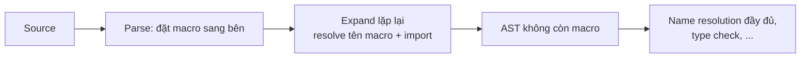

# P9 · Chương 07 — Macro

## Bạn sẽ hiểu được gì

1. **Q1.** Vì sao Rust có macro khi đã có hàm, generic và trait; macro làm được gì mà hàm không làm được? → mục 1
2. **Q2.** `macro_rules!` hoạt động thế nào: matcher, fragment specifier (`expr`, `ident`, `ty`, `tt`…), repetition `$(...)*`? → mục 2
3. **Q3.** "Hygiene" nghĩa là gì; `$crate`, `#[macro_export]` và thứ tự định nghĩa (textual scope) quyết định macro nào gọi được ở đâu? → mục 3
4. **Q4.** Ba loại procedural macro khác nhau ra sao; vì sao phải nằm trong crate riêng? → mục 4
5. **Q5.** `syn` và `quote` làm gì trong một derive macro; một derive macro nhỏ chạy thật trông thế nào? → mục 5
6. **Q6.** Macro được expand ở giai đoạn nào của compiler, và xem code sau khi expand bằng cách nào? → mục 6
7. **Q7.** `vec!`, `println!`, `#[derive(Debug)]`, `#[tokio::main]` thực chất làm gì? → mục 7
8. **Q8.** serde derive và sqlx `query!` làm gì, và cái giá phải trả của macro là gì? → mục 8

## Kiến thức cần trước

Chương này đứng độc lập về cú pháp, nhưng bạn nên quen với trait và generic: xem [02-trait](02-trait.md) và [03-generics-nang-cao](03-generics-nang-cao.md), cùng phase P9. Phần "macro expand ở đâu trong pipeline compiler" chỉ nêu mức đủ dùng; chi tiết ở chương pipeline rustc, P10·01 (`docs/10-rust-internals/01-…`, viết sau).

Ví dụ xuyên suốt là `orders`, một service Rust nhận đơn hàng qua HTTP rồi lưu vào Postgres. Đây là ví dụ giả định của người soạn, không phải code trong repo. Mỗi mục mở đầu bằng việc `orders` cần gì ở macro, còn các đoạn code chạy thật thì giữ dạng ngắn nhất để minh họa cơ chế.

Mọi ví dụ trong chương được chạy thật với `rustc`/`cargo` 1.95.0 trên macOS (aarch64). Phần xem code đã expand dùng `cargo expand` 1.0.118, vốn cần nightly (nightly đã có trên máy).

## 1. Vì sao Rust cần macro (Q1)

> **Trả lời ngắn.** Hàm Rust phải khai báo trước số lượng và kiểu tham số[^book-fn-sig]. Macro thì nhận được số tham số thay đổi[^book-variadic]. Macro cũng được expand trước khi compiler hiểu nghĩa của code, nên nó implement được trait cho một kiểu[^book-expand-before]. Hàm không làm được việc này, vì hàm chạy lúc runtime còn trait phải implement lúc compile[^book-fn-runtime]. Cuối cùng, macro là cách viết code sinh ra code khác (metaprogramming), nhờ vậy bạn viết một lần thay cho nhiều đoạn code lặp[^book-meta].

**Giải thích.**

*Với service `orders`.* Mở code của `orders` ra là gặp macro ngay: `println!("served order {}", id)` trong handler, `#[derive(Debug)]` trên mỗi struct, `#[tokio::main]` trên `main`. Ta sẽ tự hỏi: vì sao những thứ này là macro mà không phải hàm, và khi nào đáng tự viết macro cho `orders`? Mục này trả lời câu thứ nhất bằng ba điều hàm không làm được.

### 1.1 Số tham số thay đổi

Handler của `orders` lúc thì in `println!("started")` với một đối số, lúc thì `println!("served order {} in {} ms", id, ms)` với ba đối số. Hàm không viết được như vậy, vì chữ ký hàm phải khai báo số lượng và kiểu tham số[^book-fn-sig]. Macro thì khác: `println!("hello")` nhận một đối số, `println!("hello {}", name)` nhận hai[^book-variadic]. Đó là lý do `println!` là macro (suy luận của người soạn từ ví dụ của Book).

### 1.2 Sinh item, không chỉ giá trị

`orders` có ba kiểu id là `OrderId`, `CustomerId` và `ProductId`, và cả ba cần cùng một `impl`. Hàm không giúp được ở đây: hàm chạy lúc runtime, còn trait phải được implement lúc compile[^book-fn-runtime]. Macro làm được vì nó expand trước khi compiler diễn giải nghĩa của code[^book-expand-before]. Nói cách khác, macro sinh được *item* (struct, impl, fn) chứ không chỉ sinh giá trị (suy luận của người soạn).

### 1.3 Viết một lần, dùng nhiều lần

Với ba kiểu id kia, thay vì copy-paste `impl` ba lần, bạn viết một macro rồi gọi nó ba lần (ví dụ minh họa của người soạn, chưa chạy). Đó chính là ý của metaprogramming: code sinh ra code khác[^book-meta].

<details><summary>Đi sâu: hai họ macro và bảng so sánh</summary>

Book chia macro thành hai họ: declarative macro (`macro_rules!`) và ba loại procedural macro, gồm custom `#[derive]`, attribute-like và function-like[^book-three-kinds].

| | `macro_rules!` (declarative) | Procedural |
|---|---|---|
| Cách viết | Các luật `matcher => transcriber`, giống `match` | Một hàm Rust nhận và trả `TokenStream` |
| Nơi định nghĩa | Cùng crate được | Phải trong crate riêng kiểu `proc-macro` |
| Sức mạnh | Pattern-matching trên token | Chạy code Rust tùy ý trên token |
| Phụ thuộc ngoài | Không | Thường `syn` + `quote` |

</details>

**Quay lại Q1:** hàm cố định chữ ký và chạy lúc runtime; macro sinh code lúc compile nên linh hoạt hơn về số tham số và về thứ sinh ra. Với `orders`, đó là lý do `println!` nhận số đối số tùy ý và một macro có thể phát ra `impl` cho cả ba kiểu id.

## 2. `macro_rules!`: matcher, fragment, repetition (Q2)

> **Trả lời ngắn.** Một macro `macro_rules!` là danh sách luật. Mỗi luật có một matcher, khuôn để khớp đầu vào, và một transcriber, khuôn để sinh code; compiler thử lần lượt từ trên xuống rồi dùng luật khớp đầu tiên[^ref-transcribe]. Trong matcher, `$tên:loại` bắt một mảnh cú pháp thuộc đúng *loại* đó (biểu thức, định danh, kiểu…) và gán vào tên[^ref-metavar]. Muốn bắt nhiều mảnh cùng dạng thì dùng lặp `$( ... ),*`[^ref-repetition-sep].

**Giải thích.**

*Với service `orders`.* Giả sử `orders` gọi ba service phía sau (kho, thanh toán, vận chuyển) và muốn biết lần gọi nào chậm nhất. Số lần gọi thay đổi, nên một hàm hai tham số không đủ; đây là việc `macro_rules!` làm được gọn. Mục này đi từ một macro nhỏ như vậy tới ba mảnh ghép: luật, loại mảnh cú pháp và lặp. (Để ví dụ ngắn, ta tìm số lớn nhất trong vài số nguyên chứ không dùng latency thật.)

### 2.1 Luật và đệ quy: `maxm!`

```rust
macro_rules! maxm {
    ($x:expr) => ($x);
    ($x:expr, $($rest:expr),+) => {{
        let a = $x;
        let b = maxm!($($rest),+);
        if a > b { a } else { b }
    }};
}
fn main() { println!("{}", maxm!(3, 9, 4)); }
```

Chạy thật: in `9`. Macro có hai luật. Luật 1 xử lý đúng một biểu thức. Luật 2 lấy biểu thức đầu, rồi gọi lại chính macro với phần còn lại, cho tới khi chỉ còn một biểu thức thì luật 1 dừng đệ quy. Macro đệ quy được vì tên macro được tra từ nơi gọi[^ref-textual-scope].

### 2.2 Loại mảnh cú pháp (fragment specifier)

Trong matcher, `$name:fragment` khớp một mảnh cú pháp thuộc loại `fragment` và gán nó vào metavariable `$name`[^ref-metavar]. Reference còn liệt kê `block`, `item`, `lifetime`, `literal`, `meta`, `pat`, `path`, `stmt`, `vis`… ngoài bốn loại hay gặp nhất dưới đây[^ref-fragspec-list].

| Specifier | Khớp | Theo Reference |
|---|---|---|
| `expr` | một biểu thức | một Expression[^ref-expr] |
| `ident` | một định danh | định danh hoặc từ khóa, trừ `_`, raw identifier và `$crate`[^ref-ident] |
| `ty` | một kiểu | một Type[^ref-ty] |
| `tt` | một token tree | một token đơn, hoặc các token nằm trong cặp ngoặc khớp nhau `()`, `[]`, `{}`[^ref-tt] |

Vì `tt` khớp được cả một cụm token trong ngoặc mà không cần hiểu nghĩa, nó hay được dùng để chuyển tiếp nguyên xi token cho macro khác (nhận xét của người soạn).

### 2.3 Sinh tên hàm từ đối số

Cặp `ident` và `ty` cho phép macro *tạo* hàm:

```rust
macro_rules! make_fn {
    ($name:ident, $t:ty, $v:expr) => { fn $name() -> $t { $v } };
}
make_fn!(answer, u32, 42);
fn main() { println!("{}", answer()); }   // in 42
```

(Chạy thật: in `42`.) Đây là điều hàm không làm được: tên hàm `answer` sinh ra từ đối số. Trong `orders`, cùng kiểu macro này có thể sinh hàng loạt hàm kiểu `default_port()` hay `default_timeout()` từ một danh sách (ví dụ minh họa của người soạn, chưa chạy).

### 2.4 Lặp

Để bắt nhiều mảnh cùng dạng, bạn viết `$( ... )` rồi thêm toán tử lặp, có thể kèm dấu phân cách. Chẳng hạn `$( $i:ident ),*` biểu diễn một số lượng bất kỳ định danh ngăn cách bằng dấu phẩy[^ref-repetition-sep]. Có ba toán tử:

- `*`: không hoặc nhiều lần.
- `+`: một hoặc nhiều lần[^ref-plus].
- `?`: một mảnh tùy chọn, xuất hiện không hoặc một lần[^ref-opt].

`maxm!` ở trên đã dùng `$($rest:expr),+` để bắt phần đuôi gồm một hoặc nhiều biểu thức.

<details><summary>Đi sâu: ràng buộc số lần lặp, ví dụ <code>hashmap!</code>, khác biệt edition 2024</summary>

Reference đặt một ràng buộc: metavariable phải xuất hiện trong transcriber với đúng số lượng, loại và độ lồng của lặp như trong matcher[^ref-rep-rules]. Ví dụ cụ thể là `hashmap!`, thứ `orders` có thể dùng để dựng bảng header hay bảng route (ví dụ minh họa của người soạn):

```rust
macro_rules! hashmap {
    ($($k:expr => $v:expr),* $(,)?) => {{
        let mut m = ::std::collections::HashMap::new();
        $( m.insert($k, $v); )*
        m
    }};
}
fn main() {
    let m = hashmap!{"a" => 1, "b" => 2,};
    println!("{}", m.len());   // in 2
}
```

Chạy thật: in `2`. Dấu `,` cuối được chấp nhận nhờ `$(,)?`. Cũng để ý đường dẫn đầy đủ `::std::collections::HashMap` trong transcriber. Macro sẽ chạy ở nơi người dùng có thể đã `use` một thứ khác tên `HashMap`, nên đường dẫn tuyệt đối là thói quen an toàn (nhận xét của người soạn). Với macro export ra crate khác thì việc này giải bằng `$crate` (mục 3).

Một lưu ý về phiên bản: trước edition 2024, `expr` không khớp `_` và const block ở cấp cao nhất[^ref-expr2024]. Nếu macro của bạn dùng `expr` mà hành xử khác nhau giữa các edition thì đây là chỗ cần kiểm tra.

</details>

**Quay lại Q2:** luật gồm matcher và transcriber, thử từ trên xuống; fragment specifier định loại mảnh bắt được; `$(...)sep op` bắt nhiều mảnh. Với `orders`, `maxm!(a, b, c)` đệ quy qua số đối số tùy ý, còn `make_fn!` sinh cả tên hàm.

## 3. Hygiene, `$crate`, `#[macro_export]` và textual scope (Q3)

> **Trả lời ngắn.** Hygiene của `macro_rules!` giữ biến cục bộ và nhãn (label) bên trong macro tách khỏi của người gọi; các tên còn lại như hàm, kiểu, trait vẫn tra tại nơi gọi[^ref-hygiene]. Vì vậy macro của thư viện dùng `$crate` để trỏ về crate hiện tại[^ref-dollar-crate]. Việc macro gọi được ở đâu thì do hai thứ quyết định. Thứ nhất, `#[macro_export]` đổi visibility ngầm định của macro từ `pub(crate)` sang `pub`[^ref-macro-export]. Thứ hai, `macro_rules!` chỉ dùng được từ sau chỗ định nghĩa trở đi[^ref-textual-scope].

**Giải thích.**

*Với service `orders`.* Giả sử `orders` có một macro bọc biểu thức của handler và tự khai báo một biến tạm bên trong. Nếu biến tạm đó trùng tên với biến trong handler thì sao? Và nếu macro nằm ở crate `orders_core` còn handler ở crate khác, các tên trong thân macro tra vào đâu? Mục này trả lời hai câu đó, rồi nói tới chuyện thứ tự: gọi macro trước chỗ định nghĩa thì lỗi.

### 3.1 Hygiene: biến trong macro không đụng biến ngoài

Reference gọi đây là hygiene kiểu "mixed-site": nhãn vòng lặp, nhãn block và biến cục bộ được tra tại nơi định nghĩa macro, còn mọi ký hiệu khác tra tại nơi gọi[^ref-hygiene]. Nghĩa là biến cục bộ `x` mà macro khai báo *không* trùng với `x` của người gọi.

```rust
macro_rules! hyg {
    ($e:expr) => {{ let x = 100; $e + x }};
}
fn main() {
    let x = 1;
    println!("{}", hyg!(x * 2));
}
```

Chạy thật: in `102`. Biểu thức `x * 2` của người gọi dùng `x = 1` của người gọi, cho 2. Còn `x` trong `$e + x` là `x = 100` do macro khai báo, nên kết quả là 2 + 100 = 102. Nếu macro không hygienic thì `let x = 100` sẽ che `x` của người gọi và kết quả là 300 (suy luận số học của người soạn, chưa chạy thử).

Chiều ngược lại cũng đúng: biến `let` bên trong macro không rò ra ngoài.

```rust
macro_rules! bad { () => { let x = 100; } }
fn main() { bad!(); println!("{}", x); }
```

Chạy thật, compile lỗi `E0425: cannot find value 'x' in this scope`, kèm gợi ý "an identifier with the same name is defined here, but is not accessible due to macro hygiene". Muốn macro tạo biến cho người gọi thấy, tên phải do người gọi truyền vào dưới dạng `ident`:

```rust
macro_rules! show_ident { ($i:ident) => { let $i = 5; }; }
fn main() { show_ident!(z); println!("{}", z); }   // in 5
```

(Chạy thật: in `5`.) Hygiene của `macro_rules!` chỉ che biến cục bộ và label. Mọi ký hiệu khác, kể cả tên hàm, kiểu và trait, vẫn tra tại nơi gọi[^ref-hygiene]. Đó là lý do cần `$crate`.

### 3.2 `$crate` và `#[macro_export]`

Từ khóa metavariable `$crate` trỏ tới crate hiện tại[^ref-dollar-crate]. Trong macro của thư viện, bạn viết `$crate::path::item` để trỏ tới item của crate chứa định nghĩa macro, nên dù người dùng gọi macro từ crate nào thì tên vẫn tra đúng chỗ (cách dùng điển hình, nhận xét của người soạn; Reference chỉ nêu `$crate` trỏ tới crate hiện tại).

Về visibility, macro mặc định là `pub(crate)`, và `#[macro_export]` đổi nó thành `pub`[^ref-macro-export]. Ví dụ trong một crate:

```rust
mod inner {
    #[macro_export]
    macro_rules! helper_pub { () => { $crate::inner::f() }; }
    pub fn f() -> i32 { 7 }
}
fn main() { println!("{}", helper_pub!()); }   // in 7
```

Chạy thật: in `7`. Dù `helper_pub` nằm trong `mod inner`, `#[macro_export]` đưa nó ra gốc crate để các crate khác gọi theo đường dẫn[^ref-macro-export-root]. Vì thế dependency gọi là `tên_crate::helper_pub!()` (suy luận của người soạn từ câu đó), còn `$crate::inner::f()` vẫn trỏ đúng vị trí thật của `f`.

### 3.3 Thứ tự định nghĩa: textual scope

Macro-by-example có hai dạng scope là textual và path-based. Textual scope dựa trên thứ tự các thứ xuất hiện trong file nguồn, và là scope mặc định[^ref-scope-two]. Với `macro_rules!`, macro vào scope từ sau chỗ định nghĩa, cho tới khi scope bao quanh (thường là module) đóng lại[^ref-textual-scope]. Khi bạn gọi bằng tên trơn, compiler tra textual scope trước, không có mới tra path-based[^ref-lookup-order].

Hệ quả thực tế: gọi macro *trước* chỗ định nghĩa thì lỗi.

```rust
fn main(){ early!(); }
macro_rules! early { () => {} }
```

Chạy thật, compile lỗi: `cannot find macro 'early' in this scope`, với gợi ý "consider moving the definition of 'early' before this call". Khác với `fn`, thứ tự khai báo macro quan trọng.

<details><summary>Đi sâu: <code>#[macro_use]</code> và re-export</summary>

Muốn macro vượt ranh giới module thì có `#[macro_use]`. Đặt trên module, nó mở rộng scope của các macro định nghĩa bên trong ra ngoài module; đặt trên `extern crate`, nó nhập macro của crate khác vào `macro_use` prelude[^ref-macro-use]. Cách khác là `#[macro_export]` rồi `use crate::tên_macro;` hoặc gọi theo đường dẫn, thường gọn hơn (nhận xét của người soạn). Reference cũng nói macro có thể được re-export để có path-based scope từ module khác ngoài gốc crate[^ref-reexport].

</details>

**Quay lại Q3:** hygiene chỉ che biến cục bộ và nhãn; tên còn lại tra tại nơi gọi nên macro thư viện cần `$crate`; macro dùng được từ sau chỗ định nghĩa, hoặc qua đường dẫn nếu có `#[macro_export]`. Với `orders`, biến tạm trong macro không đè biến của handler, và macro đặt ở `orders_core` vẫn tìm đúng hàm của crate đó.

## 4. Procedural macro: ba loại và crate riêng (Q4)

> **Trả lời ngắn.** Procedural macro là một hàm Rust chạy ngay lúc compile[^ref-proc-run]. Nó làm việc trên dãy token (`TokenStream`) chứ không trên AST[^ref-tokenstream]. Có ba loại là derive, attribute và function-like[^book-three-kinds]. Hàm phải nằm ở gốc một crate kiểu `proc-macro` và không dùng được ngay trong crate định nghĩa nó[^ref-proc-root].

**Giải thích.**

*Với service `orders`.* `macro_rules!` chỉ khớp mẫu trên token. Khi `orders` cần nhiều hơn, chẳng hạn đọc danh sách field của một struct rồi sinh code theo từng field, bạn phải viết procedural macro: một hàm Rust thật sự chạy trong compiler, nhận token của struct và trả token của code mới. Cái giá là cấu trúc dự án đổi đi. Mục này nói ba loại macro đó là gì và vì sao chúng đòi một crate riêng.

### 4.1 Hàm trên TokenStream, ba loại

Khác với việc khớp mẫu, procedural macro nhận và trả `TokenStream`[^ref-tokenstream]. Ba loại custom derive, attribute-like và function-like hoạt động theo cách tương tự nhau[^book-three-kinds]. Khác biệt nằm ở chỗ chúng được gọi thế nào và nhận gì:

| Loại | Cách dùng | Hàm nhận / trả |
|---|---|---|
| Function-like | `my_macro!(...)` | Nhận nội dung trong ngoặc, thay toàn bộ lời gọi bằng kết quả[^ref-fnlike] |
| Derive | `#[derive(MyTrait)]` | Nhận token của struct/enum/union, có thể phát ra item mới đặt sau nó[^ref-derive] |
| Attribute | `#[my_attr(...)]` trên item | Tham số 1 là token trong ngoặc của attribute; tham số 2 là phần còn lại của item, kể cả các attribute khác trên item[^ref-attr-second] |

Để ý hai dòng cuối. Derive không *thay thế* item gốc mà chỉ thêm item mới sau nó[^ref-derive]. Reference nói syntax trả về sẽ thay thế hoặc thêm, tùy loại macro[^ref-proc-result]. Nên attribute macro, nhận cả item, trả về thứ thay cho item đó (suy luận của người soạn từ hai tham số và câu trên).

### 4.2 Vì sao phải ở crate riêng

Book chỉ nói định nghĩa của procedural macro phải nằm trong crate riêng, với một crate type đặc biệt[^book-own-crate]. Reference nói cụ thể hơn: procedural macro phải định nghĩa ở gốc crate có crate type `proc-macro`; chúng không dùng được trong chính crate định nghĩa, chỉ dùng được khi import vào crate khác[^ref-proc-root]. Với Cargo, bạn khai báo trong `Cargo.toml`:

```toml
[lib]
proc-macro = true
```

Reference nói đây là cách Cargo định nghĩa crate procedural macro[^ref-proc-cargo].

Hệ quả cho `orders`: một dự án có derive macro riêng thường thành workspace hai crate, kiểu `orders` và `orders_derive` (nhận xét của người soạn, theo cấu trúc của ví dụ ở mục 5 và của Book).

<details><summary>Đi sâu: <code>TokenStream</code>, <code>Span</code> và hygiene của procedural macro</summary>

Procedural macro làm việc trên `TokenStream` chứ không phải AST. Reference giải thích đây là giao diện ổn định hơn nhiều theo thời gian, cho cả compiler lẫn procedural macro[^ref-tokenstream]. Mỗi token mang một `Span`, tức vị trí trong mã nguồn, dùng chủ yếu cho báo lỗi[^ref-span].

Hygiene của procedural macro *khác* `macro_rules!`: nó không hygienic, tức hành xử như thể token đầu ra được viết thẳng vào chỗ gọi[^ref-proc-hygiene]. Vì vậy một macro sinh `let tmp = ...` có thể đụng biến của người dùng. Docs của `quote` nhắc `quote_spanned!` là quan trọng để viết procedural macro hygienic[^quote-spanned]; hướng dẫn chi tiết nằm ở docs của chúng.

</details>

**Quay lại Q4:** procedural macro là hàm Rust chạy trong compiler trên `TokenStream`, có ba loại, và bắt buộc ở crate `proc-macro` riêng. Với `orders`, đó là lý do một derive macro đòi thêm một crate vào workspace.

## 5. `syn`, `quote` và một derive macro chạy thật (Q5)

> **Trả lời ngắn.** `syn` đọc dãy token đầu vào thành cây cú pháp có cấu trúc; với derive, đầu vào là kiểu `DeriveInput`[^syn-deriveinput]. `quote!` cho bạn viết code mẫu rồi chèn biến vào bằng `#var` để sinh dãy token đầu ra[^quote-interp]. Ví dụ `FieldNames` bên dưới ghép hai thứ đó thành một derive macro nhỏ.

**Giải thích.**

*Với service `orders`.* Giả sử `orders` muốn có sẵn danh sách tên field của struct `User` để dựng câu `SELECT id, email FROM users` mà khỏi gõ tay hai lần (ví dụ minh họa của người soạn). Viết tay thì dễ lệch khi thêm field. Một derive macro đọc struct và sinh danh sách đó thì không lệch. Mục này dựng đúng macro ấy, từng bước.

### 5.1 Ba crate đi cùng nhau

Ba crate này hay xuất hiện cùng nhau. Phiên bản dùng trong ví dụ dưới, theo `Cargo.lock` thật: `syn 2.0.119`, `quote 1.0.47`, `proc-macro2 1.0.107`.

- **`syn`** parse `TokenStream` thành cây cú pháp. Docs nói Syn cung cấp một cây cú pháp đầy đủ, biểu diễn được mọi mã Rust hợp lệ[^syn-tree]. Với derive, kiểu cần chú ý là `syn::DeriveInput`, đại diện cho một trong ba loại item hợp lệ làm đầu vào của derive macro[^syn-deriveinput]. Các tính năng của `syn` bị feature-gate rất chặt, để macro không phải trả thời gian compile cho phần mình không dùng[^syn-features].
- **`quote`** sinh token. Ý tưởng của quasi-quoting là viết code rồi coi nó như dữ liệu[^quote-idea]. Trong `quote!`, cú pháp `#var` chèn một biến (tính lúc chạy macro) vào dãy token được trích[^quote-interp].
- **`proc-macro2`** bọc API `proc_macro` của compiler. Lý do là kiểu của `proc_macro` chỉ tồn tại trong procedural macro, còn kiểu `proc_macro2` có thể tồn tại ở mọi nơi[^pm2]. Docs của nó nói nhờ vậy helper library test được độc lập[^pm2-test].

### 5.2 `FieldNames`: macro chạy thật

Mục tiêu: `#[derive(FieldNames)]` thêm hằng `FIELD_NAMES: &[&str]` liệt kê tên field của struct.

Crate `mymac_derive/Cargo.toml`:

```toml
[package]
name = "mymac_derive"
version = "0.1.0"
edition = "2024"
[lib]
proc-macro = true
[dependencies]
syn = "2"
quote = "1"
```

`mymac_derive/src/lib.rs`:

```rust
use proc_macro::TokenStream;
use quote::quote;
use syn::{parse_macro_input, Data, DeriveInput, Fields};

#[proc_macro_derive(FieldNames)]
pub fn field_names(input: TokenStream) -> TokenStream {
    let ast = parse_macro_input!(input as DeriveInput);
    let name = &ast.ident;
    let (ig, tg, wc) = ast.generics.split_for_impl();
    let names: Vec<String> = match &ast.data {
        Data::Struct(s) => match &s.fields {
            Fields::Named(f) => f.named.iter()
                .map(|x| x.ident.as_ref().unwrap().to_string()).collect(),
            _ => return syn::Error::new_spanned(&ast.ident,
                "FieldNames chi ho tro struct co ten truong")
                .to_compile_error().into(),
        },
        _ => return syn::Error::new_spanned(&ast.ident,
            "FieldNames chi ho tro struct").to_compile_error().into(),
    };
    quote! {
        impl #ig #name #tg #wc {
            pub const FIELD_NAMES: &'static [&'static str] = &[#(#names),*];
        }
    }.into()
}
```

Crate `app` (có `mymac_derive = { path = "../mymac_derive" }` trong dependencies):

```rust
use mymac_derive::FieldNames;

#[derive(FieldNames)]
struct User { id: u64, email: String }

fn main() { println!("{:?}", User::FIELD_NAMES); }
```

Chạy `cargo run` thật: in `["id", "email"]` (kèm cảnh báo `dead_code` vì hai field không được đọc, không liên quan macro).

Hàm làm bốn việc theo thứ tự:

1. `parse_macro_input!` parse `TokenStream` đầu vào thành `DeriveInput`. Nếu token không parse được, nó kích hoạt lỗi biên dịch[^syn-parse-input].
2. Lấy `ident` (tên kiểu) và `generics.split_for_impl()` để `impl` đúng cả với kiểu generic.
3. Duyệt `Data::Struct` rồi `Fields::Named` để lấy tên field. Các trường hợp khác trả về `compile_error!` gắn `Span` của tên kiểu.
4. `quote!` dựng `impl`. `#(#names),*` lặp qua `Vec<String>` và phân cách bằng dấu phẩy, cùng ý tưởng với `$(...),*` của `macro_rules!` nhưng dùng `#`.

<details><summary>Đi sâu: lỗi do chính macro báo ra và <code>Span</code></summary>

Đây là lỗi do chính macro báo ra, khi áp dụng vào `enum E { A }` (chạy thật):

```text
error: FieldNames chi ho tro struct
 --> src/main.rs:3:6
  |
3 | enum E { A }
  |      ^
```

Dấu `^` nằm đúng tên `E` vì ta truyền `ast.ident` làm span. Syn docs nói API dựa trên token cho khả năng kiểm soát tốt nơi thông báo lỗi của compiler hiện ra trong code người dùng[^syn-errors]. Nếu quên span, lỗi sẽ trỏ vào dòng `#[derive(...)]`, khó đoán hơn (suy luận của người soạn, chưa chạy thử riêng).

</details>

**Quay lại Q5:** `syn` parse thành `DeriveInput`, `quote!` sinh `impl`; gắn `Span` đúng thì lỗi trỏ đúng chỗ. Với `orders`, `#[derive(FieldNames)]` trên `User` cho sẵn danh sách `["id", "email"]` và danh sách đó đổi theo struct.

## 6. Expand ở đâu và xem code đã expand (Q6)

> **Trả lời ngắn.** Parser đặt nội dung macro sang một bên, rồi compiler lặp việc expand cho tới khi cây cú pháp (AST) không còn macro[^rdg-parse]. Lúc đó crate có một AST hoàn chỉnh, không còn macro chưa expand (hoặc đã có lỗi compile)[^rdg-ast]. Để xem kết quả, chạy `cargo expand` (cần nightly)[^cargo-expand].

**Giải thích.**

*Với service `orders`.* Khi `orders` build lỗi trong một đoạn có `derive` hay macro tự viết, thứ compiler báo lỗi là code *sau khi expand*, không phải dòng bạn gõ. Muốn debug thì bạn cần biết hai điều: macro được expand ở bước nào của compiler, và làm sao nhìn được code đã expand.

### 6.1 Expand xảy ra ở giai đoạn nào

Mục này theo rustc-dev-guide, một tài liệu sống nên không ghim phiên bản và có thể đổi. Trong giai đoạn parsing, parser thông thường của Rust đặt nội dung macro và các lời gọi macro sang một bên; sau đó macro được expand dựa trên những phần mã đó[^rdg-parse]. Compiler lặp việc expand cho tới khi có AST hoàn chỉnh cho crate, không còn macro chưa expand (hoặc đã có lỗi compile)[^rdg-ast]. Thuật toán này cần phân giải import và tên macro[^rdg-resolve].

### 6.2 Xem code đã expand

`cargo expand` in kết quả macro expansion (kể cả `#[derive]`) của crate hiện tại. Nó cần nightly vì dựa vào các cờ compiler chưa ổn định[^cargo-expand]. Cài bằng `cargo install cargo-expand`. Chạy trên `app` ở mục 5 (chạy thật, 1.0.118 với nightly):

```rust
struct User { id: u64, email: String }
impl User {
    pub const FIELD_NAMES: &'static [&'static str] = &["id", "email"];
}
fn main() {
    {
        ::std::io::_print(format_args!("{0:?}\n", User::FIELD_NAMES));
    };
}
```

Kết quả cho thấy hai điều. `#[derive(FieldNames)]` đã biến mất và thay bằng `impl` của ta. `println!` đã expand thành `::std::io::_print(format_args!(...))`.

Về cách lệnh này làm việc, README của cargo-expand cho biết nó bọc một lệnh dài hơn[^cargo-expand-wrap]. Lệnh đó dùng `-Zunpretty=expanded` của rustc[^cargo-expand-unpretty]. Vì `-Z` là cờ không ổn định nên định dạng đầu ra có thể đổi theo bản nightly; đừng coi nó là hợp đồng (nhận xét của người soạn).

<details><summary>Đi sâu: sơ đồ vị trí của expand, vì sao macro không biết kiểu, macro lồng nhau</summary>

Sơ đồ dưới tóm tắt vị trí của expand trong dòng chảy (nhận xét của người soạn, dựa vào các câu ở trên, mức khái quát):



Vì sao macro không biết kiểu? Vì lúc expand chưa có type check, macro chỉ thấy token. Do đó `$x:ty` chỉ cho bạn *chữ* `u32`, không cho bạn biết `u32` implement trait nào (suy luận của người soạn từ thứ tự trên). Pipeline đầy đủ ở P10·01.

Vì expand lặp, một macro có thể sinh lời gọi macro khác. Reference minh họa: macro ngoài `example` được expand trước, rồi macro trong `println` mới được expand[^ref-nested]. Thứ tự này có hệ quả khi bạn truyền `$e:expr` chứa macro vào trong macro khác.

</details>

**Quay lại Q6:** expand diễn ra sau parse và lặp đến hết macro; `cargo expand` cho thấy kết quả nhưng định dạng không phải hợp đồng. Với `orders`, nó cho bạn thấy `derive` và `println!` thực sự biến thành code gì.

## 7. Macro quen thuộc nhìn từ bên trong (Q7)

> **Trả lời ngắn.** Trang std của `vec!` hiển thị nó với chữ ký dạng `macro_rules!`[^std-vec-rules]. `println!` mở thành một lời gọi dùng `format_args!` (kết quả `cargo expand` ở mục 6), và `format_args!` tạo giá trị kiểu `fmt::Arguments`[^std-format-args]. `#[derive(Debug)]` là derive macro sinh một `impl`[^std-debug-derive]. Còn `#[tokio::main]` dựng runtime để chạy hàm async[^tokio-main].

**Giải thích.**

*Với service `orders`.* Bốn macro này đều đã có trong code của `orders`: `vec!` để dựng danh sách dòng đơn hàng, `println!` để log, `#[derive(Debug)]` trên các struct, `#[tokio::main]` trên `main`. Chúng không phải phép màu của compiler: phần lớn là macro bình thường, và `cargo expand` cho thấy chúng sinh ra gì.

### 7.1 `vec!`

Tài liệu std mô tả `vec!` là tạo một `Vec` chứa các đối số[^std-vec]. Trang đó hiện chữ ký `macro_rules! vec` với các luật như `() => ...` và `($elem:expr; $n:expr) => ...`[^std-vec-rules]. Trên nightly 2026-05-01 trên máy, `cargo expand` cho `vec![1, 2, 3]` ra một chuỗi hàm nội bộ của `alloc` (`Box::new_uninit`, `write_box_via_move`, `box_assume_init_into_vec_unsafe`). Đó là chi tiết cài đặt của std, đổi theo phiên bản, đừng dựa vào.

### 7.2 `println!` và `format_args!`

`println!` ghi ra stdout và khóa stdout mỗi lần gọi[^std-println]. Bên trong, nó dựa vào `format_args!`. Macro này khai báo trong `core` với thân `/* compiler built-in */`, nghĩa là compiler tự cài đặt[^core-format-args]. Docs std nói nó chuẩn bị tham số để đầu ra đọc được như chuỗi[^std-format-args-prep]. Kết quả là một giá trị kiểu `fmt::Arguments`[^std-format-args]. Kết quả expand ở mục 6 cho thấy `println!` mở thành lời gọi `_print` kèm `format_args!`.

### 7.3 `#[derive(Debug)]`

Std mô tả đây là derive macro sinh một `impl` của trait `Debug`[^std-debug-derive]. Expand thật (nightly 2026-05-01) cho `struct P { x: i32 }`:

```rust
#[automatically_derived]
impl ::core::fmt::Debug for P {
    #[inline]
    fn fmt(&self, f: &mut ::core::fmt::Formatter) -> ::core::fmt::Result {
        ::core::fmt::Formatter::debug_struct_field1_finish(f, "P", "x", &&self.x)
    }
}
```

Đúng điều derive làm ở mục 4: thêm một `impl` sau struct, struct gốc nguyên vẹn. Tên hàm `debug_struct_field1_finish` là chi tiết nội bộ.

<details><summary>Đi sâu: <code>#[tokio::main]</code> tương đương code nào</summary>

Docs tokio 1.52.1: macro đánh dấu một hàm async để runtime được chọn chạy, và giúp dựng runtime mà người dùng không phải dùng `Runtime` hay `Builder` trực tiếp[^tokio-main]. Docs có mục "Equivalent code not using #[tokio::main]", cho thấy đoạn sau[^tokio-equiv]:

```rust
fn main() {
    tokio::runtime::Builder::new_multi_thread()
        .enable_all()
        .build()
        .unwrap()
        .block_on(async {
            println!("Hello world");
        })
}
```

Tức là `async fn main` không tồn tại ở cấp ngôn ngữ; macro bọc thân hàm vào `block_on` trên một runtime. Docs còn lưu ý rằng dùng macro này trên hàm không phải `main` làm hàm cư xử như hàm đồng bộ, vì mỗi lần gọi nó khởi động một runtime mới[^tokio-nonmain]. (Chương này không chạy `cargo expand` cho `#[tokio::main]` và không khẳng định đầu ra cụ thể ngoài những gì docs nói.)

</details>

**Quay lại Q7:** các macro quen thuộc chỉ là code sinh sẵn: `vec!` bằng `macro_rules!`, `println!` qua `format_args!`, derive thêm `impl`, `#[tokio::main]` dựng runtime. Với `orders`, không có gì trong bốn thứ đó vượt ra ngoài những cơ chế ở mục 2 đến mục 4.

## 8. serde, sqlx và cái giá của macro (Q8)

> **Trả lời ngắn.** serde derive sinh code lúc compile thay cho reflection lúc chạy[^serde-design]. sqlx `query!` kiểm câu SQL với schema của database ngay lúc build[^sqlx-url]. Cái giá (nhận xét của người soạn) là thời gian build, lỗi khó đọc hơn, và code compiler biên dịch khác với code bạn thấy.

**Giải thích.**

*Với service `orders`.* `orders` làm hai việc với dữ liệu: parse JSON của request thành struct, và ghi struct đó vào Postgres. Cả hai đều là chỗ macro đang làm việc nặng. serde derive lo việc đầu, sqlx `query!` lo việc sau. Mục này nói mỗi cái làm gì, rồi tính tiền: bạn trả cái gì để có chúng.

### 8.1 serde derive

Thay vì runtime reflection, serde dựa vào hệ trait của Rust. Derive là cách tự sinh implementation lúc compile, nên tránh được chi phí của reflection hay thông tin kiểu lúc chạy[^serde-design]. Hai derive `Serialize` và `Deserialize` chỉ có khi bật feature `derive` của serde[^serde-feature].

Với backend engineer quen Jackson hay GORM tag dùng reflection, đây là khác biệt cốt lõi (nhận xét của người soạn): phần "reflection" diễn ra lúc compile, nên chi phí là *thời gian build*, không phải latency của request.

### 8.2 sqlx `query!`

Docs mô tả đây là truy vấn SQL được kiểm tra tĩnh, với cú pháp kiểu `println!()`[^sqlx-static]. Lúc build, biến môi trường `DATABASE_URL` phải trỏ tới một database server có schema để kiểm câu truy vấn[^sqlx-url]. Bạn có thể thay bằng thư mục `.sqlx` ở gốc workspace, gọi là "Offline Mode"[^sqlx-offline]. Bản ghim: sqlx 0.8.6.

Với `orders`, CI build vì vậy phụ thuộc vào một DB sống hoặc vào file `.sqlx` được commit và giữ đồng bộ. Điều này đáng cân nhắc trong pipeline Docker/Kubernetes (nhận xét của người soạn).

### 8.3 Chi phí và cạm bẫy

- **Thông báo lỗi.** Lỗi trong `macro_rules!` thường trỏ vào chỗ gọi hoặc luật không khớp, không phải ý định của bạn. Ví dụ `early!` ở mục 3 cho thấy compiler vẫn có gợi ý trong trường hợp đơn giản. Với procedural macro, chất lượng lỗi phụ hoàn toàn vào tác giả macro: có gắn `Span` đúng như ví dụ `FieldNames` hay không. (Nhận xét của người soạn, chỉ dựa trên hai thí nghiệm nhỏ của chương này, không phải khảo sát.)
- **Khó đọc, khó debug.** Code người đọc thấy khác code compiler biên dịch. Công cụ để nhìn là `cargo expand` (mục 6). Hãy giữ macro nhỏ, và nếu hàm hoặc generic làm được thì dùng chúng (nhận xét của người soạn).
- **Hygiene không đối xứng.** `macro_rules!` hygienic cho biến cục bộ, procedural macro thì không (mục 3 và 4).

<details><summary>Đi sâu: một lần đo thời gian compile của macro nhỏ</summary>

Procedural macro là code Rust phải được build rồi chạy trong compiler. Docs `syn` thừa nhận điều này bằng cách cho tắt bớt tính năng để macro không phải trả thời gian compile cho phần còn lại[^syn-features]. Quan sát duy nhất ở đây: build lạnh crate `mymac_derive` (syn + quote + proc-macro2, profile dev) mất khoảng 1–1,5 giây trên máy này. Đó là một lần đo của một macro nhỏ, không đại diện; hãy đo trên dự án thật của bạn bằng `cargo build --timings` (nhận xét của người soạn).

</details>

**Quay lại Q8:** serde thay reflection bằng code sinh lúc compile, sqlx kiểm SQL lúc build; cái giá là thời gian build, lỗi khó đọc và code đã expand khác code nguồn. Với `orders`, bạn đổi latency lúc chạy lấy thời gian build và một DB (hoặc `.sqlx`) trong CI.

## Tóm tắt

- Macro tồn tại vì hàm phải khai báo cố định số tham số và không implement được trait, còn macro nhận số tham số tùy ý, sinh được item và giúp bớt code lặp.
- `macro_rules!` là các luật `matcher => transcriber`, thử từ trên xuống. Fragment specifier (`expr`, `ident`, `ty`, `tt`…) định loại mảnh cú pháp; lặp bằng `$(...)sep op`.
- Hygiene của `macro_rules!` áp dụng cho biến cục bộ và label: `hyg!(x * 2)` cho 102, và biến `let` trong macro không rò ra ngoài.
- `$crate` trỏ tới crate định nghĩa. `#[macro_export]` đổi visibility sang `pub`. Macro có textual scope nên phải định nghĩa trước khi dùng.
- Procedural macro có ba loại (derive, attribute, function-like), phải ở crate `proc-macro` riêng, làm việc trên `TokenStream` và không hygienic.
- Derive macro nhỏ cần `syn` (parse `DeriveInput`) và `quote` (sinh token); lỗi nên gắn `Span` để trỏ đúng chỗ.
- Macro expand sau parse và lặp cho tới khi hết macro (rustc-dev-guide, không ghim). Xem kết quả bằng `cargo expand` (cần nightly).
- `#[tokio::main]` chỉ dựng runtime và `block_on`. serde derive thay reflection runtime bằng code sinh lúc compile. sqlx `query!` kiểm SQL với DB hoặc `.sqlx` lúc build.
- Cái giá: thời gian compile, lỗi khó đọc, code đã expand khác code bạn thấy.

## Câu hỏi tự kiểm tra

1. Nêu ba lý do chính Rust cần macro bên cạnh hàm. Với `orders`, mỗi lý do ứng với chuyện gì?

<details><summary>Đáp án</summary>

Thứ nhất, số tham số thay đổi, như `println!` trong handler[^book-variadic]. Thứ hai, sinh item hay `impl` trước khi compiler diễn giải nghĩa, như `impl` cho ba kiểu id[^book-expand-before]. Thứ ba, giảm code lặp[^book-meta]. Hai ví dụ trong `orders` là ví dụ của người soạn.

</details>

2. `$x:ident` và `$x:expr` khác nhau thế nào? Cho ví dụ dùng `ident` để *tạo tên hàm*.

<details><summary>Đáp án</summary>

`ident` khớp một định danh[^ref-ident]. `expr` khớp một biểu thức[^ref-expr]. Ví dụ `make_fn!(answer, u32, 42)` ở mục 2 sinh `fn answer() -> u32 { 42 }` và in 42.

</details>

3. Macro `hyg!(x * 2)` với `let x = 1;` ngoài macro in gì và vì sao?

<details><summary>Đáp án</summary>

In 102. Biến local trong macro được tra tại nơi định nghĩa macro, nên `let x = 100` không che `x` của người gọi[^ref-hygiene].

</details>

4. Vì sao đoạn `fn main(){ early!(); } macro_rules! early {...}` lỗi?

<details><summary>Đáp án</summary>

Vì textual scope: macro chỉ vào scope từ sau chỗ định nghĩa[^ref-textual-scope]. Chạy thật báo "cannot find macro 'early' in this scope".

</details>

5. Dùng `$crate` để làm gì?

<details><summary>Đáp án</summary>

`$crate` trỏ tới crate hiện tại[^ref-dollar-crate]. Các tên khác ngoài biến cục bộ và label được tra tại nơi gọi[^ref-hygiene]. Vì vậy macro của thư viện dùng `$crate` để trỏ về crate định nghĩa, đó là cách dùng điển hình (suy luận của người soạn).

</details>

6. Ba loại procedural macro là gì và loại nào nhận hai `TokenStream`?

<details><summary>Đáp án</summary>

Là function-like, derive và attribute[^book-three-kinds]. Attribute macro nhận hai: tham số của attribute và phần còn lại của item[^ref-attr-second].

</details>

7. Vì sao không dùng được procedural macro trong chính crate định nghĩa nó?

<details><summary>Đáp án</summary>

Reference quy định macro phải ở crate type `proc-macro` và chỉ dùng được khi import từ crate khác[^ref-proc-root]. Book cũng nói phải ở crate riêng[^book-own-crate].

</details>

8. Hai việc của `syn` và `quote` trong derive macro?

<details><summary>Đáp án</summary>

`syn` parse đầu vào thành `DeriveInput`[^syn-deriveinput]. `quote` sinh token với nội suy `#var`[^quote-interp].

</details>

9. Làm sao xem code sau khi expand, và có điều kiện gì?

<details><summary>Đáp án</summary>

Dùng `cargo expand`, cần nightly[^cargo-expand]. Đầu ra là chi tiết không ổn định.

</details>

10. Macro expand ở giai đoạn nào so với parse?

<details><summary>Đáp án</summary>

Sau parse: parser đặt macro sang bên[^rdg-parse]. Rồi compiler lặp đến khi AST hết macro[^rdg-ast]. Nguồn này không ghim phiên bản.

</details>

11. `#[tokio::main]` tương đương code nào?

<details><summary>Đáp án</summary>

Dựng `Builder::new_multi_thread().enable_all().build().unwrap().block_on(async {...})`[^tokio-equiv].

</details>

12. sqlx `query!` kiểm SQL bằng gì lúc build?

<details><summary>Đáp án</summary>

Bằng database mà `DATABASE_URL` trỏ tới[^sqlx-url]. Hoặc bằng thư mục `.sqlx`[^sqlx-offline].

</details>

## Đọc thêm

- [Rust Book 1.95.0, ch20.5 Macros](https://doc.rust-lang.org/1.95.0/book/ch20-05-macros.html) — ví dụ `hello_macro` và `vec!` từng bước.
- [Reference 1.95.0, Macros By Example](https://doc.rust-lang.org/1.95.0/reference/macros-by-example.html) — định nghĩa chính xác về fragment, repetition, hygiene, scope.
- [Reference 1.95.0, Procedural Macros](https://doc.rust-lang.org/1.95.0/reference/procedural-macros.html) — chữ ký chính xác của ba loại, helper attribute.
- [syn 2.0.119](https://docs.rs/syn/2.0.119/syn/) — ví dụ derive đầy đủ kèm báo lỗi có `Span`.
- [quote 1.0.47](https://docs.rs/quote/1.0.47/quote/) — cú pháp `#var`, `#(...)*`, `quote_spanned!`.
- [rustc-dev-guide, Macro expansion](https://rustc-dev-guide.rust-lang.org/macro-expansion.html) — thuật toán expand (không ghim); chi tiết ở P10·01.
- [The Little Book of Rust Macros](https://veykril.github.io/tlborm/) — kỹ thuật `macro_rules!` nâng cao (không ghim, bổ trợ).

[^book-variadic]: Rust Book 1.95.0, ch20.5 — <https://doc.rust-lang.org/1.95.0/book/ch20-05-macros.html> — "Macros, on the other hand, can take a variable number of parameters"
[^book-expand-before]: Rust Book 1.95.0, ch20.5 — <https://doc.rust-lang.org/1.95.0/book/ch20-05-macros.html> — "macros are expanded before the compiler interprets the meaning of the code, so a macro can, for example, implement a trait on a given type."
[^book-meta]: Rust Book 1.95.0, ch20.5 — <https://doc.rust-lang.org/1.95.0/book/ch20-05-macros.html> — "Fundamentally, macros are a way of writing code that writes other code, which is known as metaprogramming."
[^book-three-kinds]: Rust Book 1.95.0, ch20.5 — <https://doc.rust-lang.org/1.95.0/book/ch20-05-macros.html> — "The three kinds of procedural macros are custom derive, attribute-like, and function-like, and all work in a similar fashion."
[^book-own-crate]: Rust Book 1.95.0, ch20.5 — <https://doc.rust-lang.org/1.95.0/book/ch20-05-macros.html> — "the definitions must reside in their own crate with a special crate type."
[^ref-metavar]: Rust Reference 1.95.0, Macros By Example — <https://doc.rust-lang.org/1.95.0/reference/macros-by-example.html> — "In the matcher, $ name : fragment-specifier matches a Rust syntax fragment of the kind specified and binds it to the metavariable $name."
[^ref-fragspec-list]: Rust Reference 1.95.0, Macros By Example — <https://doc.rust-lang.org/1.95.0/reference/macros-by-example.html> — "block: a BlockExpression expr: an Expression"
[^ref-expr]: Rust Reference 1.95.0, Macros By Example — <https://doc.rust-lang.org/1.95.0/reference/macros-by-example.html> — "expr: an Expression expr_2021: an Expression except UnderscoreExpression and ConstBlockExpression"
[^ref-ident]: Rust Reference 1.95.0, Macros By Example — <https://doc.rust-lang.org/1.95.0/reference/macros-by-example.html> — "ident: an IDENTIFIER_OR_KEYWORD except _, RAW_IDENTIFIER, or $crate"
[^ref-ty]: Rust Reference 1.95.0, Macros By Example — <https://doc.rust-lang.org/1.95.0/reference/macros-by-example.html> — "tt: a TokenTree (a single token or tokens in matching delimiters (), [], or {}) ty: a Type"
[^ref-tt]: Rust Reference 1.95.0, Macros By Example — <https://doc.rust-lang.org/1.95.0/reference/macros-by-example.html> — "tt: a TokenTree (a single token or tokens in matching delimiters (), [], or {})"
[^ref-expr2024]: Rust Reference 1.95.0, Macros By Example — <https://doc.rust-lang.org/1.95.0/reference/macros-by-example.html> — "Before the 2024 edition, expr fragment specifiers do not match UnderscoreExpression or ConstBlockExpression at the top level."
[^ref-repetition-sep]: Rust Reference 1.95.0, Macros By Example — <https://doc.rust-lang.org/1.95.0/reference/macros-by-example.html> — "For instance, $( $i:ident ),* represents any number of identifiers separated by commas."
[^ref-plus]: Rust Reference 1.95.0, Macros By Example — <https://doc.rust-lang.org/1.95.0/reference/macros-by-example.html> — "+ — indicates any number but at least one."
[^ref-opt]: Rust Reference 1.95.0, Macros By Example — <https://doc.rust-lang.org/1.95.0/reference/macros-by-example.html> — "? — indicates an optional fragment with zero or one occurrence."
[^ref-rep-rules]: Rust Reference 1.95.0, Macros By Example — <https://doc.rust-lang.org/1.95.0/reference/macros-by-example.html> — "A metavariable must appear in exactly the same number, kind, and nesting order of repetitions in the transcriber as it did in the matcher."
[^ref-hygiene]: Rust Reference 1.95.0, Macros By Example — <https://doc.rust-lang.org/1.95.0/reference/macros-by-example.html> — "Macros by example have mixed-site hygiene. This means that loop labels, block labels, and local variables are looked up at the macro definition site while other symbols are looked up at the macro invocation site."
[^ref-dollar-crate]: Rust Reference 1.95.0, Macros By Example — <https://doc.rust-lang.org/1.95.0/reference/macros-by-example.html> — "The keyword metavariable $crate can be used to refer to the current crate."
[^ref-macro-export]: Rust Reference 1.95.0, Macros By Example — <https://doc.rust-lang.org/1.95.0/reference/macros-by-example.html> — "Macros have an implicit visibility of pub(crate). #[macro_export] changes the implicit visibility to pub."
[^ref-scope-two]: Rust Reference 1.95.0, Macros By Example — <https://doc.rust-lang.org/1.95.0/reference/macros-by-example.html> — "Macros have two forms of scope: textual scope, and path-based scope."
[^ref-textual-scope]: Rust Reference 1.95.0, Macros By Example — <https://doc.rust-lang.org/1.95.0/reference/macros-by-example.html> — "the macro enters the scope after the definition (note that it can still be used recursively, since names are looked up from the invocation site)"
[^ref-lookup-order]: Rust Reference 1.95.0, Macros By Example — <https://doc.rust-lang.org/1.95.0/reference/macros-by-example.html> — "it is first looked up in textual scoping. If this does not yield any results, then it is looked up in path-based scoping."
[^ref-macro-use]: Rust Reference 1.95.0, Macros By Example — <https://doc.rust-lang.org/1.95.0/reference/macros-by-example.html> — "it may be used on modules to extend the scope of macros defined within them, and it may be used on extern crate to import macros from another crate into the macro_use prelude."
[^ref-reexport]: Rust Reference 1.95.0, Macros By Example — <https://doc.rust-lang.org/1.95.0/reference/macros-by-example.html> — "Macros can be re-exported to give them path-based scope from a module other than the crate root."
[^ref-proc-root]: Rust Reference 1.95.0, Procedural Macros — <https://doc.rust-lang.org/1.95.0/reference/procedural-macros.html> — "Procedural macros must be defined in the root of a crate with the crate type of proc-macro. The macros may not be used from the crate where they are defined, and can only be used when imported in another crate."
[^ref-proc-cargo]: Rust Reference 1.95.0, Procedural Macros — <https://doc.rust-lang.org/1.95.0/reference/procedural-macros.html> — "When using Cargo, Procedural macro crates are defined with the proc-macro key in your manifest:"
[^ref-fnlike]: Rust Reference 1.95.0, Procedural Macros — <https://doc.rust-lang.org/1.95.0/reference/procedural-macros.html> — "will pass what is inside the delimiters of the macro invocation as the input TokenStream argument and replace the entire macro invocation with the output TokenStream of the function."
[^ref-derive]: Rust Reference 1.95.0, Procedural Macros — <https://doc.rust-lang.org/1.95.0/reference/procedural-macros.html> — "These macros are given the token stream of a struct, enum, or union definition and can emit new items after it."
[^ref-attr-second]: Rust Reference 1.95.0, Procedural Macros — <https://doc.rust-lang.org/1.95.0/reference/procedural-macros.html> — "The second TokenStream is the rest of the item, including other attributes on the item."
[^ref-tokenstream]: Rust Reference 1.95.0, Procedural Macros — <https://doc.rust-lang.org/1.95.0/reference/procedural-macros.html> — "Procedural macros operate over token streams instead of AST nodes, which is a far more stable interface over time for both the compiler and for procedural macros to target."
[^ref-span]: Rust Reference 1.95.0, Procedural Macros — <https://doc.rust-lang.org/1.95.0/reference/procedural-macros.html> — "Spans represent an extent of source code within a program and are primarily used for error reporting."
[^ref-proc-hygiene]: Rust Reference 1.95.0, Procedural Macros — <https://doc.rust-lang.org/1.95.0/reference/procedural-macros.html> — "Procedural macros are unhygienic. This means they behave as if the output token stream was simply written inline"
[^ref-nested]: Rust Reference 1.95.0, Macros — <https://doc.rust-lang.org/1.95.0/reference/macros.html> — "Outer macro `example` is expanded, then inner macro `println` is expanded."
[^syn-tree]: syn 2.0.119 docs — <https://docs.rs/syn/2.0.119/syn/> — "Syn provides a complete syntax tree that can represent any valid Rust source code."
[^syn-deriveinput]: syn 2.0.119 docs — <https://docs.rs/syn/2.0.119/syn/> — "Of particular interest to derive macros is syn::DeriveInput which is any of the three legal input items to a derive macro."
[^syn-features]: syn 2.0.119 docs — <https://docs.rs/syn/2.0.119/syn/> — "Functionality is aggressively feature gated so your procedural macros enable only what they need, and do not pay in compile time for all the rest."
[^syn-errors]: syn 2.0.119 docs — <https://docs.rs/syn/2.0.119/syn/> — "The token-based procedural macro API provides great control over where the compiler’s error messages are displayed in user code."
[^syn-parse-input]: syn 2.0.119 docs — <https://docs.rs/syn/2.0.119/syn/> — "Parse the input TokenStream of a macro, triggering a compile error if the tokens fail to parse."
[^quote-idea]: quote 1.0.47 docs — <https://docs.rs/quote/1.0.47/quote/> — "The idea of quasi-quoting is that we write code that we treat as data."
[^quote-interp]: quote 1.0.47 docs — <https://docs.rs/quote/1.0.47/quote/> — "The #var syntax performs interpolation of runtime variables into the quoted tokens."
[^pm2]: proc-macro2 1.0.107 docs — <https://docs.rs/proc-macro2/1.0.107/proc_macro2/> — "Types from proc_macro are entirely specific to procedural macros and cannot ever exist in code outside of a procedural macro. Meanwhile proc_macro2 types may exist anywhere including non-macro code."
[^cargo-expand]: cargo-expand 1.0.118 README — <https://raw.githubusercontent.com/dtolnay/cargo-expand/1.0.118/README.md> — "Cargo expand relies on unstable compiler flags so it requires a nightly toolchain to be installed"
[^cargo-expand-wrap]: cargo-expand 1.0.118 README — <https://raw.githubusercontent.com/dtolnay/cargo-expand/1.0.118/README.md> — "This is a wrapper around the more verbose compiler command:"
[^rdg-parse]: rustc-dev-guide, Macro expansion (không ghim phiên bản) — <https://rustc-dev-guide.rust-lang.org/macro-expansion.html> — "During the parsing phase, the normal Rust parser will set aside the contents of macros and their invocations."
[^rdg-ast]: rustc-dev-guide, Macro expansion (không ghim phiên bản) — <https://rustc-dev-guide.rust-lang.org/macro-expansion.html> — "we have a complete Abstract Syntax Tree (AST) for our crate with no unexpanded macros (or a compile error)."
[^rdg-resolve]: rustc-dev-guide, Macro expansion (không ghim phiên bản) — <https://rustc-dev-guide.rust-lang.org/macro-expansion.html> — "we need to resolve imports and macro names in the above algorithm."
[^std-vec]: Rust std 1.95.0, macro vec — <https://doc.rust-lang.org/1.95.0/std/macro.vec.html> — "Creates a Vec containing the arguments."
[^std-vec-rules]: Rust std 1.95.0, macro vec — <https://doc.rust-lang.org/1.95.0/std/macro.vec.html> — "($elem:expr; $n:expr) => { ... }; ($($x:expr),+ $(,)?) => { ... };"
[^std-println]: Rust std 1.95.0, macro println — <https://doc.rust-lang.org/1.95.0/std/macro.println.html> — "The println! macro will lock the standard output on each call."
[^std-format-args]: Rust std 1.95.0, macro format_args — <https://doc.rust-lang.org/1.95.0/std/macro.format_args.html> — "This macro produces a value of type fmt::Arguments."
[^std-debug-derive]: Rust std 1.95.0, derive Debug — <https://doc.rust-lang.org/1.95.0/std/fmt/derive.Debug.html> — "Derive macro generating an impl of the trait Debug."
[^tokio-main]: tokio 1.52.1 docs, attr main — <https://docs.rs/tokio/1.52.1/tokio/attr.main.html> — "Marks async function to be executed by the selected runtime. This macro helps set up a Runtime without requiring the user to use Runtime or Builder directly."
[^tokio-equiv]: tokio 1.52.1 docs, attr main — <https://docs.rs/tokio/1.52.1/tokio/attr.main.html> — "Equivalent code not using #[tokio::main]"
[^tokio-nonmain]: tokio 1.52.1 docs, attr main — <https://docs.rs/tokio/1.52.1/tokio/attr.main.html> — "Using it on a non-main function makes the function behave as if it was synchronous by starting a new runtime each time it is called."
[^serde-design]: serde 1.0.228 docs — <https://docs.rs/serde/1.0.228/serde/> — "This avoids any overhead of reflection or runtime type information."
[^serde-feature]: serde 1.0.228 docs — <https://docs.rs/serde/1.0.228/serde/> — "Derive macro available if serde is built with features"
[^sqlx-static]: sqlx 0.8.6 docs, macro query — <https://docs.rs/sqlx/0.8.6/sqlx/macro.query.html> — "Statically checked SQL query with println!() style syntax."
[^sqlx-url]: sqlx 0.8.6 docs, macro query — <https://docs.rs/sqlx/0.8.6/sqlx/macro.query.html> — "The DATABASE_URL environment variable must be set at build-time to point to a database server with the schema that the query string will be checked against."
[^sqlx-offline]: sqlx 0.8.6 docs, macro query — <https://docs.rs/sqlx/0.8.6/sqlx/macro.query.html> — "Or, .sqlx must exist at the workspace root."
[^book-fn-sig]: Rust Book 1.95.0, ch20.5 — <https://doc.rust-lang.org/1.95.0/book/ch20-05-macros.html> — "A function signature must declare the number and type of parameters the function has."
[^book-fn-runtime]: Rust Book 1.95.0, ch20.5 — <https://doc.rust-lang.org/1.95.0/book/ch20-05-macros.html> — "A function can’t, because it gets called at runtime and a trait needs to be implemented at compile time."
[^ref-transcribe]: Rust Reference 1.95.0, Macros By Example — <https://doc.rust-lang.org/1.95.0/reference/macros-by-example.html> — "It transcribes the first successful match; if this results in an error, then future matches are not tried."
[^ref-macro-export-root]: Rust Reference 1.95.0, Macros By Example — <https://doc.rust-lang.org/1.95.0/reference/macros-by-example.html> — "The macro_export attribute exports the macro from the crate and makes it available in the root of the crate for path-based resolution."
[^ref-proc-run]: Rust Reference 1.95.0, Procedural Macros — <https://doc.rust-lang.org/1.95.0/reference/procedural-macros.html> — "Procedural macros run during compilation, and thus have the same resources that the compiler has."
[^ref-proc-result]: Rust Reference 1.95.0, Procedural Macros — <https://doc.rust-lang.org/1.95.0/reference/procedural-macros.html> — "Returned syntax either replaces or adds the syntax depending on the kind of procedural macro."
[^quote-spanned]: quote 1.0.47 docs — <https://docs.rs/quote/1.0.47/quote/> — "See also the quote_spanned! macro which is important for implementing hygienic procedural macros."
[^pm2-test]: proc-macro2 1.0.107 docs — <https://docs.rs/proc-macro2/1.0.107/proc_macro2/> — "In order for helper libraries or components of a macro to be testable in isolation, they must be implemented using proc_macro2."
[^cargo-expand-unpretty]: cargo-expand 1.0.118 README — <https://raw.githubusercontent.com/dtolnay/cargo-expand/1.0.118/README.md> — "cargo rustc --profile=check -- -Zunpretty=expanded"
[^core-format-args]: rust-lang/rust tag 1.95.0, library/core/src/macros/mod.rs — <https://raw.githubusercontent.com/rust-lang/rust/1.95.0/library/core/src/macros/mod.rs> — "($fmt:expr, $($args:tt)*) => {{ /* compiler built-in */ }};"
[^std-format-args-prep]: Rust std 1.95.0, macro format_args — <https://doc.rust-lang.org/1.95.0/std/macro.format_args.html> — "format_args! prepares the additional parameters to ensure the output can be interpreted as a string and canonicalizes the arguments into a single type."
