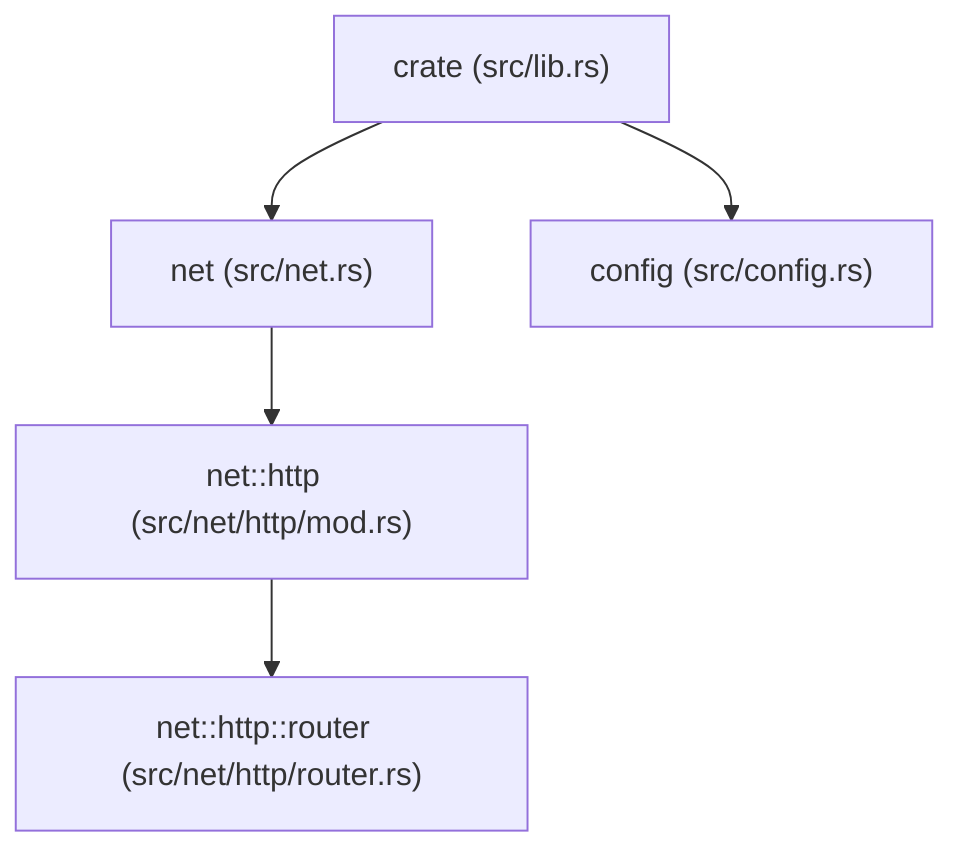
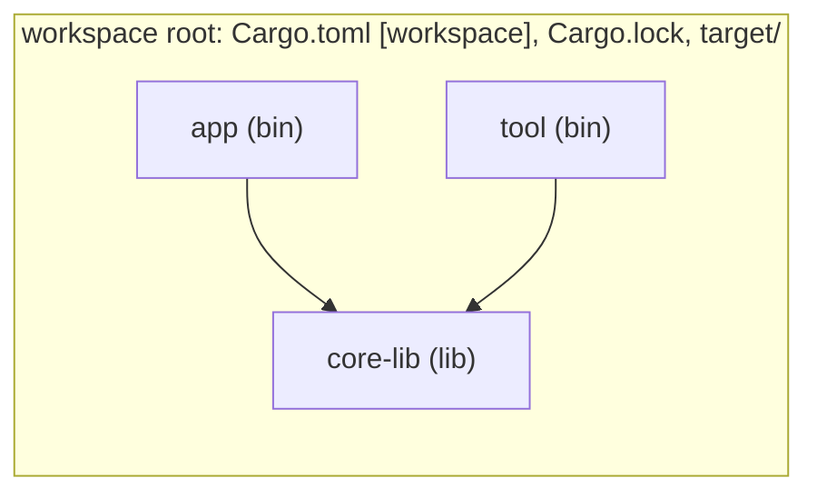

# P9 · Chương 08 — Module, crate và Cargo

## Bạn sẽ hiểu được gì

- **Q1.** Package, crate, module khác nhau thế nào, và Rust tìm mã của `mod foo;` ở file nào? → mục 1
- **Q2.** `pub`, `pub(crate)`, `pub(super)`, `pub(in path)` khác nhau chỗ nào, và lỗi E0603 trông thế nào? → mục 2
- **Q3.** `use`, `pub use`, glob, prelude hoạt động thế nào; `crate::`, `self::`, `super::` trỏ tới đâu? → mục 3
- **Q4.** `#[cfg]`, `cfg!`, `#[cfg_attr]` chọn mã theo `target_os`, `target_arch`, `feature` ở giai đoạn nào? → mục 4
- **Q5.** Caret mặc định nghĩa là gì, SemVer của Cargo quy định gì, và khi nào commit `Cargo.lock`? → mục 5
- **Q6.** Vì sao feature phải "additive", và feature unification giữa hai crate trong workspace gây ra điều gì? → mục 6
- **Q7.** Workspace chia sẻ gì, và profile (`opt-level`, `lto`, `codegen-units`, `panic`) có hiệu lực ở đâu? → mục 7
- **Q8.** `build.rs` chạy ở đâu và dùng khi nào; edition ảnh hưởng thế nào tới tương thích giữa các crate? → mục 8

## Kiến thức cần trước

Chương này gần như độc lập. Các chương anh em trong phase nên đọc song song khi cần: [Trait](02-trait.md) (phần `impl`/orphan rule liên quan đến visibility của trait), [Macro](07-macro.md) (macro và `$crate`, `#[macro_export]` được nhắc ở đó).

Môi trường mọi thí nghiệm trong chương: `rustc 1.95.0`, `cargo 1.95.0`, macOS aarch64 (Apple Silicon). Chỗ nào là quan sát trên máy này, không phải bảo đảm của tài liệu, sẽ được ghi rõ.

## 1. Package, crate, module: ba tầng khác nhau (Q1)

> **Trả lời ngắn.** Package là đơn vị Cargo quản lý (có `Cargo.toml`), crate là đơn vị rustc biên dịch, module là cách chia namespace bên trong một crate. Một package chứa nhiều binary crate nhưng tối đa một library crate.[^atmost] Rust chỉ nạp file khi có khai báo `mod` trỏ tới nó, và tìm mã inline, ở `tên.rs` hoặc ở `tên/mod.rs`.[^modfile]

**Giải thích.** Hình dung monorepo: repo, service và package nội bộ đều gọi là "project" nhưng mỗi tầng một vai (nhận xét của người soạn). Rust tách ba tầng như vậy:

| Tầng | Là gì | Ai quản lý | Đơn vị gì |
|---|---|---|---|
| Package | Thư mục có `Cargo.toml` | Cargo | Đơn vị build/phiên bản/publish |
| Crate | Một cây module do rustc biên dịch | rustc | Đơn vị biên dịch |
| Module | Một namespace lồng nhau trong crate | ngôn ngữ | Đơn vị tổ chức và quyền truy cập |

Sách Rust định nghĩa: một package là một bó gồm một hoặc nhiều crate cung cấp một tập chức năng, và có file `Cargo.toml` mô tả cách build các crate đó.[^pkg] Crate có hai dạng: binary (có `main`, biên dịch ra executable) và library (không có `main`, để chia sẻ).[^crateforms] Một package chứa được bao nhiêu binary crate cũng được, nhưng nhiều nhất **một** library crate.[^atmost]

Cargo suy ra crate từ cấu trúc thư mục, không cần khai báo trong `Cargo.toml`: `src/main.rs` là crate root của binary crate trùng tên package; `src/lib.rs` là crate root của library crate trùng tên package; Cargo đưa các file crate root cho rustc để build.[^conv] Muốn thêm binary thì đặt file vào `src/bin/`, mỗi file là một binary crate riêng.[^bindir]

Thí nghiệm thật: package `svc` có `src/lib.rs`, `src/main.rs`, `src/bin/worker.rs`. `cargo metadata` liệt kê ba target:

```
svc ['lib']
svc ['bin']
worker ['bin']
```

Tức một package, ba crate (một lib + hai bin). Đây chính là mẫu "lib + bin" sẽ dùng ở mục 9.

### Crate root và module tree

Crate root (`main.rs`/`lib.rs`) là file rustc bắt đầu biên dịch; nội dung của nó tạo thành module gốc tên `crate`, và các module lồng bên dưới tạo thành **module tree**.[^modtree] Khác với Java/Go, **file không tự động là module**: file chỉ được biên dịch nếu có một khai báo `mod` trỏ tới nó. Viết `mod garden;` trong crate root nghĩa là "có một module `garden` ở đây, hãy nạp mã của nó"; trình biên dịch tìm mã ở ba nơi: inline ngay sau `mod garden` trong cặp ngoặc nhọn, file `src/garden.rs`, hoặc `src/garden/mod.rs`.[^modfile]



<details><summary>Đi sâu: trộn <code>mod.rs</code> và <code>tên.rs</code>, lịch sử rustc 1.30</summary>

Quy tắc file cho submodule: `mod vegetables;` khai báo trong `src/garden.rs` thì mã nằm ở `src/garden/vegetables.rs` hoặc `src/garden/vegetables/mod.rs`.[^submod] Ta đã chạy đúng cấu trúc ở trên: `net.rs` (kiểu hiện đại) cùng thư mục `net/http/mod.rs` (kiểu cũ) cùng tồn tại và biên dịch được. Sách nói rõ việc trộn hai kiểu cho các module khác nhau là được phép nhưng có thể gây rối cho người đọc.[^mix]

**`mod.rs` hay `tên.rs`?** Reference ghi rằng trước rustc 1.30 `mod.rs` là cách duy nhất để nạp module có con; hiện nay cách đặt tên mới được khuyến khích vì nhất quán hơn và tránh có nhiều file cùng tên `mod.rs` trong dự án;[^modrs] không được có cả `util.rs` lẫn `util/mod.rs`.[^notboth] Edition Guide mô tả cùng thay đổi này: `foo.rs` và thư mục `foo/` có thể cùng tồn tại, không cần `mod.rs` khi đặt submodule trong thư mục con.[^e2018] (Nhận xét của người soạn: lý do thực dụng dễ thấy nhất là tab editor — mười tab cùng tên `mod.rs` thì không phân biệt được.)

</details>

**Quay lại Q1:** package chứa crate, crate là cây module, và cây đó chỉ gồm những file được `mod` khai báo.

## 2. Visibility: ai được thấy cái gì (Q2)

> **Trả lời ngắn.** Mặc định mọi thứ là private: chỉ module chứa nó và các module con thấy được.[^privdesc] `pub(crate)`, `pub(super)`, `pub(in path)` mở rộng phạm vi có kiểm soát.[^scopedin] Dùng item private từ ngoài báo lỗi E0603 (quan sát ở phần Đi sâu).

**Giải thích.** Giống phòng ban trong một tòa nhà: người trong phòng ra được sảnh chung, nhưng người ngoài không mở được tủ riêng của phòng (nhận xét của người soạn).

Mặc định mọi thứ là private, với hai ngoại lệ: associated item trong trait `pub` mặc định public, và variant của enum `pub` cũng public.[^visdefault] Sách mô tả quy tắc theo chiều cây: code trong một module private **với module cha** theo mặc định;[^privparent] item ở cha không dùng được item private của con, nhưng con dùng được item của tổ tiên.[^ancestor] Reference nói gọn hơn: item private truy cập được từ module hiện tại và các hậu duệ của nó.[^privdesc]

Để mở rộng có kiểm soát, `pub` có dạng hạn chế phạm vi:[^scopedin]

| Cú pháp | Nhìn thấy trong | Nguồn |
|---|---|---|
| (không có) / `pub(self)` | module hiện tại (và con của nó) | tương đương nhau[^scopedself] |
| `pub(super)` | module cha | tương đương `pub(in super)`[^scopedsuper] |
| `pub(crate)` | toàn bộ crate hiện tại | [^scopedcrate] |
| `pub(in path)` | phạm vi `path`, phải là tổ tiên của item | [^scopedin] |
| `pub` | bất kỳ nơi nào truy cập được cha của nó | [^reachable] |

Từ edition 2018, đường dẫn trong `pub(in path)` phải bắt đầu bằng `crate`, `self` hoặc `super`.[^vis2018]

### Re-export và quyền truy cập

Một tên được `use` vào scope là private với scope đó.[^usepriv] Reference: Rust cho phép re-export công khai bằng `pub use`, nhờ đó đưa quyền truy cập công khai tới item được re-export.[^reexpvis] Điều đó cho phép tách **cấu trúc nội bộ** (nhiều module sâu) khỏi **API công khai** (phẳng). Trong thí nghiệm `svc`, `src/lib.rs` có `pub use config::Config;`, nên `main.rs` viết `use svc::{net, Config};` thay vì `svc::config::Config`.

<details><summary>Đi sâu: thí nghiệm E0603 và E0616</summary>

### Thí nghiệm: E0603 và các mức visibility

Mã thử (crate `vis`, edition 2024):

```rust
mod bank {
    pub mod account {
        pub struct Account { pub id: u32, balance: i64 }
        impl Account { pub fn new(id: u32) -> Self { Account { id, balance: 0 } } }
        pub(super) fn parent_only() {}
        pub(in crate::bank) fn bank_only() {}
    }
    pub fn demo() {
        account::parent_only();   // OK: bank là cha của account
        account::bank_only();     // OK: nằm trong crate::bank
    }
}
fn main() {
    bank::demo();
    let a = bank::account::Account::new(1);
    println!("{}", a.balance);        // lỗi
    bank::account::parent_only();     // lỗi
}
```

Kết quả `cargo build` (quan sát trên rustc 1.95.0):

```
error[E0603]: function `parent_only` is private
  --> src/main.rs:17:20
   |
17 |     bank::account::parent_only();
   |                    ^^^^^^^^^^^ private function
...
error[E0616]: field `balance` of struct `Account` is private
```

Hai điểm đáng nhớ. Thứ nhất, E0603 là lỗi "đường dẫn tới item private"; lỗi dùng field private là mã khác, E0616 — visibility áp dụng riêng cho từng field, nên struct có field private không thể tạo bằng literal từ bên ngoài, buộc người ngoài đi qua constructor (`new`) — một công cụ giữ bất biến (invariant) rất thường dùng (nhận xét của người soạn). Thứ hai, thông báo lỗi của rustc vẫn nói `private function` cho item `pub(super)` khi gọi từ `main`: đối với `main` (module gốc), nó thật sự là private. Với `fn audit()` không có `pub`, lỗi y hệt (`error[E0603]: function 'audit' is private` — cũng đã chạy thật).

</details>

**Quay lại Q2:** private theo cây module, `pub(...)` mở có kiểm soát, và `pub use` tách API công khai khỏi cấu trúc nội bộ.

## 3. `use`, path, glob và prelude (Q3)

> **Trả lời ngắn.** Path đi theo cây module: absolute bắt đầu từ `crate` hoặc tên crate ngoài, relative bắt đầu từ `self`, `super` hoặc một tên trong module hiện tại.[^paths] `use` chỉ tạo shortcut trong scope đó (private với scope), còn `pub use` mới re-export ra ngoài.[^usepriv][^reexpvis] Một số tên có sẵn nhờ prelude, và từ edition 2018 hầu như không cần `extern crate`.[^preludestd][^externgone]

**Giải thích.** Path giống đường dẫn file: tuyệt đối từ gốc ổ đĩa, hoặc tương đối từ thư mục hiện tại (nhận xét của người soạn).

### Hai dạng path

Path có hai dạng: **absolute** bắt đầu từ crate root — với code của chính crate, bắt đầu bằng từ khóa `crate`; với crate ngoài, bắt đầu bằng tên crate — và **relative**, bắt đầu từ module hiện tại với `self`, `super` hoặc một định danh trong module hiện tại.[^paths] `super::` đi lên module cha. Thí nghiệm: `net.rs` gọi `super::config::who()` và `crate::root_fn()`, `http/mod.rs` gọi `self::router::who()`; chương trình in:

```
net -> config / root
http, self::router=router
```

(Nhận xét của người soạn: `super` luôn là module cha trực tiếp. `net.rs` là con trực tiếp của crate root nên từ đó `super` = `crate`; còn từ `net::http` thì `super` = `net`. Di chuyển file đổi nghĩa của `super::`, một lỗi quen.)

### `use` và quy ước idiom

`use` tạo shortcut trong scope. Sách chỉ ra quy ước: đưa **module cha** của hàm vào scope (`use crate::front_of_house::hosting;` rồi gọi `hosting::add_to_waitlist()`) là cách idiomatic, vì nó nói rõ hàm không định nghĩa cục bộ.[^idiom] Với struct/enum thì quy ước là import thẳng đường dẫn đầy đủ của tên.[^structfull] Hai item cùng tên (ví dụ `fmt::Result` và `io::Result`) thì import module cha[^sameparent] hoặc dùng `as` để đổi tên.[^asrename] Reference còn có `use Trait as _;` để nhập trait (kích hoạt method) mà không chiếm tên.[^asunder]

Re-export bằng `pub use` còn là công cụ thiết kế API thư viện, như đã thấy ở mục 2.[^reexp]

### Glob import

`use std::collections::*;` mang vào mọi item public của `std::collections`. Sách cảnh báo: glob khiến khó biết tên nào đang trong scope và được định nghĩa ở đâu.[^globwarn] Reference thêm một quy tắc ưu tiên: item và import có tên được phép **che** (shadow) tên đến từ glob cùng namespace.[^globshadow] Glob không bị cấm mà có chỗ dùng hợp lý (test module `use super::*;`, enum variants); chỉ nên tránh ở API ranh giới. (Nhận xét của người soạn.)

<details><summary>Đi sâu: prelude và <code>extern crate</code></summary>

### Prelude

Mỗi crate có "standard library prelude" gồm các tên từ một module duy nhất của std,[^preludestd] và Reference liệt kê module theo edition: `std::prelude::rust_2015`, `rust_2018`, `rust_2021`, `rust_2024` (và bản `core::` khi có `no_std`).[^preludeedition] Ngoài ra còn *language prelude* luôn trong scope (kiểu nguyên thủy như `i32`, `str`, các attribute và derive built-in),[^preludelang] và *extern prelude* cho tên các crate ngoài. (Suy luận của người soạn: đây là lý do `Vec`, `Option`, `String` dùng được mà không `use`; và vì module prelude tách theo edition nên edition mới có thể thêm tên mà không phá crate cũ, xem mục 8.)

### `extern crate` và vì sao hiếm gặp

Trước 2018, mỗi crate ngoài phải khai báo `extern crate foo;`. Edition Guide: "extern crate không còn cần trong 99% trường hợp",[^externgone] vì chỉ cần thêm crate vào `Cargo.toml` là đủ.[^externcargo] Cơ chế bên dưới: crate được cung cấp cho compiler (qua cờ `--extern`, thứ Cargo làm hộ) được đưa vào extern prelude;[^externprelude] một `extern crate` đặt ở crate root cũng đưa tên crate vào extern prelude, nên nó tự trong scope ở mọi module.[^externroot] Vẫn còn dùng `extern crate` cho vài ca đặc biệt (ví dụ đổi tên crate bằng `as`, hoặc `extern crate alloc;` trong `no_std`) — danh sách ca này là hiểu biết của người soạn, chưa trích nguồn trong chương, và nằm ngoài phạm vi chương.

</details>

**Quay lại Q3:** path đi theo cây module, `use` chỉ là shortcut trong scope, và prelude cho sẵn một số tên.

## 4. Conditional compilation (Q4)

> **Trả lời ngắn.** `#[cfg]` bật hoặc tắt mã theo điều kiện như hệ điều hành, kiến trúc CPU hay feature, và quyết định này được chốt lúc biên dịch, không phải lúc chạy.[^cfgstatic] `cfg!(...)` chỉ cho ra `true`/`false` nên cả hai nhánh vẫn phải biên dịch được (suy luận của người soạn từ định nghĩa literal[^cfgmacro]).

**Giải thích.** Giống `#ifdef` hay build tag: một codebase, nhiều bản build (nhận xét của người soạn).

**Vấn đề**: một codebase cần chạy trên macOS lẫn Linux, bật/tắt tính năng theo build, hoặc dùng code debug chỉ ở dev. Rust giải quyết **ở thời điểm biên dịch**, không phải runtime: tập cấu hình được xác định tĩnh khi biên dịch crate.[^cfgstatic]

Các công cụ:[^cfgtools]

| Công cụ | Tác dụng |
|---|---|
| `#[cfg(pred)]` | nếu `pred` sai, phần được gắn attribute bị loại khỏi mã nguồn[^cfgremove] |
| `cfg!(pred)` | macro cho ra literal `true`/`false`[^cfgmacro] — **cả hai nhánh vẫn phải biên dịch được** |
| `#[cfg_attr(pred, attr)]` | gắn attribute `attr` chỉ khi `pred` đúng |

Predicate gồm option dạng tên (`unix`) hoặc cặp key-value (`target_arch = "x86_64"`), kết hợp bằng `all()`, `any()`, `not()`.[^cfgpred] `all()` rỗng là true,[^cfgall] `any()` rỗng là false.[^cfgpred2] Các key quan trọng với backend: `target_os` (ví dụ `"linux"`, `"macos"`, `"windows"`),[^targetos] `target_arch` (ví dụ `"x86_64"`, `"aarch64"`),[^targetarch] `unix`/`windows` (suy ra từ `target_family`),[^unixfam] `debug_assertions` (bật mặc định khi không tối ưu, điều khiển cả `debug_assert!`),[^dbgassert] và `feature = "..."` — theo Reference đó là một quy ước của Cargo cho tùy chọn compile-time và dependency tùy chọn.[^cfgfeature] Muốn biết một target đặt những cfg nào: `rustc --print cfg --target $TARGET`.[^printcfg]

<details><summary>Đi sâu: thí nghiệm <code>cfg</code> theo <code>target_os</code> và <code>cfg_attr</code> chọn file module</summary>

### Thí nghiệm: `cfg` theo `target_os`

Chương trình dưới có ba hàm `os()`, mỗi hàm một `#[cfg]`:

```rust
#[cfg(target_os = "macos")]
fn os() -> &'static str { "macos" }
#[cfg(target_os = "linux")]
fn os() -> &'static str { "linux" }
#[cfg(not(any(target_os = "macos", target_os = "linux")))]
fn os() -> &'static str { "other" }

#[cfg_attr(feature = "verbose", derive(Debug))]
struct P(u8);
```

Chạy trên macOS aarch64:

```
os=macos arch=aarch64
cfg!(unix)=true debug_assertions=true       # cargo run (dev)
arch aarch64=true x86_64=false
quiet                                        # chưa bật feature verbose
```

Với `--features verbose` dòng cuối thành `P(1)` (derive `Debug` được gắn nhờ `cfg_attr`); với `--release`, `debug_assertions=false`. Để xác nhận nhánh `linux` mà không cần máy Linux, ta biên dịch kiểm tra chéo bằng `cargo check --target x86_64-unknown-linux-gnu` (cần target đã cài trong rustup) và đặt `compile_error!` ở hai nhánh: build host báo `error: macos branch`, build `--target x86_64-unknown-linux-gnu` báo `error: linux branch`. Output `rustc --print cfg --target x86_64-unknown-linux-gnu` cho `target_os="linux"`, `target_arch="x86_64"`, `target_env="gnu"`, `target_family="unix"` (quan sát).

Hệ quả thiết kế: `#[cfg]` loại phần mã bị tắt khỏi mã nguồn[^cfgremove] (suy luận của người soạn: việc loại này xảy ra trước khi kiểm tra kiểu và borrow, nên code ở nhánh không chọn không cần hợp lệ trong môi trường hiện tại, ví dụ gọi API chỉ có trên Linux); ngược lại `cfg!(...)` chỉ là điều kiện hằng, mọi nhánh vẫn phải qua type-check. (Suy luận của người soạn từ định nghĩa "cfg! evaluates to literal"; sách Reference chỉ nói macro ra literal.)

`cfg_attr` cũng có thể chọn **file module** theo nền tảng: ví dụ trong Reference, `#[cfg_attr(target_os = "linux", path = "linux.rs")] mod os;`.[^cfgattrpath]

</details>

**Quay lại Q4:** `cfg` chọn mã tĩnh lúc biên dịch theo `target_os`, `target_arch`, `feature`; `cfg!` chỉ là hằng nên không bỏ được kiểm tra kiểu.

## 5. Cargo: manifest, dependency, SemVer, `Cargo.lock` (Q5)

> **Trả lời ngắn.** Viết `"1.2.3"` trong `Cargo.toml` nghĩa là chấp nhận mọi bản tương thích SemVer từ `1.2.3` tới trước `2.0.0`; với `0.2.3` thì chỉ tới trước `0.3.0`, tức tới trước minor kế tiếp.[^caret][^caretable] `Cargo.lock` ghi lại đúng phiên bản đã build, và Cargo khuyên cứ commit khi không chắc.[^lockpurpose][^lockindoubt]

**Giải thích.** Caret giống thỏa thuận "nhận bản vá và tính năng mới, không nhận thay đổi phá vỡ hợp đồng" (nhận xét của người soạn).

### `Cargo.toml`

Mục `[package]` đứng đầu; trường duy nhất Cargo bắt buộc là `name` (registry có thể đòi thêm khi publish).[^pkgname] Phần còn lại bạn đã quen: `[dependencies]`, `[dev-dependencies]` (cho test/bench), `[build-dependencies]` (cho `build.rs`), `[features]`, `[profile.*]`, `[workspace]`. Target được suy từ layout: thư viện ở `src/lib.rs`,[^libsrc] binary ở `src/main.rs` và/hoặc `src/bin/`.[^binsrc] Binary dùng được API công khai của library trong cùng package.[^binuselib]

### Version requirement mặc định là caret

`time = "0.1.12"` là một *version requirement*. Caret là chiến lược mặc định, cho phép cập nhật tương thích SemVer;[^caret] bỏ dấu `^` là cú pháp rút gọn tương đương.[^caretleave] Bảng chuyển đổi trong Cargo book:[^caretable]

| Viết | Nghĩa |
|---|---|
| `1.2.3` | `>=1.2.3, <2.0.0` |
| `1.2` | `>=1.2.0, <2.0.0` |
| `0.2.3` | `>=0.2.3, <0.3.0` |

Chú ý hàng thứ ba: với phiên bản `0.x`, "breaking" nằm ở số minor, nên caret chỉ cho nâng patch. Với backend: một cập nhật `cargo update` mà vẫn nằm trong khoảng caret là thứ Cargo coi là an toàn — nhưng "coi là" dựa trên việc tác giả crate tuân SemVer, vốn là niềm tin chứ không phải kiểm chứng (nhận xét của người soạn).

### `Cargo.lock`: khi nào commit

`Cargo.lock` mô tả "trạng thái thế giới" tại một lần build thành công, nhờ đó build cho kết quả xác định trên các máy/thời điểm khác nhau.[^lockpurpose] Guide của Cargo khuyên: khi không chắc, hãy commit `Cargo.lock` vào version control.[^lockindoubt] FAQ nói rõ hơn: `cargo new` mặc định theo dõi `Cargo.lock`, còn bạn có commit hay không là tùy nhu cầu của package.[^lockfaq] Cũng cần biết giới hạn: tính xác định có thể cho cảm giác an toàn giả, vì `Cargo.lock` không ảnh hưởng người tiêu dùng package của bạn, chỉ `Cargo.toml` làm điều đó; và `cargo install` chọn dependency mới nhất trừ khi truyền `--locked`.[^locklimit]

(Nhận xét của người soạn: với service backend triển khai ra production, hầu như luôn nên commit `Cargo.lock` cùng `cargo build --locked` trong CI để image build tái lập được. Với thư viện, chính sách tùy bạn; điều quan trọng là có job CI định kỳ build với dependency mới nhất.)

<details><summary>Đi sâu: bảng "API compatibility" của SemVer trong Cargo</summary>

### Quy tắc SemVer của Cargo

Cargo book có hẳn một bảng "API compatibility". Một số dòng quan trọng khi bạn xuất bản crate nội bộ (hoặc lib trong workspace dùng chung):

| Thay đổi | Mức |
|---|---|
| Đổi tên/di chuyển/xóa bất kỳ public item | Major[^semvermajor] |
| **Thêm** public item mới | Minor[^semverminor] |
| Thêm field private vào struct khi mọi field hiện tại đều public | Major[^semverprivfield] |
| Thêm variant enum (không có `non_exhaustive`) | Major[^semverenum] |
| Thêm trait item không có mặc định | Major[^semvertrait] |
| Thêm Cargo feature mới | Minor[^semverfeatadd] |
| Xóa Cargo feature | Major[^semverfeatrm] |

"Thêm pub item là minor" có một ngoại lệ hiếm mà chính tài liệu nêu: có thể thành breaking vì glob import, ví dụ thêm trait mới có associated item xung đột với kiểu mà dự án khác đã glob import.[^semverglob] (Nhận xét của người soạn: đây là lý do thực tế để hạn chế `use dep::*` ở code ứng dụng; và vì item private không thuộc API, đổi chúng là thay đổi nội bộ — nguyên do để dùng `pub(crate)` thay `pub` cho mọi thứ không cố ý công bố, liên hệ với visibility ở mục 2.)

</details>

**Quay lại Q5:** caret cho phép nâng trong cùng bản major (hoặc minor với `0.x`), SemVer quyết định thay đổi nào là major, và ứng dụng nên commit `Cargo.lock`.

## 6. Features và feature unification (Q6)

> **Trả lời ngắn.** Feature là công tắc bật/tắt mã và dependency tùy chọn của một package.[^featdef] Khi nhiều crate trong cùng một lần build cần cùng một dependency với feature khác nhau, Cargo build nó một lần với hợp của các feature đó,[^featunion] nên feature phải additive: bật thêm không được làm mất chức năng.[^additive]

**Giải thích.** Giống feature flag nhưng được chốt lúc build, và cờ của mọi người dùng chung được cộng dồn lại (nhận xét của người soạn).

Feature là cơ chế "biên dịch có điều kiện và dependency tùy chọn" của Cargo: package khai báo tập feature có tên trong `[features]`, mỗi feature bật hoặc tắt; feature của chính package bật bằng `--features`, feature của dependency bật ở khai báo dependency.[^featdef] Mặc định mọi feature tắt trừ khi được bật rõ, và feature `default` liệt kê tập bật sẵn;[^featdefault] `default-features = false` hoặc `--no-default-features` tắt chúng.[^nodefault] Mỗi feature xuất hiện trong code dưới dạng `cfg(feature = "...")` (mục 4).

### Feature là additive, và vì sao

Khi cùng một crate được nhiều người cần với feature khác nhau, Cargo hợp nhất (unify) chúng: Cargo book lấy ví dụ `winapi`: nếu `foo` bật `fileapi`, `handleapi` và `bar` bật `std`, `winnt`, thì `winapi` được build với cả bốn feature.[^featunion] Hệ quả mà tài liệu rút ra: feature nên là **additive** — bật một feature không được tắt chức năng, bật tổ hợp bất kỳ nên an toàn.[^additive] Feature loại trừ nhau là hiếm, nên tránh nếu có thể vì nó buộc cả đồ thị dependency phối hợp; nếu không tránh được thì thêm compile error để phát hiện.[^mutex]

<details><summary>Đi sâu: thí nghiệm workspace 2 crate và resolver 2/3</summary>

### Thí nghiệm: workspace 2 crate, feature unification

Cấu trúc (virtual workspace, `resolver = "3"`): `core-lib` có feature `fast` và `extra` (mặc định rỗng); hai crate binary `app` (phụ thuộc `core-lib` với `features = ["fast"]`) và `tool` (phụ thuộc `core-lib` với `features = ["extra"]`). `core_lib::mode()` trả `"fast"` nếu `cfg!(feature = "fast")` bật, ngược lại `"slow"`; `tool` in `mode()` rồi in `extra()`.

`cargo tree -p tool -e features` cho thấy `tool` chỉ tự bật `extra`:

```
tool v0.1.0
├── core-lib feature "default"
└── core-lib feature "extra"
```

`cargo tree` có kiểu cạnh `features` để hiển thị feature mỗi dependency bật, và dùng `-i` để xem feature chảy vào package thế nào.[^treefeat] Chạy thật:

| Lệnh build | Chạy `target/debug/tool` in ra |
|---|---|
| `cargo build -p tool` | `slow` / `extra on` |
| `cargo build -p app -p tool` | `fast` / `extra on` |
| `cargo build --workspace` | `fast` / `extra on` |

Cùng một binary `tool` đổi hành vi (`slow` → `fast`) chỉ vì lần build đó có thêm `app` trong **cùng** lệnh, vì `core-lib` chỉ được biên dịch một lần với hợp (`fast` + `extra`). Và `cargo tree --workspace -e features -i core-lib` hiển thị `core-lib` nhận `fast` từ `app` và `extra` từ `tool`. Kết quả là hành vi quan sát trên 1.95.0 phù hợp với quy tắc unification; đối với bạn, nó là cảnh báo: **kết quả `cargo test -p x` và `cargo test --workspace` có thể khác nhau** khi code của bạn rẽ nhánh theo feature (nhận xét của người soạn, rút từ thí nghiệm trên).

### Resolver 2 và 3 giảm bớt unification vô lý

Resolver phiên bản 1 hợp nhất feature của một package bất kể nó được khai báo ở đâu;[^res1] resolver 2 thôi unify trong vài tình huống: feature của dependency theo target (`[target.'cfg(windows)'.dependencies]`) không bật khi không build target đó;[^res2tgt] feature bật trên `build-dependencies` hoặc proc-macro không bị unify với cùng dependency khi dùng như dependency thường.[^res2build] Resolver 3 (mặc định cho edition 2024, cần Rust 1.84+) đổi mặc định của `resolver.incompatible-rust-versions` từ `allow` sang `fallback`;[^res3] với `fallback`, resolver ưu tiên package có Rust version nhỏ hơn hoặc bằng Rust của bạn.[^resfallback] Bảng phiên bản của Cargo chỉ liệt kê thay đổi đó cho resolver 3 (không có thay đổi thuật toán feature). Resolver là tùy chọn toàn cục cho cả workspace, giá trị ở dependency bị bỏ qua; với virtual workspace phải đặt trong bảng `[workspace]`.[^reswide] (Lưu ý của người soạn: virtual workspace không có `[package]` nên không có edition để suy ra mặc định, vì vậy ví dụ trên ghi tường minh `resolver = "3"`.)

</details>

**Quay lại Q6:** feature được hợp nhất trong một lệnh build, nên chúng phải additive và kết quả `-p x` có thể khác `--workspace`.

## 7. Workspace và profile (Q7)

> **Trả lời ngắn.** Workspace gom nhiều package dùng chung một `Cargo.lock` và một thư mục `target/`.[^wslock][^wstarget] Profile (`dev`, `release`...) chỉnh cách rustc biên dịch, nhưng Cargo chỉ đọc profile ở manifest gốc workspace; profile khai báo trong dependency bị bỏ qua.[^profroot]

**Giải thích.** Workspace giống monorepo của các crate: một lockfile, một thư mục build, một nơi đặt cấu hình build (nhận xét của người soạn).

### Workspace

Workspace là tập một hoặc nhiều package (members) được quản lý chung.[^wsdef] Điểm then chốt: mọi package **chia sẻ một `Cargo.lock`** ở gốc workspace và **một thư mục output `target/`**.[^wslock][^wstarget] Tối thiểu workspace cần một member, hoặc với root package hoặc dạng virtual manifest (chỉ có `[workspace]`, không `[package]`).[^wsvirtual] Metadata dùng chung (version, edition, license…) khai báo ở `[workspace.package]` rồi member kế thừa bằng `{key}.workspace = true`.[^wspkg] Các phần `[patch]`, `[replace]`, `[profile.*]` chỉ được nhận ở manifest gốc.[^wsroot]



### Profiles

Cargo có bốn profile built-in: `dev`, `release`, `test`, `bench`; chọn tự động theo lệnh, và có thể định nghĩa profile tùy chỉnh.[^profbuiltin] Cấu hình ở bảng `[profile.*]`, nhưng **chỉ manifest ở gốc workspace được xét; setting profile khai báo trong dependency bị bỏ qua**.[^profroot] Mặc định theo Cargo book: `dev` có `opt-level = 0`, `debug = true`, `debug-assertions = true`, `overflow-checks = true`, `lto = false`, `panic = 'unwind'`, `codegen-units = 256`;[^profdev] `release` có `opt-level = 3`, `debug = false`, `debug-assertions = false`, `overflow-checks = false`, `lto = false`, `panic = 'unwind'`, `codegen-units = 16`.[^profrelease]

| Setting | Làm gì | Trade-off |
|---|---|---|
| `opt-level` | mức tối ưu (`-C opt-level`) | mức cao hơn có thể cho code chạy nhanh hơn, đổi lại thời gian biên dịch lâu hơn[^optlevel] |
| `lto` | tối ưu liên-crate khi link | tốt hơn nhờ phân tích toàn chương trình, đổi lại link chậm hơn[^lto]; `lto = false` (mặc định) vẫn là thin local LTO trong crate hiện tại, khác `"off"` tắt hẳn[^ltofalse] — xem [P11·03 mục 3](../11-do-dac-va-go-loi/03-hieu-nang-service-rust.md) |
| `codegen-units` | chia crate thành bao nhiêu đơn vị sinh mã | nhiều đơn vị → song song, biên dịch nhanh hơn, nhưng có thể ra code chậm hơn[^cgu] |
| `panic` | `unwind` hoặc `abort` (hai giá trị của Cargo; rustc còn có `immediate-abort`, xem [P10·08 mục 2](../10-rust-internals/08-panic-abi-ffi.md)) | `abort` kết thúc process khi panic; test/bench/build script/proc-macro bỏ qua setting này[^panic] |
| `strip` | gỡ symbol/debuginfo | mặc định `"none"`[^strip] |

<details><summary>Đi sâu: số đo kích thước binary và <code>panic = "abort"</code></summary>

Số đo (quan sát một lần, macOS aarch64, rustc 1.95.0, binary `svc` rất nhỏ, kích thước đo bằng `stat`):

| `[profile.release]` | Kích thước binary |
|---|---|
| `opt-level = 3` (mặc định) | 433.168 byte |
| thêm `lto = true`, `codegen-units = 1`, `panic = "abort"` | 374.176 byte |
| thêm `strip = true` | 302.544 byte |

Bản `dev` cùng chương trình là 531.448 byte. Đây là một lần đo trên một chương trình nhỏ; không suy rộng thành tỷ lệ cho service thật. (Ghi chú: ta cũng thử `opt-level = "z"` và nhận 433.504 byte — gần như không đổi với chương trình mà phần lớn kích thước là thư viện chuẩn đã biên dịch sẵn; ta không rút kết luận gì từ đó.)

Về `panic = "abort"` cho service: `abort` kết thúc process khi panic.[^panicabort] Hệ quả (suy luận của người soạn): không unwind, nên `catch_unwind` và drop khi panic không chạy; đây là quyết định kiến trúc, không chỉ tối ưu kích thước. Cơ chế panic nằm ở P10 · chương 08 (panic-abi-ffi).

</details>

**Quay lại Q7:** workspace chia sẻ lockfile và `target/`, còn profile chỉ có hiệu lực khi đặt ở manifest gốc.

## 8. `build.rs` và edition (Q8)

> **Trả lời ngắn.** `build.rs` là chương trình Cargo biên dịch và chạy ngay trước khi build package, dùng cho việc như build thư viện C hay sinh code.[^bsplace][^bscases] Nó chạy trên máy host nên phải đọc biến `CARGO_CFG_*` để biết target.[^bshost] Edition là lựa chọn của từng crate, và crate khác edition vẫn liên thông liền mạch.[^edcrate][^edinterop]

**Giải thích.** `build.rs` giống bước pre-build/codegen trong CI, còn edition giống phiên bản ngôn ngữ mà từng crate tự chọn (nhận xét của người soạn).

### `build.rs`: dùng khi nào

Cargo không định thay thế các công cụ chuyên dụng cho việc biên dịch C, tìm thư viện hệ thống hay sinh code; nó tích hợp với chúng bằng build script.[^bsintent] Đặt file `build.rs` ở gốc package thì Cargo biên dịch nó và chạy ngay trước khi build package.[^bsplace] Các ca dùng tiêu biểu theo tài liệu: build một thư viện C đi kèm, tìm thư viện C trên hệ thống, sinh module Rust từ đặc tả, cấu hình đặc thù nền tảng.[^bscases] Nó có phụ thuộc riêng khai trong `[build-dependencies]`[^bsbd] và không thấy `[dependencies]` của package.[^bsdeps] (Nhận xét của người soạn: nếu `#[cfg]`, feature hay một crate thuần Rust giải quyết được thì không cần `build.rs` — build script làm chậm build và khó tái lập hơn.)

Điểm hay sai: `build.rs` chạy trên **host**, nên `cfg!`/`#[cfg]` trong chính nó kiểm tra máy host, không phải target; muốn biết target phải đọc biến môi trường `CARGO_CFG_*`.[^bshost]

Thí nghiệm: `build.rs` đọc `CARGO_CFG_TARGET_ARCH`, phát `cargo::rustc-cfg=has_big_pages` khi là `aarch64` và `cargo::rustc-env=BUILT_FOR=<arch>`. `cargo check` (host aarch64) cho `has_big_pages` được đặt; `cargo check --target x86_64-unknown-linux-gnu` cho `has_big_pages` **không** đặt (xác minh bằng `compile_error!` ở hai nhánh) dù build script vẫn chạy trên host. (Tên `has_big_pages` là tên giả lập của người soạn để minh họa cơ chế, không phải một cfg có thật của Rust.) Các chỉ thị `cargo::rustc-cfg` và `cargo::rustc-env` nằm trong danh sách chỉ thị của Cargo book.[^bsdirectives]

### Edition và tương thích giữa crate

Edition giải quyết bài toán thêm keyword mới: ví dụ trong guide, `let async = 1;` sẽ hỏng nếu `async` thành keyword đột ngột.[^edkeyword] Khi có thay đổi không tương thích ngược, chúng được đẩy sang edition kế tiếp, và vì edition là opt-in, crate hiện có không bị ảnh hưởng.[^edwhy] Mỗi crate chọn edition trong `Cargo.toml` của nó.[^edcrate] Quy tắc quan trọng nhất: crate ở edition này phải interoperate liền mạch với crate biên dịch bằng edition khác; mỗi crate tự quyết định thời điểm di cư.[^edinterop] (Edition Guide không ghim phiên bản như các nguồn còn lại; nội dung trích từ URL `doc.rust-lang.org/edition-guide/` tại thời điểm soạn.)

<details><summary>Đi sâu: thí nghiệm crate edition 2015 gọi từ edition 2024</summary>

Thí nghiệm: crate `old` (edition 2015) khai báo `pub fn async()` và `pub fn gen()`; crate `new` (edition 2024) phụ thuộc vào nó. `old::r#async()` và `old::r#gen()` biên dịch và in `7 8`. Gọi `old::gen()` không có `r#` trong `new` lỗi:

```
error: expected identifier, found reserved keyword `gen`
help: escape `gen` to use it as an identifier
```

Tức tên hàm hợp lệ ở edition 2015 vẫn dùng được từ edition 2024, chỉ là phía gọi phải dùng raw identifier `r#` vì edition của **crate đang biên dịch** quyết định keyword. Quy trình nâng edition do Edition Guide mô tả: `cargo update`, `cargo fix --edition`, sửa `edition` trong `Cargo.toml`, build/test, rồi `cargo fmt`.[^edmigrate]

</details>

**Quay lại Q8:** `build.rs` chạy trên host và truyền thông tin cho rustc qua chỉ thị `cargo::`; edition của crate đang biên dịch quyết định keyword nhưng không chia cắt hệ sinh thái.

## 9. Tổ chức một service backend (nhận xét có nhãn)

Phần này là **nhận xét của người soạn**, dựa trên các cơ chế đã trích ở trên, không phải quy tắc của tài liệu Rust.

**Lib + bin trong cùng package.** Đặt logic (handler, domain, repository) vào `src/lib.rs` và để `src/main.rs` chỉ làm composition root: đọc cấu hình, dựng pool/connection, gọi thư viện. Lý do có cơ sở trong tài liệu: binary dùng được API công khai của library cùng package,[^binuselib] nên bạn có thể test integration (`tests/`) trên lib thật và thêm binary phụ (`src/bin/migrate.rs`, `worker.rs`) dùng chung code.[^bindir] Đó chính là cấu trúc thí nghiệm `svc`.

**Visibility hẹp theo mặc định.** Dùng `pub(crate)` cho thứ chỉ cần trong crate, `pub` chỉ cho thứ muốn công bố; vì thêm `pub` item là minor còn xóa là major,[^semverminor][^semvermajor] bề mặt công khai nhỏ giúp đổi cấu trúc nội bộ miễn phí.

**Khi nào tách workspace nhiều crate.** Lý do chính đáng: (1) ranh giới biên dịch — chỉ crate đổi và crate phụ thuộc nó phải biên dịch lại [INFERENCE — suy luận của người soạn từ việc crate là đơn vị biên dịch; chưa đo trong chương này]; (2) ép quy tắc phụ thuộc một chiều (crate `domain` không được depend vào `http`) bằng chính `Cargo.toml`; (3) dùng chung `Cargo.lock` và `target/` giữa các crate nên một lệnh `cargo test --workspace` cho toàn hệ thống;[^wslock][^wstarget] (4) có crate chia sẻ giữa nhiều service. Cái giá: mục 6 — feature bị unify khi build chung, nên hai service dùng chung `core-lib` với cấu hình khác nhau có thể build khác nhau trong CI so với trên máy dev. Nếu một crate chỉ có một người dùng, một module trong crate đó thường đủ.

**Profile cho image production.** `[profile.release]` với `lto` và `codegen-units = 1` đánh đổi thời gian build lấy tối ưu; `panic = "abort"` chỉ khi bạn chấp nhận process chết khi panic (thường cùng chiến lược restart của Kubernetes). Nhớ rằng setting này chỉ có hiệu lực ở manifest gốc workspace.[^profroot]

## Liên hệ với Rust

Toàn chương là Rust, nên các điểm cần nhớ là các bảo đảm đã trích: (a) file không là module nếu thiếu `mod`; (b) privacy là quan hệ cây module — con thấy tổ tiên, cha không thấy con private; (c) `cfg` loại mã bị tắt khỏi mã nguồn, và (suy luận của người soạn) việc đó xảy ra trước kiểm tra kiểu; (d) feature unification là thuộc tính của **một lệnh build**, không phải của từng package; (e) edition là thuộc tính của từng crate nhưng không chia cắt hệ sinh thái.

## Tóm tắt

- Package (Cargo, có `Cargo.toml`) chứa ≥1 crate (đơn vị rustc), tối đa một lib; crate là cây module bắt đầu từ crate root.
- File chỉ thành module khi có `mod`; `foo.rs` + `foo/` được ưu tiên hơn `foo/mod.rs`, không được dùng cả hai cho cùng một module.
- Mặc định private; con thấy tổ tiên, cha không thấy con private. `pub(crate)`, `pub(super)`, `pub(in path)` thu hẹp phạm vi; truy cập item private từ ngoài báo E0603.
- `use` đưa tên vào scope (private với scope đó); `pub use` re-export; glob có thể bị shadow và làm khó đọc; `extern crate` hầu như không cần từ 2018.
- `cfg`/`cfg_attr`/`cfg!` quyết định tĩnh khi biên dịch; `target_os`, `target_arch`, `feature` là các key hay dùng; `build.rs` chạy trên host nên đọc `CARGO_CFG_*` để biết target.
- Caret là mặc định: `1.2.3` = `>=1.2.3, <2.0.0`, `0.2.3` = `>=0.2.3, <0.3.0`. Thêm public item là minor, xóa/đổi tên là major.
- Commit `Cargo.lock` khi không chắc; ứng dụng triển khai thì nên commit và build `--locked` (nhận xét của người soạn).
- Feature được unify trong một lệnh build: cùng binary có thể khác hành vi tùy lệnh (đã chạy thật), nên feature phải additive.
- Workspace chia sẻ `Cargo.lock` và `target/`; profile chỉ đọc từ manifest gốc.
- Crate khác edition tương tác liền mạch; edition của crate đang biên dịch quyết định keyword (cần `r#`).

## Câu hỏi tự kiểm tra

1. Một package có thể chứa bao nhiêu library crate và binary crate? `src/bin/worker.rs` là gì?
<details><summary>Đáp án</summary>

Nhiều binary, tối đa một library; `src/bin/worker.rs` là binary crate riêng.[^atmost][^bindir]

</details>

2. Bạn tạo `src/payments.rs` nhưng không có `mod payments;` ở đâu cả. File này có được biên dịch không?
<details><summary>Đáp án</summary>

Không: module chỉ tồn tại khi được khai báo bằng `mod`, từ đó compiler mới tìm file.[^modfile]

</details>

3. `src/util.rs` và `src/util/mod.rs` cùng tồn tại thì sao? Kiểu nào được khuyến khích?
<details><summary>Đáp án</summary>

Không cho phép cả hai; khuyến khích `util.rs` + thư mục `util/` cho con.[^notboth][^modrs]

</details>

4. Phân biệt `pub(super)` và `pub(in crate::bank)` và `pub(crate)`.
<details><summary>Đáp án</summary>

Cha trực tiếp / phạm vi path (phải là tổ tiên) / toàn crate.[^scopedsuper][^scopedin][^scopedcrate]

</details>

5. Một hàm không có `pub` gọi từ module anh em/cha bên ngoài thì lỗi mã nào? Field private thì sao?
<details><summary>Đáp án</summary>

E0603 cho đường dẫn tới item private, E0616 cho field private (quan sát ở mục 2).

</details>

6. `1.2.3` và `0.2.3` trong `Cargo.toml` cho nâng tới đâu?
<details><summary>Đáp án</summary>

`<2.0.0` và `<0.3.0`.[^caretable]

</details>

7. Thêm một hàm `pub` mới vào crate thư viện là bump gì? Có trường hợp ngoại lệ nào không?
<details><summary>Đáp án</summary>

Minor; ngoại lệ hiếm do glob import gây xung đột.[^semverminor][^semverglob]

</details>

8. Vì sao `cargo build -p tool` và `cargo build -p app -p tool` có thể cho binary `tool` hành vi khác nhau?
<details><summary>Đáp án</summary>

Feature của `core-lib` bị hợp nhất trong cùng lệnh build: `fast` từ `app` + `extra` từ `tool`.[^featunion] Thí nghiệm mục 6 in `slow` rồi `fast`.

</details>

9. Trong `build.rs`, `cfg!(target_os = "linux")` hỏi về máy nào? Dùng gì để biết target?
<details><summary>Đáp án</summary>

Máy host nơi build script chạy; dùng `CARGO_CFG_*`.[^bshost]

</details>

10. Bạn đặt `[profile.release] lto = true` trong `Cargo.toml` của một member crate trong workspace. Có hiệu lực không?
<details><summary>Đáp án</summary>

Không: chỉ manifest ở gốc workspace được xét.[^profroot][^wsroot]

</details>

11. Crate edition 2024 gọi hàm tên `gen` định nghĩa trong crate edition 2015. Viết thế nào?
<details><summary>Đáp án</summary>

`old::r#gen()`; `gen` là từ khóa dành riêng ở edition của crate gọi (chạy thật ở mục 8); hai edition vẫn interoperate.[^edinterop]

</details>

## Đọc thêm

- [Rust Book ch07](https://doc.rust-lang.org/1.95.0/book/ch07-00-managing-growing-projects-with-packages-crates-and-modules.html) — toàn bộ mô hình package/crate/module kèm ví dụ nhà hàng.
- [Reference: Visibility and Privacy](https://doc.rust-lang.org/1.95.0/reference/visibility-and-privacy.html) — đặc tả đầy đủ của `pub(in path)` và re-export.
- [Reference: Conditional compilation](https://doc.rust-lang.org/1.95.0/reference/conditional-compilation.html) — danh sách đầy đủ các option `cfg`.
- [Cargo book: Features](https://doc.rust-lang.org/1.95.0/cargo/reference/features.html) — feature, `dep:`, unification và các cạm bẫy.
- [Cargo book: SemVer Compatibility](https://doc.rust-lang.org/1.95.0/cargo/reference/semver.html) — bảng đầy đủ thay đổi nào là major/minor.
- [Cargo book: Workspaces](https://doc.rust-lang.org/1.95.0/cargo/reference/workspaces.html), [Profiles](https://doc.rust-lang.org/1.95.0/cargo/reference/profiles.html), [Build scripts](https://doc.rust-lang.org/1.95.0/cargo/reference/build-scripts.html).
- [Edition Guide](https://doc.rust-lang.org/edition-guide/editions/index.html) — từng edition đổi gì (không ghim phiên bản).

[^pkg]: Rust Book 1.95.0, ch07-01 — <https://doc.rust-lang.org/1.95.0/book/ch07-01-packages-and-crates.html> — "A package is a bundle of one or more crates that provides a set of functionality. A package contains a Cargo.toml file that describes how to build those crates."
[^crateforms]: Rust Book 1.95.0, ch07-01 — <https://doc.rust-lang.org/1.95.0/book/ch07-01-packages-and-crates.html> — "A crate can come in one of two forms: a binary crate or a library crate."
[^atmost]: Rust Book 1.95.0, ch07-01 — <https://doc.rust-lang.org/1.95.0/book/ch07-01-packages-and-crates.html> — "A package can contain as many binary crates as you like, but at most only one library crate."
[^conv]: Rust Book 1.95.0, ch07-01 — <https://doc.rust-lang.org/1.95.0/book/ch07-01-packages-and-crates.html> — "Cargo follows a convention that src/main.rs is the crate root of a binary crate with the same name as the package. Likewise, Cargo knows that if the package directory contains src/lib.rs, the package contains a library crate with the same name as the package, and src/lib.rs is its crate root. Cargo passes the crate root files to rustc to build the library or binary."
[^bindir]: Rust Book 1.95.0, ch07-01 — <https://doc.rust-lang.org/1.95.0/book/ch07-01-packages-and-crates.html> — "A package can have multiple binary crates by placing files in the src/bin directory: Each file will be a separate binary crate."
[^modtree]: Rust Book 1.95.0, ch07-02 — <https://doc.rust-lang.org/1.95.0/book/ch07-02-defining-modules-to-control-scope-and-privacy.html> — "The reason for their name is that the contents of either of these two files form a module named crate at the root of the crate's module structure, known as the module tree."
[^modfile]: Rust Book 1.95.0, ch07-02 — <https://doc.rust-lang.org/1.95.0/book/ch07-02-defining-modules-to-control-scope-and-privacy.html> — "Inline, within curly brackets that replace the semicolon following mod garden In the file src/garden.rs In the file src/garden/mod.rs"
[^submod]: Rust Book 1.95.0, ch07-02 — <https://doc.rust-lang.org/1.95.0/book/ch07-02-defining-modules-to-control-scope-and-privacy.html> — "In the file src/garden/vegetables.rs In the file src/garden/vegetables/mod.rs"
[^mix]: Rust Book 1.95.0, ch07-05 — <https://doc.rust-lang.org/1.95.0/book/ch07-05-separating-modules-into-different-files.html> — "Using a mix of both styles for different modules in the same project is allowed but might be confusing for people navigating your project."
[^modrs]: Rust Reference 1.95.0, Modules — <https://doc.rust-lang.org/1.95.0/reference/items/modules.html> — "Prior to rustc 1.30, using mod.rs files was the way to load a module with nested children. It is encouraged to use the new naming convention as it is more consistent, and avoids having many files named mod.rs within a project."
[^notboth]: Rust Reference 1.95.0, Modules — <https://doc.rust-lang.org/1.95.0/reference/items/modules.html> — "It is not allowed to have both util.rs and util/mod.rs."
[^e2018]: Rust Edition Guide (không ghim phiên bản), Path clarity — <https://doc.rust-lang.org/edition-guide/rust-2018/path-changes.html> — "A foo.rs and foo/ subdirectory may coexist; mod.rs is no longer needed when placing submodules in a subdirectory."
[^visdefault]: Rust Reference 1.95.0, Visibility and privacy — <https://doc.rust-lang.org/1.95.0/reference/visibility-and-privacy.html> — "By default, everything is private, with two exceptions: Associated items in a pub Trait are public by default; Enum variants in a pub enum are also public by default."
[^privparent]: Rust Book 1.95.0, ch07-02 — <https://doc.rust-lang.org/1.95.0/book/ch07-02-defining-modules-to-control-scope-and-privacy.html> — "Code within a module is private from its parent modules by default."
[^ancestor]: Rust Book 1.95.0, ch07-03 — <https://doc.rust-lang.org/1.95.0/book/ch07-03-paths-for-referring-to-an-item-in-the-module-tree.html> — "Items in a parent module can’t use the private items inside child modules, but items in child modules can use the items in their ancestor modules."
[^privdesc]: Rust Reference 1.95.0, Visibility and privacy — <https://doc.rust-lang.org/1.95.0/reference/visibility-and-privacy.html> — "If an item is private, it may be accessed by the current module and its descendants."
[^reachable]: Rust Reference 1.95.0, Visibility and privacy — <https://doc.rust-lang.org/1.95.0/reference/visibility-and-privacy.html> — "If an item is public, then it can be accessed externally from some module m if you can access all the item’s ancestor modules from m."
[^scopedin]: Rust Reference 1.95.0, Visibility and privacy — <https://doc.rust-lang.org/1.95.0/reference/visibility-and-privacy.html> — "pub(in path) makes an item visible within the provided path. path must be a simple path which resolves to an ancestor module of the item whose visibility is being declared."
[^scopedcrate]: Rust Reference 1.95.0, Visibility and privacy — <https://doc.rust-lang.org/1.95.0/reference/visibility-and-privacy.html> — "pub(crate) makes an item visible within the current crate."
[^scopedsuper]: Rust Reference 1.95.0, Visibility and privacy — <https://doc.rust-lang.org/1.95.0/reference/visibility-and-privacy.html> — "pub(super) makes an item visible to the parent module. This is equivalent to pub(in super)."
[^scopedself]: Rust Reference 1.95.0, Visibility and privacy — <https://doc.rust-lang.org/1.95.0/reference/visibility-and-privacy.html> — "pub(self) makes an item visible to the current module. This is equivalent to pub(in self) or not using pub at all."
[^vis2018]: Rust Reference 1.95.0, Visibility and privacy — <https://doc.rust-lang.org/1.95.0/reference/visibility-and-privacy.html> — "Starting with the 2018 edition, paths for pub(in path) must start with crate, self, or super."
[^usepriv]: Rust Book 1.95.0, ch07-04 — <https://doc.rust-lang.org/1.95.0/book/ch07-04-bringing-paths-into-scope-with-the-use-keyword.html> — "When we bring a name into scope with the use keyword, the name is private to the scope into which we imported it."
[^reexpvis]: Rust Reference 1.95.0, Visibility and privacy — <https://doc.rust-lang.org/1.95.0/reference/visibility-and-privacy.html> — "Rust allows publicly re-exporting items through a pub use directive."
[^paths]: Rust Book 1.95.0, ch07-03 — <https://doc.rust-lang.org/1.95.0/book/ch07-03-paths-for-referring-to-an-item-in-the-module-tree.html> — "An absolute path is the full path starting from a crate root; for code from an external crate, the absolute path begins with the crate name, and for code from the current crate, it starts with the literal crate. A relative path starts from the current module and uses self, super, or an identifier in the current module."
[^idiom]: Rust Book 1.95.0, ch07-04 — <https://doc.rust-lang.org/1.95.0/book/ch07-04-bringing-paths-into-scope-with-the-use-keyword.html> — "Listing 7-11 is the idiomatic way to bring a function into scope with use. Bringing the function’s parent module into scope with use means we have to specify the parent module when calling the function. Specifying the parent module when calling the function makes it clear that the function isn’t locally defined"
[^asrename]: Rust Book 1.95.0, ch07-04 — <https://doc.rust-lang.org/1.95.0/book/ch07-04-bringing-paths-into-scope-with-the-use-keyword.html> — "After the path, we can specify as and a new local name, or alias, for the type."
[^sameparent]: Rust Book 1.95.0, ch07-04 — <https://doc.rust-lang.org/1.95.0/book/ch07-04-bringing-paths-into-scope-with-the-use-keyword.html> — "As you can see, using the parent modules distinguishes the two Result types."
[^asunder]: Rust Reference 1.95.0, Use declarations — <https://doc.rust-lang.org/1.95.0/reference/items/use-declarations.html> — "This is particularly useful to import a trait so that its methods may be used without importing the trait’s symbol, for example if the trait’s symbol may conflict with another symbol."
[^reexp]: Rust Book 1.95.0, ch07-04 — <https://doc.rust-lang.org/1.95.0/book/ch07-04-bringing-paths-into-scope-with-the-use-keyword.html> — "To enable code outside that scope to refer to that name as if it had been defined in that scope, we can combine pub and use."
[^globwarn]: Rust Book 1.95.0, ch07-04 — <https://doc.rust-lang.org/1.95.0/book/ch07-04-bringing-paths-into-scope-with-the-use-keyword.html> — "Glob can make it harder to tell what names are in scope and where a name used in your program was defined."
[^globshadow]: Rust Reference 1.95.0, Use declarations — <https://doc.rust-lang.org/1.95.0/reference/items/use-declarations.html> — "Items and named imports are allowed to shadow names from glob imports in the same namespace."
[^preludestd]: Rust Reference 1.95.0, Preludes — <https://doc.rust-lang.org/1.95.0/reference/names/preludes.html> — "Each crate has a standard library prelude, which consists of the names from a single standard library module."
[^preludeedition]: Rust Reference 1.95.0, Preludes — <https://doc.rust-lang.org/1.95.0/reference/names/preludes.html> — "The module used depends on the crate’s edition, and on whether the no_std attribute is applied to the crate: Edition no_std not applied no_std applied 2015 std::prelude::rust_2015 core::prelude::rust_2015 2018 std::prelude::rust_2018 core::prelude::rust_2018 2021 std::prelude::rust_2021 core::prelude::rust_2021 2024 std::prelude::rust_2024 core::prelude::rust_2024"
[^preludelang]: Rust Reference 1.95.0, Preludes — <https://doc.rust-lang.org/1.95.0/reference/names/preludes.html> — "The language prelude includes names of types and attributes that are built-in to the language. The language prelude is always in scope."
[^externgone]: Rust Edition Guide (không ghim phiên bản), Path clarity — <https://doc.rust-lang.org/edition-guide/rust-2018/path-changes.html> — "extern crate is no longer needed in 99% of circumstances."
[^externprelude]: Rust Reference 1.95.0, Preludes — <https://doc.rust-lang.org/1.95.0/reference/names/preludes.html> — "External crates imported with extern crate in the root module or provided to the compiler (as with the --extern flag with rustc) are added to the extern prelude."
[^externroot]: Rust Reference 1.95.0, Extern crates — <https://doc.rust-lang.org/1.95.0/reference/items/extern-crates.html> — "Additionally, if the extern crate appears in the crate root, then the crate name is also added to the extern prelude, making it automatically in scope in all modules."
[^cfgstatic]: Rust Reference 1.95.0, Conditional compilation — <https://doc.rust-lang.org/1.95.0/reference/conditional-compilation.html> — "Which configuration options are set is determined statically during the compilation of the crate."
[^cfgtools]: Rust Reference 1.95.0, Conditional compilation — <https://doc.rust-lang.org/1.95.0/reference/conditional-compilation.html> — "Source code can be made conditionally compiled using the cfg and cfg_attr attributes and the built-in cfg! and cfg_select! macros."
[^cfgmacro]: Rust Reference 1.95.0, Conditional compilation — <https://doc.rust-lang.org/1.95.0/reference/conditional-compilation.html> — "evaluates to the true literal when the predicate is true and the false literal when it is false."
[^cfgpred]: Rust Reference 1.95.0, Conditional compilation — <https://doc.rust-lang.org/1.95.0/reference/conditional-compilation.html> — "Key-value pairs are written as an identifier, =, and then a string, such as target_arch = "x86_64"."
[^cfgpred2]: Rust Reference 1.95.0, Conditional compilation — <https://doc.rust-lang.org/1.95.0/reference/conditional-compilation.html> — "any() with a comma-separated list of configuration predicates. It is true if at least one of the given predicates is true. If there are no predicates, it is false."
[^cfgall]: Rust Reference 1.95.0, Conditional compilation — <https://doc.rust-lang.org/1.95.0/reference/conditional-compilation.html> — "all() with a comma-separated list of configuration predicates. It is true if all of the given predicates are true, or if the list is empty."
[^targetos]: Rust Reference 1.95.0, Conditional compilation — <https://doc.rust-lang.org/1.95.0/reference/conditional-compilation.html> — "Key-value option set once with the target’s operating system."
[^targetarch]: Rust Reference 1.95.0, Conditional compilation — <https://doc.rust-lang.org/1.95.0/reference/conditional-compilation.html> — "Key-value option set once with the target’s CPU architecture."
[^unixfam]: Rust Reference 1.95.0, Conditional compilation — <https://doc.rust-lang.org/1.95.0/reference/conditional-compilation.html> — "unix is set if target_family = "unix" is set."
[^dbgassert]: Rust Reference 1.95.0, Conditional compilation — <https://doc.rust-lang.org/1.95.0/reference/conditional-compilation.html> — "Enabled by default when compiling without optimizations. This can be used to enable extra debugging code in development but not in production. For example, it controls the behavior of the standard library’s debug_assert! macro."
[^cfgfeature]: Rust Reference 1.95.0, Conditional compilation — <https://doc.rust-lang.org/1.95.0/reference/conditional-compilation.html> — "Configuration options with the key feature are a convention used by Cargo for specifying compile-time options and optional dependencies."
[^printcfg]: Rust Reference 1.95.0, Conditional compilation — <https://doc.rust-lang.org/1.95.0/reference/conditional-compilation.html> — "rustc --print cfg --target $TARGET"
[^cfgattrpath]: Rust Reference 1.95.0, Conditional compilation — <https://doc.rust-lang.org/1.95.0/reference/conditional-compilation.html> — "The following module will either be found at linux.rs or windows.rs based on the target."
[^pkgname]: Cargo Book 1.95.0, Manifest — <https://doc.rust-lang.org/1.95.0/cargo/reference/manifest.html> — "The only field required by Cargo is name. If publishing to a registry, the registry may require additional fields."
[^binsrc]: Cargo Book 1.95.0, Cargo Targets — <https://doc.rust-lang.org/1.95.0/cargo/reference/cargo-targets.html> — "A binary’s source can be src/main.rs and/or stored in the src/bin/ directory."
[^libsrc]: Cargo Book 1.95.0, Cargo Targets — <https://doc.rust-lang.org/1.95.0/cargo/reference/cargo-targets.html> — "The filename defaults to src/lib.rs, and the name of the library defaults to the name of the package, with any dashes replaced with underscores. A package can have only one library."
[^binuselib]: Cargo Book 1.95.0, Cargo Targets — <https://doc.rust-lang.org/1.95.0/cargo/reference/cargo-targets.html> — "Binaries can use the public API of the package’s library."
[^caret]: Cargo Book 1.95.0, Specifying Dependencies — <https://doc.rust-lang.org/1.95.0/cargo/reference/specifying-dependencies.html> — "Caret requirements are the default version requirement strategy. This version strategy allows SemVer compatible updates."
[^caretleave]: Cargo Book 1.95.0, Specifying Dependencies — <https://doc.rust-lang.org/1.95.0/cargo/reference/specifying-dependencies.html> — "Leaving off the caret is a simplified equivalent syntax to using caret requirements."
[^caretable]: Cargo Book 1.95.0, Specifying Dependencies — <https://doc.rust-lang.org/1.95.0/cargo/reference/specifying-dependencies.html> — "1.2.3 := >=1.2.3, <2.0.0 1.2 := >=1.2.0, <2.0.0 1 := >=1.0.0, <2.0.0 0.2.3 := >=0.2.3, <0.3.0"
[^semvermajor]: Cargo Book 1.95.0, SemVer Compatibility — <https://doc.rust-lang.org/1.95.0/cargo/reference/semver.html> — "Major: renaming/moving/removing any public items"
[^semverminor]: Cargo Book 1.95.0, SemVer Compatibility — <https://doc.rust-lang.org/1.95.0/cargo/reference/semver.html> — "Minor: adding new public items"
[^semverprivfield]: Cargo Book 1.95.0, SemVer Compatibility — <https://doc.rust-lang.org/1.95.0/cargo/reference/semver.html> — "Major: adding a private struct field when all current fields are public"
[^semverenum]: Cargo Book 1.95.0, SemVer Compatibility — <https://doc.rust-lang.org/1.95.0/cargo/reference/semver.html> — "Major: adding new enum variants (without non_exhaustive)"
[^semvertrait]: Cargo Book 1.95.0, SemVer Compatibility — <https://doc.rust-lang.org/1.95.0/cargo/reference/semver.html> — "Major: adding a non-defaulted trait item"
[^semverfeatadd]: Cargo Book 1.95.0, SemVer Compatibility — <https://doc.rust-lang.org/1.95.0/cargo/reference/semver.html> — "Minor: adding a new Cargo feature"
[^semverfeatrm]: Cargo Book 1.95.0, SemVer Compatibility — <https://doc.rust-lang.org/1.95.0/cargo/reference/semver.html> — "Major: removing a Cargo feature"
[^semverglob]: Cargo Book 1.95.0, SemVer Compatibility — <https://doc.rust-lang.org/1.95.0/cargo/reference/semver.html> — "Note that in some rare cases this can be a breaking change due to glob imports."
[^lockpurpose]: Cargo Book 1.95.0, FAQ — <https://doc.rust-lang.org/1.95.0/cargo/faq.html> — "The purpose of a Cargo.lock lockfile is to describe the state of the world at the time of a successful build. Cargo uses the lockfile to provide deterministic builds at different times and on different systems, by ensuring that the exact same dependencies and versions are used as when the Cargo.lock file was originally generated."
[^lockindoubt]: Cargo Book 1.95.0, Cargo.toml vs Cargo.lock — <https://doc.rust-lang.org/1.95.0/cargo/guide/cargo-toml-vs-cargo-lock.html> — "When in doubt, check Cargo.lock into the version control system (e.g. Git)."
[^lockfaq]: Cargo Book 1.95.0, FAQ — <https://doc.rust-lang.org/1.95.0/cargo/faq.html> — "While cargo new defaults to tracking Cargo.lock in version control, whether you do is dependent on the needs of your package."
[^locklimit]: Cargo Book 1.95.0, FAQ — <https://doc.rust-lang.org/1.95.0/cargo/faq.html> — "However, this determinism can give a false sense of security because Cargo.lock does not affect the consumers of your package, only Cargo.toml does that. For example: cargo install will select the latest dependencies unless --locked is passed in."
[^featdef]: Cargo Book 1.95.0, Features — <https://doc.rust-lang.org/1.95.0/cargo/reference/features.html> — "A package defines a set of named features in the [features] table of Cargo.toml, and each feature can either be enabled or disabled. Features for the package being built can be enabled on the command-line with flags such as --features. Features for dependencies can be enabled in the dependency declaration in Cargo.toml."
[^featdefault]: Cargo Book 1.95.0, Features — <https://doc.rust-lang.org/1.95.0/cargo/reference/features.html> — "By default, all features are disabled unless explicitly enabled."
[^nodefault]: Cargo Book 1.95.0, Features — <https://doc.rust-lang.org/1.95.0/cargo/reference/features.html> — "The --no-default-features command-line flag disables the default features of the package. The default-features = false option can be specified in a dependency declaration."
[^featunion]: Cargo Book 1.95.0, Features — <https://doc.rust-lang.org/1.95.0/cargo/reference/features.html> — "When a dependency is used by multiple packages, Cargo will use the union of all features enabled on that dependency when building it. This helps ensure that only a single copy of the dependency is used."
[^additive]: Cargo Book 1.95.0, Features — <https://doc.rust-lang.org/1.95.0/cargo/reference/features.html> — "A consequence of this is that features should be additive. That is, enabling a feature should not disable functionality, and it should usually be safe to enable any combination of features."
[^mutex]: Cargo Book 1.95.0, Features — <https://doc.rust-lang.org/1.95.0/cargo/reference/features.html> — "There are rare cases where features may be mutually incompatible with one another. This should be avoided if at all possible, because it requires coordinating all uses of the package in the dependency graph to cooperate to avoid enabling them together. If it is not possible, consider adding a compile error to detect this scenario."
[^treefeat]: Cargo Book 1.95.0, cargo-tree — <https://doc.rust-lang.org/1.95.0/cargo/commands/cargo-tree.html> — "When using -e features it can be helpful to use -i flag to show how the features flow into a package."
[^res1]: Cargo Book 1.95.0, Dependency Resolution (Feature resolver version 2) — <https://doc.rust-lang.org/1.95.0/cargo/reference/resolver.html> — "The version "1" resolver will unify features for a package no matter where it is specified."
[^res2tgt]: Cargo Book 1.95.0, Dependency Resolution (Feature resolver version 2) — <https://doc.rust-lang.org/1.95.0/cargo/reference/resolver.html> — "Features for target-specific dependencies are not enabled if the target is not currently being built."
[^res2build]: Cargo Book 1.95.0, Dependency Resolution (Feature resolver version 2) — <https://doc.rust-lang.org/1.95.0/cargo/reference/resolver.html> — "Features enabled on build-dependencies or proc-macros will not be unified when those same dependencies are used as a normal dependency."
[^res3]: Cargo Book 1.95.0, Dependency Resolution — <https://doc.rust-lang.org/1.95.0/cargo/reference/resolver.html> — ""3" (edition = "2024" default, requires Rust 1.84+): Change the default for resolver.incompatible-rust-versions from allow to fallback"
[^reswide]: Cargo Book 1.95.0, Dependency Resolution — <https://doc.rust-lang.org/1.95.0/cargo/reference/resolver.html> — "The resolver is a global option that affects the entire workspace. The resolver version in dependencies is ignored, only the value in the top-level package will be used. If using a virtual workspace, the version should be specified in the [workspace] table"
[^resfallback]: Cargo Book 1.95.0, Dependency Resolution — <https://doc.rust-lang.org/1.95.0/cargo/reference/resolver.html> — "With the fallback setting, the resolver will prefer packages with a Rust version that is less than or equal to your own Rust version."
[^wsdef]: Cargo Book 1.95.0, Workspaces — <https://doc.rust-lang.org/1.95.0/cargo/reference/workspaces.html> — "A workspace is a collection of one or more packages, called workspace members, that are managed together."
[^wslock]: Cargo Book 1.95.0, Workspaces — <https://doc.rust-lang.org/1.95.0/cargo/reference/workspaces.html> — "All packages share a common Cargo.lock file which resides in the workspace root."
[^wstarget]: Cargo Book 1.95.0, Workspaces — <https://doc.rust-lang.org/1.95.0/cargo/reference/workspaces.html> — "All packages share a common output directory, which defaults to a directory named target in the workspace root."
[^wsvirtual]: Cargo Book 1.95.0, Workspaces — <https://doc.rust-lang.org/1.95.0/cargo/reference/workspaces.html> — "At minimum, a workspace has to have a member, either with a root package or as a virtual manifest."
[^wspkg]: Cargo Book 1.95.0, Workspaces — <https://doc.rust-lang.org/1.95.0/cargo/reference/workspaces.html> — "These keys can be inherited by defining them in the member package with {key}.workspace = true."
[^wsroot]: Cargo Book 1.95.0, Workspaces — <https://doc.rust-lang.org/1.95.0/cargo/reference/workspaces.html> — "are only recognized in the root manifest"
[^profbuiltin]: Cargo Book 1.95.0, Profiles — <https://doc.rust-lang.org/1.95.0/cargo/reference/profiles.html> — "Cargo has 4 built-in profiles: dev, release, test, and bench."
[^profroot]: Cargo Book 1.95.0, Profiles — <https://doc.rust-lang.org/1.95.0/cargo/reference/profiles.html> — "Cargo only looks at the profile settings in the Cargo.toml manifest at the root of the workspace. Profile settings defined in dependencies will be ignored."
[^profdev]: Cargo Book 1.95.0, Profiles — <https://doc.rust-lang.org/1.95.0/cargo/reference/profiles.html> — "opt-level = 0 debug = true split-debuginfo = '...' # Platform-specific. strip = "none" debug-assertions = true overflow-checks = true lto = false panic = 'unwind' incremental = true codegen-units = 256 rpath = false"
[^profrelease]: Cargo Book 1.95.0, Profiles — <https://doc.rust-lang.org/1.95.0/cargo/reference/profiles.html> — "opt-level = 3 debug = false split-debuginfo = '...' # Platform-specific. strip = "none" debug-assertions = false overflow-checks = false lto = false panic = 'unwind' incremental = false codegen-units = 16 rpath = false"
[^lto]: Cargo Book 1.95.0, Profiles — <https://doc.rust-lang.org/1.95.0/cargo/reference/profiles.html> — "LTO can produce better optimized code, using whole-program analysis, at the cost of longer linking time."
[^ltofalse]: Cargo Book 1.95.0, Profiles, lto — <https://doc.rust-lang.org/1.95.0/cargo/reference/profiles.html> — "Performs thin local LTO which performs thin LTO on the local crate only across its codegen units. No LTO is performed if codegen units is 1 or opt-level is 0. "off": Disables LTO."
[^cgu]: Cargo Book 1.95.0, Profiles — <https://doc.rust-lang.org/1.95.0/cargo/reference/profiles.html> — "More code generation units allows more of a crate to be processed in parallel possibly reducing compile time, but may produce slower code."
[^panic]: Cargo Book 1.95.0, Profiles — <https://doc.rust-lang.org/1.95.0/cargo/reference/profiles.html> — "Tests, benchmarks, build scripts, and proc macros ignore the panic setting."
[^strip]: Cargo Book 1.95.0, Profiles — <https://doc.rust-lang.org/1.95.0/cargo/reference/profiles.html> — "Possible string values of strip are "none", "debuginfo", and "symbols". The default is "none"."
[^bsintent]: Cargo Book 1.95.0, Build Scripts — <https://doc.rust-lang.org/1.95.0/cargo/reference/build-scripts.html> — "Cargo does not aim to replace other tools that are well-optimized for these tasks, but it does integrate with them with custom build scripts."
[^bsplace]: Cargo Book 1.95.0, Build Scripts — <https://doc.rust-lang.org/1.95.0/cargo/reference/build-scripts.html> — "Placing a file named build.rs in the root of a package will cause Cargo to compile that script and execute it just before building the package."
[^bscases]: Cargo Book 1.95.0, Build Scripts — <https://doc.rust-lang.org/1.95.0/cargo/reference/build-scripts.html> — "Building a bundled C library. Finding a C library on the host system. Generating a Rust module from a specification. Performing any platform-specific configuration needed for the crate."
[^bsdeps]: Cargo Book 1.95.0, Build Scripts — <https://doc.rust-lang.org/1.95.0/cargo/reference/build-scripts.html> — "The build script does not have access to the dependencies listed in the dependencies or dev-dependencies section"
[^bsbd]: Cargo Book 1.95.0, Build Scripts — <https://doc.rust-lang.org/1.95.0/cargo/reference/build-scripts.html> — "Dependencies are declared through the build-dependencies section of the manifest."
[^bshost]: Cargo Book 1.95.0, Build Scripts — <https://doc.rust-lang.org/1.95.0/cargo/reference/build-scripts.html> — "these check the host machine (where the build script runs), not the target platform you’re compiling for. This distinction matters when cross-compiling. Instead, read the corresponding CARGO_CFG_* environment variables, which correctly reflect the target’s configuration."
[^bsdirectives]: Cargo Book 1.95.0, Build Scripts — <https://doc.rust-lang.org/1.95.0/cargo/reference/build-scripts.html> — "cargo::rustc-cfg=KEY[="VALUE"] — Enables compile-time cfg settings. cargo::rustc-check-cfg=CHECK_CFG – Register custom cfgs as expected for compile-time checking of configs. cargo::rustc-env=VAR=VALUE — Sets an environment variable."
[^edwhy]: Rust Edition Guide (không ghim phiên bản), Editions — <https://doc.rust-lang.org/edition-guide/editions/index.html> — "When there are backwards-incompatible changes, they are pushed into the next edition. Since editions are opt-in, existing crates won’t use the changes unless they explicitly migrate into the new edition."
[^edcrate]: Rust Edition Guide (không ghim phiên bản), Editions — <https://doc.rust-lang.org/edition-guide/editions/index.html> — "Each crate chooses its edition within its Cargo.toml file."
[^edinterop]: Rust Edition Guide (không ghim phiên bản), Editions — <https://doc.rust-lang.org/edition-guide/editions/index.html> — "crates in one edition must seamlessly interoperate with those compiled with other editions."
[^edmigrate]: Rust Edition Guide (không ghim phiên bản), Transitioning an existing project — <https://doc.rust-lang.org/edition-guide/editions/transitioning-an-existing-project-to-a-new-edition.html> — "Run cargo update to update your dependencies to the latest versions. Run cargo fix --edition Edit Cargo.toml and set the edition field to the next edition, for example edition = "2024" Run cargo build or cargo test to verify the fixes worked. Run cargo fmt to reformat your project."
[^panicabort]: Cargo Book 1.95.0, Profiles — <https://doc.rust-lang.org/1.95.0/cargo/reference/profiles.html> — ""abort": Terminate the process upon panic."
[^structfull]: Rust Book 1.95.0, ch07-04 — <https://doc.rust-lang.org/1.95.0/book/ch07-04-bringing-paths-into-scope-with-the-use-keyword.html> — "when bringing in structs, enums, and other items with use, it’s idiomatic to specify the full path."
[^externcargo]: Rust Edition Guide (không ghim phiên bản), Path clarity — <https://doc.rust-lang.org/edition-guide/rust-2018/path-changes.html> — "Now, to add a new crate to your project, you can add it to your Cargo.toml, and then there is no step two."
[^cfgremove]: Rust Reference 1.95.0, Conditional compilation — <https://doc.rust-lang.org/1.95.0/reference/conditional-compilation.html> — "If any predicate is false, the form is removed from the source code."
[^optlevel]: Cargo Book 1.95.0, Profiles — <https://doc.rust-lang.org/1.95.0/cargo/reference/profiles.html> — "Higher optimization levels may produce faster runtime code at the expense of longer compiler times."
[^edkeyword]: Rust Edition Guide (không ghim phiên bản), Editions — <https://doc.rust-lang.org/edition-guide/editions/index.html> — "If Rust had suddenly introduced these new keywords, some code would have broken: let async = 1; would no longer work."
