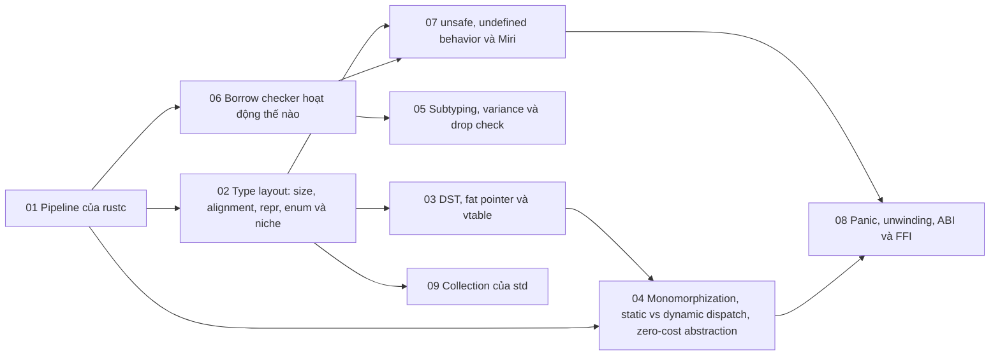

# P10 · Tổng quan — Rust internals

> Trang này chỉ điều hướng: mục tiêu, bản đồ chương, thứ tự đọc, sách gốc và câu hỏi tổng hợp. Mọi khẳng định kỹ thuật có chú thích nằm trong từng chương; các lời khuyên về thứ tự đọc là của người soạn.

## Mục tiêu của phase

Phase này mở hộp đen của compiler và runtime Rust: pipeline của rustc, layout kiểu dữ liệu, DST/fat pointer/vtable, monomorphization, variance và drop check, borrow checker trên MIR, `unsafe`/UB/Miri, panic/ABI/FFI. Mỗi chương dựa lên những gì bạn đã học ở P2–P4 và P9. Đích đến là đọc được thông báo lỗi và mã máy của Rust như đọc một hệ thống bạn hiểu cơ chế, không phải một ma thuật.

## Bản đồ chương

Mũi tên nghĩa là chương đích dùng khái niệm của chương nguồn (nhận xét của người soạn về thứ tự học).

## Các chương

| Chương | Nội dung chính |
|---|---|
| [01 — Pipeline của rustc](01-pipeline-rustc.md) | Các biểu diễn trung gian từ `.rs` đến binary; lexing, parsing, macro expansion, name resolution; HIR và THIR, type inference, trait solving; MIR; monomorphization, codegen unit, LLVM, linker; hệ query và incremental compilation. |
| [02 — Type layout: size, alignment, repr, enum và niche](02-type-layout.md) | Size, alignment, padding và vì sao `size_of` chưa phải hợp đồng; `repr(Rust)` vs `repr(C)`; `align`/`packed`/`transparent`; enum, tag/discriminant; niche và `Option<&T>`; niche mà std hứa; ZST. |
| [03 — DST, fat pointer và vtable](03-dst-fat-pointer-vtable.md) | Vì sao DST không nằm trong biến cục bộ, `?Sized`; kích thước fat pointer; unsized coercion; vtable chứa gì và lời gọi `dyn`; điều kiện của `dyn Trait`; `+ Send`, upcasting, `Any`; struct có DST cuối; chi phí `Box<dyn Handler>`. |
| [04 — Monomorphization, static vs dynamic dispatch, zero-cost abstraction](04-monomorphization.md) | Monomorphization là gì và làm ở đâu; static vs dynamic dispatch; generic vs `dyn Trait`; closure, `impl Fn` vs `Box<dyn Fn>`; "zero-cost" của iterator; code bloat và compile time; `#[inline]`, codegen unit, LTO. |
| [05 — Subtyping, variance và drop check](05-variance-va-dropck.md) | Subtyping và `'long <: 'short`; covariant/contravariant/invariant của các kiểu phổ biến; vì sao `&mut T` và `Cell<T>` invariant; variance của struct tự định nghĩa và `PhantomData`; drop check; `#[may_dangle]`; lỗi lifetime của generic container. |
| [06 — Borrow checker hoạt động thế nào](06-borrow-checker.md) | Borrow checker chạy ở đâu trong pipeline; MIR và `--emit=mir`; lexical lifetime vs NLL; region inference; loan và E0499/E0502/E0505/E0506; two-phase borrow; "problem case #3" và Polonius; `unsafe` ngoài tầm borrowck. |
| [07 — unsafe, undefined behavior và Miri](07-unsafe-ub-miri.md) | `unsafe` là hợp đồng; undefined behavior và các nhóm UB; sound vs unsound, ranh giới module; aliasing, `&mut` và `UnsafeCell`; raw pointer hợp lệ và provenance; `MaybeUninit`; Miri bắt gì và không chứng minh gì. |
| [08 — Panic, unwinding, ABI và FFI](08-panic-abi-ffi.md) | Panic và unwinding, destructor; `panic=unwind` vs `abort`; `catch_unwind`, `UnwindSafe`, poisoning; ABI `"Rust"`/`"C"`/`"system"`, khối `extern`; kiểu an toàn qua FFI; panic băng qua FFI, `"C-unwind"`; tường chắn panic khi mở API cho C. |
| [09 — Bên trong collection của std: Vec, String, HashMap, BTreeMap, VecDeque](09-collections-internals.md) | `Vec<T>` và `RawVec`, khi nào không cấp phát; capacity tăng thế nào, `with_capacity`/`reserve`/`shrink_to_fit`; `String` là `Vec<u8>` UTF-8 và vì sao không `s[0]`; `HashMap` (hashbrown/SwissTable), load factor; SipHash, HashDoS, `RandomState`; `BTreeMap`; `VecDeque` là ring buffer; bảng chọn collection. |

## Thứ tự đọc

Đọc 01 → 09 theo số. Chương 01 đặt bản đồ nên đọc trước; 03, 04 là cặp (dyn vs generic); 05, 06 là cặp (lifetime); 07, 08 đọc cuối vì dùng layout, vtable và borrowck làm nền. Chương 09 (collection của std) dùng layout từ chương 02 và allocator của P3 nên có thể đọc ngay sau 02 nếu bạn đang quan tâm `Vec`/`HashMap`; các chỗ có `unsafe` bên trong dễ theo dõi hơn nếu đã đọc 07 (lời khuyên của người soạn).

## Lộ trình đọc sách gốc

Các nguồn dưới đây đều là nguồn mà chương của phase đã dùng; mở đọc song song với chương tương ứng. Không bắt buộc: chương đã tự chứa phần cần thiết.

- [rustc-dev-guide — Overview of the compiler](https://rustc-dev-guide.rust-lang.org/overview.html) — chương 01.
- [rustc-dev-guide — The MIR](https://rustc-dev-guide.rust-lang.org/mir/index.html) — chương 01, 06.
- [rustc-dev-guide — Borrow check](https://rustc-dev-guide.rust-lang.org/borrow-check.html) — chương 06.
- [rustc-dev-guide — Region inference](https://rustc-dev-guide.rust-lang.org/borrow-check/region-inference.html) — chương 06.
- [rustc-dev-guide — Two-phase borrows](https://rustc-dev-guide.rust-lang.org/borrow-check/two-phase-borrows.html) — chương 06.
- [The Rust Reference — Type layout](https://doc.rust-lang.org/1.95.0/reference/type-layout.html) — chương 02.
- [The Rust Reference — Dynamically sized types](https://doc.rust-lang.org/1.95.0/reference/dynamically-sized-types.html) — chương 03.
- [The Rust Reference — Trait objects](https://doc.rust-lang.org/1.95.0/reference/types/trait-object.html) — chương 03.
- [The Rustonomicon — Exotic Sizes](https://doc.rust-lang.org/1.95.0/nomicon/exotic-sizes.html) — chương 03.
- [The Rustonomicon — Subtyping and Variance](https://doc.rust-lang.org/1.95.0/nomicon/subtyping.html) — chương 05.
- [The Rustonomicon — Drop Check](https://doc.rust-lang.org/1.95.0/nomicon/dropck.html) — chương 05.
- [The Rustonomicon — PhantomData](https://doc.rust-lang.org/1.95.0/nomicon/phantom-data.html) — chương 05.
- [Polonius — current status (commit 41ae30d)](https://github.com/rust-lang/polonius/blob/41ae30d2cb66d82098a8b8abd2cbccf1c1a2a96f/book/src/current_status.md) — chương 06.
- [Miri — README (commit 0923e3e)](https://raw.githubusercontent.com/rust-lang/miri/0923e3ee8eccff5912b668cbccf3bc464ff3c0e1/README.md) — chương 07.

## Câu hỏi tổng hợp xuyên chương

Không có đáp án ở đây; mỗi câu trỏ về chương cần đọc lại.

1. Từ `cargo build` đến binary: những giai đoạn nào của rustc chạy, và borrow checker đứng ở đâu trong chuỗi đó? ([chương 01](01-pipeline-rustc.md), [chương 06](06-borrow-checker.md)).
2. `size_of::<Option<&T>>()` và `size_of::<Option<u32>>()`: niche, `repr` và padding giải thích thế nào? ([chương 02](02-type-layout.md)).
3. `&dyn Trait` và `T: Trait` biên dịch ra mã máy khác nhau thế nào, và `Box<dyn Handler>` đắt ở đâu? ([chương 03](03-dst-fat-pointer-vtable.md), [chương 04](04-monomorphization.md)).
4. Vì sao `&mut T` phải invariant, và vì sao thêm `impl Drop` làm một chương trình đang biên dịch được bỗng bị từ chối? ([chương 05](05-variance-va-dropck.md), [chương 06](06-borrow-checker.md)).
5. Một chương trình đúng về ngữ nghĩa vẫn bị borrow checker từ chối: lý do nằm ở MIR, NLL hay hạn chế khác, và Polonius có sửa không? ([chương 06](06-borrow-checker.md)).
6. `unsafe` đổi trách nhiệm của ai, undefined behavior là gì, và Miri bắt được loại lỗi nào? ([chương 07](07-unsafe-ub-miri.md), [chương 02](02-type-layout.md)).
7. Panic đi qua ranh giới `extern "C"` thì chuyện gì có thể xảy ra, và ABI nào là ổn định? ([chương 08](08-panic-abi-ffi.md); P2 [chương 04](../02-cpu/04-calling-convention-va-stack-frame.md)).
8. Monomorphization đổi gì giữa tốc độ chạy và kích thước binary so với `dyn`? ([chương 04](04-monomorphization.md), [chương 03](03-dst-fat-pointer-vtable.md)).

## Lab

Làm sau khi đã đọc lý thuyết:

- [Lab 10 — Rust internals](../labs/10-rust-internals-lab.md)
- [Capstone — HTTP server trên epoll rồi mini async runtime](../labs/capstone.md)
