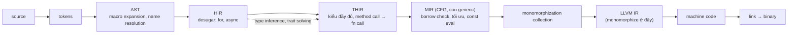
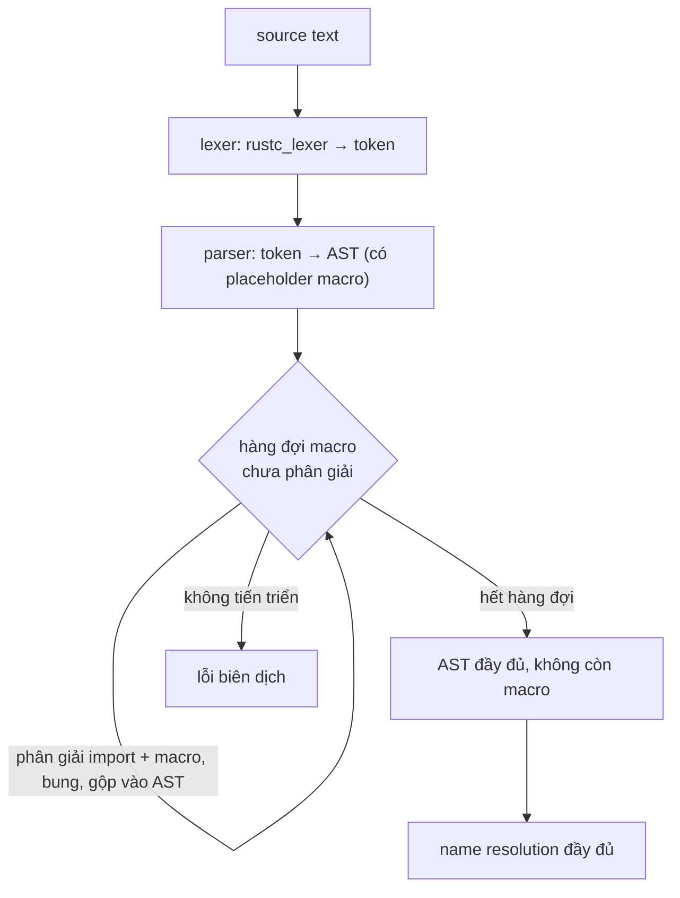
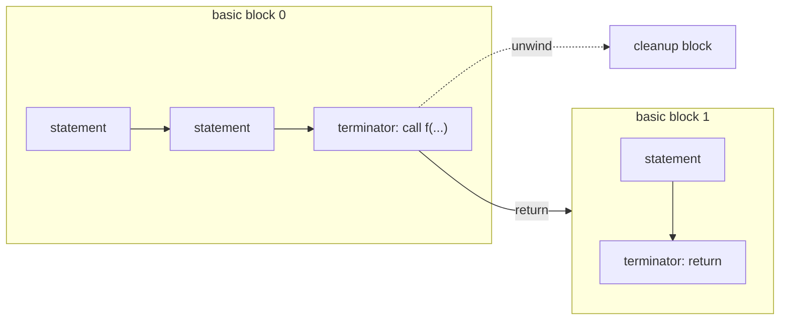
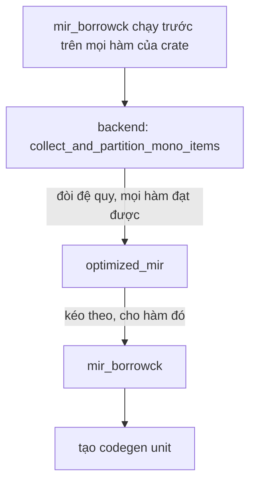

# P10 · Chương 01 — Pipeline của rustc

> Nguồn chính của chương là **rustc-dev-guide**, sách dành cho người đóng góp vào compiler. Sách không ghim phiên bản (ta đọc trang "latest"), nên mô tả có thể đã đổi khi bạn đọc. Chương này cũng không chạy compiler: mọi điều ở đây là *tài liệu nói gì*, không phải quan sát. Riêng thứ tự chạy của borrow checker so với tối ưu MIR có đối chiếu thêm với source rustc 1.95.0 ở [Chương 06, mục 1](06-borrow-checker.md#1-borrowck-chạy-ở-đâu-q1). Phần nào là ý kiến thì ghi "(nhận xét của người soạn)"; phần suy ra từ nguồn mà nguồn chưa nói thẳng thì ghi "(suy luận của người soạn)". Tên các bước ("HIR", "THIR"…) là tên *nội bộ* của rustc, không phải đặc tả ngôn ngữ (nhận xét của người soạn).

## Bạn sẽ hiểu được gì

1. **Q1.** rustc biến một file `.rs` thành binary qua những biểu diễn trung gian nào, theo thứ tự nào, và vì sao không phân tích thẳng trên text? → mục 1
2. **Q2.** Lexing, parsing, macro expansion và name resolution làm gì, và vì sao macro "chạy" trước mọi kiểm tra kiểu? → mục 2
3. **Q3.** HIR và THIR khác nhau thế nào; type inference và trait solving xảy ra ở đâu? → mục 3
4. **Q4.** MIR là gì, gồm những thành phần nào, và vì sao borrow check cùng nhiều tối ưu hóa đặt ở MIR? → mục 4
5. **Q5.** Monomorphization xảy ra lúc nào, codegen unit là gì, LLVM và linker làm phần nào? → mục 5
6. **Q6.** Vì sao rustc không phải chuỗi pass tuần tự mà là hệ "query", và incremental compilation dựa vào đó thế nào? → mục 6

## Kiến thức cần trước

Bạn chỉ cần biết biên dịch là gì ở mức "source thành file chạy được"; không cần kiến thức compiler. Ví dụ xuyên suốt chương là `orders`, một service Rust nhận đơn hàng dạng JSON và tính tổng tiền; mỗi mục sẽ chỉ ra rustc làm gì với đúng những dòng code của nó.

Chương này đứng *trước* ba chương dùng lại nó: [Chương 02 — Type layout](02-type-layout.md) (layout kiểu mà codegen cần biết), [Chương 04 — Monomorphization](04-monomorphization.md) (đi sâu mục 5) và [Chương 06 — Borrow checker](06-borrow-checker.md) (đi sâu mục 4).

## 1. Bản đồ: từ source đến binary (Q1)

> **Trả lời ngắn.** rustc không phân tích thẳng trên text, vì làm việc với text vừa bất tiện vừa dễ sai[^dev-ir-why]. Nó dựng lần lượt vài biểu diễn trung gian (IR), mỗi cái tối ưu cho một việc: dòng token, AST, HIR, THIR, MIR, rồi LLVM-IR[^dev-irs]. Cuối cùng LLVM phát machine code[^dev-llvm]. Sau đó các thư viện và binary được link với nhau thành file cuối[^dev-link].

**Giải thích.**

*Với service của bạn.* Giả sử bạn viết `orders`, một service Rust nhận JSON của đơn hàng rồi tính tổng tiền. Lõi của crate trông như dưới đây (ví dụ giả định của người soạn; chương này không biên dịch nó, chỉ dùng để chỉ ra mỗi mục sau nói về dòng nào):

```rust
use serde::{de::DeserializeOwned, Deserialize};

#[derive(Deserialize)]
struct Line { price: u64, qty: u64 }

#[derive(Deserialize)]
struct Order { id: u64, lines: Vec<Line> }

#[derive(Deserialize)]
struct Refund { order_id: u64, amount: u64 }

fn load<T: DeserializeOwned>(body: &str) -> T {
    serde_json::from_str(body).unwrap()
}

impl Order {
    fn total(&self) -> u64 {
        let mut sum = 0;
        for line in &self.lines {
            sum += line.price * line.qty;
        }
        sum
    }
}

fn handle(body: &str) -> u64 {
    let order: Order = load(body);
    match order.lines.len() {
        0 => 0,
        _ => order.total(),
    }
}

fn handle_refund(body: &str) -> u64 {
    let refund: Refund = load(body);
    refund.amount
}
```

Bạn chạy `rustc` trực tiếp, hoặc để `cargo build` gọi nó thay bạn[^dev-invoke]. Câu hỏi của chương: từ mấy chục dòng text này đến binary, rustc đã làm những gì, và mỗi loại kiểm tra (macro, kiểu, borrow) nằm ở bước nào?

### 1.1 Vì sao không phân tích thẳng trên text

Source code viết ra cho người đọc và không nhập nhằng, nhưng làm việc trực tiếp trên nó rất bất tiện và dễ lỗi, chẳng hạn khi kiểm tra kiểu. Vì vậy rustc, cũng như hầu hết compiler, dựng từ source một biểu diễn trung gian (IR) dễ phân tích hơn[^dev-ir-why]. Với `orders`: để biết `line.price` là `u64`, type checker không nên phải lo dấu cách, comment hay macro đang nằm quanh nó; trên một cây cú pháp thì chỉ cần nhìn một nút (nhận xét của người soạn).

### 1.2 Sáu biểu diễn, theo thứ tự

rustc không dùng một IR duy nhất mà dùng vài cái, mỗi cái tối ưu cho một mục đích[^dev-irs]. Theo thứ tự chạy:

1. **Token stream**: lexer cắt thẳng source thành một dòng token[^dev-lex-ir].
2. **AST** (Abstract Syntax Tree): dựng từ token, phản ánh gần như đúng những gì bạn viết[^dev-ast-desc].
3. **HIR** (High-level IR): một dạng AST đã *desugar*[^dev-hir-desc]. Desugar là bung cú pháp viết tắt thành dạng tường minh hơn[^dev-desugar]. Dạng này hợp để type check[^dev-hir-amenable].
4. **THIR** (Typed HIR): đứng giữa HIR và MIR, có đầy đủ kiểu và desugar thêm một chút[^dev-thir-typed]. Nhờ vậy hạ từ THIR xuống MIR dễ hơn hạ thẳng từ HIR[^dev-thir-easier].
5. **MIR** (Mid-level IR): về cơ bản là một control-flow graph[^dev-ir-mir].
6. **LLVM-IR**: dạng đầu vào chuẩn của LLVM[^dev-llvm-ir].



(Sơ đồ vẽ lại các câu có chú thích ở mục 1–5. Mũi tên chấm là việc làm *trên* HIR, kết quả dùng khi hạ xuống THIR.)

### 1.3 Mỗi kiểm tra "sống" ở đâu

Bảng dưới gắn từng dòng của `orders` với bước xử lý nó. Bảng gom chủ yếu từ chương *Overview of the compiler*; từng ô được giải thích kỹ ở mục tương ứng.

| Trong `orders` | rustc làm gì | Xảy ra ở | Mục |
|---|---|---|---|
| `#[derive(Deserialize)]`, `use serde::…` | bung macro, kiểm tra AST, phân giải tên, early lint | trên AST, trong giai đoạn lexing/parsing[^dev-macro] | 2 |
| `for line in &self.lines` | desugar `for` thành `loop` | lúc hạ AST xuống HIR[^dev-hir] | 3 |
| `let order: Order = load(body)` | type inference, trait solving (ghép `impl` cho bound `T: DeserializeOwned`), type checking | trên HIR[^dev-typeinf] | 3 |
| `match order.lines.len() { … }` | kiểm tra pattern và exhaustiveness | THIR[^dev-hir-mir] | 3 |
| `order.total()` | method call thành lời gọi hàm thường | THIR[^dev-thir] | 3 |
| `&self.lines` trong `total`, `sum` phải có giá trị trước khi cộng | borrow check, kiểm tra biến chưa khởi tạo, tối ưu, const eval | MIR[^dev-mir-use] | 4 |
| `load::<Order>`, `load::<Refund>` | thu thập các bản generic cần sinh mã | mức MIR[^dev-collect-mir] | 5 |
| cũng hai lời gọi trên | monomorphize thật sự | lúc chuyển MIR sang LLVM-IR[^dev-codegen] | 5 |

<details><summary>Đi sâu: điểm vào, cờ dòng lệnh, interning, tính song song</summary>

- Quá trình biên dịch bắt đầu khi bạn gọi `rustc` trên source. Việc compiler phải làm do tùy chọn dòng lệnh quyết định: ví dụ bật tính năng nightly bằng cờ `-Z`, chỉ kiểm tra mà không sinh mã, hay phát LLVM-IR thay vì machine code. `cargo` cũng có thể gọi `rustc` thay bạn[^dev-invoke].
- Việc đọc tham số dòng lệnh nằm trong crate `rustc_driver`[^dev-driver].
- Nhiều giá trị trong compiler được *intern*: compiler cấp phát chúng trong một arena đặc biệt rồi chuyền tham chiếu đi. Nhờ vậy giá trị giống hệt nhau (ví dụ một kiểu) chỉ cấp phát một lần và so sánh rẻ bằng so con trỏ[^dev-intern].
- Về song song: sách ghi rằng chỉ một phần của rustc song song theo mặc định, đó là code generation. Phần còn lại chưa song song; đã tốn nhiều công nhưng nói chung đây là bài toán khó[^dev-par].
- Compiler phải cân nhiều mục tiêu kéo ngược nhau, ví dụ tốc độ compile[^dev-goals]. Sách còn nêu bộ nhớ compiler dùng, tốc độ và kích thước của chương trình sinh ra, và thời gian build bản thân compiler[^dev-goals-more]; danh sách trong sách còn dài hơn.

</details>

**Quay lại Q1:** rustc đi qua token → AST → HIR → THIR → MIR → LLVM-IR → machine code → link, và mỗi tầng đặt đúng chỗ cho một loại kiểm tra; với `orders`, macro `derive` xử lý ở tầng AST, vòng `for` ở HIR, borrow check ở MIR.

## 2. Lexing, parsing, macro expansion, name resolution (Q2)

> **Trả lời ngắn.** Lexer cắt text thành token[^dev-lex]. Parser dịch dòng token đó thành AST[^dev-parse]. Ngay trong giai đoạn này compiler còn bung macro, kiểm tra AST, phân giải tên và chạy early lint[^dev-macro]. Vì tất cả xảy ra trước khi có HIR, type checker chỉ thấy code đã bung hết macro (suy luận của người soạn từ thứ tự trên).

**Giải thích.**

*Với service `orders`.* Ba dòng `#[derive(Deserialize)]` ở đầu `orders` không phải code mà type checker nhìn thấy: chúng là lời gọi macro. rustc phải bung chúng thành code thật, và tìm ra `Deserialize` nghĩa là gì, trước khi các bước sau chạy (suy luận của người soạn từ thứ tự các giai đoạn). Mục này đi theo bốn việc theo đúng thứ tự: lexing, parsing, macro expansion, name resolution.

### 2.1 Lexing: từ text sang token

Text của source trước hết đi qua một lexer mức thấp nằm trong `rustc_lexer`[^dev-lexer]. Kết quả là một dòng các đơn vị nguyên tử của source, gọi là token[^dev-lex]; với `orders`, đó là những mẩu như `fn`, `handle`, `(`, `body`… (ví dụ minh họa của người soạn). Dòng token đi tiếp qua một lexer mức cao hơn trong `rustc_parse`, nơi chuỗi ký tự đổi thành symbol đã intern[^dev-lex2]. Lexer giữ đầy đủ thông tin cho IDE và procedural macro[^dev-lex-fidelity].

### 2.2 Parsing: từ token sang AST

Parser dịch dòng token thành AST, theo kiểu recursive descent, tức phân tích cú pháp từ trên xuống[^dev-rd]. AST phản ánh cấu trúc của chương trình trong bộ nhớ, và dùng `Span` để nối mỗi nút về đoạn text gốc[^dev-ast-span]. Khi gặp lỗi cú pháp, parser cố phục hồi bằng cách phân tích một *tập cha* của ngữ pháp Rust và phát ra một kiểu "lỗi"[^dev-recover].

### 2.3 Macro expansion

`#[derive(Deserialize)]` của `orders` được xử lý ở đây. Việc bung macro làm ở mức crate[^dev-macro-crate]. Với source thô của một crate, compiler sinh ra một AST lớn: mọi macro đã bung, mọi module đã nằm sẵn trong đó[^dev-macro-fully].

Thuật toán là một vòng lặp trên hàng đợi các lời gọi macro chưa phân giải, tức những macro compiler chưa tìm được định nghĩa[^dev-macro-queue]. Nếu một vòng không tiến triển được thì đó là lỗi biên dịch[^dev-macro-noprogress]. Macro nào sinh ra token (ví dụ proc macro, loại mà `derive(Deserialize)` thuộc về; nhận xét của người soạn) thì compiler parse chỗ token đó thành AST, và bước parse này có thể báo lỗi[^dev-macro-tokens].

### 2.4 Name resolution

Phân giải tên là quá trình hai pha[^dev-nr-twophase]. Pha đầu chạy *ngay trong lúc* bung macro và chỉ phân giải import cùng tên macro, vì không biết macro nào thì không biết cần bung gì[^dev-nr-partial]. Với `orders`, `use serde::Deserialize` phải phân giải xong thì `derive(Deserialize)` mới bung được (suy luận của người soạn từ câu trên).

Pha sau chạy khi đã có AST đầy đủ và phân giải mọi tên trong crate[^dev-nr-late]. Lúc này mỗi tên chỉ cần thử một lần, vì không còn tên mới nào được thêm vào[^dev-nr-once]. Một chuyện nhỏ về namespace: `type x = u32; let x: x = 1;` hợp lệ vì tên kiểu và tên biến nằm ở các namespace khác nhau nên cùng tồn tại được[^dev-nr-ns].



(Sơ đồ rút gọn từ thuật toán trong chương *Macro expansion*; chỉ vẽ các nhánh sách mô tả.)

<details><summary>Đi sâu: NodeId, cfg, hygiene, proc macro</summary>

- Mỗi nút AST có một `NodeId`, kể cả statement và expression; đó là số định danh duy nhất trong crate[^dev-nodeid-def]. Nhưng vì `NodeId` tuyệt đối trong crate, thêm hay bỏ một nút làm mọi `NodeId` sau đó đổi, nên nó gần như vô dụng cho incremental compilation[^dev-nodeid-incr]. Sách ghi `NodeId` dùng ở các phần làm việc trực tiếp trên AST, như macro expansion và name resolution[^dev-nodeid-use].
- `cfg` và `cfg_attr` được xử lý đặc biệt, khác các macro thường[^dev-cfg].
- Vòng lặp macro còn ghi dữ liệu hygiene. Khi một macro được phân giải, compiler gọi `set_expn_data` để điền thuộc tính của nó vào dữ liệu toàn cục gắn với `ExpnId`[^dev-macro-expn]. Khi bung, compiler tạo các `SyntaxContext`[^dev-macro-syntaxctx]. Sách dành riêng một mục *Hygiene* về cách thu thập dữ liệu này[^dev-macro-hyg].
- Điều đáng nhớ cho người dùng `proc-macro`: Reference nói procedural macro hoạt động trên token stream chứ không phải nút AST[^ref-proc-token]. Giai đoạn này đứng trước type check, nên proc macro không có thông tin kiểu để hỏi (suy luận của người soạn từ thứ tự các giai đoạn).

</details>

**Quay lại Q2:** macro, import và tên được xử lý trên AST, trước HIR và trước type check; nhờ vậy các bước sau chỉ làm việc với code đã bung hết, như `Order` đã có phần code mà `derive` sinh ra.

## 3. HIR, THIR và type checking (Q3)

> **Trả lời ngắn.** AST hạ (lowering) thành HIR, một dạng AST đã desugar, ví dụ `for` thành `loop`[^dev-hir]. Type inference, trait solving và type checking chạy trên HIR[^dev-typeinf]. Khi kiểu đã đầy đủ, HIR hạ tiếp qua THIR, một dạng desugar sâu hơn dùng để kiểm tra pattern rồi dựng MIR[^dev-hir-mir].

**Giải thích.**

*Với service `orders`.* Ở mục này hai thứ xảy ra với `total` và `handle`. Thứ nhất, vòng `for line in &self.lines` không còn là `for` nữa. Thứ hai, rustc biết `line.price` kiểu gì, `load(body)` trả kiểu gì, và `order.total()` thực chất gọi hàm nào. Ta đi theo ba bước: hạ xuống HIR, type checking trên HIR, rồi hạ tiếp xuống THIR.

### 3.1 Hạ AST xuống HIR

HIR là biểu diễn chính ở hầu hết rustc[^dev-hir-primary]. Compiler sinh nó sau khi parsing, macro expansion và name resolution đã xong[^dev-hir-after]. Bước chuyển từ AST sang HIR gọi là lowering, và kèm nhiều desugar (bung cú pháp viết tắt thành dạng tường minh) cho những thứ như loop và `async fn`[^dev-desugar]. Vòng `for` trong `total` là một ví dụ: nó bị đổi thành `loop`, nên HIR không còn `for` nữa[^dev-hir].

Phần còn lại của HIR vẫn gần cách bạn viết, kèm một số thứ ngầm như lifetime bị lược[^dev-hir-implicit]. Dạng này thuận tiện cho type checking[^dev-hir-amenable].

### 3.2 Type checking trên HIR

Trên HIR, rustc làm ba việc: type inference (tự suy ra kiểu của biểu thức), trait solving (ghép một `impl` với mỗi chỗ dùng trait) và type checking[^dev-typeinf]. Trong `orders`, `sum` khởi tạo bằng `0` rồi cộng với một `u64`, nên rustc suy ra `sum: u64`; còn `let order: Order = load(body)` cho `T = Order`, rồi trait solving phải tìm một `impl DeserializeOwned for Order` cho bound của `load` (minh họa của người soạn). Type checking ở đây còn có nghĩa là chuyển các kiểu bạn viết (`hir::Ty`) sang biểu diễn nội bộ của compiler (`Ty<'tcx>`)[^dev-typeck-conv].

### 3.3 Hạ tiếp xuống THIR

Kiểu chỉ điền đầy đủ được sau khi type checking xong[^dev-thir-typed2]. Từ lúc đó THIR mới dựng được, và nó desugar thêm: tham chiếu và dereference tự động thành tường minh, method call và toán tử overload thành lời gọi hàm thường[^dev-thir]. Trong `orders`, `order.total()` thành lời gọi hàm thường nhận `&order` làm tham số (minh họa của người soạn).

THIR là bước đệm: hạ từ THIR xuống MIR dễ hơn hạ thẳng từ HIR[^dev-thir-easier]. Nó cũng là nơi kiểm tra pattern và exhaustiveness[^dev-hir-mir]; với `orders`, đó là việc kiểm tra `match order.lines.len()` đã phủ hết các trường hợp (minh họa của người soạn).

<details><summary>Đi sâu: HIR lưu thế nào, THIR chỉ có body, định danh</summary>

- Cấu trúc HIR lưu *ngoài luồng*: nút module `foo` chỉ giữ `ItemId` của hàm `bar()` bên trong; muốn chi tiết thì phải tra bảng `items`[^dev-hir-ooband]. Lợi ích kèm theo: mỗi lần tra là một cơ hội để compiler ghi nhận phụ thuộc cho incremental compilation[^dev-hir-incr].
- `DefId` định danh một định nghĩa (item) trong một crate. Không có `DefId` cho mỗi expression nên nó ổn định hơn qua các lần biên dịch[^dev-defid]. `HirId` định danh một nút HIR của crate hiện tại và chi tiết đến expression[^dev-hirid].
- HIR chỉ dựng cho crate đang biên dịch[^dev-hir-crate].
- THIR giống MIR ở chỗ chỉ biểu diễn *body* (code thực thi: thân hàm, const initializer), nên không có biểu diễn cho struct hay trait[^dev-thir-nobodies]. Mỗi body THIR chỉ lưu tạm và bị hủy khi hết cần, khác HIR lưu đến hết quá trình biên dịch[^dev-thir-temp].
- Trang THIR liệt kê THIR dùng cho dựng MIR, kiểm tra exhaustiveness, kiểm tra `unsafe` và kiểm tra explicit tail call (ghi nhận tại thời điểm sách viết)[^dev-thir-use].
- Muốn xem HIR thì dùng cờ `-Z` (thuộc các tính năng nightly[^dev-invoke]): `-Z unpretty=hir-tree`[^dev-unpretty-tree], hoặc `-Z unpretty=hir` cho dạng gần source hơn[^dev-unpretty].

</details>

**Quay lại Q3:** HIR là AST đã desugar để type check (`for` trong `total` thành `loop`); THIR là HIR đã có kiểu và desugar sâu hơn (`order.total()` thành lời gọi hàm thường), làm cầu sang MIR.

## 4. MIR: nơi borrow check và tối ưu sống (Q4)

> **Trả lời ngắn.** MIR là dạng của một hàm sau khi đã đơn giản hóa tối đa: một đồ thị gồm các khối lệnh đơn giản nối nhau bằng mũi tên rẽ nhánh (CFG, đồ thị luồng điều khiển), không còn biểu thức lồng nhau và mọi kiểu đều tường minh[^dev-mir-chars]. Vì MIR đơn giản hơn HIR nhiều nên borrow checker đỡ lỗi[^dev-bc-simpler]. MIR còn *generic*, tức chưa tách thành bản riêng cho từng kiểu cụ thể, nên nhiều phân tích làm ở đây hiệu quả hơn so với sau monomorphization[^dev-mir-generic]. Vì vậy rustc đặt ở MIR việc borrow check, kiểm tra biến chưa khởi tạo, nhiều tối ưu và const evaluation[^dev-mir-use]. Borrow checker chạy trên MIR[^dev-bc-mir]. Chính điều đó cho phép "non-lexical lifetimes", tức vùng sống của borrow được suy ra từ đồ thị luồng điều khiển[^dev-nll].

**Giải thích.**

*Với service `orders`.* MIR là dạng mà `total` mang khi đến borrow checker: một vòng lặp, một phép cộng dồn và một lần trả về, tất cả thành các khối lệnh nối nhau, không còn câu lệnh lồng nhau. Câu hỏi mà borrow checker phải trả lời kiểu như "có đường đi nào trong hàm dùng `&self.lines` sau khi dữ liệu đã hết hiệu lực không?". Hỏi chuyện đó trên đồ thị đường đi thì tự nhiên hơn nhiều so với hỏi trên cây cú pháp lồng nhau (nhận xét của người soạn).

### 4.1 Thành phần của MIR

- **Basic block** là đơn vị của CFG. Nó gồm các *statement*, mỗi statement chỉ có một successor, và kết thúc bằng một *terminator*. Terminator có thể có nhiều successor và luôn nằm cuối block[^dev-mir-bb].
- **Local** là chỗ nhớ cấp trên stack (về mặt khái niệm) cho tham số, biến cục bộ và temporary. Local đánh số `_1`, `_2`…; riêng `_0` giữ giá trị trả về[^dev-mir-locals].
- Biến trong MIR không có tên, chỉ có chỉ số, và biến của bạn nằm lẫn với temporary[^dev-mir-nonames]. Chỗ duy nhất còn cho biết `_1` là biến của người dùng là phần chú thích debuginfo[^dev-mir-hint]. Mỗi chú thích đó gắn tên biến với place để debugger tìm được dữ liệu của biến[^dev-mir-debuginfo].
- **Place** là biểu thức chỉ một vị trí trong bộ nhớ, như `_1` hay `_1.f`. **Rvalue** là biểu thức sinh ra giá trị. **Operand** là đối số của rvalue, là hằng hoặc một place[^dev-mir-place].
- Lời gọi hàm luôn là terminator, vì nó có thể unwind[^dev-mir-call]. Trong `orders`, `serde_json::from_str(body)` bên trong `load` là một terminator như thế. Unwind nghĩa là khi panic, Rust đi ngược lên stack và dọn dữ liệu của từng hàm nó đi qua[^book-unwind]; chi tiết ở [Chương 08, mục 1](08-panic-abi-ffi.md).



(Sơ đồ minh họa khái niệm basic block/terminator và lý do lời gọi hàm là terminator, không phải một MIR dump thật. Nhánh unwind vẽ theo ví dụ trong sách, nơi một lời gọi hàm có hai successor: `return` và `unwind`[^dev-mir-unwind-edge]. Việc gọi block đích là "cleanup" là cách đặt tên của người soạn.)

### 4.2 Vì sao dùng MIR

Điểm mấu chốt là MIR còn generic. Với `orders`, `load::<T>` trong MIR vẫn là *một* hàm cho mọi `T`; phân tích nó một lần rẻ hơn phân tích hai bản riêng cho `Order` và `Refund` sau khi monomorphize (suy luận của người soạn từ câu trên của sách[^dev-mir-generic]). Nhiều tối ưu cũng đặt ở MIR vì nó generic, và điều đó cải thiện cả code generation lẫn tốc độ biên dịch về sau[^dev-mir-opt]. Ngoài ra một số tối ưu dễ làm ở MIR hơn ở LLVM-IR[^dev-mir-opt-easier].

### 4.3 Borrow checker nằm ở đâu trong luồng

Còn thứ tự giữa borrow check và tối ưu thì sao? Trang "MIR queries and passes" trả lời qua hai query. `mir_drops_elaborated_and_const_checked` làm borrow checking rồi chuẩn bị MIR cho tối ưu[^dev-mir-passes-drops]. `optimized_mir` mới là nơi chạy các tối ưu[^dev-mir-passes-opt]. Vậy borrow check chạy trên MIR *trước* các pass tối ưu và trước khi sinh mã. Nó còn phải chạy cho mọi code vì tính đúng đắn, kể cả dead code[^dev-bc-dead]; một hàm của `orders` mà không ai gọi vẫn bị kiểm (suy luận của người soạn từ câu trên).

Chuỗi query đầy đủ theo trang Overview, đối chiếu với source rustc 1.95.0, và danh sách luật borrow checker ép buộc nằm ở [Chương 06, mục 1](06-borrow-checker.md#1-borrowck-chạy-ở-đâu-q1). Region inference ở mục 4, two-phase borrow ở mục 6, vì sao chương trình đúng vẫn bị từ chối ở mục 7.

<details><summary>Đi sâu: định dạng MIR dump, <code>--emit</code>, MIR chưa tối ưu</summary>

- MIR còn dùng cho const evaluation qua Miri[^dev-mir-use]; `unsafe` và Miri ở [Chương 07](07-unsafe-ub-miri.md) (Miri: mục 7).
- Định dạng in MIR chỉ dành cho người đọc và có thể đổi không báo trước[^dev-mir-warn].
- `--emit` của rustc nhận nhiều giá trị: `mir` (file `CRATE_NAME.mir`)[^rustc-emit], `llvm-ir` (`CRATE_NAME.ll`)[^rustc-emit-ir], `asm` (`CRATE_NAME.s`)[^rustc-emit-asm] và `obj` (file object native)[^rustc-emit-obj].
- MIR trên Playground là bản *đã tối ưu*, trong đó một số statement như `StorageLive` đã bị bỏ[^dev-mir-playground]. Muốn xem MIR chưa tối ưu thì dùng `-Z mir-opt-level=0 --emit mir`, cần toolchain nightly[^dev-mir-nightly].
- Chương này không chạy lệnh nào để xem MIR. Ví dụ MIR thật (dump `--emit=mir`, đã chạy khi soạn Chương 06) nằm ở [Chương 06, mục 2](06-borrow-checker.md#2-mir-trong-năm-phút-q2). Dump đó là MIR đã tối ưu, không phải đúng thứ borrow checker đã duyệt (đối chiếu source ở [Chương 06, mục 1](06-borrow-checker.md#1-borrowck-chạy-ở-đâu-q1)).

</details>

**Quay lại Q4:** MIR là CFG đơn giản, còn generic; vì vậy các phân tích dataflow như borrow check của `total`, cùng nhiều tối ưu, đặt ở đây, và borrow check chạy trước các pass tối ưu.

## 5. Monomorphization, codegen, LLVM, link (Q5)

> **Trả lời ngắn.** Code generic được "đóng dấu" thành một bản riêng cho mỗi kiểu cụ thể cần dùng[^dev-mono]. rustc trước hết *thu thập* danh sách các bản đó, ở mức MIR[^dev-collect-mir]. Sau đó nó mới monomorphize thật khi chuyển MIR sang LLVM-IR[^dev-codegen]. Danh sách được chia vào các codegen unit (CGU)[^dev-mono-run]; mỗi CGU là một "module" LLVM, và nhiều module có thể được codegen đồng thời[^dev-cgu]. LLVM tối ưu thêm rồi phát machine code[^dev-llvm], và các object được link lại[^dev-link]. Chương trình sinh ra nhanh, đổi lại tốn thời gian biên dịch và kích thước binary[^dev-mono-cost].

**Giải thích.**

*Với service `orders`.* `load<T>` là hàm generic, nhưng `handle` gọi nó với `Order` còn `handle_refund` gọi với `Refund`. Mục này trả lời: rustc sinh machine code cho `load` ra sao khi `T` có hai giá trị, cái giá phải trả là gì, và đoạn code đó đi qua những ai trước khi thành binary.

### 5.1 Monomorphization là gì

Monomorphization là việc làm bản sao của toàn bộ code generic, với tham số kiểu thay bằng kiểu cụ thể[^dev-mono-def]. Ví dụ trong sách: dùng cả `Vec<u64>` và `Vec<String>` thì binary có hai bản code cho `Vec`[^dev-mono]. Theo đúng cách đó, `load::<Order>` và `load::<Refund>` sẽ thành hai hàm riêng trong binary của `orders` (suy luận của người soạn). Đây là bước đầu tiên của backend rustc[^dev-mono-first].

### 5.2 Collection: lập danh sách cần đóng dấu

Muốn đóng dấu thì trước hết phải biết cần những bản nào. Công việc đó gọi là collection, và code làm việc đó là *monomorphization collector*[^dev-mono-collect-def]. Ví dụ của sách: `main` gọi `banana` gọi `peach::<u64>` thì collector trả danh sách `[main, banana, peach::<u64>]`, những hàm sẽ được sinh machine code[^dev-mono-collect]. Với `orders`, danh sách sẽ có `handle`, `handle_refund`, `load::<Order>` và `load::<Refund>` (minh họa của người soạn). Collector cũng thêm cả `static` vào danh sách[^dev-mono-statics].

Bước này chạy ở mức MIR[^dev-collect-mir]. Cụ thể, `codegen_crate` gọi query `collect_and_partition_mono_items`, làm collection rồi chia các mục thành codegen unit[^dev-mono-run].

### 5.3 Codegen unit (CGU)

Mỗi CGU sẽ trở thành một "module" LLVM, và nhiều module có thể được codegen đồng thời để tận dụng nhiều lõi[^dev-cgu]. Cách chia còn tính tới build tăng dần: bộ chia tạo hai CGU cho mỗi module ở mức source, một cho code "ổn định" (không generic) và một cho code hay đổi hơn (các bản monomorphize/specialize)[^dev-mono-cgu]. Nếu `total` và `load` nằm cùng một module, `total` sẽ vào CGU ổn định còn `load::<Order>` vào CGU kia (suy luận của người soạn). Số CGU tối đa của một crate chỉnh được bằng cờ `-C codegen-units`[^rustc-cgu].

### 5.4 Sang LLVM và link

rustc dùng LLVM nên bước đầu của codegen là đổi MIR sang LLVM-IR, và *đó mới là chỗ MIR thực sự được monomorphize*[^dev-codegen]. LLVM-IR vào LLVM, nơi nó được tối ưu thêm nhiều rồi phát machine code (ví dụ object ELF hoặc WASM)[^dev-llvm]. Các object đi tới linker cùng (tùy chọn) object metadata, để ra archive hoặc file thực thi[^dev-link-obj].

Dùng LLVM có ba lợi ích mà sách nêu: không phải viết cả backend, hưởng bộ tối ưu hóa lớn của LLVM, và biên dịch sang mọi nền tảng LLVM hỗ trợ[^dev-llvm-benefit].

<details><summary>Đi sâu: bảng CGU cho generic, LTO, vì sao chương này không đo kích thước</summary>

- Bảng trong chương *Monomorphization* mô tả crate B dùng hàm của crate A. Hàm không generic của A không xuất hiện trong CGU nào của B (bảng có thêm một dòng riêng cho hàm `#[inline]`; xem [Chương 04, mục 7](04-monomorphization.md))[^dev-mono-table-ng]. Hàm generic của A thì mọi bản monomorphize xuất hiện trong một CGU của B, bất kể inline[^dev-mono-table].
- Không nhất thiết codegen là bước chạy tối ưu: với một số kiểu LTO, tối ưu hóa có thể xảy ra lúc link[^dev-lto].
- Các CGU đã được lập từ thời điểm monomorphization collection[^dev-cgu-est].
- Nhận xét của người soạn: một bản mã cho mỗi kiểu là lý do generic không tốn chi phí runtime[^book-generic-cost]. Cái giá là thời gian compile và kích thước binary[^dev-mono-cost]. Trait object (`dyn`) đi hướng ngược lại: method được chọn lúc chạy qua các con trỏ trong trait object, và việc tra cứu này có chi phí runtime[^book-dyn]. Vtable ở [Chương 03](03-dst-fat-pointer-vtable.md). Chương này không đo kích thước nào; so sánh chi tiết nằm ở [Chương 04 — Monomorphization](04-monomorphization.md).
- Suy luận của người soạn: codegen cần biết layout (size, alignment) của từng kiểu để cấp chỗ và truy cập field; layout xem [Chương 02 — Type layout](02-type-layout.md).

</details>

**Quay lại Q5:** collection chọn những bản generic cần sinh (ở mức MIR, như `load::<Order>` và `load::<Refund>`), monomorphize thật xảy ra khi sinh LLVM-IR, rồi LLVM và linker làm nốt phần máy.

## 6. Query system và incremental compilation (Q6)

> **Trả lời ngắn.** rustc không được tổ chức thành chuỗi pass chạy tuần tự trên code[^dev-query-notseq]. Các bước lớn từ HIR đến LLVM-IR là những *query* gọi lẫn nhau, và kết quả của mỗi query được ghi nhớ[^dev-query-memo]. Lexing, parsing, macro expansion và name resolution thì chưa (mốc 11/2022, xem phần Đi sâu)[^dev-query-nov2022]. Nhờ cách tổ chức này, khi bạn sửa code rồi biên dịch lại, compiler làm càng ít việc thừa càng tốt[^dev-query-why]. Vì thế sơ đồ ở mục 1 là thứ tự phụ thuộc về mặt khái niệm, không phải thứ tự thực thi từng dòng (suy luận của người soạn).

**Giải thích.**

*Với service `orders`.* Bạn sửa một dòng trong `total` rồi `cargo build` lại. Nếu rustc chạy lại toàn bộ pipeline từ lexing thì dòng sửa nhỏ đó cũng tốn bằng một lần build đầy đủ. Câu hỏi của mục này: làm sao rustc biết phần nào của `orders` không cần làm lại?

### 6.1 Query là gì

Trong rustc, các bước lớn ở trên được tổ chức thành các query gọi nhau. Ví dụ có query hỏi kiểu của một thứ, và query hỏi MIR đã tối ưu của một hàm[^dev-query-examples]. Sách gọi cách này là *demand-driven* (kéo theo nhu cầu), trái với các pass độc lập chạy lần lượt[^dev-query-demand]. Trang Query system còn ghi compiler vẫn đang chuyển dần từ kiểu pass-based sang demand-driven (mốc 7/2021)[^dev-query-passes].

### 6.2 Query chạy và cache thế nào

Lần đầu bạn gọi một query thì compiler tính; lần sau kết quả lấy từ hashtable[^dev-query-memo]. Query là method của `TyCtxt`, nơi cũng giữ cache trong bộ nhớ[^dev-query-tcx]. Khi query chưa có trong cache, compiler gọi *provider* tương ứng[^dev-query-provider]. Trong lúc chạy một query, compiler còn phát hiện *lúc chạy* nó phụ thuộc những query nào. Từ đó nó dựng đồ thị phụ thuộc của crate, làm cho tính toán tăng dần là *sound* (đúng đắn)[^dev-query-deps].

### 6.3 Một query kéo cả pipeline

Sách mô tả bức tranh nguyên lý thế này: từ HIR của một hàm, hỏi LLVM-IR của nó sẽ kéo theo `optimized_mir`, kéo theo borrow checker, kéo theo việc dựng MIR[^dev-query-drives]. Sách cũng nói thẳng bức tranh đó quá đơn giản hóa[^dev-query-simplified].

Thực tế khác một chút (sách dùng chữ "hiện tại" nên chi tiết này có thể đã đổi). Query `mir_borrowck` chạy trước trên mọi hàm của crate[^dev-bc-first]. Sau đó backend gọi `collect_and_partition_mono_items`, nó đòi đệ quy `optimized_mir` của mọi hàm đạt được; mỗi `optimized_mir` lại kéo theo `mir_borrowck` cho hàm đó, rồi codegen unit được tạo[^dev-bc-order]. Hàm nào đã kiểm ở bước trước thì kết quả query đã được ghi nhớ nên không chạy lại (suy luận của người soạn). Phần chia tách này cần giữ để hàm không với tới được vẫn phát lỗi[^dev-query-split].



(Sơ đồ chỉ vẽ các bước mà đoạn trích về `mir_borrowck` / `optimized_mir` / `collect_and_partition_mono_items` nói tới[^dev-bc-order]. Thứ tự mũi tên theo lời sách; còn nhiều query khác không được vẽ.)

### 6.4 Incremental: tô màu đỏ và xanh

Kết quả query được cache trên đĩa, để compiler biết kết quả nào đã đổi so với lần biên dịch trước và chỉ làm lại những cái đó[^dev-query-cache]. Không phải query nào cũng cache trên đĩa[^dev-query-notdisk]. Mỗi query được gán một *màu*: **đỏ** nếu kết quả lần này khác lần trước, **xanh** nếu giống[^dev-incr-colors].

Có hai ý then chốt. Một: nếu mọi input của query Q đều xanh thì Q phải cho kết quả như cũ, nên không cần chạy lại[^dev-incr-green-inputs]. Hai: input đổi vẫn có thể cho ra kết quả cũ[^dev-incr-partial]. Vì vậy sau khi chạy lại Q, ta so hash kết quả cũ với mới, và nếu hash không đổi thì Q vẫn xanh[^dev-incr-hash].

Áp vào `orders`: sửa một dòng trong `total` thì query đọc thẳng thân `total` có thể đỏ; còn query của `load`, mà input không đổi, đều xanh nên không chạy lại (minh họa của người soạn, không phải mô tả chính xác từng query).

<details><summary>Đi sâu: phần chưa query-fy, provider, try-mark-green</summary>

- Không phải mọi bước đã là query. Theo sách (mốc tháng 11/2022, hiện nay có thể đã đổi), các bước từ HIR đến LLVM-IR đã là query; còn lexing, parsing, name resolution và macro expansion chạy một lượt cho cả chương trình[^dev-query-nov2022]. Sách nói rõ rằng query system được "gắn thêm" vào compiler sau này, nên còn phần chưa query-fy. LLVM không phải code của rustc nên cũng không query-fy[^dev-query-retrofit].
- *Provider* là hàm cài đặt thật của một query, đăng ký vào struct `Providers` (query của crate hiện tại) hoặc `ExternProviders` (crate phụ thuộc)[^dev-query-providers].
- *try-mark-green* là thuật toán xác định màu của một query Q chưa chạy. Nếu Q chưa từng chạy ở lần trước thì chạy lại và tô đỏ[^dev-incr-tmg0]. Nếu từng chạy thì lần lượt hỏi màu các query nó đã đọc, *theo đúng thứ tự cũ*[^dev-incr-reads]. Có query đỏ thì Q "dirty" và chạy lại để so hash[^dev-incr-tmg]. Thứ tự đọc được giữ vì một nhánh `if` đổi kết quả có thể khiến Q đi đường khác[^dev-incr-order].
- Nhận xét của người soạn cho backend engineer: đây là cùng tư tưởng với build cache theo content hash (như Bazel) hay memoization trong service, nhưng rustc tự *khám phá* đồ thị phụ thuộc lúc chạy thay vì khai báo trước. Phần so sánh là nhận xét, không có trong nguồn.
- Ghi chú về HIR và incremental: `DefId` ổn định hơn `HirId` qua các lần biên dịch vì không có `DefId` cho từng expression[^dev-defid]. Còn `NodeId` thì gần như vô dụng cho incremental[^dev-nodeid-incr] (xem mục 2, 3).

</details>

**Quay lại Q6:** rustc là đồ thị query có cache và theo dõi phụ thuộc; "pipeline" là thứ tự phụ thuộc khái niệm, còn việc build lại `orders` nhanh nhờ tô màu đỏ/xanh.

## Liên hệ với Rust

Những gì bạn chạm hằng ngày mà ánh xạ vào pipeline này (đều là diễn giải của người soạn từ các mục trên, trừ chỗ có chú thích):

- **Lỗi borrow checker** đến từ giai đoạn MIR[^dev-bc-mir]. Lỗi macro không tìm thấy hay import không phân giải được thì đến từ giai đoạn bung macro, trước HIR[^dev-macro-undefined]. Biết lỗi đến từ tầng nào giúp bạn đoán mình đang vướng cơ chế nào (nhận xét của người soạn).
- **`--emit`** cho lấy các sản phẩm trung gian của `orders` (các giá trị `mir`, `llvm-ir`, `asm`, `obj` nằm ở phần Đi sâu của mục 4). Cờ `-Z unpretty=hir` (nightly) cho xem HIR[^dev-unpretty]. MIR chưa tối ưu thì xem bằng `-Z mir-opt-level=0 --emit mir`[^dev-mir-nightly]. Nội dung dump đổi không báo trước[^dev-mir-warn], nên đừng parse nó trong công cụ.
- **Generic cost**: viết `fn load<T: DeserializeOwned>` nghĩa là chấp nhận một bản code cho mỗi `T` thật dùng[^dev-mono]. Đổi lại generics không tốn chi phí runtime[^book-generic-cost]. Đó cũng là lý do thời gian biên dịch và kích thước binary tăng khi lạm dụng generic[^dev-mono-cost].
- **Build tăng dần**: sửa một hàm không làm rustc dựng lại mọi thứ nhờ cache query[^dev-query-cache]. Ở mức dự án, `cargo` là cách gọi `rustc` gián tiếp[^dev-invoke] (nhận xét của người soạn: CI cache thư mục `target` hiệu quả vì cùng nguyên lý "đừng làm lại cái chưa đổi").
- **Ở chương sau**: layout kiểu (size, alignment, `repr`) ở [Chương 02](02-type-layout.md), generic vs `dyn` ở [Chương 04](04-monomorphization.md), cơ chế borrow checker ở [Chương 06](06-borrow-checker.md).

## Tóm tắt

- rustc đi qua token → AST → HIR → THIR → MIR → LLVM-IR → machine code → link; mỗi biểu diễn tối ưu cho một mục đích riêng[^dev-irs].
- Macro expansion, AST validation, name resolution và early lint xảy ra ở giai đoạn đầu trên AST, trước HIR[^dev-macro].
- Name resolution có hai pha: import và macro trong lúc bung macro[^dev-nr-partial], mọi tên khi đã có AST đầy đủ[^dev-nr-late].
- HIR là AST đã desugar (`for` → `loop`)[^dev-hir]. Type inference, trait solving, type checking chạy trên HIR[^dev-typeinf].
- THIR có kiểu đầy đủ và method call thành lời gọi hàm[^dev-thir]. Nó dùng để kiểm tra pattern rồi dựng MIR[^dev-hir-mir].
- MIR là CFG đơn giản và còn generic[^dev-mir-chars]. Borrow check, kiểm tra khởi tạo, nhiều tối ưu và const eval làm ở đây[^dev-mir-use].
- Borrow check chạy trước các pass tối ưu của `optimized_mir`[^dev-mir-passes-opt].
- Monomorphization collection ở mức MIR[^dev-collect-mir]; monomorphize thật khi sinh LLVM-IR[^dev-codegen]. Chương trình nhanh đổi bằng thời gian compile và kích thước binary[^dev-mono-cost].
- Codegen unit là các module LLVM, có thể codegen song song[^dev-cgu]. Object được link ở cuối[^dev-link-obj].
- rustc là hệ query có cache[^dev-query-notseq]. Nó theo dõi phụ thuộc và tô màu đỏ/xanh để làm lại ít nhất[^dev-incr-colors].
- `mir_borrowck` chạy cho mọi hàm, kể cả hàm không với tới[^dev-query-split].

## Câu hỏi tự kiểm tra

1. Liệt kê thứ tự các biểu diễn từ source đến binary. Borrow check và monomorphization nằm ở đâu?
2. Vì sao macro "chạy" trước type checker? Type checker thấy gì?
3. Name resolution chia mấy pha và mỗi pha làm gì?
4. `for` biến thành gì trong HIR? Method call và toán tử overload biến thành gì ở THIR?
5. Kể ba đặc điểm của MIR và vì sao lời gọi hàm luôn là terminator.
6. Vì sao nhiều phân tích và tối ưu đặt ở MIR thay vì sau monomorphization?
7. Collection khác monomorphization thật ở chỗ nào? Ví dụ `main → banana → peach::<u64>` cho ra danh sách gì?
8. Codegen unit là gì? Vì sao chia nhiều CGU?
9. Mô tả hai ý then chốt của incremental compilation với màu đỏ/xanh.
10. `mir_borrowck` có chạy cho hàm không bao giờ được gọi không? Tìm bằng chứng trong sách.
11. Có phải toàn bộ rustc là query không? Phần nào không?
12. Borrow check chạy trước hay sau các pass tối ưu MIR? Chỉ ra câu của sách.

<details><summary>Đáp án</summary>

1. Token → AST → HIR → THIR → MIR → LLVM-IR → machine code → link; mục 1 đã dẫn từng bước[^dev-irs]. Borrow check chạy trên MIR, trước các pass tối ưu MIR[^dev-mir-passes-opt]. Monomorphization collection ở mức MIR[^dev-collect-mir]. Monomorphize thật khi sang LLVM-IR[^dev-codegen].
2. Macro expansion nằm ở giai đoạn đầu cùng parsing[^dev-macro]. Type inference thì chạy trên HIR, sinh ra sau đó[^dev-typeinf]. Vậy type checker chỉ thấy code đã bung (suy luận của người soạn từ thứ tự).
3. Hai pha. Trong lúc bung macro chỉ phân giải import và macro[^dev-nr-partial]. Sau khi có AST đầy đủ mới phân giải mọi tên[^dev-nr-late].
4. `for` → `loop`[^dev-hir]. Method call và toán tử overload → lời gọi hàm thường[^dev-thir].
5. MIR dựa trên CFG, không có biểu thức lồng nhau, và mọi kiểu đều tường minh[^dev-mir-chars]. Lời gọi hàm là terminator vì có thể unwind[^dev-mir-call].
6. Vì MIR còn generic nên phân tích hiệu quả hơn so với sau monomorphization[^dev-mir-generic]. Tối ưu ở đây cũng cải thiện codegen và tốc độ biên dịch[^dev-mir-opt].
7. Collection liệt kê hàm cần sinh mã, ở mức MIR[^dev-collect-mir]. Monomorphize thật xảy ra khi chuyển sang LLVM-IR[^dev-codegen]. Danh sách của ví dụ là `[main, banana, peach::<u64>]`[^dev-mono-collect].
8. CGU là các "module" LLVM; chia để codegen đồng thời, tận dụng nhiều lõi[^dev-cgu]. Bộ chia còn tách code ổn định khỏi code hay đổi để build tăng dần nhanh hơn[^dev-mono-cgu].
9. Nếu mọi input của Q xanh thì Q không cần chạy lại[^dev-incr-green-inputs]. Nếu input đổi nhưng hash kết quả không đổi thì Q vẫn xanh[^dev-incr-hash].
10. Có. Borrow checker phải chạy cho mọi code, kể cả dead code[^dev-bc-dead]. `mir_borrowck` chạy trước trên mọi hàm của crate[^dev-bc-first]. Sách nói phần chia tách này cần giữ để hàm không với tới được vẫn phát lỗi[^dev-query-split].
11. Không, theo sách (mốc 11/2022): các bước từ HIR đến LLVM-IR là query. Lexing, parsing, name resolution, macro expansion chạy một lượt cho cả chương trình[^dev-query-nov2022]. LLVM không phải query[^dev-query-retrofit].
12. Trước. `mir_drops_elaborated_and_const_checked` làm borrow checking rồi chuẩn bị MIR cho tối ưu[^dev-mir-passes-drops]. `optimized_mir` mới làm các tối ưu[^dev-mir-passes-opt]. Trang Overview cũng mô tả `optimized_mir` kéo theo `mir_borrowck` cho hàm đó[^dev-bc-order]. [Chương 06, mục 1](06-borrow-checker.md#1-borrowck-chạy-ở-đâu-q1) đối chiếu thêm với source rustc 1.95.0.

</details>

## Đọc thêm

1. [rustc-dev-guide — Overview of the compiler](https://rustc-dev-guide.rust-lang.org/overview.html): bức tranh toàn cảnh; nguồn của mục 1 và bảng "kiểm tra ở đâu".
2. [rustc-dev-guide — Lexing and Parsing](https://rustc-dev-guide.rust-lang.org/the-parser.html) và [Macro expansion](https://rustc-dev-guide.rust-lang.org/macro-expansion.html): chi tiết mục 2, kể cả hygiene.
3. [rustc-dev-guide — Name resolution](https://rustc-dev-guide.rust-lang.org/name-resolution.html): hai pha phân giải tên và namespace.
4. [rustc-dev-guide — The HIR](https://rustc-dev-guide.rust-lang.org/hir.html) và [The THIR](https://rustc-dev-guide.rust-lang.org/thir.html): định danh `DefId`/`HirId`, body, và THIR (mục 3).
5. [rustc-dev-guide — The MIR](https://rustc-dev-guide.rust-lang.org/mir/index.html) và [MIR queries and passes](https://rustc-dev-guide.rust-lang.org/mir/passes.html): từ vựng MIR đầy đủ, cách đọc dump, và thứ tự các query dựng MIR (mục 4).
6. [rustc-dev-guide — Monomorphization](https://rustc-dev-guide.rust-lang.org/backend/monomorph.html) và [Code generation](https://rustc-dev-guide.rust-lang.org/backend/codegen.html): collector, CGU, LLVM, LTO (mục 5).
7. [rustc-dev-guide — The Query System](https://rustc-dev-guide.rust-lang.org/query.html) và [Incremental compilation](https://rustc-dev-guide.rust-lang.org/queries/incremental-compilation.html): provider, try-mark-green (mục 6).
8. [The rustc book — Command-line arguments](https://doc.rust-lang.org/1.95.0/rustc/command-line-arguments.html): các giá trị `--emit`.
9. [Chương 06 — Borrow checker, mục 1](06-borrow-checker.md#1-borrowck-chạy-ở-đâu-q1): đối chiếu thứ tự borrow check và tối ưu MIR với source rustc 1.95.0.

[^dev-ir-why]: rustc-dev-guide, Overview of the compiler — <https://rustc-dev-guide.rust-lang.org/overview.html> — "In general, working directly with the source code is extremely inconvenient and error-prone. Source code is designed to be human-friendly while at the same time being unambiguous, but it’s less convenient for doing something like, say, type checking. Instead most compilers, including rustc, build some sort of IR out of the source code which is easier to analyze."
[^dev-irs]: rustc-dev-guide, Overview of the compiler — <https://rustc-dev-guide.rust-lang.org/overview.html> — "rustc has a few IRs, each optimized for different purposes:"
[^dev-lex-ir]: rustc-dev-guide, Overview of the compiler — <https://rustc-dev-guide.rust-lang.org/overview.html> — "Token stream: the lexer produces a stream of tokens directly from the source code."
[^dev-ast-desc]: rustc-dev-guide, Overview of the compiler — <https://rustc-dev-guide.rust-lang.org/overview.html> — "It represents pretty much exactly what the user wrote."
[^dev-hir-desc]: rustc-dev-guide, Overview of the compiler — <https://rustc-dev-guide.rust-lang.org/overview.html> — "High-level IR (HIR): This is a sort of desugared AST."
[^dev-thir-typed]: rustc-dev-guide, Overview of the compiler — <https://rustc-dev-guide.rust-lang.org/overview.html> — "It is like the HIR but it is fully typed and a bit more desugared (e.g. method calls and implicit dereferences are made fully explicit)."
[^dev-ir-mir]: rustc-dev-guide, Overview of the compiler — <https://rustc-dev-guide.rust-lang.org/overview.html> — "Middle-level IR (MIR): This IR is basically a Control-Flow Graph (CFG)."
[^dev-llvm-ir]: rustc-dev-guide, Overview of the compiler — <https://rustc-dev-guide.rust-lang.org/overview.html> — "LLVM-IR: This is the standard form of all input to the LLVM compiler."
[^dev-lex]: rustc-dev-guide, Overview of the compiler — <https://rustc-dev-guide.rust-lang.org/overview.html> — "At this stage, the source text is turned into a stream of atomic source code units known as tokens."
[^dev-parse]: rustc-dev-guide, Overview of the compiler — <https://rustc-dev-guide.rust-lang.org/overview.html> — "The parser translates the token stream from the lexer into an Abstract Syntax Tree (AST)."
[^dev-macro]: rustc-dev-guide, Overview of the compiler — <https://rustc-dev-guide.rust-lang.org/overview.html> — "Macro-expansion, AST-validation, name-resolution, and early linting also take place during the lexing and parsing stage."
[^dev-typeinf]: rustc-dev-guide, Overview of the compiler — <https://rustc-dev-guide.rust-lang.org/overview.html> — "We then use the HIR to do type inference (the process of automatic detection of the type of an expression), trait solving (the process of pairing up an impl with each reference to a trait), and type checking."
[^dev-hir-mir]: rustc-dev-guide, Overview of the compiler — <https://rustc-dev-guide.rust-lang.org/overview.html> — "The HIR is further lowered to MIR (used for borrow checking) by constructing the THIR (an even more desugared HIR used for pattern and exhaustiveness checking) to convert into MIR."
[^dev-mir-use]: rustc-dev-guide, Overview of the compiler — <https://rustc-dev-guide.rust-lang.org/overview.html> — "MIR is used for borrow checking and other important dataflow-based checks, such as checking for uninitialized values. It is also used for a series of optimizations and for constant evaluation (via Miri)."
[^dev-mir-generic]: rustc-dev-guide, Overview of the compiler — <https://rustc-dev-guide.rust-lang.org/overview.html> — "Because MIR is still generic, we can do a lot of analyses here more efficiently than after monomorphization."
[^dev-mir-opt]: rustc-dev-guide, Overview of the compiler — <https://rustc-dev-guide.rust-lang.org/overview.html> — "We do many optimizations on the MIR because it is generic and that improves later code generation and compilation speed."
[^dev-mir-opt-easier]: rustc-dev-guide, Overview of the compiler — <https://rustc-dev-guide.rust-lang.org/overview.html> — "It is easier to do some optimizations at MIR level than at LLVM-IR level."
[^dev-collect-mir]: rustc-dev-guide, Overview of the compiler — <https://rustc-dev-guide.rust-lang.org/overview.html> — "This is called monomorphization collection and it happens at the MIR level."
[^dev-mono-def]: rustc-dev-guide, Overview of the compiler — <https://rustc-dev-guide.rust-lang.org/overview.html> — "Rust code is also monomorphized during code generation, which means making copies of all the generic code with the type parameters replaced by concrete types."
[^dev-codegen]: rustc-dev-guide, Overview of the compiler — <https://rustc-dev-guide.rust-lang.org/overview.html> — "Since rustc uses LLVM for code generation, the first step is to convert the MIR to LLVM-IR. This is where the MIR is actually monomorphized."
[^dev-llvm]: rustc-dev-guide, Overview of the compiler — <https://rustc-dev-guide.rust-lang.org/overview.html> — "The LLVM-IR is passed to LLVM, which does a lot more optimizations on it, emitting machine code which is basically assembly code with additional low-level types and annotations added"
[^dev-link]: rustc-dev-guide, Overview of the compiler — <https://rustc-dev-guide.rust-lang.org/overview.html> — "The different libraries/binaries are then linked together to produce the final binary."
[^dev-goals]: rustc-dev-guide, Overview of the compiler — <https://rustc-dev-guide.rust-lang.org/overview.html> — "There are a lot of constraints and conflicting goals that the compiler needs to satisfy/optimize for. For example, Compilation speed: how fast is it to compile a program?"
[^dev-goals-more]: rustc-dev-guide, Overview of the compiler — <https://rustc-dev-guide.rust-lang.org/overview.html> — "Compiler memory usage: while compiling a program, we don’t want to use more memory than we need. Program speed: how fast is your compiled program? More/better compile-time analyses often means the compiler can do better optimizations. Program size: how large is the compiled binary? Similar to the previous point. Compiler compilation speed: how long does it take to compile the compiler?"
[^dev-invoke]: rustc-dev-guide, Overview of the compiler — <https://rustc-dev-guide.rust-lang.org/overview.html> — "Compilation begins when a user writes a Rust source program in text and invokes the rustc compiler on it. The work that the compiler needs to perform is defined by command-line options. For example, it is possible to enable nightly features (-Z flags), perform check-only builds, or emit the LLVM Intermediate Representation (LLVM-IR) rather than executable machine code. The rustc executable call may be indirect through the use of cargo."
[^dev-driver]: rustc-dev-guide, Overview of the compiler — <https://rustc-dev-guide.rust-lang.org/overview.html> — "Command line argument parsing occurs in the rustc_driver."
[^dev-intern]: rustc-dev-guide, Overview of the compiler — <https://rustc-dev-guide.rust-lang.org/overview.html> — "One other thing to note is that many values in the compiler are interned. This is a performance and memory optimization in which we allocate the values in a special allocator called an arena. Then, we pass around references to the values allocated in the arena. This allows us to make sure that identical values (e.g. types in your program) are only allocated once and can be compared cheaply by comparing pointers."
[^dev-par]: rustc-dev-guide, Overview of the compiler — <https://rustc-dev-guide.rust-lang.org/overview.html> — "Currently, there is only one part of rustc that is parallel by default: code generation. However, the rest of the compiler is still not yet parallel. There have been lots of efforts spent on this, but it is generally a hard problem."
[^dev-lexer]: rustc-dev-guide, Overview of the compiler — <https://rustc-dev-guide.rust-lang.org/overview.html> — "The raw Rust source text is analyzed by a low-level lexer located in rustc_lexer."
[^dev-lex2]: rustc-dev-guide, Overview of the compiler — <https://rustc-dev-guide.rust-lang.org/overview.html> — "The Lexer struct is used at this stage to perform a set of validations and turn strings into interned symbols (interning is discussed later)."
[^dev-lex-fidelity]: rustc-dev-guide, Overview of the compiler — <https://rustc-dev-guide.rust-lang.org/overview.html> — "The lexer preserves full fidelity information for both IDEs and procedural macros"
[^dev-rd]: rustc-dev-guide, Overview of the compiler — <https://rustc-dev-guide.rust-lang.org/overview.html> — "It uses a recursive descent (top-down) approach to syntax analysis."
[^dev-recover]: rustc-dev-guide, Overview of the compiler — <https://rustc-dev-guide.rust-lang.org/overview.html> — "Generally Rust’s compiler will try to recover from errors by parsing a superset of Rust’s grammar, while also emitting an error type."
[^dev-ast-span]: rustc-dev-guide, Lexing and Parsing — <https://rustc-dev-guide.rust-lang.org/the-parser.html> — "The AST mirrors the structure of a Rust program in memory, using a Span to link a particular AST node back to its source text."
[^dev-nodeid-def]: rustc-dev-guide, Lexing and Parsing — <https://rustc-dev-guide.rust-lang.org/the-parser.html> — "Every node in the AST has its own NodeId, including top-level items such as structs, but also individual statements and expressions. A NodeId is an identifier number that uniquely identifies an AST node within a crate."
[^dev-nodeid-incr]: rustc-dev-guide, Lexing and Parsing — <https://rustc-dev-guide.rust-lang.org/the-parser.html> — "However, because they are absolute within a crate, adding or removing a single node in the AST causes all the subsequent NodeIds to change. This renders NodeIds pretty much useless for incremental compilation, where you want as few things as possible to change."
[^dev-nodeid-use]: rustc-dev-guide, Lexing and Parsing — <https://rustc-dev-guide.rust-lang.org/the-parser.html> — "NodeIds are used in all the rustc bits that operate directly on the AST, like macro expansion and name resolution"
[^dev-macro-crate]: rustc-dev-guide, Macro expansion — <https://rustc-dev-guide.rust-lang.org/macro-expansion.html> — "Firstly, expansion happens at the crate level."
[^dev-macro-fully]: rustc-dev-guide, Macro expansion — <https://rustc-dev-guide.rust-lang.org/macro-expansion.html> — "Given a raw source code for a crate, the compiler will produce a massive AST with all macros expanded, all modules inlined, etc."
[^dev-macro-queue]: rustc-dev-guide, Macro expansion — <https://rustc-dev-guide.rust-lang.org/macro-expansion.html> — "We keep a queue of unresolved macro invocations (i.e. macros we haven’t found the definition of yet)."
[^dev-macro-noprogress]: rustc-dev-guide, Macro expansion — <https://rustc-dev-guide.rust-lang.org/macro-expansion.html> — "If we can’t make progress in an iteration, this represents a compile error."
[^dev-macro-tokens]: rustc-dev-guide, Macro expansion — <https://rustc-dev-guide.rust-lang.org/macro-expansion.html> — "If the macro produces tokens (e.g. a proc macro), we parse into an AST, which may produce parse errors."
[^dev-cfg]: rustc-dev-guide, Macro expansion — <https://rustc-dev-guide.rust-lang.org/macro-expansion.html> — "Also of note, cfg and cfg_attr are treated specially from other macros, and are handled in rustc_expand::config."
[^dev-macro-hyg]: rustc-dev-guide, Macro expansion — <https://rustc-dev-guide.rust-lang.org/macro-expansion.html> — "Next, we take a look at how hygiene data is collected."
[^dev-macro-expn]: rustc-dev-guide, Macro expansion — <https://rustc-dev-guide.rust-lang.org/macro-expansion.html> — "At this point, we know everything about the macro itself and can call set_expn_data to fill in its properties in the global data; that is the hygiene data associated with ExpnId (see Hygiene below)."
[^dev-macro-syntaxctx]: rustc-dev-guide, Macro expansion — <https://rustc-dev-guide.rust-lang.org/macro-expansion.html> — "During expansion, we create SyntaxContexts (hierarchy 2) (see Hygiene below)."
[^dev-macro-undefined]: rustc-dev-guide, Macro expansion — <https://rustc-dev-guide.rust-lang.org/macro-expansion.html> — "If we make no progress in an iteration we have reached a compilation error (e.g. an undefined macro). We attempt to recover from failures (i.e. unresolved macros or imports) with the intent of generating diagnostics."
[^dev-nr-twophase]: rustc-dev-guide, Name resolution — <https://rustc-dev-guide.rust-lang.org/name-resolution.html> — "The name resolution in Rust is a two-phase process."
[^dev-nr-partial]: rustc-dev-guide, Name resolution — <https://rustc-dev-guide.rust-lang.org/name-resolution.html> — "In fact, we don’t do full name resolution during macro expansion – we only resolve imports and macros at that time. This is required to know what to even expand."
[^dev-nr-late]: rustc-dev-guide, Name resolution — <https://rustc-dev-guide.rust-lang.org/name-resolution.html> — "Later, after we have the whole AST, we do full name resolution to resolve all names in the crate."
[^dev-nr-once]: rustc-dev-guide, Name resolution — <https://rustc-dev-guide.rust-lang.org/name-resolution.html> — "Unlike during macro expansion, in this late expansion, we only need to try to resolve a name once, since no new names can be added."
[^dev-nr-ns]: rustc-dev-guide, Name resolution — <https://rustc-dev-guide.rust-lang.org/name-resolution.html> — "name resolution defines that type names and variable names live in separate namespaces and therefore can co-exist."
[^dev-hir-primary]: rustc-dev-guide, The HIR — <https://rustc-dev-guide.rust-lang.org/hir.html> — "is the primary IR used in most of rustc."
[^dev-hir-after]: rustc-dev-guide, The HIR — <https://rustc-dev-guide.rust-lang.org/hir.html> — "It is a compiler-friendly representation of the abstract syntax tree (AST) that is generated after parsing, macro expansion, and name resolution"
[^dev-hir]: rustc-dev-guide, The HIR — <https://rustc-dev-guide.rust-lang.org/hir.html> — "for loops are converted into a loop and do not appear in the HIR."
[^dev-hir-implicit]: rustc-dev-guide, Overview of the compiler — <https://rustc-dev-guide.rust-lang.org/overview.html> — "but it includes some implicit things such as some elided lifetimes, etc."
[^dev-hir-amenable]: rustc-dev-guide, Overview of the compiler — <https://rustc-dev-guide.rust-lang.org/overview.html> — "This IR is amenable to type checking."
[^dev-typeck-conv]: rustc-dev-guide, Overview of the compiler — <https://rustc-dev-guide.rust-lang.org/overview.html> — "Type checking is the process of converting the types found in the HIR (hir::Ty), which represent what the user wrote, into the internal representation used by the compiler (Ty\<'tcx>)."
[^dev-thir-typed2]: rustc-dev-guide, The THIR — <https://rustc-dev-guide.rust-lang.org/thir.html> — "the types have been filled in, which is possible after type checking has completed."
[^dev-thir]: rustc-dev-guide, The THIR — <https://rustc-dev-guide.rust-lang.org/thir.html> — "For example, automatic references and dereferences are made explicit, and method calls and overloaded operators are converted into plain function calls."
[^dev-thir-easier]: rustc-dev-guide, Overview of the compiler — <https://rustc-dev-guide.rust-lang.org/overview.html> — "As a result, it is easier to lower to MIR from THIR than from HIR."
[^dev-thir-nobodies]: rustc-dev-guide, The THIR — <https://rustc-dev-guide.rust-lang.org/thir.html> — "Like the MIR, the THIR only represents bodies, i.e. “executable code”; this includes function bodies, but also const initializers, for example. Specifically, all body owners have THIR created. Consequently, the THIR has no representation for items like structs or traits."
[^dev-thir-temp]: rustc-dev-guide, The THIR — <https://rustc-dev-guide.rust-lang.org/thir.html> — "Each body of THIR is only stored temporarily and is dropped as soon as it’s no longer needed, as opposed to being stored until the end of the compilation process (which is what is done with the HIR)."
[^dev-hir-ooband]: rustc-dev-guide, The HIR — <https://rustc-dev-guide.rust-lang.org/hir.html> — "then in the HIR the representation of module foo (the Mod struct) would only have the ItemId I of bar(). To get the details of the function bar(), we would lookup I in the items map."
[^dev-hir-incr]: rustc-dev-guide, The HIR — <https://rustc-dev-guide.rust-lang.org/hir.html> — "this gives the compiler a chance to observe that you accessed the data for bar(), and then record the dependency."
[^dev-defid]: rustc-dev-guide, The HIR — <https://rustc-dev-guide.rust-lang.org/hir.html> — "A DefId, as the name suggests, identifies a particular definition, or top-level item, in a given crate. It is composed of two parts: a CrateNum which identifies the crate the definition comes from, and a DefIndex which identifies the definition within the crate. Unlike HirIds, there isn’t a DefId for every expression, which makes them more stable across compilations."
[^dev-hirid]: rustc-dev-guide, The HIR — <https://rustc-dev-guide.rust-lang.org/hir.html> — "Unlike DefIds, a HirId can refer to fine-grained entities like expressions, but stays local to the current crate."
[^dev-hir-crate]: rustc-dev-guide, The HIR — <https://rustc-dev-guide.rust-lang.org/hir.html> — "(we only ever construct HIR for the current crate)"
[^dev-unpretty-tree]: rustc-dev-guide, The HIR — <https://rustc-dev-guide.rust-lang.org/hir.html> — "You can view the HIR representation of your code by passing the -Z unpretty=hir-tree flag to rustc:"
[^dev-unpretty]: rustc-dev-guide, The HIR — <https://rustc-dev-guide.rust-lang.org/hir.html> — "You can also use the -Z unpretty=hir option to generate a HIR that is closer to the original source code expression:"
[^dev-mir-chars]: rustc-dev-guide, The MIR — <https://rustc-dev-guide.rust-lang.org/mir/index.html> — "It is based on a control-flow graph. It does not have nested expressions. All types in MIR are fully explicit."
[^dev-mir-bb]: rustc-dev-guide, The MIR — <https://rustc-dev-guide.rust-lang.org/mir/index.html> — "statements: actions with one successor terminators: actions with potentially multiple successors; always at the end of a block"
[^dev-mir-locals]: rustc-dev-guide, The MIR — <https://rustc-dev-guide.rust-lang.org/mir/index.html> — "Locals: Memory locations allocated on the stack (conceptually, at least), such as function arguments, local variables, and temporaries. These are identified by an index, written with a leading underscore, like _1. There is also a special “local” (_0) allocated to store the return value."
[^dev-mir-nonames]: rustc-dev-guide, The MIR — <https://rustc-dev-guide.rust-lang.org/mir/index.html> — "You can see that variables in MIR don’t have names, they have indices, like _0 or _1. We also intermingle the user’s variables (e.g., _1) with temporary values (e.g., _2 or _3)."
[^dev-mir-hint]: rustc-dev-guide, The MIR — <https://rustc-dev-guide.rust-lang.org/mir/index.html> — "Below the variable declarations, we find the only hint that _1 represents a user variable:"
[^dev-mir-debuginfo]: rustc-dev-guide, The MIR — <https://rustc-dev-guide.rust-lang.org/mir/index.html> — "Each debug \<Name> => \<Place>; annotation describes a named user variable, and where (i.e. the place) a debugger can find the data of that variable."
[^dev-mir-place]: rustc-dev-guide, The MIR — <https://rustc-dev-guide.rust-lang.org/mir/index.html> — "Places: expressions that identify a location in memory, like _1 or _1.f. Rvalues: expressions that produce a value. The “R” stands for the fact that these are the “right-hand side” of an assignment. Operands: the arguments to an rvalue, which can either be a constant (like 22) or a place (like _1)."
[^dev-mir-call]: rustc-dev-guide, The MIR — <https://rustc-dev-guide.rust-lang.org/mir/index.html> — "Function calls like the call to Vec::new are always terminators because of the possibility of unwinding"
[^dev-mir-warn]: rustc-dev-guide, The MIR — <https://rustc-dev-guide.rust-lang.org/mir/index.html> — "This output format is intended for human consumers only and is subject to change without notice."
[^dev-mir-playground]: rustc-dev-guide, The MIR — <https://rustc-dev-guide.rust-lang.org/mir/index.html> — "MIR shown by above link is optimized. Some statements like StorageLive are removed in optimization."
[^dev-mir-nightly]: rustc-dev-guide, The MIR — <https://rustc-dev-guide.rust-lang.org/mir/index.html> — "We can use rustc [filename].rs -Z mir-opt-level=0 --emit mir to view unoptimized MIR. This requires the nightly toolchain."
[^dev-bc-mir]: rustc-dev-guide, MIR borrow check — <https://rustc-dev-guide.rust-lang.org/borrow-check.html> — "The borrow checker operates on the MIR."
[^dev-nll]: rustc-dev-guide, MIR borrow check — <https://rustc-dev-guide.rust-lang.org/borrow-check.html> — "using the MIR enables “non-lexical lifetimes”, which are regions derived from the control-flow graph."
[^dev-bc-order]: rustc-dev-guide, Overview of the compiler — <https://rustc-dev-guide.rust-lang.org/overview.html> — "which first recursively requests the optimized_mir for all reachable functions, which in turn runs mir_borrowck for that function and then creates codegen units."
[^dev-bc-dead]: rustc-dev-guide, Overview of the compiler — <https://rustc-dev-guide.rust-lang.org/overview.html> — "some parts of the compiler have to run for all code anyway for correctness even if the code is dead code (e.g. the borrow checker)."
[^rustc-emit]: The rustc book, Command-line arguments — <https://doc.rust-lang.org/1.95.0/rustc/command-line-arguments.html> — "mir — Generates a file containing rustc’s mid-level intermediate representation. The default output filename is CRATE_NAME.mir."
[^rustc-emit-ir]: The rustc book, Command-line arguments — <https://doc.rust-lang.org/1.95.0/rustc/command-line-arguments.html> — "llvm-ir — Generates a file containing LLVM IR. The default output filename is CRATE_NAME.ll."
[^rustc-emit-asm]: The rustc book, Command-line arguments — <https://doc.rust-lang.org/1.95.0/rustc/command-line-arguments.html> — "asm — Generates a file with the crate’s assembly code. The default output filename is CRATE_NAME.s."
[^rustc-emit-obj]: The rustc book, Command-line arguments — <https://doc.rust-lang.org/1.95.0/rustc/command-line-arguments.html> — "obj — Generates a native object file. The default output filename is CRATE_NAME.o."
[^rustc-cgu]: The rustc book, Codegen options — <https://doc.rust-lang.org/1.95.0/rustc/codegen-options/index.html> — "This flag controls the maximum number of code generation units the crate is split into. It takes an integer greater than 0."
[^dev-mono]: rustc-dev-guide, Monomorphization — <https://rustc-dev-guide.rust-lang.org/backend/monomorph.html> — "This means that compiler stamps out a different copy of the code of a generic function for each concrete type needed. For example, if I use a Vec\<u64> and a Vec\<String> in my code, then the generated binary will have two copies of the generated code for Vec: one for Vec\<u64> and another for Vec\<String>."
[^dev-mono-cost]: rustc-dev-guide, Monomorphization — <https://rustc-dev-guide.rust-lang.org/backend/monomorph.html> — "The result is fast programs, but it comes at the cost of compile time (creating all those copies can take a while) and binary size (all those copies might take a lot of space)."
[^dev-mono-first]: rustc-dev-guide, Monomorphization — <https://rustc-dev-guide.rust-lang.org/backend/monomorph.html> — "Monomorphization is the first step in the backend of the Rust compiler."
[^dev-mono-collect-def]: rustc-dev-guide, Monomorphization — <https://rustc-dev-guide.rust-lang.org/backend/monomorph.html> — "This is called collection, and the code that does this is called the monomorphization collector."
[^dev-mono-collect]: rustc-dev-guide, Monomorphization — <https://rustc-dev-guide.rust-lang.org/backend/monomorph.html> — "The monomorphization collector will give you a list of [main, banana, peach::\<u64>]. These are the functions that will have machine code generated for them."
[^dev-mono-statics]: rustc-dev-guide, Monomorphization — <https://rustc-dev-guide.rust-lang.org/backend/monomorph.html> — "Collector will also add things like statics to that list."
[^dev-mono-run]: rustc-dev-guide, Monomorphization — <https://rustc-dev-guide.rust-lang.org/backend/monomorph.html> — "rustc_codegen_ssa::base::codegen_crate calls the collect_and_partition_mono_items query, which does monomorphization collection and then partitions them into codegen units."
[^dev-mono-cgu]: rustc-dev-guide, Monomorphization — <https://rustc-dev-guide.rust-lang.org/backend/monomorph.html> — "For better incremental build times, the CGU partitioner creates two CGU for each source level modules. One is for “stable” i.e. non-generic code and the other is more volatile code i.e. monomorphized/specialized instances."
[^dev-mono-table]: rustc-dev-guide, Monomorphization — <https://rustc-dev-guide.rust-lang.org/backend/monomorph.html> — "Regardless of inlining, all monomorphized (specialized) functions from Crate A appear within a single codegen unit for Crate B."
[^dev-mono-table-ng]: rustc-dev-guide, Monomorphization — <https://rustc-dev-guide.rust-lang.org/backend/monomorph.html> — "Non-generic function Crate A function doesn’t appear in any codegen units of Crate B."
[^dev-cgu]: rustc-dev-guide, Code generation — <https://rustc-dev-guide.rust-lang.org/backend/codegen.html> — "Multiple “modules” can be codegened at the same time to aid in multi-core utilization."
[^dev-cgu-est]: rustc-dev-guide, Code generation — <https://rustc-dev-guide.rust-lang.org/backend/codegen.html> — "These units were established way back during monomorphization collection phase."
[^dev-link-obj]: rustc-dev-guide, Code generation — <https://rustc-dev-guide.rust-lang.org/backend/codegen.html> — "Once LLVM produces objects from these modules, these objects are passed to the linker along with, optionally, the metadata object and an archive or an executable is produced."
[^dev-lto]: rustc-dev-guide, Code generation — <https://rustc-dev-guide.rust-lang.org/backend/codegen.html> — "With certain kinds of LTO, the optimization might happen during linking time instead."
[^dev-llvm-benefit]: rustc-dev-guide, Code generation — <https://rustc-dev-guide.rust-lang.org/backend/codegen.html> — "We don’t have to write a whole compiler backend. This reduces implementation and maintenance burden. We benefit from the large suite of advanced optimizations that the LLVM project has been collecting. We can automatically compile Rust to any of the platforms for which LLVM has support."
[^dev-query-notseq]: rustc-dev-guide, Overview of the compiler — <https://rustc-dev-guide.rust-lang.org/overview.html> — "The Rust compiler is not organized as a series of passes over the code which execute sequentially."
[^dev-query-why]: rustc-dev-guide, Overview of the compiler — <https://rustc-dev-guide.rust-lang.org/overview.html> — "The Rust compiler does this to make incremental compilation possible – that is, if the user makes a change to their program and recompiles, we want to do as little redundant work as possible to output the new binary."
[^dev-query-examples]: rustc-dev-guide, Overview of the compiler — <https://rustc-dev-guide.rust-lang.org/overview.html> — "In rustc, all the major steps above are organized as a bunch of queries that call each other. For example, there is a query to ask for the type of something and another to ask for the optimized MIR of a function."
[^dev-query-demand]: rustc-dev-guide, The Query System — <https://rustc-dev-guide.rust-lang.org/query.html> — "The compiler’s “query system” is the key to rustc’s demand-driven organization."
[^dev-query-cache]: rustc-dev-guide, Overview of the compiler — <https://rustc-dev-guide.rust-lang.org/overview.html> — "The results of the queries are cached on disk so that the compiler can tell which queries’ results changed from the last compilation and only redo those."
[^dev-query-memo]: rustc-dev-guide, The Query System — <https://rustc-dev-guide.rust-lang.org/query.html> — "The first time you invoke a query, it will go do the computation, but the next time, the result is returned from a hashtable."
[^dev-query-tcx]: rustc-dev-guide, Overview of the compiler — <https://rustc-dev-guide.rust-lang.org/overview.html> — "All queries are defined as methods on the TyCtxt type, and the in-memory query cache is stored there too."
[^dev-query-provider]: rustc-dev-guide, The Query System — <https://rustc-dev-guide.rust-lang.org/query.html> — "If, however, the query is not in the cache, then the compiler will call the corresponding provider function."
[^dev-query-providers]: rustc-dev-guide, The Query System — <https://rustc-dev-guide.rust-lang.org/query.html> — "the Providers struct (for local crate queries) or the ExternProviders struct (for external crate queries)"
[^dev-query-deps]: rustc-dev-guide, The Query System — <https://rustc-dev-guide.rust-lang.org/query.html> — "This allows us to construct a dependency graph of our crate, which makes incremental computation sound."
[^dev-query-split]: rustc-dev-guide, Overview of the compiler — <https://rustc-dev-guide.rust-lang.org/overview.html> — "This kind of split will need to remain to ensure that unreachable functions still have their errors emitted."
[^dev-query-nov2022]: rustc-dev-guide, Overview of the compiler — <https://rustc-dev-guide.rust-lang.org/overview.html> — "The plan is to eventually query-fy all of the steps listed in the previous section, but as of November 2022, only the steps between HIR and LLVM-IR are query-fied. That is, lexing, parsing, name resolution, and macro expansion are done all at once for the whole program."
[^dev-query-retrofit]: rustc-dev-guide, Overview of the compiler — <https://rustc-dev-guide.rust-lang.org/overview.html> — "Moreover, the compiler wasn’t originally built to use a query system; the query system has been retrofitted into the compiler, so parts of it are not query-fied yet. Also, LLVM isn’t our code, so that isn’t querified either."
[^dev-incr-colors]: rustc-dev-guide, Incremental compilation — <https://rustc-dev-guide.rust-lang.org/queries/incremental-compilation.html> — "If a query is colored red, that means that its result during this compilation has changed from the previous compilation. If a query is colored green, that means that its result is the same as the previous compilation."
[^dev-incr-green-inputs]: rustc-dev-guide, Incremental compilation — <https://rustc-dev-guide.rust-lang.org/queries/incremental-compilation.html> — "First, if all the inputs to query Q are colored green, then the query Q must result in the same value as last time and hence need not be re-executed (or else the compiler is not deterministic)."
[^dev-incr-partial]: rustc-dev-guide, Incremental compilation — <https://rustc-dev-guide.rust-lang.org/queries/incremental-compilation.html> — "Second, even if some inputs to a query changes, it may be that it still produces the same result as the previous compilation."
[^dev-incr-hash]: rustc-dev-guide, Incremental compilation — <https://rustc-dev-guide.rust-lang.org/queries/incremental-compilation.html> — "If the hash has not changed, we can mark Q as green and return."
[^dev-incr-reads]: rustc-dev-guide, Incremental compilation — <https://rustc-dev-guide.rust-lang.org/queries/incremental-compilation.html> — "For each query R in reads(Q), we recursively demand the color of R using try-mark-green. Note: it is important that we visit each node in reads(Q) in same order as they occurred in the original compilation."
[^dev-incr-tmg]: rustc-dev-guide, Incremental compilation — <https://rustc-dev-guide.rust-lang.org/queries/incremental-compilation.html> — "If any of the nodes in reads(Q) wind up colored red, then Q is dirty. We re-execute Q and compare the hash of its result to the hash of the result from the previous compilation."
[^dev-incr-order]: rustc-dev-guide, Incremental compilation — <https://rustc-dev-guide.rust-lang.org/queries/incremental-compilation.html> — "This allows try-mark-green to walk those queries back in the same order. This is important because once a subquery comes back as red, we can no longer be sure that Q will continue along the same path as before."
[^dev-desugar]: rustc-dev-guide, Overview of the compiler — <https://rustc-dev-guide.rust-lang.org/overview.html> — "This process is called “lowering” and involves a lot of desugaring (the expansion and formalizing of shortened or abbreviated syntax constructs) of things like loops and async fn."
[^dev-thir-use]: rustc-dev-guide, The THIR — <https://rustc-dev-guide.rust-lang.org/thir.html> — "It is (as of October 2026) used for MIR construction, exhaustiveness checking, unsafety checking, and explicit tail call checking."
[^dev-mir-unwind-edge]: rustc-dev-guide, The MIR — <https://rustc-dev-guide.rust-lang.org/mir/index.html> — "const 1i32) -> [return: bb3, unwind: bb4];"
[^book-unwind]: The Rust Book, Unrecoverable Errors with panic! — <https://doc.rust-lang.org/1.95.0/book/ch09-01-unrecoverable-errors-with-panic.html> — "By default, when a panic occurs, the program starts unwinding, which means Rust walks back up the stack and cleans up the data from each function it encounters."
[^dev-query-notdisk]: rustc-dev-guide, Overview of the compiler — <https://rustc-dev-guide.rust-lang.org/overview.html> — "In fact, some queries are not cached on disk, and some parts of the compiler have to run for all code anyway for correctness even if the code is dead code (e.g. the borrow checker)."
[^dev-incr-tmg0]: rustc-dev-guide, Incremental compilation — <https://rustc-dev-guide.rust-lang.org/queries/incremental-compilation.html> — "First check if the query Q was executed during the previous compilation. If not, we can just re-execute the query as normal, and assign it the color of red."
[^dev-query-passes]: rustc-dev-guide, Queries: demand-driven compilation — <https://rustc-dev-guide.rust-lang.org/query.html> — "the Rust compiler is still (as of July 2021) transitioning from a traditional “pass-based” setup to a “demand-driven” system."
[^dev-bc-first]: rustc-dev-guide, Overview of the compiler — <https://rustc-dev-guide.rust-lang.org/overview.html> — "currently the mir_borrowck query is first executed on all functions of a crate."
[^book-generic-cost]: The Rust Book, Generic Data Types — <https://doc.rust-lang.org/1.95.0/book/ch10-01-syntax.html> — "Because Rust compiles generic code into code that specifies the type in each instance, we pay no runtime cost for using generics. When the code runs, it performs just as it would if we had duplicated each definition by hand."
[^book-dyn]: The Rust Book, Using Trait Objects — <https://doc.rust-lang.org/1.95.0/book/ch18-02-trait-objects.html> — "Instead, at runtime, Rust uses the pointers inside the trait object to know which method to call. This lookup incurs a runtime cost that doesn’t occur with static dispatch."
[^ref-proc-token]: The Rust Reference, Procedural macros — <https://doc.rust-lang.org/1.95.0/reference/procedural-macros.html> — "Procedural macros operate over token streams instead of AST nodes, which is a far more stable interface over time for both the compiler and for procedural macros to target."
[^dev-bc-simpler]: rustc-dev-guide, MIR borrow check — <https://rustc-dev-guide.rust-lang.org/borrow-check.html> — "The MIR is far less complex than the HIR; the radical desugaring helps prevent bugs in the borrow checker."
[^dev-mir-passes-drops]: rustc-dev-guide, MIR queries and passes — <https://rustc-dev-guide.rust-lang.org/mir/passes.html> — "mir_drops_elaborated_and_const_checked(D) - it performs borrow checking, runs major transformation passes (such as drop elaboration) and makes MIR ready for optimization;"
[^dev-mir-passes-opt]: rustc-dev-guide, MIR queries and passes — <https://rustc-dev-guide.rust-lang.org/mir/passes.html> — "optimized_mir(D) – it performs all enabled optimizations and reaches the final state."
[^dev-query-drives]: rustc-dev-guide, Overview of the compiler — <https://rustc-dev-guide.rust-lang.org/overview.html> — "For example, we will take the HIR for a function and use queries to ask for the LLVM-IR for that HIR. This drives the generation of optimized MIR, which drives the borrow checker, which drives the generation of MIR, and so on."
[^dev-query-simplified]: rustc-dev-guide, Overview of the compiler — <https://rustc-dev-guide.rust-lang.org/overview.html> — "except that this is very over-simplified."
