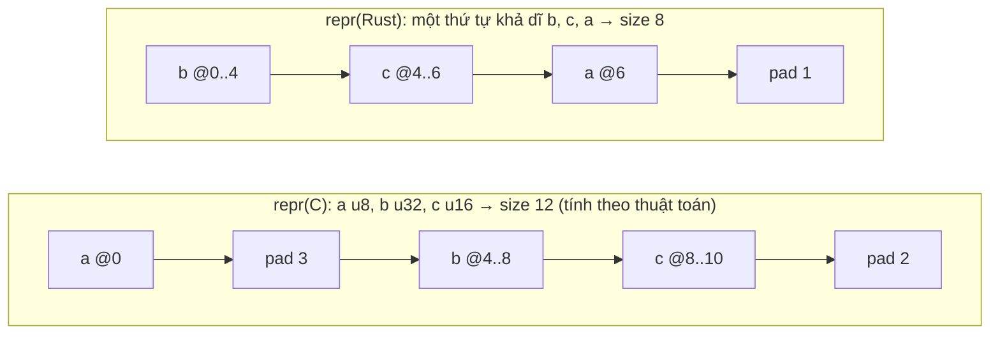
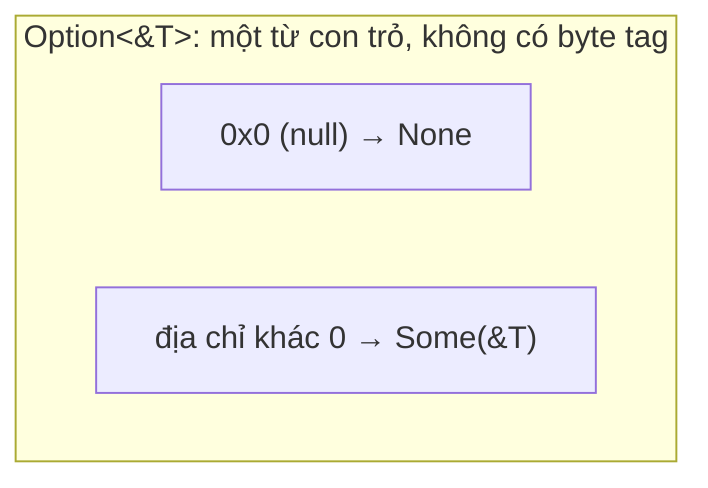

# P10 · Chương 02 — Type layout: size, alignment, repr, enum và niche

> Nguồn ghim Rust 1.95.0 (Reference, Nomicon, `std`). Chương này **không có thí nghiệm mới**: mọi con số hoặc lấy từ ví dụ `assert_eq!` ngay trong tài liệu chính thức, hoặc là kết quả *tính tay theo thuật toán* của Reference (ghi rõ), hoặc là quan sát đã có output thật trong [Lab 10 bài (a)](../labs/10-rust-internals-lab.md) (ghi rõ). Chỉ những câu có chú thích cuối trang mới là bảo đảm của docs. Phần ghi "(nhận xét của người soạn)" là ý kiến, "(suy luận của người soạn)" là suy ra từ nguồn nhưng chưa có câu nào nói thẳng.

## Bạn sẽ hiểu được gì

1. **Q1.** Size, alignment và padding là gì, và vì sao con số `size_of` bạn đo được chưa phải là hợp đồng? → mục 1
2. **Q2.** `repr(Rust)` (mặc định) khác `repr(C)` thế nào; vì sao compiler được xếp lại thứ tự field? → mục 2
3. **Q3.** `align`, `packed` và `transparent` thay đổi điều gì, và cái giá của `packed`? → mục 3
4. **Q4.** Enum được biểu diễn trong bộ nhớ ra sao: tag/discriminant là gì, `repr(u8)` và `repr(C)` bảo đảm gì? → mục 4
5. **Q5.** Niche là gì, vì sao `Option<&T>` không tốn thêm byte nào so với `&T`? → mục 5
6. **Q6.** std *hứa* niche cho những kiểu nào, và những gì làm mất niche? → mục 6
7. **Q7.** Kiểu kích thước 0 (ZST) là gì và có hệ quả gì với safe/unsafe code? → mục 7

## Kiến thức cần trước

- [P3 · Chương 07 — Stack, alignment và padding](../03-memory/07-stack-alignment-padding.md): vì sao CPU muốn dữ liệu được căn, cách tính padding bằng tay, `Layout`. Chương này dùng lại các khái niệm đó và đi tiếp sang enum, niche và `repr`.

Kiểu có size chỉ biết lúc chạy (`[T]`, `str`, `dyn Trait`) và con trỏ béo của chúng nằm ở [P10 · Chương 03 — DST, fat pointer và vtable](03-dst-fat-pointer-vtable.md); chương này chỉ nói về kiểu `Sized`.

## 1. Size, alignment, padding và vì sao số đo không phải hợp đồng (Q1)

> **Trả lời ngắn.** Alignment `n` nghĩa là giá trị chỉ được đặt ở địa chỉ chia hết cho `n`[^ref-align]. Size là khoảng cách tính bằng byte giữa hai phần tử liên tiếp của mảng cùng kiểu, đã gồm padding (byte đệm)[^ref-sizedef], và luôn là bội của alignment[^ref-size]. Reference nói layout có thể đổi sau mỗi lần biên dịch, nên số bạn đo chỉ là quan sát[^ref-guarantees].

**Giải thích.**

Hình dung (nhận xét của người soạn): kho hàng xếp pallet. Kiện nhỏ đặt ở ô nào cũng được; kiện lớn chỉ được đặt ở ô có số chia hết cho cỡ của nó. Giữa hai kiện khác cỡ sẽ có ô trống: đó là padding.

*Alignment.* Reference nói rõ: giá trị alignment 2 phải ở địa chỉ chẵn, alignment 1 ở địa chỉ nào cũng được, và alignment luôn là lũy thừa của 2[^ref-align-ex]. Phần "vì sao phần cứng cần điều đó" đã nằm ở [P3·07 mục 5](../03-memory/07-stack-alignment-padding.md); ở đây chỉ dùng định nghĩa.

*Size là bội của alignment.* Nomicon giải thích lý do: nhờ vậy một mảng kiểu đó luôn được chỉ mục bằng cách cộng bội số của size[^nomicon-size-mult]. Mảng `[T; N]` có size `size_of::<T>() * N` và alignment của `T`[^ref-array].

*Kiểu ghép.* Nomicon liệt kê năm loại kiểu ghép: struct, tuple, array, enum, union[^nomicon-composites]. Rust chèn padding để mọi field được căn và để size tổng là bội của alignment[^nomicon-padding]. Alignment của struct `repr(Rust)` ít nhất bằng alignment lớn nhất trong các field[^ref-rust-guar].

*Con số đo được là quan sát.* Reference viết rằng layout có thể đổi mỗi lần biên dịch và chỉ ghi lại những gì được bảo đảm hôm nay[^ref-guarantees]. Với `size_of`, docs nói cùng ý: size của kiểu nói chung không ổn định giữa các lần biên dịch, trừ vài kiểu như primitive[^sizeof-unstable]. Vì vậy phân biệt ba loại thông tin khi đọc chương này: *bảo đảm* (docs hứa), *quan sát* (đo một lần trên một compiler), *chi tiết cài đặt* (đọc từ source, có thể đổi).

<details><summary>Đi sâu: alignment của primitive, con trỏ, và hai khẳng định "tính tay"</summary>

- Alignment của primitive phụ thuộc nền tảng[^ref-prim-align]. Thường nó bằng size, nhưng `u128`/`i128` hay chỉ được căn 4 hoặc 8 dù size là 16[^ref-i128-align]. Tức là không thể suy `align_of` từ `size_of`.
- Con trỏ tới kiểu `Sized` có cùng size và alignment với `usize`[^ref-ptr-sized]; `&T` và `&mut T` cùng layout[^ref-ptr-same].
- Giá trị `size_of` của primitive (`u8` = 1, `u32` = 4, `u64` = 8, `char` = 4…) được `std::mem::size_of` liệt kê thành bảng[^sizeof-prim-table].
- Tuple dùng biểu diễn Rust[^ref-tuple], trừ unit `()` được bảo đảm size 0 và alignment 1[^ref-unit]; closure thì "không có bảo đảm layout nào"[^ref-closure].
- Trên stack, kích thước và vị trí thật của từng biến còn do compiler/optimizer quyết (ví dụ biến nằm trong thanh ghi không có địa chỉ; nhận xét của người soạn, chương này không dẫn nguồn cho điều đó); chương này chỉ nói layout *của kiểu*, không nói frame.

</details>

**Quay lại Q1:** alignment là điều kiện địa chỉ, size là bội của alignment đã gồm padding, và size của kiểu nói chung chỉ là số đo của một lần biên dịch (trừ vài kiểu như primitive).

## 2. `repr(Rust)` và `repr(C)`: ai quyết định thứ tự field? (Q2)

> **Trả lời ngắn.** Với `repr(Rust)` (mặc định), Reference chỉ hứa những gì cần cho tính đúng: field được căn, không chồng nhau, alignment kiểu ≥ alignment lớn nhất của field[^ref-rust-guar]; thứ tự trong bộ nhớ không nhất thiết là thứ tự khai báo[^ref-rust-order]. `repr(C)` thì có thuật toán xác định: duyệt field theo khai báo, chèn padding cho đến khi offset chia hết alignment của field[^ref-c-algo]. Cần layout đoán trước được (giao tiếp với C, hoặc diễn giải lại giá trị thành kiểu khác) thì dùng `repr(C)`[^ref-c-purposes].

**Giải thích.**

Hình dung (nhận xét của người soạn): `repr(C)` giống bản vẽ nhà có số phòng cố định, ai đọc bản vẽ cũng ra cùng một căn nhà. `repr(Rust)` giống giao khoán cho nhà thầu: nhà thầu được tự xếp lại các phòng miễn là phòng nào cũng đủ rộng và không chồng nhau.

Lấy struct có ba field `a: u8`, `b: u32`, `c: u16`.

```rust
struct A { a: u8, b: u32, c: u16 }              // repr(Rust)
#[repr(C)] struct AC { a: u8, b: u32, c: u16 }  // repr(C)
```

*`repr(C)`, từng bước theo thuật toán.* Bắt đầu với offset 0. Với mỗi field theo khai báo: nếu offset hiện tại không chia hết alignment của field thì cộng padding cho đến khi chia hết; offset lúc đó là offset của field; rồi tăng offset thêm size của field[^ref-c-algo]. Cuối cùng size của struct là offset hiện tại làm tròn lên bội của alignment struct[^ref-c-size], và alignment struct là alignment của field căn lớn nhất[^ref-c-align]. Áp vào `AC` (tính tay, giả định `u8`/`u16`/`u32` có alignment bằng size): `a` ở 0; offset 1 không chia hết 4 nên thêm 3 byte padding, `b` ở 4; `c` ở 8 (offset 8 chia hết 2); offset thành 10, làm tròn lên bội của 4 thành 12. Vậy size 12, alignment 4. Khớp output chạy thật của `CRepr` (cùng ba field) trong [Lab 10 bài (a)](../labs/10-rust-internals-lab.md): size 12, align 4, `a`@0, `b`@4, `c`@8.

*`repr(Rust)`, cùng struct.* Nomicon viết hai cách xếp "có thể xảy ra": `a`, 3 byte padding, `b`, `c`, 2 byte padding; hoặc `b`, `c`, `a`, 1 byte padding[^nomicon-two-layouts]. Cách sau nhỏ hơn: theo cách xếp đó size là 8 (tính tay: `b` ở 0..4, `c` ở 4..6, `a` ở 6, padding 1 để tròn bội của 4). Quan sát (output thật trong [Lab 10 bài (a)](../labs/10-rust-internals-lab.md), rustc 1.95.0 trên aarch64; không chạy lại ở bản này): `RustRepr`, cùng ba field nhưng không có `repr(C)`, được compiler xếp `b`@0, `c`@4, `a`@6, size 8, align 4. Đây là quan sát chứ không phải lời hứa; bản compiler khác được phép chọn khác.



(Sơ đồ `repr(C)` suy ra từ thuật toán; sơ đồ `repr(Rust)` là *một* thứ tự hợp lệ chứ không phải bảo đảm.)

*Vì sao Rust cố tình không hứa thứ tự.* Nomicon: Rust bảo đảm hai instance của cùng một struct có layout y hệt nhau, nhưng không bảo đảm hai struct khác tên (dù khai báo giống hệt) có cùng thứ tự field hay padding[^nomicon-reorder]. Nomicon nêu generic làm ví dụ đầu tiên (và nói thêm rằng enum làm chuyện này phức tạp hơn): với `struct Foo<T, U> { count: u16, data1: T, data2: U }`, nếu giữ nguyên thứ tự khai báo thì `Foo<u32, u16>` phải thêm padding lãng phí, nên dùng không gian tối ưu đòi hỏi các monomorphization khác nhau có thứ tự field khác nhau[^nomicon-mono-reorder].

*Representation khác layout.* Reference nhấn mạnh: vì `repr` là attribute gắn vào item, representation không phụ thuộc tham số generic; `Foo<Bar>` và `Foo<Baz>` có cùng representation[^ref-repr-generic]. Đừng đọc câu đó là "cùng layout": representation `Rust` chính là cái cho phép layout của hai instantiation khác nhau (suy luận của người soạn, ghép từ hai câu trên).

*Hệ quả thực hành.* Đừng ép con trỏ giữa hai struct `repr(Rust)` "trông giống nhau", đừng dựa vào offset. Mẹo "xếp field giảm dần theo alignment để tiết kiệm padding" chỉ có tác dụng với `repr(C)`, vì với `repr(Rust)` compiler đã được phép tự làm việc đó (nhận xét của người soạn).

<details><summary>Đi sâu: pseudocode của Reference, ví dụ size 6 vs 4, union, field lồng nhau, <code>offset_of!</code></summary>

- Pseudocode chính thức của Reference dùng một hàm `padding_needed_for(offset, alignment)` và cảnh báo rằng nó ngây thơ, bỏ qua tràn số; để tính layout trong code thật phải dùng `Layout`[^ref-c-warning].
- `std::mem::size_of` có ví dụ `#[repr(C)] struct FieldStruct { first: u8, second: u16, third: u8 }` với size 6[^sizeof-fieldstruct], và ghi chú rằng đổi chỗ để `third` đứng trước `second` loại được cả hai byte padding, còn 4 byte[^sizeof-reorder]. Docs cũng nói size của item `repr(C)` ổn định miễn là các field có size ổn định[^sizeof-reprc].
- Union `repr(C)`: size là max size các field làm tròn lên theo alignment, alignment là max alignment các field, và mỗi field nằm ở offset 0[^ref-c-union].
- `repr` chỉ đổi padding *giữa* các field, không đổi layout *bên trong* field: struct `repr(C)` chứa `Inner` kiểu `repr(Rust)` không làm đổi layout của `Inner`[^ref-repr-inter-field].
- Reference cảnh báo bảo đảm "không chồng nhau" không có nghĩa các field có địa chỉ khác nhau: kiểu size 0 có thể trùng địa chỉ với field khác (mục 7)[^ref-zst-addr].
- `repr(Rust)` viết tường minh được bảo đảm giống hệt việc bỏ attribute[^ref-rust-explicit].
- `offset_of!(Type, field)` trả offset (tính bằng byte từ đầu kiểu) dưới dạng `usize`[^offset-of-def][^offset-of-usize]. Docs hứa offset của một field trong một kiểu không đổi suốt vòng đời chương trình, nhưng hai lần biên dịch có thể cho layout khác[^offset-of-change]; và với các kiểu tương tự nhưng không giống hệt như `Wrapper<u8, u8>` và `Wrapper<u8, i8>` thì không có bảo đảm gì về việc chúng cùng layout[^offset-of-wrapper].

</details>

**Quay lại Q2:** `repr(Rust)` chỉ hứa tính đúng và được tự xếp lại field; `repr(C)` có thuật toán padding xác định nên dùng khi layout là một phần hợp đồng.

## 3. `align`, `packed`, `transparent` (Q3)

> **Trả lời ngắn.** `align(n)` nâng alignment của kiểu lên ít nhất `n`[^nomicon-align-least]; `packed(n)` hạ alignment xuống tối đa `n`[^nomicon-packed-most], và `packed(1)` bỏ hết padding giữa field[^ref-packed]. Cái giá của `packed` là tham chiếu tới field không căn bị cấm vì là UB[^ref-packed-ref]. `transparent` dành cho kiểu bọc đúng một field thật (thường gọi là newtype, cách gọi của người soạn): nó có cùng layout và ABI với field đó[^ref-transparent].

**Giải thích.**

Hình dung (nhận xét của người soạn): `align(64)` giống quy định "mỗi kiện hàng bắt đầu ở đầu một ô pallet 64"; `packed` giống nén chặt các kiện, đổi lại người lấy hàng phải thò tay vào chỗ không thẳng hàng; `transparent` giống hộp trong suốt: bên ngoài hộp có nhãn riêng nhưng đem đi đâu cũng như món bên trong.

*`align` và `packed` là modifier.* Chúng nâng/hạ alignment và biến đổi representation đã chọn; nếu không chọn gì thì biến đổi representation mặc định[^ref-align-packed-mod]. Riêng chúng không bảo đảm thứ tự field; muốn thứ tự thì ghép với `C`[^ref-align-no-order]. Hai quy tắc dễ quên: `align(n)` nhỏ hơn alignment tự nhiên thì không có tác dụng[^ref-align-less]; và không dùng chung `align` với `packed` trên một kiểu[^ref-align-packed-excl].

*`align` để làm gì.* Nomicon nêu ví dụ: bảo đảm các phần tử kề nhau của mảng không bao giờ dùng chung một cache line, có thể giúp một số loại code đồng thời chạy nhanh hơn[^nomicon-align-cache]. (Nhận xét của người soạn: đây là công cụ chống false sharing giữa các counter của từng thread; cache line và false sharing được giải thích ở [P2 · Chương 06 mục 6](../02-cpu/06-cache-va-numa.md), còn `repr(align)`/`CachePadded` ở [P2 · Chương 07 mục 7](../02-cpu/07-rust-va-may.md).)

*`packed` và cái giá.* Mỗi field được căn theo `min(n, alignment tự nhiên)`[^ref-packed-fields]; padding giữa các field là mức tối thiểu để thỏa alignment đó[^ref-packed-padding]. Nomicon cảnh báo đa số kiến trúc ưa dữ liệu căn tự nhiên: load không căn có thể bị phạt (x86) hoặc thậm chí lỗi (một số chip ARM)[^nomicon-packed-cost]. Với field của struct `packed`, Reference chỉ ra ba cách: copy giá trị ra biến cục bộ[^ref-packed-copy]; trong `println!` (vốn tạo tham chiếu) thì bọc thành `{ e.f2 }` để nó thành bản copy[^ref-packed-braces]; hoặc dùng `&raw const` rồi `read_unaligned`/`write_unaligned`[^ref-packed-ways]. Số đo `repr(C, packed)` cụ thể có ở [P3·07 mục 7](../03-memory/07-stack-alignment-padding.md) (phần Đi sâu).

*`transparent`.* Chỉ dùng được trên struct hoặc enum một biến thể có tối đa một field "thật", cộng bất kỳ số field size 0 alignment 1 (ví dụ `PhantomData<T>`)[^ref-transparent-constraint]. Khác `repr(C)` ở ABI: struct `repr(C)` luôn có ABI của một struct C, còn struct `transparent` bọc một primitive có ABI của primitive đó[^ref-transparent-abi]. Mục đích Nomicon nêu là cho phép `transmute` giữa field và wrapper[^nomicon-transparent-goal], và truyền wrapper qua FFI ở chỗ bên kia mong kiểu bên trong[^nomicon-transparent-ffi]. Ví dụ backend (nhận xét của người soạn): `#[repr(transparent)] struct UserId(u64);` phân biệt kiểu ở compile time mà không thêm byte nào.

<details><summary>Đi sâu: giới hạn của <code>transparent</code>, <code>align</code> trên enum, khi nào layout thành "public ABI"</summary>

- `transparent` không ghép với repr khác, vì nó giao toàn bộ layout cho kiểu khác[^ref-transparent-exclusive].
- Nomicon: repr này chỉ được coi là một phần ABI công khai của kiểu khi field duy nhất là `pub` hoặc layout được ghi bằng văn xuôi; nếu không thì crate khác không nên dựa vào nó[^nomicon-transparent-pub].
- `align` áp dụng được cho enum, tác dụng lên alignment giống như bọc enum trong một newtype struct có cùng modifier `align`[^ref-align-enum].
- `align`/`packed` chỉ áp dụng được cho representation `Rust` và `C`[^ref-align-packed-excl].
- Nomicon khuyên: "không dùng `packed` tùy tiện"[^nomicon-packed-warning]; để tương thích FFI nên viết tường minh `repr(C, packed)`[^nomicon-packed-ffi].

</details>

**Quay lại Q3:** `align` nâng, `packed` hạ alignment (đổi lấy field không căn và cấm tham chiếu), `transparent` làm newtype giống hệt field bên trong về layout lẫn ABI.

## 4. Enum trong bộ nhớ: tag, discriminant và `repr(u8)`/`repr(C)` (Q4)

> **Trả lời ngắn.** Enum là kiểu tổng (một trong nhiều biến thể), nên mỗi giá trị cần một *discriminant*: số nguyên gắn với biến thể để biết giá trị đang giữ biến thể nào[^ref-discr-intro]. Với `repr(Rust)` mặc định, layout của enum chưa được đặc tả[^nomicon-enum-unspec] và discriminant thậm chí có thể không được lưu thành byte riêng[^disc-default-opaque]. Thêm `repr(u8)`/`repr(C)` thì layout được xác định: một tag cộng vùng payload dùng chung[^ref-prim-adt][^ref-c-adt].

**Giải thích.**

Hình dung (nhận xét của người soạn): một message trên đường truyền có trường `type` và trường `data`; bên nhận đọc `type` trước để biết diễn giải `data` thế nào. Enum là bản trong bộ nhớ của kiểu message đó. Nomicon gọi enum là "kiểu tổng" (tagged union)[^nomicon-sumtype].

*Discriminant là gì.* Mỗi giá trị enum có một discriminant: số nguyên về mặt logic gắn với nó, dùng để xác định biến thể[^ref-discr-intro]. Nếu không ghi, discriminant của biến thể bằng discriminant của biến thể liền trước cộng 1, biến thể đầu là 0[^ref-discr-implicit]. Hai biến thể không được trùng discriminant[^ref-discr-dup]. Trong biểu diễn Rust mặc định, discriminant được hiểu là giá trị `isize`, nhưng compiler được dùng kiểu nhỏ hơn hoặc cách khác để phân biệt biến thể trong layout thật[^ref-discr-isize].

*Enum không có field, kèm `repr(u8)`/`repr(i32)`…* Size và alignment bằng đúng kiểu nguyên đó[^ref-primitive-enum]; discriminant phải vừa kiểu, ví dụ `u8` chỉ nhận 0 đến 255[^ref-prim-range]. Không có `repr` thì enum không field vẫn là kiểu "native" của Rust, không có layout hay biểu diễn ổn định[^nomicon-fieldless]. Với `repr(C)`, size và alignment là của enum C mặc định theo ABI C của target[^ref-c-fieldless]. Nomicon nói thẳng đây là "đoán tốt nhất" vì biểu diễn enum trong C do implementation định nghĩa[^nomicon-c-enum-guess].

*Enum có field.* Với `repr(u8)`: biểu diễn là một `repr(C)` union của các `repr(C)` struct, mỗi struct (cho biến thể có field) bắt đầu bằng tag[^ref-prim-adt]. Với `repr(C)`: một `repr(C)` struct hai field là tag và union payload, đúng kiểu "tagged union" của C[^ref-c-adt].

Ví dụ (tính tay theo thuật toán `repr(C)` ở mục 2, giả định `u8`, `u32`, `u64` có alignment bằng size) cho `#[repr(u8)] enum E { A(u32), B(u64), C(u8) }`:

| Biến thể | Struct tương ứng (tag `u8` ở đầu) | Offset field | Size | Alignment |
|---|---|---|---|---|
| `A(u32)` | `(u8, u32)` | tag 0, `u32` ở 4 | 8 | 4 |
| `B(u64)` | `(u8, u64)` | tag 0, `u64` ở 8 | 16 | 8 |
| `C(u8)` | `(u8, u8)` | tag 0, `u8` ở 1 | 2 | 1 |

Union lấy max size làm tròn theo alignment lớn nhất[^ref-c-union]; từ bảng trên (tính tay) ra size 16, alignment 8. Tức biến thể bé nhất cũng phải trả đúng 16 byte, giống ý "vùng chứa chung" trong ví dụ `FooRepr { data: u64, tag: u8 }` của Nomicon, mà Nomicon bảo là *xấp xỉ* cách enum mặc định được bố trí (chưa tính kích thước và vị trí của tag)[^nomicon-enum-naive].

*Giá trị không khớp biến thể nào.* Dù có `repr(C)` hay `repr(u*)`, enum không field vẫn không được mang giá trị nguyên không ứng với biến thể nào, trái với enum C. Tạo một giá trị như vậy (bằng `unsafe`) là UB; điều này cho phép `match` đầy đủ vẫn biên dịch bình thường[^nomicon-enum-ub]. Vì thế Reference nhận xét dùng enum không field để mô hình enum C ở FFI thường là sai[^ref-fieldless-c].

<details><summary>Đi sâu: <code>repr(C, u8)</code>, ví dụ size 2/4 của Reference, đọc discriminant, discriminant tường minh</summary>

- Với enum có field, có thể ghép `repr(C)` và repr nguyên (ví dụ `repr(C, u8)`): khi đó enum discriminant bên trong `repr(C)` đổi sang kiểu nguyên đã chọn[^ref-primitive-c-mod], và với `repr(C, u8)` thì không thể có 257 tag khác nhau[^ref-primitive-c].
- Reference minh họa size đổi theo repr bằng `assert_eq!`: `EnumC` có size phụ thuộc nền tảng[^ref-enumc-platform], `Enum8` (`repr(C, u8)`) có size 2 (1 byte discriminant, 1 byte giá trị)[^ref-enum8] và `Enum16` (`repr(C, u16)`) có size 4; chú thích trong ví dụ giải thích: 2 byte discriminant, 1 byte giá trị, cộng 1 byte padding[^ref-enum16].
- Discriminant tường minh (`Unit = 3`) chỉ được đặt trong hai trường hợp, theo Reference[^ref-discr-explicit] là enum "unit-only"[^ref-discr-unit-only], hoặc enum có primitive repr[^ref-discr-primrepr]. Nomicon: nếu discriminant tràn kiểu nguyên của `repr(u*)` thì lỗi compile[^nomicon-repr-overflow].
- Với enum chỉ có unit variant, discriminant lấy bằng `as`[^disc-cast]. `mem::discriminant` trả giá trị đục dùng để so sánh[^disc-opaque][^disc-compare]; transmute `Discriminant` sang số là UB[^disc-transmute].
- Chỉ khi enum có primitive repr mới đọc được tag qua con trỏ[^disc-read]; với repr mặc định thì docs nói layout của discriminant là không xác định, không biết nằm ở đâu, thậm chí có thể không được lưu[^disc-default-opaque].

</details>

**Quay lại Q4:** enum cần discriminant; với `repr(Rust)` layout là chi tiết nội bộ, còn `repr(u8)`/`repr(C)` đóng thành tag + union payload có thuật toán xác định.

## 5. Niche: lấy chỗ tag từ giá trị không bao giờ hợp lệ (Q5)

> **Trả lời ngắn.** *Niche* (chữ này xuất hiện trong release notes và docs của Rust[^rel-niche][^mu-niche]; định nghĩa sau là cách diễn đạt của người soạn) là bit pattern mà kiểu không bao giờ được phép giữ, ví dụ con trỏ null của `&T`. Enum có thể dùng pattern đó để mã hóa biến thể còn lại, nên khỏi cần byte tag: `None` của `Option<&T>` được hiểu là con trỏ null[^nomicon-npo]. Kết quả là `Option<&T>` có cùng size với `&T`[^sizeof-same].

**Giải thích.**

Hình dung (nhận xét của người soạn): bảng DB có cột `owner_id` mà quy ước không bao giờ là 0. Thay vì thêm một cột cờ `has_owner`, bạn dùng 0 để biểu diễn "chưa có". Niche là ý tưởng đó, nhưng compiler tự làm và kiểm tra bằng kiểu, nên không bị lỗi "quên check 0".

Về tên gọi: Nomicon gọi tối ưu này là "tối ưu con trỏ null" (bước 3 bên dưới). Chữ *niche* xuất hiện trong release notes của Rust 1.50: kiểu `File` trên Unix có một niche là `-1`[^rel-niche], vì giá trị đó không thể là file descriptor hợp lệ nên `Option<File>` chiếm cùng chỗ với `File`[^rel-niche-meaning]. Docs `MaybeUninit` cũng dùng chữ này khi nói về tối ưu lấp niche[^mu-niche]. Chương này dùng *niche* theo nghĩa đó.

Từng bước:

1. *Kiểu nào có giá trị cấm.* Reference liệt kê điều kiện hợp lệ: `bool` chỉ được là `false` (0) hoặc `true` (1)[^ref-ub-bool]; reference và `Box<T>` phải căn, khác null, không dangling[^ref-ub-ref]; kiểu có khoảng giá trị hợp lệ riêng thì giá trị phải nằm trong khoảng, và trong std điều này áp dụng cho `NonNull<T>` và `NonZero<T>`[^ref-valid-range].
2. *Vi phạm là UB.* Reference định nghĩa "tạo ra" một giá trị xảy ra mỗi khi gán, đọc, truyền hoặc trả giá trị, và tạo giá trị không hợp lệ là UB[^ref-ub-invalid]. Suy luận của người soạn: vì chương trình đúng không bao giờ tạo ra pattern cấm, compiler được tự do dùng pattern đó làm dữ liệu riêng.
3. *Dùng pattern cấm làm tag.* Nomicon mô tả "tối ưu con trỏ null": enum gồm một biến thể đơn vị ngoài cùng (như `None`) và một biến thể con trỏ không-null (như `Some(&T)`) khiến tag trở nên thừa; con trỏ null được hiểu là biến thể đơn vị; hệ quả `size_of::<Option<&T>>() == size_of::<&T>()`[^nomicon-npo].
4. *Phạm vi rộng hơn con trỏ.* Nomicon kể nhiều kiểu std là hoặc chứa con trỏ không-null, như `Box<T>`, `Vec<T>`, `String`, `&T`, `&mut T`[^nomicon-nonnull-types]. Nó cũng hình dung enum lồng nhau gộp tag vào một discriminant vì mỗi cái có tập giá trị hợp lệ hạn chế[^nomicon-pool-tags], và nói về khả năng dùng "thuật toán khá phức tạp" lưu bit rải rác qua các kiểu lồng nhau có giá trị cấm[^nomicon-forbidden]. Chính vì thế, Nomicon thấy nên *giữ layout enum chưa được đặc tả*[^nomicon-enum-unspec].
5. *Kiểu không có niche.* Nếu mọi pattern bit đều hợp lệ thì không còn chỗ giấu tag (suy luận của người soạn; ví dụ `u32` tạo ra mọi giá trị 32 bit). Mục 6 kể về `MaybeUninit`, kiểu cố ý bỏ niche.



*Ứng dụng backend (nhận xét của người soạn):* cây/danh sách liên kết dùng `Option<Box<Node>>` không tốn thêm byte cho "không có con"[^sizeof-same]; ID kiểu `Option<NonZero<u64>>` cùng size với `u64`, suy ra từ ví dụ `u32` trong docs `NonZero`[^nz-option-size] và từ việc `NonZero<T>` có cùng layout với `T`[^nz-layout].

<details><summary>Đi sâu: <code>NonNull</code>, <code>NonZero</code>, <code>Option&lt;bool&gt;</code>, kiểu rỗng</summary>

- Docs `NonNull<T>`: con trỏ phải luôn khác null, kể cả khi không bao giờ bị dereference, *để enum dùng giá trị cấm đó làm discriminant*; `Option<NonNull<T>>` cùng size với `*mut T`[^nn-forbidden].
- Docs `NonZero<T>`: có cùng layout và bit validity với `T` trừ việc pattern toàn 0 không hợp lệ[^nz-layout]; `Option<NonZero<T>>` được bảo đảm tương thích với `T`, kể cả ở FFI[^nz-option-ffi].
- `Option<bool>` có thể chỉ 1 byte: docs `MaybeUninit` có `assert_eq!` khẳng định điều đó[^mu-option-bool]; lý do hợp lý là `bool` chỉ được là 0 hoặc 1[^ref-ub-bool] nên còn pattern bit trống để biểu diễn `None` (suy luận của người soạn). Đó là ví dụ trong docs, không nằm trong danh sách *bảo đảm* của mục 6.
- Kiểu rỗng (enum không biến thể) là trường hợp cực đoan: Nomicon nói `Result<T, Void>` được biểu diễn chỉ như `T`, vì nhánh `Err` không tồn tại; nhưng đó "chỉ là tối ưu, không bảo đảm", nên transmute giữa chúng vẫn là UB[^nomicon-void-result].
- `Vec<T>`: docs `Vec` hứa nó luôn là một bộ ba (pointer, capacity, length), không hơn không kém, và không hứa thứ tự các field[^vec-triplet]. Con trỏ không bao giờ null nên `Vec` được tối ưu null-pointer[^vec-nonnull], cùng ý với việc Nomicon xếp `Vec<T>` và `String` vào nhóm kiểu chứa con trỏ không-null (bước 4). Cấu trúc đầy đủ của `Vec` ở [Chương 09 · mục 1](09-collections-internals.md).

</details>

**Quay lại Q5:** niche là bit pattern kiểu không bao giờ hợp lệ giữ; enum mượn nó làm tag nên `Option<&T>` không tốn thêm byte.

## 6. std hứa gì, và cái gì làm mất niche (Q6)

> **Trả lời ngắn.** std chỉ *bảo đảm* cho một danh sách kiểu `T`: `Option<T>` có cùng size, alignment và function-call ABI với `T`[^opt-rep]. Danh sách gồm `Box<U>` (chỉ `Global`), `&U`, `&mut U`, `fn`, `extern "C" fn`, `NonZero*`, `NonNull<U>` và `repr(transparent)` struct bọc một trong các kiểu đó[^opt-table]. Ngoài danh sách thì không hứa; `MaybeUninit` và `repr(u8)` trên enum có field là hai ví dụ làm mất niche[^mu-niche][^nomicon-suppress-npo].

**Giải thích.**

Hình dung (nhận xét của người soạn): niche giống số p99 đo được hôm nay trên máy của bạn so với SLA ghi trong hợp đồng. Hợp đồng chỉ có danh sách; số đo ngoài danh sách có thể đẹp hôm nay và khác sau khi nâng phiên bản compiler.

*Danh sách được hứa* (đã liệt kê ở trả lời ngắn). Hệ quả: với các `T` này, `transmute` từ mọi giá trị hợp lệ của `T` sang `Option<T>` và từ `Some(_)` sang `T` đều hợp lệ, nhưng transmute `None` sang `T` là UB[^opt-transmute]. Bảng của docs còn có cột thứ hai, nói ở trường hợp nào docs hứa *thêm* rằng `[0u8; size_of::<T>()]` chính là `None`[^opt-zero]; cụ thể, luôn đúng với `fn`, `extern "C" fn` và `NonZero*`; với `Box<U>`, `&U`, `&mut U`, `NonNull<U>` thì chỉ khi `U: Sized`; với `repr(transparent)` struct thì khi điều đó đúng cho kiểu bên trong[^opt-table]. Chữ `U: Sized` vì vậy chỉ giới hạn lời hứa phụ này, không phải việc `Option<Box<U>>` có nằm trong danh sách hay không (cách đọc bảng của người soạn, dựa trên tiêu đề cột thứ hai).

*Tại sao điều này quan trọng với FFI.* Nomicon: nếu `T` là con trỏ không-null an toàn cho FFI thì `Option<T>` có cùng layout và ABI với `T`, nên cũng an toàn cho FFI; hiện gồm `&`, `&mut` và con trỏ hàm[^nomicon-c-ffi-option]. Cách dùng thực tế (nhận xét của người soạn): `Option<extern "C" fn(...)>` thay cho con trỏ hàm có thể null của C.

*Ngoài danh sách thì sao.* Docs không hứa. `Option<bool>` nhỏ là ví dụ ở mục 5, một quan sát. Với `Result`, docs chỉ nói "dưới một số điều kiện" các kiểu trong danh sách cũng được tối ưu null pointer khi nằm trong `Result`[^opt-result]. Đừng viết code `unsafe` dựa vào các kích thước ngoài danh sách (nhận xét của người soạn).

*Con trỏ tới DST.* Cột đầu của bảng không ghi `U: Sized` nên `Option<Box<dyn Trait>>`, `Option<&[T]>` hay `Option<&str>` vẫn thuộc danh sách (cách đọc bảng của người soạn); riêng lời hứa phụ `[0u8; N]` = `None` thì chỉ có khi `U: Sized` nên không áp dụng cho chúng. Docs `size_of` cũng có một câu nói `Box<T>` và `Option<Box<T>>` cùng size mà không kèm `T: Sized`[^sizeof-same]. Số đo `Option<Box<dyn Shape>>` = 16 byte, bằng `Box<dyn Shape>`, nằm ở [Chương 03 · mục 2](03-dst-fat-pointer-vtable.md).

*Những thứ làm mất niche.*

- `MaybeUninit<T>`: vì mọi bit pattern đều hợp lệ với nó, compiler không áp dụng tối ưu niche được, có thể làm kiểu lớn hơn[^mu-niche]. Docs còn nhắc: `Option<T>` và `Option<MaybeUninit<T>>` vẫn có thể khác size, dù `MaybeUninit` bảo đảm cùng size/alignment/ABI với `T`[^mu-layout].
- Enum có field mà gắn `repr(u*)`, `repr(i*)` hoặc `repr(C)`: Nomicon nói điều đó chặn tối ưu con trỏ null[^nomicon-suppress-npo]. Ví dụ của Nomicon khẳng định `MyOption<&u16>` (không repr) có size 8 còn `MyReprOption<&u16>` (`repr(u8)`) có size 16[^nomicon-suppress-npo-ex]. Lý do (suy luận của người soạn): `repr(u8)` đòi một tag `u8` thật ở đầu, nên không còn chỗ để "mượn" niche. Tính tay theo thuật toán mục 4 (giả định con trỏ 8 byte, alignment 8): biến thể `Some(&u16)` là struct `(u8, &u16)` với tag ở 0 và con trỏ ở 8, nên size 16, khớp với con số của Nomicon.
- Ngược lại, tối ưu này vẫn áp dụng cho enum *không* field dù có `repr(u*)`/`repr(C)`[^nomicon-fieldless-npo]; và (đoạn Nomicon về `repr(u*)`/`repr(i*)`) compiler vẫn khai thác các giá trị "không hợp lệ" của chính kiểu enum đó để tối ưu layout, ví dụ khi enum nằm trong `Option`[^nomicon-repr-niche-kept].

<details><summary>Đi sâu: <code>UnsafeCell</code>, và ranh giới giữa quan sát với bảo đảm</summary>

- Nomicon ghi chú `UnsafeCell` dùng thuộc tính chưa ổn định `no_niche`, nên ABI của nó không được bảo đảm giống kiểu bên trong khi lồng vào kiểu khác[^nomicon-no-niche].
- Quy tắc áp dụng cho bạn (nhận xét của người soạn): chỉ dựa vào *bảo đảm* khi viết `unsafe`/FFI; dùng *quan sát* để hiểu chi phí và tối ưu (ví dụ chọn `Option<Box<T>>` thay vì cờ riêng), và kiểm lại bằng `size_of` khi nâng phiên bản compiler.
- Nếu muốn assert layout trong code, bắt buộc ghi rõ kiểu nằm trong danh sách hứa hay chỉ là kỳ vọng hiện tại (nhận xét của người soạn).

</details>

**Quay lại Q6:** chỉ danh sách kiểu của `std::option` được hứa `Option<T>` cùng size, alignment và ABI gọi hàm với `T`; ngoài danh sách là quan sát, và `MaybeUninit` hay `repr(u*)` trên enum có field làm mất niche.

## 7. Kiểu kích thước 0 (ZST) (Q7)

> **Trả lời ngắn.** ZST (zero-sized type) là kiểu không chiếm chỗ nào trong bộ nhớ, ví dụ struct không field, `()` và `[u8; 0]`[^nomicon-zst-def]. `()` được bảo đảm size 0 và alignment 1[^ref-unit]. Rust phần lớn hiểu rằng mọi thao tác tạo hoặc lưu ZST đều có thể rút thành no-op[^nomicon-zst]; với unsafe code thì phải cẩn thận vì offset con trỏ là no-op và allocator thường đòi size khác 0[^nomicon-zst-unsafe].

**Giải thích.**

Hình dung (nhận xét của người soạn): một "thẻ quyền" kiểu type-state, chỉ để biểu thị "bạn đã qua bước xác thực". Nó có giá trị kiểu (compiler kiểm được) nhưng không mang dữ liệu nào, nên không đáng tốn byte nào.

Từng ý:

1. *Định nghĩa.* Size là bội của alignment, và 0 được coi là bội của mọi alignment; vì thế có kiểu size 0 mà alignment khác 1, ví dụ trên một số nền tảng `[u16; 0]` có size 0 và alignment 2[^ref-zst-align].
2. *Không làm tròn lên 1 byte.* `size_of` ghi rõ, khác C, struct size 0 không bị làm tròn lên 1 byte[^sizeof-zst]. Reference nói thêm rằng C++ cho struct rỗng size 1 (trừ vài ngoại lệ)[^ref-c-empty]; và với `repr(C)` ZST vẫn size 0 dù điều đó không chuẩn trong C[^nomicon-reprc-zst].
3. *Thao tác thành no-op.* Lưu ZST không chiếm chỗ, và chỉ có một giá trị của kiểu đó nên "đọc" nó chỉ là tạo ra từ không khí (lời Nomicon)[^nomicon-zst-why]. Ví dụ cực đoan Nomicon đưa ra: `Set<Key>` làm thành `Map<Key, ()>`, và Rust biết mọi load/store giá trị `()` đều vô ích nên phần giá trị không chiếm chỗ nào[^nomicon-set-map].
4. *Marker.* `PhantomData<T>` là ví dụ Reference dùng cho "field size 0, alignment 1"[^ref-transparent-constraint]; ta gặp lại nó ở [Chương 05 · mục 5](05-variance-va-dropck.md) (variance của kiểu tự định nghĩa và `PhantomData`).
5. *Chỗ unsafe phải để ý.* Reference chỉ ra field size 0 có thể trùng địa chỉ với field khác[^ref-zst-addr]. Nomicon: tham chiếu tới ZST (kể cả slice rỗng) vẫn phải không-null và căn đúng; nhưng load/store qua con trỏ null tới ZST thì không phải UB, khác con trỏ tới kiểu khác[^nomicon-zst-null].

<details><summary>Đi sâu: <code>Vec&lt;ZST&gt;</code>, kiểu rỗng, <code>*const ()</code></summary>

- Docs `Vec`: nó cấp phát *khi và chỉ khi* `size_of::<T>() * capacity() > 0`; với ZST nó có thể không báo capacity 0[^vec-zst].
- Kiểu rỗng (enum không biến thể) khác ZST: ZST có đúng một giá trị[^nomicon-zst-why], kiểu rỗng không thể tạo ra giá trị nào[^nomicon-empty-types]. Nomicon khuyên không mô hình `void*` của C bằng `*const Void`[^nomicon-void-rec]; dùng `*const ()` thì có thể biến thành reference mà không vấn đề an toàn[^nomicon-void-ptr].
- Struct có DST ở field cuối, và `size_of_val` cho DST, thuộc [Chương 03](03-dst-fat-pointer-vtable.md) (mục 7 cho struct có DST cuối; mục 1 và 2 cho `size_of_val`).

</details>

**Quay lại Q7:** ZST chiếm 0 byte, thao tác trên nó phần lớn rút thành no-op; thứ cần cẩn thận là unsafe code (offset, allocator, địa chỉ trùng).

## 8. Liên hệ với Rust

Công cụ đo và điều khiển layout trong std (theo docs 1.95.0):

| Công cụ | Làm gì | Lưu ý |
|---|---|---|
| `size_of::<T>()` | Offset giữa hai phần tử liên tiếp của mảng, đã gồm padding[^sizeof-def] | Nói chung không ổn định giữa các lần biên dịch, trừ primitive[^sizeof-unstable] |
| `align_of::<T>()` | Alignment tối thiểu theo ABI, tính bằng byte[^alignof] | Cũng là alignment dùng cho field của struct[^alignof-field] |
| `size_of_val(&x)` | Size của giá trị được trỏ tới; dùng cho slice hoặc trait object khi `T` không có size tĩnh[^sizeofval] | Chi tiết ở [Chương 03](03-dst-fat-pointer-vtable.md) |
| `offset_of!(T, f)` | Offset của field từ đầu kiểu, trả `usize`[^offset-of-def][^offset-of-usize] | Layout có thể đổi giữa các lần biên dịch[^offset-of-change] |
| `mem::discriminant` | Giá trị đục nhận diện biến thể của enum[^disc-def][^disc-opaque] | Dùng để so sánh enum mà bỏ qua dữ liệu[^disc-compare]; transmute `Discriminant` sang số là UB[^disc-transmute] |
| `Layout` | Size + alignment cho allocator[^layout-def] | Xem [P3·07 mục 8](../03-memory/07-stack-alignment-padding.md) |

Chọn `repr` (nhận xét của người soạn, dựa trên các mục trên):

| Nhu cầu | Chọn | Vì |
|---|---|---|
| Struct truyền qua FFI hoặc đọc/ghi định dạng nhị phân | `repr(C)` | Thuật toán xác định (mục 2) |
| Newtype không tốn kém, qua FFI như kiểu bên trong | `repr(transparent)` | Cùng layout và ABI (mục 3) |
| Enum qua FFI hoặc cần đọc tag | `repr(u8)`/`repr(C)` (kèm field: union của struct) | Layout xác định (mục 4) |
| Tránh hai field dùng chung cache line | `repr(align(n))` | Mục 3 |
| Giảm bộ nhớ khi đã hiểu hậu quả | `packed`, chỉ khi chắc chắn | Tham chiếu field không căn là UB (mục 3) |
| Mọi trường hợp còn lại | để mặc định | Compiler được tự tối ưu (mục 2, 5) |

Ví dụ minh họa assert layout lúc biên dịch (nhận xét của người soạn; cú pháp minh họa, chưa chạy ở bản này):

```rust
#[repr(C)]
struct Header { magic: u32, len: u32 }
const _: () = assert!(size_of::<Header>() == 8);
```

Assert kiểu này hợp lý với kiểu `repr(C)` mà bạn chủ động đặt hợp đồng, nhưng không nên áp cho `Option<MyType>` ngoài danh sách của mục 6 (nhận xét của người soạn).

## Tóm tắt

- Alignment `n` nghĩa là địa chỉ chia hết cho `n`; size là bội của alignment, đã gồm padding[^ref-align][^ref-sizedef][^ref-size].
- Số đo layout là quan sát; Reference chỉ ghi lại các bảo đảm hôm nay[^ref-guarantees].
- `repr(Rust)` chỉ hứa tính đúng, được tự xếp lại field; mỗi monomorphization có thể xếp khác nhau[^ref-rust-guar][^nomicon-mono-reorder].
- `repr(C)` có thuật toán padding xác định[^ref-c-algo]; được thiết kế cho giao tiếp với C và cho thao tác dựa trên layout như diễn giải lại giá trị sang kiểu khác[^ref-c-purposes].
- `packed(1)` bỏ padding giữa field[^ref-packed] nhưng cấm tham chiếu field không căn[^ref-packed-ref]; `align` nâng alignment[^nomicon-align-least]; `transparent` giữ layout và ABI của field bên trong[^ref-transparent].
- Enum có discriminant; `repr(u8)` cho enum có field là union của các `repr(C)` struct bắt đầu bằng tag[^ref-prim-adt].
- Niche là pattern cấm của kiểu; enum mượn nó nên `Option<&T>` cùng size với `&T`[^nomicon-npo].
- std chỉ hứa `Option<T>` cùng size, alignment và ABI gọi hàm với `T` cho danh sách kiểu của `std::option`[^opt-rep] (điều kiện `U: Sized` trong bảng chỉ giới hạn lời hứa phụ `[0u8; N]` = `None`[^opt-table]); `MaybeUninit` và `repr(u*)` trên enum có field làm mất niche[^mu-niche][^nomicon-suppress-npo].
- ZST có size 0; thao tác thành no-op; unsafe code phải để ý offset và allocator[^nomicon-zst][^nomicon-zst-unsafe].

## Câu hỏi tự kiểm tra

1. Vì sao size luôn là bội của alignment?
2. `repr(Rust)` của Reference thực sự hứa những gì về struct?
3. Với `#[repr(C)] struct { a: u8, b: u32, c: u16 }`, size và offset của `b` là bao nhiêu (tính tay)?
4. Vì sao hai struct khác tên cùng khai báo vẫn có thể có thứ tự field khác?
5. Vì sao tham chiếu tới field của struct `packed` bị cấm, và có những cách lấy giá trị nào?
6. `repr(transparent)` khác `repr(C)` ở điểm nào trong ABI?
7. Discriminant là gì, và `repr(u8)` làm layout enum có field ra sao?
8. Niche là gì? Vì sao compiler dùng được pattern bit đó?
9. Trong các kiểu `Option<&T>`, `Option<bool>`, `Option<MaybeUninit<bool>>`, kiểu nào được std *bảo đảm* cùng size với kiểu bên trong?
10. Vì sao gắn `repr(u8)` lên enum có field làm `Option`-kiểu-tự-tạo lớn hơn?
11. `size_of::<[u16; 0]>()` và `align_of` của nó nói gì về quan hệ giữa size và alignment?

<details><summary>Đáp án</summary>

1. Để mảng luôn chỉ mục được bằng cộng bội của size[^nomicon-size-mult]; Reference cũng nêu size là bội của alignment[^ref-size].
2. Field được căn, không chồng nhau, alignment kiểu ≥ alignment lớn nhất của field; thứ tự không nhất thiết như khai báo[^ref-rust-guar][^ref-rust-order].
3. `a` ở 0, padding 3, `b` ở 4, `c` ở 8, size làm tròn lên 12 (theo thuật toán)[^ref-c-algo][^ref-c-size].
4. Nomicon không bảo đảm hai struct khác tên có cùng thứ tự/padding, vì cần để các monomorphization có thứ tự khác nhau[^nomicon-reorder][^nomicon-mono-reorder].
5. Vì là UB[^ref-packed-ref]; copy giá trị ra biến cục bộ hoặc dùng `read_unaligned` qua con trỏ thô[^ref-packed-ways].
6. Struct `repr(C)` luôn có ABI của struct C; `transparent` bọc primitive có ABI của primitive[^ref-transparent-abi].
7. Số nguyên gắn với biến thể để biết giá trị giữ biến thể nào[^ref-discr-intro]; `repr(u8)` cho enum có field là union của `repr(C)` struct, mỗi struct bắt đầu bằng tag[^ref-prim-adt].
8. Pattern bit mà kiểu cấm giữ. Vì tạo giá trị không hợp lệ là UB[^ref-ub-invalid], enum có thể dùng pattern đó làm dữ liệu riêng (suy luận của người soạn); ví dụ `None` là con trỏ null[^nomicon-npo].
9. Chỉ `Option<&T>`: `&U` có trong danh sách của docs[^opt-table]; `Option<bool>` chỉ là ví dụ trong docs `MaybeUninit`[^mu-option-bool], còn `MaybeUninit` làm mất niche[^mu-niche].
10. Vì repr đó chặn tối ưu con trỏ null; ví dụ Nomicon có 8 so với 16[^nomicon-suppress-npo][^nomicon-suppress-npo-ex].
11. 0 được coi là bội của mọi alignment, nên có kiểu size 0 mà alignment khác 1 (trên một số nền tảng)[^ref-zst-align].

</details>

## Đọc thêm

- [The Rust Reference — Type layout](https://doc.rust-lang.org/1.95.0/reference/type-layout.html): đọc để thấy toàn bộ danh sách bảo đảm theo từng `repr`, kể cả union và `align`/`packed`.
- [Rustonomicon — repr(Rust)](https://doc.rust-lang.org/1.95.0/nomicon/repr-rust.html): đọc để hiểu lý do cho phép xếp lại field và tối ưu con trỏ null.
- [Rustonomicon — Alternative representations](https://doc.rust-lang.org/1.95.0/nomicon/other-reprs.html): đọc để biết `repr(C)`, `transparent`, `repr(u*)` tương tác với FFI và niche.
- [`std::option` — Representation](https://doc.rust-lang.org/1.95.0/std/option/index.html): danh sách kiểu mà `Option<T>` được hứa cùng layout với `T`; đọc cả cột thứ hai của bảng để thấy khi nào `[0u8; N]` chính là `None`.
- [`std::mem::MaybeUninit` — Layout](https://doc.rust-lang.org/1.95.0/std/mem/union.MaybeUninit.html): đọc để thấy vì sao `MaybeUninit` làm mất niche.
- [Rustonomicon — Exotically Sized Types](https://doc.rust-lang.org/1.95.0/nomicon/exotic-sizes.html): đọc phần ZST và kiểu rỗng.
- [P10 · Chương 03 — DST, fat pointer và vtable](03-dst-fat-pointer-vtable.md): bước kế tiếp, kiểu không có size tĩnh.
- [P3 · Chương 07 — Stack, alignment và padding](../03-memory/07-stack-alignment-padding.md): bản gốc về padding, `Layout`, `read_unaligned`.
- [Lab 10 bài (a)](../labs/10-rust-internals-lab.md): output thật (size, offset, niche, fat pointer) trên rustc 1.95.0 để đối chiếu với các con số tính tay trong chương.

[^ref-align]: The Rust Reference, Type layout — <https://doc.rust-lang.org/1.95.0/reference/type-layout.html> — "A value of alignment n must only be stored at an address that is a multiple of n."
[^ref-align-ex]: The Rust Reference, Type layout — <https://doc.rust-lang.org/1.95.0/reference/type-layout.html> — "For example, a value with an alignment of 2 must be stored at an even address, while a value with an alignment of 1 can be stored at any address. Alignment is measured in bytes, and must be at least 1, and always a power of 2."
[^ref-size]: The Rust Reference, Type layout — <https://doc.rust-lang.org/1.95.0/reference/type-layout.html> — "The size of a value is always a multiple of its alignment."
[^ref-sizedef]: The Rust Reference, Type layout — <https://doc.rust-lang.org/1.95.0/reference/type-layout.html> — "The size of a value is the offset in bytes between successive elements in an array with that item type including alignment padding."
[^ref-guarantees]: The Rust Reference, Type layout — <https://doc.rust-lang.org/1.95.0/reference/type-layout.html> — "Type layout can be changed with each compilation. Instead of trying to document exactly what is done, we only document what is guaranteed today."
[^nomicon-size-mult]: The Rustonomicon, repr(Rust) — <https://doc.rust-lang.org/1.95.0/nomicon/repr-rust.html> — "This ensures that an array of that type may always be indexed by offsetting by a multiple of its size."
[^ref-array]: The Rust Reference, Type layout — <https://doc.rust-lang.org/1.95.0/reference/type-layout.html> — "An array of [T; N] has a size of size_of::\<T>() * N and the same alignment of T."
[^nomicon-composites]: The Rustonomicon, repr(Rust) — <https://doc.rust-lang.org/1.95.0/nomicon/repr-rust.html> — "Rust gives you the following ways to lay out composite data: structs (named product types) tuples (anonymous product types) arrays (homogeneous product types) enums (named sum types – tagged unions) unions (untagged unions)"
[^nomicon-padding]: The Rustonomicon, repr(Rust) — <https://doc.rust-lang.org/1.95.0/nomicon/repr-rust.html> — "Rust will consequently insert padding where necessary to ensure that all fields are properly aligned and that the overall type’s size is a multiple of its alignment."
[^ref-rust-guar]: The Rust Reference, Type layout — <https://doc.rust-lang.org/1.95.0/reference/type-layout.html> — "The only data layout guarantees made by this representation are those required for soundness. They are: The fields are properly aligned. The fields do not overlap. The alignment of the type is at least the maximum alignment of its fields."
[^sizeof-unstable]: Rust std, mem::size_of — <https://doc.rust-lang.org/1.95.0/std/mem/fn.size_of.html> — "In general, the size of a type is not stable across compilations, but specific types such as primitives are."
[^ref-prim-align]: The Rust Reference, Type layout — <https://doc.rust-lang.org/1.95.0/reference/type-layout.html> — "The alignment of primitives is platform-specific. In most cases, their alignment is equal to their size, but it may be less."
[^ref-i128-align]: The Rust Reference, Type layout — <https://doc.rust-lang.org/1.95.0/reference/type-layout.html> — "In particular, i128 and u128 are often aligned to 4 or 8 bytes even though their size is 16"
[^ref-ptr-sized]: The Rust Reference, Type layout — <https://doc.rust-lang.org/1.95.0/reference/type-layout.html> — "Pointers to sized types have the same size and alignment as usize."
[^ref-ptr-same]: The Rust Reference, Type layout — <https://doc.rust-lang.org/1.95.0/reference/type-layout.html> — "Pointers and references have the same layout. Mutability of the pointer or reference does not change the layout."
[^ref-tuple]: The Rust Reference, Type layout — <https://doc.rust-lang.org/1.95.0/reference/type-layout.html> — "Tuples are laid out according to the Rust representation."
[^ref-closure]: The Rust Reference, Type layout — <https://doc.rust-lang.org/1.95.0/reference/type-layout.html> — "Closures have no layout guarantees."
[^ref-rust-order]: The Rust Reference, Type layout — <https://doc.rust-lang.org/1.95.0/reference/type-layout.html> — "The ordering does not have to be the same as the order in which the fields are specified in the declaration of the type."
[^ref-c-algo]: The Rust Reference, Type layout — <https://doc.rust-lang.org/1.95.0/reference/type-layout.html> — "If the current offset is not a multiple of the field’s alignment, then add padding bytes to the current offset until it is a multiple of the field’s alignment. The offset for the field is what the current offset is now. Then increase the current offset by the size of the field."
[^ref-c-size]: The Rust Reference, Type layout — <https://doc.rust-lang.org/1.95.0/reference/type-layout.html> — "Finally, the size of the struct is the current offset rounded up to the nearest multiple of the struct’s alignment."
[^ref-c-align]: The Rust Reference, Type layout — <https://doc.rust-lang.org/1.95.0/reference/type-layout.html> — "The alignment of the struct is the alignment of the most-aligned field in it."
[^nomicon-two-layouts]: The Rustonomicon, repr(Rust) — <https://doc.rust-lang.org/1.95.0/nomicon/repr-rust.html> — "It may become: #![allow(unused)] fn main() { struct A { a: u8, _pad1: [u8; 3], // to align `b` b: u32, c: u16, _pad2: [u8; 2], // to make overall size multiple of 4 } } or maybe: #![allow(unused)] fn main() { struct A { b: u32, c: u16, a: u8, _pad: u8, } }"
[^nomicon-reorder]: The Rustonomicon, repr(Rust) — <https://doc.rust-lang.org/1.95.0/nomicon/repr-rust.html> — "Rust does guarantee that two instances of A have their data laid out in exactly the same way. However Rust does not currently guarantee that an instance of A has the same field ordering or padding as an instance of B."
[^nomicon-mono-reorder]: The Rustonomicon, repr(Rust) — <https://doc.rust-lang.org/1.95.0/nomicon/repr-rust.html> — "The latter case quite simply wastes space. An optimal use of space requires different monomorphizations to have different field orderings. Enums make this consideration even more complicated."
[^ref-repr-generic]: The Rust Reference, Type layout — <https://doc.rust-lang.org/1.95.0/reference/type-layout.html> — "the representation does not depend on generic parameters. Any two types with the same name have the same representation. For example, Foo\<Bar> and Foo\<Baz> both have the same representation."
[^ref-c-warning]: The Rust Reference, Type layout — <https://doc.rust-lang.org/1.95.0/reference/type-layout.html> — "This pseudocode uses a naive algorithm that ignores overflow issues for the sake of clarity. To perform memory layout computations in actual code, use Layout."
[^sizeof-reorder]: Rust std, mem::size_of — <https://doc.rust-lang.org/1.95.0/std/mem/fn.size_of.html> — "Note that reordering the fields can lower the size. We can remove both padding bytes by putting `third` before `second`. #[repr(C)] struct FieldStructOptimized { first: u8, third: u8, second: u16 } assert_eq!(4, size_of::\<FieldStructOptimized>());"
[^sizeof-reprc]: Rust std, mem::size_of — <https://doc.rust-lang.org/1.95.0/std/mem/fn.size_of.html> — "The C representation for items has a defined layout. With this layout, the size of items is also stable as long as all fields have a stable size."
[^ref-c-union]: The Rust Reference, Type layout — <https://doc.rust-lang.org/1.95.0/reference/type-layout.html> — "The union will have a size of the maximum size of all of its fields rounded to its alignment, and an alignment of the maximum alignment of all of its fields. These maximums may come from different fields. Each field lives at byte offset 0 from the beginning of the union."
[^ref-repr-inter-field]: The Rust Reference, Type layout — <https://doc.rust-lang.org/1.95.0/reference/type-layout.html> — "The representation of a type can change the padding between fields, but does not change the layout of the fields themselves. For example, a struct with a C representation that contains a struct Inner with the Rust representation will not change the layout of Inner."
[^ref-zst-addr]: The Rust Reference, Type layout — <https://doc.rust-lang.org/1.95.0/reference/type-layout.html> — "Be aware that the second guarantee does not imply that the fields have distinct addresses: zero-sized types may have the same address as other fields in the same struct."
[^ref-rust-explicit]: The Rust Reference, Type layout — <https://doc.rust-lang.org/1.95.0/reference/type-layout.html> — "Using this representation explicitly through a repr attribute is guaranteed to be the same as omitting the attribute entirely."
[^offset-of-change]: Rust std, mem::offset_of — <https://doc.rust-lang.org/1.95.0/std/mem/macro.offset_of.html> — "Rust guarantees that the offset of a given field within a given type will not change over the lifetime of the program. However, two different compilations of the same program may result in different layouts."
[^ref-packed]: The Rust Reference, Type layout — <https://doc.rust-lang.org/1.95.0/reference/type-layout.html> — "a type with #[repr(packed(1))] (or #[repr(packed)]) will have no inter-field padding."
[^ref-packed-ref]: The Rust Reference, Type layout — <https://doc.rust-lang.org/1.95.0/reference/type-layout.html> — "References to unaligned fields are not allowed because it is undefined behavior."
[^ref-transparent]: The Rust Reference, Type layout — <https://doc.rust-lang.org/1.95.0/reference/type-layout.html> — "Structs and enums with this representation have the same layout and ABI as the only non-size 0 non-alignment 1 field, if present, or unit otherwise."
[^ref-align-packed-mod]: The Rust Reference, Type layout — <https://doc.rust-lang.org/1.95.0/reference/type-layout.html> — "They alter the representation specified in the attribute. If no representation is specified, the default one is altered."
[^ref-align-no-order]: The Rust Reference, Type layout — <https://doc.rust-lang.org/1.95.0/reference/type-layout.html> — "On their own, align and packed do not provide guarantees about the order of fields in the layout of a struct or the layout of an enum variant, although they may be combined with representations (such as C) which do provide such guarantees."
[^ref-align-less]: The Rust Reference, Type layout — <https://doc.rust-lang.org/1.95.0/reference/type-layout.html> — "For align, if the specified alignment is less than the alignment of the type without the align modifier, then the alignment is unaffected."
[^ref-align-packed-excl]: The Rust Reference, Type layout — <https://doc.rust-lang.org/1.95.0/reference/type-layout.html> — "The align and packed modifiers cannot be applied on the same type and a packed type cannot transitively contain another aligned type. align and packed may only be applied to the Rust and C representations."
[^nomicon-align-cache]: The Rustonomicon, Alternative representations — <https://doc.rust-lang.org/1.95.0/nomicon/other-reprs.html> — "making sure neighboring elements of an array never share the same cache line with each other (which may speed up certain kinds of concurrent code)."
[^ref-packed-fields]: The Rust Reference, Type layout — <https://doc.rust-lang.org/1.95.0/reference/type-layout.html> — "The alignments of each field, for the purpose of positioning fields, is the smaller of the specified alignment and the alignment of the field’s type."
[^nomicon-packed-cost]: The Rustonomicon, Alternative representations — <https://doc.rust-lang.org/1.95.0/nomicon/other-reprs.html> — "most architectures strongly prefer values to be naturally aligned. This may mean that unaligned loads are penalized (x86), or even fault (some ARM chips)."
[^ref-packed-ways]: The Rust Reference, Type layout — <https://doc.rust-lang.org/1.95.0/reference/type-layout.html> — "Or if you need a pointer, use the unaligned methods for reading and writing instead of dereferencing the pointer directly."
[^ref-transparent-constraint]: The Rust Reference, Type layout — <https://doc.rust-lang.org/1.95.0/reference/type-layout.html> — "The transparent representation can only be used on a struct or an enum with a single variant that has: any number of fields with size 0 and alignment 1 (e.g. PhantomData\<T>), and at most one other field."
[^ref-transparent-abi]: The Rust Reference, Type layout — <https://doc.rust-lang.org/1.95.0/reference/type-layout.html> — "This is different than the C representation because a struct with the C representation will always have the ABI of a C struct while, for example, a struct with the transparent representation with a primitive field will have the ABI of the primitive field."
[^nomicon-transparent-goal]: The Rustonomicon, Alternative representations — <https://doc.rust-lang.org/1.95.0/nomicon/other-reprs.html> — "The goal is to make it possible to transmute between the single field and the struct/enum."
[^ref-transparent-exclusive]: The Rust Reference, Type layout — <https://doc.rust-lang.org/1.95.0/reference/type-layout.html> — "Because this representation delegates type layout to another type, it cannot be used with any other representation."
[^nomicon-transparent-pub]: The Rustonomicon, Alternative representations — <https://doc.rust-lang.org/1.95.0/nomicon/other-reprs.html> — "This repr is only considered part of the public ABI of a type if either the single field is pub, or if its layout is documented in prose. Otherwise, the layout should not be relied upon by other crates."
[^ref-align-enum]: The Rust Reference, Type layout — <https://doc.rust-lang.org/1.95.0/reference/type-layout.html> — "The align modifier can also be applied on an enum. When it is, the effect on the enum’s alignment is the same as if the enum was wrapped in a newtype struct with the same align modifier."
[^nomicon-packed-warning]: The Rustonomicon, Alternative representations — <https://doc.rust-lang.org/1.95.0/nomicon/other-reprs.html> — "repr(packed)/repr(packed(n)) is not to be used lightly. Unless you have extreme requirements, this should not be used."
[^ref-discr-intro]: The Rust Reference, Enumerations — <https://doc.rust-lang.org/1.95.0/reference/items/enumerations.html> — "Each enum instance has a discriminant: an integer logically associated to it that is used to determine which variant it holds."
[^disc-default-opaque]: Rust std, mem::discriminant — <https://doc.rust-lang.org/1.95.0/std/mem/fn.discriminant.html> — "That cannot be done for enums using the default representation, however, as it’s undefined what layout the discriminant has and where it’s stored — it might not even be stored at all!"
[^ref-prim-adt]: The Rust Reference, Type layout — <https://doc.rust-lang.org/1.95.0/reference/type-layout.html> — "The representation of a primitive representation enum is a repr(C) union of repr(C) structs for each variant with a field. The first field of each struct in the union is the primitive representation version of the enum with all fields removed (“the tag”) and the remaining fields are the fields of that variant."
[^ref-c-adt]: The Rust Reference, Type layout — <https://doc.rust-lang.org/1.95.0/reference/type-layout.html> — "The representation of a repr(C) enum with fields is a repr(C) struct with two fields, also called a “tagged union” in C:"
[^nomicon-sumtype]: The Rustonomicon, repr(Rust) — <https://doc.rust-lang.org/1.95.0/nomicon/repr-rust.html> — "enums (named sum types – tagged unions)"
[^ref-discr-implicit]: The Rust Reference, Enumerations — <https://doc.rust-lang.org/1.95.0/reference/items/enumerations.html> — "If a discriminant for a variant is not specified, then it is set to one higher than the discriminant of the previous variant in the declaration. If the discriminant of the first variant in the declaration is unspecified, then it is set to zero."
[^ref-discr-dup]: The Rust Reference, Enumerations — <https://doc.rust-lang.org/1.95.0/reference/items/enumerations.html> — "It is an error when two variants share the same discriminant."
[^ref-discr-isize]: The Rust Reference, Enumerations — <https://doc.rust-lang.org/1.95.0/reference/items/enumerations.html> — "Under the Rust representation, the discriminant is interpreted as an isize value. However, the compiler is allowed to use a smaller type (or another means of distinguishing variants) in its actual memory layout."
[^ref-primitive-enum]: The Rust Reference, Type layout — <https://doc.rust-lang.org/1.95.0/reference/type-layout.html> — "For field-less enums, primitive representations set the size and alignment to be the same as the primitive type of the same name."
[^ref-prim-range]: The Rust Reference, Type layout — <https://doc.rust-lang.org/1.95.0/reference/type-layout.html> — "For example, a field-less enum with a u8 representation can only have discriminants between 0 and 255 inclusive."
[^nomicon-fieldless]: The Rustonomicon, Alternative representations — <https://doc.rust-lang.org/1.95.0/nomicon/other-reprs.html> — "A fieldless enum without a repr is still a Rust native type, and does not have a stable layout or representation."
[^ref-c-fieldless]: The Rust Reference, Type layout — <https://doc.rust-lang.org/1.95.0/reference/type-layout.html> — "For field-less enums, the C representation has the size and alignment of the default enum size and alignment for the target platform’s C ABI."
[^nomicon-c-enum-guess]: The Rustonomicon, Alternative representations — <https://doc.rust-lang.org/1.95.0/nomicon/other-reprs.html> — "Note that enum representation in C is implementation defined, so this is really a “best guess”."
[^nomicon-enum-naive]: The Rustonomicon, repr(Rust) — <https://doc.rust-lang.org/1.95.0/nomicon/repr-rust.html> — "And indeed this is approximately how it would be laid out (modulo the size and position of tag)."
[^nomicon-enum-ub]: The Rustonomicon, Alternative representations — <https://doc.rust-lang.org/1.95.0/nomicon/other-reprs.html> — "Fieldless enums with repr(C) or repr(u*) still may not be set to an integer value without a corresponding variant, even though this is permitted behavior in C or C++. It is undefined behavior to (unsafely) construct an instance of an enum that does not match one of its variants. (This allows exhaustive matches to continue to be written and compiled as normal.)"
[^ref-fieldless-c]: The Rust Reference, Type layout — <https://doc.rust-lang.org/1.95.0/reference/type-layout.html> — "In contrast, Rust’s field-less enums can only legally hold the discriminant values, everything else is undefined behavior. Therefore, using a field-less enum in FFI to model a C enum is often wrong."
[^ref-primitive-c]: The Rust Reference, Type layout — <https://doc.rust-lang.org/1.95.0/reference/type-layout.html> — "For example, with a repr(C, u8) enum it is not possible to have 257 unique discriminants (“tags”) whereas the same enum with only a repr(C) attribute will compile without any problems."
[^ref-enum16]: The Rust Reference, Type layout — <https://doc.rust-lang.org/1.95.0/reference/type-layout.html> — "Two bytes for the discriminant and one byte for the value in Enum16::Variant0 plus one byte of padding. assert_eq!(std::mem::size_of::\<Enum16>(), 4);"
[^ref-discr-explicit]: The Rust Reference, Enumerations — <https://doc.rust-lang.org/1.95.0/reference/items/enumerations.html> — "In two circumstances, the discriminant of a variant may be explicitly set by following the variant name with = and a constant expression:"
[^nomicon-repr-overflow]: The Rustonomicon, Alternative representations — <https://doc.rust-lang.org/1.95.0/nomicon/other-reprs.html> — "If the discriminant overflows the integer it has to fit in, it will produce a compile-time error."
[^disc-cast]: Rust std, mem::discriminant — <https://doc.rust-lang.org/1.95.0/std/mem/fn.discriminant.html> — "If an enum has only unit variants, then the numeric value of the discriminant can be accessed with an as cast:"
[^disc-transmute]: Rust std, mem::discriminant — <https://doc.rust-lang.org/1.95.0/std/mem/fn.discriminant.html> — "Note that it is undefined behavior to transmute from Discriminant to a primitive!"
[^disc-read]: Rust std, mem::discriminant — <https://doc.rust-lang.org/1.95.0/std/mem/fn.discriminant.html> — "If an enum has opted-in to having a primitive representation for its discriminant, then it’s possible to use pointers to read the memory location storing the discriminant."
[^disc-def]: Rust std, mem::discriminant — <https://doc.rust-lang.org/1.95.0/std/mem/fn.discriminant.html> — "Returns a value uniquely identifying the enum variant in v."
[^nomicon-npo]: The Rustonomicon, repr(Rust) — <https://doc.rust-lang.org/1.95.0/nomicon/repr-rust.html> — "an enum consisting of a single outer unit variant (e.g. None) and a (potentially nested) non- nullable pointer variant (e.g. Some(&T)) makes the tag unnecessary. A null pointer can safely be interpreted as the unit (None) variant. The net result is that, for example, size_of::\<Option<&T>>() == size_of::<&T>()."
[^sizeof-same]: Rust std, mem::size_of — <https://doc.rust-lang.org/1.95.0/std/mem/fn.size_of.html> — "The types *const T, &T, Box\<T>, Option<&T>, and Option\<Box\<T>> all have the same size."
[^ref-ub-bool]: The Rust Reference, Behavior considered undefined — <https://doc.rust-lang.org/1.95.0/reference/behavior-considered-undefined.html> — "A bool value must be false (0) or true (1)."
[^ref-ub-ref]: The Rust Reference, Behavior considered undefined — <https://doc.rust-lang.org/1.95.0/reference/behavior-considered-undefined.html> — "A reference or Box\<T> must be aligned and non-null, it cannot be dangling, and it must point to a valid value"
[^ref-valid-range]: The Rust Reference, Behavior considered undefined — <https://doc.rust-lang.org/1.95.0/reference/behavior-considered-undefined.html> — "If a type has a custom range of a valid values, then a valid value must be in that range. In the standard library, this affects NonNull\<T> and NonZero\<T>."
[^ref-ub-invalid]: The Rust Reference, Behavior considered undefined — <https://doc.rust-lang.org/1.95.0/reference/behavior-considered-undefined.html> — "Producing an invalid value. “Producing” a value happens any time a value is assigned to or read from a place, passed to a function/primitive operation or returned from a function/primitive operation."
[^nomicon-nonnull-types]: The Rustonomicon, repr(Rust) — <https://doc.rust-lang.org/1.95.0/nomicon/repr-rust.html> — "There are many types in Rust that are, or contain, non-nullable pointers such as Box\<T>, Vec\<T>, String, &T, and &mut T."
[^nomicon-pool-tags]: The Rustonomicon, repr(Rust) — <https://doc.rust-lang.org/1.95.0/nomicon/repr-rust.html> — "Similarly, one can imagine nested enums pooling their tags into a single discriminant, as they are by definition known to have a limited range of valid values."
[^nomicon-forbidden]: The Rustonomicon, repr(Rust) — <https://doc.rust-lang.org/1.95.0/nomicon/repr-rust.html> — "In principle enums could use fairly elaborate algorithms to store bits throughout nested types with forbidden values."
[^nomicon-enum-unspec]: The Rustonomicon, repr(Rust) — <https://doc.rust-lang.org/1.95.0/nomicon/repr-rust.html> — "As such it is especially desirable that we leave enum layout unspecified today."
[^nn-forbidden]: Rust std, ptr::NonNull — <https://doc.rust-lang.org/1.95.0/std/ptr/struct.NonNull.html> — "Unlike *mut T, the pointer must always be non-null, even if the pointer is never dereferenced. This is so that enums may use this forbidden value as a discriminant – Option\<NonNull\<T>> has the same size as *mut T."
[^nz-layout]: Rust std, num::NonZero — <https://doc.rust-lang.org/1.95.0/std/num/struct.NonZero.html> — "NonZero\<T> is guaranteed to have the same layout and bit validity as T with the exception that the all-zero bit pattern is invalid."
[^mu-option-bool]: Rust std, MaybeUninit, Layout — <https://doc.rust-lang.org/1.95.0/std/mem/union.MaybeUninit.html> — "assert_eq!(size_of::\<Option\<bool>>(), 1);"
[^nomicon-void-result]: The Rustonomicon, Exotically Sized Types — <https://doc.rust-lang.org/1.95.0/nomicon/exotic-sizes.html> — "Result\<T, Void> is represented as just T, because the Err case doesn’t actually exist (strictly speaking, this is only an optimization that is not guaranteed, so for example transmuting one into the other is still Undefined Behavior)."
[^opt-rep]: Rust std, Option, Representation — <https://doc.rust-lang.org/1.95.0/std/option/index.html> — "Rust guarantees to optimize the following types T such that Option\<T> has the same size, alignment, and function call ABI as T."
[^opt-table]: Rust std, Option, Representation — <https://doc.rust-lang.org/1.95.0/std/option/index.html> — "These cases are identified by the second column: T Transmuting between [0u8; size_of::\<T>()] and Option::\<T>::None sound? Box\<U> (specifically, only Box\<U, Global>) when U: Sized &U when U: Sized &mut U when U: Sized fn, extern "C" fn1 always num::NonZero* always ptr::NonNull\<U> when U: Sized #[repr(transparent)] struct around one of the types in this list. when it holds for the inner type"
[^opt-transmute]: Rust std, Option, Representation — <https://doc.rust-lang.org/1.95.0/std/option/index.html> — "It is further guaranteed that, for the cases above, one can mem::transmute from all valid values of T to Option\<T> and from Some::\<T>(_) to T (but transmuting None::\<T> to T is undefined behavior)."
[^opt-zero]: Rust std, Option, Representation — <https://doc.rust-lang.org/1.95.0/std/option/index.html> — "In some of these cases, Rust further guarantees the following: transmute::\<_, Option\<T>>([0u8; size_of::\<T>()]) is sound and produces Option::\<T>::None"
[^opt-result]: Rust std, Option, Representation — <https://doc.rust-lang.org/1.95.0/std/option/index.html> — "Under some conditions the above types T are also null pointer optimized when wrapped in a Result."
[^nomicon-c-ffi-option]: The Rustonomicon, Alternative representations — <https://doc.rust-lang.org/1.95.0/nomicon/other-reprs.html> — "Option\<T> is guaranteed to have the same layout and ABI as T and is therefore also FFI-safe. As of this writing, this covers &, &mut, and function pointers, all of which can never be null."
[^mu-niche]: Rust std, MaybeUninit, Layout — <https://doc.rust-lang.org/1.95.0/std/mem/union.MaybeUninit.html> — "Furthermore because any bit value is valid for a MaybeUninit\<T> the compiler can’t apply non-zero/niche-filling optimizations, potentially resulting in a larger size:"
[^mu-layout]: Rust std, MaybeUninit, Layout — <https://doc.rust-lang.org/1.95.0/std/mem/union.MaybeUninit.html> — "While MaybeUninit is #[repr(transparent)] (indicating it guarantees the same size, alignment, and ABI as T), this does not change any of the previous caveats. Option\<T> and Option\<MaybeUninit\<T>> may still have different sizes, and types containing a field of type T may be laid out (and sized) differently than if that field were MaybeUninit\<T>."
[^nomicon-suppress-npo]: The Rustonomicon, Alternative representations — <https://doc.rust-lang.org/1.95.0/nomicon/other-reprs.html> — "Adding an explicit repr(u*), repr(i*), or repr(C) to an enum with fields suppresses the null-pointer optimization, like:"
[^nomicon-suppress-npo-ex]: The Rustonomicon, Alternative representations — <https://doc.rust-lang.org/1.95.0/nomicon/other-reprs.html> — "assert_eq!(8, size_of::\<MyOption<&u16>>()); assert_eq!(16, size_of::\<MyReprOption<&u16>>());"
[^nomicon-fieldless-npo]: The Rustonomicon, Alternative representations — <https://doc.rust-lang.org/1.95.0/nomicon/other-reprs.html> — "This optimization still applies to fieldless enums with an explicit repr(u*), repr(i*), or repr(C)."
[^nomicon-repr-niche-kept]: The Rustonomicon, Alternative representations — <https://doc.rust-lang.org/1.95.0/nomicon/other-reprs.html> — "except that the compiler will still exploit its knowledge of “invalid” values at this type to optimize enum layout, such as when this enum is wrapped in Option"
[^nomicon-no-niche]: The Rustonomicon, Alternative representations — <https://doc.rust-lang.org/1.95.0/nomicon/other-reprs.html> — "UnsafeCell also uses the unstable no_niche, so its ABI is not actually guaranteed to be the same when nested in other types"
[^ref-unit]: The Rust Reference, Type layout — <https://doc.rust-lang.org/1.95.0/reference/type-layout.html> — "The exception to this is the unit tuple (()), which is guaranteed as a zero-sized type to have a size of 0 and an alignment of 1."
[^nomicon-zst]: The Rustonomicon, Exotically Sized Types — <https://doc.rust-lang.org/1.95.0/nomicon/exotic-sizes.html> — "Rust largely understands that any operation that produces or stores a ZST can be reduced to a no-op."
[^nomicon-zst-unsafe]: The Rustonomicon, Exotically Sized Types — <https://doc.rust-lang.org/1.95.0/nomicon/exotic-sizes.html> — "In particular, pointer offsets are no-ops, and allocators typically require a non-zero size."
[^ref-zst-align]: The Rust Reference, Type layout — <https://doc.rust-lang.org/1.95.0/reference/type-layout.html> — "Note that some types are zero-sized; 0 is considered a multiple of any alignment (for example, on some platforms, the type [u16; 0] has size 0 and alignment 2)."
[^sizeof-zst]: Rust std, mem::size_of — <https://doc.rust-lang.org/1.95.0/std/mem/fn.size_of.html> — "Unlike C, zero sized structs are not rounded up to one byte in size."
[^ref-c-empty]: The Rust Reference, Type layout — <https://doc.rust-lang.org/1.95.0/reference/type-layout.html> — "C++, in contrast, gives empty structs a size of 1, unless they are inherited from or they are fields that have the [[no_unique_address]] attribute"
[^nomicon-reprc-zst]: The Rustonomicon, Alternative representations — <https://doc.rust-lang.org/1.95.0/nomicon/other-reprs.html> — "ZSTs are still zero-sized, even though this is not a standard behavior in C, and is explicitly contrary to the behavior of an empty type in C++, which says they should still consume a byte of space."
[^nomicon-zst-why]: The Rustonomicon, Exotically Sized Types — <https://doc.rust-lang.org/1.95.0/nomicon/exotic-sizes.html> — "Also there’s only one value of that type, so anything that loads it can just produce it from the aether – which is also a no-op since it doesn’t occupy any space."
[^nomicon-set-map]: The Rustonomicon, Exotically Sized Types — <https://doc.rust-lang.org/1.95.0/nomicon/exotic-sizes.html> — "Now Rust statically knows that every load and store is useless, and no allocation has any size."
[^nomicon-zst-null]: The Rustonomicon, Exotically Sized Types — <https://doc.rust-lang.org/1.95.0/nomicon/exotic-sizes.html> — "Note that references to ZSTs (including empty slices), just like all other references, must be non-null and suitably aligned. However, loading or storing through a null pointer to a ZST is not undefined behavior, unlike pointers to other types."
[^vec-zst]: Rust std, Vec — <https://doc.rust-lang.org/1.95.0/std/vec/struct.Vec.html> — "Note that in this case the Vec might not report a capacity of 0. Vec will allocate if and only if size_of::\<T>() * capacity() > 0."
[^nomicon-void-ptr]: The Rustonomicon, Exotically Sized Types — <https://doc.rust-lang.org/1.95.0/nomicon/exotic-sizes.html> — "*const () (or equivalent) works reasonably well for void*, and can be made into a reference without any safety problems."
[^sizeof-def]: Rust std, mem::size_of — <https://doc.rust-lang.org/1.95.0/std/mem/fn.size_of.html> — "More specifically, this is the offset in bytes between successive elements in an array with that item type including alignment padding."
[^alignof]: Rust std, mem::align_of — <https://doc.rust-lang.org/1.95.0/std/mem/fn.align_of.html> — "Returns the ABI-required minimum alignment of a type in bytes."
[^alignof-field]: Rust std, mem::align_of — <https://doc.rust-lang.org/1.95.0/std/mem/fn.align_of.html> — "This is the alignment used for struct fields. It may be smaller than the preferred alignment."
[^sizeofval]: Rust std, mem::size_of_val — <https://doc.rust-lang.org/1.95.0/std/mem/fn.size_of_val.html> — "However, when T has no statically-known size, e.g., a slice [T] or a trait object, then size_of_val can be used to get the dynamically-known size."
[^offset-of-def]: Rust std, mem::offset_of — <https://doc.rust-lang.org/1.95.0/std/mem/macro.offset_of.html> — "Expands to the offset in bytes of a field from the beginning of the given type."
[^sizeof-prim-table]: Rust std, mem::size_of — <https://doc.rust-lang.org/1.95.0/std/mem/fn.size_of.html> — "The following table gives the size for primitives. Type size_of::\<Type>() () 0 bool 1 u8 1 u16 2 u32 4 u64 8 u128 16 i8 1 i16 2 i32 4 i64 8 i128 16 f32 4 f64 8 char 4"
[^ref-c-purposes]: The Rust Reference, Type layout — <https://doc.rust-lang.org/1.95.0/reference/type-layout.html> — "The C representation is designed for dual purposes. One purpose is for creating types that are interoperable with the C Language. The second purpose is to create types that you can soundly perform operations on that rely on data layout such as reinterpreting values as a different type."
[^offset-of-usize]: Rust std, mem::offset_of — <https://doc.rust-lang.org/1.95.0/std/mem/macro.offset_of.html> — "The offset is returned as a usize."
[^nomicon-align-least]: The Rustonomicon, Alternative representations — <https://doc.rust-lang.org/1.95.0/nomicon/other-reprs.html> — "repr(align(n)) (where n is a power of two) forces the type to have an alignment of at least n."
[^nomicon-packed-most]: The Rustonomicon, Alternative representations — <https://doc.rust-lang.org/1.95.0/nomicon/other-reprs.html> — "repr(packed(n)) (where n is a power of two) forces the type to have an alignment of at most n."
[^ref-packed-padding]: The Rust Reference, Type layout — <https://doc.rust-lang.org/1.95.0/reference/type-layout.html> — "Inter-field padding is guaranteed to be the minimum required in order to satisfy each field’s (possibly altered) alignment"
[^ref-packed-copy]: The Rust Reference, Type layout — <https://doc.rust-lang.org/1.95.0/reference/type-layout.html> — "Instead of creating a reference to a field, copy the value to a local variable."
[^ref-packed-braces]: The Rust Reference, Type layout — <https://doc.rust-lang.org/1.95.0/reference/type-layout.html> — "Or in situations like `println!` which creates a reference, use braces"
[^nomicon-transparent-ffi]: The Rustonomicon, Alternative representations — <https://doc.rust-lang.org/1.95.0/nomicon/other-reprs.html> — "Also, passing the struct/enum through FFI where the inner field type is expected on the other side is guaranteed to work."
[^nomicon-packed-ffi]: The Rustonomicon, Alternative representations — <https://doc.rust-lang.org/1.95.0/nomicon/other-reprs.html> — "This repr is a modifier on repr(C) and repr(Rust). For FFI compatibility you most likely always want to be explicit: repr(C, packed)."
[^ref-primitive-c-mod]: The Rust Reference, Type layout — <https://doc.rust-lang.org/1.95.0/reference/type-layout.html> — "This modifies the repr(C) by changing the representation of the discriminant enum to the chosen primitive instead."
[^ref-enumc-platform]: The Rust Reference, Type layout — <https://doc.rust-lang.org/1.95.0/reference/type-layout.html> — "The size of the C representation is platform dependent"
[^ref-enum8]: The Rust Reference, Type layout — <https://doc.rust-lang.org/1.95.0/reference/type-layout.html> — "One byte for the discriminant and one byte for the value in Enum8::Variant0 assert_eq!(std::mem::size_of::\<Enum8>(), 2);"
[^ref-discr-unit-only]: The Rust Reference, Enumerations — <https://doc.rust-lang.org/1.95.0/reference/items/enumerations.html> — "if the enumeration is “unit-only”."
[^ref-discr-primrepr]: The Rust Reference, Enumerations — <https://doc.rust-lang.org/1.95.0/reference/items/enumerations.html> — "if a primitive representation is used."
[^nz-option-size]: Rust std, num::NonZero — <https://doc.rust-lang.org/1.95.0/std/num/struct.NonZero.html> — "For example, Option\<NonZero\<u32>> is the same size as u32:"
[^nz-option-ffi]: Rust std, num::NonZero — <https://doc.rust-lang.org/1.95.0/std/num/struct.NonZero.html> — "Option\<NonZero\<T>> is guaranteed to be compatible with T, including in FFI."
[^nomicon-empty-types]: The Rustonomicon, Exotically Sized Types — <https://doc.rust-lang.org/1.95.0/nomicon/exotic-sizes.html> — "Rust also enables types to be declared that cannot even be instantiated. These types can only be talked about at the type level, and never at the value level."
[^nomicon-void-rec]: The Rustonomicon, Exotically Sized Types — <https://doc.rust-lang.org/1.95.0/nomicon/exotic-sizes.html> — "We recommend against modelling C’s void* type with *const Void."
[^disc-opaque]: Rust std, mem::Discriminant — <https://doc.rust-lang.org/1.95.0/std/mem/struct.Discriminant.html> — "Opaque type representing the discriminant of an enum."
[^disc-compare]: Rust std, mem::discriminant — <https://doc.rust-lang.org/1.95.0/std/mem/fn.discriminant.html> — "This can be used to compare enums that carry data, while disregarding the actual data:"
[^rel-niche]: Rust RELEASES.md, Version 1.50.0, Libraries — <https://raw.githubusercontent.com/rust-lang/rust/1.95.0/RELEASES.md> — "On Unix platforms, the std::fs::File type now has a "niche" of -1."
[^rel-niche-meaning]: Rust RELEASES.md, Version 1.50.0, Libraries — <https://raw.githubusercontent.com/rust-lang/rust/1.95.0/RELEASES.md> — "This value cannot be a valid file descriptor, and now means Option\<File> takes up the same amount of space as File."
[^vec-triplet]: Rust std, Vec, Guarantees — <https://doc.rust-lang.org/1.95.0/std/vec/struct.Vec.html> — "Most fundamentally, Vec is and always will be a (pointer, capacity, length) triplet. No more, no less. The order of these fields is completely unspecified, and you should use the appropriate methods to modify these."
[^vec-nonnull]: Rust std, Vec, Guarantees — <https://doc.rust-lang.org/1.95.0/std/vec/struct.Vec.html> — "The pointer will never be null, so this type is null-pointer-optimized."
[^nomicon-zst-def]: The Rustonomicon, Exotically Sized Types — <https://doc.rust-lang.org/1.95.0/nomicon/exotic-sizes.html> — "Rust also allows types to be specified that occupy no space: #![allow(unused)] fn main() { struct Nothing; // No fields = no size // All fields have no size = no size struct LotsOfNothing { foo: Nothing, qux: (), // empty tuple has no size baz: [u8; 0], // empty array has no size } }"
[^layout-def]: Rust std, alloc::Layout — <https://doc.rust-lang.org/1.95.0/std/alloc/struct.Layout.html> — "Layout of a block of memory. An instance of Layout describes a particular layout of memory. You build a Layout up as an input to give to an allocator."
[^sizeof-fieldstruct]: Rust std, mem::size_of — <https://doc.rust-lang.org/1.95.0/std/mem/fn.size_of.html> — "Finally, the alignment of the struct is 2 (because the largest alignment amongst its fields is 2), so add 1 to the size for padding. Size is 6. assert_eq!(6, size_of::\<FieldStruct>());"
[^offset-of-wrapper]: Rust std, mem::offset_of — <https://doc.rust-lang.org/1.95.0/std/mem/macro.offset_of.html> — "no guarantees are made about types which are similar but not identical, e.g.: struct Wrapper\<T, U>(T, U); type A = Wrapper\<u8, u8>; type B = Wrapper\<u8, i8>; // Not necessarily identical even though u8 and i8 have the same layout!"
