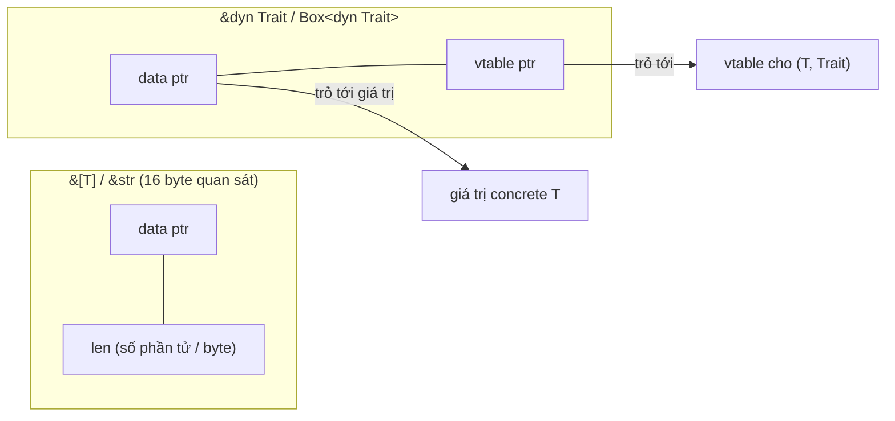
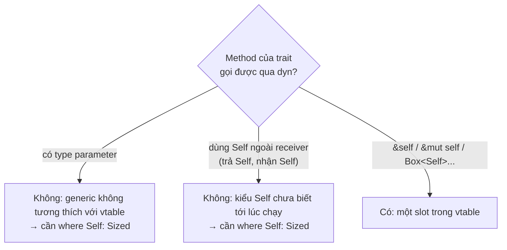

# P10 · Chương 03 — DST, fat pointer và vtable

> Mọi số đo trong chương chạy bằng `rustc 1.95.0 (59807616e 2026-04-14)` trên macOS aarch64 (Apple Silicon). Asm là AArch64, build `-O`. Số đo và asm là **quan sát** trên một compiler, một target; chỉ những câu có chú thích chân trang mới là bảo đảm của docs. Phần ghi "(nhận xét của người soạn)" là ý kiến, "(suy luận của người soạn)" là suy ra từ nguồn nhưng chưa có câu nào nói thẳng.

## Bạn sẽ hiểu được gì

- **Q1.** Vì sao `str`, `[T]`, `dyn Trait` không thể nằm trong biến cục bộ, và `?Sized` giải quyết vấn đề gì? → mục 1
- **Q2.** Con trỏ tới DST chứa những gì, và `&[u8]`, `&str`, `&dyn Debug`, `Box<dyn Trait>`, `Rc<str>` thực tế là bao nhiêu byte? → mục 2
- **Q3.** Unsized coercion `&[T; N] → &[T]`, `Box<T> → Box<dyn Trait>` xảy ra ở đâu và theo quy tắc nào? → mục 3
- **Q4.** Vtable chứa gì (theo docs), điều gì **không** được bảo đảm, và một lời gọi `dyn` biên dịch ra lệnh máy nào so với lời gọi generic? → mục 4
- **Q5.** Vì sao trait có method generic hoặc trả `Self` không dùng làm `dyn Trait` được? → mục 5
- **Q6.** `dyn Trait + Send`, supertrait, upcasting, `Any`/`downcast` hoạt động ra sao? → mục 6
- **Q7.** Struct có field cuối là DST dùng để làm gì, vì sao khó tạo? → mục 7
- **Q8.** `Box<dyn Handler>` trong router/plugin đắt ở đâu và không đắt ở đâu? → mục 8

## Kiến thức cần trước

- [P9 · Chương 02 — Trait](../09-rust-language/02-trait.md): trait, impl, supertrait, generic bound.
- [P10 · Chương 02 — Type layout](./02-type-layout.md): size, alignment, `repr`; chương này nhắc lại niche của `Option` (mục 5–6) và ZST (mục 7) bằng link thay vì lặp.
- [P9 · Chương 04 — Smart pointer](../09-rust-language/04-smart-pointer.md): `Box`, `Rc`, `Arc`.

Chương này nói về *cách biểu diễn* trait object. Việc compiler sinh một bản mã cho mỗi kiểu (static dispatch) nằm ở [P10 · Chương 04 — Monomorphization](./04-monomorphization.md); ở đây chỉ nhắc để so sánh.

## 1. Vì sao có kiểu không đặt được vào biến, và `?Sized` là gì (Q1)

> **Trả lời ngắn.** Rust cần biết size và alignment của một giá trị mới làm việc đúng với nó[^nomicon-must-know], nên biến cục bộ phải có size biết lúc biên dịch. `str`, `[T]` và `dyn Trait` là các kiểu có size chỉ biết lúc chạy[^ref-dst], nên chúng chỉ tồn tại phía sau một con trỏ[^nomicon-wide] và không đặt được vào biến cục bộ hay tham số hàm[^ref-dst-vars]. `?Sized` là cách nói "tham số kiểu này được phép là loại kiểu đó"[^sized-doc].

**Giải thích.** Hình dung bạn xếp chỗ cho khách trong một khách sạn: mỗi khách phải khai trước số giường cần. Một "đoàn khách chưa biết bao nhiêu người" không thể được xếp phòng; bạn chỉ có thể phát cho họ một *tấm thẻ* ghi địa chỉ và số người. Tấm thẻ luôn cùng cỡ dù đoàn lớn hay nhỏ (nhận xét của người soạn).

Compiler cần biết size của biến cục bộ để dành chỗ trên stack (cách giải thích của người soạn cho điều Nomicon nói ở trên). Có những kiểu mà size chỉ biết lúc chạy: một `[u8]` dài bao nhiêu tùy lúc gọi; một `dyn Shape` có thể là hình vuông 8 byte hoặc một struct 200 byte. Reference gọi đó là *dynamically sized type* (DST): slice, trait object và `str` là ví dụ[^ref-dst]. Hệ quả: biến, tham số hàm, `const`, `static` phải `Sized`[^ref-dst-vars]. Thử là ra lỗi ngay:

```rust
fn f(x: [u8]) {}
fn main() { let s: str = *"a"; }
```

Kết quả `rustc` (đã chạy): `error[E0277]: the size for values of type [u8] cannot be known at compilation time` (cùng lỗi cho `str`), kèm `the trait Sized is not implemented`.

DST vẫn dùng được **phía sau một con trỏ**. Nomicon: vì thiếu size tĩnh nên các kiểu này chỉ tồn tại sau con trỏ; con trỏ tới DST trở thành *wide pointer*, gồm địa chỉ cộng thông tin "hoàn tất" kiểu[^nomicon-wide]. Hai DST chính ngôn ngữ cung cấp là trait object (`dyn MyTrait`) và slice (`[T]`, `str`…)[^nomicon-two].

Mọi type parameter có ràng buộc ngầm `Sized`; cú pháp `?Sized` gỡ ràng buộc đó[^sized-doc]. Với DST, Reference nói chúng có thể làm type argument cho tham số có bound `?Sized`[^ref-qs]. Ví dụ từ std docs: `struct Bar<T: ?Sized>(T)` dùng được với `[i32]`, `Foo<T>(T)` thì không[^sized-doc].

Một ngoại lệ đáng nhớ: `Self` trong định nghĩa trait *không* có bound `Sized` ngầm: khác với type parameter generic, `Self: ?Sized` là mặc định trong định nghĩa trait[^ref-self-qs]. std docs giải thích: bound đó không tương thích với trait object, nơi trait phải làm việc với mọi implementor, nên có thể là bất kỳ size nào[^sized-self]. Đây là mối nối tới dyn compatibility ở mục 5.

<details><summary>Đi sâu: <code>?Sized</code> trong hàm generic, cái bẫy <code>Box&lt;T&gt;</code>, và ZST</summary>

Ví dụ `?Sized` trong thực tế (đã chạy, in `"hello" size_of_val=5`, `[1, 2, 3] size_of_val=12`, `5 size_of_val=1`):

```rust
use std::mem::size_of_val;
fn show<T: ?Sized + std::fmt::Debug>(t: &T) {
    println!("{:?} size_of_val={}", t, size_of_val(t));
}
fn main() { show("hello"); show(&[1, 2, 3][..]); show(&5u8); }
```

Cùng một hàm nhận `str`, `[i32]` và `u8` vì tham số là `&T`, một con trỏ, và `?Sized` cho phép `T` là DST. Khi `T` không có size biết tĩnh, ví dụ slice hay trait object, `size_of_val` cho ra size biết lúc chạy[^sizeofval]; còn `size_of::<T>()` thì không dùng được cho `T: ?Sized` vì mọi type parameter mặc định có ràng buộc `Sized`[^sized-doc] (suy luận của người soạn).

Trap hay gặp (đã chạy, lỗi `E0277: the size for values of type dyn Handler cannot be known`): viết `impl<T: Handler> Handler for Box<T>` rồi truyền `Box<dyn Handler>` vào hàm generic `H: Handler`. Impl đó ngầm đòi `T: Sized`[^sized-doc], mà `dyn Handler` thì không. Sửa bằng `impl<T: Handler + ?Sized> Handler for Box<T>` (đã chạy, biên dịch và chạy đúng). Mẫu này sẽ gặp lại ở router/middleware (mục 8).

ZST (zero-sized type) *không* phải DST: size của nó biết lúc biên dịch và bằng 0, ví dụ unit `()` được bảo đảm size 0, alignment 1[^ref-unit]. Định nghĩa, hệ quả no-op và chỗ unsafe phải để ý của ZST nằm ở [Chương 02 · mục 7](./02-type-layout.md), không lặp lại ở đây. Ghi chú: `Unit` ở mục 4 là một ZST bỏ vào `Box<dyn Shape>`.

</details>

**Quay lại Q1:** DST không biết size lúc biên dịch nên chỉ đứng sau con trỏ; `?Sized` cho phép generic code nhận chúng qua `&T`/`Box<T>`.

## 2. Fat pointer: con trỏ cộng metadata (Q2)

> **Trả lời ngắn.** Con trỏ tới DST gồm hai phần: địa chỉ và một thông tin bổ sung gọi là metadata. Slice và `str` mang thêm độ dài; `dyn Trait` mang thêm con trỏ tới bảng hàm (vtable)[^ref-dst-meta]. Trên máy đo, các con trỏ này là 16 byte, gấp đôi con trỏ thường 8 byte, khớp chương DST của Reference[^ref-dst-ptr]; nhưng mục Type layout của Reference chỉ hứa "ít nhất bằng" con trỏ thường[^ref-ptr-unsized], nên đừng coi 16 byte là bảo đảm[^ref-twice-current].

**Giải thích.** Nghĩ về tấm thẻ ở mục 1: với đoàn khách "đã biết số người" thẻ ghi *địa chỉ + số người*; với "khách từ nhiều hãng khác nhau" thẻ ghi *địa chỉ + số điện thoại tổng đài hãng* để hỏi cách phục vụ (nhận xét của người soạn).

Trang `ptr::Pointee` của std mô tả tường minh: con trỏ thô và tham chiếu có thể xem như hai phần, *data pointer* chứa địa chỉ và *metadata*[^ptr-pointee]. Với kiểu `Sized` (và `extern` type), pointer gọi là "thin": metadata kích thước 0, kiểu `()`[^ptr-thin]. Với DST, pointer là "wide" hay "fat" và metadata khác rỗng[^ptr-wide]; bảng dưới liệt kê từng loại.

| Pointee | Metadata | Nguồn |
|---|---|---|
| `[T]` | độ dài tính bằng phần tử, `usize` | `ptr::Pointee`[^ptr-slice] |
| `str` | độ dài tính bằng byte, `usize` | `ptr::Pointee`[^ptr-str] |
| `dyn Trait` | con trỏ tới vtable (`DynMetadata`) | `ptr::Pointee`[^ptr-dyn], Reference[^ref-dst-meta] |
| struct có field cuối là DST | metadata của field cuối | `ptr::Pointee`[^ptr-struct] |

Nomicon thêm: size của pointee slice bằng size tĩnh của một phần tử nhân số phần tử[^nomicon-slice]; còn size của pointee trait object được hỏi từ vtable lúc chạy[^nomicon-vtsize].



Con số: mọi con trỏ tới DST đo được đều 16 byte, gấp đôi con trỏ thường 8 byte. Khớp với chương DST của Reference, nói pointer tới DST có size gấp đôi pointer tới sized type[^ref-dst-ptr], và với mục Type layout, nói pointer tới sized type cùng size, alignment với `usize`[^ref-thin]. Nhưng **bảo đảm** trong mục Type layout yếu hơn số quan sát: nó chỉ hứa size và alignment của pointer tới unsized type *ít nhất bằng* của pointer thường[^ref-ptr-unsized], kèm lời dặn không nên dựa vào việc hiện tại chúng gấp đôi `usize`[^ref-twice-current]. Đừng viết unsafe code giả định "luôn 16 byte".

**API trạng thái nightly.** `Pointee` và `DynMetadata` đều ghi là API thử nghiệm chỉ có trên nightly (tính năng `ptr_metadata`) ở 1.95.0[^ptr-nightly-pointee][^ptr-nightly]. Vì thế chương này chỉ dùng chúng làm tài liệu mô tả, không dùng trong code ví dụ.

<details><summary>Đi sâu: bảng đo size, và các diễn giải kèm theo</summary>

Chương trình sau (chạy trên aarch64 macOS, rustc 1.95.0) in size của các con trỏ:

```rust
use std::{fmt::Debug, rc::Rc, sync::Arc, mem::size_of};
trait Shape { fn area(&self) -> f64; }
struct Tail<T: ?Sized> { id: u32, data: T }
fn main() {
    println!("&u8 {}", size_of::<&u8>());
    println!("&[u8] {}", size_of::<&[u8]>());
    println!("&str {}", size_of::<&str>());
    println!("&dyn Debug {}", size_of::<&dyn Debug>());
    println!("*const [u8] {}", size_of::<*const [u8]>());
    println!("Box<u8> {}", size_of::<Box<u8>>());
    println!("Box<[u8]> {}", size_of::<Box<[u8]>>());
    println!("Box<str> {}", size_of::<Box<str>>());
    println!("Box<dyn Shape> {}", size_of::<Box<dyn Shape>>());
    println!("Rc<str> {}", size_of::<Rc<str>>());
    println!("Arc<dyn Shape> {}", size_of::<Arc<dyn Shape>>());
    println!("Vec<u8> {}", size_of::<Vec<u8>>());
    println!("&Tail<[u8]> {}", size_of::<&Tail<[u8]>>());
    println!("Option<Box<dyn Shape>> {}", size_of::<Option<Box<dyn Shape>>>());
}
```

Kết quả đã đo:

| Kiểu | size (byte) |
|---|---|
| `&u8`, `Box<u8>` | 8 |
| `&[u8]`, `&str`, `*const [u8]` | 16 |
| `&dyn Debug`, `Box<dyn Shape>`, `Arc<dyn Shape>` | 16 |
| `Box<[u8]>`, `Box<str>`, `Rc<str>` | 16 |
| `&Tail<[u8]>` | 16 |
| `Option<Box<dyn Shape>>` | 16 |
| `Vec<u8>` | 24 |

- `Rc<str>` và `Arc<dyn Shape>` là 16: `Rc<T>` giữ một con trỏ `NonNull<RcInner<T>>`[^rc-ptr], còn `RcInner<T: ?Sized>` gồm hai bộ đếm `strong`, `weak` rồi field cuối `value: T`[^rc-inner]; `Arc<T>` có cùng khuôn: con trỏ `NonNull<ArcInner<T>>`[^arc-ptr], và `ArcInner` cũng kết thúc bằng bộ đếm `weak` rồi field cuối `data: T`[^arc-inner]. Tức đếm tham chiếu nằm trong vùng heap cùng giá trị chứ không nằm trong con trỏ, nên smart pointer sở hữu vẫn chỉ là *một* fat pointer (suy luận của người soạn từ hai khuôn struct trên).
- `Vec<u8>` là 24 byte, tức ba word: khớp việc docs `Vec` hứa nó luôn là bộ ba (pointer, capacity, length) mà không hứa thứ tự field[^vec-triplet]; `&[u8]` là 16 byte (ptr, len) (suy luận của người soạn từ số đo và từ metadata ở bảng trên). `Vec` sở hữu và có thể phình, slice chỉ là view (nhận xét của người soạn). Cấu trúc `Vec` nằm ở [Chương 09 · mục 1](./09-collections-internals.md), còn niche của con trỏ trong `Vec` ở [Chương 02 · mục 5](./02-type-layout.md).
- `Option<Box<dyn Shape>>` vẫn 16, bằng `Box<dyn Shape>`: niche (con trỏ không-null) vẫn dùng được. Số 16 ở đây là số đo, khớp docs `size_of` nói `Box<T>` và `Option<Box<T>>` cùng size mà không giới hạn `T: Sized`[^sizeof-same]; cách đọc bảng `std::option` (cột `Box<U>` và chữ `U: Sized` ở cột thứ hai) nằm ở [Chương 02 · mục 6](./02-type-layout.md). Docs không nêu ví dụ DST, nên việc áp bảng đó cho `U` là DST là cách đọc của người soạn.
- `&str` có cùng layout với `&[u8]`[^ref-str]; nên `s.as_bytes()` không cần đổi biểu diễn con trỏ (suy luận của người soạn).
- `size_of_val` đọc metadata để tính size (slice: size một phần tử nhân số phần tử[^nomicon-slice]; trait object: hỏi vtable[^nomicon-vtsize]): với `&[u32]` 4 phần tử trả 16, với `&str` "xin chào" trả 9 (ký tự `à` chiếm 2 byte UTF-8) — đã chạy.

</details>

**Quay lại Q2:** con trỏ tới DST = địa chỉ + metadata (độ dài hoặc con trỏ vtable), đo được 16 byte nhưng bảo đảm chỉ là "ít nhất bằng con trỏ thường".

## 3. Unsized coercion (Q3)

> **Trả lời ngắn.** Unsized coercion là phép đổi kiểu ngầm từ kiểu có size biết trước sang kiểu DST phía sau con trỏ, ví dụ `&[i32; 3]` thành `&[i32]` hay `Box<Circle>` thành `Box<dyn Shape>`[^coerce-tyctor]. Nó chỉ xảy ra ở các vị trí được phép (coercion site)[^coerce-site], như `let` có khai báo kiểu[^coerce-site-let], đối số hàm[^coerce-site-arg] và giá trị trả về[^coerce-site-ret].

**Giải thích.** Giống việc đóng gói một món hàng cụ thể vào hộp chung cỡ: bạn chỉ làm được khi *biết hộp đích* (kiểu đích khai báo), và hộp mới giữ thêm nhãn "bên trong là gì" (metadata) (nhận xét của người soạn).

Coercion là phép đổi kiểu ngầm, chỉ xảy ra tại các *coercion site* nhất định[^coerce-site]. Hạn chế này là lý do `let b = Box::new(Sq(2.0));` *không* tự thành `Box<dyn Shape>`: không có kiểu đích để compiler đẩy xuống (suy luận của người soạn từ điều kiện "kiểu đích tường minh" của coercion site).

Reference định nghĩa *unsized coercion* khi chuyển sang kiểu unsized. Hình thức `TyCtor(T) → TyCtor(U)` áp dụng cho `&T`, `&mut T`, `*const T`, `*mut T` và `Box<T>`, với `U` lấy từ `T` bằng unsized coercion[^coerce-tyctor]. Các phép built-in:

- `[T; n] → [T]` (mảng thành slice)[^coerce-slice];
- `T → dyn U`, khi `T` implement `U + Sized` và `U` là dyn compatible[^coerce-dyn];
- `dyn T → dyn U`, khi `U` là supertrait của `T` (upcasting, mục 6)[^coerce-upcast];
- struct `Foo<..., T, ...> → Foo<..., U, ...>` nếu field cuối của `Foo` có kiểu chứa `T` (và các điều kiện kèm theo, trong đó `T` không xuất hiện ở field nào khác)[^coerce-composite].

Lưu ý hướng (nhận xét của người soạn): unsized coercion đi từ **cụ thể → trừu tượng** (mất thông tin). Để quay lại kiểu cụ thể từ `Box<dyn Any>` cần `downcast` (mục 6).

<details><summary>Đi sâu: ví dụ đã chạy, và trait <code>Unsize</code>/<code>CoerceUnsized</code></summary>

```rust
let arr = [1, 2, 3];
let sl: &[i32] = &arr;                       // &[i32; 3] → &[i32]
let bx: Box<[i32]> = Box::new([4, 5, 6]);    // Box<[i32; 3]> → Box<[i32]>
let rc: std::rc::Rc<[i32]> = std::rc::Rc::new([7, 8]);
let d: Box<dyn Debug + Send> = Box::new(5);  // Box<i32> → Box<dyn Debug + Send>
```

Cả bốn biên dịch và chạy; in `[1, 2, 3] [4, 5, 6] [7, 8]` (đã chạy).

Các trait cơ chế `Unsize` và `CoerceUnsized` đứng sau[^coerce-unsize-traits], nhưng Reference nói rõ: định nghĩa và cài đặt của các coercion đã ổn định, còn các trait chưa stable nên không dùng trực tiếp trên Rust stable[^coerce-unstable-traits]. Tức là bạn không tự làm được smart pointer coerce như `Box` hay `Rc` trên stable (nhận xét của người soạn, từ câu trích trên).

</details>

**Quay lại Q3:** unsized coercion biến con trỏ tới kiểu cụ thể thành fat pointer, chỉ tại coercion site, và có bốn dạng built-in.

## 4. Vtable chứa gì, và lời gọi `dyn` ra lệnh máy nào (Q4)

> **Trả lời ngắn.** Con trỏ tới trait object gồm con trỏ tới giá trị và con trỏ tới *vtable*, một bảng chứa con trỏ tới từng method của kiểu đó[^ref-to-vtable]. Gọi method là load con trỏ hàm từ bảng rồi nhảy gián tiếp[^ref-to-virtual]. Các nguồn dùng trong chương này không hứa gì về thứ tự và số mục của bảng; asm chỉ là quan sát trên một compiler.

**Giải thích.** Vtable giống một bảng danh bạ nội bộ của hãng: tổng đài (code gọi) không biết nhân viên là ai, chỉ biết "máy nhánh số k là việc area". Mỗi kiểu cụ thể có một bảng riêng với cùng thứ tự máy nhánh (nhận xét của người soạn).

Reference định nghĩa: trait object là "một giá trị mờ (opaque) của một kiểu khác implement một tập trait", tập đó gồm một base trait dyn compatible cộng số lượng tùy ý auto trait[^ref-to-intro]. Trait object implement base trait, các auto trait và mọi supertrait của base trait[^ref-to-impls]. Book diễn đạt: nó trỏ tới cả instance lẫn một bảng để tra method lúc chạy[^book-to-table].

Mỗi con trỏ tới trait object gồm hai phần: con trỏ tới instance của kiểu `T` implement trait, và *virtual method table* (vtable), chứa, cho mỗi method của trait và supertrait mà `T` implement, một con trỏ tới implementation của `T`[^ref-to-vtable]. Mục đích là *late binding* (gắn method muộn, lúc chạy): gọi method trên trait object đi qua *virtual dispatch* — một function pointer được load từ vtable và gọi gián tiếp[^ref-to-virtual]. Nomicon thêm khía cạnh *erasure*: kiểu gốc bị xóa, đổi lấy runtime reflection qua vtable[^nomicon-erased].

Vtable chứa gì: Reference chỉ khẳng định con trỏ method[^ref-to-vtable]. Docs của `DynMetadata` (nightly) mô tả đầy đủ hơn: vtable *đáng chú ý là* chứa size của kiểu, alignment của kiểu, con trỏ tới `drop_in_place` của kiểu (có thể no-op với kiểu plain-old-data), và con trỏ tới mọi method[^dynmeta-contents]. Ba mục đầu đặc biệt vì cần để allocate, drop, deallocate mọi trait object[^dynmeta-three]. Nomicon cũng nói size pointee hỏi từ vtable[^nomicon-vtsize].

**Thứ tự các mục, số slot, có thêm mục khác hay không đều không được các nguồn đã dẫn ở trên hứa** (docs `DynMetadata` chỉ nói vtable *đáng chú ý là* chứa các mục trên, không nói đó là toàn bộ) — "sơ đồ drop/size/align/method" chỉ là hình dung.

Docs `DynMetadata` còn cảnh báo: so sánh con trỏ vtable không đáng tin, vì vtable của cùng kiểu cho cùng trait có thể khác địa chỉ (nhân đôi ở nhiều codegen unit), và ngược lại vtable của kiểu hoặc trait khác nhau có thể so bằng nhau (vtable giống hệt được gộp trong một codegen unit)[^dynmeta-eq]. Vì vậy đừng dùng "hai `dyn` cùng vtable" để suy ra "cùng kiểu", hay ngược lại; dùng `Any`/`TypeId` (mục 6).

Lời gọi dyn so với generic, asm AArch64 quan sát được (`rustc --crate-type=lib --emit=asm -O`):

```text
_call_dyn:            ; x0 = data ptr, x1 = vtable ptr (hai word của &dyn)
    ldr  x1, [x1, #24]    ; load function pointer từ vtable
    br   x1               ; nhảy gián tiếp
call_generic::<Sq>:
    ldr  d0, [x0]
    fmul d0, d0, d0       ; thân hàm viết thẳng cho Sq
    ret
```

Gọi dyn = load rồi nhảy gián tiếp. Phần dưới của khối asm (nhãn `call_generic::<Sq>`) chỉ là *thân* của hàm generic: code viết riêng cho `Sq`, không còn bước tra bảng; lệnh `bl` gọi tới nó xuất hiện ở `_use_generic` trong phần Đi sâu bên dưới (xem thêm [Chương 04](./04-monomorphization.md)). Book nêu trade-off: generic type parameter chỉ nhận *một* kiểu cụ thể mỗi lần, còn trait object cho phép nhiều kiểu cụ thể lấp chỗ đó lúc chạy[^book-generic-vs-dyn]; dynamic dispatch còn ngăn compiler chọn inline code của method và do đó ngăn một số tối ưu hóa[^book-inline].

<details><summary>Đi sâu: vtable quan sát được trong asm, offset 24/32, và <code>use_dyn</code> bị inline</summary>

Quan sát một lần biên dịch cụ thể để *thấy* vtable chứ không phải để dựa vào. Compile `Sq(f64)` implement `Shape { fn area(&self) -> f64; fn name(&self) -> u32; }` với `--emit=asm -O` ra vùng dữ liệu hằng:

```text
l_anon....0:
    .asciz  "\000\000\000\000\000\000\000\000\b\000\000\000\000\000\000\000\b\000\000\000\000\000\000"
    .quad   <Sq as Shape>::area
    .quad   <Sq as Shape>::name
```

Tức là 24 byte đầu: 8 byte 0 (con trỏ drop = null; suy luận của người soạn: vì `Sq` không có drop glue), 8 byte giá trị 8 (size), 8 byte giá trị 8 (align); sau đó hai con trỏ hàm. Khớp với danh sách của docs, và thứ tự "drop, size, align, rồi method theo khai báo" là *quan sát ở bản này* — đừng coi là hợp đồng.

Một thí nghiệm khác cho thấy size là thông tin lúc chạy (docs nói nó được hỏi từ vtable[^nomicon-vtsize]): `Box<dyn Shape>` chứa `Sq(2.0)` có `size_of_val` = 8, align 8; chứa `Unit` (unit struct) có size 0, align 1 — cùng kiểu tĩnh `Box<dyn Shape>`, hai kết quả khác nhau (đã chạy).

Mã nguồn so sánh (rustc `--crate-type=lib --emit=asm -O`, AArch64):

```rust
pub trait Shape { fn area(&self) -> f64; fn name(&self) -> u32; }
pub struct Sq(pub f64);
impl Shape for Sq { fn area(&self) -> f64 { self.0 * self.0 } fn name(&self) -> u32 { 1 } }

#[no_mangle] pub fn call_dyn(s: &dyn Shape) -> f64 { s.area() }
#[no_mangle] pub fn call_dyn_name(s: &dyn Shape) -> u32 { s.name() }
#[inline(never)] pub fn call_generic<T: Shape>(s: &T) -> f64 { s.area() }
#[no_mangle] pub fn use_generic(x: f64) -> f64 { let s = Sq(x); call_generic(&s) }
#[no_mangle] pub fn use_dyn(x: f64) -> f64 { let s = Sq(x); call_dyn(&s) }
```

Asm quan sát được (phần còn lại):

```text
_call_dyn_name:
    ldr  x1, [x1, #32]    ; slot kế tiếp = name
    br   x1
_use_generic:
    ...
    bl   call_generic::<Sq> ; bl = gọi trực tiếp tới một địa chỉ cố định
_use_dyn:
    fmul d0, d0, d0        ; toàn bộ đã inline, không còn dyn
    ret
```

Đọc kỹ:

1. **Gọi dyn = load rồi nhảy gián tiếp.** Hai word của `&dyn Shape` truyền vào `x0`, `x1` (data, vtable — quan sát ABI này); hàm load con trỏ từ vtable rồi nhảy. Offset 24 và 32 khớp với vtable ở trên (3 word header, rồi method theo thứ tự khai báo) — *quan sát*, không phải bảo đảm.
2. **Gọi generic = `bl` tới symbol cụ thể.** Địa chỉ đích biết lúc biên dịch, thân hàm là code riêng cho `Sq`: hệ quả của monomorphization.
3. **Dyn không *luôn* gián tiếp.** `use_dyn` cho thấy khi compiler thấy rõ kiểu cụ thể (ở đây `Sq` được tạo ngay trong hàm), nó inline `call_dyn` và gọi thẳng `fmul`. Đây là kết quả tối ưu của compiler ở build này (quan sát; chưa xác định tầng nào làm việc đó), không phải lời hứa của ngôn ngữ. Book chỉ nói ở mức tổng quát rằng dynamic dispatch ngăn inline[^book-inline]; chữ "ngăn" nên đọc là trường hợp thường gặp chứ không phải không bao giờ (suy luận của người soạn).
4. **Vòng lặp** qua `&[Box<dyn Shape>]` gọi `ldr` + `blr` cho mỗi phần tử; bản generic `&[Sq]` được vector hóa (`fmul.2d`) — quan sát trên vòng lặp nhỏ, không đo thời gian chạy.

</details>

**Quay lại Q4:** vtable là bảng con trỏ method (cùng size, align, drop theo docs `DynMetadata`) mà lời gọi `dyn` load rồi nhảy gián tiếp; layout cụ thể là quan sát, không bảo đảm.

## 5. Dyn compatibility: vì sao method generic và `-> Self` bị loại (Q5)

> **Trả lời ngắn.** Vtable là bảng các con trỏ hàm của một kiểu cụ thể[^ref-to-vtable]. Reference nêu hai lý do ngay trong ví dụ của nó: method generic không tương thích với vtable[^ref-dyn-why-generic], và kiểu `Self` chưa biết cho tới lúc chạy nên method trả `Self` không gọi được qua trait object[^ref-dyn-why-self]. Vì vậy trait có những method đó không dùng làm `dyn Trait` được, trừ khi đánh dấu chúng `where Self: Sized` để loại khỏi trait object[^ref-dyn-nondisp].

**Giải thích.** Hãy nhớ mô hình danh bạ ở mục 4: mỗi "máy nhánh" là một hàm cụ thể. Nếu ai đó muốn gọi "`g` với kiểu U nào đó", tổng đài phải có số cho *mọi* U có thể, điều không làm được. Nếu hàm hứa "trả về chính loại của tôi" thì người gọi không biết cần dành chỗ bao nhiêu byte vì loại đã bị xóa (nhận xét của người soạn, minh họa cho hai câu trích dưới đây).

Danh sách điều kiện đầy đủ của Reference (supertrait cũng dyn compatible, `Sized` không được là supertrait, không associated const, associated function phải *dispatchable* hoặc đánh dấu `where Self: Sized`) cùng các lần chạy `E0038` nằm ở [P9 · Chương 02, mục 6](../09-rust-language/02-trait.md); một trait thỏa các điều kiện đó mới làm base trait cho trait object[^ref-dyncompat]. Ở đây chỉ giữ phần *vì sao* theo góc vtable.

Lý do: ví dụ trong chính Reference chú thích bằng comment hai trường hợp: với method trả `Self`, comment nói kiểu `Self` chưa biết cho tới lúc chạy[^ref-dyn-why-self]; với method generic, comment nói generic không tương thích với vtable[^ref-dyn-why-generic]. Với method nhận tham số kiểu `Self`, comment ở ví dụ đó nói khác: tham số kia có thể là kiểu cụ thể khác với receiver[^ref-dyn-why-param].



<details><summary>Đi sâu: thí nghiệm lỗi <code>E0038</code>, <code>where Self: Sized</code>, <code>Clone</code>, <code>async</code>, <code>Sized</code> supertrait</summary>

Đã chạy hai trường hợp cố tình sai:

```rust
trait A { fn g<T>(&self, t: T); }      // method generic
trait B { fn dup(&self) -> Self; }     // trả Self
fn f(_: &dyn A) {}  fn f2(_: &dyn B) {}
```

Cả hai ra `error[E0038]: the trait A (B) is not dyn compatible`, kèm gợi ý `consider moving g/dup to another trait`. Còn trait C có `fn g<T>(&self, t: T) where Self: Sized;`, `fn dup(&self) -> Self where Self: Sized;` và `fn h(&self) -> u8;` thì `Box<dyn C>` hợp lệ và gọi được `h` (đã chạy, in `7`). Method bị `where Self: Sized` không gọi được qua `dyn C` nhưng trait vẫn dyn compatible[^ref-dyn-nondisp-ex].

Diễn giải của người soạn (suy luận, không phải câu nguồn): method generic `g<U>` thực ra là *họ* hàm, mỗi `U` một hàm — compiler không thể đặt vô hạn slot cho mọi `U` mà người gọi có thể truyền sau này. Method trả `Self` cần biết lúc gọi kiểu cụ thể để biết cấp bao nhiêu byte cho giá trị trả về, mà kiểu đã bị xóa.

Hệ quả thiết kế (nhận xét của người soạn): `Clone` không dyn compatible[^clone-dyn], nên không dùng `dyn Clone` được; pattern quen thuộc là thêm method `fn box_clone(&self) -> Box<dyn Handler>` vào trait. Còn `AsyncFn*` thì Reference nói thẳng là không dyn-compatible[^ref-dyn-asyncfn], và `async fn` trong trait cũng làm method đó không dispatchable[^ref-dyn-async].

Mối nối với mục 1 (suy luận của người soạn): `Sized` là supertrait bị cấm vì trait object *là* DST — nó không `Sized`, nên không thể thỏa `Self: Sized`; std docs cũng nói rõ bound `Sized` trên trait khiến bạn không dùng nó để tạo trait object[^sized-bound-trait].

</details>

**Quay lại Q5:** vtable là bảng cố định của hàm đã biên dịch cho một kiểu; method generic hoặc dùng `Self` không vừa vào bảng đó, nên phải loại bằng `where Self: Sized` hoặc tách trait.

## 6. `dyn Trait + Send`, supertrait, upcasting, `Any` (Q6)

> **Trả lời ngắn.** Auto trait như `Send` là một phần của kiểu trait object: hai trait object là cùng một kiểu (alias nhau) khi cùng base trait, cùng tập auto trait và cùng lifetime bound[^ref-to-alias], nên `dyn Debug` và `dyn Debug + Send` là hai kiểu khác nhau (suy luận của người soạn từ quy tắc đó). Vtable của trait chứa cả method của supertrait[^ref-to-vtable], và từ Rust 1.86 có thể đổi `dyn Derived` thành `dyn Base` ngay (upcasting)[^rel-186]. Muốn lấy lại kiểu cụ thể từ `dyn Any` thì dùng `downcast_ref` hoặc `downcast`[^any-module][^any-downcast]; `type_id()` gọi trên `dyn Any` trả `TypeId` của kiểu bên trong[^any-typeid].

**Giải thích.** `Send` giống nhãn "được phép gửi sang kho khác": một hộp chung cỡ phải ghi rõ nhãn đó ngay trên hộp, vì khi đã bỏ món hàng vào hộp thì người nhận không còn mở ra để kiểm tra (nhận xét của người soạn).

*Auto trait.* Auto trait đi cùng base trait. Hai trait object là cùng kiểu (alias nhau) khi cùng base trait, cùng tập auto trait và cùng lifetime bound[^ref-to-alias]; còn trait object chỉ implement base trait, các auto trait đã liệt kê và supertrait của base trait[^ref-to-impls]. Suy ra (suy luận của người soạn): `Box<dyn Debug>` và `Box<dyn Debug + Send>` là hai kiểu khác nhau, và chỉ kiểu thứ hai là `Send`. Gửi `Box<dyn Debug>` vào hàm đòi `T: Send` thì lỗi (đã chạy): `E0277: dyn Debug cannot be sent between threads safely`, `the trait Send is not implemented for dyn Debug`. Tức *trait object chỉ Send nếu bạn nói vậy* — vì kiểu cụ thể đã bị xóa, compiler không còn biết nó Send hay không (suy luận của người soạn). Thêm `Send` không đổi size con trỏ: `Box<dyn Debug + Send + Sync>` vẫn 16 byte (đã chạy) — auto trait không có method nên không cần slot vtable mới (suy luận của người soạn).

Quy tắc cú pháp của trait object: chỉ một trait không-auto, tối đa một lifetime bound, và không được dùng `?Sized`[^ref-to-constraint]; thứ tự auto trait không quan trọng (`dyn Trait + Send + UnwindSafe` là cùng kiểu với `dyn Trait + UnwindSafe + Send`)[^ref-to-alias].

*Supertrait và upcasting.* Vtable chứa method của trait *và* của supertrait[^ref-to-vtable], nên `&dyn Derived` gọi được `id()` của `Base` (khi `trait Derived: Base`); Reference có ví dụ gọi method supertrait trên trait object[^ref-supertraits]. `dyn T → dyn U` khi `U` là supertrait của `T` là một unsized coercion[^coerce-upcast], và release notes Rust 1.86.0 liệt kê việc ổn định (stabilize) upcasting trait object sang supertrait[^rel-186]. Bỏ auto trait được (`dyn T + Auto → dyn U`)[^coerce-upcast-drop]; thêm auto trait chỉ khi base trait có auto trait đó làm supertrait[^coerce-upcast-auto].

*`Any`.* `std::any::Any` là trait để mô phỏng dynamic typing; hầu hết kiểu đều implement, kiểu chứa tham chiếu non-`'static` thì không[^any-static]. `Any` dùng để lấy `TypeId`, và khi dùng như trait object thì có thêm `is`, `downcast_ref`…[^any-module]; riêng `Box<dyn Any>` có thêm `downcast`[^any-downcast]. Gọi `type_id()` trên `dyn Any` trả `TypeId` của kiểu cụ thể bên trong chứ không phải của `dyn Any`[^any-typeid] — nghĩa là `TypeId` đi qua vtable như một method bình thường (suy luận của người soạn). Bẫy được docs ghi rõ: với `Box<dyn Any>`, gọi thẳng `.type_id()` cho `TypeId` của *container*; muốn đúng phải chuyển smart pointer thành `&dyn Any`[^any-smart].

<details><summary>Đi sâu: ví dụ upcasting, bẫy <code>Box&lt;dyn Any&gt;</code>, lifetime mặc định, pattern plugin</summary>

Upcasting (từ 1.86 viết được; đã chạy, in `1`, `X`, `5 16`):

```rust
trait Base { fn id(&self) -> u32; }
trait Derived: Base + Debug { fn extra(&self) -> u32; }
let d: Box<dyn Derived> = Box::new(X);
let b: Box<dyn Base> = d;                 // upcast, đã chạy
let r: &dyn Derived = &X;
let dbg: &dyn Debug = r;                  // &dyn Derived → &dyn Debug
let s: Box<dyn Debug + Send> = Box::new(5);
let t: Box<dyn Debug> = s;                // bỏ auto trait
```

Vì sao đáng chú ý: vtable của `Derived` và vtable của `Base` khác nhau; chuyển từ `&dyn Derived` sang `&dyn Base` cần compiler tìm được vtable của `Base` từ vtable của `Derived` (suy luận của người soạn; cách làm cụ thể thuộc cài đặt rustc, chương này không đọc source). Trước 1.86 người ta thường dùng pattern `fn as_base(&self) -> &dyn Base` viết tay (nhận xét của người soạn).

Bẫy `Box<dyn Any>` (đã chạy):

```rust
let boxed: Box<dyn Any> = Box::new(3_i32);
boxed.type_id() == TypeId::of::<i32>()        // false
(&*boxed).type_id() == TypeId::of::<i32>()    // true
boxed.downcast_ref::<i32>()                   // Some(3)
boxed.downcast_ref::<String>()                // None
```

Giới hạn: `&dyn Any` chỉ kiểm tra được giá trị có phải *một kiểu cụ thể* hay không, không kiểm tra được kiểu có implement trait nào hay không[^any-limit].

Lifetime của trait object (`Box<dyn Trait + 'a>`) có quy tắc *default object lifetime bound* riêng. Sau các quy tắc lấy bound từ kiểu chứa và từ lifetime bound của trait, Reference nêu: nếu trait không có lifetime bound thì lifetime được suy ra trong biểu thức và là `'static` ngoài biểu thức[^ref-default-bound]. Chi tiết lifetime thuộc [P9 · Chương 01](../09-rust-language/01-ownership-borrowing-lifetime.md).

Pattern plugin hay gặp (đã chạy): `trait Plugin: Any { fn name(&self) -> &str; fn as_any(&self) -> &dyn Any; }` rồi `p.as_any().downcast_ref::<Auth>()` để lấy lại struct cụ thể từ `Box<dyn Plugin>`. (Nhận xét của người soạn: downcast là dấu hiệu thiết kế trait chưa đủ; dùng khi bạn thật sự cần mở rộng ngoài hợp đồng trait.)

</details>

**Quay lại Q6:** `Send` là một phần của kiểu `dyn`; supertrait và upcasting dựa vào vtable chứa method của supertrait; `Any` + `TypeId` cho phép downcast an toàn.

## 7. Struct có field cuối là DST (Q7)

> **Trả lời ngắn.** Một struct có thể để DST ở field cuối, khi đó chính struct đó thành DST[^ref-dst-last]. Nomicon nói kiểu như vậy gần như vô dụng nếu không có cách tạo ra nó, và cách được hỗ trợ duy nhất hiện nay là làm kiểu generic với `T: ?Sized` rồi unsizing coercion[^nomicon-useless][^nomicon-custom].

**Giải thích.** Giống một "phong bì" có tiêu đề cố định (`id`) phía trước rồi phần thân dài thay đổi phía sau: bạn không thể khai báo phần thân dài bao nhiêu lúc viết struct, nhưng có thể tạo phong bì với thân cố định rồi để compiler "quên" độ dài, giữ nó trong metadata (nhận xét của người soạn).

`struct MySuperSlice { info: u32, data: [u8] }` là ví dụ của Nomicon[^nomicon-useless]. Nomicon tự mô tả custom DST hiện là tính năng làm dở, chưa hoàn thiện[^nomicon-half]. Metadata của con trỏ tới struct bằng metadata của field cuối[^ptr-struct]; điều kiện để coerce `Foo<T> → Foo<U>` nêu ở mục 3[^coerce-composite]. Ví dụ trong std: `Rc<T: ?Sized>` trỏ tới `RcInner<T>`, một struct có field cuối là `T`[^rc-inner]; với `T = str`, `RcInner<str>` là một custom DST kiểu này (suy luận của người soạn). Hiếm khi bạn cần tự viết custom DST (nhận xét của người soạn).

<details><summary>Đi sâu: ví dụ <code>Tail&lt;T: ?Sized&gt;</code> đã chạy</summary>

```rust
struct Tail<T: ?Sized> { id: u32, data: T }
let b: Box<Tail<[u8]>> = Box::new(Tail { id: 7, data: [1u8, 2, 3] });
// b.data.len() == 3, size_of_val(&*b) == 8, align_of_val(&*b) == 4
let d: &Tail<dyn Shape> = &Tail { id: 1, data: 9u64 };
// size_of_val(d) == 16, align_of_val(d) == 8
```

`&Tail<[u8]>` và `&Tail<dyn Shape>` đều 16 byte (đã đo), khớp `ptr::Pointee`[^ptr-struct]. Điều đáng chú ý: *align* của `Tail<dyn Shape>` là 8 khi dữ liệu là `u64`. Docs `offset_of!` nói alignment của giá trị `dyn Trait` được xác định lúc chạy nên offset của field trong kiểu không có size tĩnh có thể phụ thuộc giá trị đang lưu[^offset-of-dyn-align]; còn alignment đó nằm trong vtable theo docs `DynMetadata`[^dynmeta-contents] (ghép hai nguồn: suy luận của người soạn).

</details>

**Quay lại Q7:** DST ở field cuối làm cả struct thành DST; cách được Nomicon coi là hỗ trợ đúng nghĩa duy nhất để tạo nó là generic `?Sized` + unsizing coercion.

## 8. `Box<dyn Handler>` đắt ở đâu, không đắt ở đâu (Q8)

> **Trả lời ngắn.** `Box<dyn Handler>` tốn thêm 8 byte metadata mỗi con trỏ (đo: 16 so với 8), một lời gọi gián tiếp mỗi method, và thường mất khả năng inline[^book-inline]. Chi phí đó nhỏ so với I/O của handler thật; nó đáng kể hơn trong vòng lặp nóng gọi từng phần tử (nhận xét của người soạn, chưa đo thời gian chạy).

**Giải thích.** Router `Vec<(&str, Box<dyn Handler>)>` là chỗ `dyn` hợp lý: tập handler mở, đăng ký lúc chạy, và khi có request thì tốn một lần gọi gián tiếp, rẻ so với parse HTTP hay đọc DB (nhận xét của người soạn).

Trade-off theo Book: generic chỉ nhận một kiểu cụ thể mỗi lần; trait object cho phép nhiều kiểu lấp chỗ đó lúc chạy[^book-generic-vs-dyn]. Trait object trả giá ở mỗi lời gọi (một lệnh load và một lệnh nhảy gián tiếp theo asm quan sát ở mục 4, cộng khả năng mất inline); generic được compiler sinh mã cụ thể cho từng kiểu dùng[^book-mono], nên trả giá ở bản mã (thời gian biên dịch và kích thước binary: nhận xét của người soạn, xem [Chương 04](./04-monomorphization.md)). Hai điểm cần nhớ khi so sánh: vtable chỉ là dữ liệu hằng (asm mục 4), nên mỗi `Box<dyn>` thêm một word con trỏ chứ không thêm cả bảng; và không phải lời gọi `dyn` nào cũng gián tiếp thật (`use_dyn` ở mục 4).

<details><summary>Đi sâu: router, plugin, thread pool và ranh giới ABI</summary>

- **Router/handler.** Mỗi `Box<dyn>` là 16 byte thay vì 8 (đo ở mục 2) và có một lần cấp phát heap lúc đăng ký (không phải mỗi request) (nhận xét của người soạn). Với handler chạm mạng/đĩa, một lần nhảy gián tiếp thường bị lấn át bởi độ trễ I/O; nhưng với vòng lặp xử lý từng phần tử trong hot path thì tính toán có thể đáng kể — hãy đo với dữ liệu của bạn (nhận xét của người soạn, chưa đo ở chương này).
- **Plugin.** Trait object cho phép thêm kiểu mới mà không đổi code gọi. Nhưng đừng tưởng `dyn` cho ABI ổn định: layout vtable không được bảo đảm (mục 4), Nomicon nói con trỏ DST (wide pointer) không có khái niệm tương ứng trong C nên không bao giờ FFI-safe[^nomicon-dst-ffi], và ABI `"Rust"` không có bảo đảm ổn định[^ref-abi-rust]. Vì vậy `Box<dyn Trait>` không nên đi qua ranh giới thư viện động giữa các lần biên dịch khác nhau, và plugin qua `dlopen` phải đi qua `extern "C"` (xem [Chương 08 · mục 4–5](./08-panic-abi-ffi.md)) (nhận xét của người soạn).
- **Thread pool và lỗi.** Job `Box<dyn FnOnce() + Send + 'static>` cần `Send` (mục 6); `Box<dyn Error + Send + Sync>` gộp nhiều kiểu lỗi, và `dyn Error + Send + Sync` có method `downcast` riêng để lấy lại kiểu[^err-downcast] (cùng ý với `downcast` ở mục 6) (nhận xét của người soạn).

</details>

**Quay lại Q8:** `Box<dyn Handler>` đắt ở word metadata, lời gọi gián tiếp và inline bị mất; không đắt khi handler làm việc nặng hơn nhiều so với một lần nhảy.

## Tóm tắt

- DST (`str`, `[T]`, `dyn Trait`) có size chỉ biết lúc chạy; chỉ dùng được sau con trỏ; biến/tham số phải `Sized`[^ref-dst][^ref-dst-vars].
- Con trỏ tới DST = data pointer + metadata: số phần tử cho slice/`str`, con trỏ vtable cho `dyn`[^ref-dst-meta]. Đo thật: `&[u8]`, `&str`, `&dyn Debug`, `Box<dyn T>`, `Rc<str>` đều 16 byte; con trỏ thường 8. Bảo đảm chỉ là "ít nhất bằng" con trỏ thường[^ref-ptr-unsized].
- Unsized coercion: `&[T; N] → &[T]`, `Box<T> → Box<dyn Trait>`, upcasting `dyn T → dyn U` (stable từ 1.86); chỉ ở coercion site[^coerce-site][^rel-186].
- Vtable chứa size, align, con trỏ drop và con trỏ method (theo docs `DynMetadata`)[^dynmeta-contents]; thứ tự và layout không bảo đảm; địa chỉ vtable không dùng để so sánh kiểu[^dynmeta-eq].
- Asm AArch64 (quan sát): gọi `dyn` là `ldr` slot rồi `br`/`blr`; gọi generic là `bl` tới hàm đã monomorphize; compiler vẫn có thể devirtualize khi thấy kiểu thật. Dyn thường ngăn inline[^book-inline].
- Dyn compatibility: không method generic, không `Self` ngoài receiver, không `Sized` supertrait, không associated const; thoát bằng `where Self: Sized`[^ref-dyncompat][^ref-dyn-why-generic][^ref-dyn-why-self].
- Auto trait là một phần kiểu: `dyn T` khác `dyn T + Send`[^ref-to-alias].
- `Any` + `downcast_ref`/`downcast` lấy lại kiểu cụ thể; coi chừng `.type_id()` trên `Box<dyn Any>`[^any-smart].
- Struct có field cuối DST là custom DST; cách hỗ trợ duy nhất theo Nomicon là generic `?Sized` + unsizing[^nomicon-custom].
- API metadata (`Pointee`, `DynMetadata`) vẫn là nightly ở 1.95.0[^ptr-nightly-pointee][^ptr-nightly].

## Câu hỏi tự kiểm tra

1. Vì sao `fn f(x: [u8])` không biên dịch, còn `fn f(x: &[u8])` thì có?
   <details><summary>Đáp án</summary>

   Tham số hàm phải <code>Sized</code>; <code>[u8]</code> là DST nên chỉ dùng được sau con trỏ[^ref-dst-vars]. <code>&[u8]</code> là fat pointer (ptr + len)[^ref-dst-meta] có size biết tĩnh[^ref-dst-ptr].

   </details>

2. Metadata của `&str`, `&[T]`, `&dyn Trait`, `&Tail<[u8]>` lần lượt là gì?
   <details><summary>Đáp án</summary>

   Độ dài byte; độ dài phần tử; con trỏ vtable; metadata của field cuối, tức độ dài slice[^ptr-struct][^ref-dst-meta].

   </details>

3. Vtable chứa gì theo docs, và điều gì không được bảo đảm?
   <details><summary>Đáp án</summary>

   Size, align, con trỏ drop_in_place, con trỏ method[^dynmeta-contents]. Thứ tự/số slot và layout chính xác không được hứa; địa chỉ vtable không dùng để suy ra kiểu[^dynmeta-eq].

   </details>

4. Trong asm AArch64, lời gọi `s.area()` với `s: &dyn Shape` gồm những lệnh nào? Khác gì lời gọi generic?
   <details><summary>Đáp án</summary>

   <code>ldr x1, [x1, #24]; br x1</code> (load con trỏ hàm từ vtable, nhảy gián tiếp[^ref-to-virtual]); generic dùng <code>bl</code> tới hàm đã monomorphize. Quan sát, không phải bảo đảm.

   </details>

5. Vì sao `fn dup(&self) -> Self` và `fn g<T>(&self, t: T)` làm trait mất dyn compatibility? Cách thoát?
   <details><summary>Đáp án</summary>

   Theo Reference: kiểu <code>Self</code> chưa biết cho tới lúc chạy[^ref-dyn-why-self], và generic không tương thích với vtable[^ref-dyn-why-generic]. Thoát bằng <code>where Self: Sized</code>[^ref-dyn-nondisp].

   </details>

6. `Box<dyn Debug>` có truyền sang `thread::spawn` được không? Sửa thế nào?
   <details><summary>Đáp án</summary>

   Không, vì <code>dyn Debug</code> không <code>Send</code>; đổi thành <code>dyn Debug + Send</code>. Trait object chỉ implement base trait, các auto trait đã liệt kê và supertrait[^ref-to-impls]; tập auto trait là một phần của kiểu[^ref-to-alias].

   </details>

7. Từ 1.86 làm được gì với `Box<dyn Derived>` mà trước đó phải viết tay?
   <details><summary>Đáp án</summary>

   Coerce thẳng sang <code>Box&lt;dyn Base&gt;</code> khi <code>Base</code> là supertrait: upcasting[^coerce-upcast][^rel-186].

   </details>

8. Khi nào cần `?Sized` trong `impl<T: Handler + ?Sized> Handler for Box<T>`?
   <details><summary>Đáp án</summary>

   Để <code>T</code> được là <code>dyn Handler</code>; thiếu nó thì <code>T: Sized</code> ngầm[^sized-doc] và <code>Box&lt;dyn Handler&gt;</code> không thỏa (E0277 đã chạy).

   </details>

9. Vì sao gọi `.type_id()` trực tiếp trên `Box<dyn Any>` cho kết quả sai, và sửa thế nào?
   <details><summary>Đáp án</summary>

   Nó cho <code>TypeId</code> của container, không phải của giá trị bên trong; chuyển thành <code>&dyn Any</code> trước[^any-smart].

   </details>

10. Vì sao không so sánh con trỏ vtable để biết hai `dyn` có cùng kiểu?
    <details><summary>Đáp án</summary>

    Vtable của cùng kiểu cho cùng trait có thể ở địa chỉ khác nhau vì được nhân đôi ở nhiều codegen unit; ngược lại vtable của kiểu hoặc trait khác nhau có thể so bằng nhau vì được gộp[^dynmeta-eq]; dùng <code>Any</code>/<code>TypeId</code>.

    </details>

## Đọc thêm

- [Reference — Dynamically sized types](https://doc.rust-lang.org/1.95.0/reference/dynamically-sized-types.html): định nghĩa DST ngắn gọn, `?Sized` và Self trong trait.
- [Reference — Trait objects](https://doc.rust-lang.org/1.95.0/reference/types/trait-object.html): cấu trúc trait object, virtual dispatch, quy tắc cú pháp `dyn A + Send`.
- [Reference — Traits, Dyn compatibility](https://doc.rust-lang.org/1.95.0/reference/items/traits.html): danh sách điều kiện đầy đủ, ví dụ hai chú thích.
- [Reference — Type coercions](https://doc.rust-lang.org/1.95.0/reference/type-coercions.html): coercion site và unsized coercion.
- [Nomicon — Exotically Sized Types](https://doc.rust-lang.org/1.95.0/nomicon/exotic-sizes.html): DST, ZST, custom DST và lý do chúng còn dang dở.
- [std — ptr::Pointee](https://doc.rust-lang.org/1.95.0/std/ptr/trait.Pointee.html) và [DynMetadata](https://doc.rust-lang.org/1.95.0/std/ptr/struct.DynMetadata.html): mô tả metadata/vtable (nightly).
- [std — any](https://doc.rust-lang.org/1.95.0/std/any/index.html): `Any`, `TypeId`, downcast và bẫy `Box<dyn Any>`.
- [Book ch18-02](https://doc.rust-lang.org/1.95.0/book/ch18-02-trait-objects.html): trait object vs generic dưới góc nhìn thiết kế.

[^ref-dst]: The Rust Reference, Dynamically sized types — <https://doc.rust-lang.org/1.95.0/reference/dynamically-sized-types.html> — "A type with a size that is known only at run-time is called a dynamically sized type (DST) or, informally, an unsized type. Slices, trait objects, and str are examples of DSTs."
[^ref-dst-vars]: The Rust Reference, Dynamically sized types — <https://doc.rust-lang.org/1.95.0/reference/dynamically-sized-types.html> — "Variables, function parameters, const items, and static items must be Sized."
[^nomicon-wide]: The Rustonomicon, Exotically Sized Types — <https://doc.rust-lang.org/1.95.0/nomicon/exotic-sizes.html> — "Since they lack a statically known size, these types can only exist behind a pointer. Any pointer to a DST consequently becomes a wide pointer consisting of the pointer and the information that “completes” them"
[^nomicon-two]: The Rustonomicon, Exotically Sized Types — <https://doc.rust-lang.org/1.95.0/nomicon/exotic-sizes.html> — "There are two major DSTs exposed by the language: trait objects: dyn MyTrait slices: [T], str, and others"
[^sized-doc]: Rust std, marker::Sized — <https://doc.rust-lang.org/1.95.0/std/marker/trait.Sized.html> — "All type parameters have an implicit bound of Sized. The special syntax ?Sized can be used to remove this bound if it’s not appropriate. struct Foo\<T>(T); struct Bar\<T: ?Sized>(T); // struct FooUse(Foo<[i32]>); // error: Sized is not implemented for [i32] struct BarUse(Bar<[i32]>); // OK"
[^ref-qs]: The Rust Reference, Dynamically sized types — <https://doc.rust-lang.org/1.95.0/reference/dynamically-sized-types.html> — "DSTs can be provided as type arguments to generic type parameters having the special ?Sized bound."
[^ref-self-qs]: The Rust Reference, Dynamically sized types — <https://doc.rust-lang.org/1.95.0/reference/dynamically-sized-types.html> — "Unlike with generic type parameters, Self: ?Sized is the default in trait definitions."
[^sized-self]: Rust std, marker::Sized — <https://doc.rust-lang.org/1.95.0/std/marker/trait.Sized.html> — "A trait does not have an implicit Sized bound as this is incompatible with trait objects where, by definition, the trait needs to work with all possible implementors, and thus could be any size."
[^sizeofval]: Rust std, mem::size_of_val — <https://doc.rust-lang.org/1.95.0/std/mem/fn.size_of_val.html> — "However, when T has no statically-known size, e.g., a slice [T] or a trait object, then size_of_val can be used to get the dynamically-known size."
[^ptr-pointee]: Rust std, ptr::Pointee — <https://doc.rust-lang.org/1.95.0/std/ptr/trait.Pointee.html> — "Raw pointer types and reference types in Rust can be thought of as made of two parts: a data pointer that contains the memory address of the value, and some metadata."
[^ptr-thin]: Rust std, ptr::Pointee — <https://doc.rust-lang.org/1.95.0/std/ptr/trait.Pointee.html> — "For statically-sized types (that implement the Sized traits) as well as for extern types, pointers are said to be “thin”: metadata is zero-sized and its type is ()."
[^ptr-slice]: Rust std, ptr::Pointee — <https://doc.rust-lang.org/1.95.0/std/ptr/trait.Pointee.html> — "For slice types like [T], metadata is the length in items as usize"
[^ptr-str]: Rust std, ptr::Pointee — <https://doc.rust-lang.org/1.95.0/std/ptr/trait.Pointee.html> — "For the str type, metadata is the length in bytes as usize"
[^ptr-dyn]: Rust std, ptr::Pointee — <https://doc.rust-lang.org/1.95.0/std/ptr/trait.Pointee.html> — "For trait objects like dyn SomeTrait, metadata is DynMetadata\<Self> (e.g. DynMetadata\<dyn SomeTrait>)"
[^ptr-struct]: Rust std, ptr::Pointee — <https://doc.rust-lang.org/1.95.0/std/ptr/trait.Pointee.html> — "For structs whose last field is a DST, metadata is the metadata for the last field"
[^ptr-nightly]: Rust std, ptr::DynMetadata — <https://doc.rust-lang.org/1.95.0/std/ptr/struct.DynMetadata.html> — "This is a nightly-only experimental API. (ptr_metadata #81513)"
[^ref-dst-meta]: The Rust Reference, Dynamically sized types — <https://doc.rust-lang.org/1.95.0/reference/dynamically-sized-types.html> — "Pointers to slices and str also store the number of elements. Pointers to trait objects also store a pointer to a vtable."
[^nomicon-slice]: The Rustonomicon, Exotically Sized Types — <https://doc.rust-lang.org/1.95.0/nomicon/exotic-sizes.html> — "The information that completes a slice pointer is just the number of elements it points to. The runtime size of the pointee is just the statically known size of an element multiplied by the number of elements."
[^nomicon-vtsize]: The Rustonomicon, Exotically Sized Types — <https://doc.rust-lang.org/1.95.0/nomicon/exotic-sizes.html> — "The runtime size of the pointee can be dynamically requested from the vtable."
[^ref-dst-ptr]: The Rust Reference, Dynamically sized types — <https://doc.rust-lang.org/1.95.0/reference/dynamically-sized-types.html> — "Pointer types to DSTs are sized but have twice the size of pointers to sized types"
[^ref-thin]: The Rust Reference, Type layout — <https://doc.rust-lang.org/1.95.0/reference/type-layout.html> — "Pointers to sized types have the same size and alignment as usize."
[^ref-ptr-unsized]: The Rust Reference, Type layout — <https://doc.rust-lang.org/1.95.0/reference/type-layout.html> — "Pointers to unsized types are sized. The size and alignment is guaranteed to be at least equal to the size and alignment of a pointer."
[^ref-twice-current]: The Rust Reference, Type layout — <https://doc.rust-lang.org/1.95.0/reference/type-layout.html> — "Though you should not rely on this, all pointers to DSTs are currently twice the size of the size of usize and have the same alignment."
[^ref-str]: The Rust Reference, Type layout — <https://doc.rust-lang.org/1.95.0/reference/type-layout.html> — "A reference &str has the same layout as a reference &[u8]."
[^coerce-site]: The Rust Reference, Type coercions — <https://doc.rust-lang.org/1.95.0/reference/type-coercions.html> — "A coercion can only occur at certain coercion sites in a program"
[^coerce-tyctor]: The Rust Reference, Type coercions — <https://doc.rust-lang.org/1.95.0/reference/type-coercions.html> — "TyCtor(T) to TyCtor(U), where TyCtor(T) is one of &T &mut T *const T *mut T Box\<T> and where U can be obtained from T by unsized coercion."
[^coerce-dyn]: The Rust Reference, Type coercions — <https://doc.rust-lang.org/1.95.0/reference/type-coercions.html> — "T to dyn U, when T implements U + Sized, and U is dyn compatible."
[^coerce-upcast]: The Rust Reference, Type coercions — <https://doc.rust-lang.org/1.95.0/reference/type-coercions.html> — "dyn T to dyn U, when U is one of T’s supertraits."
[^coerce-upcast-auto]: The Rust Reference, Type coercions — <https://doc.rust-lang.org/1.95.0/reference/type-coercions.html> — "This allows adding auto traits if the principal trait has the auto trait as a super trait, i.e. given trait T: U + Send {}, dyn T to dyn T + Send or to dyn U + Send coercions are allowed."
[^coerce-composite]: The Rust Reference, Type coercions — <https://doc.rust-lang.org/1.95.0/reference/type-coercions.html> — "Foo is a struct. T implements Unsize\<U>. The last field of Foo has a type involving T. If that field has type Bar\<T>, then Bar\<T> implements Unsize\<Bar\<U>>. T is not part of the type of any other fields."
[^coerce-unstable-traits]: The Rust Reference, Type coercions — <https://doc.rust-lang.org/1.95.0/reference/type-coercions.html> — "While the definition of the unsized coercions and their implementation has been stabilized, the traits themselves are not yet stable and therefore can’t be used directly in stable Rust."
[^ref-to-intro]: The Rust Reference, Trait object types — <https://doc.rust-lang.org/1.95.0/reference/types/trait-object.html> — "A trait object is an opaque value of another type that implements a set of traits. The set of traits is made up of a dyn compatible base trait plus any number of auto traits."
[^ref-to-impls]: The Rust Reference, Trait object types — <https://doc.rust-lang.org/1.95.0/reference/types/trait-object.html> — "Trait objects implement the base trait, its auto traits, and any supertraits of the base trait."
[^ref-to-vtable]: The Rust Reference, Trait object types — <https://doc.rust-lang.org/1.95.0/reference/types/trait-object.html> — "a virtual method table, often just called a vtable, which contains, for each method of SomeTrait and its supertraits that T implements, a pointer to T’s implementation (i.e. a function pointer)."
[^ref-to-virtual]: The Rust Reference, Trait object types — <https://doc.rust-lang.org/1.95.0/reference/types/trait-object.html> — "Calling a method on a trait object results in virtual dispatch at runtime: that is, a function pointer is loaded from the trait object vtable and invoked indirectly."
[^ref-to-constraint]: The Rust Reference, Trait object types — <https://doc.rust-lang.org/1.95.0/reference/types/trait-object.html> — "There may not be more than one non-auto trait, no more than one lifetime, and opt-out bounds (e.g. ?Sized) are not allowed."
[^ref-to-alias]: The Rust Reference, Trait object types — <https://doc.rust-lang.org/1.95.0/reference/types/trait-object.html> — "Two trait object types alias each other if the base traits alias each other and if the sets of auto traits are the same and the lifetime bounds are the same. For example, dyn Trait + Send + UnwindSafe is the same as dyn Trait + UnwindSafe + Send."
[^nomicon-erased]: The Rustonomicon, Exotically Sized Types — <https://doc.rust-lang.org/1.95.0/nomicon/exotic-sizes.html> — "The exact original type is erased in favor of runtime reflection with a vtable containing all the information necessary to use the type."
[^dynmeta-contents]: Rust std, ptr::DynMetadata — <https://doc.rust-lang.org/1.95.0/std/ptr/struct.DynMetadata.html> — "The vtable notably contains: type size type alignment a pointer to the type’s drop_in_place impl (may be a no-op for plain-old-data) pointers to all the methods for the type’s implementation of the trait"
[^dynmeta-three]: Rust std, ptr::DynMetadata — <https://doc.rust-lang.org/1.95.0/std/ptr/struct.DynMetadata.html> — "Note that the first three are special because they’re necessary to allocate, drop, and deallocate any trait object."
[^dynmeta-eq]: Rust std, ptr::DynMetadata — <https://doc.rust-lang.org/1.95.0/std/ptr/struct.DynMetadata.html> — "comparing vtable pointers is unreliable: pointers to vtables of the same type for the same trait can compare inequal (because vtables are duplicated in multiple codegen units), and pointers to vtables of different types/traits can compare equal (since identical vtables can be deduplicated within a codegen unit)."
[^book-inline]: The Rust Programming Language, Using Trait Objects That Allow for Values of Different Types — <https://doc.rust-lang.org/1.95.0/book/ch18-02-trait-objects.html> — "Dynamic dispatch also prevents the compiler from choosing to inline a method’s code, which in turn prevents some optimizations"
[^book-generic-vs-dyn]: The Rust Programming Language, Using Trait Objects That Allow for Values of Different Types — <https://doc.rust-lang.org/1.95.0/book/ch18-02-trait-objects.html> — "A generic type parameter can be substituted with only one concrete type at a time, whereas trait objects allow for multiple concrete types to fill in for the trait object at runtime."
[^ref-dyncompat]: The Rust Reference, Traits (dyn compatibility) — <https://doc.rust-lang.org/1.95.0/reference/items/traits.html> — "A dyn-compatible trait can be the base trait of a trait object."
[^ref-dyn-async]: The Rust Reference, Traits (dyn compatibility) — <https://doc.rust-lang.org/1.95.0/reference/items/traits.html> — "Not have an opaque return type; that is, Not be an async fn (which has a hidden Future type). Not have a return position impl Trait type (fn example(&self) -> impl Trait)."
[^ref-dyn-asyncfn]: The Rust Reference, Traits (dyn compatibility) — <https://doc.rust-lang.org/1.95.0/reference/items/traits.html> — "The AsyncFn, AsyncFnMut, and AsyncFnOnce traits are not dyn-compatible."
[^ref-dyn-nondisp]: The Rust Reference, Traits (dyn compatibility) — <https://doc.rust-lang.org/1.95.0/reference/items/traits.html> — "Explicitly non-dispatchable functions require: Have a where Self: Sized bound (receiver type of Self (i.e. self) implies this)."
[^ref-dyn-why-generic]: The Rust Reference, Traits (dyn compatibility) — <https://doc.rust-lang.org/1.95.0/reference/items/traits.html> — "Generics are not compatible with vtables."
[^ref-dyn-why-self]: The Rust Reference, Traits (dyn compatibility) — <https://doc.rust-lang.org/1.95.0/reference/items/traits.html> — "Self type isn't known until runtime."
[^sized-bound-trait]: Rust std, marker::Sized — <https://doc.rust-lang.org/1.95.0/std/marker/trait.Sized.html> — "Although Rust will let you bind Sized to a trait, you won’t be able to use it to form a trait object later:"
[^ref-supertraits]: The Rust Reference, Traits (supertraits) — <https://doc.rust-lang.org/1.95.0/reference/items/traits.html> — "Similarly, here is an example of calling supertrait methods on trait objects."
[^ref-default-bound]: The Rust Reference, Lifetime elision — <https://doc.rust-lang.org/1.95.0/reference/lifetime-elision.html> — "If the trait has no lifetime bounds, then the lifetime is inferred in expressions and is 'static outside of expressions."
[^rel-186]: Rust RELEASES.md, Version 1.86.0, Language — <https://raw.githubusercontent.com/rust-lang/rust/1.95.0/RELEASES.md> — "Stabilize upcasting trait objects to supertraits."
[^any-static]: Rust std, any::Any — <https://doc.rust-lang.org/1.95.0/std/any/trait.Any.html> — "A trait to emulate dynamic typing. Most types implement Any. However, any type which contains a non-'static reference does not."
[^any-module]: Rust std, module any — <https://doc.rust-lang.org/1.95.0/std/any/index.html> — "Any itself can be used to get a TypeId, and has more features when used as a trait object. As &dyn Any (a borrowed trait object), it has the is and downcast_ref methods, to test if the contained value is of a given type, and to get a reference to the inner value as a type."
[^any-typeid]: Rust std, any::Any — <https://doc.rust-lang.org/1.95.0/std/any/trait.Any.html> — "this returns the TypeId of the underlying concrete type, not that of dyn Any itself."
[^any-smart]: Rust std, module any — <https://doc.rust-lang.org/1.95.0/std/any/index.html> — "simply calling .type_id() on the value will produce the TypeId of the container, not the underlying trait object. This can be avoided by converting the smart pointer into a &dyn Any instead, which will return the object’s TypeId."
[^any-limit]: Rust std, module any — <https://doc.rust-lang.org/1.95.0/std/any/index.html> — "Note that &dyn Any is limited to testing whether a value is of a specified concrete type, and cannot be used to test whether a type implements a trait."
[^nomicon-useless]: The Rustonomicon, Exotically Sized Types — <https://doc.rust-lang.org/1.95.0/nomicon/exotic-sizes.html> — "such a type is largely useless without a way to construct it."
[^nomicon-custom]: The Rustonomicon, Exotically Sized Types — <https://doc.rust-lang.org/1.95.0/nomicon/exotic-sizes.html> — "Currently the only properly supported way to create a custom DST is by making your type generic and performing an unsizing coercion:"
[^nomicon-half]: The Rustonomicon, Exotically Sized Types — <https://doc.rust-lang.org/1.95.0/nomicon/exotic-sizes.html> — "(Yes, custom DSTs are a largely half-baked feature for now.)"
[^ref-dst-last]: The Rust Reference, Dynamically sized types — <https://doc.rust-lang.org/1.95.0/reference/dynamically-sized-types.html> — "Structs may contain a DST as the last field; this makes the struct itself a DST."
[^book-to-table]: The Rust Programming Language, Using Trait Objects That Allow for Values of Different Types — <https://doc.rust-lang.org/1.95.0/book/ch18-02-trait-objects.html> — "A trait object points to both an instance of a type implementing our specified trait and a table used to look up trait methods on that type at runtime."
[^ptr-nightly-pointee]: Rust std, ptr::Pointee — <https://doc.rust-lang.org/1.95.0/std/ptr/trait.Pointee.html> — "This is a nightly-only experimental API. (ptr_metadata #81513)"
[^coerce-upcast-drop]: The Rust Reference, Type coercions — <https://doc.rust-lang.org/1.95.0/reference/type-coercions.html> — "This allows dropping auto traits, i.e. dyn T + Auto to dyn U is allowed."
[^ref-unit]: The Rust Reference, Type layout — <https://doc.rust-lang.org/1.95.0/reference/type-layout.html> — "The exception to this is the unit tuple (()), which is guaranteed as a zero-sized type to have a size of 0 and an alignment of 1."
[^ref-dyn-why-param]: The Rust Reference, Traits (dyn compatibility) — <https://doc.rust-lang.org/1.95.0/reference/items/traits.html> — "other may be a different concrete type of the receiver."
[^clone-dyn]: Rust std, clone::Clone, Dyn Compatibility — <https://doc.rust-lang.org/1.95.0/std/clone/trait.Clone.html> — "This trait is not dyn compatible. In older versions of Rust, dyn compatibility was called"
[^rc-ptr]: Rust source, library/alloc/src/rc.rs (struct Rc) — <https://raw.githubusercontent.com/rust-lang/rust/1.95.0/library/alloc/src/rc.rs> — "ptr: NonNull\<RcInner\<T>>, phantom: PhantomData\<RcInner\<T>>, alloc: A,"
[^rc-inner]: Rust source, library/alloc/src/rc.rs (struct RcInner) — <https://raw.githubusercontent.com/rust-lang/rust/1.95.0/library/alloc/src/rc.rs> — "struct RcInner\<T: ?Sized> { strong: Cell\<usize>, weak: Cell\<usize>, value: T, }"
[^book-mono]: The Rust Programming Language, Generic Data Types (Performance of Code Using Generics) — <https://doc.rust-lang.org/1.95.0/book/ch10-01-syntax.html> — "Monomorphization is the process of turning generic code into specific code by filling in the concrete types that are used when compiled."
[^nomicon-must-know]: The Rustonomicon, Exotically Sized Types — <https://doc.rust-lang.org/1.95.0/nomicon/exotic-sizes.html> — "Rust must know the size and alignment of something in order to correctly work with it!"
[^ptr-wide]: Rust std, ptr::Pointee — <https://doc.rust-lang.org/1.95.0/std/ptr/trait.Pointee.html> — "Pointers to dynamically-sized types are said to be “wide” or “fat”, they have non-zero-sized metadata:"
[^coerce-site-let]: The Rust Reference, Type coercions — <https://doc.rust-lang.org/1.95.0/reference/type-coercions.html> — "let statements where an explicit type is given."
[^coerce-site-arg]: The Rust Reference, Type coercions — <https://doc.rust-lang.org/1.95.0/reference/type-coercions.html> — "Arguments for function calls The value being coerced is the actual parameter, and it is coerced to the type of the formal parameter."
[^coerce-site-ret]: The Rust Reference, Type coercions — <https://doc.rust-lang.org/1.95.0/reference/type-coercions.html> — "Function results—either the final line of a block if it is not semicolon-terminated or any expression in a return statement"
[^coerce-slice]: The Rust Reference, Type coercions — <https://doc.rust-lang.org/1.95.0/reference/type-coercions.html> — "The following coercions are built-ins and, if T can be coerced to U with one of them, then an implementation of Unsize\<U> for T will be provided: [coerce.unsize.slice] [T; n] to [T]."
[^coerce-unsize-traits]: The Rust Reference, Type coercions — <https://doc.rust-lang.org/1.95.0/reference/type-coercions.html> — "Two traits, Unsize and CoerceUnsized, are used to assist in this process and expose it for library use."
[^ref-dyn-nondisp-ex]: The Rust Reference, Traits (dyn compatibility) — <https://doc.rust-lang.org/1.95.0/reference/items/traits.html> — "This trait is dyn compatible, but these methods cannot be dispatched on a trait object."
[^any-downcast]: Rust std, module any — <https://doc.rust-lang.org/1.95.0/std/any/index.html> — "As &mut dyn Any, there is also the downcast_mut method, for getting a mutable reference to the inner value. Box\<dyn Any> adds the downcast method, which attempts to convert to a Box\<T>."
[^arc-ptr]: Rust source, library/alloc/src/sync.rs (struct Arc) — <https://raw.githubusercontent.com/rust-lang/rust/1.95.0/library/alloc/src/sync.rs> — "ptr: NonNull\<ArcInner\<T>>, phantom: PhantomData\<ArcInner\<T>>, alloc: A,"
[^arc-inner]: Rust source, library/alloc/src/sync.rs (struct ArcInner) — <https://raw.githubusercontent.com/rust-lang/rust/1.95.0/library/alloc/src/sync.rs> — "weak: Atomic\<usize>, data: T,"
[^vec-triplet]: Rust std, Vec, Guarantees — <https://doc.rust-lang.org/1.95.0/std/vec/struct.Vec.html> — "Most fundamentally, Vec is and always will be a (pointer, capacity, length) triplet. No more, no less. The order of these fields is completely unspecified, and you should use the appropriate methods to modify these."
[^sizeof-same]: Rust std, mem::size_of — <https://doc.rust-lang.org/1.95.0/std/mem/fn.size_of.html> — "The types *const T, &T, Box\<T>, Option<&T>, and Option\<Box\<T>> all have the same size. If T is Sized, all of those types have the same size as usize."
[^nomicon-dst-ffi]: The Rustonomicon, Alternative representations — <https://doc.rust-lang.org/1.95.0/nomicon/other-reprs.html> — "DST pointers (wide pointers) and tuples are not a concept in C, and as such are never FFI-safe."
[^ref-abi-rust]: The Rust Reference, External blocks — <https://doc.rust-lang.org/1.95.0/reference/items/external-blocks.html> — "The native calling convention for Rust functions and closures. This is the default when a function is declared without using extern fn. The Rust ABI offers no stability guarantees."
[^err-downcast]: Rust std, error::Error — <https://doc.rust-lang.org/1.95.0/std/error/trait.Error.html> — "pub fn downcast\<T>( self: Box\<dyn Error + Sync + Send>, ) -> Result\<Box\<T>, Box\<dyn Error + Sync + Send>> where T: Error + 'static, Attempts to downcast the box to a concrete type."
[^offset-of-dyn-align]: Rust std, mem::offset_of — <https://doc.rust-lang.org/1.95.0/std/mem/macro.offset_of.html> — "since the offset may depend on the particular value being stored (in particular, dyn Trait values have a dynamically-determined alignment), you must retrieve the offset from a specific reference or pointer"
