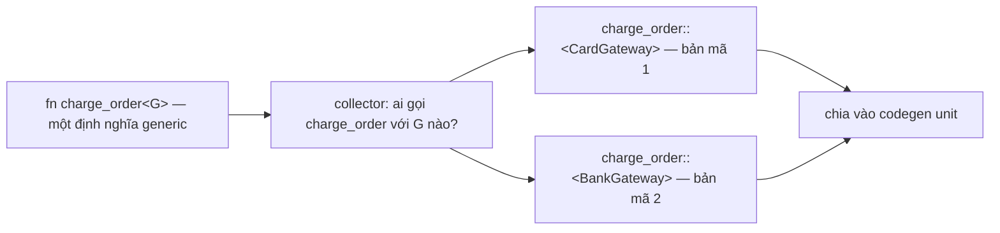
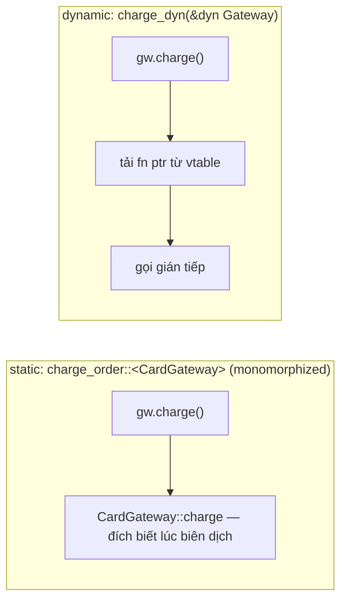
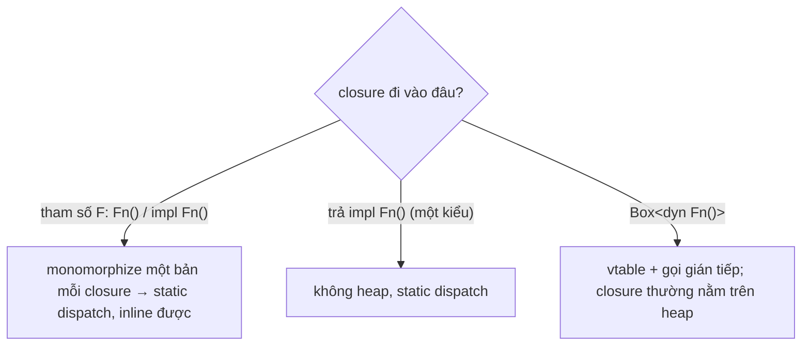

# P10 · Chương 04 — Monomorphization, static vs dynamic dispatch, zero-cost abstraction

> Chương này chỉ dựa trên tài liệu và source Rust 1.95.0 (Book, Reference, rustc-dev-guide, Cargo book, std-dev-guide, source `library/`); **không có thí nghiệm mới**. Các quan sát asm đã có ở [P10·03 mục 4](./03-dst-fat-pointer-vtable.md) và [P9·06 mục 5](../09-rust-language/06-iterator-va-closure.md) chỉ được nhắc lại bằng link. Những chỗ nói về *cách rustc cài đặt* (collector, codegen unit) lấy từ rustc-dev-guide, là chi tiết cài đặt và có thể đổi giữa các phiên bản.

## Bạn sẽ hiểu được gì

1. **Q1.** Monomorphization là gì, compiler làm nó ở đâu và khi nào? → mục 1
2. **Q2.** Static dispatch và dynamic dispatch khác nhau thế nào ở lời gọi hàm? → mục 2
3. **Q3.** Khi nào chọn generic, khi nào chọn `dyn Trait`; vì sao có trait không làm trait object được? → mục 3
4. **Q4.** Closure đi vào monomorphization ra sao; `impl Fn` khác `Box<dyn Fn>` ở đâu? → mục 4
5. **Q5.** Vì sao chuỗi iterator được gọi là "zero-cost", và "zero-cost" *không* có nghĩa là gì? → mục 5
6. **Q6.** Cái giá của monomorphization (code bloat, compile time) nằm ở đâu và cách giảm? → mục 6
7. **Q7.** `#[inline]`, codegen unit và LTO quyết định điều gì? → mục 7

## Kiến thức cần trước

- [P9 · Chương 02 — Trait nhìn sâu](../09-rust-language/02-trait.md) và [P9 · Chương 03 — Generics nâng cao](../09-rust-language/03-generics-nang-cao.md): trait bound, `impl Trait`.
- [P10 · Chương 01 — Pipeline của rustc](./01-pipeline-rustc.md): mục 5 nói monomorphization nằm ở đâu trong pipeline từ source đến binary. Chương này đi sâu vào dispatch và chi phí, không lặp lại phần vị trí đó.
- [P10 · Chương 03 — DST, fat pointer và vtable](./03-dst-fat-pointer-vtable.md): `&dyn Trait` là (data ptr, vtable ptr), vtable chứa gì, dyn compatibility. Chương này chỉ tóm lại để so sánh.
- [P9 · Chương 06 — Iterator và closure](../09-rust-language/06-iterator-va-closure.md): closure là struct ẩn danh, `Fn`/`FnMut`/`FnOnce`, adapter lười. Chương này chỉ nói phần monomorphization.

Ví dụ xuyên suốt chương là `checkout`, một service Rust nhận request đặt hàng và thu tiền qua hai cổng thanh toán: thẻ và chuyển khoản ngân hàng. Nó đọc file cấu hình lúc khởi động, tính tổng tiền từ các dòng hàng, và được build trong CI mỗi lần có commit mới. Đây là ví dụ giả định của người soạn, không phải code trong repo.

## 1. Monomorphization: một bản mã cho mỗi kiểu (Q1)

> **Trả lời ngắn.** Monomorphization là bước compiler biến code generic thành code cụ thể: nó điền các kiểu thật mà chương trình dùng vào chỗ tham số kiểu[^book-mono]. Nói cụ thể hơn, với mỗi kiểu cần dùng, compiler "dập" ra một bản riêng của hàm generic[^dev-mono]. Đây là bước đầu tiên của backend rustc[^dev-mono-first].

**Giải thích.**

*Với service `checkout`.* Hai cổng thanh toán của `checkout` cùng implement một trait `Gateway`, và bạn viết logic thu tiền đúng một lần, generic theo cổng:

```rust
// Minh họa của người soạn (không chạy).
trait Gateway {
    fn charge(&self, amount: u64) -> Result<(), String>;
}
struct CardGateway;
struct BankGateway;
// impl Gateway for CardGateway { ... }   impl Gateway for BankGateway { ... }

fn charge_order<G: Gateway>(gw: &G, amount: u64) -> Result<(), String> {
    gw.charge(amount)
}
```

Trong source chỉ có một `charge_order`, nhưng CPU không chạy được "một hàm với kiểu nào đó". Câu hỏi của mục này: compiler biến hàm generic ấy thành mã máy bằng cách nào, và nó làm ở khâu nào của quá trình biên dịch?

### 1.1 Vì sao phải làm

Assembly không có generic, nên trước khi code chạy, compiler phải biết kiểu cụ thể của mọi tham số generic[^dev-mono-asm]. Ngôn ngữ khác xử lý theo cách khác. Java chẳng hạn: rustc-dev-guide lấy nó làm ví dụ về ngôn ngữ mà có khi tới lúc chạy mới biết kiểu chính xác của một giá trị[^dev-mono-java]. Rust chọn đường ngược lại là monomorphize mọi kiểu generic[^dev-mono-all].

### 1.2 Kết quả trông thế nào

`charge_order` được gọi với `CardGateway` ở chỗ này và `BankGateway` ở chỗ kia, nên compiler tạo hai bản, mỗi kiểu một bản (suy luận của người soạn từ nguyên tắc "một bản cho mỗi kiểu cần dùng"). Nguồn có ví dụ cùng loại: dùng `Vec<u64>` và `Vec<String>` thì binary có hai bản mã sinh ra của `Vec`, mỗi kiểu một bản[^dev-mono-vec]. Book minh họa bằng `Option<T>`: compiler đọc các chỗ dùng, thấy hai loại `Option<T>` (với `i32` và `f64`), rồi bung định nghĩa generic thành hai định nghĩa chuyên biệt[^book-mono-expand]. Mã sinh ra đã gắn chặt với kiểu cụ thể, nên chạy như thể bạn tự tay viết từng định nghĩa[^book-mono-hand].

### 1.3 Compiler làm từng bước ra sao

Ở mức khái niệm có ba bước:

1. **Collection (thu thập).** Compiler tìm xem chương trình cần những kiểu cụ thể nào cho mọi thứ generic. Việc này gọi là collection, và đoạn code làm nó là *monomorphization collector*[^dev-mono-collect-what]. Ví dụ của rustc-dev-guide: `main` gọi `banana`, `banana` gọi `peach::<u64>`; collector trả `[main, banana, peach::<u64>]`, danh sách những hàm sẽ được sinh mã máy[^dev-mono-collect]. Ngoài hàm, collector còn thêm cả `static` vào danh sách[^dev-mono-statics]. Từ định nghĩa "danh sách hàm sẽ được sinh mã" suy ra: hàm generic mà không ai dùng với kiểu nào thì không có trong danh sách (suy luận của người soạn). Với `checkout`, danh sách sẽ có `charge_order::<CardGateway>` và `charge_order::<BankGateway>`; một cổng thứ ba chưa ai gọi thì không có.
2. **Partition (chia codegen unit).** Query `collect_and_partition_mono_items` làm thu thập rồi chia các mục vào *codegen unit* (CGU)[^dev-mono-query]. CGU nói kỹ ở mục 6 và 7.
3. **Sinh mã.** Mỗi mục trong danh sách là một hàm sẽ được sinh mã máy[^dev-mono-collect], lúc này kiểu đã cụ thể.

Về *khi nào*: collector chạy ngay trước *MIR lowering* và codegen[^dev-mono-before-codegen]. Vị trí của collection và của việc monomorphize thật sự trong cả pipeline nằm ở [P10·01 mục 5](./01-pipeline-rustc.md), chương này không lặp lại.



(Sơ đồ là minh họa của người soạn dựa trên mô tả collector; `charge_order` là ví dụ của chương, không phải của nguồn.)

Hệ quả: lời gọi `charge_order::<CardGateway>(..)` là lời gọi tới một hàm cụ thể mà compiler biết ngay lúc biên dịch. Đó là *static dispatch*, nội dung của mục 2[^book-dispatch].

<details><summary>Đi sâu: Book hứa gì, và ai sinh bản mã khi hàm generic nằm ở crate khác</summary>

- Book hứa rằng dùng kiểu generic không làm chương trình chạy chậm hơn dùng kiểu cụ thể[^book-generics-nocost]. Cơ chế đằng sau lời hứa: compiler nhìn mọi chỗ gọi code generic và sinh code cho đúng các kiểu mà nó được gọi với[^book-mono-callsites].
- Giả sử `charge_order` nằm trong một crate thư viện còn `checkout` là crate dùng nó. Bảng của rustc-dev-guide về hàm của Crate A được Crate B dùng nói rằng với hàm generic, mọi hàm đã monomorphize từ Crate A xuất hiện trong một codegen unit của Crate B, bất kể có inline hay không[^dev-cgu-generic]. Còn hàm *không* generic và không `#[inline]` thì không xuất hiện trong CGU nào của Crate B[^dev-cgu-nongeneric]. Suy luận của người soạn: crate dùng phải nhận đủ thông tin từ crate thư viện để tự sinh mã cho kiểu của mình, và hai crate cùng dùng `Vec<u64>` có thể mỗi bên giữ một bản. Nguồn không nói chi tiết việc dùng chung bản, và bảng chỉ nói về hàm của A được B dùng.
- `impl Trait` ở vị trí đối số là cú pháp tắt cho tham số kiểu generic, chỉ khác là kiểu ẩn danh và không nằm trong danh sách generic parameter[^ref-impl-arg]. Vì vậy `fn f(x: impl Display)` cũng bị monomorphize như `fn f<T: Display>(x: T)` (suy luận của người soạn).

</details>

**Quay lại Q1:** monomorphization là dập một bản mã riêng cho mỗi kiểu cụ thể được dùng; collector tìm ra danh sách bản cần dập (với `checkout`: một bản `charge_order` mỗi cổng), rồi backend sinh mã cho từng bản.

## 2. Static dispatch và dynamic dispatch (Q2)

> **Trả lời ngắn.** Static dispatch là khi compiler biết *lúc biên dịch* sẽ gọi method nào; mã sinh ra từ monomorphization thuộc loại này[^book-dispatch]. Dynamic dispatch là khi compiler không biết, nên nó sinh mã để tự tìm method lúc chạy[^book-dispatch-dyn]. Hễ dùng trait object thì Rust phải dùng dynamic dispatch[^book-dyn-must]. Trình tối ưu đôi khi vẫn bỏ được vtable khi thấy rõ kiểu thật (quan sát ở P10·03, xem phần Đi sâu).

**Giải thích.**

*Với service `checkout`.* Cùng một câu `gw.charge(amount)` có thể là static hoặc dynamic, tùy bạn khai báo tham số của hàm bao quanh nó là `G: Gateway` hay `&dyn Gateway`. Mục này cho thấy hai kiểu khai báo đó khác nhau gì ở lời gọi, và chi phí chênh nhau ở đâu.

### 2.1 Static: mỗi bản biết đích của mình

Trong `charge_order::<CardGateway>`, kiểu `G` đã là `CardGateway`, nên `gw.charge(amount)` trỏ thẳng tới `CardGateway::charge`. Bản `charge_order::<BankGateway>` trỏ thẳng tới `BankGateway::charge`. Đích của lời gọi đã biết ngay lúc compile[^book-dispatch].

### 2.2 Dynamic: tra vtable mỗi lần gọi

Bây giờ viết lại hàm đó nhận `&dyn Gateway`:

```rust
// Minh họa của người soạn (không chạy).
fn charge_dyn(gw: &dyn Gateway, amount: u64) -> Result<(), String> {
    gw.charge(amount)
}
```

Hàm này không generic nên chỉ có một bản, dùng chung cho mọi cổng (suy luận của người soạn). `dyn Gateway` là kiểu trait object: một giá trị "đục" của kiểu nào đó có implement trait, và ta không biết đó là kiểu nào[^ref-to-intro]. `&dyn Gateway` là con trỏ tới giá trị ấy. Mỗi con trỏ tới trait object chứa hai thứ: con trỏ tới instance và con trỏ tới vtable. Vtable chứa, cho mỗi method của trait (và supertrait) mà kiểu đó implement, một con trỏ tới implementation[^ref-to-vtable]. Gọi method trên trait object là virtual dispatch: lúc chạy, CPU tải một function pointer từ vtable rồi gọi gián tiếp qua nó[^ref-to-virtual]. Bước tra cứu này là chi phí lúc chạy mà static dispatch không có[^book-dyn-cost].



Muốn thấy bằng mắt thì xem asm AArch64 ở chương 03 mục 4 (quan sát trên một compiler): lời gọi `dyn` là một lệnh load con trỏ từ vtable rồi một lệnh nhảy gián tiếp, còn lời gọi generic là `bl` tới hàm đã monomorphize (lệnh `bl` thấy ở `_use_generic` trong mục đó; [P10·03 mục 4](./03-dst-fat-pointer-vtable.md)). Cấu trúc vtable chi tiết, kể cả phần ngoài các con trỏ method, cũng ở mục đó. Ở đây chỉ cần nhớ hai điều: phía gọi `dyn` dùng chung một bản mã cho mọi kiểu, và mỗi lời gọi phải qua một bước tra bảng.

Chọn static hay dynamic là chọn *ngay chỗ viết kiểu*, không phải một cờ biên dịch (nhận xét của người soạn): `T: Trait` hay `impl Trait` là static, `&dyn Trait` hay `Box<dyn Trait>` là dynamic.

<details><summary>Đi sâu: <code>dyn Trait</code> cũng là một kiểu để điền vào generic</summary>

- Trait object implement chính base trait, các auto trait và các supertrait của nó[^ref-to-implements]. Nghĩa là `dyn Gateway` có thể điền vào generic `G: Gateway`, nhưng chỉ khi `G` được phép không `Sized`. Tham số kiểu mặc định là `Sized`[^ref-sized-implicit]. Muốn nới thì phải dùng bound đặc biệt `?Sized`[^ref-sized-relax]. Lý do cần nới: trait object là DST, kiểu có kích thước chỉ biết lúc chạy[^ref-to-unsized]. (`?Sized` và DST: [P10·03 mục 1](./03-dst-fat-pointer-vtable.md).)
- Từ hai điểm trên suy ra (suy luận của người soạn): với `fn charge_any<G: Gateway + ?Sized>(gw: &G, ..)`, gọi `charge_any::<dyn Gateway>` là *một* instance monomorphize duy nhất, và bên trong nó dùng dynamic dispatch. Nên "generic" và "dyn" không loại trừ nhau: generic quyết định *số bản mã*, còn `G` là gì quyết định lời gọi bên trong là tĩnh hay động.
- Chương 03 quan sát rằng khi compiler thấy rõ kiểu cụ thể phía sau `&dyn`, nó vẫn có thể inline và bỏ vtable ([P10·03 mục 4](./03-dst-fat-pointer-vtable.md), phần Đi sâu). Đó là hành vi tối ưu quan sát được, không phải bảo đảm của ngôn ngữ.

</details>

**Quay lại Q2:** static là đích gọi biết lúc biên dịch (nhờ monomorphization); dynamic là một bản mã dùng chung và một lần tra vtable ở mỗi lời gọi. Với `checkout`: `charge_order::<G>` là static, `charge_dyn(&dyn Gateway)` là dynamic.

## 3. Generic hay `dyn`: trade-off và dyn compatibility (Q3)

> **Trả lời ngắn.** Generic mỗi lần chỉ nhận *một* kiểu cụ thể, còn trait object cho phép nhiều kiểu khác nhau lấp chỗ đó lúc chạy[^book-generic-vs-dyn]. Generic đổi tốc độ chạy lấy binary lớn hơn và compile lâu hơn[^dev-mono-cost]. `dyn` thì mỗi lời gọi tốn thêm một bước tra cứu[^book-dyn-cost]. Nó còn ngăn compiler inline[^book-inline], đổi lại chỉ cần một bản mã (suy luận của người soạn từ mục 2). Và chỉ trait "dyn compatible" mới làm được trait object[^ref-dyncompat].

**Giải thích.**

*Với service `checkout`.* Giả sử bạn muốn thử cổng thanh toán theo thứ tự ưu tiên lấy từ file cấu hình: thẻ trước, lỗi thì sang chuyển khoản, rồi tới ví điện tử. Danh sách đó chỉ có lúc chạy, và các phần tử là những kiểu khác nhau. Mục này trả lời: lúc nào kiểu danh sách ấy phải là `dyn`, lúc nào generic là đủ và tốt hơn.

### 3.1 Một kiểu mỗi lần, hay nhiều kiểu lúc chạy

Book so hai cách bằng ví dụ một vector: với `Vec<Box<dyn Trait>>` vector chứa được nhiều kiểu khác nhau cùng implement trait, còn với generic `T: Trait` thì mọi phần tử phải cùng một kiểu `T`[^book-generic-vs-dyn]. Áp vào `checkout`: `Vec<G>` với `G: Gateway` chỉ giữ được toàn `CardGateway` hoặc toàn `BankGateway`. Muốn một chuỗi failover lẫn cả hai thì phải là `Vec<Box<dyn Gateway>>`. Đó là thứ trait object mang lại: *tập kiểu mở lúc chạy* (diễn giải của người soạn).

Ngược lại, khi đã biết `charge_order` luôn gọi với một cổng cụ thể thì generic cho đích gọi biết trước và cho phép inline. Bảng dưới tóm tắt (tổng hợp của người soạn từ các câu đã dẫn ở mục 1–2, không có nguồn riêng cho bảng):

| | Generic / `impl Trait` | `dyn Trait` |
|---|---|---|
| Số bản mã của hàm gọi | một bản mỗi kiểu[^dev-mono] | một bản chung (impl của từng kiểu vẫn có riêng; suy luận) |
| Đích lời gọi | biết lúc biên dịch[^book-dispatch] | tra vtable lúc chạy[^ref-to-virtual] |
| Inline | tạo điều kiện (mục 7) | Book nói dynamic dispatch ngăn inline[^book-inline]; chương 03 quan sát ngoại lệ khi compiler thấy rõ kiểu |
| Tập kiểu | cố định lúc biên dịch, một kiểu mỗi lần | mở, nhiều kiểu lẫn nhau[^book-generic-vs-dyn] |
| Chi phí chính | compile time + binary size[^dev-mono-cost] | tra bảng[^book-dyn-cost] + mất một số tối ưu[^book-inline] |

### 3.2 Dyn compatibility: trait nào làm được trait object

Không phải trait nào cũng đặt sau `dyn` được. Chỉ trait dyn compatible mới làm được trait object[^ref-dyncompat]; khái niệm này trước đây có tên là object safety[^ref-dyn-formerly]. Ví dụ dễ vấp nhất là method generic: hàm "dispatchable" không được có type parameter[^ref-dyn-generic]. Lý do Reference ghi rất ngắn: generic không tương thích với vtable[^ref-dyn-why-generic]. Nếu thêm vào `Gateway` một method như `fn log_to<W: Write>(&self, w: W)` thì `dyn Gateway` sẽ không hợp lệ nữa, trừ các ngoại lệ ở P10·03 (suy luận của người soạn từ điều kiện trên). Điều kiện đầy đủ, lý do với `Self`, `where Self: Sized`, supertrait và upcasting nằm ở [P10·03 mục 5](./03-dst-fat-pointer-vtable.md) và [mục 6](./03-dst-fat-pointer-vtable.md).

<details><summary>Đi sâu: chọn thế nào khi viết API backend</summary>

- (Nhận xét của người soạn.) `Vec<Box<dyn Middleware>>` hay `Vec<Box<dyn Gateway>>` hợp với những thứ đăng ký lúc chạy, như middleware, handler, plugin: tập kiểu mở, và mỗi lời gọi gắn với I/O hay công việc lớn hơn nhiều so với một bước tra bảng. Hot loop xử lý từng byte hay từng record thì generic thường hợp lý hơn vì inline được. Nhưng hãy đo, đừng đoán.
- Book chỉ nói dynamic dispatch "ngăn compiler chọn inline" và "ngăn một số tối ưu"[^book-inline]; nó không đưa số đo chi phí, nên chương này cũng không.
- Không gì ép phải chọn một trong hai cho cả chương trình: kiểu *ở biên* có thể là `dyn`, còn bên trong là generic (mục 6).

</details>

**Quay lại Q3:** generic là một kiểu mỗi lần, nhanh và inline được nhưng nhiều bản mã; `dyn` là nhiều kiểu lúc chạy, một bản mã nhưng gián tiếp; chỉ trait dyn compatible mới làm `dyn` được. Danh sách failover của `checkout` buộc phải là `dyn`.

## 4. Closure và monomorphization (Q4)

> **Trả lời ngắn.** Mỗi closure có một kiểu duy nhất, ẩn danh, không viết ra được[^ref-closure-struct]. Vì vậy hàm generic nhận closure được monomorphize một bản *cho mỗi closure*, và gọi closure là static dispatch (suy luận của người soạn, nối từ mục 1–2). `Box<dyn Fn()>` thì ngược lại: nó là trait object, có vtable và gọi gián tiếp[^ref-to-virtual].

**Giải thích.**

*Với service `checkout`.* Trong `checkout` có hai chỗ dùng closure. Chỗ thứ nhất là helper thử lại khi cổng thanh toán báo lỗi tạm thời, nhận closure làm việc cần thử: `with_retry(|| gw.charge(amount))`. Chỗ thứ hai là các hook chạy sau khi đặt hàng xong (ghi audit log, gửi email), đăng ký lúc khởi động. Hai chỗ này trông giống nhau nhưng nên khai báo khác nhau, và lý do nằm ở cách monomorphization xử lý closure.

### 4.1 Mỗi closure là một kiểu riêng

Closure expression sinh ra một giá trị có kiểu duy nhất và ẩn danh, gần tương đương một struct chứa các giá trị capture[^ref-closure-struct]. Chi tiết về capture và `Fn`/`FnMut`/`FnOnce` nằm ở [P9·06 mục 1–3](../09-rust-language/06-iterator-va-closure.md); ở đây chỉ cần nhớ "mỗi closure là một kiểu riêng".

### 4.2 Hệ quả với generic

`fn with_retry<F: Fn() -> Result<(), String>>(f: F)` có một instance cho mỗi kiểu `F` được truyền vào. Hai closure khác nhau, dù thân giống hệt, vẫn là hai kiểu và cho hai instance ở mức monomorphization (suy luận của người soạn từ "kiểu duy nhất" và mục 1; chương này không khẳng định số hàm trong binary cuối cùng). Vì `F` là kiểu cụ thể, `f()` bên trong là lời gọi tĩnh tới thân closure đó, nên có thể inline (suy luận của người soạn từ mục 2). [P9·06 mục 5](../09-rust-language/06-iterator-va-closure.md) đã soi asm một chuỗi iterator kèm closure và thấy lớp closure biến mất hoàn toàn (quan sát một trường hợp).

### 4.3 Trả closure về: `impl Fn` hay `Box<dyn Fn>`

Giả sử bạn viết hàm tạo hook audit cho từng tenant. Nếu trả `impl Fn(&Order)` thì hàm trả về một abstract type không boxed, đặc biệt hữu ích với closure và iterator[^ref-impl-ret-unboxed]. Trước khi có `impl Trait`, cách duy nhất để trả closure là `Box<dyn Fn>`, và việc đó có thể kéo theo heap allocation lẫn dynamic dispatch[^ref-impl-closure-cost]. Cái giá của `impl Trait` là mọi nhánh trả về phải cùng một kiểu cụ thể[^ref-impl-ret-same]. Nếu hook phụ thuộc vào cấu hình và các nhánh trả những closure khác nhau thì (suy luận từ điều kiện đó) phải dùng `Box<dyn Fn>`, tức là quay về dynamic dispatch.



<details><summary>Đi sâu: kích thước closure và <code>dyn Fn</code> (quan sát)</summary>

- Reference chỉ nói kiểu closure xấp xỉ một struct chứa các giá trị capture[^ref-closure-struct]. Reference cũng nói rõ closure không có bảo đảm layout nào[^ref-closure-nolayout] (xem thêm [P10·02 mục 1](./02-type-layout.md), phần Đi sâu). Vì vậy mọi con số về kích thước là quan sát, không phải hợp đồng. Số đo aarch64 đã có ở [P9·06 mục 3](../09-rust-language/06-iterator-va-closure.md): closure không capture gì là 0 byte; closure `move` một `String` là 24 byte; closure chỉ mượn thì chứa tham chiếu (8 byte mỗi tham chiếu); closure `move` một mảng 100 byte là 100 byte. Chương này không đo thêm.
- `Box<dyn Fn()>` là fat pointer (data, vtable) giữ closure trong `Box`, thường kéo theo heap allocation[^ref-impl-closure-cost]. Việc *gọi* closure đi qua vtable như mọi trait object ([P10·03 mục 4](./03-dst-fat-pointer-vtable.md)).
- Chọn trong thực tế (nhận xét của người soạn): callback truyền vào hàm tiện ích như `with_retry` nên là generic (`F: Fn…` hoặc `impl Fn…`). Bảng route hay danh sách hook đăng ký lúc chạy, với nhiều closure khác nhau trong cùng một `Vec`, cần `Box<dyn Fn…>`.

</details>

**Quay lại Q4:** mỗi closure là một kiểu, nên generic nhận closure sinh một bản mã cho mỗi closure và gọi tĩnh (`with_retry` của `checkout`); `Box<dyn Fn>` đổi điều đó lấy khả năng gom nhiều closure vào một kiểu (danh sách hook).

## 5. Iterator và zero-cost abstraction (Q5)

> **Trả lời ngắn.** Iterator là abstraction mức cao nhưng được biên dịch xuống mã gần như tương đương code vòng lặp mức thấp viết tay[^book-iter-perf]. "Zero-cost" nghĩa là dùng abstraction không thêm overhead *lúc chạy*[^book-zero-cost]. Nó không có nghĩa là "không tốn compile time hay kích thước binary": monomorphization chính là khoản chi đó[^dev-mono-cost] (nối hai nguồn: suy luận của người soạn).

**Giải thích.**

*Với service `checkout`.* Mỗi request, `checkout` tính tổng tiền từ các dòng hàng: `order.lines.iter().map(|l| l.price * l.qty).sum::<u64>()`. Viết bằng iterator thì ngắn và dễ đọc hơn vòng `for` có biến cộng dồn, và câu hỏi tự nhiên là: dòng đó có chậm hơn vòng `for` không? Mục này giải thích vì sao câu trả lời, theo Book, là gần như không, và chữ "gần như không" ấy nằm ở đâu.

### 5.1 Iterator ở tầng kiểu

Iterator và adapter là lười: tạo ra chưa làm gì đáng kể, chỉ khi gọi `next` mới có việc[^std-iter-lazy]. Adapter như `map` là một struct generic. `Iterator::map` trong source 1.95.0 có chữ ký `fn map<B, F>(self, f: F) -> Map<Self, F>`[^src-iter-map]. `Map<I, F>` là struct giữ iterator con `I` và closure `F` làm field[^src-map-struct]. Nó implement `Iterator` với ràng buộc `F: FnMut(I::Item) -> B`[^src-map-impl].

### 5.2 Từ kiểu tới mã

Nối mục 1 với mục 4 (suy luận của người soạn): dòng tính tổng ở trên có đúng một kiểu cụ thể, dạng `Map<slice::Iter<..>, {closure}>`, trong đó closure là kiểu riêng. Mọi tham số kiểu đều cụ thể, nên không chỗ nào cần vtable. `next` của `Map` gọi `next` của iterator con rồi áp closure[^src-map-next]. Tất cả là lời gọi tĩnh giữa các hàm đã biết, đủ điều kiện để inline và tối ưu như một vòng lặp duy nhất. Chiều ngược lại cũng đúng, theo Book: dynamic dispatch ngăn compiler chọn inline[^book-inline].

### 5.3 Book hứa gì

Book dùng định nghĩa zero-overhead của Stroustrup: cái bạn không dùng thì không trả tiền, và cái bạn dùng thì bạn không thể tự viết tay tốt hơn[^book-stroustrup]. Book nêu thêm rằng các tối ưu như loop unrolling và loại bỏ bounds check trên truy cập mảng áp dụng được ở đây[^book-iter-opts]. Asm của một trường hợp cụ thể (quan sát, không phải bảo đảm) ở [P9·06 mục 5](../09-rust-language/06-iterator-va-closure.md), phần Đi sâu.

### 5.4 Hiểu lầm cần tránh

- "Zero-cost" là cam kết về *runtime so với code tay tương đương*[^book-zero-cost]. Compile time và kích thước binary vẫn tăng khi có nhiều instance (mục 6)[^dev-mono-cost].
- Book chỉ nói mã sinh ra *gần như* tương đương mã viết tay[^book-iter-perf], không phải luôn giống hệt trên mọi cấu hình. [P9·06 mục 5](../09-rust-language/06-iterator-va-closure.md) đã lưu ý build debug (không `-O`) khác (suy luận của người soạn; P9·06 không đo).
- `Box<dyn Iterator>` là lựa chọn dynamic dispatch, vì trait object luôn dùng dynamic dispatch[^book-dyn-must]. `Box<I>` implement `Iterator` (cho cả `I: ?Sized`) bằng cách chuyển tiếp `(**self).next()`[^src-box-iter-next]. Với `I = dyn Iterator`, lời gọi này đi qua vtable (suy luận của người soạn từ mục 2), nên mỗi lần gọi `next` thường là một lời gọi gián tiếp. Đó có thể là đánh đổi hợp lý khi các nhánh trả iterator khác kiểu ([P9·06 mục 4](../09-rust-language/06-iterator-va-closure.md), phần trait object cho iterator). Nhưng theo định nghĩa "zero-cost" ở trên thì bạn đã rời con đường đó (suy luận của người soạn).

<details><summary>Đi sâu: <code>#[inline]</code> trong chính adapter của std</summary>

- Trong source `core` 1.95.0, `next` của `Map` mang `#[inline]`: dòng `#[inline]` đứng ngay trước `fn next(&mut self) -> Option<B>`[^src-map-next-sig]. Đây chỉ là *gợi ý* (mục 7): thuộc tính `inline` chỉ đề nghị đặt bản copy vào nơi gọi, không bắt buộc[^ref-inline].
- Phần `fold` của `Map` được viết riêng để chuyển tiếp vào `fold` của iterator con[^src-map-fold]. (Nhận xét của người soạn: nhờ vậy nhiều consumer không phải đi qua từng `next`, nhưng đó là tối ưu của từng adapter; nguồn ở đây không hứa mọi chuỗi đều như vậy.)
- Đo ở [P9·06 mục 5](../09-rust-language/06-iterator-va-closure.md): hai hàm cộng gấp đôi các phần tử `u32`, một vòng `for` với chỉ số và một chuỗi iterator, cho cùng khung lệnh trên aarch64 `-O` (quan sát một trường hợp). Không suy ra mọi chuỗi iterator đều miễn phí.

</details>

**Quay lại Q5:** chuỗi adapter là một kiểu cụ thể, được monomorphize thành mã tĩnh nên compiler gộp được như vòng lặp viết tay (dòng tính tổng tiền của `checkout`); "zero-cost" chỉ nói về runtime, còn compile time và binary size là cái giá của monomorphization.

## 6. Cái giá: code bloat, compile time và cách giảm (Q6)

> **Trả lời ngắn.** Monomorphization cho chương trình nhanh, nhưng đổi bằng thời gian biên dịch (tạo hết các bản sao tốn thời gian) và kích thước binary (các bản sao chiếm chỗ)[^dev-mono-cost]. Có hai cách giảm. Một là đẩy phần thân không phụ thuộc kiểu ra hàm không generic; mẫu `inner` này có thật trong std[^src-fs-read-inner]. Hai là dùng `dyn` ở những chỗ không nóng (nhận xét của người soạn).

**Giải thích.**

*Với service `checkout`.* Hai mục trước toàn kể lợi ích: không vtable, inline được. Mục này tính hóa đơn. Mỗi lần CI build `checkout`, compiler phải sinh và tối ưu mọi bản sao ấy; image container của service cũng chứa chúng. Câu hỏi: bản sao nhiều tới mức nào thì đáng lo, và cắt bớt bằng cách nào mà không mất lợi ích?

### 6.1 Vấn đề

Compiler dập một bản mã cho mỗi kiểu cụ thể cần dùng[^dev-mono]. Vì thế số instance xấp xỉ số cặp (hàm generic, bộ tham số kiểu) được dùng. Một hàm generic có thân lớn mà gọi với 20 kiểu thì cho 20 bản thân lớn (cả hai ý này là suy luận của người soạn từ "một bản mỗi kiểu"). Hệ quả rustc-dev-guide nêu ra là compile time và binary size[^dev-mono-cost]. Nguồn không đưa con số, nên chương này cũng không.

### 6.2 Cách giảm 1: hàm `inner` không generic

Source std 1.95.0 có một ví dụ đáng học. `fs::read` có chữ ký `pub fn read<P: AsRef<Path>>(path: P) -> io::Result<Vec<u8>>`[^src-fs-read-sig]. Toàn bộ thân việc đọc file nằm trong hàm lồng `fn inner(path: &Path) -> io::Result<Vec<u8>>`[^src-fs-read-inner]. Hàm ngoài chỉ gọi `inner(path.as_ref())`[^src-fs-read-call]. `read_to_string` làm y như vậy[^src-fs-rts-inner]. `write` cũng thế[^src-fs-write-inner].

Source không giải thích lý do. Suy luận của người soạn: phần generic mỏng chỉ đổi `P` thành `&Path`, nên số bản bị nhân theo `P` chỉ còn phần mỏng đó, còn thân lớn có đúng một bản. Hàm đọc file cấu hình của `checkout` viết theo mẫu này sẽ như sau:

```rust
// Minh họa (không chạy): mẫu "generic mỏng bọc hàm thật không generic".
pub fn load_config<P: AsRef<std::path::Path>>(path: P) -> std::io::Result<Vec<u8>> {
    fn inner(path: &std::path::Path) -> std::io::Result<Vec<u8>> {
        std::fs::read(path) // thân nặng, chỉ một bản
    }
    inner(path.as_ref())
}
```

### 6.3 Cách giảm 2: `dyn` ở biên

Ở chỗ không nằm trên hot path, như đăng ký danh sách cổng thanh toán lúc khởi động, `dyn Trait` cho một bản mã duy nhất (mục 3). Đây là lựa chọn có chủ đích giữa hai loại chi phí, không phải "tối ưu miễn phí" (nhận xét của người soạn).

### 6.4 Tác động tới CI và vận hành

Với service lớn, compile time và binary size là chi phí vận hành thật: CI chậm, image container to hơn (nhận xét của người soạn). Hãy đo bằng công cụ build của bạn trước khi tối ưu; chương này không đưa số.

<details><summary>Đi sâu: vì sao generic ảnh hưởng incremental build</summary>

- Để build incremental nhanh hơn, CGU partitioner tạo hai CGU cho mỗi module cấp source: một cho code "stable" (không generic), một cho code hay thay đổi hơn gồm các instance đã monomorphize/chuyên biệt[^dev-cgu-two].
- Hàm generic từ crate khác được đưa vào CGU của crate dùng[^dev-cgu-generic]. Suy ra (suy luận của người soạn từ các câu trên): sửa một crate thư viện generic có thể buộc crate dùng sinh lại mã.
- Tất cả những điều này là mô tả của rustc-dev-guide về cài đặt hiện tại, không phải bảo đảm của ngôn ngữ.

</details>

**Quay lại Q6:** cái giá là một bản mã mỗi kiểu (compile time và binary size); giảm bằng cách tách phần không phụ thuộc kiểu ra hàm thường (mẫu `inner` trong std, như `load_config` của `checkout`) hoặc dùng `dyn` ở nơi không nóng.

## 7. `#[inline]`, codegen unit, LTO (Q7)

> **Trả lời ngắn.** `#[inline]` chỉ *gợi ý* compiler đặt bản copy mã hàm vào nơi gọi thay vì sinh lời gọi[^ref-inline]. rustc vẫn tự inline khi thấy đáng[^ref-inline-auto]. Codegen unit là đơn vị chia crate để sinh mã song song: nhiều CGU hơn có thể giảm compile time nhưng có thể sinh mã chậm hơn[^cargo-cgu]. LTO tối ưu bằng phân tích toàn chương trình[^cargo-lto]. Nó còn có dạng cục bộ chỉ qua các CGU của crate[^cargo-lto-local].

**Giải thích.**

*Với service `checkout`.* Build release của `checkout` phải cân ba thứ cùng lúc: mã chạy nhanh, CI không quá chậm, binary không quá to. Ba cần gạt `#[inline]`, `codegen-units` và `lto` nằm ở đúng chỗ đó, và mục này nói mỗi cần gạt làm gì với các bản mã mà monomorphization vừa tạo ra.

### 7.1 Inline là gì và ai quyết định

Thuộc tính `inline` *gợi ý* có nên đặt bản copy của mã hàm vào caller thay vì sinh một lời gọi hay không[^ref-inline]. Phần lớn việc này do rustc tự quyết: nó tự inline khi thấy đáng, và quyết định inline tồi có thể làm chương trình chậm đi[^ref-inline-auto]. Ba dạng `#[inline]`/`always`/`never` đều chỉ là gợi ý; cách kiểm chứng bằng asm nằm ở [P2·07 mục 2](../02-cpu/07-rust-va-may.md).

### 7.2 Liên hệ với monomorphization

Muốn inline, compiler phải biết đích lời gọi và có thân hàm trong tay (suy luận của người soạn). Static dispatch cho biết đích; có thân hàm hay không thì tùy loại hàm (xem bảng CGU ở §7.4). Trait object thường không cho biết đích, nên Book nói dynamic dispatch ngăn inline[^book-inline]. Đây là chỗ hai nửa của chương gặp nhau: monomorphization *tạo điều kiện* cho inline (suy luận của người soạn).

### 7.3 Codegen unit

Tùy chọn `codegen-units` của Cargo điều khiển số "code generation units" mà một crate được chia ra. Nhiều CGU hơn cho phép xử lý song song nhiều hơn nên có thể giảm compile time, nhưng mã sinh ra có thể chậm hơn[^cargo-cgu]. Mặc định là 256 cho build incremental và 16 cho build không incremental[^cargo-cgu-default] (bảng mặc định của các profile: [P9·08 mục 7](../09-rust-language/08-module-crate-cargo.md)). Suy luận của người soạn: ranh giới giữa các CGU hạn chế việc tối ưu qua lại, và đó là lý do "có thể chậm hơn". Điều này khớp với việc Cargo có chế độ LTO cục bộ để tối ưu thêm *qua các CGU* của crate[^cargo-lto-local].

### 7.4 Qua ranh giới crate

Với `checkout` dùng một crate thư viện, bảng CGU của rustc-dev-guide cho thấy hai trường hợp. Hàm không generic *có* `#[inline]` từ Crate A xuất hiện trong một CGU của Crate B[^dev-cgu-inline]. Hàm không generic và không `#[inline]` thì không xuất hiện trong CGU nào của Crate B[^dev-cgu-nongeneric]. Trường hợp hàm generic đã nói ở mục 1 (Đi sâu). Suy luận của người soạn: đó là cách `#[inline]` cho phép inline *giữa* các crate, vì thân hàm có mặt ở crate dùng; hàm generic thì vốn đã được sinh ở crate dùng.

### 7.5 LTO

Link-time optimization tối ưu bằng phân tích toàn chương trình, với giá là link lâu hơn[^cargo-lto]. Cấu hình `lto = false` vẫn là LTO cục bộ qua các CGU của crate[^cargo-lto-local]. Phân biệt `true`/`"fat"`, `"thin"`, `false` và `"off"` cùng điều kiện không có LTO: [P11·03 mục 3](../11-do-dac-va-go-loi/03-hieu-nang-service-rust.md).

<details><summary>Đi sâu: <code>#[inline]</code> ở debug và release, và vị trí hợp lệ của nó</summary>

- Hướng dẫn của đội thư viện chuẩn (std-dev-guide) mô tả thêm: ở release mode compiler mặc định sinh một hàm `#[inline]` vào *mỗi* CGU có tham chiếu tới nó và thêm gợi ý inline, còn ở debug mode rustc gần như phớt lờ `#[inline]`[^std-inline-cgu]. Đó là lời một người đóng góp được trích trong hướng dẫn, mô tả cài đặt hiện tại nên có thể đổi.
- Hai mô tả nghe lệch nhau về số CGU: bảng ở §7.4 nói "một CGU", còn lời trích nói "mỗi CGU có tham chiếu tới nó". Nguồn không giải thích chỗ lệch, nên chương này không suy ra con số cụ thể.
- Cũng theo hướng dẫn đó, không cần `#[inline]` cho method có generic trong phạm vi[^std-inline-generic].
- `#[inline]` chỉ áp dụng cho hàm có thân: closure, async block, hàm tự do, hàm trong `impl` (inherent hoặc trait impl), và hàm trong định nghĩa trait khi có thân mặc định[^ref-inline-positions].
- Nhận xét của người soạn: không nên rắc `#[inline(always)]` bừa; Reference đã cảnh báo quyết định inline tồi làm chậm[^ref-inline-auto]. Hãy đo.

</details>

**Quay lại Q7:** `#[inline]` là gợi ý; static dispatch cho compiler cơ hội inline mà `dyn` thường không có; CGU và LTO quyết định phạm vi mà tối ưu nhìn thấy nhau (trong build release của `checkout`, đó là hai cần gạt `codegen-units` và `lto`).

## Liên hệ với Rust

Phần này gom các quyết định thiết kế hằng ngày khi viết Rust và áp vào `checkout` (nhận xét của người soạn, dựa trên các mục trên).

1. **`dyn` hay generic.** Mặc định dùng generic hoặc `impl Trait` cho API nhận callback hay kiểu nội bộ, vì nhanh và inline được (mục 2–4). Dùng `dyn` khi cần tập kiểu mở lúc chạy, như chuỗi cổng thanh toán đọc từ config, plugin, handler, collection hỗn hợp (mục 3). Khi nghi ngờ, viết bản generic trước, rồi đổi sang `dyn` ở chỗ binary phình hay compile chậm, và đo.
2. **Code bloat.** Số instance nhân theo số kiểu. Hãy tách phần thân không phụ thuộc kiểu ra hàm thường (mẫu `inner` của std, mục 6), hoặc nhận `&dyn`, `&[u8]`, `&Path` ở biên thay vì generic toàn bộ.
3. **Inline.** `#[inline]` là gợi ý; để compiler tự quyết trừ khi đã đo (mục 7). Trả `impl Iterator` hay `impl Fn` thay vì `Box<dyn …>` để giữ khả năng inline và tránh heap (mục 4–5), trừ khi các nhánh trả kiểu khác nhau.
4. **API công khai.** Đổi `impl Trait` thành generic (hay ngược lại) trong tham số có thể là breaking change cho người gọi vì nó đổi số generic argument[^ref-impl-arg-break]. Đổi giữa generic và `dyn` thì còn rộng hơn (suy luận của người soạn).
5. **Build profile.** `codegen-units` là cần gạt giữa compile time và chất lượng mã[^cargo-cgu]. `lto` cũng vậy, đánh đổi giữa mã tối ưu hơn và link lâu hơn[^cargo-lto]. Đừng bật bừa trên CI của `checkout` nếu chưa đo.

## Tóm tắt

- Monomorphization: compiler dập một bản mã riêng cho mỗi kiểu cụ thể của hàm generic[^dev-mono]. Đó là bước đầu tiên của backend[^dev-mono-first].
- Collector tạo danh sách hàm cần sinh mã (ví dụ `main`, `banana`, `peach::<u64>`)[^dev-mono-collect]. Sau đó danh sách được chia vào CGU[^dev-mono-query].
- Mã monomorphize là static dispatch[^book-dispatch]. Trait object luôn là dynamic dispatch[^book-dyn-must]. Lời gọi đó đi qua vtable[^ref-to-virtual].
- Generic nhận một kiểu mỗi lần, còn `dyn` nhận nhiều kiểu lúc chạy[^book-generic-vs-dyn]. Dynamic dispatch ngăn inline và một số tối ưu[^book-inline].
- Trait phải dyn compatible mới làm trait object[^ref-dyncompat]. Method generic không dispatch được[^ref-dyn-why-generic].
- Mỗi closure là một kiểu[^ref-closure-struct], nên `impl Fn` hay `F: Fn` là static, còn `Box<dyn Fn>` là dynamic.
- Iterator "zero-cost" nghĩa là biên dịch xuống mã gần như viết tay[^book-iter-perf]. Nhưng chữ đó chỉ nói về runtime[^book-zero-cost].
- Cái giá của monomorphization là compile time và binary size[^dev-mono-cost]. Giảm bằng hàm `inner` không generic (ví dụ `fs::read`)[^src-fs-read-inner] hoặc `dyn` ở chỗ không nóng.
- `#[inline]` là gợi ý[^ref-inline]. `codegen-units` đánh đổi tốc độ biên dịch lấy chất lượng mã[^cargo-cgu]. LTO tối ưu toàn chương trình[^cargo-lto].

## Câu hỏi tự kiểm tra

1. Monomorphization xảy ra ở đâu trong pipeline rustc, và collector trả về gì cho ví dụ `main → banana → peach::<u64>`?
   <details><summary>Đáp án</summary>

   Là bước đầu của backend[^dev-mono-first]. Collector trả `[main, banana, peach::<u64>]`, những hàm sẽ được sinh mã máy[^dev-mono-collect]. Query `collect_and_partition_mono_items` làm thu thập rồi chia CGU[^dev-mono-query].

   </details>

2. Vì sao `Vec<u64>` và `Vec<String>` có hai bản mã khác nhau trong binary? Với `charge_order<G>` của `checkout` thì sao?
   <details><summary>Đáp án</summary>

   Compiler dập một bản riêng cho mỗi kiểu cụ thể cần dùng[^dev-mono]. rustc-dev-guide nêu đúng ví dụ `Vec` này[^dev-mono-vec]. Theo cùng nguyên tắc, `charge_order::<CardGateway>` và `charge_order::<BankGateway>` là hai bản (suy luận).

   </details>

3. Phân biệt static dispatch và dynamic dispatch; trait object thuộc loại nào?
   <details><summary>Đáp án</summary>

   Static: compiler biết lúc biên dịch method nào được gọi[^book-dispatch]. Dynamic: không biết, nên sinh mã tự tìm lúc chạy[^book-dispatch-dyn]. Trait object luôn là dynamic[^book-dyn-must].

   </details>

4. Gọi method qua `&dyn Trait` làm gì lúc chạy?
   <details><summary>Đáp án</summary>

   Tải function pointer từ vtable của trait object rồi gọi gián tiếp[^ref-to-virtual].

   </details>

5. Nêu các điểm đối lập chính giữa generic và `dyn`.
   <details><summary>Đáp án</summary>

   Số bản mã: một mỗi kiểu[^dev-mono] so với một bản chung. Tập kiểu: một kiểu mỗi lần so với nhiều kiểu lúc chạy[^book-generic-vs-dyn]. Inline: được so với bị ngăn trong nhiều trường hợp[^book-inline]. Chi phí: generic tốn compile time và binary size[^dev-mono-cost]. `dyn` tốn một bước tra bảng[^book-dyn-cost].

   </details>

6. Vì sao trait có method generic không dùng làm trait object?
   <details><summary>Đáp án</summary>

   Reference: hàm dispatchable không được có type parameter[^ref-dyn-generic]. Ví dụ trong Reference chú thích rằng generic không tương thích với vtable[^ref-dyn-why-generic]. Giải thích vì sao (suy luận): vtable là bảng cố định nên không có ô cho mọi `T` có thể truyền.

   </details>

7. Hai closure có thân giống hệt có cùng kiểu không, và hàm `run<F: Fn()>` được monomorphize mấy bản nếu gọi với cả hai?
   <details><summary>Đáp án</summary>

   Mỗi closure expression sinh một kiểu duy nhất[^ref-closure-struct], nên hai closure khác kiểu. Do đó (suy luận) có hai instance của `run` ở mức monomorphization. Nguồn không nói gì về số hàm còn lại trong binary cuối.

   </details>

8. Vì sao trả `impl Fn(i32) -> i32` thường tốt hơn `Box<dyn Fn(i32) -> i32>`, và khi nào buộc phải dùng `Box<dyn …>`?
   <details><summary>Đáp án</summary>

   `impl Trait` trả một abstract type không boxed[^ref-impl-ret-unboxed]. Nhờ vậy tránh được heap và dynamic dispatch[^ref-impl-closure-cost]. Nhưng mọi giá trị trả về phải cùng một kiểu cụ thể[^ref-impl-ret-same]; nhiều kiểu khác nhau thì phải dùng trait object.

   </details>

9. "Zero-cost abstraction" cam kết gì và không cam kết gì?
   <details><summary>Đáp án</summary>

   Dùng abstraction không thêm overhead lúc chạy[^book-zero-cost]. Nó không cam kết gì về compile time hay binary size, vốn là cái giá của monomorphization[^dev-mono-cost].

   </details>

10. Mẫu `fn inner` trong `fs::read` có tác dụng gì (nêu rõ phần nào là nguồn, phần nào là suy luận)?
    <details><summary>Đáp án</summary>

    Nguồn cho thấy hàm ngoài generic theo `P: AsRef<Path>` chỉ gọi `inner(path.as_ref())`[^src-fs-read-call]. Còn `inner` nhận `&Path`[^src-fs-read-inner]. Việc nó giảm số bản mã bị nhân bản là suy luận của người soạn, vì source không ghi lý do.

    </details>

11. `#[inline]` có bảo đảm hàm được inline không? Nên dùng thế nào?
    <details><summary>Đáp án</summary>

    Không, nó chỉ là gợi ý[^ref-inline]; kể cả `inline(always)`, compiler vẫn có thể bỏ qua[^ref-inline-hint]. rustc tự inline khi thấy đáng, và inline tồi có thể làm chương trình chậm[^ref-inline-auto]. Chỉ dùng sau khi đo (nhận xét của người soạn).

    </details>

12. `codegen-units` lớn làm gì cho compile time và chất lượng mã?
    <details><summary>Đáp án</summary>

    Nhiều CGU cho phép xử lý song song nhiều hơn, có thể giảm compile time nhưng có thể sinh mã chậm hơn[^cargo-cgu].

    </details>

## Đọc thêm

- [rustc-dev-guide — Monomorphization](https://rustc-dev-guide.rust-lang.org/backend/monomorph.html): collector, CGU partitioning và bảng hành vi qua ranh giới crate.
- [Book 1.95.0 — Generic Data Types (Performance of Code Using Generics)](https://doc.rust-lang.org/1.95.0/book/ch10-01-syntax.html): ví dụ `Option<T>` → `Option_i32`/`Option_f64`.
- [Book 1.95.0 — Trait Objects (Performing Dynamic Dispatch)](https://doc.rust-lang.org/1.95.0/book/ch18-02-trait-objects.html): static vs dynamic dispatch, trade-off, inline.
- [Reference 1.95.0 — Impl trait](https://doc.rust-lang.org/1.95.0/reference/types/impl-trait.html): `impl Trait` ở đối số và trả về; closure/iterator.
- [Reference 1.95.0 — Codegen attributes (inline)](https://doc.rust-lang.org/1.95.0/reference/attributes/codegen.html): `#[inline]`, `always`, `never`.
- [Cargo book 1.95.0 — Profiles](https://doc.rust-lang.org/1.95.0/cargo/reference/profiles.html): `codegen-units`, `lto`.
- [P10·01 — Pipeline của rustc](./01-pipeline-rustc.md): mục 5 đặt monomorphization và codegen unit trong pipeline từ source đến binary.
- [P10·03 — DST, fat pointer và vtable](./03-dst-fat-pointer-vtable.md): vtable, asm `dyn` vs generic, dyn compatibility đầy đủ.
- [P9·06 — Iterator và closure](../09-rust-language/06-iterator-va-closure.md): closure struct, `Fn` traits, asm zero-cost.
- [P10·09 — Bên trong collection của std](./09-collections-internals.md): mục 1 (Đi sâu) có `RawVecInner`, một ví dụ trong std của việc tách phần không generic để giảm code phải monomorphize.

[^book-mono]: The Rust Programming Language, Generic Data Types — <https://doc.rust-lang.org/1.95.0/book/ch10-01-syntax.html> — "Monomorphization is the process of turning generic code into specific code by filling in the concrete types that are used when compiled."
[^book-mono-expand]: The Rust Programming Language, Generic Data Types — <https://doc.rust-lang.org/1.95.0/book/ch10-01-syntax.html> — "it expands the generic definition of Option\<T> into two definitions specialized to i32 and f64"
[^book-mono-hand]: The Rust Programming Language, Generic Data Types — <https://doc.rust-lang.org/1.95.0/book/ch10-01-syntax.html> — "When the code runs, it performs just as it would if we had duplicated each definition by hand."
[^book-mono-callsites]: The Rust Programming Language, Generic Data Types — <https://doc.rust-lang.org/1.95.0/book/ch10-01-syntax.html> — "The compiler looks at all the places where generic code is called and generates code for the concrete types the generic code is called with."
[^book-generics-nocost]: The Rust Programming Language, Generic Data Types — <https://doc.rust-lang.org/1.95.0/book/ch10-01-syntax.html> — "using generic types won’t make your program run any slower than it would with concrete types."
[^dev-mono]: rustc-dev-guide, Monomorphization — <https://rustc-dev-guide.rust-lang.org/backend/monomorph.html> — "This means that compiler stamps out a different copy of the code of a generic function for each concrete type needed."
[^dev-mono-first]: rustc-dev-guide, Monomorphization — <https://rustc-dev-guide.rust-lang.org/backend/monomorph.html> — "Monomorphization is the first step in the backend of the Rust compiler."
[^dev-mono-asm]: rustc-dev-guide, Monomorphization — <https://rustc-dev-guide.rust-lang.org/backend/monomorph.html> — "But of course, assembly is not generic, so we need to figure out the concrete types of all the generics before the code can execute."
[^dev-mono-all]: rustc-dev-guide, Monomorphization — <https://rustc-dev-guide.rust-lang.org/backend/monomorph.html> — "Rust takes a different approach: it monomorphizes all generic types."
[^dev-mono-vec]: rustc-dev-guide, Monomorphization — <https://rustc-dev-guide.rust-lang.org/backend/monomorph.html> — "then the generated binary will have two copies of the generated code for Vec: one for Vec\<u64> and another for Vec\<String>."
[^dev-mono-cost]: rustc-dev-guide, Monomorphization — <https://rustc-dev-guide.rust-lang.org/backend/monomorph.html> — "The result is fast programs, but it comes at the cost of compile time (creating all those copies can take a while) and binary size (all those copies might take a lot of space)."
[^dev-mono-collect]: rustc-dev-guide, Monomorphization — <https://rustc-dev-guide.rust-lang.org/backend/monomorph.html> — "The monomorphization collector will give you a list of [main, banana, peach::\<u64>]. These are the functions that will have machine code generated for them."
[^dev-mono-query]: rustc-dev-guide, Monomorphization — <https://rustc-dev-guide.rust-lang.org/backend/monomorph.html> — "query, which does monomorphization collection and then partitions them into codegen units."
[^dev-cgu-two]: rustc-dev-guide, Monomorphization — <https://rustc-dev-guide.rust-lang.org/backend/monomorph.html> — "For better incremental build times, the CGU partitioner creates two CGU for each source level modules. One is for “stable” i.e. non-generic code and the other is more volatile code i.e. monomorphized/specialized instances."
[^dev-cgu-generic]: rustc-dev-guide, Monomorphization — <https://rustc-dev-guide.rust-lang.org/backend/monomorph.html> — "Regardless of inlining, all monomorphized (specialized) functions from Crate A appear within a single codegen unit for Crate B."
[^dev-cgu-nongeneric]: rustc-dev-guide, Monomorphization — <https://rustc-dev-guide.rust-lang.org/backend/monomorph.html> — "Non-generic function Crate A function doesn’t appear in any codegen units of Crate B."
[^dev-cgu-inline]: rustc-dev-guide, Monomorphization — <https://rustc-dev-guide.rust-lang.org/backend/monomorph.html> — "Non-generic #[inline] function Crate A function appears within a single CGU of Crate B."
[^book-dispatch]: The Rust Programming Language, Using Trait Objects That Allow for Values of Different Types — <https://doc.rust-lang.org/1.95.0/book/ch18-02-trait-objects.html> — "The code that results from monomorphization is doing static dispatch, which is when the compiler knows what method you’re calling at compile time."
[^book-dispatch-dyn]: The Rust Programming Language, Using Trait Objects That Allow for Values of Different Types — <https://doc.rust-lang.org/1.95.0/book/ch18-02-trait-objects.html> — "In dynamic dispatch cases, the compiler emits code that at runtime will know which method to call."
[^book-dyn-must]: The Rust Programming Language, Using Trait Objects That Allow for Values of Different Types — <https://doc.rust-lang.org/1.95.0/book/ch18-02-trait-objects.html> — "When we use trait objects, Rust must use dynamic dispatch."
[^book-dyn-cost]: The Rust Programming Language, Using Trait Objects That Allow for Values of Different Types — <https://doc.rust-lang.org/1.95.0/book/ch18-02-trait-objects.html> — "This lookup incurs a runtime cost that doesn’t occur with static dispatch."
[^book-inline]: The Rust Programming Language, Using Trait Objects That Allow for Values of Different Types — <https://doc.rust-lang.org/1.95.0/book/ch18-02-trait-objects.html> — "Dynamic dispatch also prevents the compiler from choosing to inline a method’s code, which in turn prevents some optimizations"
[^book-generic-vs-dyn]: The Rust Programming Language, Using Trait Objects That Allow for Values of Different Types — <https://doc.rust-lang.org/1.95.0/book/ch18-02-trait-objects.html> — "A generic type parameter can be substituted with only one concrete type at a time, whereas trait objects allow for multiple concrete types to fill in for the trait object at runtime."
[^ref-to-intro]: The Rust Reference, Trait object types — <https://doc.rust-lang.org/1.95.0/reference/types/trait-object.html> — "A trait object is an opaque value of another type that implements a set of traits."
[^ref-to-vtable]: The Rust Reference, Trait object types — <https://doc.rust-lang.org/1.95.0/reference/types/trait-object.html> — "a virtual method table, often just called a vtable, which contains, for each method of SomeTrait and its supertraits that T implements, a pointer to T’s implementation (i.e. a function pointer)."
[^ref-to-virtual]: The Rust Reference, Trait object types — <https://doc.rust-lang.org/1.95.0/reference/types/trait-object.html> — "Calling a method on a trait object results in virtual dispatch at runtime: that is, a function pointer is loaded from the trait object vtable and invoked indirectly."
[^ref-to-implements]: The Rust Reference, Trait object types — <https://doc.rust-lang.org/1.95.0/reference/types/trait-object.html> — "Trait objects implement the base trait, its auto traits, and any supertraits of the base trait."
[^ref-to-unsized]: The Rust Reference, Trait object types — <https://doc.rust-lang.org/1.95.0/reference/types/trait-object.html> — "Due to the opaqueness of which concrete type the value is of, trait objects are dynamically sized types."
[^ref-sized-implicit]: The Rust Reference, Special types and traits — <https://doc.rust-lang.org/1.95.0/reference/special-types-and-traits.html> — "Type parameters (except Self in traits) are Sized by default, as are associated types."
[^ref-sized-relax]: The Rust Reference, Special types and traits — <https://doc.rust-lang.org/1.95.0/reference/special-types-and-traits.html> — "These implicit Sized bounds may be relaxed by using the special ?Sized bound."
[^ref-dyncompat]: The Rust Reference, Traits (dyn compatibility) — <https://doc.rust-lang.org/1.95.0/reference/items/traits.html> — "A dyn-compatible trait can be the base trait of a trait object."
[^ref-dyn-generic]: The Rust Reference, Traits (dyn compatibility) — <https://doc.rust-lang.org/1.95.0/reference/items/traits.html> — "Not have any type parameters (although lifetime parameters are allowed)."
[^ref-dyn-why-generic]: The Rust Reference, Traits (dyn compatibility) — <https://doc.rust-lang.org/1.95.0/reference/items/traits.html> — "Generics are not compatible with vtables."
[^ref-closure-struct]: The Rust Reference, Closure types — <https://doc.rust-lang.org/1.95.0/reference/types/closure.html> — "A closure expression produces a closure value with a unique, anonymous type that cannot be written out. A closure type is approximately equivalent to a struct which contains the captured values."
[^ref-impl-arg]: The Rust Reference, Impl trait — <https://doc.rust-lang.org/1.95.0/reference/types/impl-trait.html> — "impl Trait in argument position is syntactic sugar for a generic type parameter like \<T: Trait>, except that the type is anonymous and doesn’t appear in the GenericParams list."
[^ref-impl-arg-break]: The Rust Reference, Impl trait — <https://doc.rust-lang.org/1.95.0/reference/types/impl-trait.html> — "Changing a parameter from either one to the other can constitute a breaking change for the callers of a function, since this changes the number of generic arguments."
[^ref-impl-ret-unboxed]: The Rust Reference, Impl trait — <https://doc.rust-lang.org/1.95.0/reference/types/impl-trait.html> — "impl Trait in return position allows a function to return an unboxed abstract type."
[^ref-impl-closure-cost]: The Rust Reference, Impl trait — <https://doc.rust-lang.org/1.95.0/reference/types/impl-trait.html> — "This could incur performance penalties from heap allocation and dynamic dispatch."
[^ref-impl-ret-same]: The Rust Reference, Impl trait — <https://doc.rust-lang.org/1.95.0/reference/types/impl-trait.html> — "Each possible return value from the function must resolve to the same concrete type."
[^std-iter-lazy]: Rust std, iter, Laziness — <https://doc.rust-lang.org/1.95.0/std/iter/index.html> — "Iterators (and iterator adapters) are lazy. This means that just creating an iterator doesn’t do a whole lot. Nothing really happens until you call next."
[^book-iter-perf]: The Rust Programming Language, Performance in Loops vs. Iterators — <https://doc.rust-lang.org/1.95.0/book/ch13-04-performance.html> — "Iterators, although a high-level abstraction, get compiled down to roughly the same code as if you’d written the lower-level code yourself."
[^book-zero-cost]: The Rust Programming Language, Performance in Loops vs. Iterators — <https://doc.rust-lang.org/1.95.0/book/ch13-04-performance.html> — "Iterators are one of Rust’s zero-cost abstractions, by which we mean that using the abstraction imposes no additional runtime overhead."
[^book-stroustrup]: The Rust Programming Language, Performance in Loops vs. Iterators — <https://doc.rust-lang.org/1.95.0/book/ch13-04-performance.html> — "What you don’t use, you don’t pay for. And further: What you do use, you couldn’t hand code any better."
[^book-iter-opts]: The Rust Programming Language, Performance in Loops vs. Iterators — <https://doc.rust-lang.org/1.95.0/book/ch13-04-performance.html> — "Optimizations such as loop unrolling and eliminating bounds checking on array access apply and make the resultant code extremely efficient."
[^src-iter-map]: rust-lang/rust tag 1.95.0, library/core/src/iter/traits/iterator.rs — <https://raw.githubusercontent.com/rust-lang/rust/1.95.0/library/core/src/iter/traits/iterator.rs> — "fn map\<B, F>(self, f: F) -> Map\<Self, F>"
[^src-map-struct]: rust-lang/rust tag 1.95.0, library/core/src/iter/adapters/map.rs — <https://raw.githubusercontent.com/rust-lang/rust/1.95.0/library/core/src/iter/adapters/map.rs> — "pub struct Map\<I, F> {"
[^src-map-impl]: rust-lang/rust tag 1.95.0, library/core/src/iter/adapters/map.rs — <https://raw.githubusercontent.com/rust-lang/rust/1.95.0/library/core/src/iter/adapters/map.rs> — "impl\<B, I: Iterator, F> Iterator for Map\<I, F> where F: FnMut(I::Item) -> B,"
[^src-map-next]: rust-lang/rust tag 1.95.0, library/core/src/iter/adapters/map.rs — <https://raw.githubusercontent.com/rust-lang/rust/1.95.0/library/core/src/iter/adapters/map.rs> — "self.iter.next().map(&mut self.f)"
[^src-map-next-sig]: rust-lang/rust tag 1.95.0, library/core/src/iter/adapters/map.rs — <https://raw.githubusercontent.com/rust-lang/rust/1.95.0/library/core/src/iter/adapters/map.rs> — "#[inline] fn next(&mut self) -> Option\<B> {"
[^src-map-fold]: rust-lang/rust tag 1.95.0, library/core/src/iter/adapters/map.rs — <https://raw.githubusercontent.com/rust-lang/rust/1.95.0/library/core/src/iter/adapters/map.rs> — "self.iter.fold(init, map_fold(self.f, g))"
[^src-box-iter-next]: rust-lang/rust tag 1.95.0, library/alloc/src/boxed/iter.rs — <https://raw.githubusercontent.com/rust-lang/rust/1.95.0/library/alloc/src/boxed/iter.rs> — "impl\<I: Iterator + ?Sized, A: Allocator> Iterator for Box\<I, A> { type Item = I::Item; fn next(&mut self) -> Option\<I::Item> { (**self).next() }"
[^src-fs-read-sig]: rust-lang/rust tag 1.95.0, library/std/src/fs.rs — <https://raw.githubusercontent.com/rust-lang/rust/1.95.0/library/std/src/fs.rs> — "pub fn read\<P: AsRef\<Path>>(path: P) -> io::Result\<Vec\<u8>> {"
[^src-fs-read-inner]: rust-lang/rust tag 1.95.0, library/std/src/fs.rs — <https://raw.githubusercontent.com/rust-lang/rust/1.95.0/library/std/src/fs.rs> — "fn inner(path: &Path) -> io::Result\<Vec\<u8>> {"
[^src-fs-write-inner]: rust-lang/rust tag 1.95.0, library/std/src/fs.rs — <https://raw.githubusercontent.com/rust-lang/rust/1.95.0/library/std/src/fs.rs> — "fn inner(path: &Path, contents: &[u8]) -> io::Result<()> {"
[^ref-inline]: The Rust Reference, Code generation attributes (inline) — <https://doc.rust-lang.org/1.95.0/reference/attributes/codegen.html> — "The inline attribute suggests whether a copy of the attributed function’s code should be placed in the caller rather than generating a call to the function."
[^ref-inline-auto]: The Rust Reference, Code generation attributes (inline) — <https://doc.rust-lang.org/1.95.0/reference/attributes/codegen.html> — "rustc automatically inlines functions when doing so seems worthwhile. Use this attribute carefully as poor decisions about what to inline can slow down programs."
[^ref-inline-positions]: The Rust Reference, Code generation attributes (inline) — <https://doc.rust-lang.org/1.95.0/reference/attributes/codegen.html> — "The inline attribute may only be applied to functions with bodies — closures, async blocks, free functions, associated functions in an inherent impl or trait impl, and associated functions in a trait definition when those functions have a default definition"
[^cargo-cgu]: The Cargo Book, Profiles (codegen-units) — <https://doc.rust-lang.org/1.95.0/cargo/reference/profiles.html> — "More code generation units allows more of a crate to be processed in parallel possibly reducing compile time, but may produce slower code."
[^cargo-cgu-default]: The Cargo Book, Profiles (codegen-units) — <https://doc.rust-lang.org/1.95.0/cargo/reference/profiles.html> — "The default is 256 for incremental builds, and 16 for non-incremental builds."
[^cargo-lto]: The Cargo Book, Profiles (lto) — <https://doc.rust-lang.org/1.95.0/cargo/reference/profiles.html> — "LTO can produce better optimized code, using whole-program analysis, at the cost of longer linking time."
[^dev-mono-java]: rustc-dev-guide, Monomorphization — <https://rustc-dev-guide.rust-lang.org/backend/monomorph.html> — "in some languages, such as Java, we may not know the most precise type of value until runtime."
[^dev-mono-collect-what]: rustc-dev-guide, Monomorphization — <https://rustc-dev-guide.rust-lang.org/backend/monomorph.html> — "First, we need to figure out what concrete types we need for all the generic things in our program. This is called collection, and the code that does this is called the monomorphization collector."
[^ref-dyn-formerly]: The Rust Reference, Traits (dyn compatibility) — <https://doc.rust-lang.org/1.95.0/reference/items/traits.html> — "This concept was formerly known as object safety."
[^src-fs-read-call]: rust-lang/rust tag 1.95.0, library/std/src/fs.rs — <https://raw.githubusercontent.com/rust-lang/rust/1.95.0/library/std/src/fs.rs> — "Ok(bytes) } inner(path.as_ref())"
[^src-fs-rts-inner]: rust-lang/rust tag 1.95.0, library/std/src/fs.rs — <https://raw.githubusercontent.com/rust-lang/rust/1.95.0/library/std/src/fs.rs> — "fn inner(path: &Path) -> io::Result\<String> {"
[^ref-inline-hint]: The Rust Reference, Code generation attributes (inline) — <https://doc.rust-lang.org/1.95.0/reference/attributes/codegen.html> — "In every form the attribute is a hint. The compiler may ignore it."
[^cargo-lto-local]: The Cargo Book, Profiles (lto) — <https://doc.rust-lang.org/1.95.0/cargo/reference/profiles.html> — "Performs “thin local LTO” which performs “thin” LTO on the local crate only across its codegen units. No LTO is performed if codegen units is 1 or opt-level is 0."
[^std-inline-cgu]: Standard library developers Guide, When to #[inline] (trích một thread) — <https://std-dev-guide.rust-lang.org/policy/inline.html> — "In debug mode rustc basically ignores #[inline], pretending you didn't even write it. In release mode the compiler will, by default, codegen an #[inline] function into every single referencing codegen unit, and then it will also add inlinehint."
[^std-inline-generic]: Standard library developers Guide, When to #[inline] — <https://std-dev-guide.rust-lang.org/policy/inline.html> — "You shouldn't need #[inline]: On methods that have any generics in scope."
[^dev-mono-before-codegen]: rustc-dev-guide, Monomorphization — <https://rustc-dev-guide.rust-lang.org/backend/monomorph.html> — "The monomorphization collector is run just before MIR lowering and codegen."
[^dev-mono-statics]: rustc-dev-guide, Monomorphization — <https://rustc-dev-guide.rust-lang.org/backend/monomorph.html> — "Collector will also add things like statics to that list."
[^ref-closure-nolayout]: The Rust Reference, Type layout (closure layout) — <https://doc.rust-lang.org/1.95.0/reference/type-layout.html> — "Closures have no layout guarantees."
