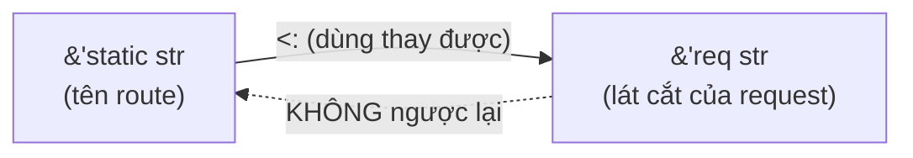
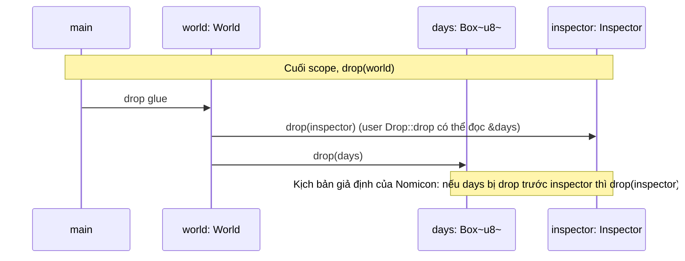

# P10 · Chương 05 — Subtyping, variance và drop check

## Bạn sẽ hiểu được gì

- **Q1.** Rust có subtyping ở đâu, và `'long <: 'short` nghĩa là gì? → mục 1
- **Q2.** Covariant, contravariant, invariant khác nhau thế nào; variance của `&'a T`, `&'a mut T`, `*const T`, `*mut T`, `Box<T>`, `Vec<T>`, `Cell<T>`, `fn(T) -> U`, `PhantomData<T>` là gì? → mục 2
- **Q3.** Vì sao `&mut T` phải invariant theo `T`, và lỗi `E0597` của ví dụ `assign` nói gì? → mục 3
- **Q4.** Vì sao `Cell<T>` invariant dù chỉ là "một ô chứa giá trị", còn `Box`/`Vec` covariant vẫn an toàn? → mục 4
- **Q5.** Variance của struct tự định nghĩa được suy ra thế nào, và `PhantomData<…>` điều khiển nó ra sao? → mục 5
- **Q6.** Drop check (dropck) là gì, vì sao thêm `impl Drop` làm chương trình đang chạy được bỗng lỗi `E0597`? → mục 6
- **Q7.** `#[may_dangle]` là gì, vì sao `Vec` dùng được còn code người dùng thì không (trên stable)? → mục 7
- **Q8.** Vì sao viết generic container hay gặp lỗi lifetime "kỳ lạ", và `PhantomData<T>` còn vai trò gì với dropck? → mục 8

## Kiến thức cần trước

- [P9 · Chương 01 — Ownership, borrowing và lifetime nhìn sâu](../09-rust-language/01-ownership-borrowing-lifetime.md): lifetime annotation, `'static`, outlives.
- [P9 · Chương 03 — Generics nâng cao](../09-rust-language/03-generics-nang-cao.md): `PhantomData` ở mức người dùng (typed ID, type state). Chương này đi sâu vào phần "compiler nhìn `PhantomData` thế nào".
- [P9 · Chương 04 — Smart pointer](../09-rust-language/04-smart-pointer.md): `Box`, `Cell`, `RefCell`.

Quy ước: các ví dụ lỗi biên dịch bên dưới được chạy thật bằng `rustc 1.95.0 (59807616e 2026-04-14)`, edition 2024, trên macOS aarch64. Thông điệp lỗi là nguyên văn (có cắt bớt dòng `warning`/`aborting`). Thông điệp có thể đổi chữ ở phiên bản khác.

## 1. Subtyping trong Rust: chỉ có ở lifetime (Q1)

> **Trả lời ngắn.** Subtyping là ý "kiểu này dùng thay được cho kiểu kia". Trong Rust, quan hệ đó chỉ có ở lifetime (và ở kiểu có higher-ranked lifetime)[^ref-subtype-kinds], nên Rust không có quan hệ kiểu hướng đối tượng như `Dog <: Animal` (hệ quả, suy luận của người soạn). `'long <: 'short` nghĩa là vùng code `'long` chứa trọn `'short`[^long-short]; vì vậy tham chiếu sống lâu dùng thay được tham chiếu sống ngắn.

**Giải thích.**

*Với service `orders`.* Hãy hình dung `orders`, một service HTTP viết bằng Rust (ví dụ giả định của người soạn, không phải code trong repo). Code của nó có hai loại chuỗi. Loại thứ nhất là tên route viết cứng như `"/orders"`, kiểu `&'static str`, sống suốt chương trình. Loại thứ hai là các lát cắt `&str` mượn từ buffer của một request, hết hạn khi request xong. Rất nhiều hàm chỉ cần "một chuỗi sống đủ lâu cho lời gọi này", và ta muốn đưa cả hai loại vào mà không phải sao chép. Ta sẽ bám theo `orders` suốt chương để xem Rust cho phép chuyện đó bằng cơ chế nào, và vì sao cơ chế ấy có những giới hạn nghe lạ tai ở các mục sau.

### 1.1 Subtyping và lifetime

Subtyping là ý tưởng một kiểu dùng được thay cho kiểu khác. Ta viết `Sub <: Super` khi mọi yêu cầu mà `Super` đặt ra đều được `Sub` đáp ứng đủ[^nomicon-subtype-def]. Rust cần nó vì nếu cài lifetime một cách ngây thơ thì hoặc quá chặt, hoặc cho phép undefined behavior; dùng subtyping và variance thì vừa linh hoạt vừa an toàn[^nomicon-subtyping-why].

Với lifetime, mỗi `'a` là một vùng code, và `'long <: 'short` khi và chỉ khi `'long` là vùng chứa trọn `'short`[^long-short]. Trong `orders`, `'static` sống lâu hơn mọi lifetime tham số `'a`, nên `&'static str` là subtype của `&'a str`[^ref-static-sub]. Nói cách khác, tên route đưa được vào bất kỳ chỗ nào cần một chuỗi ngắn hạn. Chiều ngược lại thì không, vì một lát cắt của request không thể đứng ở chỗ hứa `'static` (suy luận của người soạn). Việc "hạ" lifetime này bạn không phải viết gì: subtyping là ngầm định và có thể xảy ra ở mọi giai đoạn type checking hay inference[^ref-implicit].



(Sơ đồ minh họa của người soạn.)

### 1.2 Subtyping của Rust hẹp hơn bạn nghĩ

Đây là điểm cốt lõi của cả chương: Rust giới hạn subtyping ở đúng hai trường hợp, variance theo lifetime và giữa các kiểu có higher-ranked lifetime[^ref-subtype-kinds]. Nếu xóa hết lifetime khỏi kiểu thì quan hệ subtype duy nhất còn lại là kiểu bằng nhau[^ref-erase]. Vì vậy chuyện đưa `&String` vào chỗ cần `&str` không phải subtyping. Đó là *coercion*, cụ thể là deref coercion: `&T` thành `&U` khi `T` implement `Deref<Target = U>`[^ref-deref-coerce]. Nó thuộc một cơ chế khác, không nằm trong hai trường hợp subtyping ở trên (suy luận của người soạn).

<details><summary>Đi sâu: nếu bắt hai lifetime bằng nhau, và "region" trong compiler</summary>

Hàm `debug<'a>(a: &'a str, b: &'a str)` đòi hai tham chiếu cùng lifetime `'a`. Giả sử trong `orders` ta gọi nó với `hello: &'static str` là tên route và `world` là lát cắt ngắn hạn của request. Nếu cài lifetime kiểu bảo thủ, bắt hai lifetime phải *bằng nhau*, thì lời gọi bị từ chối vì hai biến có lifetime khác nhau: lỗi `E0308`[^nomicon-conservative]. Thực tế nó biên dịch được (chạy thật, in `a = "hello" b = "world"`), vì compiler "hạ" `&'static str` thành `&'world str`[^nomicon-downgrade].

Với compiler, mỗi lifetime là một *region*. Bước region inference tính giá trị của mỗi region, tức các điểm trong control-flow graph mà lifetime đó phải còn hợp lệ theo các ràng buộc đã thu thập[^dev-bc-region]. Quy tắc "lifetime là vùng code" đơn giản này là trực giác đúng cho khoảng 99% trường hợp, và nếu bạn không viết unsafe thì compiler tự lo các trường hợp góc[^nomicon-99]. (Region inference, outlives và liveness ở mức khái niệm: [P10·06 mục 4](./06-borrow-checker.md).)

</details>

**Quay lại Q1:** Rust chỉ có subtyping theo lifetime; `'long <: 'short` vì `'long` bao trọn `'short`, nên tên route `'static` của `orders` dùng thay được lát cắt ngắn hạn của request.

## 2. Variance: subtype đi qua generic thế nào (Q2)

> **Trả lời ngắn.** Variance cho biết quan hệ "dùng thay được" của tham số có truyền sang kiểu bọc nó hay không. Covariant: truyền thẳng; contravariant: đảo chiều; invariant: không truyền được[^nomicon-variance-def]. `&T`, `Box<T>`, `Vec<T>` covariant; `&mut T`, `Cell<T>`, `*mut T` invariant theo `T`; `fn(T)` contravariant theo `T`[^variance-table].

**Giải thích.**

*Với service `orders`.* Ở mục 1, `&'static str` dùng thay được `&'req str`. Nhưng `orders` còn có `Vec<&'static str>` (danh sách route), `&mut &'static str` (con trỏ để ghi vào biến giữ route hiện tại), `Cell<&'static str>` (ô nhãn nhiều thread cùng đọc ghi) và `fn(&'static str)` (hàm xử lý tên route). Câu hỏi là phần ruột dùng thay được có kéo theo phần vỏ dùng thay được không. Mỗi loại vỏ trả lời một kiểu, và variance là tên của câu trả lời đó.

### 2.1 Ba loại variance

Gọi `F<T>` là một kiểu generic theo `T`, và cho `Sub <: Super`:

- `F` **covariant** nếu `F<Sub> <: F<Super>` (quan hệ subtype "đi thẳng qua");
- `F` **contravariant** nếu `F<Super> <: F<Sub>` (quan hệ bị "đảo chiều");
- `F` **invariant** trong các trường hợp còn lại (không có quan hệ subtype nào)[^nomicon-variance-def].

Reference định nghĩa tương tự: variance của kiểu generic theo một tham số là cách quan hệ subtype của tham số ảnh hưởng tới quan hệ subtype của kiểu[^ref-var-def].

### 2.2 Variance của các kiểu thường gặp

Bảng dưới trả lời cho từng kiểu. Mục 3 và 4 giải thích vì sao `&mut T` và `Cell<T>` lại khác `&T` và `Box<T>`.

| Kiểu | Theo `'a` | Theo `T` | Ghi chú |
|---|---|---|---|
| `&'a T` | covariant | covariant | chỉ đọc (nhận xét của người soạn)[^variance-table] |
| `&'a mut T` | covariant | **invariant** | ghi được vào `T` (nhận xét của người soạn)[^variance-table] |
| `*const T` | — | covariant | theo logic của `&T`[^variance-rawptr-const] |
| `*mut T` | — | **invariant** | theo logic của `&mut T`/`UnsafeCell<T>`[^variance-rawptr] |
| `Box<T>`, `Vec<T>` | — | covariant | owning pointer/collection theo logic `Box<T>`[^variance-owning] |
| `Cell<T>`, `UnsafeCell<T>` | — | **invariant** | interior mutability giống `&mut T`[^variance-cell] |
| `fn(T) -> U` | — | `T` **contravariant**, `U` covariant | xem phần Đi sâu[^variance-table] |
| `PhantomData<T>` | — | covariant | theo Reference[^ref-var-table]; kiểm bằng thực nghiệm ở mục 5 |

Contravariance hiếm gặp trong thực tế, vì nguồn contravariance duy nhất của ngôn ngữ là tham số của hàm[^variance-contra].

<details><summary>Đi sâu: bảng Reference đầy đủ hơn, và <code>fn(T) -> U</code> contravariant theo đối số</summary>

Bảng của Reference còn có `[T]`, `[T; n]`, `fn() -> T` (covariant), `fn(T) -> ()` (contravariant), `PhantomData<T>` (covariant) và `dyn Trait<T> + 'a`[^ref-var-table]. Riêng `&'a mut T` covariant theo `'a` nhưng invariant theo `T`[^variance-table].

Với kết quả trả về, lập luận khá thẳng: hàm hứa trả về `&'a str` thì thay bằng hàm trả về `&'static str` được (sống lâu hơn là đủ), nên `fn(T) -> U` covariant theo `U`[^variance-fnret]. Với đối số thì ngược lại. Trong `orders`, một hàm như `store(&'static str)` chỉ nhận chuỗi `'static`, nên không đứng được ở chỗ cần hàm nhận `&'a str` bất kỳ[^variance-fnarg]. Ngược lại, hàm xử lý được *mọi* lifetime thì thay được cho hàm cần xử lý `&'static str`[^variance-fnarg-ok]. Ví dụ chạy thật (rút gọn từ Nomicon, bỏ thread-local):

```rust
fn store(_input: &'static str) {}
fn demo<'a>(input: &'a str, f: fn(&'a str)) { f(input); }
fn main() {
    demo("hello", store);
    {
        let smuggle = String::from("smuggle");
        demo(&smuggle, store);
    }
}
```

```text
error[E0597]: `smuggle` does not live long enough
 --> a4.rs:7:14
  |
6 |         let smuggle = String::from("smuggle");
  |             ------- binding `smuggle` declared here
7 |         demo(&smuggle, store);
  |              ^^^^^^^^  ----- coercion requires that `smuggle` is borrowed for `'static`
  |              |
  |              borrowed value does not live long enough
8 |     }
  |     - `smuggle` dropped here while still borrowed
```

Đó là lý do kiểu hàm, khác mọi thứ khác trong ngôn ngữ, contravariant theo đối số[^fn-contra-why]. Chiều thuận cũng chạy thật: truyền hàm `fn store_any(&str)` (nhận mọi lifetime) vào chỗ cần `fn(&'static str)` biên dịch và chạy được (in `ok`).

</details>

**Quay lại Q2:** covariant truyền thẳng, contravariant đảo chiều, invariant chặn; với `orders`, `Vec<&'static str>` co được còn `&mut &'static str` thì không. Chỉ tham số hàm sinh ra contravariance.

## 3. Vì sao `&mut T` phải invariant theo `T` (Q3)

> **Trả lời ngắn.** Nếu `&mut &'static str` dùng được như `&mut &'b str` thì ta ghi được vào đó một `&'b str` ngắn hạn, và biến vốn hứa `'static` sẽ giữ một con trỏ treo[^assign-uaf]. Vì vậy `&mut &'static str` không thể là subtype của `&mut &'b str`[^nomicon-mut-invariant]: compiler không áp dụng subtyping bên trong `&mut T`, và ví dụ `assign` bị từ chối với `E0597`[^assign-t].

**Giải thích.**

*Với service `orders`.* Giả sử một handler giữ biến `current: &'static str`, tên route đang xử lý, và có hàm generic `assign` để ghi giá trị mới vào một chỗ chứa. Nếu Rust cho coi `&mut &'static str` như `&mut &'req str`, ta nhét được vào `current` một lát cắt của request buffer. Request xong thì buffer bị giải phóng, còn `current` thành con trỏ treo mà kiểu của nó vẫn khẳng định là `'static`. Rust chặn chuyện đó bằng cách bắt `&mut T` invariant theo `T`.

Ví dụ kinh điển của Nomicon, trong đó `hello` đóng vai tên route còn `world` đóng vai chuỗi của một request:

```rust
fn assign<T>(input: &mut T, val: T) { *input = val; }

fn main() {
    let mut hello: &'static str = "hello";
    {
        let world = String::from("world");
        assign(&mut hello, &world);
    }
    println!("{hello}"); // use after free nếu chương trình này được biên dịch
}
```

`assign` tự nó không sai: ghi một `T` vào chỗ chứa `T` là chuyện hợp lý. Vấn đề là ta không được giả định `&mut &'static str` và `&mut &'b str` tương thích với nhau[^assign-ok]. Chạy thật bằng rustc 1.95.0:

```text
error[E0597]: `world` does not live long enough
 --> a2.rs:6:28
  |
3 |     let mut hello: &'static str = "hello";
  |                    ------------ type annotation requires that `world` is borrowed for `'static`
4 |     {
5 |         let world = String::from("world");
  |             ----- binding `world` declared here
6 |         assign(&mut hello, &world);
  |                            ^^^^^^ borrowed value does not live long enough
7 |     }
  |     - `world` dropped here while still borrowed
```

Cách đọc lỗi này: `assign` tạo ra một ràng buộc *bằng nhau* giữa kiểu của chỗ chứa và kiểu của giá trị[^assign-eq]. Vì `&mut T` invariant theo `T`, compiler không áp dụng subtyping cho đối số đầu, nên `T` phải đúng là `&'static str`[^assign-t]. Khi đó `&world` cũng phải sống `'static`. Đó là dòng "type annotation requires that `world` is borrowed for `'static`", và lỗi là `E0597`. Nomicon kết luận `&mut &'static str` không thể là subtype của `&mut &'b str`, dù `'static` là subtype của `'b`[^nomicon-mut-invariant].

<details><summary>Đi sâu: đối chiếu với trường hợp <code>&T</code> covariant</summary>

`debug<T: Debug>(a: T, b: T)` cũng buộc `a` và `b` cùng kiểu `T`. Nhưng vì `&'a T` covariant theo `'a`, compiler được phép co `&'static str` thành `&'b str`[^assign-cov]. Cùng một ràng buộc "hai đối số cùng kiểu", covariant thì biên dịch được, invariant thì không. Tổng quát hơn, `&mut T` invariant theo `T`[^variance-mut]; nó vẫn covariant theo `'a` (bảng ở mục 2).

</details>

**Quay lại Q3:** `&mut T` invariant theo `T` vì ghi được; nếu không, một lát cắt ngắn hạn của request lọt được vào biến hứa `'static`.

## 4. `Box`/`Vec` covariant vẫn an toàn, `Cell<T>` thì không (Q4)

> **Trả lời ngắn.** `Box` và `Vec` covariant mà vẫn an toàn, vì khi bạn nhét chúng vào thứ như tham chiếu mutable thì chúng thừa hưởng invariance, nên không làm điều xấu được[^box-cov]. `Cell<T>` thì cho *ghi* qua tham chiếu chung `&`, cùng lý do với `&mut T`, nên invariant[^variance-cell].

**Giải thích.**

*Với service `orders`.* `orders` có hai thứ nhìn qua giống nhau: danh sách route `Vec<&'static str>` nằm trong biến của một handler, và một `Cell<&'static str>` làm ô nhãn mà nhiều chỗ trong code cùng ghi (ví dụ giả định). Tại sao Rust cho co lifetime của cái đầu mà cấm với cái sau?

### 4.1 `Box` và `Vec`: co được vì chủ cũ không còn

Khi ta move `Box<&'static str>` sang một biến chỉ biết giá trị sống `'b`, ta đã hủy thứ duy nhất "nhớ" rằng nó sống lâu hơn[^box-move]. Không còn cái nhìn `'static` nào để bị lừa. Chạy thật: chuyển `Vec<&'static str>` thành `Vec<&str>` rồi push một `&String` ngắn hạn, và chuyển `Box<&'static str>` thành `Box<&str>` rồi gán. Cả hai **biên dịch và chạy** (in `["x", "short"]` và `short`).

### 4.2 `Cell<T>`: ghi qua `&`

`Cell<T>` và các kiểu interior mutability khác theo logic của `UnsafeCell<T>`, và `UnsafeCell<T>` có interior mutability nên cùng tính chất variance với `&mut T`[^variance-cell]. Qua `&Cell<&'static str>` ta *ghi* được: `Cell<T>` cho phép đổi giá trị bên trong một struct bất biến[^cell-doc]. Khác với `Box` ở trên, ô này dùng chung qua `&` nên cái nhìn `'static` cũ vẫn còn sau khi ghi. Vì vậy nếu `Cell<&'static str>` dùng được như `Cell<&'a str>`, ta sẽ ghi được `&'a str` ngắn hạn vào ô vốn hứa `'static` (suy luận của người soạn, từ lập luận `&mut T` ở mục 3). Chạy thật:

```rust
use std::cell::Cell;
fn needs_short<'a>(c: &Cell<&'a str>, s: &'a str) { c.set(s); }
fn main() {
    let c: Cell<&'static str> = Cell::new("hello");
    {
        let world = String::from("world");
        needs_short(&c, &world);
    }
    println!("{}", c.get());
}
```

```text
error[E0597]: `world` does not live long enough
 --> a8.rs:7:25
  |
4 |     let c: Cell<&'static str> = Cell::new("hello");
  |            ------------------ type annotation requires that `world` is borrowed for `'static`
...
7 |         needs_short(&c, &world);
  |                         ^^^^^^ borrowed value does not live long enough
8 |     }
  |     - `world` dropped here while still borrowed
```

Đây là cùng dạng lỗi `E0597` như với `&mut`: `Cell` khóa lifetime lại. Biến thể `let shorter: Cell<&str> = c;` rồi `shorter.set(&world)` cho cùng thông điệp `E0597` (đã chạy).

<details><summary>Đi sâu: <code>Cell</code> trong source std 1.95.0</summary>

Chi tiết cài đặt (có thể đổi): trong std 1.95.0, `Cell<T>` là `repr(transparent)` struct với một field `value: UnsafeCell<T>`[^cell-src]. Vì "struct thừa hưởng variance của field" (mục 5), `Cell` cũng invariant.

</details>

**Quay lại Q4:** `Box`/`Vec` covariant vẫn an toàn vì khi nhét vào tham chiếu mutable chúng thừa hưởng invariance[^box-cov]. Khi move thì lifetime cũ không còn ai nhớ[^box-move]. Còn `Cell` invariant vì tự nó cho ghi.

## 5. Variance của kiểu tự định nghĩa và `PhantomData` (Q5)

> **Trả lời ngắn.** Struct thừa hưởng variance từ các field; tham số dùng ở những vị trí có variance khác nhau thì invariant[^ref-user-composite]. Khi tham số không nằm trong field nào, `PhantomData<…>` giả làm một field để chọn variance (và auto trait) mong muốn[^phantom].

**Giải thích.**

*Với service `orders`.* Giả sử `orders` tự viết vài container dùng raw pointer để khỏi cấp phát: một `MyBox<T>` giữ con trỏ, và một iterator đi trên buffer của request (ví dụ giả định). Compiler suy ra variance của chúng thế nào, và khi raw pointer che mất ý định của bạn thì làm sao nói lại cho compiler biết?

### 5.1 Struct thừa hưởng variance từ field

Nói gọn, struct thừa hưởng variance của các field[^variance-struct]. Chính xác hơn, variance của struct, enum và union do variance của kiểu các field quyết định, và nếu tham số xuất hiện ở những vị trí có variance khác nhau thì nó invariant[^ref-user-composite]. Ví dụ (suy ra từ quy tắc trên): `struct A<T> { x: Vec<T> }` covariant theo `T`; thêm field `y: Cell<T>` thì cả struct invariant theo `T`.

Hệ quả cho unsafe code là bạn phải *dựng field* sao cho compiler suy ra đúng variance mình muốn (suy luận của người soạn). Cái bẫy phổ biến: `struct MyBox<T> { ptr: *mut T }` **invariant** theo `T` vì `*mut T` invariant[^variance-table], dù ý định logic của bạn có thể là covariant như `Box<T>`. Std có `NonNull<T>`, và docs mô tả nó covariant theo `T`, khác với `*mut T`[^nonnull-cov].

### 5.2 `PhantomData`: field "ảo" để chọn variance

Tình huống khác: lifetime hoặc kiểu gắn với struct về mặt logic nhưng không nằm trong field nào, như `Iter<'a, T> { ptr: *const T, end: *const T }`. Khi đó `'a` không được dùng trong thân struct nên bị "unbounded", và Rust cấm unbounded lifetime/kiểu trong định nghĩa struct[^nomicon-phantom-unbounded]. Lối ra là `PhantomData`: nó không chiếm chỗ nhưng giả làm một field kiểu đã cho, cho mục đích phân tích tĩnh[^phantom]. Thêm `_marker: PhantomData<&'a T>` thì "lifetime sẽ bị ràng buộc, và iterator covariant theo `'a` và `T`"[^phantom-iter]. Cách này được chọn vì ít lỗi hơn việc bắt bạn khai báo variance tường minh, lại còn cho thêm auto trait và thông tin mà drop check cần[^nomicon-phantom-why].

### 5.3 Thử từng mẫu

Với `struct S<T>(PhantomData<…>)`, ta thử hàm `fn f<'long: 'short, 'short>(x: S<&'long u8>) -> S<&'short u8> { x }` (co lifetime) và hàm kéo dài ngược lại (OK = biên dịch được). Phần variance của bảng dưới đã chạy thật từng dòng:

| Phantom field | Co lifetime (`'long`→`'short`) | Kéo dài (`'short`→`'long`) | Kết luận variance theo `T` |
|---|---|---|---|
| `PhantomData<T>` | OK | lỗi | covariant |
| `PhantomData<*const T>` | OK | lỗi | covariant |
| `PhantomData<fn() -> T>` | OK | lỗi | covariant |
| `PhantomData<fn(T)>` | lỗi | OK | contravariant |
| `PhantomData<*mut T>` | lỗi | lỗi | invariant |
| `PhantomData<fn(T) -> T>` | lỗi | lỗi | invariant |
| `PhantomData<Cell<T>>` | lỗi | lỗi | invariant |

Sáu dòng đầu khớp cột variance của bảng Nomicon; dòng `Cell<T>` là bản thử riêng, vì Nomicon dùng `PhantomData<Cell<&'a ()>>` (invariant theo `'a`)[^phantom-table]. Lỗi ở trường hợp invariant có dạng: `` note: the struct `S<T>` is invariant over the parameter `T` `` kèm `help: see <https://doc.rust-lang.org/nomicon/subtyping.html>`. Các cột auto trait (`Send`/`Sync`) và dropck của bảng Nomicon **không** chạy lại; xem bảng gốc.

<details><summary>Đi sâu: chọn mẫu nào, và <code>Unique&lt;T&gt;</code> trong std</summary>

Chọn mẫu nào (nhận xét của người soạn): muốn "như sở hữu `T`" thì dùng `PhantomData<T>`; muốn "như mượn `&'a T`" thì dùng `PhantomData<&'a T>`; muốn *ép invariant* thì dùng `PhantomData<fn(T) -> T>` (vẫn `Send + Sync` theo bảng Nomicon) hoặc `PhantomData<*mut T>` (nhưng mất `Send`/`Sync` theo bảng)[^phantom-table].

Raw pointer sở hữu một allocation là mẫu rất phổ biến, nên std tự làm cho mình tiện ích `Unique<T>`: bọc `*const T` để có variance, gồm `PhantomData<T>`, tự derive `Send`/`Sync` như thể chứa `T`, và đánh dấu non-zero cho null-pointer optimization[^unique-list]. Code người dùng có `NonNull<T>` (non-null và covariant theo `T`, thường dùng khi xây cấu trúc dữ liệu bằng raw pointer)[^nonnull-doc]. Nếu cần giống `Unique<T>` thì ghép nó với `PhantomData<T>` (nhận xét của người soạn).

</details>

**Quay lại Q5:** variance của struct do field quyết định; khi không có field thật, `PhantomData<…>` là công cụ để chọn nó.

## 6. Drop check (Q6)

> **Trả lời ngắn.** `Drop::drop` là code tùy ý chạy lúc kiểu "chết", nên có thể đọc dữ liệu mà lẽ ra sống ngang nó nhưng đã bị hủy trước[^nomicon-dropck-problem]. Vì thế một kiểu generic có `impl Drop` đòi mọi tham số generic phải *strictly outlive* nó[^nomicon-dropck-rule]; thêm `Drop` có thể làm code vốn chạy được bỗng lỗi `E0597`[^dropck-add].

**Giải thích.**

*Với service `orders`.* Một kiểu rất quen trong service: guard mượn một connection từ pool và có `Drop` để trả connection về pool, trong `drop` có thể ghi log hay đọc lại dữ liệu nó mượn (ví dụ giả định của người soạn). Code đang chạy tốt, rồi bạn thêm `impl Drop` cho một struct generic và `E0597` hiện ra ở đoạn bạn chưa đụng tới. Mục này giải thích vì sao.

### 6.1 Thứ tự drop

Biến bị drop theo thứ tự ngược với thứ tự khai báo, còn field của struct và tuple drop theo thứ tự khai báo[^drop-order]. Destructor của một giá trị gồm hai phần: gọi `Drop::drop` nếu kiểu có implement, rồi *drop glue* do compiler sinh ra để gọi đệ quy destructor của mọi field[^drop-glue-def]. Ta sẽ dùng lại hai khái niệm này ở các mục sau.

### 6.2 Có `Drop` và không có `Drop`

Ví dụ của Nomicon: `World { inspector: Option<Inspector<'a>>, days: Box<u8> }`, rồi `world.inspector = Some(Inspector(&world.days))`. Ta có thể coi `days` như buffer của một request và `inspector` như guard mượn buffer đó (nhận xét của người soạn). Khi `Inspector` **không** có `Drop`, chương trình hợp lệ và biên dịch (đã chạy, chỉ có cảnh báo dead code): `days` không cần strictly outlive `inspector`, vì miễn `inspector` còn sống thì `days` cũng còn[^dropck-nodrop].

Thêm destructor thì chương trình không biên dịch nữa[^dropck-add]. Đây là ví dụ đã thêm `Drop`:

```rust
struct Inspector<'a>(&'a u8);
impl<'a> Drop for Inspector<'a> {
    fn drop(&mut self) { println!("I was only {} days from retirement!", self.0); }
}
struct World<'a> { inspector: Option<Inspector<'a>>, days: Box<u8> }
fn main() {
    let mut world = World { inspector: None, days: Box::new(1) };
    world.inspector = Some(Inspector(&world.days));
}
```

```text
error[E0597]: `world.days` does not live long enough
 --> d2.rs:8:38
  |
7 |     let mut world = World { inspector: None, days: Box::new(1) };
  |         --------- binding `world` declared here
8 |     world.inspector = Some(Inspector(&world.days));
  |                                      ^^^^^^^^^^^ borrowed value does not live long enough
9 | }
  | -
  | |
  | `world.days` dropped here while still borrowed
  | borrow might be used here, when `world` is dropped and runs the destructor for type `World<'_>`
```

Dòng quyết định là "borrow might be used here, when `world` is dropped and runs the destructor". Đây là lỗi do drop check, không phải do một lần dùng tường minh nào trong code. Đổi thứ tự field hay dùng tuple thay struct vẫn không biên dịch[^dropck-reorder].

### 6.3 Vì sao rustc từ chối

Nhìn thứ tự drop thì ví dụ này có vẻ ổn: `inspector` khai báo trước `days` nên drop trước[^drop-order].



(Sơ đồ vẽ thứ tự field theo khai báo. Dòng Note cuối vẽ kịch bản giả định mà Nomicon nêu trong comment code, không phải kết quả của một lần chạy.)

Nhưng khi phân tích `main`, borrow checker không biết thân `drop` của `Inspector` làm gì và có thể đụng vào dữ liệu mượn hay không. Vì thế drop checker buộc mọi dữ liệu borrowed trong một giá trị phải strictly outlive giá trị đó[^dropck-conservative]. Phân tích hiện tại cố ý bảo thủ như vậy, và nó chắc chắn sound[^dropck-deliberate]. Hệ quả là các biến thể của `Inspector` mà `drop` không hề đụng dữ liệu mượn vẫn bị borrow checker từ chối[^dropck-variants].

### 6.4 Luật lớn (Big Rule)

Chỉ kiểu generic mới phải lo chuyện này. Kiểu không generic chỉ chứa được lifetime `'static`, sống mãi[^dropck-generic-only]. Vấn đề này gọi là *sound generic drop*, do drop checker thực thi[^dropck-name]. Luật là: generic argument phải **strictly outlive** kiểu[^nomicon-dropck-rule]. Tuân thủ luật này là đủ để sound nhưng không nhất thiết cần[^nomicon-dropck-suff].

Docs của `Drop` mô tả phân tích hiện tại theo cách khác: nếu `T` implement `Drop` thì mọi tham số generic (lifetime và kiểu) của `T` phải còn live khi `T` bị drop[^std-dropck-live]. Cả hai nguồn đều nói đây là phân tích hiện tại và có thể đổi. Một bên viết rằng các quy tắc có thể bớt hạn chế trong tương lai[^dropck-future]. Bên kia viết rằng chi tiết phân tích chưa được bảo đảm ổn định[^std-dropck-unstable].

<details><summary>Đi sâu: <code>Vec&lt;&amp;str&gt;</code> với <code>Drop</code> thường, và <code>ManuallyDrop</code></summary>

Nomicon dùng ví dụ này để giải thích `#[may_dangle]`:

```rust
let mut v: Vec<&str> = Vec::new();
let s: String = "Short-lived".into();
v.push(&s);
drop(s);
// v bị drop ở đây
```

Với một `impl<T> Drop for Vec<T>` "cổ điển", đoạn trên bị từ chối vì `'s` đã hết hạn khi `Vec` bị drop[^vec-classic]. Chạy thật hai phiên bản:

- `Vec` thật của std 1.95.0: **biên dịch được**, không in gì.
- `MyVec<T>` tự viết, có `impl<T> Drop for MyVec<T>` (không `may_dangle`): lỗi.

```text
error[E0597]: `s` does not live long enough
  --> d5.rs:14:12
   |
13 |     let s: String = "Short-lived".into();
   |         - binding `s` declared here
14 |     v.push(&s);
   |            ^^ borrowed value does not live long enough
15 |     drop(s);
16 | }
   | -
   | |
   | `s` dropped here while still borrowed
   | borrow might be used here, when `v` is dropped and runs the `Drop` code for type `MyVec`
   |
   = note: values in a scope are dropped in the opposite order they are defined

error[E0505]: cannot move out of `s` because it is borrowed
```

Cùng code, chỉ khác `Vec` của std có đặc quyền `#[may_dangle]` (mục 7). Ngoài ra, thứ tự drop field tuy được định nghĩa nhưng dựa vào nó là mong manh; khi thứ tự quan trọng thì nên dùng `ManuallyDrop`[^manually-drop].

</details>

**Quay lại Q6:** kiểu generic có `Drop` có thể đọc lại dữ liệu mượn lúc chết, nên dropck bắt mọi tham số của nó phải sống lâu hơn nó thật sự; guard của `orders` cũng chịu luật đó.

## 7. `#[may_dangle]` (dropck eyepatch) (Q7)

> **Trả lời ngắn.** `#[may_dangle]` là attribute unstable để *khẳng định (unsafe)* rằng destructor không đụng dữ liệu đã hết hạn, nhờ đó nới luật strictly outlive[^nomicon-maydangle]. `Vec` trong std dùng nó[^vec-maydangle]; code người dùng trên stable thì không dùng được vì `may_dangle` còn unstable (mục này có thông báo lỗi E0658 đã chạy).

**Giải thích.**

*Với service `orders`.* Giả sử `orders` tự viết một container `MyVec<T>` có `impl Drop` để giải phóng buffer (tên lấy từ ví dụ ở mục 6; đây là ví dụ giả định). Bạn nhét vào đó các lát cắt `&str` của request thì bị `E0597`, trong khi `Vec<&str>` của std thì không. Std có thứ gì mà bạn không có?

### 7.1 Lời khẳng định `unsafe`

Thứ đó là attribute `may_dangle`, giới thiệu trong RFC 1327[^rfc1327]. Cách dùng: đặt nó trên tham số của một `unsafe impl Drop`, áp được cho nhiều tham số lifetime hoặc type[^maydangle-params]. `Drop` impl phải đánh dấu `unsafe` vì compiler không kiểm tra lời khẳng định ngầm rằng không có dữ liệu nào có thể đã hết hạn bị truy cập[^maydangle-unsafe]. Với tham số generic, việc truy cập có thể xảy ra gián tiếp, ví dụ qua callback hoặc qua method của trait (như `Display::fmt`)[^maydangle-indirect]. Vì vậy Nomicon khuyên tốt nhất là tránh thêm attribute này[^maydangle-avoid].

### 7.2 Trên stable thì không dùng được

`#[may_dangle]` còn unstable, nên trên stable thuần nó bị từ chối (đã chạy):

```text
error[E0658]: `may_dangle` has unstable semantics and may be removed in the future
 --> d4.rs:2:13
  |
2 | unsafe impl<#[may_dangle] 'a> Drop for Inspector<'a> {
  |             ^^^^^^^^^^^^^
  |
  = note: see issue #34761 <https://github.com/rust-lang/rust/issues/34761> for more information
```

<details><summary>Đi sâu: ví dụ eyepatch, <code>Vec</code> và <code>RawVec</code> trong source 1.95.0</summary>

```rust
#![feature(dropck_eyepatch)]
struct Inspector<'a>(&'a u8, &'static str);
unsafe impl<#[may_dangle] 'a> Drop for Inspector<'a> {
    fn drop(&mut self) { println!("Inspector(_, {}) knows when *not* to inspect.", self.1); }
}
struct World<'a> { days: Box<u8>, inspector: Option<Inspector<'a>> }
fn main() {
    let mut world = World { inspector: None, days: Box::new(1) };
    world.inspector = Some(Inspector(&world.days, "gadget"));
}
```

Chạy với `RUSTC_BOOTSTRAP=1` (chỉ để thử feature unstable trên toolchain stable, không dùng cho code thật): biên dịch được, in `Inspector(_, gadget) knows when *not* to inspect.`

`library/alloc/src/vec/mod.rs` có `unsafe impl<#[may_dangle] T, A: Allocator> Drop for Vec<T, A> {`[^vec-maydangle]. Thân `drop` chỉ gọi `ptr::drop_in_place` trên một raw slice của các phần tử, còn việc giải phóng buffer để `RawVec` lo (theo comment trong source)[^vec-drop-body]. `RawVec` cũng có `unsafe impl<#[may_dangle] T, A: Allocator> Drop for RawVec<T, A> {`[^rawvec-maydangle]. (*Vì sao* std làm vậy, để `Vec<&'a X>` drop được dù `'a` đã hết hạn, là diễn giải của người soạn từ Nomicon.)

Nomicon có một cảnh báo tinh tế. `Drop` của `Vec` không quan tâm `&'s str` vì kiểu đó không có drop glue riêng, chỉ cần giải phóng buffer[^vec-nodropglue]. Nhưng nếu `T` có drop glue riêng thì `Vec` *phải* drop từng phần tử trước khi giải phóng buffer, và `#[may_dangle]` đủ thông minh để tự vô hiệu hóa khi tham số được giữ "theo kiểu sở hữu" trong field của struct[^maydangle-smart]. Theo mô tả đó, với `PrintOnDrop<'s>` (có `Drop` riêng đọc `&'s str`) thì `'s` không được phép dangle, còn với `&'s str` thì được (mô tả của Nomicon; không chạy ví dụ `PrintOnDrop`).

</details>

**Quay lại Q7:** `may_dangle` là lời hứa unsafe và unstable, cho phép `Vec` nới dropck; code stable của bạn không dùng được nên `MyVec<&str>` vẫn lỗi.

## 8. Vì sao lỗi lifetime "kỳ lạ", và `PhantomData<T>` với dropck (Q8)

> **Trả lời ngắn.** Lỗi lifetime "kỳ lạ" thường quy về ba thứ (suy luận của người soạn): một tham số bị khóa invariant (do `&mut`, `Cell`, `*mut T`), một `impl Drop` kích hoạt luật strictly outlive, hoặc `may_dangle` mà std có còn bạn thì không. `PhantomData<T>` còn có vai trò dropck, nhưng nếu kiểu đã có `Drop` impl thì nó thừa về mặt dropck[^phantom-superfluous].

**Giải thích.**

*Với service `orders`.* Khi `orders` gặp lỗi lifetime ở chỗ bạn thấy vô lý, hãy đối chiếu triệu chứng với các trường hợp dưới đây. Đây là phần tổng hợp từ các mục trên; phần diễn giải là suy luận của người soạn.

- **"Tại sao `&mut` của tôi không co được lifetime?"** Vì `&mut T`, `*mut T`, `Cell<T>`, `UnsafeCell<T>` invariant theo `T` (mục 2). Container nào chứa chúng trực tiếp, kể cả qua `*mut T` thô, cũng invariant theo `T`. Lỗi điển hình là `E0597` với dòng "type annotation requires that `x` is borrowed for `'static`".
- **"Container của tôi invariant dù chỉ đọc."** Nguyên nhân phổ biến là dùng `*mut T` làm con trỏ (mục 5). Thay bằng `NonNull<T>`, covariant theo `T`[^nonnull-cov]. Hoặc dùng `*const T`, cũng covariant[^variance-table]. Rồi thêm `PhantomData` đúng mẫu.
- **"Thêm `Drop` thì code cũ không biên dịch nữa."** Xem mục 6: `impl Drop` cho kiểu generic kích hoạt luật strictly outlive trên mọi generic argument.
- **"`Vec<&str>` dùng được nhưng `MyVec<&str>` thì không."** Đó là do `#[may_dangle]` (mục 7). Cách thoát trên stable: không implement `Drop` trực tiếp trên kiểu generic. Hãy để field có sẵn `Drop` đúng (như `Vec` hay `Box`) lo việc giải phóng, hoặc chấp nhận luật bảo thủ.

Còn `PhantomData<T>` với dropck thì chương chỉ nêu đúng điều trang Nomicon *PhantomData* hiện nói. Trước đây tài liệu từng dạy cần thêm `_owns_T: PhantomData<T>` để báo cho dropck rằng `Vec<T>` sở hữu `T`[^phantom-need]. Nomicon viết rằng "từ RFC 1238, điều này không còn đúng và không còn cần thiết"[^rfc1238]. Hiện nay chỉ riêng `impl<T> Drop for Vec<T>` đã khiến Rust coi `Vec<T>` sở hữu giá trị kiểu `T` và không cho chúng dangle khi `Vec<T>` bị drop[^drop-impl-owns]. Nên khi kiểu đã có `Drop` impl, thêm `_owns_T: PhantomData<T>` là thừa về dropck, dù nó vẫn ảnh hưởng variance và auto trait[^phantom-superfluous]. Docs của `PhantomData` trong std nói thêm: tương tác chính xác với drop check có thể đổi trong tương lai, và hiện nay field `PhantomData<T>` chỉ báo kiểu sở hữu `T` trong những hoàn cảnh rất hiếm[^std-phantom-dropck].

<details><summary>Đi sâu: trường hợp biên và ngoại lệ của std</summary>

- Nếu kiểu chứa `PhantomData` **không** có `Drop` impl nhưng vẫn có drop glue (do field khác có drop glue), thì các cân nhắc dropck/`#[may_dangle]` vẫn áp dụng[^phantom-edge]. Docs của `Drop` cho thấy điều tương ứng: khi duyệt các kiểu mà `T` sở hữu, phân tích đi xuyên qua `PhantomData`, `Box`, tuple và mảng[^std-dropck-descend]. Chương không khẳng định gì thêm ngoài lời hai nguồn.
- Với `#[may_dangle]`, std vẫn cần field `_owns_T: PhantomData<T>` để soundness[^std-still-needs]. Trong source 1.95.0, `RawVec<T, A>` có field `inner: RawVecInner<A>` và `_marker: PhantomData<T>`[^rawvec-marker].
- Tóm lại `PhantomData<T>` làm ba việc. (a) Giả làm field `T` cho variance, covariant[^ref-var-table]. (b) Báo "sở hữu `T`" cho dropck khi `#[may_dangle]` đang dùng[^maydangle-smart]. Việc này cũng cần khi kiểu có drop glue mà không có `Drop` impl[^phantom-edge]. (c) Không cần cho dropck nếu kiểu đã có `Drop` impl không `may_dangle`[^phantom-superfluous].
- Thứ tự khai báo biến hay field có thể quyết định lỗi; khi thứ tự quan trọng thì dùng `ManuallyDrop`[^manually-drop].
- Liên hệ backend (nhận xét của người soạn, suy luận chưa chạy): `Guard<'pool, T>` có `Drop` trả connection về pool phải khai báo *sau* pool mà nó mượn (vì drop ngược thứ tự khai báo), và dropck sẽ chặn nếu guard còn dùng dữ liệu mượn đã hết hạn lúc drop.

</details>

**Quay lại Q8:** lỗi lạ thường do invariance, luật dropck, hoặc thiếu `may_dangle`; `PhantomData<T>` chỉ còn cần cho dropck ở các trường hợp biên.

## Tóm tắt

- Rust chỉ có subtyping theo lifetime (và higher-ranked); `'long <: 'short` khi `'long` chứa trọn `'short`[^long-short]. Với `orders`, tên route `'static` dùng thay được lát cắt ngắn hạn của request.
- Covariant: subtype đi thẳng; contravariant: đảo; invariant: không có quan hệ[^nomicon-variance-def]. Contravariance chỉ đến từ tham số hàm[^variance-contra].
- `&mut T`, `*mut T`, `Cell<T>`, `UnsafeCell<T>` invariant theo `T`[^variance-table]. Nếu không thì ghi được lifetime ngắn vào chỗ hứa dài, như ví dụ `assign` với lỗi `E0597`[^nomicon-mut-invariant].
- `Box<T>`, `Vec<T>`, `&T`, `*const T` covariant theo `T`[^variance-table].
- Variance của struct suy ra từ field; có field invariant thì cả struct invariant[^ref-user-composite].
- `PhantomData<T>` covariant; `PhantomData<fn(T)>` contravariant; `PhantomData<*mut T>` và `PhantomData<fn(T) -> T>` invariant. Đã kiểm bằng rustc 1.95.0 và khớp bảng Nomicon[^phantom-table].
- Drop check: kiểu generic có `Drop` đòi mọi generic argument strictly outlive nó[^nomicon-dropck-rule]. Vi phạm cho `E0597`, với dòng chú thích nói borrow có thể bị dùng khi destructor chạy (quan sát).
- `#[may_dangle]` kèm `unsafe impl Drop` nới luật đó nhưng còn unstable (E0658 trên stable); `Vec` trong std 1.95.0 dùng nó[^vec-maydangle]. `RawVec` cũng vậy[^rawvec-maydangle].
- Với kiểu đã có `Drop` impl, `PhantomData<T>` chỉ để drop-check là thừa theo Nomicon[^phantom-superfluous].

## Câu hỏi tự kiểm tra

1. Quan hệ `'long <: 'short` nghĩa là gì, và subtyping của Rust giới hạn ở những trường hợp nào?
   <details><summary>Đáp án</summary>

   `'long` là vùng chứa trọn `'short`[^long-short]. Subtyping chỉ có variance theo lifetime và giữa các kiểu có higher-ranked lifetime[^ref-subtype-kinds].

   </details>

2. Định nghĩa covariant, contravariant, invariant.
   <details><summary>Đáp án</summary>

   Covariant: quan hệ subtype đi thẳng qua (`F<Sub>` là subtype của `F<Super>`). Contravariant: quan hệ bị đảo (`F<Super>` là subtype của `F<Sub>`). Invariant: không có quan hệ subtype[^nomicon-variance-def].

   </details>

3. Vì sao `assign(&mut hello, &world)` lỗi mà `debug(hello, world)` thì không?
   <details><summary>Đáp án</summary>

   `&mut T` invariant nên `T` phải đúng `&'static str`[^assign-t]. Còn `&'a T` covariant nên compiler co được `&'static str` về lifetime ngắn hơn[^assign-cov].

   </details>

4. `Vec<&'static str>` có chuyển được thành `Vec<&'a str>` không, và vì sao an toàn?
   <details><summary>Đáp án</summary>

   Có: `Vec<T>` covariant theo `T`[^variance-table] (chạy thật). An toàn vì khi nhét vào tham chiếu mutable thì nó thừa hưởng invariance[^box-cov].

   </details>

5. Vì sao `Cell<T>` invariant?
   <details><summary>Đáp án</summary>

   Interior mutability cho nó cùng tính chất variance với `&mut T`[^variance-cell]. Nếu `Cell` covariant thì ta ghi được giá trị ngắn hạn vào ô hứa dài hạn (suy luận của người soạn).

   </details>

6. `fn(&'static str)` có dùng được ở chỗ cần `fn(&'a str)` không? Ngược lại?
   <details><summary>Đáp án</summary>

   Không (chạy thật E0597). Ngược lại được, vì `fn` contravariant theo đối số[^fn-contra-why].

   </details>

7. Variance của struct `S<T> { a: Vec<T>, b: fn(T) }` theo `T`?
   <details><summary>Đáp án</summary>

   `T` xuất hiện ở cả vị trí covariant (`Vec<T>`) lẫn contravariant (`fn(T)`) nên struct invariant theo `T`[^ref-user-composite] (suy ra từ quy tắc).

   </details>

8. Chọn `PhantomData` nào để ép invariant mà vẫn `Send + Sync`?
   <details><summary>Đáp án</summary>

   `PhantomData<fn(T) -> T>`: invariant (chạy thật), và `Send + Sync` theo bảng Nomicon[^phantom-table].

   </details>

9. Vì sao thêm `impl Drop for Inspector` làm ví dụ `World` lỗi?
   <details><summary>Đáp án</summary>

   `Drop::drop` là code tùy ý, có thể quan sát dữ liệu đã bị hủy[^nomicon-dropck-problem]. Vì vậy generic argument phải strictly outlive kiểu[^nomicon-dropck-rule].

   </details>

10. `#[may_dangle]` khẳng định điều gì và vì sao `unsafe`?
    <details><summary>Đáp án</summary>

    Nó khẳng định destructor không truy cập dữ liệu hết hạn[^nomicon-maydangle]. Phải `unsafe` vì compiler không kiểm tra lời khẳng định đó[^maydangle-unsafe].

    </details>

11. Vì sao `Vec<&str>` qua được `drop(s)` còn `MyVec<&str>` thì không?
    <details><summary>Đáp án</summary>

    `Vec` có `unsafe impl<#[may_dangle] T> Drop`[^vec-maydangle]. `MyVec` có `impl<T> Drop` thường, nên gặp E0597/E0505 (chạy thật).

    </details>

12. Sau RFC 1238, `PhantomData<T>` có còn cần để dropck biết `Vec<T>` sở hữu `T` không?
    <details><summary>Đáp án</summary>

    Không cần khi kiểu đã có `Drop` impl[^phantom-superfluous]. Trường hợp không có `Drop` impl nhưng có drop glue thì còn áp dụng[^phantom-edge].

    </details>

## Đọc thêm

- [Nomicon — Subtyping and Variance](https://doc.rust-lang.org/1.95.0/nomicon/subtyping.html): nguồn chính cho mục 1–5, gồm ví dụ `assign` và `StaticVecs`.
- [Reference — Subtyping and variance](https://doc.rust-lang.org/1.95.0/reference/subtyping.html): bảng variance đầy đủ và ví dụ composite type.
- [Nomicon — PhantomData](https://doc.rust-lang.org/1.95.0/nomicon/phantom-data.html): bảng mẫu `PhantomData`, phần dropck và `Unique<T>`.
- [Nomicon — Drop Check](https://doc.rust-lang.org/1.95.0/nomicon/dropck.html): Big Rule và eyepatch.
- [std 1.95.0 — trait `Drop` (mục Drop check)](https://doc.rust-lang.org/1.95.0/std/ops/trait.Drop.html): drop glue và cách docs mô tả phân tích drop check hiện tại.
- [std `Vec` Drop impl, 1.95.0](https://raw.githubusercontent.com/rust-lang/rust/1.95.0/library/alloc/src/vec/mod.rs): `unsafe impl<#[may_dangle] T, A>` thật.
- [P9 · Chương 03 — Generics nâng cao](../09-rust-language/03-generics-nang-cao.md): `PhantomData` ở mức người dùng.
- [P10 · Chương 06 — Borrow checker hoạt động thế nào](./06-borrow-checker.md): mục 4 giải thích region inference, outlives và liveness ở mức khái niệm.

[^nomicon-subtyping-why]: The Rustonomicon, Subtyping and Variance — <https://doc.rust-lang.org/1.95.0/nomicon/subtyping.html> — "However, a naive implementation of lifetimes would be either too restrictive, or permit undefined behavior. In order to allow flexible usage of lifetimes while also preventing their misuse, Rust uses subtyping and variance."
[^nomicon-subtype-def]: The Rustonomicon, Subtyping and Variance — <https://doc.rust-lang.org/1.95.0/nomicon/subtyping.html> — "Subtyping is the idea that one type can be used in place of another. Let’s define that Sub is a subtype of Super (we’ll be using the notation Sub <: Super throughout this chapter). What this is suggesting to us is that the set of requirements that Super defines are completely satisfied by Sub."
[^long-short]: The Rustonomicon, Subtyping and Variance — <https://doc.rust-lang.org/1.95.0/nomicon/subtyping.html> — "'long <: 'short if and only if 'long defines a region of code that completely contains 'short."
[^ref-subtype-kinds]: The Rust Reference, Subtyping and variance — <https://doc.rust-lang.org/1.95.0/reference/subtyping.html> — "Subtyping is restricted to two cases: variance with respect to lifetimes and between types with higher ranked lifetimes."
[^ref-static-sub]: The Rust Reference, Subtyping and variance — <https://doc.rust-lang.org/1.95.0/reference/subtyping.html> — "Since 'static outlives the lifetime parameter 'a, &'static str is a subtype of &'a str."
[^ref-implicit]: The Rust Reference, Subtyping and variance — <https://doc.rust-lang.org/1.95.0/reference/subtyping.html> — "Subtyping is implicit and can occur at any stage in type checking or inference."
[^nomicon-variance-def]: The Rustonomicon, Subtyping and Variance — <https://doc.rust-lang.org/1.95.0/nomicon/subtyping.html> — "F is covariant if F\<Sub> is a subtype of F\<Super> (the subtype property is passed through) F is contravariant if F\<Super> is a subtype of F\<Sub> (the subtype property is “inverted”) F is invariant otherwise (no subtyping relationship exists)"
[^ref-var-def]: The Rust Reference, Subtyping and variance — <https://doc.rust-lang.org/1.95.0/reference/subtyping.html> — "A generic type’s variance in a parameter is how the subtyping of the parameter affects the subtyping of the type."
[^variance-table]: The Rustonomicon, Subtyping and Variance — <https://doc.rust-lang.org/1.95.0/nomicon/subtyping.html> — "&'a T covariant covariant &'a mut T covariant invariant Box\<T> covariant Vec\<T> covariant UnsafeCell\<T> invariant Cell\<T> invariant fn(T) -> U contravariant covariant *const T covariant *mut T invariant"
[^variance-rawptr-const]: The Rustonomicon, Subtyping and Variance — <https://doc.rust-lang.org/1.95.0/nomicon/subtyping.html> — "*const T follows the logic of &T"
[^variance-rawptr]: The Rustonomicon, Subtyping and Variance — <https://doc.rust-lang.org/1.95.0/nomicon/subtyping.html> — "*mut T follows the logic of &mut T (or UnsafeCell\<T>)"
[^variance-owning]: The Rustonomicon, Subtyping and Variance — <https://doc.rust-lang.org/1.95.0/nomicon/subtyping.html> — "Vec\<T> and all other owning pointers and collections follow the same logic as Box\<T>"
[^variance-cell]: The Rustonomicon, Subtyping and Variance — <https://doc.rust-lang.org/1.95.0/nomicon/subtyping.html> — "Cell\<T> and all other interior mutability types follow the same logic as UnsafeCell\<T> UnsafeCell\<T> having interior mutability gives it the same variance properties as &mut T"
[^variance-contra]: The Rustonomicon, Subtyping and Variance — <https://doc.rust-lang.org/1.95.0/nomicon/subtyping.html> — "the only source of contravariance in the language is the arguments to a function"
[^nomicon-mut-invariant]: The Rustonomicon, Subtyping and Variance — <https://doc.rust-lang.org/1.95.0/nomicon/subtyping.html> — "This means that &mut &'static str cannot be a subtype of &mut &'b str, even if 'static is a subtype of 'b."
[^assign-eq]: The Rustonomicon, Subtyping and Variance — <https://doc.rust-lang.org/1.95.0/nomicon/subtyping.html> — "What’s important about this function is that it creates a type equality constraint."
[^assign-t]: The Rustonomicon, Subtyping and Variance — <https://doc.rust-lang.org/1.95.0/nomicon/subtyping.html> — "Because &mut T is invariant over T, the compiler concludes it can’t apply any subtyping to the first argument, and so T must be exactly &'static str."
[^assign-cov]: The Rustonomicon, Subtyping and Variance — <https://doc.rust-lang.org/1.95.0/nomicon/subtyping.html> — "But since &'a T is covariant over 'a, we are allowed to perform subtyping."
[^box-cov]: The Rustonomicon, Subtyping and Variance — <https://doc.rust-lang.org/1.95.0/nomicon/subtyping.html> — "as soon as you try to stuff them in something like a mutable reference, they inherit invariance and you’re prevented from doing anything bad."
[^box-move]: The Rustonomicon, Subtyping and Variance — <https://doc.rust-lang.org/1.95.0/nomicon/subtyping.html> — "because as soon as we moved hello to a variable that only knew it was alive for 'b, we destroyed the only thing in the universe that remembered it lived for longer!"
[^cell-src]: Rust 1.95.0 source, library/core/src/cell.rs — <https://raw.githubusercontent.com/rust-lang/rust/1.95.0/library/core/src/cell.rs> — "#[repr(transparent)] #[rustc_pub_transparent] pub struct Cell\<T: ?Sized> { value: UnsafeCell\<T>, }"
[^variance-fnret]: The Rustonomicon, Subtyping and Variance — <https://doc.rust-lang.org/1.95.0/nomicon/subtyping.html> — "To see why fn(T) -> U should be covariant over U, consider the following signature:"
[^fn-contra-why]: The Rustonomicon, Subtyping and Variance — <https://doc.rust-lang.org/1.95.0/nomicon/subtyping.html> — "And that’s why function types, unlike anything else in the language, are contravariant over their arguments."
[^variance-struct]: The Rustonomicon, Subtyping and Variance — <https://doc.rust-lang.org/1.95.0/nomicon/subtyping.html> — "A struct, informally speaking, inherits the variance of its fields."
[^ref-user-composite]: The Rust Reference, Subtyping and variance — <https://doc.rust-lang.org/1.95.0/reference/subtyping.html> — "The variance of other struct, enum, and union types is decided by looking at the variance of the types of their fields. If the parameter is used in positions with different variances then the parameter is invariant."
[^nomicon-phantom-unbounded]: The Rustonomicon, PhantomData — <https://doc.rust-lang.org/1.95.0/nomicon/phantom-data.html> — "However because 'a is unused within the struct’s body, it’s unbounded. Because of the troubles this has historically caused, unbounded lifetimes and types are forbidden in struct definitions."
[^phantom]: The Rustonomicon, PhantomData — <https://doc.rust-lang.org/1.95.0/nomicon/phantom-data.html> — "PhantomData consumes no space, but simulates a field of the given type for the purpose of static analysis."
[^nomicon-phantom-why]: The Rustonomicon, PhantomData — <https://doc.rust-lang.org/1.95.0/nomicon/phantom-data.html> — "This was deemed to be less error-prone than explicitly telling the type-system the kind of variance that you want, while also providing other useful things such as auto traits and the information needed by drop check."
[^phantom-iter]: The Rustonomicon, PhantomData — <https://doc.rust-lang.org/1.95.0/nomicon/phantom-data.html> — "The lifetime will be bounded, and your iterator will be covariant over 'a and T."
[^phantom-table]: The Rustonomicon, PhantomData — <https://doc.rust-lang.org/1.95.0/nomicon/phantom-data.html> — "PhantomData\<T> - covariant inherited disallowed (“owns T”) PhantomData<&'a T> covariant covariant Send + Sync requires T : Sync allowed PhantomData<&'a mut T> covariant invariant inherited allowed PhantomData<*const T> - covariant !Send + !Sync allowed PhantomData<*mut T> - invariant !Send + !Sync allowed PhantomData\<fn(T)> - contravariant Send + Sync allowed PhantomData\<fn() -> T> - covariant Send + Sync allowed PhantomData\<fn(T) -> T> - invariant Send + Sync allowed PhantomData\<Cell<&'a ()>> invariant - Send + !Sync allowed"
[^unique-list]: The Rustonomicon, PhantomData — <https://doc.rust-lang.org/1.95.0/nomicon/phantom-data.html> — "Raw pointers that own an allocation is such a pervasive pattern that the standard library made a utility for itself called Unique\<T> which: wraps a *const T for variance includes a PhantomData\<T> auto-derives Send/Sync as if T was contained marks the pointer as NonZero for the null-pointer optimization"
[^drop-order]: The Rustonomicon, Drop Check — <https://doc.rust-lang.org/1.95.0/nomicon/dropck.html> — "variables are dropped in the reverse order of their definition, fields of structs and tuples in order of their definition."
[^dropck-add]: The Rustonomicon, Drop Check — <https://doc.rust-lang.org/1.95.0/nomicon/dropck.html> — "However if we add a destructor, the program will no longer compile!"
[^nomicon-dropck-problem]: The Rustonomicon, Drop Check — <https://doc.rust-lang.org/1.95.0/nomicon/dropck.html> — "Implementing Drop lets the Inspector execute some arbitrary code during its death. This means it can potentially observe that types that are supposed to live as long as it does actually were destroyed first."
[^dropck-reorder]: The Rustonomicon, Drop Check — <https://doc.rust-lang.org/1.95.0/nomicon/dropck.html> — "You can try changing the order of fields or use a tuple instead of the struct, it’ll still not compile."
[^dropck-generic-only]: The Rustonomicon, Drop Check — <https://doc.rust-lang.org/1.95.0/nomicon/dropck.html> — "Interestingly, only generic types need to worry about this. If they aren’t generic, then the only lifetimes they can harbor are 'static, which will truly live forever."
[^dropck-name]: The Rustonomicon, Drop Check — <https://doc.rust-lang.org/1.95.0/nomicon/dropck.html> — "This is why this problem is referred to as sound generic drop. Sound generic drop is enforced by the drop checker."
[^nomicon-dropck-rule]: The Rustonomicon, Drop Check — <https://doc.rust-lang.org/1.95.0/nomicon/dropck.html> — "For a generic type to soundly implement drop, its generics arguments must strictly outlive it."
[^nomicon-dropck-suff]: The Rustonomicon, Drop Check — <https://doc.rust-lang.org/1.95.0/nomicon/dropck.html> — "Obeying this rule is (usually) necessary to satisfy the borrow checker; obeying it is sufficient but not necessary to be sound."
[^dropck-conservative]: The Rustonomicon, Drop Check — <https://doc.rust-lang.org/1.95.0/nomicon/dropck.html> — "The reason is that the borrow checking analysis of main does not know about the internals of each Inspector’s Drop implementation. As far as the borrow checker knows while it is analyzing main, the body of an inspector’s destructor might access that borrowed data. Therefore, the drop checker forces all borrowed data in a value to strictly outlive that value."
[^vec-classic]: The Rustonomicon, PhantomData — <https://doc.rust-lang.org/1.95.0/nomicon/phantom-data.html> — "with a classical impl\<T> Drop for Vec\<T> { definition, the above is denied. Indeed, in this case we have a Vec</* T = */ &'s str> vector of 's-lived references to strings, but in the case of let s: String, it is dropped before the Vec is, and thus 's is expired by the time the Vec is dropped"
[^nomicon-maydangle]: The Rustonomicon, Drop Check — <https://doc.rust-lang.org/1.95.0/nomicon/dropck.html> — "there is an unstable attribute that one can use to assert (unsafely) that a generic type’s destructor is guaranteed to not access any expired data, even if its type gives it the capability to do so."
[^rfc1327]: The Rustonomicon, Drop Check — <https://doc.rust-lang.org/1.95.0/nomicon/dropck.html> — "That attribute is called may_dangle and was introduced in RFC 1327."
[^maydangle-unsafe]: The Rustonomicon, Drop Check — <https://doc.rust-lang.org/1.95.0/nomicon/dropck.html> — "Use of this attribute requires the Drop impl to be marked unsafe because the compiler is not checking the implicit assertion that no potentially expired data (e.g. self.0 above) is accessed."
[^maydangle-avoid]: The Rustonomicon, Drop Check — <https://doc.rust-lang.org/1.95.0/nomicon/dropck.html> — "It is better to avoid adding the attribute."
[^vec-maydangle]: Rust std 1.95.0 source, library/alloc/src/vec/mod.rs — <https://raw.githubusercontent.com/rust-lang/rust/1.95.0/library/alloc/src/vec/mod.rs> — "unsafe impl<#[may_dangle] T, A: Allocator> Drop for Vec\<T, A> {"
[^vec-drop-body]: Rust std 1.95.0 source, library/alloc/src/vec/mod.rs — <https://raw.githubusercontent.com/rust-lang/rust/1.95.0/library/alloc/src/vec/mod.rs> — "ptr::drop_in_place(ptr::slice_from_raw_parts_mut(self.as_mut_ptr(), self.len)) } // RawVec handles deallocation"
[^rawvec-maydangle]: Rust std 1.95.0 source, library/alloc/src/raw_vec/mod.rs — <https://raw.githubusercontent.com/rust-lang/rust/1.95.0/library/alloc/src/raw_vec/mod.rs> — "unsafe impl<#[may_dangle] T, A: Allocator> Drop for RawVec\<T, A> {"
[^maydangle-smart]: The Rustonomicon, PhantomData — <https://doc.rust-lang.org/1.95.0/nomicon/phantom-data.html> — "That’s why Rust’s #[may_dangle] is smart enough to know of this opt-out, and will thus be disabled when the generic parameter is held in an owned fashion by the fields of the struct."
[^rfc1238]: The Rustonomicon, PhantomData — <https://doc.rust-lang.org/1.95.0/nomicon/phantom-data.html> — "But ever since RFC 1238, this is no longer true nor necessary."
[^drop-impl-owns]: The Rustonomicon, PhantomData — <https://doc.rust-lang.org/1.95.0/nomicon/phantom-data.html> — "then the existence of that impl\<T> Drop for Vec\<T> makes it so Rust will consider that that Vec\<T> owns values of type T (more precisely: may use values of type T in its Drop implementation), and Rust will thus not allow them to dangle should a Vec\<T> be dropped."
[^phantom-superfluous]: The Rustonomicon, PhantomData — <https://doc.rust-lang.org/1.95.0/nomicon/phantom-data.html> — "When a type already has a Drop impl, adding an extra _owns_T: PhantomData\<T> field is thus superfluous and accomplishes nothing, dropck-wise (it still affects variance and auto-traits)."
[^phantom-edge]: The Rustonomicon, PhantomData — <https://doc.rust-lang.org/1.95.0/nomicon/phantom-data.html> — "if the type containing the PhantomData has no Drop impl at all, but still has drop glue (by having another field with drop glue), then the dropck/#[may_dangle] considerations mentioned herein do apply as well"
[^std-still-needs]: The Rustonomicon, PhantomData — <https://doc.rust-lang.org/1.95.0/nomicon/phantom-data.html> — "it still needs to use a _owns_T: PhantomData\<T> field for soundness."
[^manually-drop]: The Rustonomicon, Drop Check — <https://doc.rust-lang.org/1.95.0/nomicon/dropck.html> — "While the drop order of fields inside a struct is defined, relying on it is fragile and subtle. When the order matters, it is better to use the ManuallyDrop wrapper."
[^dev-bc-region]: rustc-dev-guide, MIR borrow check — <https://rustc-dev-guide.rust-lang.org/borrow-check.html> — "Next, we do region inference, which computes the values of each region — basically, the points in the control-flow graph where each lifetime must be valid according to the constraints we collected."
[^variance-mut]: The Rustonomicon, Subtyping and Variance — <https://doc.rust-lang.org/1.95.0/nomicon/subtyping.html> — "therefore we can say that &mut T is invariant over T"
[^ref-var-table]: The Rust Reference, Subtyping and variance — <https://doc.rust-lang.org/1.95.0/reference/subtyping.html> — "&'a T covariant covariant &'a mut T covariant invariant *const T covariant *mut T invariant [T] and [T; n] covariant fn() -> T covariant fn(T) -> () contravariant std::cell::UnsafeCell\<T> invariant std::marker::PhantomData\<T> covariant dyn Trait\<T> + 'a covariant invariant"
[^rawvec-marker]: Rust std 1.95.0 source, library/alloc/src/raw_vec/mod.rs — <https://raw.githubusercontent.com/rust-lang/rust/1.95.0/library/alloc/src/raw_vec/mod.rs> — "pub(crate) struct RawVec\<T, A: Allocator = Global> { inner: RawVecInner\<A>, _marker: PhantomData\<T>, }"
[^ref-erase]: The Rust Reference, Subtyping and variance — <https://doc.rust-lang.org/1.95.0/reference/subtyping.html> — "If we were to erase lifetimes from types, then the only subtyping would be due to type equality."
[^ref-deref-coerce]: The Rust Reference, Type coercions — <https://doc.rust-lang.org/1.95.0/reference/type-coercions.html> — "&T or &mut T to &U if T implements Deref\<Target = U>."
[^nomicon-conservative]: The Rustonomicon, Subtyping and Variance — <https://doc.rust-lang.org/1.95.0/nomicon/subtyping.html> — "In a conservative implementation of lifetimes, since hello and world have different lifetimes, we might see the following error:"
[^nomicon-downgrade]: The Rustonomicon, Subtyping and Variance — <https://doc.rust-lang.org/1.95.0/nomicon/subtyping.html> — "then we can “downgrade” &'static str into a &'world str."
[^nomicon-99]: The Rustonomicon, Subtyping and Variance — <https://doc.rust-lang.org/1.95.0/nomicon/subtyping.html> — "this simple rule is a very good 99% intuition. And unless you write unsafe code, the compiler will automatically handle all the corner cases for you."
[^variance-fnarg]: The Rustonomicon, Subtyping and Variance — <https://doc.rust-lang.org/1.95.0/nomicon/subtyping.html> — "The first function can accept any string reference as long as it lives at least for 'a, but the second cannot accept a string reference that lives for any duration less than 'static, which would cause a conflict."
[^variance-fnarg-ok]: The Rustonomicon, Subtyping and Variance — <https://doc.rust-lang.org/1.95.0/nomicon/subtyping.html> — "If we need a function that can handle &'static str, a function that can handle any reference lifetime will surely work fine."
[^cell-doc]: Rust std 1.95.0, Cell — <https://doc.rust-lang.org/1.95.0/std/cell/struct.Cell.html> — "In this example, you can see that Cell\<T> enables mutation inside an immutable struct."
[^nonnull-cov]: Rust std 1.95.0, NonNull — <https://doc.rust-lang.org/1.95.0/std/ptr/struct.NonNull.html> — "Unlike *mut T, NonNull\<T> is covariant over T."
[^dropck-nodrop]: The Rustonomicon, Drop Check — <https://doc.rust-lang.org/1.95.0/nomicon/dropck.html> — "This program is totally sound and compiles today. The fact that days does not strictly outlive inspector doesn’t matter. As long as the inspector is alive, so is days."
[^dropck-variants]: The Rustonomicon, Drop Check — <https://doc.rust-lang.org/1.95.0/nomicon/dropck.html> — "However, both of the above variants are rejected by the borrow checker during the analysis of fn main, saying that days does not live long enough."
[^maydangle-params]: The Rustonomicon, Drop Check — <https://doc.rust-lang.org/1.95.0/nomicon/dropck.html> — "The attribute can be applied to any number of lifetime and type parameters."
[^maydangle-indirect]: The Rustonomicon, Drop Check — <https://doc.rust-lang.org/1.95.0/nomicon/dropck.html> — "However, when dealing with a generic type parameter, such access can occur indirectly. Examples of such indirect access are: invoking a callback, via a trait method call."
[^vec-nodropglue]: The Rustonomicon, PhantomData — <https://doc.rust-lang.org/1.95.0/nomicon/phantom-data.html> — "And yet, in the case of the real Vec, the Drop impl does not care about &'s str, since it has no drop glue of its own: it only wants to deallocate the backing buffer."
[^assign-uaf]: The Rustonomicon, Subtyping and Variance — <https://doc.rust-lang.org/1.95.0/nomicon/subtyping.html> — "In assign, we are setting the hello reference to point to world. But then world goes out of scope, before the later use of hello in the println! This is a classic use-after-free bug!"
[^nonnull-doc]: Rust std 1.95.0, NonNull — <https://doc.rust-lang.org/1.95.0/std/ptr/struct.NonNull.html> — "*mut T but non-zero and covariant. This is often the correct thing to use when building data structures using raw pointers, but is ultimately more dangerous to use because of its additional properties."
[^dropck-deliberate]: The Rustonomicon, Drop Check — <https://doc.rust-lang.org/1.95.0/nomicon/dropck.html> — "The current analysis is deliberately conservative; it forces all borrowed data in a value to outlive that value, which is certainly sound."
[^phantom-need]: The Rustonomicon, PhantomData — <https://doc.rust-lang.org/1.95.0/nomicon/phantom-data.html> — "In order to tell the drop checker that we do own values of type T, and therefore may drop some T’s when we drop, we must add an extra PhantomData saying exactly that"
[^drop-glue-def]: Rust std 1.95.0, trait `Drop` — <https://doc.rust-lang.org/1.95.0/std/ops/trait.Drop.html> — "This destructor consists of two components: A call to Drop::drop for that value, if this special Drop trait is implemented for its type. The automatically generated “drop glue” which recursively calls the destructors of all the fields of this value."
[^std-dropck-live]: Rust std 1.95.0, trait `Drop` (Drop check) — <https://doc.rust-lang.org/1.95.0/std/ops/trait.Drop.html> — "Furthermore, if T implements Drop, then all generic (lifetime and type) parameters of T must be live."
[^std-dropck-unstable]: Rust std 1.95.0, trait `Drop` (Drop check) — <https://doc.rust-lang.org/1.95.0/std/ops/trait.Drop.html> — "The exact details of this analysis are not yet stably guaranteed and subject to change."
[^std-dropck-descend]: Rust std 1.95.0, trait `Drop` (Drop check) — <https://doc.rust-lang.org/1.95.0/std/ops/trait.Drop.html> — "Recursively descend through PhantomData, Box, tuples, and arrays (excluding arrays of length 0)."
[^dropck-future]: The Rustonomicon, Drop Check — <https://doc.rust-lang.org/1.95.0/nomicon/dropck.html> — "The precise rules that govern drop checking may be less restrictive in the future."
[^std-phantom-dropck]: Rust std 1.95.0, PhantomData (Ownership and the drop check) — <https://doc.rust-lang.org/1.95.0/std/marker/struct.PhantomData.html> — "The exact interaction of PhantomData with drop check may change in the future. Currently, adding a field of type PhantomData\<T> indicates that your type owns data of type T in very rare circumstances."
[^assign-ok]: The Rustonomicon, Subtyping and Variance — <https://doc.rust-lang.org/1.95.0/nomicon/subtyping.html> — "Our first instinct might be to blame the assign impl, but there’s really nothing wrong here. It shouldn’t be surprising that we might want to assign a T into a T. The problem is that we cannot assume that &mut &'static str and &mut &'b str are compatible."
