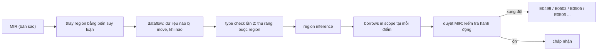
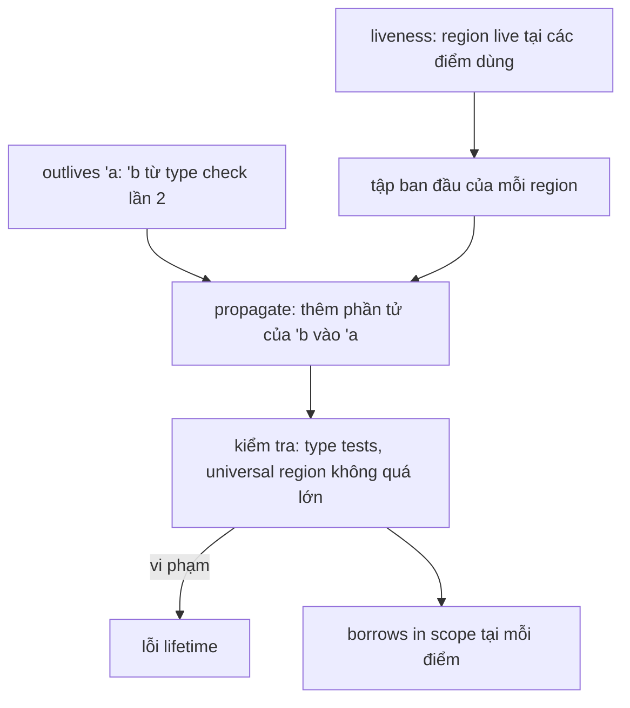

# P10 · Chương 06 — Borrow checker hoạt động thế nào

## Bạn sẽ hiểu được gì

1. **Q1.** Borrow checker chạy ở đâu trong pipeline, trên biểu diễn nào, và chạy trước hay sau tối ưu hóa? → mục 1
2. **Q2.** MIR là gì: basic block, statement, terminator, place, local `_0.._n` — và đọc một dump `--emit=mir` thế nào? → mục 2
3. **Q3.** "Lexical lifetime" cũ khác NLL ở đâu; vì sao borrow "sống đến lần dùng cuối"? → mục 3
4. **Q4.** Region inference và ràng buộc outlives/liveness là gì ở mức khái niệm? → mục 4
5. **Q5.** Loan là gì, khi nào một hành động xung đột với loan còn sống, và điều đó sinh ra E0499, E0502, E0505, E0506 thế nào? → mục 5
6. **Q6.** Two-phase borrow cho phép `vec.push(vec.len())` bằng cơ chế gì? → mục 6
7. **Q7.** Vì sao một chương trình đúng về ngữ nghĩa vẫn bị từ chối ("problem case #3")? Polonius nằm ở đâu? → mục 7
8. **Q8.** Vì sao raw pointer nằm ngoài tầm theo dõi của borrowck, và khối `unsafe` có tắt borrowck không? → mục 8

## Kiến thức cần trước

- [P9 · Chương 01 — Ownership, borrowing và lifetime nhìn sâu](../09-rust-language/01-ownership-borrowing-lifetime.md): chương đó nói *luật* ở mức người dùng; chương này nói *cơ chế* compiler thực thi luật đó.
- [P10 · Chương 01 — Pipeline của rustc](01-pipeline-rustc.md): thứ tự AST → HIR → THIR → MIR và vì sao MIR là nơi đặt borrow check (mục 4); chương này chỉ nhắc cái cần dùng, và mục 1 đi sâu thêm thứ tự chạy của borrowck so với tối ưu MIR.
- [P10 · Chương 07 — unsafe, undefined behavior và Miri](07-unsafe-ub-miri.md): `unsafe`, aliasing (mục 4) và Miri (mục 7); mục 8 của chương này chỉ chạm tới.

Mọi đoạn mã lỗi dưới đây đã được biên dịch thật bằng `rustc 1.95.0 (59807616e 2026-04-14)`, edition 2024, và thông điệp được dán từ output thật (có rút gọn ghi rõ). Các ví dụ này là *quan sát* một lần chạy; phần cơ chế lấy từ nguồn có chú thích.

---

## 1. Borrowck chạy ở đâu (Q1)

> **Trả lời ngắn.** Borrow checker là một bước bắt buộc của compiler, chạy trên MIR — dạng biểu diễn trung gian đơn giản hóa của hàm — chứ không phải trên source[^dev-bc-mir]. Nó chạy cho mọi hàm, kể cả hàm không bao giờ được gọi[^dev-bc-dead]. Về thứ tự: trong chuỗi query dựng MIR, borrow checking nằm ở `mir_drops_elaborated_and_const_checked`, còn các tối ưu nằm ở bước `optimized_mir` đứng sau nó[^dev-mir-passes-drops][^dev-mir-passes-opt]; nên borrowck chạy *trước* các pass tối ưu MIR và trước khi sinh mã[^dev-bc-first][^dev-bc-order].

**Giải thích.**

Hình dung (nhận xét của người soạn): borrowck giống một bước type/lint trong CI chặn merge ngay cả khi endpoint chưa ai gọi — kết quả không phụ thuộc runtime.

rustc-dev-guide liệt kê các tính chất mà borrow check ép buộc, trong đó có: không move một giá trị khi đang bị borrow, không truy cập place khi nó đang bị mượn `&mut`, không mutate place khi nó đang bị mượn `&`[^dev-bc-rules]. (Place là một vị trí bộ nhớ như biến hay field; xem mục 2.)

Điểm then chốt: nó chạy trên MIR[^dev-bc-mir]. Dev-guide ghi rằng có một bản cài đặt cũ chạy trên HIR[^dev-bc-hir]. Dev-guide nêu các lợi ích của việc chạy trên MIR, trong đó có hai ý: MIR đơn giản hơn nhiều nên giúp tránh lỗi trong borrow checker[^dev-bc-simpler], và quan trọng hơn là cho phép "non-lexical lifetimes" — region suy ra từ đồ thị luồng điều khiển (CFG)[^dev-nll]; hệ cũ thì gắn lifetime với khối `{}` (mục 3).

*Trước hay sau tối ưu?* Dev-guide có một trang riêng về các query dựng MIR. Theo trang đó, MIR của một hàm đi qua các query theo thứ tự: `mir_built` (MIR ngay sau khi dựng), `mir_const` (áp vài pass biến đổi đơn giản để MIR sẵn sàng cho const qualification)[^dev-mir-passes-const], `mir_promoted` (tách các temporary "promote" được ra body riêng và làm MIR sẵn sàng cho borrow checking)[^dev-mir-passes-promoted], `mir_drops_elaborated_and_const_checked` (thực hiện borrow checking, chạy các pass biến đổi lớn như drop elaboration, rồi làm MIR sẵn sàng cho tối ưu)[^dev-mir-passes-drops] và cuối cùng `optimized_mir` (thực hiện mọi tối ưu được bật rồi ra bản cuối)[^dev-mir-passes-opt]. Nghĩa là borrow check đứng *trước* các pass tối ưu. Trang Overview mô tả cùng thứ tự theo cách khác: query `optimized_mir` của một hàm kéo theo `mir_borrowck` cho hàm đó, rồi mới tạo codegen unit[^dev-bc-order]; `mir_borrowck` còn được chạy trước trên mọi hàm của crate[^dev-bc-first]; và có những phần compiler phải chạy cho mọi code vì tính đúng đắn, kể cả code chết, ví dụ borrow checker[^dev-bc-dead].

Đối chiếu với source `rust-lang/rust` tag 1.95.0 (tên hàm trong source là chi tiết cài đặt, có thể đổi):

- Provider `mir_borrowck` lấy MIR đầu vào từ query `mir_promoted`[^src-bc-input].
- `mir_drops_elaborated_and_const_checked` gọi `mir_borrowck`[^src-mdec-borrowck], rồi mới lấy (*steal*) MIR từ `mir_promoted` để chạy tiếp các pass biến đổi[^dev-mir-steal-part0]; comment của hàm ghi rằng nó chạy borrowck *trước* để borrowck không bị thiếu MIR nguồn do MIR đã bị steal[^src-mdec-doc]. ("Steal" là cách query trao MIR cho query sau mà không sao chép; đọc kết quả đã bị steal làm compiler panic, nên ai cần đọc MIR ở một giai đoạn phải đọc xong trước khi nó bị steal[^dev-mir-steal][^dev-mir-steal-order].)
- `inner_optimized_mir` (hàm cài đặt của `optimized_mir`) lấy body từ `mir_drops_elaborated_and_const_checked(did).steal()`[^src-optimized-steal] rồi mới gọi `run_optimization_passes`[^src-opt-call].

Ghép lại (suy luận của người soạn từ các đoạn code trên, không phải câu nguyên văn của nguồn): với mỗi body, `run_optimization_passes` chỉ chạy trên MIR sau khi `mir_borrowck` của body đó đã chạy xong, còn borrowck đọc MIR từ `mir_promoted` — tức MIR *trước* các pass tối ưu. Kết luận này khớp với mô tả của dev-guide ở trên.

Kiểm chứng rằng borrowck chạy cho cả hàm không được gọi: hàm `never_called` có `#[allow(dead_code)]`, không bao giờ được gọi, vẫn bị từ chối:

```rust
#[allow(dead_code)]
fn never_called() {
    let mut s = String::new();
    let a = &mut s;
    let b = &mut s;
    a.push('x'); b.push('y');
}
fn main() {}
```

```text
error[E0499]: cannot borrow `s` as mutable more than once at a time
 --> dead.rs:5:13
4 |     let a = &mut s;   first mutable borrow occurs here
5 |     let b = &mut s;   second mutable borrow occurs here
6 |     a.push('x'); b.push('y');   first borrow later used here
```

(Rút gọn: bỏ phần vẽ gạch dưới; thông điệp thật có đủ.) Nghĩa là borrowck là kiểm tra *tĩnh theo từng hàm* (dev-guide: các bước đã query-fy được làm cho từng item riêng[^dev-per-item]).

Các pha chính theo dev-guide (entry point là query `mir_borrowck` trong crate `rustc_borrowck`[^dev-phases]) như sau:

1. Tạo bản sao cục bộ của MIR[^dev-bc-copy], rồi gọi `replace_regions_in_mir` để thay mọi region trong MIR bằng *biến suy luận* mới[^dev-bc-replace].
2. Chạy các phân tích dataflow tính dữ liệu nào bị move và khi nào[^dev-bc-dataflow].
3. Type check lần hai trên MIR, mục đích là thu mọi ràng buộc giữa các region[^dev-bc-typeck].
4. Region inference: tính giá trị mỗi region — các điểm trong CFG mà lifetime đó phải hợp lệ[^dev-bc-region].
5. Tính "borrows in scope" tại mỗi điểm[^dev-bc-scope].
6. Đi qua MIR lần nữa, xét từng hành động và báo lỗi[^dev-bc-walk].



(Sơ đồ vẽ lại sáu pha ở trên theo dev-guide.)

<details><summary>Đi sâu: "chưa tối ưu" nghĩa là gì, mọi hàm được kiểm thế nào, và vì sao dump <code>--emit=mir</code> không phải thứ borrowck đã duyệt</summary>

Thứ tự các pha là thứ tự dev-guide liệt kê; tên hàm trong source là chi tiết cài đặt và có thể đổi (dev-guide là trang sống, không có phiên bản 1.95.0).

- **"Chưa tối ưu" không có nghĩa là MIR thô.** `mir_promoted` chạy `PromoteTemps`, `SimplifyCfg::PromoteConsts` và `InstrumentCoverage` trên MIR lấy từ `mir_built`; comment trong source ghi các pass này là để chuẩn bị cho borrowck[^src-promoted-passes]. "Chưa tối ưu" ở đây chỉ nghĩa là chưa qua `run_optimization_passes`. Trang dev-guide còn liệt kê `mir_const` giữa `mir_built` và `mir_promoted`; trong source 1.95.0, `mir_promoted` lấy thẳng kết quả của `mir_built`[^src-promoted-built] (suy luận của người soạn: dev-guide có thể chưa theo kịp source).
- **Mọi hàm được kiểm thế nào.** Ở source 1.95.0, `run_required_analyses` (crate `rustc_interface`) có một đoạn tên `MIR_borrow_checking` duyệt mọi *body owner* của crate và gọi `mir_borrowck` cho từng cái, trừ các hằng *trivial* (`is_trivial_const`, bị bỏ qua) và các body con (`is_typeck_child`) được kiểm cùng body cha[^src-all-bodies] — khớp với mô tả "chạy trước trên mọi hàm" của dev-guide.
- **Hệ quả cho việc đọc dump.** Theo source 1.95.0, `--emit=mir` đi qua hàm `emit_mir`[^src-emit-fn]; hàm in MIR của một hàm thường gọi `tcx.instance_mir(Item(def_id))`[^src-emit-mir], và `instance_mir` trả `optimized_mir` cho hàm (nhánh mặc định; comment ghi `const fn` cũng được coi là muốn bản optimized)[^src-instance-mir]. Nên dump `--emit=mir` là MIR *sau* tối ưu, không phải thứ borrowck đã duyệt. Cùng ý với dev-guide: MIR trên Playground là bản tối ưu[^dev-mir-optimized], và muốn xem bản chưa tối ưu thì dùng `-Z mir-opt-level=0 --emit mir`, cần toolchain nightly[^dev-mir-opt]. Chương này không chạy bản nightly nên không có dump chưa tối ưu.

</details>

**Quay lại Q1:** borrowck chạy trên MIR, bắt buộc, cho mọi hàm, trước các pass tối ưu MIR và trước khi sinh mã; mục 2 cho biết MIR trông thế nào.

---

## 2. MIR trong năm phút (Q2)

> **Trả lời ngắn.** MIR là đồ thị (CFG) các "basic block": mỗi block là vài lệnh đơn giản rồi một lệnh rẽ nhánh/gọi hàm ở cuối[^dev-mir-chars][^dev-mir-bb]. Biến được đánh số `_1`, `_2`…, riêng `_0` giữ giá trị trả về[^dev-mir-locals]. Một lần mượn như `&mut x` hiện ra trong MIR thành một phép gán rõ ràng[^dev-mir-assign].

**Giải thích.**

Hình dung (nhận xét của người soạn): MIR giống bytecode có cấu trúc — hàm Rust được khử đường (desugar) thành các bước nhỏ, mỗi bước một thao tác, nên dễ phân tích hơn source.

Basic block là chuỗi statement cộng một terminator ở cuối[^dev-mir-bb]. Terminator khác statement ở chỗ có thể có nhiều successor[^dev-mir-term]; lời gọi hàm luôn là terminator vì có thể unwind[^dev-mir-call]. Place là biểu thức chỉ một vị trí bộ nhớ như `_3`, `_3.f` hay `*_3`[^dev-mir-place]. Rvalue không lồng nhau: chỉ tham chiếu place và hằng[^dev-mir-nest]. Dạng gán là `<Place> = <Rvalue>`[^dev-mir-assign-form], trong đó rvalue có thể là biểu thức borrow `&mut <Place>`[^dev-mir-assign] — đây chính là chỗ *một borrow ra đời*[^rfc-loan-gen]. (Các khái niệm này cũng được giới thiệu ở [Chương 01, mục 4](01-pipeline-rustc.md#4-mir-nơi-borrow-check-và-tối-ưu-sống-q4); ở đây nhắc lại vừa đủ để đọc dump.)

Dump thật của một hàm nhỏ có borrow (lưu thành `mir1.rs`, chạy `rustc --crate-type=lib --emit=mir -C panic=abort mir1.rs`; `-C panic=abort` để đỡ nhánh `unwind`):

```rust
pub fn first_plus(v: &mut Vec<i32>) -> i32 {
    let r = &v[0];
    let x = *r;
    v.push(x);
    x
}
```

Output thật (giữ nguyên, chỉ bỏ vài dòng chú thích đầu file):

```text
fn first_plus(_1: &mut Vec<i32>) -> i32 {
    debug v => _1;
    let mut _0: i32;
    let _2: &i32;
    let mut _3: &std::vec::Vec<i32>;
    let _4: ();
    scope 1 {
        debug r => _2;
        scope 2 {
            debug x => _0;
        }
    }

    bb0: {
        _3 = &(*_1);
        _2 = <Vec<i32> as Index<usize>>::index(move _3, const 0_usize) -> [return: bb1, unwind unreachable];
    }

    bb1: {
        _0 = copy (*_2);
        _4 = Vec::<i32>::push(copy _1, copy _0) -> [return: bb2, unwind unreachable];
    }

    bb2: {
        return;
    }
}
```

Đọc cùng nhau:

- `_1` là tham số `v` (dòng `debug v => _1` nối tên người dùng với local[^dev-mir-debuginfo]). `_0` là chỗ trả về. `_2` là `r`, `_3` là temporary, `_4: ()` là kết quả của `push`.
- `bb0`: statement `_3 = &(*_1)` là một **shared reborrow** của `*v`. `v[0]` bị desugar thành lời gọi `Index::index` (terminator, rẽ sang `bb1`).
- `bb1`: `_0 = copy (*_2)` đọc qua `r`; sau đó `Vec::push(copy _1, copy _0)` là terminator gọi `push`, truyền `_1` (`&mut Vec`) và giá trị `x`.
- `debug x => _0`: biến `x` và giá trị trả về dùng chung local `_0`. Dev-guide nói tối ưu hóa có thể làm place của biến người dùng phức tạp hơn ánh xạ tầm thường, hoặc khiến nhiều biến người dùng dùng chung một place[^dev-mir-debuginfo-opt]; (suy luận của người soạn: `debug x => _0` là dấu vết của tối ưu hóa MIR.)

<details><summary>Đi sâu: vì sao đừng đếm từng statement trong dump</summary>

File do `--emit=mir` tạo ra là MIR *tối ưu* (đối chiếu source 1.95.0 ở mục 1). Dòng đầu file in ra nói rõ định dạng chỉ dành cho người đọc và có thể đổi không báo trước (quan sát từ output của lần chạy trên; hàm ghi file trong source 1.95.0 cũng in dòng cảnh báo đó[^src-mir-warning]). Vì borrowck chạy trước các pass tối ưu (mục 1), dump bạn thấy *không phải* chính xác thứ borrowck đã duyệt; nó đủ để học cấu trúc basic block/terminator/place, nhưng đừng đếm từng statement.

</details>

**Quay lại Q2:** MIR là CFG các basic block; local `_0` là giá trị trả về, `&place` là rvalue sinh borrow, và dump `--emit=mir` là bản tối ưu.

---

## 3. Từ lexical lifetime đến NLL (Q3)

> **Trả lời ngắn.** Hệ cũ gắn lifetime của một reference với *khối `{}`* chứa biến giữ nó, nên có những chương trình hợp lý vẫn bị từ chối[^rfc-pc1]. NLL (non-lexical lifetimes) tính lifetime theo *các điểm còn dùng đến reference trên đồ thị luồng điều khiển*[^dev-nll][^dev-bc-live], nên borrow kết thúc ở lần dùng cuối[^rfc-lifetime].

**Giải thích.**

Hình dung (nhận xét của người soạn): hệ cũ như khóa file đến hết hàm; NLL như thả khóa ngay sau lệnh cuối cần file.

RFC 2094 mô tả: mỗi khi tạo borrow, compiler gán cho reference một lifetime — compiler suy ra lifetime nhỏ nhất vẫn bao trùm mọi chỗ dùng reference[^rfc-lifetime]. Vấn đề của hệ cũ là "problem case #1": khi gán reference vào một biến, lifetime phải lớn bằng toàn bộ scope của biến đó[^rfc-pc1]. Ví dụ từ RFC (hệ cũ báo lỗi ở các `push`):

```rust
fn bar() {
    let mut data = vec!['a', 'b', 'c'];
    let slice = &mut data[..]; // <-+ 'lifetime
    capitalize(slice);         //   |
    data.push('d'); // ERROR!  //   |
    ...
} // <------------------------------+
```

Cách chữa tạm xưa là đặt `slice` vào một khối riêng cho scope nhỏ lại, nhưng RFC gọi cách này là nhân tạo và không hiển nhiên[^rfc-pc1-fix]. NLL xóa nhu cầu đó. Biến thể đầy đủ của ví dụ trên, chạy trên 1.95.0:

```rust
fn capitalize(data: &mut [char]) { for c in data.iter_mut() { *c = c.to_ascii_uppercase(); } }
fn main() {
    let mut data = vec!['a', 'b', 'c'];
    let slice = &mut data[..];
    capitalize(slice);
    data.push('d');
    data.push('e');
    println!("{:?}", data);
}
```

Kết quả: biên dịch thành công (exit 0). Khẳng định "hệ cũ báo lỗi" lấy từ RFC, không phải từ lần chạy này (chương này không chạy compiler cũ).

Ý tưởng cốt lõi là *liveness*: RFC nói một biến live nếu giá trị hiện tại của nó có thể còn được dùng sau đó[^rfc-live-var]; dev-guide dùng cùng khái niệm cho region — mỗi region phải live tại những điểm nó có thể được dùng[^dev-bc-live]. Nên region của một reference trải trên các điểm CFG từ chỗ tạo đến chỗ dùng cuối — *theo từng đường đi*, không theo khối `{}` (suy luận của người soạn từ hai nguồn trên). Ví dụ biên dịch được vì `r` chỉ được dùng ở nhánh `then`, còn nhánh `else` (nơi `push`) không có lần dùng nào tiếp theo của `r`:

```rust
fn main() {
    let mut v = vec![1, 2, 3];
    let r = &v[0];
    if v.len() > 5 { println!("{}", r); } else { v.push(4); }
    println!("{:?}", v);
}
```

Exit 0. Còn khi `r` được dùng *sau* `push`, bị từ chối:

```rust
fn main() {
    let mut v = vec![1, 2, 3];
    let first = &v[0];
    v.push(4);
    println!("{}", first);
}
```

```text
error[E0502]: cannot borrow `v` as mutable because it is also borrowed as immutable
 --> nll_err.rs:4:5
3 |     let first = &v[0];       - immutable borrow occurs here
4 |     v.push(4);               ^^^^^^^^^ mutable borrow occurs here
5 |     println!("{}", first);   ----- immutable borrow later used here
```

Ba nhãn của thông điệp khớp với cơ chế: *borrow xảy ra ở đâu*, *hành động xung đột ở đâu*, *chỗ dùng sau cùng khiến borrow còn sống*. Nhãn thứ ba khớp với ý liveness (suy luận của người soạn).

<details><summary>Đi sâu: reborrow qua <code>&mut</code> và phạm vi của khẳng định</summary>

NLL cho phép dùng lại biến gốc sau lần dùng cuối của một `&mut`:

```rust
let mut v = vec![1];
let r = &mut v;
r.push(2);
v.push(3);
println!("{:?}", v);
```

Đã chạy: biên dịch được (exit 0), vì `r` không còn live sau `r.push(2)`. Ví dụ này chỉ là quan sát; chương này không có nguồn nói hệ cũ *chắc chắn* từ chối nó.

</details>

**Quay lại Q3:** hệ cũ ép lifetime bằng scope của biến; NLL cho borrow sống đến lần dùng cuối trên mỗi đường đi.

---

## 4. Region inference và ràng buộc outlives (Q4)

> **Trả lời ngắn.** Compiler coi mỗi lifetime là một *tập điểm* trong chương trình mà nó phải hợp lệ[^dev-region-set]. Nó thu hai loại ràng buộc — "lifetime này phải sống ít nhất bằng lifetime kia" (outlives) và "lifetime phải sống ở mọi chỗ còn được dùng" (liveness)[^dev-outlives][^dev-bc-live] — rồi lan truyền các ràng buộc outlives để mở rộng tập điểm của từng region[^dev-propagate].

**Giải thích.**

Hình dung (nhận xét của người soạn): như xếp lịch phòng họp — mỗi region là một danh sách khung giờ cần giữ; "A outlives B" nghĩa là giờ của B cũng phải nằm trong lịch của A.

Giá trị của một region là một tập hợp chứa các điểm MIR mà region hợp lệ, cùng các region mà nó outlive: nếu `'a: 'b` thì `end('b)` nằm trong tập của `'a`[^dev-region-set]. Phần tử `end('a)` ứng với mỗi region *universal* — region xuất hiện trong chữ ký hàm, như `'a` trong `fn foo<'a>(&'a u32)`[^dev-universal-def] — và tương ứng với một phần control-flow graph của caller[^dev-region-end]. Hai loại ràng buộc phổ biến nhất:

- **Outlives constraint**: một region outlive region khác (`'a: 'b`), do MIR type checker sinh ra[^dev-outlives].
- **Liveness constraint**: mỗi region phải live ở các điểm nó có thể được dùng[^dev-bc-live].

Thuật toán ý tưởng cấp cao: bắt đầu mỗi region với các vị trí MIR biết chắc từ liveness, rồi lan truyền: với mỗi `'a: 'b`, thêm mọi phần tử của `'b` vào `'a`, kể cả `end('b)`[^dev-propagate]. Sau đó kiểm tra lỗi, trong đó có kiểm tra các region universal không quá lớn[^dev-universal].



Dev-guide có ví dụ nhỏ: `fn foo<'a, 'b>(x: &'a usize) -> &'b usize { x }`. Nó đánh số `'#1` cho tham số, `'#2` cho biểu thức `x`, `'#3` cho kiểu trả về; sau lan truyền, `'#1` chứa `end('#3)` nhưng không có where clause hay implied bound nào nói `'a: 'b`, nên là lỗi[^dev-region-example]. Tức là lỗi lifetime trên chữ ký hàm sinh ra từ một phép kiểm tra tập hợp, không phải từ "so sánh scope" (suy luận của người soạn).

<details><summary>Đi sâu: phần nằm ngoài chương này</summary>

Dev-guide còn nhắc placeholder và universe[^dev-region-placeholder] cùng xử lý riêng cho closure[^dev-region-closure]; trang Region inference tại thời điểm đọc còn hai mục `TODO` (cách tính các universal region[^dev-region-todo], và câu hỏi có nên bàn tới SCC không[^dev-region-scc]). Chương này không đi vào các chi tiết đó.

</details>

**Quay lại Q4:** region là tập điểm; liveness cho tập ban đầu, outlives lan truyền, rồi kiểm tra universal region không quá lớn.

---

## 5. Loan và xung đột (Q5)

> **Trả lời ngắn.** Mỗi biểu thức borrow tạo một "loan" (khoản vay), và loan chỉ còn "trong scope" ở những điểm nằm trong vùng region của nó[^rfc-loan-gen][^rfc-loan-kill]. Một hành động xung đột nếu nó đụng vào dữ liệu đang có loan sống: move khi đang bị mượn, truy cập khi đang bị `&mut`, ghi khi đang bị `&`[^dev-bc-rules]. Bốn mã lỗi E0499/E0502/E0505/E0506 là các tổ hợp khác nhau của quy tắc đó (khung gộp này là suy luận của người soạn; nghĩa từng mã theo bảng lỗi của Rust nằm ngay dưới bảng ở mục này).

**Giải thích.**

Hình dung (nhận xét của người soạn): như mượn sách thư viện — còn sổ mượn chưa trả (loan sống) thì không ai được bán cuốn sách đó (move), hay sửa nó (mutate) trong khi người kia còn đọc.

Mô hình (theo RFC NLL): mỗi biểu thức borrow trong MIR tạo một loan[^rfc-loan-gen]; loan chỉ còn "trong scope" ở những điểm mà region của nó còn chứa điểm đó, loan nào có region không chứa điểm đang xét thì bị loại[^rfc-loan-kill]. Dev-guide có bước "borrows in scope" tại mỗi điểm rồi bước duyệt MIR kiểm từng hành động[^dev-bc-scope][^dev-bc-walk]. Ví dụ dev-guide: gặp `*a + 1`, kiểm `a` đã khởi tạo và không bị mượn mutable, vì một trong hai sẽ phải báo lỗi[^dev-bc-walk-ex]. (Thuật ngữ "loan" là của RFC/NLL[^rfc-loans]; khung "hành động nào xung đột với loan nào đang sống" là suy luận của người soạn, chuẩn hóa từ các quy tắc của dev-guide[^dev-bc-rules].)

| Mã | Hành động xung đột | Loan còn sống | Ví dụ |
|---|---|---|---|
| E0499 | `&mut s` lần hai | `&mut s` lần một | `let a=&mut s; let b=&mut s; a.push('x');` |
| E0502 | `&mut` (push) | `&` | mục 3; chiều ngược lại cũng E0502 |
| E0505 | move `s` | `&s` | `let r=&s; drop(s); use(r)` |
| E0506 | gán `x = 6` | `&x` | `let r=&x; x=6; use(r)` |

(Bảng và các output dưới đây là quan sát của các lần chạy 1.95.0; mục E0502 chiều ngược lại được thấy ở mục 6. Nghĩa của từng mã theo bảng lỗi của Rust: E0499 — mượn `&mut` nhiều hơn một lần[^err-e0499]; E0502 — mượn lại một biến đã được mượn với mutability khác[^err-e0502]; E0505 — move khi giá trị còn đang bị mượn[^err-e0505]; E0506 — gán vào giá trị đang bị mượn[^err-e0506].)

Cả bốn đều có cấu trúc "ba nhãn": tạo loan → hành động xung đột → chỗ dùng khiến loan còn sống. Đọc lỗi bằng khung này (nhận xét của người soạn, không phải fact có nguồn):

1. *Điểm sinh*: nơi loan được tạo (`&v[0]`).
2. *Điểm dùng cuối*: nơi region còn cần loan ("later used here").
3. *Điểm xung đột*: hành động nằm giữa hai điểm trên một đường đi.

Muốn sửa (nhận xét của người soạn): (a) rút ngắn khoảng giữa — chuyển chỗ dùng cuối lên trước hành động; (b) tách đường đi (như workaround ở mục 7); (c) đổi dữ liệu để loan không cần tồn tại (clone, `entry`, index).

<details><summary>Đi sâu: output thật của E0499, E0505, E0506</summary>

E0499:

```text
error[E0499]: cannot borrow `s` as mutable more than once at a time
 --> e0499.rs:4:13
3 |     let a = &mut s;   first mutable borrow occurs here
4 |     let b = &mut s;   second mutable borrow occurs here
5 |     a.push('x');      first borrow later used here
```

E0505 (rút gọn, bỏ gợi ý `help: consider cloning`):

```text
error[E0505]: cannot move out of `s` because it is borrowed
2 |     let s = String::from("hi");  binding `s` declared here
3 |     let r = &s;                  borrow of `s` occurs here
4 |     drop(s);                     move out of `s` occurs here
5 |     println!("{}", r);           borrow later used here
```

E0506 (rút gọn; output còn một warning `unused_assignments` đã bỏ):

```text
error[E0506]: cannot assign to `x` because it is borrowed
3 |     let r = &x;   `x` is borrowed here
4 |     x = 6;        `x` is assigned to here but it was already borrowed
5 |     println!("{}", r);   borrow later used here
```

</details>

**Quay lại Q5:** lỗi borrowck là "hành động xung đột với loan đang sống", và thông điệp ba nhãn chỉ đúng ba điểm đó.

---

## 6. Two-phase borrows (Q6)

> **Trả lời ngắn.** Trong `vec.push(vec.len())`, borrow `&mut vec` của `push` ban đầu chỉ "đặt chỗ" và hoạt động như một borrow chia sẻ, nên `vec.len()` đọc `vec` được; tới lúc gọi `push` nó mới được "kích hoạt" thành mutable borrow đầy đủ[^dev-twophase]. Cơ chế này chỉ áp dụng cho borrow ngầm do compiler sinh, không áp dụng cho `&mut` bạn viết tay[^dev-twophase-only].

**Giải thích.**

Hình dung (nhận xét của người soạn): như đặt bàn nhà hàng — lúc đặt (reservation) người khác vẫn được ngồi tạm xem thực đơn, đến khi bạn tới (activation) bàn mới thuộc riêng bạn.

Vấn đề: dev-guide mở `vec.push(vec.len())` thành `let temp1 = &two_phase v; let temp2 = v.len(); Vec::push(temp1, temp2);` (`&two_phase` là ký hiệu minh họa của dev-guide)[^dev-twophase-expand]. Nếu `&mut vec` hoạt động ngay, `vec.len()` đọc `vec` khi đang bị mượn mutable → E0502 (suy luận của người soạn từ quy tắc ở mục 5). Two-phase borrow giải quyết đúng điều đó[^dev-twophase].

Mỗi two-phase borrow được gán vào một temporary chỉ dùng một lần. Điểm gán gọi là reservation point, điểm temporary được dùng (hầu như luôn là lời gọi hàm) gọi là activation point[^dev-twophase-points]. Giữa hai điểm, nó đóng vai shared borrow[^dev-twophase-between]; sau activation, nó là mutable borrow[^dev-twophase-after].

```mermaid
stateDiagram-v2
  [*] --> Reservation: temp = &two_phase v
  Reservation --> Reservation: v.len() đọc v (như shared borrow)
  Reservation --> Activation: Vec::push(temp, ...)
  Activation --> [*]: sau đó là mutable borrow đầy đủ
```

Các trường hợp sinh ra two-phase theo dev-guide: autoref khi gọi method có receiver `&mut`, reborrow mutable ở đối số hàm, và borrow ngầm của toán tử gán phức hợp bị overload[^dev-twophase-cases].

Chạy thật:

```rust
fn main() {
    let mut v = vec![1, 2, 3];
    v.push(v.len());
    println!("{:?}", v);
}
```

Biên dịch được (exit 0). Ngược lại, nếu `&mut` được *viết tay* thì không còn two-phase:

```rust
let mut v = vec![1, 2, 3];
let r = &mut v;
r.push(r.len());     // ok
let m = &mut v;      // viết tay trong source
m.push(v.len());     // lỗi
m.push(1);
```

Thật (rút gọn): `error[E0502]: cannot borrow `v` as immutable because it is also borrowed as mutable` tại `m.push(v.len())`, với `m.push(1)` là "mutable borrow later used here". Lưu ý: `r.push(r.len())` (reborrow ngầm của `r`) được chấp nhận; còn `v.len()` đọc `v` trong khi `m` vẫn được dùng sau đó thì không — `m` là `&mut` viết trong source, hoạt động ngay, không có reservation[^dev-twophase-only].

<details><summary>Đi sâu: hai kiểm tra bổ sung của two-phase borrow</summary>

Dev-guide ghi two-phase borrow được xử lý như mutable borrow, trừ các ngoại lệ[^dev-twophase-treated]. Tại điểm activation phải không có borrow nào xung đột đang sống[^dev-twophase-check]. Tại điểm reservation, báo lỗi nếu có mutable borrow xung đột đang live, và chỉ lint nếu có shared borrow xung đột[^dev-twophase-reserve]. Dev-guide cũng nói activation point được tìm bằng visitor `GatherBorrows`[^dev-twophase-gather]; đây là tên cài đặt, có thể đổi.

</details>

**Quay lại Q6:** two-phase borrow = reservation (như shared) rồi activation (mutable), chỉ cho borrow ngầm — nên `vec.push(vec.len())` biên dịch được.

---

## 7. Chương trình đúng nhưng vẫn bị từ chối (Q7)

> **Trả lời ngắn.** Borrow checker chỉ chấp nhận chương trình mà mô hình region của nó *chứng minh được* an toàn, nên có chương trình thực ra an toàn vẫn bị từ chối[^nomicon-limits]. Ví dụ kinh điển: hàm trả về tham chiếu vào map ở nhánh `Some` rồi chèn vào map ở nhánh `None` ("problem case #3" của RFC NLL[^rfc-pc3-text]), trên 1.95.0 vẫn bị E0499. Polonius là dự án nhằm thay thế borrow checker hiện tại[^pol-roadmap], nhưng nguồn ghim cho thấy nó chưa sẵn sàng[^pol-status].

**Giải thích.**

Hình dung (nhận xét của người soạn): như kiểm tra an ninh sân bay — thà chặn nhầm vài người vô tội còn hơn lọt một người nguy hiểm; "chặn đúng mọi vi phạm, nhưng chặn nhầm một số hợp lệ" là tính chất của phân tích tĩnh bảo thủ (suy luận của người soạn, nhận định chung).

**Problem case #3.** RFC 2094 trình bày: hàm trả về `&'r mut V` của map, nhánh `Some` trả `value` ra ngoài, nhánh `None` chèn rồi lấy lại. Vì `value` là tham chiếu vào map và được trả ra, map "vẫn bị mượn tới một điểm nào đó ở caller"[^rfc-pc3-text]. Phần thiết kế của RFC (Layer 4) nói borrow đầu `'m1` phải mở rộng tới hết `'r` nhưng chỉ nếu rẽ sang `SOME`[^rfc-pc3-key]; chính RFC cũng ghi phần "named lifetimes" ở prototype mới cài đặt một phần[^rfc-partial]. Bản chạy thật trên 1.95.0 (dùng `HashMap<u32, String>`):

```rust
use std::collections::HashMap;
fn get_default(map: &mut HashMap<u32, String>, key: u32) -> &mut String {
    match map.get_mut(&key) {
        Some(value) => value,
        None => {
            map.insert(key, String::new());
            map.get_mut(&key).unwrap()
        }
    }
}
```

Kết quả: **bị từ chối**, hai lỗi E0499:

```text
error[E0499]: cannot borrow `*map` as mutable more than once at a time
 --> pc3.rs:6:13
2 | fn get_default(map: &mut HashMap<u32, String>, key: u32) -> &mut String {
  |                     - let's call the lifetime of this reference `'1`
3 |     match map.get_mut(&key) {
  |           --- first mutable borrow occurs here
...
6 |             map.insert(key, String::new());
  |             ^^^ second mutable borrow occurs here
  ...  returning this value requires that `*map` is borrowed for `'1`
error[E0499]: ... pc3.rs:7:13   (map.get_mut(&key) thứ hai, cùng nhãn)
```

(Rút gọn khung vẽ nhiều dòng; hai chỗ lỗi ở dòng 6 và 7, và nhãn "returning this value requires that `*map` is borrowed for `'1`" là nguyên văn.)

Biến thể dùng `get` (nhánh `Some(v)` trả `v`, nhánh còn lại `insert`) — ví dụ cache `get_or_load` ở [P9·01, mục 6](../09-rust-language/01-ownership-borrowing-lifetime.md) — bị `E0502` thay vì `E0499`, với cùng nhãn "returning this value requires that `*c` is borrowed for `'1`". Nhận xét của người soạn: cùng cấu trúc, chỉ khác loại borrow đầu (`&` thay vì `&mut`).

Nhận xét: chương trình này an toàn về ngữ nghĩa — ở nhánh `None` không còn reference nào sống (RFC cũng viết rằng borrow đầu nên kết thúc ngay khi vào nhánh `NONE`[^rfc-pc3-key]). Nhưng khi borrow chảy vào giá trị trả về (lifetime `'1` của tham số), region của nó chứa `end('1)` — phần của caller[^dev-region-end]. Suy luận của người soạn: tập region này không phân biệt nhánh, nên loan còn "sống" cả ở nhánh `None`; thông điệp "borrowed for `'1`" khớp với suy luận đó, nhưng chương này không đối chiếu source `rustc_borrowck` nên đây là suy luận, không phải khẳng định về cài đặt.

**Cùng loại: "hệ lifetime quá thô".** Nomicon, mục *Limits of Lifetimes*, có hai ví dụ. Thứ nhất: `mutate_and_share(&mut self) -> &Self` trả về tham chiếu chia sẻ, nhưng lifetime của `&mut foo` bị kéo dài theo `loan` do chữ ký hàm, nên `foo.share()` tiếp theo bị `E0502`[^nomicon-e0502]; Nomicon nhận xét chương trình đúng theo ngữ nghĩa tham chiếu ta quan tâm nhưng hệ lifetime quá thô để xử lý[^nomicon-limits]. Thứ hai: `get_default` với `HashMap` ở trên — Nomicon nói lỗi do Rust bảo thủ dùng cả scope cho borrow đầu[^nomicon-improper].

**Workaround.** Hai cách viết lại, đã chạy thật và đều biên dịch được:

```rust
// (a) tránh giữ loan qua nhánh: kiểm tra trước
fn get_default(map: &mut HashMap<u32, String>, key: u32) -> &mut String {
    if map.contains_key(&key) {
        return map.get_mut(&key).unwrap();
    }
    map.insert(key, String::new());
    map.get_mut(&key).unwrap()
}
// (b) kết thúc loan trước khi mutate; tra cứu lần nữa ở cuối
fn get_default(map: &mut HashMap<u32, String>, key: u32) -> &mut String {
    match map.get_mut(&key) {
        Some(_) => {}
        None => { map.insert(key, String::new()); }
    }
    map.get_mut(&key).unwrap()
}
```

Cách (a) theo đúng ý workaround của RFC: đưa `get_mut` vào trong nhánh `if` luôn return, để borrow checker thấy borrow *chưa hề bắt đầu* ở ngoài nhánh đó[^rfc-pc3-workaround]. RFC cũng nhắc API `entry` có thể dùng để cài đặt hàm này[^rfc-pc3-entry]. (Nhận xét của người soạn: trong code backend, `map.entry(key).or_insert_with(...)` là cách thực tế; case này đáng nhớ như một *mẫu hình lỗi*, không phải vì bạn cần viết lại `get_default`.)

<details><summary>Đi sâu: Polonius — chỉ điều nguồn nói</summary>

Nguồn truy cập được: repo `rust-lang/polonius`, ghim commit `41ae30d2cb66d82098a8b8abd2cbccf1c1a2a96f`. README/book ở commit đó nói Polonius là thư viện lõi mô hình hóa borrow check[^pol-what]. Trang "Current status" ở commit đó viết rằng Polonius đã được tích hợp tạm thời vào rustc, chạy được với nightly rustc và cờ `-Zpolonius`, nhưng chưa sẵn sàng cho dùng rộng rãi[^pol-status]; lộ trình nêu hai bước rồi — "nếu mọi thứ suôn sẻ" — thay borrow checker hiện tại[^pol-roadmap]. Quan trọng:

- Đây là trạng thái *tại commit ghim*; chương này không có nguồn khẳng định nó còn đúng hôm nay, hay Polonius đã nằm trong stable 1.95.0 hay chưa. Đừng suy ra từ chương này.
- Chương này **không** có nguồn nói Polonius chấp nhận "problem case #3" cụ thể; vì vậy không khẳng định điều đó. (Trang dev-guide về Polonius, `borrow-check/polonius.html`, trả về lỗi 404 khi tải để soạn chương này, nên không dùng.)

</details>

**Quay lại Q7:** borrowck bảo thủ — chương trình an toàn nhưng chưa chứng minh được (như problem case #3) bị từ chối; workaround là tách đường đi hoặc dùng `entry`, còn Polonius chỉ có trạng thái ở commit ghim.

---

## 8. Raw pointer nằm ngoài tầm borrowck, còn `unsafe` thì không tắt nó (Q8)

> **Trả lời ngắn.** Các quy tắc mượn mà borrowck thực thi áp dụng cho *reference* (`&`, `&mut`); raw pointer thì không có bảo đảm an toàn hay liveness[^ref-raw] và được phép phớt lờ các quy tắc mượn[^book-raw-borrowrules], nên ghi qua raw pointer không bị borrowck bắt — nhưng vi phạm quy tắc aliasing vẫn là hành vi không xác định[^ref-ub-alias]. Khối `unsafe` tự nó không tắt borrowck: reference dùng trong code `unsafe` vẫn được kiểm tra[^book-unsafe-checks].

**Giải thích.**

Hình dung (nhận xét của người soạn): borrowck là bảo vệ chỉ kiểm thẻ ở cổng chính; raw pointer là cửa sau không có ai gác — chương trình vẫn có thể vào, nhưng nếu gây hại thì lỗi thuộc người viết `unsafe`.

Thử thật:

```rust
fn main() {
    let mut x = 5;
    let p = &raw mut x;
    let r = &x;
    unsafe { *p = 6; }
    println!("{}", r);
}
```

Biên dịch được (exit 0): ghi qua `p` trong khi `r` còn sống không bị borrowck bắt. Điều này **không** có nghĩa là hợp lệ: Reference nêu `&T` phải trỏ vào bộ nhớ không bị mutate trong khi nó live (trừ `UnsafeCell`)[^ref-ub-alias]; vi phạm là hành vi không xác định, dù chính Reference lưu ý quy tắc aliasing chính xác chưa được xác định và đây chỉ là phác thảo nguyên tắc chung[^ref-ub-alias-open]. Vì vậy phần kiểm tra thuộc về lập trình viên và công cụ như Miri — xem [P10 · Chương 07 — unsafe, undefined behavior và Miri](07-unsafe-ub-miri.md) (aliasing: mục 4; Miri: mục 7). Chương này không chạy Miri.

<details><summary>Đi sâu: giới hạn của khẳng định</summary>

Chương này chỉ chứng minh hai điều: ví dụ trên biên dịch được (quan sát), và Reference phác thảo nguyên tắc aliasing cho `&T`[^ref-ub-alias]. Ví dụ không chứng minh chương trình trên *gây* ra UB hay không trong từng chi tiết; muốn kết luận cụ thể cần chạy Miri hoặc đọc model aliasing — việc của [Chương 07](07-unsafe-ub-miri.md).

</details>

**Quay lại Q8:** borrowck không theo dõi raw pointer nên không chặn được; trách nhiệm giữ quy tắc aliasing chuyển sang người viết `unsafe` — nhưng khối `unsafe` không tắt borrowck với reference.

---

## Liên hệ với Rust

- Borrowck là bước bắt buộc, chạy trên MIR trước các pass tối ưu (theo dev-guide và source 1.95.0, mục 1) và với mọi hàm kể cả không được gọi.
- Luật ở mức người dùng — ownership, `&`/`&mut`, lifetime annotation — nằm ở [P9 · 01](../09-rust-language/01-ownership-borrowing-lifetime.md); chương này chỉ giải thích compiler thực thi chúng bằng liveness + outlives + loan.
- Muốn xem MIR của chính code bạn: `rustc --crate-type=lib --emit=mir file.rs` (ra MIR đã tối ưu — theo source 1.95.0, mục 1; chạy được trên 1.95.0 như ví dụ mục 2); MIR chưa tối ưu cần nightly và `-Z mir-opt-level=0`[^dev-mir-opt].

## Tóm tắt

- Borrowck chạy trên MIR; entry point là query `mir_borrowck`[^dev-phases]; `mir_drops_elaborated_and_const_checked` thực hiện borrow checking trước các pass tối ưu của `optimized_mir`[^dev-mir-passes-drops][^dev-mir-passes-opt]; chạy cả với dead code[^dev-bc-dead].
- MIR là CFG gồm basic block (statement + terminator), local `_0` cho giá trị trả về, place và rvalue không lồng nhau[^dev-mir-bb][^dev-mir-locals][^dev-mir-nest]; `--emit=mir` cho MIR tối ưu (theo source 1.95.0)[^src-instance-mir], định dạng có thể đổi[^src-mir-warning].
- NLL: region suy ra từ CFG[^dev-nll]; borrow sống đến lần dùng cuối trên mọi đường đi (suy luận từ RFC và dev-guide, mục 3). Lexical cũ ép lifetime bằng scope của biến[^rfc-pc1].
- Region inference: liveness tạo tập ban đầu, outlives lan truyền, rồi kiểm tra universal region[^dev-propagate][^dev-universal].
- Lỗi E0499/E0502/E0505/E0506 đều là "hành động xung đột với loan đang sống" (khung gộp của người soạn), thông điệp có ba nhãn khớp mô hình đó.
- Two-phase borrow: reservation như shared borrow, rồi activation thành mutable; chỉ áp dụng cho borrow ngầm[^dev-twophase][^dev-twophase-only].
- Có chương trình đúng bị từ chối (problem case #3 trên 1.95.0 → E0499; Nomicon có ví dụ cùng loại[^nomicon-limits]); workaround: tách đường đi, `entry`[^rfc-pc3-workaround][^rfc-pc3-entry].
- Polonius: theo repo ở commit ghim, chưa sẵn sàng rộng rãi[^pol-status]; chương này không khẳng định thêm.
- Raw pointer nằm ngoài các quy tắc mượn của borrowck[^book-raw-borrowrules], nhưng vi phạm aliasing vẫn là UB[^ref-ub-alias]; khối `unsafe` không tắt borrowck với reference[^book-unsafe-checks].

## Câu hỏi tự kiểm tra

1. Borrow checker chạy trên biểu diễn nào, và trước hay sau tối ưu MIR?
   <details><summary>Đáp án</summary>

   Trên MIR[^dev-bc-mir]; trước các pass tối ưu: `mir_drops_elaborated_and_const_checked` thực hiện borrow checking rồi làm MIR sẵn sàng cho tối ưu, còn `optimized_mir` mới thực hiện các tối ưu[^dev-mir-passes-drops][^dev-mir-passes-opt]. Source 1.95.0 khớp: `mir_borrowck` đọc `mir_promoted`[^src-bc-input], và `inner_optimized_mir` chỉ gọi `run_optimization_passes` sau khi lấy body từ `mir_drops_elaborated_and_const_checked`[^src-optimized-steal][^src-opt-call].

   </details>

2. Hàm không bao giờ được gọi có bị borrowck kiểm tra không?
   <details><summary>Đáp án</summary>

   Có[^dev-bc-dead]; ví dụ `never_called` ở mục 1 vẫn gây E0499.

   </details>

3. `_0` trong MIR là gì? Terminator khác statement ở đâu?
   <details><summary>Đáp án</summary>

   Local dành cho giá trị trả về[^dev-mir-locals]; terminator có thể có nhiều successor[^dev-mir-term], và lời gọi hàm luôn là terminator vì có thể unwind[^dev-mir-call].

   </details>

4. Vì sao dump `--emit=mir` không phải đúng thứ borrowck đã duyệt?
   <details><summary>Đáp án</summary>

   Dump `--emit=mir` là MIR tối ưu (source 1.95.0: hàm ghi file lấy MIR qua `instance_mir`, nhánh mặc định trả `optimized_mir`[^src-emit-mir][^src-instance-mir]; muốn xem bản chưa tối ưu cần nightly[^dev-mir-opt]), còn borrowck chạy trước các pass tối ưu[^dev-mir-passes-drops][^src-optimized-steal].

   </details>

5. Lexical lifetime cũ làm gì ở "problem case #1"?
   <details><summary>Đáp án</summary>

   Gán reference vào biến khiến lifetime lớn bằng scope của biến[^rfc-pc1]; NLL chấp nhận ví dụ đó (đã chạy).

   </details>

6. Hai loại ràng buộc chính trong region inference?
   <details><summary>Đáp án</summary>

   Outlives và liveness[^dev-outlives][^dev-bc-live].

   </details>

7. Vì sao `v.push(v.len())` biên dịch được còn `m.push(v.len())` (với `m = &mut v` viết tay) thì không?
   <details><summary>Đáp án</summary>

   Borrow ngầm có thể là two-phase; `&mut` viết trong source thì không[^dev-twophase-only].

   </details>

8. Ba nhãn trong thông điệp E0502 tương ứng với những điểm nào của cơ chế?
   <details><summary>Đáp án</summary>

   Điểm tạo loan, hành động xung đột, và chỗ dùng sau cùng giữ loan sống (mục 3, 5).

   </details>

9. Chương trình "problem case #3" trên 1.95.0 cho kết quả gì, và hai cách viết lại?
   <details><summary>Đáp án</summary>

   Hai lỗi E0499; viết lại bằng `contains_key` + return sớm[^rfc-pc3-workaround], hoặc `match` kết thúc loan rồi `get_mut` sau (mục 7); RFC cũng nhắc `entry`[^rfc-pc3-entry].

   </details>

10. Điều gì chắc chắn về Polonius từ nguồn trong chương?
    <details><summary>Đáp án</summary>

    Chỉ trạng thái ở commit ghim: tích hợp tạm thời, `-Zpolonius` trên nightly, chưa sẵn sàng rộng rãi[^pol-status].

    </details>

11. Vì sao ghi qua raw pointer khi `&x` còn sống biên dịch được nhưng vẫn sai, và khối `unsafe` có tắt borrowck không?
    <details><summary>Đáp án</summary>

    Raw pointer không có bảo đảm liveness[^ref-raw] và được phép phớt lờ quy tắc mượn[^book-raw-borrowrules], nên borrowck không chặn; nhưng vi phạm quy tắc aliasing của `&T` là UB[^ref-ub-alias]. Khối `unsafe` không tắt borrowck: reference dùng trong đó vẫn được kiểm tra[^book-unsafe-checks].

    </details>

12. Vì sao Nomicon nói `mutate_and_share` đúng nhưng vẫn bị từ chối?
    <details><summary>Đáp án</summary>

    Chương trình đúng theo ngữ nghĩa tham chiếu, nhưng hệ lifetime quá thô[^nomicon-limits]; ví dụ `get_default` do Rust bảo thủ dùng cả scope cho borrow đầu[^nomicon-improper].

    </details>

## Đọc thêm

- [rustc-dev-guide — MIR borrow check](https://rustc-dev-guide.rust-lang.org/borrow-check.html): các pha và entry point.
- [rustc-dev-guide — Region inference](https://rustc-dev-guide.rust-lang.org/borrow-check/region-inference.html): ràng buộc, lan truyền, ví dụ `foo<'a,'b>`.
- [rustc-dev-guide — Two-phase borrows](https://rustc-dev-guide.rust-lang.org/borrow-check/two-phase-borrows.html): reservation/activation.
- [rustc-dev-guide — MIR](https://rustc-dev-guide.rust-lang.org/mir/index.html): basic block, place, rvalue.
- [RFC 2094 (ghim)](https://github.com/rust-lang/rfcs/blob/d2705ad64ba47e812a2b6b19d6f613fb4c14c5e0/text/2094-nll.md): Motivation (problem cases 1–4) và Layer 4 (named lifetimes).
- [Nomicon — Limits of Lifetimes](https://doc.rust-lang.org/1.95.0/nomicon/lifetime-mismatch.html): các giới hạn của hệ lifetime.
- [Polonius book (ghim commit)](https://github.com/rust-lang/polonius/blob/41ae30d2cb66d82098a8b8abd2cbccf1c1a2a96f/book/src/current_status.md): trạng thái tại commit đó.
- [rustc-dev-guide — MIR queries and passes](https://rustc-dev-guide.rust-lang.org/mir/passes.html): thứ tự các query dựng MIR và cơ chế "steal" (mục 1).
- [rustc-dev-guide — Overview of the compiler](https://rustc-dev-guide.rust-lang.org/overview.html): query kéo borrow checker và tối ưu MIR (mục 1).
- [Chương 01 — Pipeline của rustc, mục 4](01-pipeline-rustc.md#4-mir-nơi-borrow-check-và-tối-ưu-sống-q4): MIR và vị trí của borrow check trong pipeline.

Ghi chú nguồn: các trang rustc-dev-guide là trang sống, không ghim phiên bản; các đoạn source rustc được ghim ở tag 1.95.0.

[^dev-bc-mir]: rustc-dev-guide, MIR borrow check — <https://rustc-dev-guide.rust-lang.org/borrow-check.html> — "The borrow checker operates on the MIR."
[^dev-bc-hir]: rustc-dev-guide, MIR borrow check — <https://rustc-dev-guide.rust-lang.org/borrow-check.html> — "An older implementation operated on the HIR."
[^dev-bc-simpler]: rustc-dev-guide, MIR borrow check — <https://rustc-dev-guide.rust-lang.org/borrow-check.html> — "The MIR is far less complex than the HIR; the radical desugaring helps prevent bugs in the borrow checker."
[^dev-nll]: rustc-dev-guide, MIR borrow check — <https://rustc-dev-guide.rust-lang.org/borrow-check.html> — "using the MIR enables “non-lexical lifetimes”, which are regions derived from the control-flow graph."
[^dev-bc-rules]: rustc-dev-guide, MIR borrow check — <https://rustc-dev-guide.rust-lang.org/borrow-check.html> — "That you can’t move a value while it is borrowed. That you can’t access a place while it is mutably borrowed (except through the reference). That you can’t mutate a place while it is immutably borrowed."
[^dev-bc-order]: rustc-dev-guide, Overview of the compiler — <https://rustc-dev-guide.rust-lang.org/overview.html> — "which first recursively requests the optimized_mir for all reachable functions, which in turn runs mir_borrowck for that function and then creates codegen units."
[^dev-bc-first]: rustc-dev-guide, Overview of the compiler — <https://rustc-dev-guide.rust-lang.org/overview.html> — "currently the mir_borrowck query is first executed on all functions of a crate."
[^dev-bc-dead]: rustc-dev-guide, Overview of the compiler — <https://rustc-dev-guide.rust-lang.org/overview.html> — "some parts of the compiler have to run for all code anyway for correctness even if the code is dead code (e.g. the borrow checker)."
[^dev-phases]: rustc-dev-guide, MIR borrow check — <https://rustc-dev-guide.rust-lang.org/borrow-check.html> — "The borrow checker source is found in the rustc_borrowck crate. The main entry point is the mir_borrowck query."
[^dev-bc-replace]: rustc-dev-guide, MIR borrow check — <https://rustc-dev-guide.rust-lang.org/borrow-check.html> — "We then invoke replace_regions_in_mir to modify our local MIR. Among other things, this function will replace all of the regions in the MIR with fresh inference variables."
[^dev-bc-dataflow]: rustc-dev-guide, MIR borrow check — <https://rustc-dev-guide.rust-lang.org/borrow-check.html> — "Next, we perform a number of dataflow analyses that compute what data is moved and when."
[^dev-bc-typeck]: rustc-dev-guide, MIR borrow check — <https://rustc-dev-guide.rust-lang.org/borrow-check.html> — "We then do a second type check across the MIR: the purpose of this type check is to determine all of the constraints between different regions."
[^dev-bc-region]: rustc-dev-guide, MIR borrow check — <https://rustc-dev-guide.rust-lang.org/borrow-check.html> — "Next, we do region inference, which computes the values of each region — basically, the points in the control-flow graph where each lifetime must be valid according to the constraints we collected."
[^dev-bc-scope]: rustc-dev-guide, MIR borrow check — <https://rustc-dev-guide.rust-lang.org/borrow-check.html> — "At this point, we can compute the “borrows in scope” at each point."
[^dev-bc-walk]: rustc-dev-guide, MIR borrow check — <https://rustc-dev-guide.rust-lang.org/borrow-check.html> — "Finally, we do a second walk over the MIR, looking at the actions it does and reporting errors."
[^dev-bc-walk-ex]: rustc-dev-guide, MIR borrow check — <https://rustc-dev-guide.rust-lang.org/borrow-check.html> — "we would check that the variable a is initialized and that it is not mutably borrowed, as either of those would require an error to be reported."
[^dev-bc-live]: rustc-dev-guide, Region inference (NLL) — <https://rustc-dev-guide.rust-lang.org/borrow-check/region-inference.html> — "Liveness constraints. Each region needs to be live at points where it can be used."
[^dev-outlives]: rustc-dev-guide, Region inference (NLL) — <https://rustc-dev-guide.rust-lang.org/borrow-check/region-inference.html> — "Outlives constraints are generated by the MIR type checker."
[^dev-region-set]: rustc-dev-guide, Region inference (NLL) — <https://rustc-dev-guide.rust-lang.org/borrow-check/region-inference.html> — "The value of a region can be thought of as a set. This set contains all points in the MIR where the region is valid along with any regions that are outlived by this region"
[^dev-region-end]: rustc-dev-guide, Region inference (NLL) — <https://rustc-dev-guide.rust-lang.org/borrow-check/region-inference.html> — "There is an element end('a) for each universal region 'a, corresponding to some portion of the caller’s (or caller’s caller, etc) control-flow graph."
[^dev-universal-def]: rustc-dev-guide, Region inference (NLL) — <https://rustc-dev-guide.rust-lang.org/borrow-check/region-inference.html> — "First, it finds the set of regions that appear within the signature of the function"
[^dev-propagate]: rustc-dev-guide, Region inference (NLL) — <https://rustc-dev-guide.rust-lang.org/borrow-check/region-inference.html> — "we start off each region with the MIR locations we know must be in it from the liveness constraints."
[^dev-universal]: rustc-dev-guide, Region inference (NLL) — <https://rustc-dev-guide.rust-lang.org/borrow-check/region-inference.html> — "Second, we check that universal regions are not “too big”."
[^dev-region-example]: rustc-dev-guide, Region inference (NLL) — <https://rustc-dev-guide.rust-lang.org/borrow-check/region-inference.html> — "we have no where clause or implied bound to say that 'a: 'b… that’s an error!"
[^dev-mir-bb]: rustc-dev-guide, MIR — <https://rustc-dev-guide.rust-lang.org/mir/index.html> — "A basic block is defined by a series of statements and a final terminator."
[^dev-mir-term]: rustc-dev-guide, MIR — <https://rustc-dev-guide.rust-lang.org/mir/index.html> — "Terminators are different from statements because they can have more than one successor – that is, control may flow to different places."
[^dev-mir-locals]: rustc-dev-guide, MIR — <https://rustc-dev-guide.rust-lang.org/mir/index.html> — "These are identified by an index, written with a leading underscore, like _1. There is also a special “local” (_0) allocated to store the return value."
[^dev-mir-place]: rustc-dev-guide, MIR — <https://rustc-dev-guide.rust-lang.org/mir/index.html> — "A place is an expression like _3, _3.f or *_3 – it denotes a location in memory."
[^dev-mir-nest]: rustc-dev-guide, MIR — <https://rustc-dev-guide.rust-lang.org/mir/index.html> — "rvalues cannot be nested – they can only reference places and constants."
[^dev-mir-assign]: rustc-dev-guide, MIR — <https://rustc-dev-guide.rust-lang.org/mir/index.html> — "An Rvalue is an expression that creates a value: in this case, the rvalue is a mutable borrow expression, which looks like &mut \<Place>."
[^dev-mir-opt]: rustc-dev-guide, MIR — <https://rustc-dev-guide.rust-lang.org/mir/index.html> — "We can use rustc [filename].rs -Z mir-opt-level=0 --emit mir to view unoptimized MIR. This requires the nightly toolchain."
[^dev-mir-optimized]: rustc-dev-guide, MIR — <https://rustc-dev-guide.rust-lang.org/mir/index.html> — "MIR shown by above link is optimized."
[^src-bc-input]: rust-lang/rust 1.95.0, compiler/rustc_borrowck/src/lib.rs — <https://raw.githubusercontent.com/rust-lang/rust/1.95.0/compiler/rustc_borrowck/src/lib.rs> — "let (input_body, _) = tcx.mir_promoted(def);"
[^src-mdec-borrowck]: rust-lang/rust 1.95.0, compiler/rustc_mir_transform/src/lib.rs — <https://raw.githubusercontent.com/rust-lang/rust/1.95.0/compiler/rustc_mir_transform/src/lib.rs> — "let tainted_by_errors = if !tcx.is_synthetic_mir(def) { tcx.mir_borrowck(tcx.typeck_root_def_id(def.to_def_id()).expect_local()).err() } else { None };"
[^src-mdec-doc]: rust-lang/rust 1.95.0, compiler/rustc_mir_transform/src/lib.rs — <https://raw.githubusercontent.com/rust-lang/rust/1.95.0/compiler/rustc_mir_transform/src/lib.rs> — "Obtain just the main MIR (no promoteds) and run some cleanups on it. This also runs mir borrowck *before* doing so in order to ensure that borrowck can be run and doesn't end up missing the source MIR due to stealing happening."
[^src-optimized-steal]: rust-lang/rust 1.95.0, compiler/rustc_mir_transform/src/lib.rs — <https://raw.githubusercontent.com/rust-lang/rust/1.95.0/compiler/rustc_mir_transform/src/lib.rs> — "let body = tcx.mir_drops_elaborated_and_const_checked(did).steal();"
[^src-opt-call]: rust-lang/rust 1.95.0, compiler/rustc_mir_transform/src/lib.rs — <https://raw.githubusercontent.com/rust-lang/rust/1.95.0/compiler/rustc_mir_transform/src/lib.rs> — "run_optimization_passes(tcx, &mut body);"
[^src-promoted-passes]: rust-lang/rust 1.95.0, compiler/rustc_mir_transform/src/lib.rs — <https://raw.githubusercontent.com/rust-lang/rust/1.95.0/compiler/rustc_mir_transform/src/lib.rs> — "// What we need to run borrowck etc. let promote_pass = promote_consts::PromoteTemps::default(); pm::run_passes( tcx, &mut body, &[&promote_pass, &simplify::SimplifyCfg::PromoteConsts, &coverage::InstrumentCoverage],"
[^src-promoted-built]: rust-lang/rust 1.95.0, compiler/rustc_mir_transform/src/lib.rs — <https://raw.githubusercontent.com/rust-lang/rust/1.95.0/compiler/rustc_mir_transform/src/lib.rs> — "let mut body = tcx.mir_built(def).steal();"
[^src-all-bodies]: rust-lang/rust 1.95.0, compiler/rustc_interface/src/passes.rs — <https://raw.githubusercontent.com/rust-lang/rust/1.95.0/compiler/rustc_interface/src/passes.rs> — "sess.time("MIR_borrow_checking", || { tcx.par_hir_body_owners(|def_id| { let not_typeck_child = !tcx.is_typeck_child(def_id.to_def_id()); if not_typeck_child { // Child unsafety and borrowck happens together with the parent tcx.ensure_ok().check_unsafety(def_id); } if tcx.is_trivial_const(def_id) { return; } if not_typeck_child { tcx.ensure_ok().mir_borrowck(def_id);"
[^src-emit-fn]: rust-lang/rust 1.95.0, compiler/rustc_mir_transform/src/dump_mir.rs — <https://raw.githubusercontent.com/rust-lang/rust/1.95.0/compiler/rustc_mir_transform/src/dump_mir.rs> — "pub fn emit_mir(tcx: TyCtxt\<'_>) -> io::Result<()> { match tcx.output_filenames(()).path(OutputType::Mir) {"
[^src-emit-mir]: rust-lang/rust 1.95.0, compiler/rustc_middle/src/mir/pretty.rs — <https://raw.githubusercontent.com/rust-lang/rust/1.95.0/compiler/rustc_middle/src/mir/pretty.rs> — "let instance_mir = tcx.instance_mir(ty::InstanceKind::Item(def_id)); render_body(w, instance_mir)?;"
[^src-instance-mir]: rust-lang/rust 1.95.0, compiler/rustc_middle/src/ty/mod.rs — <https://raw.githubusercontent.com/rust-lang/rust/1.95.0/compiler/rustc_middle/src/ty/mod.rs> — "If the caller wants `mir_for_ctfe` of a function they should not be using `instance_mir`, so we'll assume const fn also wants the optimized version."
[^src-mir-warning]: rust-lang/rust 1.95.0, compiler/rustc_middle/src/mir/pretty.rs — <https://raw.githubusercontent.com/rust-lang/rust/1.95.0/compiler/rustc_middle/src/mir/pretty.rs> — "writeln!(w, "// WARNING: This output format is intended for human consumers only")?; writeln!(w, "// and is subject to change without notice. Knock yourself out.")?;"
[^dev-twophase]: rustc-dev-guide, Two-phase borrows — <https://rustc-dev-guide.rust-lang.org/borrow-check/two-phase-borrows.html> — "Two-phase borrows are a more permissive version of mutable borrows that allow nested method calls such as vec.push(vec.len()). Such borrows first act as shared borrows in a “reservation” phase and can later be “activated” into a full mutable borrow."
[^dev-twophase-only]: rustc-dev-guide, Two-phase borrows — <https://rustc-dev-guide.rust-lang.org/borrow-check/two-phase-borrows.html> — "Only certain implicit mutable borrows can be two-phase, any &mut or ref mut in the source code is never a two-phase borrow."
[^dev-twophase-cases]: rustc-dev-guide, Two-phase borrows — <https://rustc-dev-guide.rust-lang.org/borrow-check/two-phase-borrows.html> — "The autoref borrow when calling a method with a mutable reference receiver. A mutable reborrow in function arguments. The implicit mutable borrow in an overloaded compound assignment operator."
[^dev-twophase-points]: rustc-dev-guide, Two-phase borrows — <https://rustc-dev-guide.rust-lang.org/borrow-check/two-phase-borrows.html> — "Each two-phase borrow is assigned to a temporary that is only used once. As such we can define: The point where the temporary is assigned to is called the reservation point of the two-phase borrow. The point where the temporary is used, which is effectively always a function call, is called the activation point."
[^dev-twophase-between]: rustc-dev-guide, Two-phase borrows — <https://rustc-dev-guide.rust-lang.org/borrow-check/two-phase-borrows.html> — "Between the reservation and the activation point, the two-phase borrow acts as a shared borrow."
[^dev-twophase-after]: rustc-dev-guide, Two-phase borrows — <https://rustc-dev-guide.rust-lang.org/borrow-check/two-phase-borrows.html> — "After the activation point, the two-phase borrow acts as a mutable borrow."
[^dev-twophase-check]: rustc-dev-guide, Two-phase borrows — <https://rustc-dev-guide.rust-lang.org/borrow-check/two-phase-borrows.html> — "If a live two phase borrow is activated at a location, then we check that there are no borrows that conflict with the two-phase borrow."
[^dev-twophase-reserve]: rustc-dev-guide, Two-phase borrows — <https://rustc-dev-guide.rust-lang.org/borrow-check/two-phase-borrows.html> — "At the reservation point we error if there are conflicting live mutable borrows. And lint if there are any conflicting shared borrows."
[^rfc-lifetime]: RFC 2094 (NLL), Motivation — <https://raw.githubusercontent.com/rust-lang/rfcs/d2705ad64ba47e812a2b6b19d6f613fb4c14c5e0/text/2094-nll.md> — "The compiler will infer this lifetime to be the smallest lifetime that it can have that still encompasses all the uses of the reference."
[^rfc-pc1]: RFC 2094 (NLL), Problem case #1 — <https://raw.githubusercontent.com/rust-lang/rfcs/d2705ad64ba47e812a2b6b19d6f613fb4c14c5e0/text/2094-nll.md> — "The way that the compiler currently works, assigning a reference into a variable means that its lifetime must be as large as the entire scope of that variable."
[^rfc-pc1-fix]: RFC 2094 (NLL), Problem case #1 — <https://raw.githubusercontent.com/rust-lang/rfcs/d2705ad64ba47e812a2b6b19d6f613fb4c14c5e0/text/2094-nll.md> — "Introducing a block like this is kind of artificial and also not an entirely obvious solution."
[^rfc-live-var]: RFC 2094 (NLL), Liveness — <https://raw.githubusercontent.com/rust-lang/rfcs/d2705ad64ba47e812a2b6b19d6f613fb4c14c5e0/text/2094-nll.md> — "We say that **a variable is live if the current value that it holds may be used later**."
[^rfc-pc3-text]: RFC 2094 (NLL), Problem case #3 — <https://raw.githubusercontent.com/rust-lang/rfcs/d2705ad64ba47e812a2b6b19d6f613fb4c14c5e0/text/2094-nll.md> — "Since `value` is a reference into the map, this implies that the `map` will remain borrowed **until some point in the caller** (the point `'r`, to be exact)."
[^rfc-pc3-key]: RFC 2094 (NLL), Layer 4 — <https://raw.githubusercontent.com/rust-lang/rfcs/d2705ad64ba47e812a2b6b19d6f613fb4c14c5e0/text/2094-nll.md> — "The key to this example is that the first borrow of `map`, with the lifetime `'m1`, must extend to the end of the `'r`, but only if we branch to SOME. Otherwise, it should end once we enter the NONE block."
[^rfc-partial]: RFC 2094 (NLL), Layer 4 — <https://raw.githubusercontent.com/rust-lang/rfcs/d2705ad64ba47e812a2b6b19d6f613fb4c14c5e0/text/2094-nll.md> — "NB: This part of the prototype is partially implemented."
[^rfc-pc3-workaround]: RFC 2094 (NLL), Problem case #3 — <https://raw.githubusercontent.com/rust-lang/rfcs/d2705ad64ba47e812a2b6b19d6f613fb4c14c5e0/text/2094-nll.md> — "but the borrow checker can see that this borrow *will not have even started* outside of the `if`."
[^rfc-pc3-entry]: RFC 2094 (NLL), Problem case #3 — <https://raw.githubusercontent.com/rust-lang/rfcs/d2705ad64ba47e812a2b6b19d6f613fb4c14c5e0/text/2094-nll.md> — "It's worth noting that Rust's hashmaps include an `entry` API that one could use to implement this function today."
[^nomicon-limits]: The Rustonomicon, Limits of Lifetimes — <https://doc.rust-lang.org/1.95.0/nomicon/lifetime-mismatch.html> — "is clearly correct according to the reference semantics we actually care about, but the lifetime system is too coarse-grained to handle that."
[^nomicon-improper]: The Rustonomicon, Limits of Lifetimes — <https://doc.rust-lang.org/1.95.0/nomicon/lifetime-mismatch.html> — "This is caused by Rust conservatively falling back to using a whole scope for the first borrow."
[^pol-what]: Polonius book, What is polonius? (commit 41ae30d) — <https://raw.githubusercontent.com/rust-lang/polonius/41ae30d2cb66d82098a8b8abd2cbccf1c1a2a96f/book/src/what_is_polonius.md> — "This is a core library that models the borrow check."
[^pol-status]: Polonius book, Current status (commit 41ae30d) — <https://raw.githubusercontent.com/rust-lang/polonius/41ae30d2cb66d82098a8b8abd2cbccf1c1a2a96f/book/src/current_status.md> — "Polonius has been provisionally integrated into rustc. You can run a nightly rustc with the `-Zpolonius` flag to try it out. However, it is not really ready for widespread use."
[^pol-roadmap]: Polonius book, Current status (commit 41ae30d) — <https://raw.githubusercontent.com/rust-lang/polonius/41ae30d2cb66d82098a8b8abd2cbccf1c1a2a96f/book/src/current_status.md> — "After those two steps are done, and presuming all goes well, we expect to replace the existing rustc borrow checker with the polonius crate."
[^ref-raw]: The Rust Reference, Pointer types — <https://doc.rust-lang.org/1.95.0/reference/types/pointer.html> — "Raw pointers are pointers without safety or liveness guarantees."
[^ref-ub-alias]: The Rust Reference, Behavior considered undefined — <https://doc.rust-lang.org/1.95.0/reference/behavior-considered-undefined.html> — "&T must point to memory that is not mutated while they are live (except for data inside an UnsafeCell\<U>), and &mut T must point to memory that is not read or written by any pointer not derived from the reference and that no other reference points to while they are live."
[^dev-mir-passes-const]: rustc-dev-guide, MIR queries and passes — <https://rustc-dev-guide.rust-lang.org/mir/passes.html> — "mir_const(D) – it applies some simple transformation passes to make MIR ready for const qualification;"
[^dev-mir-passes-promoted]: rustc-dev-guide, MIR queries and passes — <https://rustc-dev-guide.rust-lang.org/mir/passes.html> — "mir_promoted(D) - it extracts promotable temps into separate MIR bodies, and also makes MIR ready for borrow checking;"
[^dev-mir-passes-drops]: rustc-dev-guide, MIR queries and passes — <https://rustc-dev-guide.rust-lang.org/mir/passes.html> — "mir_drops_elaborated_and_const_checked(D) - it performs borrow checking, runs major transformation passes (such as drop elaboration) and makes MIR ready for optimization;"
[^dev-mir-passes-opt]: rustc-dev-guide, MIR queries and passes — <https://rustc-dev-guide.rust-lang.org/mir/passes.html> — "optimized_mir(D) – it performs all enabled optimizations and reaches the final state."
[^dev-mir-steal]: rustc-dev-guide, MIR queries and passes — <https://rustc-dev-guide.rust-lang.org/mir/passes.html> — "This indicates that the result may be stolen by a subsequent query – this is an optimization to avoid cloning the MIR. Attempting to use a stolen result will cause a panic in the compiler."
[^dev-mir-steal-order]: rustc-dev-guide, MIR queries and passes — <https://rustc-dev-guide.rust-lang.org/mir/passes.html> — "Because of this stealing mechanism, some care must be taken to ensure that, before the MIR at a particular phase in the processing pipeline is stolen, anyone who may want to read from it has already done so."
[^dev-bc-copy]: rustc-dev-guide, MIR borrow check — <https://rustc-dev-guide.rust-lang.org/borrow-check.html> — "We first create a local copy of the MIR."
[^dev-per-item]: rustc-dev-guide, Overview of the compiler — <https://rustc-dev-guide.rust-lang.org/overview.html> — "In principle, for the query-fied steps, we do each of the above for each item individually."
[^dev-mir-chars]: rustc-dev-guide, MIR — <https://rustc-dev-guide.rust-lang.org/mir/index.html> — "It is based on a control-flow graph. It does not have nested expressions. All types in MIR are fully explicit."
[^dev-mir-call]: rustc-dev-guide, MIR — <https://rustc-dev-guide.rust-lang.org/mir/index.html> — "Function calls like the call to Vec::new are always terminators because of the possibility of unwinding"
[^dev-mir-assign-form]: rustc-dev-guide, MIR — <https://rustc-dev-guide.rust-lang.org/mir/index.html> — "Assignments in general have the form: \<Place> = \<Rvalue>"
[^dev-mir-debuginfo]: rustc-dev-guide, MIR — <https://rustc-dev-guide.rust-lang.org/mir/index.html> — "Each debug \<Name> => \<Place>; annotation describes a named user variable, and where (i.e. the place) a debugger can find the data of that variable."
[^dev-mir-debuginfo-opt]: rustc-dev-guide, MIR — <https://rustc-dev-guide.rust-lang.org/mir/index.html> — "Here the mapping is trivial, but optimizations may complicate the place, or lead to multiple user variables sharing the same place."
[^dev-twophase-expand]: rustc-dev-guide, Two-phase borrows — <https://rustc-dev-guide.rust-lang.org/borrow-check/two-phase-borrows.html> — "let temp1 = &two_phase v; let temp2 = v.len(); Vec::push(temp1, temp2);"
[^dev-twophase-treated]: rustc-dev-guide, Two-phase borrows — <https://rustc-dev-guide.rust-lang.org/borrow-check/two-phase-borrows.html> — "Two-phase borrows are treated as if they were mutable borrows with the following exceptions:"
[^dev-twophase-gather]: rustc-dev-guide, Two-phase borrows — <https://rustc-dev-guide.rust-lang.org/borrow-check/two-phase-borrows.html> — "The activation points are found using the GatherBorrows visitor."
[^rfc-loans]: RFC 2094 (NLL), Borrow checker phase 1 — <https://raw.githubusercontent.com/rust-lang/rfcs/d2705ad64ba47e812a2b6b19d6f613fb4c14c5e0/text/2094-nll.md> — "The first phase of the borrow checker computes, at each point in the CFG, the set of in-scope **loans**."
[^rfc-loan-gen]: RFC 2094 (NLL), Borrow checker phase 1 — <https://raw.githubusercontent.com/rust-lang/rfcs/d2705ad64ba47e812a2b6b19d6f613fb4c14c5e0/text/2094-nll.md> — "We create a loan tuple from each borrow rvalue in the MIR (that is, every assignment statement like `tmp = &'a b.c.d`), giving each tuple a unique index `i`."
[^rfc-loan-kill]: RFC 2094 (NLL), Borrow checker phase 1 — <https://raw.githubusercontent.com/rust-lang/rfcs/d2705ad64ba47e812a2b6b19d6f613fb4c14c5e0/text/2094-nll.md> — "any loans whose region does not include P are killed;"
[^err-e0499]: The Rust error index, E0499 — <https://doc.rust-lang.org/1.95.0/error_codes/E0499.html> — "A variable was borrowed as mutable more than once."
[^err-e0502]: The Rust error index, E0502 — <https://doc.rust-lang.org/1.95.0/error_codes/E0502.html> — "A variable already borrowed with a certain mutability (either mutable or immutable) was borrowed again with a different mutability."
[^err-e0505]: The Rust error index, E0505 — <https://doc.rust-lang.org/1.95.0/error_codes/E0505.html> — "A value was moved out while it was still borrowed."
[^err-e0506]: The Rust error index, E0506 — <https://doc.rust-lang.org/1.95.0/error_codes/E0506.html> — "An attempt was made to assign to a borrowed value."
[^dev-region-placeholder]: rustc-dev-guide, Region inference (NLL) — <https://rustc-dev-guide.rust-lang.org/borrow-check/region-inference.html> — "for details on placeholders, see the section placeholders and universes."
[^dev-region-closure]: rustc-dev-guide, Region inference (NLL) — <https://rustc-dev-guide.rust-lang.org/borrow-check/region-inference.html> — "There is some special handling for closures that we will discuss later."
[^dev-region-todo]: rustc-dev-guide, Region inference (NLL) — <https://rustc-dev-guide.rust-lang.org/borrow-check/region-inference.html> — "TODO: write about how these regions are computed."
[^dev-region-scc]: rustc-dev-guide, Region inference (NLL) — <https://rustc-dev-guide.rust-lang.org/borrow-check/region-inference.html> — "TODO: should we discuss any of the others fields? What about the SCCs?"
[^nomicon-e0502]: The Rustonomicon, Limits of Lifetimes — <https://doc.rust-lang.org/1.95.0/nomicon/lifetime-mismatch.html> — "error[E0502]: cannot borrow `foo` as immutable because it is also borrowed as mutable"
[^book-unsafe-checks]: The Rust Programming Language, Unsafe Rust — <https://doc.rust-lang.org/1.95.0/book/ch20-01-unsafe-rust.html> — "It’s important to understand that unsafe doesn’t turn off the borrow checker or disable any of Rust’s other safety checks: If you use a reference in unsafe code, it will still be checked."
[^book-raw-borrowrules]: The Rust Programming Language, Unsafe Rust — <https://doc.rust-lang.org/1.95.0/book/ch20-01-unsafe-rust.html> — "Are allowed to ignore the borrowing rules by having both immutable and mutable pointers or multiple mutable pointers to the same location"
[^ref-ub-alias-open]: The Rust Reference, Behavior considered undefined — <https://doc.rust-lang.org/1.95.0/reference/behavior-considered-undefined.html> — "Breaking the pointer aliasing rules. The exact aliasing rules are not determined yet, but here is an outline of the general principles:"
[^dev-mir-steal-part0]: rustc-dev-guide, MIR queries and passes — <https://rustc-dev-guide.rust-lang.org/mir/passes.html> — "The mir_promoted query will yield up a tuple (&'tcx Steal\<Body\<'tcx>>, &'tcx Steal\<IndexVec\<Promoted, Body\<'tcx>>>), promoted_mir will steal part 1 (&'tcx Steal\<IndexVec\<Promoted, Body\<'tcx>>>) and mir_drops_elaborated_and_const_checked will steal part 0 (&'tcx Steal\<Body\<'tcx>>)."
