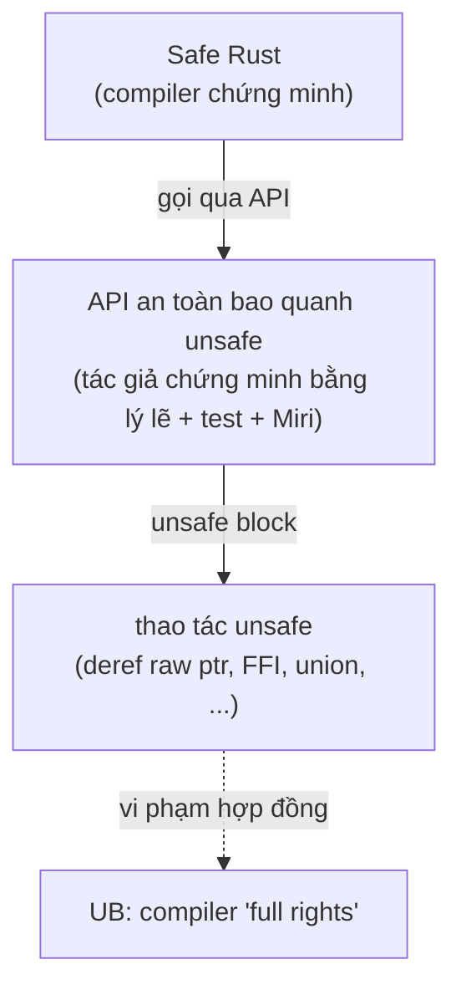
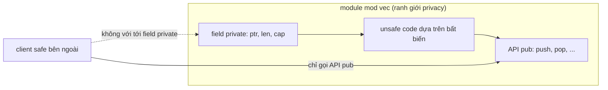
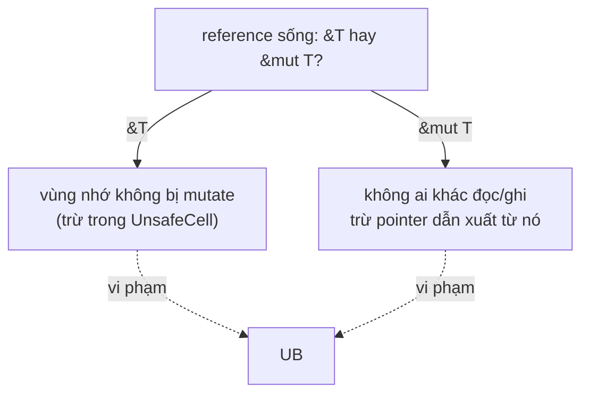
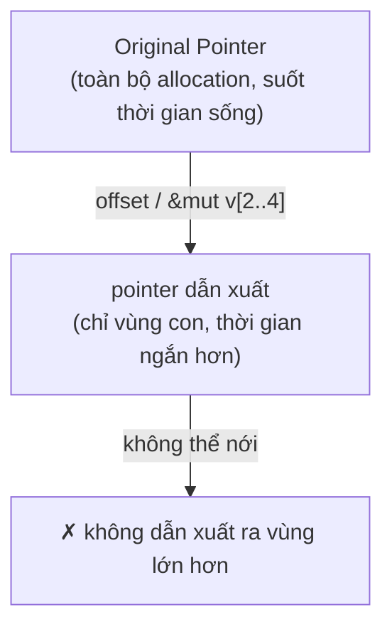

# P10 · Chương 07 — unsafe, undefined behavior và Miri

> Mọi khẳng định về ngôn ngữ theo tài liệu Rust **1.95.0** (Reference, Rustonomicon, Rust Book, `std`). Miri được trích từ README ở một commit ghim cố định. Chương này **không có thí nghiệm**: các đoạn code chỉ để minh họa, không kèm output; chương không khẳng định một chương trình cụ thể "in ra gì" hay "Miri báo đúng dòng nào".

## Bạn sẽ hiểu được gì

1. **Q1.** `unsafe` thực sự cho phép thêm những việc gì, và nó là "tắt kiểm tra" hay là một hợp đồng? → mục 1
2. **Q2.** Undefined behavior (UB) là gì, vì sao nó nguy hiểm hơn một lỗi thông thường, và danh sách UB của Rust gồm những nhóm nào? → mục 2
3. **Q3.** "Sound" và "unsound" nghĩa là gì; vì sao một dòng code *safe* vẫn có thể làm code *unsafe* sai, và ranh giới module giúp gì? → mục 3
4. **Q4.** Aliasing là gì, vì sao `&mut` không được alias, và `UnsafeCell` đứng ở đâu trong luật này? → mục 4
5. **Q5.** Raw pointer "hợp lệ" nghĩa là gì, và provenance là gì mà một địa chỉ số nguyên không đủ? → mục 5
6. **Q6.** Vì sao không được "tạo biến chưa khởi tạo" và `MaybeUninit<T>` giải quyết việc đó thế nào? → mục 6
7. **Q7.** Miri bắt được gì, chạy thế nào, và nó **không** chứng minh được điều gì? → mục 7

## Kiến thức cần trước

- [Chương 06 — Borrow checker hoạt động thế nào](06-borrow-checker.md): borrow checker kiểm quy tắc mượn của *reference* (kể cả reference nằm trong khối `unsafe`); mục 8 của chương đó nói rõ raw pointer nằm ngoài tầm của nó. Chương này nói về phần *compiler không chứng minh được* và người viết phải tự chịu trách nhiệm.
- [Chương 05 — Subtyping, variance và drop check](05-variance-va-dropck.md): mục 2–4 cho thấy `&mut T` và `UnsafeCell<T>` đều invariant theo `T`; mục 4 ở đây nhìn cùng các kiểu đó từ mặt aliasing. Mục 7 của chương đó là một ví dụ `unsafe impl` thật (`#[may_dangle]`).
- [Chương 02 — Type layout: size, alignment, repr, enum và niche](02-type-layout.md): mục 5–6 giải thích niche và vì sao `MaybeUninit` làm mất niche; mục 2 và mục 6 ở đây dùng cùng khái niệm "giá trị hợp lệ".

Chương [08 — Panic, unwinding, ABI và FFI](08-panic-abi-ffi.md) đọc *sau* chương này: nó dùng định nghĩa UB ở mục 2 để trả lời panic băng qua ranh giới FFI là abort hay UB (mục 6–7 của chương 08). Mục 1, 2, 6 và 7 ở đây có chỗ trỏ sang đó.

## 1. `unsafe` cho phép gì — và nó là hợp đồng (Q1)

> **Trả lời ngắn.** `unsafe` giữ nguyên quy tắc và ngữ nghĩa của Safe Rust[^nomicon-same-rules] và không "tắt" bộ kiểm tra (reference dùng trong khối `unsafe` vẫn được borrow checker kiểm)[^book-unsafe-checks]; nó chỉ mở khóa một danh sách ngắn các thao tác mà compiler không kiểm được, như dereference raw pointer hay gọi hàm `unsafe`[^nomicon-five]. Từ khóa `unsafe` vừa *khai báo* "ở đây có điều kiện mà compiler không kiểm được", vừa *khẳng định* "tôi đã kiểm điều kiện đó rồi"[^nomicon-unsafe-keyword]. Làm sai thì hậu quả là UB[^nomicon-five-why], không phải lỗi biên dịch.

**Giải thích.**

Hình dung (nhận xét của người soạn): bạn làm backend và có quyền `sudo` trên một máy production. `sudo` không biến bạn thành người khác và không làm hệ thống "thôi kiểm tra" — nó chỉ cho phép những lệnh mà hệ thống bình thường chặn, và nếu gõ nhầm thì không ai đỡ cho bạn. Khối `unsafe` cũng vậy: nó là chữ ký của bạn dưới một cam kết.

*Danh sách ngắn các năng lực.* Nomicon liệt kê đúng năm thứ khác biệt giữa Unsafe Rust và Safe Rust: dereference raw pointer; gọi hàm `unsafe` (kể cả hàm C, intrinsic của compiler, raw allocator); implement `unsafe trait`; truy cập hoặc sửa `static mut`; truy cập field của `union`[^nomicon-five]. Lý do chúng bị tách riêng là dùng sai bất kỳ thứ nào trong số đó đều gây Undefined Behavior[^nomicon-five-why]. Đó là danh sách của Nomicon; Reference liệt kê chi tiết hơn (xem phần Đi sâu bên dưới).

*Hai nghĩa của từ khóa.* Từ khóa `unsafe` có hai cách dùng: khai báo sự tồn tại của hợp đồng mà compiler không kiểm được, và khai báo rằng lập trình viên đã kiểm hợp đồng đó được giữ[^nomicon-unsafe-keyword]. Trên hàm, `unsafe fn` nghĩa là *người gọi* phải đọc tài liệu hàm và dùng đúng cách. Trên trait, `unsafe trait` nghĩa là *người implement* phải đọc tài liệu trait và giữ đúng hợp đồng[^nomicon-unsafe-contract]. Ngược lại, khối `unsafe {}` tuyên bố mọi thao tác unsafe bên trong đã được kiểm là giữ đúng hợp đồng của chúng[^nomicon-block-keyword], còn `unsafe impl` tuyên bố bản implement giữ đúng hợp đồng của trait[^nomicon-impl-keyword]. Tóm lại (cách gọi của người soạn): `unsafe fn`/`unsafe trait` là chỗ **đặt** hợp đồng; `unsafe {}`/`unsafe impl` là chỗ **ký** hợp đồng.

*`unsafe` không đổi luật.* Rust code sai nếu nó thể hiện bất kỳ hành vi nào trong danh sách UB, *kể cả* code nằm trong khối `unsafe` hay hàm `unsafe`[^ref-ub-incorrect]. Reference nói gọn: `unsafe` chỉ có nghĩa việc tránh UB thuộc về lập trình viên, không thay đổi việc chương trình Rust không bao giờ được gây UB[^ref-ub-intro].

*Hệ quả cho code review* (nhận xét của người soạn): vì chỉ có khối `unsafe` mới có thể ký hợp đồng, bạn có thể `grep unsafe` để khoanh vùng chỗ cần soi. Nomicon còn nhắc rằng có thể thêm `#![forbid(unsafe_code)]` để bảo đảm tĩnh rằng code base chỉ chứa Safe Rust[^nomicon-forbid] (nhận xét của người soạn: lint áp dụng cho crate đặt nó, không phủ dependency).

<details><summary>Đi sâu: danh sách thao tác unsafe theo Reference, <code>extern</code>, <code>static mut</code></summary>

- Reference mô tả *unsafe operations* là những thao tác có thể vi phạm bảo đảm memory-safety của ngữ nghĩa tĩnh của Rust[^ref-unsafe-intro], và liệt kê các tính năng ngôn ngữ không dùng được trong tập con safe[^ref-unsafe-list]. Các mục: dereference raw pointer, gọi hàm `unsafe`, implement `unsafe trait` (trùng danh sách Nomicon ở trên[^nomicon-five]); đọc hoặc ghi `static mut` hay `static` ngoại (khai báo trong khối `extern`) loại unsafe[^ref-unsafe-static]; truy cập field `union` trừ khi chỉ để gán[^ref-unsafe-ops]; gọi hàm safe có `target_feature` từ hàm không bật cùng feature[^ref-unsafe-tf]; khai báo khối `extern`[^ref-unsafe-extern-ed]; áp dụng attribute `unsafe` cho item[^ref-unsafe-attr]. (Suy luận của người soạn: danh sách của Reference dài hơn danh sách năm mục của Nomicon; các mục Reference có thêm là gọi hàm safe có `target_feature`, khai báo khối `extern` và áp dụng attribute `unsafe`.)
- Khai báo khối `extern` cũng nằm trong danh sách: từ khóa `unsafe` về ngữ nghĩa là bắt buộc trước `extern` trên khối[^ref-ext-unsafe-required], còn trước edition 2024 khối `extern` được phép khai báo không cần `unsafe`[^ref-unsafe-extern-ed]. Cú pháp khối `extern` và qualifier `safe`/`unsafe` cho từng item được nói ở [Chương 08, mục 4](08-panic-abi-ffi.md).
- Tài liệu `std` nói hàm và static khai báo trong khối `extern` mặc định là `unsafe` (nhưng không áp dụng cho hàm khai báo kiểu `extern "something" fn ...`), và static có thể sửa luôn luôn là unsafe dù khai báo ở đâu[^kw-extern-static].
- Nomicon nhấn mạnh mọi hàm FFI đều unsafe để gọi vì ngôn ngữ kia có thể làm bất cứ điều gì mà compiler Rust không kiểm được[^nomicon-ffi-unsafe]; [Chương 08](08-panic-abi-ffi.md) đi tiếp vào ABI, kiểu dữ liệu và panic qua ranh giới đó.
- Hợp đồng không chỉ là "UB trực tiếp": Nomicon lưu ý hàm unsafe được tự khai báo thêm ràng buộc, ví dụ API cấp phát nói giải phóng vùng nhớ chưa được cấp phát là UB[^nomicon-alloc-ub].

</details>

**Quay lại Q1:** `unsafe` mở khóa một danh sách thao tác nhỏ và chuyển trách nhiệm chứng minh từ compiler sang người viết; nó không tắt kiểm tra và không làm UB trở nên được phép.

## 2. Undefined behavior là gì (Q2)

> **Trả lời ngắn.** UB là hành vi mà chương trình Rust không bao giờ được gây ra[^ref-ub-intro]; một khi chương trình đã có UB thì compiler được phép làm bất cứ điều gì với *toàn bộ* chương trình, không chỉ dòng gây lỗi[^nomicon-fullrights][^ref-ub-whole]. Reference liệt kê các nhóm UB chính — data race, truy cập con trỏ dangling/lệch alignment, phá luật aliasing, tạo giá trị không hợp lệ, gọi sai ABI… — nhưng nói rõ danh sách chưa đầy đủ[^ref-ub-notexh].

**Giải thích.**

Hình dung (nhận xét của người soạn): lỗi thường giống một nhân viên làm sai một ô trong bảng tính — bạn tìm ra ô đó và sửa. UB giống việc nhân viên đó ký nhầm vào một *giả định nền* của cả công ty ("kho luôn đủ hàng"): mọi bộ phận khác đã lập kế hoạch dựa trên giả định ấy, nên sai lệch lan ra những chỗ không liên quan gì tới ô bị sửa.

*Vì sao compiler được "làm bất cứ gì".* Nomicon: gây UB cho compiler "toàn quyền" làm những điều tệ tùy ý với chương trình của bạn[^nomicon-fullrights]. Reference nhấn mạnh phạm vi: UB ảnh hưởng toàn chương trình; UB trong code C được gọi qua FFI làm cả chương trình có UB, bao gồm phần Rust, và ngược lại UB trong Rust có thể làm hỏng code ở ngôn ngữ khác được gọi qua FFI[^ref-ub-whole][^ref-ub-ffi]. Lý do thực tế (suy luận của người soạn): compiler tối ưu bằng cách *giả định* UB không bao giờ xảy ra; Nomicon cho thấy cơ chế này ở mục 4 qua ví dụ aliasing, và std docs nói rõ compiler khai thác bất biến "đã khởi tạo đúng kiểu" để bỏ kiểm tra lúc chạy và tối ưu layout enum[^mu-exploit].

*So với C: UB của Rust hẹp hơn nhưng không biến mất.* Nomicon nói UB trong Rust có phạm vi giới hạn so với C; nhóm "core language quan tâm" gồm dereference con trỏ dangling/lệch, phá luật aliasing, gọi sai ABI hoặc unwind khỏi hàm có ABI unwind sai, data race, chạy code biên dịch với target feature mà máy không hỗ trợ, và tạo giá trị không hợp lệ[^nomicon-ub-short][^nomicon-ub-list]. Reference có danh sách chi tiết hơn và *tự nhận* là không đầy đủ: danh sách có thể mở rộng hoặc thu hẹp, chưa có mô hình hình thức của ngữ nghĩa Rust cho unsafe code, và Reference bảo lưu quyền biến một số mục thành "có định nghĩa" trong tương lai[^ref-ub-nomodel][^ref-ub-reserve].

*Các nhóm chính* (theo Reference, chỉ giữ phần trọng tâm của phase này):

- **Data race.** Nomicon định nghĩa: hai luồng cùng truy cập một vùng nhớ, ít nhất một ghi, ít nhất một không đồng bộ. Data race là UB và vì thế không thể xảy ra trong Safe Rust[^nomicon-race]. (Đây là phát biểu của Nomicon; định nghĩa chuẩn dùng xuyên suốt giáo trình, kèm cách hai cách phát biểu được đặt cạnh nhau, ở [P4·06 mục 3](../04-concurrency/06-memory-model.md).)
- **Truy cập place dangling hoặc dựa trên pointer lệch alignment** (đọc hoặc ghi)[^ref-ub-access].
- **Phá luật aliasing** — mục 4[^ref-ub-alias].
- **Gọi hàm sai ABI**, hoặc unwind qua frame không cho phép unwind (ví dụ gọi một hàm `"C-unwind"` được import hoặc transmute thành hàm/con trỏ hàm `"C"`)[^ref-ub-call]. Đừng suy ra rằng *mọi* panic chạm một hàm `extern "C"` đều là UB: khi một thao tác unwind chạm ranh giới không cho unwind, Nomicon phân biệt panic của Rust (process abort an toàn) với exception ngoại lai đi vào Rust (UB)[^nomicon-ffi-boundary]. Bảng hành vi đầy đủ và cách đối chiếu hai điều này nằm ở [Chương 08, mục 6](08-panic-abi-ffi.md).
- **Tạo giá trị không hợp lệ.** "Tạo" (produce) một giá trị xảy ra mỗi khi giá trị được gán/đọc từ một place, truyền hoặc trả về từ hàm/phép toán nguyên thủy[^ref-ub-invalid]. Compiler giả định mọi giá trị sinh ra khi chạy đều hợp lệ, nên tạo giá trị không hợp lệ là UB *ngay lập tức*[^ref-ub-valid-assume].



(Sơ đồ là tóm tắt của người soạn; các mũi tên khớp với phần trích ở mục 1 và 3.)

<details><summary>Đi sâu: bảng "giá trị hợp lệ" theo kiểu, dangling, misaligned</summary>

- Reference định nghĩa hợp lệ theo kiểu: `bool` phải là 0 hoặc 1[^ref-ub-bool]; số nguyên, số thực, raw pointer không được lấy từ bộ nhớ chưa khởi tạo[^ref-ub-scalar]; enum phải có discriminant hợp lệ và mọi field của variant tương ứng hợp lệ[^ref-ub-enum]; kiểu có "dải giá trị hợp lệ" tùy biến phải nằm trong dải — trong standard library điều này áp dụng cho `NonNull<T>` và `NonZero<T>`[^ref-ub-validrange]. [Chương 02, mục 5](02-type-layout.md) dùng chính các điều kiện này để giải thích niche.
- Tham chiếu (`&`, `&mut`) và `Box<T>` phải căn đúng, khác null, không dangling và trỏ tới giá trị hợp lệ[^ref-ub-ref]; Reference ghi chú phần "trỏ tới giá trị hợp lệ" vẫn còn tranh luận[^ref-ub-ref-debate].
- "Dangling": một reference/pointer là dangling nếu không phải mọi byte nó trỏ tới đều thuộc cùng một allocation còn sống[^ref-ub-dangling]. Nếu kích thước span là 0 thì pointer không bao giờ dangling, kể cả pointer null[^ref-ub-zero]. Trường hợp kích thước 0 gặp lại ở kiểu ZST: xem [Chương 02, mục 7](02-type-layout.md).
- Với kiểu DST (slice, string), pointer trỏ tới *toàn bộ* phạm vi nên metadata độ dài không được quá lớn[^ref-ub-dst-len]; kích thước động của một giá trị không được vượt `isize::MAX`[^ref-ub-isize]. (Fat pointer và metadata: [Chương 03, mục 2](03-dst-fat-pointer-vtable.md).)
- Alignment: Reference nói một place chỉ gây UB vì "dựa trên pointer lệch" khi nó được *load/store*[^ref-ub-misaligned-access]; viết `&raw const`/`&raw mut` trên place đó vẫn được phép[^ref-ub-misaligned-raw].
- Tham chiếu và `Box` bắt buộc căn đúng *ngay lúc được tạo*, không chỉ lúc dùng — hệ quả của việc "tạo giá trị không hợp lệ" ở trên[^ref-ub-invalid][^ref-ub-ref][^ref-ub-misaligned-ref].
- Nomicon nhắc: vi phạm các ràng buộc do unsafe function tự khai báo thường dẫn tới một trong các UB ở trên theo dây chuyền[^nomicon-ub-transitive].

</details>

**Quay lại Q2:** UB không phải "một lỗi tại một dòng" mà là việc phá giả định mà compiler dùng để biên dịch cả chương trình; vì thế phải tránh nó, không chỉ "hy vọng nó không chạy tới".

## 3. Sound, unsound và ranh giới module (Q3)

> **Trả lời ngắn.** Code unsafe là *sound* nếu mọi client safe, dù viết thế nào, cũng không kích hoạt được UB qua nó; nếu có một client safe làm được thì nó *unsound*[^ref-sound]. Tính an toàn là **không cục bộ**: sửa một dòng safe có thể làm một khối `unsafe` ở chỗ khác sai[^nomicon-wwu-unsound][^nomicon-wwu-nonlocal]. Cách chắc chắn nhất để khoanh vùng là dùng privacy ở ranh giới module[^nomicon-wwu-privacy].

**Giải thích.**

Hình dung (nhận xét của người soạn): bạn viết một thư viện connection pool. Bên trong có đoạn tự quản lý bộ nhớ, đúng *với điều kiện* trường `size` luôn bằng số kết nối thật. Nếu mọi người dùng thư viện đều có thể ghi bừa vào `size`, đoạn quản lý bộ nhớ kia không còn đúng nữa dù nó không đổi một chữ. Muốn giữ đúng, bạn phải giấu `size` đi.

*Soundness là tính chất của Safe Rust.* Nomicon: dù thế nào Safe Rust cũng không thể gây UB; đó là *soundness property*[^nomicon-soundness]. Tính chất này dựa trên một quan hệ tin cậy bất đối xứng: Safe Rust buộc phải tin rằng Unsafe Rust mà nó chạm vào đã được viết đúng[^nomicon-asym]. Ngược lại, Unsafe Rust không thể tin Safe Rust nếu thiếu sự cẩn trọng[^nomicon-unsafe-cant-trust].

*Ví dụ kinh điển: `Ord` và `BTreeMap`.* Nomicon giải thích `BTreeMap` cần key implement `Ord`, nhưng vì một `Ord` sai (viết được bằng Safe Rust) không được phép gây UB, code unsafe trong `BTreeMap` phải được viết để chịu được `Ord` không thực sự total order[^nomicon-btree-robust]. Khi đó `BTreeMap` có thể hành xử thất thường nếu key không có thứ tự toàn phần, nhưng không bao giờ gây UB[^nomicon-btree-erratic]. Đây là phân biệt *logic sai* (hành vi lạ nhưng vẫn memory-safe) với *UB* (compiler mất giả định nền).

*An toàn không cục bộ.* Nomicon đưa hàm `index` kiểm tra `idx < arr.len()` rồi gọi `get_unchecked`; hàm này sound[^nomicon-wwu-sound]. Chỉ đổi `<` thành `<=` — một thay đổi trong phần safe — là hàm thành unsound[^nomicon-wwu-unsound]; Nomicon gọi đây là vấn đề nền tảng của safety: nó không cục bộ[^nomicon-wwu-nonlocal]. Lý do là độ đúng của thao tác unsafe phụ thuộc vào trạng thái được thiết lập bởi các thao tác "safe" khác[^nomicon-wwu-state].

```rust
// Minh họa theo Nomicon "Working with Unsafe": sound hay không tùy một ký tự.
fn index(idx: usize, arr: &[u8]) -> Option<u8> {
    if idx < arr.len() {                 // đổi thành `<=` là unsound
        unsafe { Some(*arr.get_unchecked(idx)) }
    } else {
        None
    }
}
```

*Bất biến của struct.* Cũng theo Nomicon: một `Vec` ngây thơ gồm `ptr`, `len`, `cap` có `push` đúng nếu `cap` phản ánh vùng nhớ đã cấp[^nomicon-wwu-invariant]. Thêm một phương thức `make_room` chỉ làm `self.cap += 1` thì code 100% Safe Rust nhưng hoàn toàn unsound[^nomicon-wwu-makeroom], vì nó phá bất biến "`cap` phản ánh vùng nhớ cấp phát"[^nomicon-wwu-invariant]. Hệ quả: unsafe code dựa trên bất biến của field không chỉ "làm ô nhiễm" một hàm mà cả module[^nomicon-wwu-pollute].

*Privacy là công cụ khoanh vùng.* Nomicon nói: nhìn chung, cách đáng tin cậy duy nhất để giới hạn phạm vi của unsafe code là ở ranh giới module bằng privacy[^nomicon-wwu-privacy]. `make_room` không phải vấn đề nếu nó không `pub`, vì chỉ module định nghĩa nó gọi được[^nomicon-wwu-private-ok]; vì nó đụng trực tiếp vào field private của `Vec`, nó chỉ viết được trong cùng module với `Vec`[^nomicon-wwu-private-access] (Nomicon nói gọn như vậy; theo Reference, item private truy cập được từ module hiện tại *và các module con của nó*[^ref-vis-private]). Nhờ vậy ta có thể viết một abstraction hoàn toàn safe dựa trên bất biến phức tạp[^nomicon-wwu-abstraction].



(Sơ đồ là tóm tắt của người soạn từ các câu trích về privacy ở trên.)

<details><summary>Đi sâu: giữ ranh giới trong thực hành, thư viện chuẩn, "an toàn nhưng sai"</summary>

- Nomicon nói thư viện chuẩn dùng Unsafe Rust nhiều ở bên trong; các cài đặt đó thường được kiểm tra thủ công kỹ nên giao diện Safe Rust xây trên chúng có thể coi là an toàn[^nomicon-std-unsafe]. (Nhận xét của người soạn: điều này là *quy trình* — con người xem xét — không phải chứng minh tự động, nên Miri vẫn hữu ích.)
- Tài liệu `std` (từ khóa `unsafe`) cho thấy `unsafe fn` "đẩy" việc kiểm tra cho *người gọi* qua mục `# Safety`: ví dụ `Vec::set_len` yêu cầu `new_len <= capacity()`[^kw-set-len] và các phần tử trong `old_len..new_len` đã khởi tạo[^kw-set-len-init] (xem mục 8).
- Reference định nghĩa `sound`/`unsound` theo "mọi client safe"[^ref-sound]; theo định nghĩa đó một thư viện có chứa `unsafe` vẫn có thể sound, còn một hàm *không* chứa `unsafe`, như `make_room`, vẫn có thể làm thư viện unsound vì nó phá bất biến mà code `unsafe` ở chỗ khác dựa vào (nhận xét của người soạn, nối từ ví dụ `make_room`).

</details>

**Quay lại Q3:** sound nghĩa là "client safe nào cũng không gây UB được"; vì unsafe phụ thuộc vào bất biến, ta phải đóng gói chúng sau privacy ở ranh giới module.

## 4. Aliasing và luật của `&T`, `&mut T` (Q4)

> **Trả lời ngắn.** Theo định nghĩa làm việc của Nomicon, hai thứ *alias* nhau khi chúng trỏ tới các vùng nhớ chồng lên nhau (định nghĩa rộng nhất; của Rust nhiều khả năng hẹp hơn)[^nomicon-alias-def][^nomicon-alias-broad]. Rust cho phép compiler giả định `&mut` không bị alias[^nomicon-alias-correct], nhờ đó tối ưu mạnh[^nomicon-alias-opts]; nếu bạn dùng unsafe code phá giả định đó thì đó là UB[^ref-ub-alias]. Luật chính xác chưa được chốt; Reference chỉ phác thảo nguyên tắc[^ref-ub-alias-open].

**Giải thích.**

Hình dung (nhận xét của người soạn): một Google Doc có người *đang chỉnh sửa độc quyền* (`&mut`) hoặc nhiều người *chỉ đọc* (`&`), nhưng không bao giờ vừa có người ghi vừa có người đọc cùng lúc. Nếu trình soát lỗi chính tả biết chắc điều đó, nó có thể "cache" nội dung thay vì đọc lại mỗi lần. Compiler cũng vậy.

*Vì sao compiler quan tâm.* Nomicon cho hàm `compute(input: &u32, output: &mut u32)`; compiler muốn đọc `*input` một lần vào register thay vì đọc lại[^nomicon-alias-cache]. Điều này chỉ đúng nếu `input` và `output` không chồng nhau[^nomicon-alias-compute]. Trong Rust điều đó an toàn để giả định, vì `&mut` không được phép bị alias; nếu không, kết quả sau tối ưu sẽ khác kết quả code gốc với đầu vào như `compute(&x, &mut x)`[^nomicon-alias-correct]. Với hầu hết ngôn ngữ khác, tối ưu này không hợp lệ nếu thiếu phân tích toàn cục[^nomicon-alias-sound-opt]. Nomicon liệt kê các tối ưu mà phân tích alias mở khóa, ví dụ giữ giá trị trong register nhờ chứng minh không pointer nào khác chạm vào vùng nhớ[^nomicon-alias-opts].

*Luật theo Reference.* Một `&T` phải trỏ tới vùng nhớ không bị mutate khi reference còn live (ngoại lệ: dữ liệu bên trong `UnsafeCell`). Một `&mut T` phải trỏ tới vùng nhớ không bị đọc hoặc ghi bởi bất kỳ pointer nào *không dẫn xuất từ nó*, và không reference nào khác trỏ tới nó khi nó còn live[^ref-ub-alias]. `Box<T>` được coi tương tự `&'static mut T` cho mục đích các luật này[^ref-ub-box]. "Live" không có định nghĩa chính xác nhưng có vài cận[^ref-ub-live-unspec]. Mỗi lần reference/box bị dereference hoặc reborrow thì nó được coi là live[^ref-ub-live], và một reference (không phải `Box`) truyền vào hàm thì live ít nhất trong suốt lời gọi, trừ khi `&T` chứa `UnsafeCell`[^ref-ub-live-fn]. Thời gian live của reference bị chặn trên bởi lifetime cú pháp mà borrow checker gán[^ref-ub-live-bound].

*"Luật chính xác chưa được xác định".* Reference nói thẳng đây là phác thảo nguyên tắc chung, chưa phải luật cuối cùng[^ref-ub-alias-open]. Tài liệu `std::ptr` cũng nói như vậy: aliasing rules chưa được quyết định nên chỉ có tổng quan sơ lược[^ptr-alias-undecided]. Miri kiểm tra vi phạm luật này theo hai mô hình, Stacked Borrows và Tree Borrows; README của Miri đánh dấu cả hai là **experimental**, và nêu Tree Borrows như lựa chọn thay thế tùy chọn cho Stacked Borrows[^miri-sb][^miri-tb]. Chương này không mô tả nội bộ của hai mô hình vì chưa ghim nguồn đặc tả (nhận xét của người soạn).

*Bất biến của `&T`.* Bytes mà một shared reference trỏ tới (kể cả gián tiếp qua reference và `Box` khác) là bất biến[^ref-ub-immutable-shared]; mutation là bất kỳ lần ghi nào dài hơn 0 byte, chồng với các byte liên quan, *kể cả khi nó không đổi nội dung*[^ref-ub-immutable]. Tài liệu `UnsafeCell` nói thêm: mutate dữ liệu sau `&T`, ví dụ qua alias hoặc bằng cách transmute `&T` thành `&mut T`, là UB[^uc-transmute].

*`UnsafeCell` — ngoại lệ có kiểm soát.* `UnsafeCell<T>` opt-out khỏi bảo đảm bất biến của `&T`: một `&UnsafeCell<T>` có thể trỏ tới dữ liệu đang bị mutate; đó là *interior mutability*[^uc-optout]. `Cell<T>`, `RefCell<T>` và mọi kiểu khác có interior mutability đều dùng `UnsafeCell` bọc dữ liệu bên trong[^uc-others]. Nhưng bảo đảm tính duy nhất (uniqueness) của `&mut` không bị ảnh hưởng: không có cách hợp lệ để có `&mut` alias, kể cả với `UnsafeCell<T>`[^uc-unique][^uc-mutref]. `UnsafeCell` cũng không chống data race[^uc-race]. (Suy luận của người soạn: theo câu "mọi kiểu khác có interior mutability" ở trên, `Mutex` và atomic cũng dựa vào `UnsafeCell`; Phase 4 xây cơ chế đồng bộ *trên* nó, xem [P4 · Chương 08, mục 5–6](../04-concurrency/08-rust-concurrency.md).)



(Sơ đồ là tóm tắt của người soạn từ luật của Reference ở trên[^ref-ub-alias].)

<details><summary>Đi sâu: tạo reference từ raw pointer, <code>UnsafeCell::get</code></summary>

- `std::ptr` nói khi đổi pointer thành reference (`&*ptr`, `&mut *ptr`) có một danh sách quy tắc phải theo: pointer căn đúng, khác null, "dereferenceable", trỏ tới giá trị hợp lệ của `T`, và bạn phải tự bảo đảm luật aliasing của Rust[^ptr-ptr2ref]. Cụ thể: khi *tạo* `&mut`, trong suốt thời gian nó tồn tại vùng nhớ không được truy cập bởi pointer/reference nào không dẫn xuất từ nó; khi tạo `&`, vùng nhớ không được mutate (trừ trong `UnsafeCell`)[^ptr-ptr2ref-mut][^ptr-ptr2ref-alias].
- Kết quả của việc đổi *reference* thành pointer là hợp lệ chừng nào allocation còn sống và *không* có reference nào (chỉ raw pointer) được dùng để truy cập cùng vùng nhớ — tức là truy cập qua reference và qua pointer không được đan xen[^ptr-ref-cast][^ptr-ref-interleave].
- Với `UnsafeCell`, cách duy nhất hợp lệ để lấy `*mut T` từ `UnsafeCell<T>` được chia sẻ là `.get()` hoặc `.raw_get()`; dù `T` và `UnsafeCell<T>` cùng layout, việc "ép" trực tiếp là không được phép và là UB[^uc-get][^uc-get-cast].
- Chi tiết "UB nằm ở đâu theo thời gian" (khi nào một reference bị coi là "chết" và pointer dẫn xuất từ nó còn dùng được hay không) nhiều khả năng thuộc các mô hình như Stacked/Tree Borrows (suy luận của người soạn); chương này không trình bày vì không ghim nguồn đặc tả.

</details>

**Quay lại Q4:** aliasing quan trọng vì nó cho compiler giả định để tối ưu; `&mut` luôn độc quyền và `&T` bất biến (trừ `UnsafeCell`), còn luật chi tiết vẫn đang được chốt.

## 5. Raw pointer, validity và provenance (Q5)

> **Trả lời ngắn.** Raw pointer là pointer không có bảo đảm an toàn hay còn sống; dereference nó là thao tác unsafe[^ref-raw][^ref-raw-deref]. Một raw pointer "hợp lệ" chỉ có nghĩa *cho một truy cập cụ thể*, và về mặt ngữ nghĩa nó không chỉ là một địa chỉ mà còn mang **provenance** — thông tin nó được dẫn xuất từ allocation nào và được làm gì[^ptr-valid][^ptr-prov].

**Giải thích.**

Hình dung (nhận xét của người soạn): địa chỉ như số nhà "42 Lê Lợi"; provenance như *chìa khóa* mà bạn được phát — chìa khóa này chỉ mở được đúng căn nhà đó trong đúng thời gian thuê. Biết số nhà của hàng xóm không cho bạn quyền vào nhà họ, và chìa khóa cũ của nhà đã bị phá bỏ không còn dùng được dù số nhà vẫn y hệt.

*Raw pointer là gì.* Raw pointer là pointer không có bảo đảm an toàn hay liveness[^ref-raw]. Có thể tạo trực tiếp bằng `&raw const` (cho `*const`) và `&raw mut` (cho `*mut`)[^ref-raw-new]. *Dereference* raw pointer là thao tác unsafe[^ref-raw-deref]. (Nhận xét của người soạn: tạo raw pointer bằng ép kiểu hay `&raw` không cần `unsafe`; còn các hàm như `ptr.add`/`ptr.read` có hợp đồng riêng và là `unsafe fn` — xem mục 8.)

*Hợp lệ theo từng truy cập.* `std::ptr` nói hợp lệ phụ thuộc vào thao tác (đọc hay ghi) và độ lớn vùng nhớ truy cập; không có nghĩa khi hỏi "pointer này có hợp lệ không", phải hỏi "có hợp lệ cho truy cập này không"[^ptr-valid]. Quy tắc chính xác của validity cũng chưa được xác định, chỉ có vài bảo đảm tối thiểu[^ptr-valid-open]. Những bảo đảm này gồm: với truy cập kích thước 0 mọi pointer đều hợp lệ, kể cả null[^ptr-zero]; pointer null không bao giờ hợp lệ cho truy cập khác 0[^ptr-null]; và pointer phải *dereferenceable* — điều kiện cần nhưng chưa đủ để hợp lệ[^ptr-deref-nec] — tức đoạn nhớ cần truy cập nằm hoàn toàn trong biên của allocation mà pointer được dẫn xuất từ đó[^ptr-deref-def]; mỗi biến cục bộ trên stack được coi là một allocation riêng[^ptr-deref].

*Vì sao cần provenance.* `std::ptr` lập luận: để giải thích các ràng buộc như vậy, pointer cần "nhiều hơn địa chỉ của nó" — chúng phải có provenance[^ptr-prov]. Cấu trúc chính xác của provenance chưa được đặc tả, nhưng quyền của pointer có một thành phần *không gian* (vùng nhớ nào), một thành phần *thời gian* (bao lâu) và một thành phần *khả biến* (đọc hay ghi)[^ptr-prov-parts].

*Quy tắc dẫn xuất.* Khi allocation được tạo, nó có một "Original Pointer" duy nhất[^ptr-original]. Provenance được kế thừa bởi mọi pointer dẫn xuất từ nó qua offset, borrowing, pointer cast[^ptr-inherit]. Một số phép dẫn xuất *thu hẹp* quyền (ví dụ borrow một subslice thu hẹp thành phần không gian)[^ptr-prov-some-shrink] nhưng không phép nào *nới* được: ngay cả khi bạn "biết" có allocation lớn hơn, bạn không thể dẫn xuất pointer có provenance lớn hơn[^ptr-prov-shrink]. Shared reference chỉ có provenance cho phép *đọc*, không bao giờ cho phép ghi, trừ bên trong `UnsafeCell`[^ptr-shared-prov].



(Sơ đồ là tóm tắt của người soạn từ các câu trích ở đoạn trên.)

*UB do provenance.* Truy cập bộ nhớ qua pointer không có provenance trên vùng nhớ đó là UB[^ptr-access-prov]. Offset pointer ra ngoài phạm vi allocation nó dẫn xuất từ đó cũng là UB[^ptr-offset-ub]. Use-after-free là UB *ngay cả khi bạn "gặp may"* và vùng nhớ vừa giải phóng được cấp phát lại trước lúc đọc/ghi[^ptr-uaf].

*Pointer và số nguyên.* `std::ptr` nói `usize` không biểu diễn đúng một pointer; chuyển pointer sang `usize` thường chỉ trích ra địa chỉ, còn chuyển ngược lại đòi hỏi trả lời câu hỏi "provenance nào?"[^ptr-usize]. Rust có hai cách xử lý: *Strict Provenance* (tập API làm provenance tường minh, thay cho việc ép pointer sang số nguyên rồi ngược lại)[^ptr-strict] và *Exposed Provenance*, vốn có ngữ nghĩa kém vững hơn Strict Provenance[^ptr-exposed-fragile]; theo tài liệu, nó sẽ không hoạt động (tốt) với các công cụ như Miri và CHERI[^ptr-exposed-miri].

<details><summary>Đi sâu: những thứ vẫn sound với pointer, Strict vs Exposed, atomic/volatile</summary>

- Vẫn sound: tạo pointer *không có provenance* từ một địa chỉ — pointer như vậy không dùng được để truy cập bộ nhớ (trừ truy cập kích thước 0)[^ptr-without-prov], nhưng vẫn là thao tác sound[^ptr-without-sound] và dùng được làm giá trị sentinel hoặc pointer gắn tag không bao giờ dereference[^ptr-sentinel]; so sánh pointer bất kỳ theo địa chỉ[^ptr-compare].
- `std::ptr` hướng người dùng sang Strict Provenance nếu có thể: nếu có thể chuyển code sang các API này thì tránh được độ phức tạp của đặc tả và giúp dùng công cụ như Miri và CHERI[^ptr-prefer-strict][^ptr-strict-win].
- Exposed Provenance cung cấp qua `expose_provenance` và `with_exposed_provenance`; chúng tương đương phép ép `as` giữa pointer và số nguyên[^ptr-exposed-api]. Tài liệu nói rõ nếu không có provenance đã "exposed" nào biện minh cho cách pointer trả về được dùng thì chương trình có UB[^ptr-exposed-ub].
- Các hàm trong `std::ptr` thực hiện truy cập *không atomic*: hai truy cập đồng thời tới cùng vị trí từ các thread khác nhau là UB trừ khi cả hai chỉ đọc; điều này bao gồm cả `read_volatile`/`write_volatile`, vốn không dùng được để đồng bộ hóa giữa thread[^ptr-nonatomic][^ptr-nonatomic-volatile].
- Phần lớn hàm trong `std::ptr` đòi hỏi pointer căn đúng (có ngoại lệ như `read_unaligned`/`write_unaligned`), và đòi hỏi đó áp dụng cả với truy cập kích thước 0[^ptr-align-most][^ptr-align].
- Một pointer là "dangling" theo `std::ptr` nếu nó không hợp lệ cho bất kỳ truy cập nào có kích thước khác 0 — bao gồm pointer ra ngoài biên, trỏ vào bộ nhớ đã giải phóng, null, hoặc tạo bởi `NonNull::dangling`[^ptr-dangling-def]. (Nhận xét của người soạn: định nghĩa này hơi khác định nghĩa "dangling" của Reference ở mục 2 — Reference tính theo allocation còn sống và loại trừ trường hợp kích thước 0, còn `std::ptr` tính theo truy cập kích thước khác 0.)

</details>

**Quay lại Q5:** raw pointer hợp lệ hay không là câu hỏi *theo từng truy cập*, và hợp lệ phụ thuộc vào provenance — "chìa khóa" gắn với allocation và thời gian — chứ không chỉ vào con số địa chỉ.

## 6. `MaybeUninit<T>` và vì sao "chưa khởi tạo" không phải "giá trị tùy ý" (Q6)

> **Trả lời ngắn.** Compiler giả định mỗi biến luôn được khởi tạo đúng theo yêu cầu của kiểu[^mu-invariant], nên tạo `bool` chưa khởi tạo là UB ngay lúc tạo[^mu-bool]. `MaybeUninit<T>` là kiểu dành riêng để giữ chỗ cho giá trị *có thể chưa khởi tạo*, với cùng size, alignment và ABI như `T`[^mu-layout].

**Giải thích.**

Hình dung (nhận xét của người soạn): bạn thuê một kho hàng trống. Nếu bạn khai trên giấy tờ "kho đã chứa đủ 1000 thùng hàng hợp lệ" trong khi thực tế chưa có thùng nào, mọi quy trình phía sau (kiểm kê, vận chuyển) đều tin giấy tờ và hỏng. `MaybeUninit<T>` là giấy tờ ghi "chỗ này *có thể* chưa có hàng", trung thực với thực tế.

*Vì sao "đọc rác" không đơn giản.* `std::mem` giải thích ba lớp lý do. Một là bất biến kiểu: biến kiểu reference phải căn đúng và khác null; vì vậy zero-initialize một biến kiểu reference gây UB *tức thời*, kể cả khi reference đó chưa bao giờ được dùng để đọc bộ nhớ[^mu-zero-ref]. Hai là `bool` chỉ được là `true` hoặc `false` nên tạo `bool` chưa khởi tạo là UB[^mu-bool]. Ba là bộ nhớ chưa khởi tạo *không có giá trị cố định*: đọc cùng một byte chưa khởi tạo nhiều lần có thể cho kết quả khác nhau[^mu-fixed]; vì vậy có dữ liệu chưa khởi tạo trong một biến là UB ngay cả với kiểu số nguyên, vốn chấp nhận bất kỳ bit pattern cố định nào[^mu-int]. Reference cũng nói như vậy ở cấp ngôn ngữ: số nguyên, số thực, raw pointer không được lấy từ bộ nhớ chưa khởi tạo[^ref-ub-scalar].

*Compiler khai thác điều này.* Std docs nói compiler khai thác bất biến "biến được khởi tạo đúng yêu cầu của kiểu" cho nhiều tối ưu, ví dụ bỏ kiểm tra lúc chạy và tối ưu layout enum[^mu-exploit]. (Suy luận của người soạn: vì thế UB ở đây không phải "đọc ra giá trị lạ" mà có thể là "đường code bị cắt bỏ hoàn toàn".)

*Cách dùng đúng.* Tạo `MaybeUninit<&i32>::uninit()` là hợp lệ vì compiler biết dữ liệu bên trong `MaybeUninit<T>` có thể không hợp lệ[^mu-may-invalid]; ghi giá trị rồi mới `assume_init` — chỉ được phép *sau khi* khởi tạo đúng[^mu-assume]. Có thể coi `MaybeUninit<T>` giống `Option<T>` nhưng không có theo dõi lúc chạy và không có kiểm tra an toàn[^mu-option].

```rust
use std::mem::MaybeUninit;

// Minh họa theo ví dụ trong tài liệu std::mem::MaybeUninit.
let mut x = MaybeUninit::<&i32>::uninit();
x.write(&0);                          // khởi tạo bằng một giá trị hợp lệ
let x: &i32 = unsafe { x.assume_init() }; // chỉ sau khi đã ghi
```

*Hệ quả cho layout.* Vì mọi bit pattern đều hợp lệ với `MaybeUninit<T>`, compiler không thể áp dụng tối ưu niche[^mu-niche]; tài liệu std đưa ví dụ so sánh `size_of::<Option<bool>>()` và `size_of::<Option<MaybeUninit<bool>>>()` với kết quả 1 và 2[^mu-niche-assert]. Đó là ví dụ minh họa trong docs, không nằm trong danh sách kiểu mà std *bảo đảm* về layout của `Option`; xem [Chương 02, mục 5–6](02-type-layout.md).

<details><summary>Đi sâu: out-pointer, khởi tạo mảng, khởi tạo từng field, <code>Drop</code></summary>

- *Out-pointer*: thay vì trả dữ liệu từ hàm, truyền vào một pointer tới vùng nhớ chưa khởi tạo để hàm ghi kết quả; hữu ích khi người gọi cần kiểm soát nơi lưu và muốn tránh di chuyển (move) thừa[^mu-outptr]. Ví dụ trong docs có chú thích: `write` không drop nội dung cũ — điều quan trọng[^mu-write].
- *Khởi tạo mảng từng phần tử* (docs có riêng một mục cho việc này[^mu-array]): tạo mảng `MaybeUninit`, ghi từng phần tử, rồi mới biến đổi (transmute) thành mảng đã khởi tạo[^mu-array-transmute]; docs ghi chú `Drop` của `MaybeUninit` không làm gì nên nếu panic giữa vòng lặp thì rò bộ nhớ nhưng không gây vấn đề memory safety[^mu-drop]. (Panic và exception safety: [Chương 08](08-panic-abi-ffi.md), mục 1 và 3.)
- *Khởi tạo struct từng field*: dùng cú pháp `&raw mut` để lấy pointer tới field mà không tạo reference tới dữ liệu chưa khởi tạo[^mu-raw-field] (suy luận của người soạn: đây là lý do `&raw` tồn tại — tạo `&` tới field chưa khởi tạo sẽ là "tạo giá trị không hợp lệ" ở mục 2).
- "Khởi tạo" ở mức kiểu chưa phải "hợp lệ ở mức logic": docs cảnh báo một `Vec<T>` có toàn bit 1 được coi là đã khởi tạo (theo cài đặt hiện tại, không phải bảo đảm ổn định) vì yêu cầu duy nhất compiler biết là data pointer khác null, nhưng với hầu hết thao tác safe — kể cả drop — nó vẫn gây UB[^mu-vec].
- Về layout: `MaybeUninit<T>` là union và `#[repr(transparent)]` trên union còn là tính năng không ổn định; tài liệu cảnh báo cách `#[repr(transparent)]` bảo đảm trên union có thể thay đổi, nhưng `MaybeUninit<T>` vẫn *luôn* bảo đảm cùng size, alignment và ABI với `T`[^mu-repr-union].

</details>

**Quay lại Q6:** "chưa khởi tạo" không phải một giá trị mà là *không có giá trị*; `MaybeUninit<T>` là kiểu được dành riêng để giữ chỗ cho nó, và chỉ sau khi ghi đủ thì mới `assume_init`.

## 7. Miri: phát hiện UB trong lúc chạy (Q7)

> **Trả lời ngắn.** Miri là công cụ phát hiện UB: nó chạy binary hoặc test suite của một cargo project và bắt unsafe code vi phạm yêu cầu an toàn của nó[^miri-what], như truy cập ngoài biên, use-after-free, `bool` không phải 0/1, hoặc (thử nghiệm) vi phạm Stacked/Tree Borrows[^miri-oob][^miri-invariant][^miri-sb][^miri-tb]. Nhưng Miri chỉ kiểm *các lần chạy cụ thể*: nó báo UB thì code chắc chắn unsound, còn không báo thì chưa chứng minh được gì[^miri-limit].

**Giải thích.**

Hình dung (nhận xét của người soạn): Miri giống một *kiểm toán viên đi theo từng bước* của chương trình trong một phòng thí nghiệm vô trùng: mỗi lần chương trình đọc/ghi bộ nhớ, kiểm toán viên đối chiếu với sổ sách (allocation, provenance, bất biến kiểu). Kiểm toán viên không thể báo lỗi ở những đường code mà chương trình chưa từng đi qua.

*Nó bắt gì.* README liệt kê ví dụ: truy cập ngoài biên và use-after-free[^miri-oob]; dùng dữ liệu chưa khởi tạo không hợp lệ[^miri-uninit]; truy cập/reference không đủ alignment[^miri-align]; vi phạm bất biến kiểu cơ bản như `bool` không phải 0 hoặc 1, hay discriminant enum không hợp lệ[^miri-invariant]; data race và mô phỏng *một phần* weak memory effects[^miri-race]; và các vi phạm aliasing của Stacked Borrows / Tree Borrows, được ghi là thử nghiệm[^miri-sb][^miri-tb]. Ngoài ra Miri báo memory leak: bộ nhớ vẫn được cấp ở cuối chương trình mà không còn truy cập được từ `static` toàn cục[^miri-leaks].

*Cài và chạy.* Cài trên nightly: `rustup +nightly component add miri`[^miri-install]. Chạy toàn bộ test qua Miri bằng `cargo miri test`[^miri-test-all]; với project dạng binary dùng `cargo miri run`[^miri-test]. Lần chạy đầu Miri thực hiện một số bước setup và cài một số dependency[^miri-setup]. Cờ truyền qua biến môi trường `MIRIFLAGS`[^miri-flags]. Khi biên dịch qua `cargo miri`, cờ cấu hình `cfg(miri)` được bật, nên bạn dùng nó để bỏ qua test mà Miri không hỗ trợ[^miri-cfg][^miri-ignore].

```sh
# Minh họa, không kèm output
rustup +nightly component add miri
cargo +nightly miri test
MIRIFLAGS="-Zmiri-many-seeds=0..16" cargo +nightly miri test
```

*Giới hạn.* README nêu thẳng: Miri **không** bắt mọi vi phạm đặc tả của Rust, một phần vì không có đặc tả đầy đủ[^miri-notall]. Nó dùng *xấp xỉ riêng* của nó về cái gì là UB[^miri-approx]. Khi Miri thấy UB thì code chắc chắn unsound, còn khi Miri không thấy thì có thể bạn chỉ cần thử nhiều input hoặc nhiều lựa chọn non-deterministic hơn[^miri-limit]. Cụ thể: nếu chương trình dựa vào chi tiết layout *không được đặc tả* thì Miri vẫn chạy ngon nhưng có thể hỏng (kể cả UB) trên compiler/nền tảng khác[^miri-layout]; và Miri chỉ kiểm *một* trong nhiều lần thực thi khả dĩ, nên bỏ sót lỗi chỉ xảy ra ở lần thực thi khác[^miri-nondet]. (Nhận xét của người soạn: Miri là một *thực thi cụ thể*, không phải chứng minh. Nó đáng đặt vào CI cho code unsafe, nhưng kết quả "sạch" chỉ có nghĩa "với các test này, không có UB nào được Miri nhận ra".)

<details><summary>Đi sâu: isolation, <code>-Zmiri-many-seeds</code>, FFI, cờ tắt aliasing, cross-interpretation</summary>

- Mặc định Miri chạy deterministic bằng cách cô lập chương trình khỏi host: API như entropy, biến môi trường, đồng hồ được thay bằng bản "giả" deterministic; `-Zmiri-disable-isolation` để dùng API thật[^miri-isolation].
- Một số thứ ngẫu nhiên: địa chỉ cơ sở của allocation và cách các thread đan xen nhau. `-Zmiri-many-seeds` thử nhiều seed để khám phá nhiều thực thi khác nhau[^miri-many-seeds].
- Miri chạy chương trình như một *interpreter độc lập nền tảng* nên chương trình không có quyền truy cập hầu hết API đặc thù nền tảng hay FFI[^miri-ffi] (FFI là chủ đề của [Chương 08](08-panic-abi-ffi.md)); khi gặp thao tác không hỗ trợ, Miri báo rõ ràng[^miri-unsupported].
- Cờ `-Zmiri-disable-stacked-borrows` làm Miri chạy nhanh hơn, nhưng sẽ không phát hiện vi phạm aliasing nào; README gọi việc dùng cờ này là unsound, kèm chú thích rằng các quy tắc soundness bị ảnh hưởng là thử nghiệm[^miri-disable-sb].
- Miri có thể "cross-interpret" cho target khác, ví dụ chạy test trên target big-endian `s390x-unknown-linux-gnu`[^miri-cross].
- Miri cập nhật cùng compiler để bảo vệ trước UB *như compiler hiện tại hiểu*, nhưng không hứa gì cho phiên bản rustc tương lai[^miri-keepup].
- Mọi README ở đây là bản ghim ở commit `0923e3ee8eccff5912b668cbccf3bc464ff3c0e1`; cờ có thể đổi theo thời gian.

</details>

**Quay lại Q7:** Miri là kiểm toán viên động cho unsafe code — bắt nhiều loại UB, nhưng chỉ trên đường chạy mà bạn đưa cho nó, nên dùng như một lưới an toàn, không phải bằng chứng.

## 8. Liên hệ với Rust: `unsafe fn`, `unsafe {}`, `unsafe impl`, `// SAFETY:`

Phần này nối các mục trước vào thói quen viết code Rust.

*Bốn vị trí của `unsafe`.* Tài liệu `std` tóm tắt: `unsafe fn` — gọi hàm nghĩa là tuân thủ một hợp đồng compiler không ép được; `unsafe trait` — implement trait nghĩa là tuân thủ hợp đồng đó; `unsafe {}` — hợp đồng cần để gọi các thao tác bên trong đã được lập trình viên kiểm và được bảo đảm tuân thủ; `unsafe impl` — hợp đồng cần để implement trait đã được kiểm[^kw-four][^kw-trait][^kw-block][^kw-impl].

*Viết hợp đồng.* Vì `unsafe fn`/`unsafe trait` chỉ ra hợp đồng mà compiler không ép, tài liệu `std` nhấn mạnh việc *ghi lại* nó[^kw-document]. Quy ước là mục `# Safety` trong doc comment; ví dụ `Vec::set_len` ghi các điều kiện mà người gọi phải giữ[^kw-safety-section].

```rust
/// Dereference the given pointer.
///
/// # Safety
///
/// `ptr` must be aligned and must not be dangling.
unsafe fn deref_unchecked(ptr: *const i32) -> i32 {
    // SAFETY: the caller is required to ensure that `ptr` is aligned and dereferenceable.
    unsafe { *ptr }
}
```

*Ký hợp đồng bằng `// SAFETY:`.* Ví dụ trong tài liệu `std` đặt một comment `// SAFETY:` ngay trên khối `unsafe` nói vì sao các điều kiện được thỏa[^kw-safety-comment]. std nói thực hiện thao tác unsafe đòi một khối `unsafe {}`[^kw-unsafe-blocks]; ví dụ gốc còn bật `#![deny(unsafe_op_in_unsafe_fn)]` ở đầu (dòng này được bỏ khỏi đoạn trích trên cho gọn)[^kw-deny-lint], nên ngay trong một `unsafe fn` mỗi thao tác unsafe vẫn cần khối `unsafe {}` của nó. Vì vậy hợp đồng của hàm (người gọi phải đảm bảo) và việc kiểm hợp đồng của từng thao tác bên trong là hai việc riêng. (Nhận xét của người soạn: một comment `SAFETY:` tốt trả lời "vì sao điều kiện của thao tác này đúng *ở đây*", dựa trên hợp đồng của hàm bao ngoài hoặc một kiểm tra runtime ngay trước đó.)

*`unsafe trait` và `unsafe impl`.* Ví dụ `MakeEven` trong tài liệu `std`: trait khai báo hợp đồng là `make_even` phải trả số chẵn[^kw-makeeven-contract], bản implement ký bằng `unsafe impl` kèm comment `// SAFETY:`[^kw-makeeven-safety], và hàm *safe* `use_make_even` được dựa vào lời hứa đó để gọi `unreachable_unchecked`[^kw-makeeven]. Điểm mấu chốt: hợp đồng của trait được dùng để thỏa hợp đồng của một hàm unsafe khác; nếu implementor nói dối, hàm safe sẽ trở thành unsound (suy luận của người soạn, từ ví dụ trên).

*Ví dụ thực tế: `Send` và `Sync`.* Nomicon: một kiểu là `Send` nếu an toàn để chuyển sang thread khác, `Sync` nếu an toàn để chia sẻ giữa các thread (`T: Sync` khi và chỉ khi `&T: Send`)[^nomicon-sendsync]. Chúng là `unsafe trait`: implement chúng là unsafe, và code unsafe khác được quyền giả định chúng được implement đúng[^nomicon-sendsync-unsafe]. Vì vậy implement sai `Send`/`Sync` có thể gây UB[^nomicon-sendsync-wrong] — tức unsound. Nomicon cũng liệt kê `Send`, `Sync`, `GlobalAlloc` là các unsafe trait mà std định nghĩa (trang này ghi mốc Rust 1.29.2; còn trait khác chưa ổn định)[^nomicon-unsafe-traits-list]. Chi tiết `Send`/`Sync` từ phía concurrency: [P4 · Chương 08, mục 3](../04-concurrency/08-rust-concurrency.md). (Nhận xét của người soạn: với một backend engineer, đây là lý do ta không bao giờ viết `unsafe impl Send` để "cho compiler im lặng" khi một kiểu bị báo là không `Send` — bạn đang ký một hợp đồng mà compiler không kiểm được, và code unsafe khác sẽ tin vào lời ký đó.)

*Soundness của API công khai.* Mục 3 áp dụng: một hàm `pub` *safe* chứa `unsafe` phải đúng với *mọi* đầu vào safe có thể; nếu không, hàm là unsound. Reference định nghĩa đây là trách nhiệm của người viết unsafe code[^ref-soundness-duty]. Rustonomicon nhắc rằng thư viện chuẩn xây các giao diện safe lên trên các cài đặt unsafe được kiểm thủ công cẩn thận[^nomicon-std-unsafe].

## Tóm tắt

- `unsafe` mở khóa một danh sách nhỏ thao tác (dereference raw pointer, gọi hàm unsafe, implement unsafe trait, `static mut`, field của union…) nhưng không đổi luật: chương trình Rust không bao giờ được gây UB[^nomicon-five][^ref-ub-intro].
- `unsafe fn`/`unsafe trait` là nơi *đặt* hợp đồng; `unsafe {}`/`unsafe impl` là nơi *ký* hợp đồng[^kw-four][^kw-trait][^kw-block][^kw-impl].
- UB cho compiler toàn quyền, ảnh hưởng toàn chương trình; danh sách UB của Reference không đầy đủ và chưa có mô hình hình thức[^nomicon-fullrights][^ref-ub-whole][^ref-ub-nomodel].
- Danh sách UB có mục "unwind qua frame không cho phép unwind", nhưng panic Rust chạm ranh giới không-unwind (ví dụ hàm `extern "C"`) là abort an toàn, còn exception ngoại lai đi vào Rust mới là UB; chi tiết ở chương 08[^ref-ub-call][^nomicon-ffi-boundary].
- Code unsafe là *sound* nếu mọi client safe không kích hoạt được UB; tính an toàn không cục bộ, nên cách đáng tin cậy để khoanh vùng là privacy ở ranh giới module[^ref-sound][^nomicon-wwu-privacy].
- `&T` bất biến (trừ `UnsafeCell`), `&mut T` độc quyền; luật chính xác còn đang được xác định[^ref-ub-alias][^ref-ub-alias-open], và Stacked/Tree Borrows là các mô hình thử nghiệm trong Miri[^miri-sb][^miri-tb].
- Raw pointer hợp lệ *theo từng truy cập*; provenance (không gian, thời gian, khả biến) có thể thu hẹp qua dẫn xuất nhưng không bao giờ nới[^ptr-valid][^ptr-prov-parts][^ptr-prov-shrink].
- Tạo giá trị không hợp lệ là UB ngay lúc tạo; `MaybeUninit<T>` là kiểu giữ chỗ cho giá trị có thể chưa khởi tạo, cùng size/alignment/ABI với `T`[^ref-ub-valid-assume][^mu-layout].
- Miri bắt nhiều loại UB trong lúc chạy test/binary, nhưng chỉ trên các thực thi cụ thể: báo UB thì chắc chắn unsound, không báo thì chưa kết luận được[^miri-limit].
- Viết `# Safety` cho `unsafe fn`, `// SAFETY:` cho từng khối `unsafe`, và coi implement `Send`/`Sync` bằng tay là cam kết nghiêm trọng[^kw-safety-section][^kw-safety-comment][^nomicon-sendsync-wrong].

## Câu hỏi tự kiểm tra

1. Nomicon liệt kê những khả năng nào chỉ có trong Unsafe Rust? Khối `unsafe` có tắt borrow checker không?
2. `unsafe fn` và `unsafe {}` khác nhau thế nào về "ai chịu trách nhiệm"?
3. Vì sao UB trong một chỗ có thể ảnh hưởng chỗ khác của chương trình, kể cả code C qua FFI?
4. Một hàm `index` dùng `get_unchecked` chỉ đổi `<` thành `<=`. Nó sound hay unsound? Điều này nói gì về tính "cục bộ" của unsafe?
5. Vì sao thêm `fn make_room(&mut self) { self.cap += 1 }` vào `Vec` ngây thơ là unsound, và vì sao để nó private thì ổn?
6. Hai biến alias nhau khi nào? Vì sao compiler quan tâm đến `&mut` không alias?
7. Vai trò của `UnsafeCell` trong luật aliasing là gì? Nó có cho phép `&mut` alias không?
8. "Pointer hợp lệ" nghĩa là gì? Provenance gồm những thành phần nào, và vì sao một `usize` không đủ?
9. Vì sao tạo `bool` chưa khởi tạo là UB, và vì sao ngay cả `i32` chưa khởi tạo cũng là UB?
10. Miri bắt được những loại lỗi nào, và vì sao "Miri không báo gì" không phải chứng minh code đúng?
11. Một crate cần `unsafe impl Send for MyType`. Bạn phải kiểm những gì, và để lại ở đâu?

<details><summary>Đáp án</summary>

1. Năm thứ: dereference raw pointer, gọi hàm unsafe, implement unsafe trait, truy cập/sửa `static mut`, truy cập field của union[^nomicon-five]. Không, khối `unsafe` không tắt borrow checker: reference dùng trong khối `unsafe` vẫn được kiểm tra[^book-unsafe-checks]. Reference xác nhận code trong khối `unsafe` vẫn phải tránh mọi UB[^ref-ub-incorrect]. (Danh sách năm mục là của Nomicon; Reference liệt kê chi tiết hơn — xem mục 1.)
2. `unsafe fn` đặt hợp đồng — *người gọi* chịu trách nhiệm đọc tài liệu và giữ đúng; `unsafe {}` *ký* hợp đồng — người viết khối cam kết các thao tác bên trong đã được kiểm[^nomicon-unsafe-contract][^nomicon-block-keyword][^kw-four].
3. UB cho compiler toàn quyền làm hành vi tùy ý với chương trình[^nomicon-fullrights]; Reference nói UB ảnh hưởng toàn chương trình, kể cả UB của C qua FFI[^ref-ub-whole][^ref-ub-ffi].
4. Unsound: đổi thành `<=` làm hàm cho phép Safe Rust gây UB dù chỉ sửa phần safe[^nomicon-wwu-unsound]. Nghĩa là an toàn không cục bộ[^nomicon-wwu-nonlocal].
5. Nó phá bất biến "`cap` phản ánh vùng nhớ đã cấp" mà code unsafe dựa vào[^nomicon-wwu-invariant]. Để private thì chỉ module định nghĩa gọi được, nên ranh giới module khoanh được vùng cần tin[^nomicon-wwu-private-ok].
6. Theo định nghĩa làm việc (rộng nhất) của Nomicon: khi chúng trỏ tới vùng nhớ chồng nhau[^nomicon-alias-def][^nomicon-alias-broad]. Compiler muốn cache giá trị, bỏ/dịch chuyển đọc-ghi[^nomicon-alias-opts]; điều này chỉ đúng nếu `&mut` không bị alias[^nomicon-alias-compute][^nomicon-alias-correct].
7. `UnsafeCell` opt-out khỏi bảo đảm bất biến của `&T`[^uc-optout]. Không: không có cách hợp lệ để có `&mut` alias, kể cả với `UnsafeCell`[^uc-mutref].
8. Hợp lệ *cho một truy cập cụ thể* (đọc/ghi, bao nhiêu byte)[^ptr-valid]. Provenance có thành phần không gian, thời gian, khả biến[^ptr-prov-parts]. `usize` không biểu diễn đúng một pointer; chuyển pointer sang `usize` thường chỉ trích ra địa chỉ[^ptr-usize].
9. Compiler giả định biến khởi tạo đúng yêu cầu kiểu[^mu-invariant]; `bool` chỉ có 0/1[^mu-bool]. Bộ nhớ chưa khởi tạo không có giá trị cố định (đọc nhiều lần có thể ra kết quả khác nhau), nên không được chứa trong biến, kể cả kiểu số nguyên[^mu-fixed][^mu-int].
10. Ngoài biên, use-after-free, dữ liệu chưa khởi tạo, alignment, bất biến kiểu, data race, aliasing (thử nghiệm)[^miri-oob][^miri-uninit][^miri-align][^miri-invariant][^miri-race][^miri-sb]. Miri chỉ chạy các thực thi cụ thể và dùng xấp xỉ riêng về UB[^miri-nondet][^miri-approx]; "không báo" chỉ nghĩa chưa thử đủ input[^miri-limit].
11. Phải kiểm kiểu đúng là an toàn để chuyển sang thread khác, theo hợp đồng `Send` trong tài liệu[^nomicon-impl-keyword][^nomicon-sendsync]. Ghi lý do trong comment `// SAFETY:` ngay trên `unsafe impl`[^kw-makeeven-safety]. Implement sai có thể gây UB[^nomicon-sendsync-wrong].

</details>

## Đọc thêm

- [Rustonomicon — What Unsafe Rust Can Do](https://doc.rust-lang.org/1.95.0/nomicon/what-unsafe-does.html): danh sách năm khả năng và danh sách UB ngắn.
- [Rustonomicon — How Safe and Unsafe Interact](https://doc.rust-lang.org/1.95.0/nomicon/safe-unsafe-meaning.html): ba cách dùng `unsafe`, soundness, ví dụ `BTreeMap`/`Ord`.
- [Rustonomicon — Working with Unsafe](https://doc.rust-lang.org/1.95.0/nomicon/working-with-unsafe.html): vì sao unsafe không cục bộ, ví dụ `Vec`, privacy.
- [Rust Reference — Behavior considered undefined](https://doc.rust-lang.org/1.95.0/reference/behavior-considered-undefined.html): danh sách UB đầy đủ nhất hiện có, định nghĩa dangling/misaligned/valid.
- [Rust Reference — Unsafety](https://doc.rust-lang.org/1.95.0/reference/unsafety.html): danh sách chính xác các thao tác unsafe.
- [Rustonomicon — Aliasing](https://doc.rust-lang.org/1.95.0/nomicon/aliasing.html): ví dụ `compute` và các tối ưu dựa trên alias analysis.
- [`std::ptr`](https://doc.rust-lang.org/1.95.0/std/ptr/index.html): validity, provenance, Strict vs Exposed Provenance.
- [`std::mem::MaybeUninit`](https://doc.rust-lang.org/1.95.0/std/mem/union.MaybeUninit.html): invariant khởi tạo, out-pointer, khởi tạo mảng/struct.
- [`UnsafeCell`](https://doc.rust-lang.org/1.95.0/std/cell/struct.UnsafeCell.html): nền của interior mutability.
- [Miri README (commit ghim)](https://raw.githubusercontent.com/rust-lang/miri/0923e3ee8eccff5912b668cbccf3bc464ff3c0e1/README.md): cách cài, chạy, cờ và giới hạn.
- [`unsafe` keyword trong std](https://doc.rust-lang.org/1.95.0/std/keyword.unsafe.html): ví dụ `# Safety`, `// SAFETY:`, `unsafe trait`/`unsafe impl`.
- [Chương 02 — Type layout, mục 5–6](02-type-layout.md): niche (vì sao "giá trị không hợp lệ" ở mục 2 cho compiler chỗ giấu tag) và vì sao `MaybeUninit` làm mất niche (mục 6 ở đây).
- [Chương 08 — Panic, unwinding, ABI và FFI](08-panic-abi-ffi.md): mục 6–7 trả lời panic hoặc exception băng qua ranh giới FFI là abort hay UB (nối với danh sách UB ở mục 2); mục 3 nói exception safety khi unsafe code gặp panic.
- [P4 · Chương 08 — Concurrency trong Rust, mục 3 và 5](../04-concurrency/08-rust-concurrency.md): `Send`/`Sync` (mục 8 ở đây) và `UnsafeCell`/interior mutability (mục 4 ở đây) nhìn từ phía concurrency.
- [Lab 10 — Rust internals, bài (d) `miri_ub`](../labs/10-rust-internals-lab.md): các case UB cố ý (use-after-free, ngoài biên, aliasing, `bool` không hợp lệ) chỉ chạy dưới Miri, kèm output thật do người soạn lab chạy; đọc để thấy các loại UB ở mục 2, 4, 7 được Miri báo ra sao.

[^nomicon-five]: The Rustonomicon, What Unsafe Rust Can Do — <https://doc.rust-lang.org/1.95.0/nomicon/what-unsafe-does.html> — "The only things that are different in Unsafe Rust are that you can: Dereference raw pointers Call unsafe functions (including C functions, compiler intrinsics, and the raw allocator) Implement unsafe traits Access or modify mutable statics Access fields of unions"
[^nomicon-five-why]: The Rustonomicon, What Unsafe Rust Can Do — <https://doc.rust-lang.org/1.95.0/nomicon/what-unsafe-does.html> — "The reason these operations are relegated to Unsafe is that misusing any of these things will cause the ever dreaded Undefined Behavior."
[^nomicon-unsafe-keyword]: The Rustonomicon, How Safe and Unsafe Interact — <https://doc.rust-lang.org/1.95.0/nomicon/safe-unsafe-meaning.html> — "The unsafe keyword has two uses: to declare the existence of contracts the compiler can’t check, and to declare that a programmer has checked that these contracts have been upheld."
[^nomicon-unsafe-contract]: The Rustonomicon, How Safe and Unsafe Interact — <https://doc.rust-lang.org/1.95.0/nomicon/safe-unsafe-meaning.html> — "On functions, unsafe means that users of the function must check that function’s documentation to ensure they are using it in a way that maintains the contracts the function requires. On trait declarations, unsafe means that implementors of the trait must check the trait documentation to ensure their implementation maintains the contracts the trait requires."
[^nomicon-block-keyword]: The Rustonomicon, How Safe and Unsafe Interact — <https://doc.rust-lang.org/1.95.0/nomicon/safe-unsafe-meaning.html> — "You can use unsafe on a block to declare that all unsafe actions performed within are verified to uphold the contracts of those operations."
[^nomicon-impl-keyword]: The Rustonomicon, How Safe and Unsafe Interact — <https://doc.rust-lang.org/1.95.0/nomicon/safe-unsafe-meaning.html> — "You can use unsafe on a trait implementation to declare that the implementation upholds the trait’s contract."
[^nomicon-forbid]: The Rustonomicon, How Safe and Unsafe Interact — <https://doc.rust-lang.org/1.95.0/nomicon/safe-unsafe-meaning.html> — "you can even toss #![forbid(unsafe_code)] into your code base to statically guarantee that you’re only writing Safe Rust."
[^ref-ub-incorrect]: The Rust Reference, Behavior considered undefined — <https://doc.rust-lang.org/1.95.0/reference/behavior-considered-undefined.html> — "Rust code is incorrect if it exhibits any of the behaviors in the following list. This includes code within unsafe blocks and unsafe functions."
[^ref-ub-intro]: The Rust Reference, Behavior considered undefined — <https://doc.rust-lang.org/1.95.0/reference/behavior-considered-undefined.html> — "unsafe only means that avoiding undefined behavior is on the programmer; it does not change anything about the fact that Rust programs must never cause undefined behavior."
[^ref-unsafe-intro]: The Rust Reference, Unsafety — <https://doc.rust-lang.org/1.95.0/reference/unsafety.html> — "Unsafe operations are those that can potentially violate the memory-safety guarantees of Rust’s static semantics."
[^ref-unsafe-ops]: The Rust Reference, Unsafety — <https://doc.rust-lang.org/1.95.0/reference/unsafety.html> — "Accessing a field of a union, other than to assign to it."
[^ref-unsafe-tf]: The Rust Reference, Unsafety — <https://doc.rust-lang.org/1.95.0/reference/unsafety.html> — "Calling a safe function marked with a target_feature from a function that does not have a target_feature attribute enabling the same features"
[^ref-unsafe-extern-ed]: The Rust Reference, Unsafety — <https://doc.rust-lang.org/1.95.0/reference/unsafety.html> — "Prior to the 2024 edition, extern blocks were allowed to be declared without unsafe."
[^kw-extern-static]: Rust std, keyword unsafe — <https://doc.rust-lang.org/1.95.0/std/keyword.unsafe.html> — "Note that functions and statics declared in extern blocks are implicitly marked as unsafe (but not functions declared as extern "something" fn ...). Mutable statics are always unsafe, wherever they are declared."
[^nomicon-ffi-unsafe]: The Rustonomicon, How Safe and Unsafe Interact — <https://doc.rust-lang.org/1.95.0/nomicon/safe-unsafe-meaning.html> — "All FFI (Foreign Function Interface) functions are unsafe to call because the other language can do arbitrary operations that the Rust compiler can’t check."
[^nomicon-alloc-ub]: The Rustonomicon, What Unsafe Rust Can Do — <https://doc.rust-lang.org/1.95.0/nomicon/what-unsafe-does.html> — "the allocator APIs declare that deallocating unallocated memory is Undefined Behavior."
[^nomicon-fullrights]: The Rustonomicon, What Unsafe Rust Can Do — <https://doc.rust-lang.org/1.95.0/nomicon/what-unsafe-does.html> — "Invoking Undefined Behavior gives the compiler full rights to do arbitrarily bad things to your program."
[^ref-ub-whole]: The Rust Reference, Behavior considered undefined — <https://doc.rust-lang.org/1.95.0/reference/behavior-considered-undefined.html> — "Undefined behavior affects the entire program."
[^ref-ub-ffi]: The Rust Reference, Behavior considered undefined — <https://doc.rust-lang.org/1.95.0/reference/behavior-considered-undefined.html> — "Undefined behavior affects the entire program. For example, calling a function in C that exhibits undefined behavior of C means your entire program contains undefined behaviour that can also affect the Rust code. And vice versa, undefined behavior in Rust can cause adverse affects on code executed by any FFI calls to other languages."
[^ref-ub-notexh]: The Rust Reference, Behavior considered undefined — <https://doc.rust-lang.org/1.95.0/reference/behavior-considered-undefined.html> — "The following list is not exhaustive; it may grow or shrink."
[^ref-ub-nomodel]: The Rust Reference, Behavior considered undefined — <https://doc.rust-lang.org/1.95.0/reference/behavior-considered-undefined.html> — "There is no formal model of Rust’s semantics for what is and is not allowed in unsafe code, so there may be more behavior considered unsafe."
[^nomicon-ub-short]: The Rustonomicon, What Unsafe Rust Can Do — <https://doc.rust-lang.org/1.95.0/nomicon/what-unsafe-does.html> — "Unlike C, Undefined Behavior is pretty limited in scope in Rust. All the core language cares about is preventing the following things:"
[^nomicon-ub-transitive]: The Rustonomicon, What Unsafe Rust Can Do — <https://doc.rust-lang.org/1.95.0/nomicon/what-unsafe-does.html> — "However, violations of these constraints generally will just transitively lead to one of the above problems."
[^mu-exploit]: Rust std, MaybeUninit — <https://doc.rust-lang.org/1.95.0/std/mem/union.MaybeUninit.html> — "This is exploited by the compiler for various optimizations, such as eliding run-time checks and optimizing enum layout."
[^nomicon-race]: The Rustonomicon, Data Races and Race Conditions — <https://doc.rust-lang.org/1.95.0/nomicon/races.html> — "Safe Rust guarantees an absence of data races, which are defined as: two or more threads concurrently accessing a location of memory one or more of them is a write one or more of them is unsynchronized A data race has Undefined Behavior, and is therefore impossible to perform in Safe Rust."
[^ref-ub-access]: The Rust Reference, Behavior considered undefined — <https://doc.rust-lang.org/1.95.0/reference/behavior-considered-undefined.html> — "Accessing (loading from or storing to) a place that is dangling or based on a misaligned pointer."
[^ref-ub-alias]: The Rust Reference, Behavior considered undefined — <https://doc.rust-lang.org/1.95.0/reference/behavior-considered-undefined.html> — "&T must point to memory that is not mutated while they are live (except for data inside an UnsafeCell\<U>), and &mut T must point to memory that is not read or written by any pointer not derived from the reference and that no other reference points to while they are live."
[^ref-ub-call]: The Rust Reference, Behavior considered undefined — <https://doc.rust-lang.org/1.95.0/reference/behavior-considered-undefined.html> — "Calling a function with the wrong call ABI, or unwinding past a stack frame that does not allow unwinding (e.g. by calling a "C-unwind" function imported or transmuted as a "C" function or function pointer)."
[^ref-ub-invalid]: The Rust Reference, Behavior considered undefined — <https://doc.rust-lang.org/1.95.0/reference/behavior-considered-undefined.html> — "Producing an invalid value. “Producing” a value happens any time a value is assigned to or read from a place, passed to a function/primitive operation or returned from a function/primitive operation."
[^ref-ub-valid-assume]: The Rust Reference, Behavior considered undefined — <https://doc.rust-lang.org/1.95.0/reference/behavior-considered-undefined.html> — "The Rust compiler assumes that all values produced during program execution are “valid”, and producing an invalid value is hence immediate UB."
[^ref-ub-bool]: The Rust Reference, Behavior considered undefined — <https://doc.rust-lang.org/1.95.0/reference/behavior-considered-undefined.html> — "A bool value must be false (0) or true (1)."
[^ref-ub-scalar]: The Rust Reference, Behavior considered undefined — <https://doc.rust-lang.org/1.95.0/reference/behavior-considered-undefined.html> — "An integer (i*/u*), floating point value (f*), or raw pointer must be initialized, i.e., must not be obtained from uninitialized memory."
[^ref-ub-enum]: The Rust Reference, Behavior considered undefined — <https://doc.rust-lang.org/1.95.0/reference/behavior-considered-undefined.html> — "An enum must have a valid discriminant, and all fields of the variant indicated by that discriminant must be valid at their respective type."
[^ref-ub-validrange]: The Rust Reference, Behavior considered undefined — <https://doc.rust-lang.org/1.95.0/reference/behavior-considered-undefined.html> — "If a type has a custom range of a valid values, then a valid value must be in that range. In the standard library, this affects NonNull\<T> and NonZero\<T>."
[^ref-ub-ref]: The Rust Reference, Behavior considered undefined — <https://doc.rust-lang.org/1.95.0/reference/behavior-considered-undefined.html> — "A reference or Box\<T> must be aligned and non-null, it cannot be dangling, and it must point to a valid value"
[^ref-ub-ref-debate]: The Rust Reference, Behavior considered undefined — <https://doc.rust-lang.org/1.95.0/reference/behavior-considered-undefined.html> — "Note that the last point (about pointing to a valid value) remains a subject of some debate."
[^ref-ub-dangling]: The Rust Reference, Behavior considered undefined — <https://doc.rust-lang.org/1.95.0/reference/behavior-considered-undefined.html> — "A reference/pointer is “dangling” if not all of the bytes it points to are part of the same live allocation (so in particular they all have to be part of some allocation)."
[^ref-ub-zero]: The Rust Reference, Behavior considered undefined — <https://doc.rust-lang.org/1.95.0/reference/behavior-considered-undefined.html> — "If the size is 0, then the pointer is trivially never “dangling” (even if it is a null pointer)."
[^ref-ub-isize]: The Rust Reference, Behavior considered undefined — <https://doc.rust-lang.org/1.95.0/reference/behavior-considered-undefined.html> — "the dynamic size of a Rust value (as determined by size_of_val) must never exceed isize::MAX"
[^ref-ub-misaligned-access]: The Rust Reference, Behavior considered undefined — <https://doc.rust-lang.org/1.95.0/reference/behavior-considered-undefined.html> — "Note that a place based on a misaligned pointer only leads to undefined behavior when it is loaded from or stored to."
[^ref-ub-misaligned-raw]: The Rust Reference, Behavior considered undefined — <https://doc.rust-lang.org/1.95.0/reference/behavior-considered-undefined.html> — "&raw const/&raw mut on such a place is allowed."
[^ref-sound]: The Rust Reference, Behavior considered undefined — <https://doc.rust-lang.org/1.95.0/reference/behavior-considered-undefined.html> — "unsafe code that satisfies this property for any safe client is called sound; if unsafe code can be misused by safe code to exhibit undefined behavior, it is unsound."
[^ref-soundness-duty]: The Rust Reference, Behavior considered undefined — <https://doc.rust-lang.org/1.95.0/reference/behavior-considered-undefined.html> — "It is the programmer’s responsibility when writing unsafe code to ensure that any safe code interacting with the unsafe code cannot trigger these behaviors."
[^nomicon-soundness]: The Rustonomicon, How Safe and Unsafe Interact — <https://doc.rust-lang.org/1.95.0/nomicon/safe-unsafe-meaning.html> — "the soundness property: No matter what, Safe Rust can’t cause Undefined Behavior."
[^nomicon-asym]: The Rustonomicon, How Safe and Unsafe Interact — <https://doc.rust-lang.org/1.95.0/nomicon/safe-unsafe-meaning.html> — "Safe Rust inherently has to trust that any Unsafe Rust it touches has been written correctly."
[^nomicon-unsafe-cant-trust]: The Rustonomicon, How Safe and Unsafe Interact — <https://doc.rust-lang.org/1.95.0/nomicon/safe-unsafe-meaning.html> — "On the other hand, Unsafe Rust cannot trust Safe Rust without care."
[^nomicon-btree-robust]: The Rustonomicon, How Safe and Unsafe Interact — <https://doc.rust-lang.org/1.95.0/nomicon/safe-unsafe-meaning.html> — "the Unsafe code in BTreeMap must be written to be robust against Ord implementations which aren’t actually total"
[^nomicon-btree-erratic]: The Rustonomicon, How Safe and Unsafe Interact — <https://doc.rust-lang.org/1.95.0/nomicon/safe-unsafe-meaning.html> — "BTreeMap will still behave completely erratically if you feed in values that don’t have a total ordering. It just won’t ever cause Undefined Behavior."
[^nomicon-std-unsafe]: The Rustonomicon, How Safe and Unsafe Interact — <https://doc.rust-lang.org/1.95.0/nomicon/safe-unsafe-meaning.html> — "Much of the Rust standard library also uses Unsafe Rust internally. These implementations have generally been rigorously manually checked, so the Safe Rust interfaces built on top of these implementations can be assumed to be safe."
[^nomicon-wwu-sound]: The Rustonomicon, Working with Unsafe — <https://doc.rust-lang.org/1.95.0/nomicon/working-with-unsafe.html> — "We say that such a correct unsafely implemented function is sound, meaning that safe code cannot cause Undefined Behavior through it"
[^nomicon-wwu-nonlocal]: The Rustonomicon, Working with Unsafe — <https://doc.rust-lang.org/1.95.0/nomicon/working-with-unsafe.html> — "This is the fundamental problem of safety: it’s non-local."
[^nomicon-wwu-state]: The Rustonomicon, Working with Unsafe — <https://doc.rust-lang.org/1.95.0/nomicon/working-with-unsafe.html> — "The soundness of our unsafe operations necessarily depends on the state established by otherwise “safe” operations."
[^nomicon-wwu-makeroom]: The Rustonomicon, Working with Unsafe — <https://doc.rust-lang.org/1.95.0/nomicon/working-with-unsafe.html> — "This code is 100% Safe Rust but it is also completely unsound."
[^nomicon-wwu-invariant]: The Rustonomicon, Working with Unsafe — <https://doc.rust-lang.org/1.95.0/nomicon/working-with-unsafe.html> — "Changing the capacity violates the invariants of Vec (that cap reflects the allocated space in the Vec)."
[^nomicon-wwu-pollute]: The Rustonomicon, Working with Unsafe — <https://doc.rust-lang.org/1.95.0/nomicon/working-with-unsafe.html> — "this unsafe code does more than pollute a whole function: it pollutes a whole module."
[^nomicon-wwu-privacy]: The Rustonomicon, Working with Unsafe — <https://doc.rust-lang.org/1.95.0/nomicon/working-with-unsafe.html> — "Generally, the only bullet-proof way to limit the scope of unsafe code is at the module boundary with privacy."
[^nomicon-wwu-private-ok]: The Rustonomicon, Working with Unsafe — <https://doc.rust-lang.org/1.95.0/nomicon/working-with-unsafe.html> — "The existence of make_room is not a problem for the soundness of Vec because we didn’t mark it as public. Only the module that defines this function can call it."
[^nomicon-wwu-abstraction]: The Rustonomicon, Working with Unsafe — <https://doc.rust-lang.org/1.95.0/nomicon/working-with-unsafe.html> — "It is therefore possible for us to write a completely safe abstraction that relies on complex invariants."
[^kw-set-len]: Rust std, keyword unsafe — <https://doc.rust-lang.org/1.95.0/std/keyword.unsafe.html> — "new_len must be less than or equal to capacity()."
[^nomicon-alias-def]: The Rustonomicon, Aliasing — <https://doc.rust-lang.org/1.95.0/nomicon/aliasing.html> — "variables and pointers alias if they refer to overlapping regions of memory."
[^nomicon-alias-compute]: The Rustonomicon, Aliasing — <https://doc.rust-lang.org/1.95.0/nomicon/aliasing.html> — "Specifically, we need to worry about function arguments that make input and output overlap, such as compute(&x, &mut x)."
[^nomicon-alias-correct]: The Rustonomicon, Aliasing — <https://doc.rust-lang.org/1.95.0/nomicon/aliasing.html> — "In Rust we know this input should be impossible because &mut isn’t allowed to be aliased."
[^nomicon-alias-sound-opt]: The Rustonomicon, Aliasing — <https://doc.rust-lang.org/1.95.0/nomicon/aliasing.html> — "In Rust, this optimization should be sound. For almost any other language, it wouldn’t be (barring global analysis)."
[^nomicon-alias-opts]: The Rustonomicon, Aliasing — <https://doc.rust-lang.org/1.95.0/nomicon/aliasing.html> — "keeping values in registers by proving no pointers access the value’s memory eliminating reads by proving some memory hasn’t been written to since last we read it eliminating writes by proving some memory is never read before the next write to it moving or reordering reads and writes by proving they don’t depend on each other"
[^ref-ub-alias-open]: The Rust Reference, Behavior considered undefined — <https://doc.rust-lang.org/1.95.0/reference/behavior-considered-undefined.html> — "The exact aliasing rules are not determined yet, but here is an outline of the general principles"
[^ref-ub-box]: The Rust Reference, Behavior considered undefined — <https://doc.rust-lang.org/1.95.0/reference/behavior-considered-undefined.html> — "Box\<T> is treated similar to &'static mut T for the purpose of these rules."
[^ref-ub-live]: The Rust Reference, Behavior considered undefined — <https://doc.rust-lang.org/1.95.0/reference/behavior-considered-undefined.html> — "Each time a reference or box is dereferenced or reborrowed, it is considered live."
[^ref-ub-live-fn]: The Rust Reference, Behavior considered undefined — <https://doc.rust-lang.org/1.95.0/reference/behavior-considered-undefined.html> — "When a reference (but not a Box!) is passed to a function, it is live at least as long as that function call, again except if the &T contains an UnsafeCell\<U>."
[^ref-ub-immutable]: The Rust Reference, Behavior considered undefined — <https://doc.rust-lang.org/1.95.0/reference/behavior-considered-undefined.html> — "A mutation is any write of more than 0 bytes which overlaps with any of the relevant bytes (even if that write does not change the memory contents)."
[^ptr-alias-undecided]: Rust std, ptr — <https://doc.rust-lang.org/1.95.0/std/ptr/index.html> — "You must enforce Rust’s aliasing rules. The exact aliasing rules are not decided yet, so we only give a rough overview here."
[^ptr-ptr2ref]: Rust std, ptr — <https://doc.rust-lang.org/1.95.0/std/ptr/index.html> — "When converting a pointer to a reference (e.g. via &*ptr or &mut *ptr), there are several rules that must be followed: The pointer must be properly aligned. It must be non-null. It must be “dereferenceable” in the sense defined above. The pointer must point to a valid value of type T. You must enforce Rust’s aliasing rules."
[^ptr-ptr2ref-alias]: Rust std, ptr — <https://doc.rust-lang.org/1.95.0/std/ptr/index.html> — "When creating a shared reference, then while this reference exists, the memory it points to must not get mutated (except inside UnsafeCell)."
[^ptr-ref-cast]: Rust std, ptr — <https://doc.rust-lang.org/1.95.0/std/ptr/index.html> — "The result of casting a reference to a pointer is valid for as long as the underlying allocation is live and no reference (just raw pointers) is used to access the same memory."
[^miri-sb]: Miri README — <https://raw.githubusercontent.com/rust-lang/miri/0923e3ee8eccff5912b668cbccf3bc464ff3c0e1/README.md> — "Experimental: Violations of the Stacked Borrows rules governing aliasing for reference types"
[^miri-tb]: Miri README — <https://raw.githubusercontent.com/rust-lang/miri/0923e3ee8eccff5912b668cbccf3bc464ff3c0e1/README.md> — "Experimental: Violations of the Tree Borrows aliasing rules, as an optional alternative to Stacked Borrows"
[^uc-transmute]: Rust std, UnsafeCell — <https://doc.rust-lang.org/1.95.0/std/cell/struct.UnsafeCell.html> — "Mutating that data, for example through an alias or by transmuting a &T into a &mut T, is considered undefined behavior."
[^uc-optout]: Rust std, UnsafeCell — <https://doc.rust-lang.org/1.95.0/std/cell/struct.UnsafeCell.html> — "UnsafeCell\<T> opts-out of the immutability guarantee for &T: a shared reference &UnsafeCell\<T> may point to data that is being mutated."
[^uc-others]: Rust std, UnsafeCell — <https://doc.rust-lang.org/1.95.0/std/cell/struct.UnsafeCell.html> — "All other types that allow internal mutability, such as Cell\<T> and RefCell\<T>, internally use UnsafeCell to wrap their data."
[^uc-mutref]: Rust std, UnsafeCell — <https://doc.rust-lang.org/1.95.0/std/cell/struct.UnsafeCell.html> — "There is no legal way to obtain aliasing &mut, not even with UnsafeCell\<T>."
[^uc-race]: Rust std, UnsafeCell — <https://doc.rust-lang.org/1.95.0/std/cell/struct.UnsafeCell.html> — "UnsafeCell does nothing to avoid data races; they are still undefined behavior."
[^uc-get]: Rust std, UnsafeCell — <https://doc.rust-lang.org/1.95.0/std/cell/struct.UnsafeCell.html> — "Note that the only valid way to obtain a *mut T pointer to the contents of a shared UnsafeCell\<T> is through .get() or .raw_get()."
[^ref-raw]: The Rust Reference, Pointer types — <https://doc.rust-lang.org/1.95.0/reference/types/pointer.html> — "Raw pointers are pointers without safety or liveness guarantees."
[^ref-raw-deref]: The Rust Reference, Pointer types — <https://doc.rust-lang.org/1.95.0/reference/types/pointer.html> — "Dereferencing a raw pointer is an unsafe operation."
[^ref-raw-new]: The Rust Reference, Pointer types — <https://doc.rust-lang.org/1.95.0/reference/types/pointer.html> — "Raw pointers can be created directly using &raw const for *const pointers and &raw mut for *mut pointers."
[^ptr-valid]: Rust std, ptr — <https://doc.rust-lang.org/1.95.0/std/ptr/index.html> — "Whether a pointer is valid depends on the operation it is used for (read or write), and the extent of the memory that is accessed (i.e., how many bytes are read/written) – it makes no sense to ask “is this pointer valid”; one has to ask “is this pointer valid for a given access”."
[^ptr-valid-open]: Rust std, ptr — <https://doc.rust-lang.org/1.95.0/std/ptr/index.html> — "The precise rules for validity are not determined yet. The guarantees that are provided at this point are very minimal:"
[^ptr-zero]: Rust std, ptr — <https://doc.rust-lang.org/1.95.0/std/ptr/index.html> — "For memory accesses of size zero, every pointer is valid, including the null pointer."
[^ptr-null]: Rust std, ptr — <https://doc.rust-lang.org/1.95.0/std/ptr/index.html> — "A null pointer is never valid."
[^ptr-deref]: Rust std, ptr — <https://doc.rust-lang.org/1.95.0/std/ptr/index.html> — "Note that in Rust, every (stack-allocated) variable is considered a separate allocation."
[^ptr-prov]: Rust std, ptr — <https://doc.rust-lang.org/1.95.0/std/ptr/index.html> — "To rationalize claims like this, pointers need to somehow be more than just their addresses: they must have provenance."
[^ptr-prov-parts]: Rust std, ptr — <https://doc.rust-lang.org/1.95.0/std/ptr/index.html> — "The exact structure of provenance is not yet specified, but the permission defined by a pointer’s provenance have a spatial component, a temporal component, and a mutability component"
[^ptr-original]: Rust std, ptr — <https://doc.rust-lang.org/1.95.0/std/ptr/index.html> — "When an allocation is created, it has a unique Original Pointer."
[^ptr-inherit]: Rust std, ptr — <https://doc.rust-lang.org/1.95.0/std/ptr/index.html> — "Provenance is implicitly inherited by all pointers transitively derived from the Original Pointer through operations like offset, borrowing, and pointer casts."
[^ptr-prov-shrink]: Rust std, ptr — <https://doc.rust-lang.org/1.95.0/std/ptr/index.html> — "However, no operation can ever grow the permissions of the derived provenance: even if you “know” there is a larger allocation, you can’t derive a pointer with a larger provenance."
[^ptr-shared-prov]: Rust std, ptr — <https://doc.rust-lang.org/1.95.0/std/ptr/index.html> — "A shared reference only ever has provenance that permits reading from memory, and never permits writes, except inside UnsafeCell."
[^ptr-access-prov]: Rust std, ptr — <https://doc.rust-lang.org/1.95.0/std/ptr/index.html> — "It is undefined behavior to access memory through a pointer that does not have provenance over that memory."
[^ptr-offset-ub]: Rust std, ptr — <https://doc.rust-lang.org/1.95.0/std/ptr/index.html> — "It is undefined behavior to offset a pointer across a memory range that is not contained in the allocation it is derived from"
[^ptr-uaf]: Rust std, ptr — <https://doc.rust-lang.org/1.95.0/std/ptr/index.html> — "it’s uncontroversial to say that a Use After Free is clearly Undefined Behavior, even if you “get lucky” and the freed memory gets reallocated before your read/write"
[^ptr-usize]: Rust std, ptr — <https://doc.rust-lang.org/1.95.0/std/ptr/index.html> — "From this discussion, it becomes very clear that a usize cannot accurately represent a pointer, and converting from a pointer to a usize is generally an operation which only extracts the address."
[^ptr-strict]: Rust std, ptr — <https://doc.rust-lang.org/1.95.0/std/ptr/index.html> — "“Strict Provenance” refers to a set of APIs designed to make working with provenance more explicit. They are intended as substitutes for casting a pointer to an integer and back."
[^ptr-exposed-miri]: Rust std, ptr — <https://doc.rust-lang.org/1.95.0/std/ptr/index.html> — "Furthermore, Exposed Provenance will not work (well) with tools like Miri and CHERI."
[^ptr-exposed-api]: Rust std, ptr — <https://doc.rust-lang.org/1.95.0/std/ptr/index.html> — "Exposed Provenance is provided by the expose_provenance and with_exposed_provenance methods, which are equivalent to as casts between pointers and integers."
[^ptr-exposed-ub]: Rust std, ptr — <https://doc.rust-lang.org/1.95.0/std/ptr/index.html> — "if there is no previously ‘exposed’ provenance that justifies the way the returned pointer will be used, the program has undefined behavior."
[^ptr-prefer-strict]: Rust std, ptr — <https://doc.rust-lang.org/1.95.0/std/ptr/index.html> — "If at all possible, we encourage code to be ported to Strict Provenance APIs, thus avoiding the need for Exposed Provenance."
[^ptr-without-prov]: Rust std, ptr — <https://doc.rust-lang.org/1.95.0/std/ptr/index.html> — "Such a pointer cannot be used for memory accesses (except for zero-sized accesses)."
[^ptr-compare]: Rust std, ptr — <https://doc.rust-lang.org/1.95.0/std/ptr/index.html> — "Compare arbitrary pointers by address."
[^ptr-nonatomic]: Rust std, ptr — <https://doc.rust-lang.org/1.95.0/std/ptr/index.html> — "All accesses performed by functions in this module are non-atomic in the sense of atomic operations used to synchronize between threads. This means it is undefined behavior to perform two concurrent accesses to the same location from different threads unless both accesses only read from memory."
[^ptr-align]: Rust std, ptr — <https://doc.rust-lang.org/1.95.0/std/ptr/index.html> — "When a function requires proper alignment, it does so even if the access has size 0, i.e., even if memory is not actually touched."
[^ptr-dangling-def]: Rust std, ptr — <https://doc.rust-lang.org/1.95.0/std/ptr/index.html> — "We say that a pointer is “dangling” if it is not valid for any non-zero-sized accesses. This means out-of-bounds pointers, pointers to freed memory, null pointers, and pointers created with NonNull::dangling are all dangling."
[^mu-invariant]: Rust std, MaybeUninit — <https://doc.rust-lang.org/1.95.0/std/mem/union.MaybeUninit.html> — "The compiler, in general, assumes that a variable is properly initialized according to the requirements of the variable’s type."
[^mu-zero-ref]: Rust std, MaybeUninit — <https://doc.rust-lang.org/1.95.0/std/mem/union.MaybeUninit.html> — "zero-initializing a variable of reference type causes instantaneous undefined behavior, no matter whether that reference ever gets used to access memory"
[^mu-bool]: Rust std, MaybeUninit — <https://doc.rust-lang.org/1.95.0/std/mem/union.MaybeUninit.html> — "Similarly, entirely uninitialized memory may have any content, while a bool must always be true or false. Hence, creating an uninitialized bool is undefined behavior"
[^mu-fixed]: Rust std, MaybeUninit — <https://doc.rust-lang.org/1.95.0/std/mem/union.MaybeUninit.html> — "Reading the same uninitialized byte multiple times can give different results."
[^mu-int]: Rust std, MaybeUninit — <https://doc.rust-lang.org/1.95.0/std/mem/union.MaybeUninit.html> — "This makes it undefined behavior to have uninitialized data in a variable even if that variable has an integer type, which otherwise can hold any fixed bit pattern"
[^mu-assume]: Rust std, MaybeUninit — <https://doc.rust-lang.org/1.95.0/std/mem/union.MaybeUninit.html> — "Extract the initialized data -- this is only allowed *after* properly initializing `x`!"
[^mu-option]: Rust std, MaybeUninit — <https://doc.rust-lang.org/1.95.0/std/mem/union.MaybeUninit.html> — "You can think of MaybeUninit\<T> as being a bit like Option\<T> but without any of the run-time tracking and without any of the safety checks."
[^mu-layout]: Rust std, MaybeUninit, Layout — <https://doc.rust-lang.org/1.95.0/std/mem/union.MaybeUninit.html> — "MaybeUninit\<T> is guaranteed to have the same size, alignment, and ABI as T"
[^mu-niche]: Rust std, MaybeUninit, Layout — <https://doc.rust-lang.org/1.95.0/std/mem/union.MaybeUninit.html> — "Furthermore because any bit value is valid for a MaybeUninit\<T> the compiler can’t apply non-zero/niche-filling optimizations, potentially resulting in a larger size:"
[^mu-write]: Rust std, MaybeUninit, out-pointers — <https://doc.rust-lang.org/1.95.0/std/mem/union.MaybeUninit.html> — "`write` does not drop the old contents, which is important."
[^mu-drop]: Rust std, MaybeUninit, array initialization — <https://doc.rust-lang.org/1.95.0/std/mem/union.MaybeUninit.html> — "Dropping a `MaybeUninit` does nothing, so if there is a panic during this loop, we have a memory leak, but there is no memory safety issue."
[^mu-raw-field]: Rust std, MaybeUninit, field-by-field — <https://doc.rust-lang.org/1.95.0/std/mem/union.MaybeUninit.html> — "You can use MaybeUninit\<T> and the &raw mut syntax to initialize structs field by field:"
[^mu-vec]: Rust std, MaybeUninit — <https://doc.rust-lang.org/1.95.0/std/mem/union.MaybeUninit.html> — "a 1-initialized Vec\<T> is considered initialized (under the current implementation; this does not constitute a stable guarantee) because the only requirement the compiler knows about it is that the data pointer must be non-null. Creating such a Vec\<T> does not cause immediate undefined behavior, but will cause undefined behavior with most safe operations (including dropping it)."
[^mu-repr-union]: Rust std, MaybeUninit, Layout — <https://doc.rust-lang.org/1.95.0/std/mem/union.MaybeUninit.html> — "MaybeUninit is a union type, and #[repr(transparent)] on unions is unstable (see the tracking issue). Over time, the exact guarantees of #[repr(transparent)] on unions may evolve, and MaybeUninit may or may not remain #[repr(transparent)]. That said, MaybeUninit\<T> will always guarantee that it has the same size, alignment, and ABI as T"
[^miri-what]: Miri README — <https://raw.githubusercontent.com/rust-lang/miri/0923e3ee8eccff5912b668cbccf3bc464ff3c0e1/README.md> — "It can run binaries and test suites of cargo projects and detect unsafe code that fails to uphold its safety requirements."
[^miri-oob]: Miri README — <https://raw.githubusercontent.com/rust-lang/miri/0923e3ee8eccff5912b668cbccf3bc464ff3c0e1/README.md> — "Out-of-bounds memory accesses and use-after-free"
[^miri-uninit]: Miri README — <https://raw.githubusercontent.com/rust-lang/miri/0923e3ee8eccff5912b668cbccf3bc464ff3c0e1/README.md> — "Invalid use of uninitialized data"
[^miri-align]: Miri README — <https://raw.githubusercontent.com/rust-lang/miri/0923e3ee8eccff5912b668cbccf3bc464ff3c0e1/README.md> — "Not sufficiently aligned memory accesses and references"
[^miri-invariant]: Miri README — <https://raw.githubusercontent.com/rust-lang/miri/0923e3ee8eccff5912b668cbccf3bc464ff3c0e1/README.md> — "Violation of basic type invariants (a bool that is not 0 or 1, for example, or an invalid enum discriminant)"
[^miri-race]: Miri README — <https://raw.githubusercontent.com/rust-lang/miri/0923e3ee8eccff5912b668cbccf3bc464ff3c0e1/README.md> — "Data races and emulation of *some* weak memory effects, i.e., atomic reads can return outdated values"
[^miri-leaks]: Miri README — <https://raw.githubusercontent.com/rust-lang/miri/0923e3ee8eccff5912b668cbccf3bc464ff3c0e1/README.md> — "On top of that, Miri will also tell you about memory leaks: when there is memory still allocated at the end of the execution, and that memory is not reachable from a global static, Miri will raise an error."
[^miri-install]: Miri README, Using Miri — <https://raw.githubusercontent.com/rust-lang/miri/0923e3ee8eccff5912b668cbccf3bc464ff3c0e1/README.md> — "rustup +nightly component add miri"
[^miri-test]: Miri README, Using Miri — <https://raw.githubusercontent.com/rust-lang/miri/0923e3ee8eccff5912b668cbccf3bc464ff3c0e1/README.md> — "If you have a binary project, you can run it through Miri using cargo miri run."
[^miri-setup]: Miri README, Using Miri — <https://raw.githubusercontent.com/rust-lang/miri/0923e3ee8eccff5912b668cbccf3bc464ff3c0e1/README.md> — "The first time you run Miri, it will perform some extra setup and install some dependencies."
[^miri-flags]: Miri README, Using Miri — <https://raw.githubusercontent.com/rust-lang/miri/0923e3ee8eccff5912b668cbccf3bc464ff3c0e1/README.md> — "You can pass [flags][miri-flags] to Miri via `MIRIFLAGS`."
[^miri-cfg]: Miri README, Using Miri — <https://raw.githubusercontent.com/rust-lang/miri/0923e3ee8eccff5912b668cbccf3bc464ff3c0e1/README.md> — "When compiling code via cargo miri, the cfg(miri) config flag is set for code that will be interpreted under Miri."
[^miri-ignore]: Miri README, Using Miri — <https://raw.githubusercontent.com/rust-lang/miri/0923e3ee8eccff5912b668cbccf3bc464ff3c0e1/README.md> — "You can use this to ignore test cases that fail under Miri because they do things Miri does not support:"
[^miri-notall]: Miri README — <https://raw.githubusercontent.com/rust-lang/miri/0923e3ee8eccff5912b668cbccf3bc464ff3c0e1/README.md> — "be aware that Miri does not catch every violation of the Rust specification in your program, not least because there is no such specification."
[^miri-approx]: Miri README — <https://raw.githubusercontent.com/rust-lang/miri/0923e3ee8eccff5912b668cbccf3bc464ff3c0e1/README.md> — "Miri uses its own approximation of what is and is not Undefined Behavior in Rust."
[^miri-limit]: Miri README — <https://raw.githubusercontent.com/rust-lang/miri/0923e3ee8eccff5912b668cbccf3bc464ff3c0e1/README.md> — "When Miri finds UB, your code is definitely unsound, but when Miri does not find UB, then you may just have to test more inputs or more possible non-deterministic choices."
[^miri-layout]: Miri README — <https://raw.githubusercontent.com/rust-lang/miri/0923e3ee8eccff5912b668cbccf3bc464ff3c0e1/README.md> — "If the program relies on unspecified details of how data is laid out, it will still run fine in Miri -- but might break (including causing UB) on different compiler versions or different platforms."
[^miri-nondet]: Miri README — <https://raw.githubusercontent.com/rust-lang/miri/0923e3ee8eccff5912b668cbccf3bc464ff3c0e1/README.md> — "Miri tests one of many possible executions of your program, but it will miss bugs that only occur in a different possible execution."
[^miri-isolation]: Miri README — <https://raw.githubusercontent.com/rust-lang/miri/0923e3ee8eccff5912b668cbccf3bc464ff3c0e1/README.md> — "By default, Miri ensures a fully deterministic execution by isolating the program from the host system. Some APIs that would usually access the host, such as gathering entropy for random number generators, environment variables, and clocks, are replaced by deterministic “fake” implementations. Set MIRIFLAGS=“-Zmiri-disable-isolation” to access the real system APIs instead."
[^miri-many-seeds]: Miri README, Testing multiple different executions — <https://raw.githubusercontent.com/rust-lang/miri/0923e3ee8eccff5912b668cbccf3bc464ff3c0e1/README.md> — "Certain parts of the execution are picked randomly by Miri, such as the exact base address allocations are stored at and the interleaving of concurrently executing threads."
[^miri-ffi]: Miri README — <https://raw.githubusercontent.com/rust-lang/miri/0923e3ee8eccff5912b668cbccf3bc464ff3c0e1/README.md> — "Miri runs the program as a platform-independent interpreter, so the program has no access to most platform-specific APIs or FFI."
[^miri-unsupported]: Miri README, Using Miri — <https://raw.githubusercontent.com/rust-lang/miri/0923e3ee8eccff5912b668cbccf3bc464ff3c0e1/README.md> — "the interpreter will explicitly tell you when it finds something unsupported"
[^miri-disable-sb]: Miri README, flags — <https://raw.githubusercontent.com/rust-lang/miri/0923e3ee8eccff5912b668cbccf3bc464ff3c0e1/README.md> — "This can make Miri run faster, but it also means no aliasing violations will be detected. Using this flag is unsound (but the affected soundness rules are experimental)"
[^miri-cross]: Miri README, Cross-interpretation — <https://raw.githubusercontent.com/rust-lang/miri/0923e3ee8eccff5912b668cbccf3bc464ff3c0e1/README.md> — "For example, cargo miri test --target s390x-unknown-linux-gnu will run your test suite on a big-endian target"
[^miri-keepup]: Miri README — <https://raw.githubusercontent.com/rust-lang/miri/0923e3ee8eccff5912b668cbccf3bc464ff3c0e1/README.md> — "Miri will be updated with the Rust compiler to protect against UB as it is understood by the current compiler, but it makes no promises about future versions of rustc."
[^kw-four]: Rust std, keyword unsafe — <https://doc.rust-lang.org/1.95.0/std/keyword.unsafe.html> — "unsafe fn: calling this function means abiding by a contract the compiler cannot enforce."
[^kw-block]: Rust std, keyword unsafe — <https://doc.rust-lang.org/1.95.0/std/keyword.unsafe.html> — "unsafe {}: the contract necessary to call the operations inside the block has been checked by the programmer and is guaranteed to be respected."
[^kw-impl]: Rust std, keyword unsafe — <https://doc.rust-lang.org/1.95.0/std/keyword.unsafe.html> — "unsafe impl: the contract necessary to implement the trait has been checked by the programmer and is guaranteed to be respected."
[^kw-document]: Rust std, keyword unsafe — <https://doc.rust-lang.org/1.95.0/std/keyword.unsafe.html> — "Since unsafe fn and unsafe trait indicate that there is a safety contract that the compiler cannot enforce, documenting it is important."
[^kw-safety-section]: Rust std, keyword unsafe — <https://doc.rust-lang.org/1.95.0/std/keyword.unsafe.html> — "The # Safety section explains the contract that must be fulfilled to safely call the function."
[^kw-safety-comment]: Rust std, keyword unsafe — <https://doc.rust-lang.org/1.95.0/std/keyword.unsafe.html> — "// SAFETY: the caller is required to ensure that `ptr` is aligned and dereferenceable."
[^kw-deny-lint]: Rust std, keyword unsafe — <https://doc.rust-lang.org/1.95.0/std/keyword.unsafe.html> — "#![deny(unsafe_op_in_unsafe_fn)]"
[^kw-makeeven]: Rust std, keyword unsafe — <https://doc.rust-lang.org/1.95.0/std/keyword.unsafe.html> — "Note how the safety contract of the trait is upheld by the implementation, and is itself used to uphold the safety contract of the unsafe function unreachable_unchecked"
[^nomicon-sendsync]: The Rustonomicon, Send and Sync — <https://doc.rust-lang.org/1.95.0/nomicon/send-and-sync.html> — "A type is Send if it is safe to send it to another thread. A type is Sync if it is safe to share between threads (T is Sync if and only if &T is Send)."
[^nomicon-sendsync-unsafe]: The Rustonomicon, Send and Sync — <https://doc.rust-lang.org/1.95.0/nomicon/send-and-sync.html> — "First and foremost, they’re unsafe traits. This means that they are unsafe to implement, and other unsafe code can assume that they are correctly implemented."
[^nomicon-sendsync-wrong]: The Rustonomicon, Send and Sync — <https://doc.rust-lang.org/1.95.0/nomicon/send-and-sync.html> — "Incorrectly implementing Send or Sync can cause Undefined Behavior."
[^nomicon-unsafe-traits-list]: The Rustonomicon, How Safe and Unsafe Interact — <https://doc.rust-lang.org/1.95.0/nomicon/safe-unsafe-meaning.html> — "As of Rust 1.29.2, the standard library defines the following unsafe traits (there are others, but they are not stabilized yet and some of them may never be):"
[^book-unsafe-checks]: The Rust Programming Language, Unsafe Rust — <https://doc.rust-lang.org/1.95.0/book/ch20-01-unsafe-rust.html> — "It’s important to understand that unsafe doesn’t turn off the borrow checker or disable any of Rust’s other safety checks: If you use a reference in unsafe code, it will still be checked."
[^ref-unsafe-list]: The Rust Reference, Unsafety — <https://doc.rust-lang.org/1.95.0/reference/unsafety.html> — "The following language level features cannot be used in the safe subset of Rust:"
[^ref-unsafe-static]: The Rust Reference, Unsafety — <https://doc.rust-lang.org/1.95.0/reference/unsafety.html> — "Reading or writing a mutable or unsafe external static variable."
[^ref-unsafe-attr]: The Rust Reference, Unsafety — <https://doc.rust-lang.org/1.95.0/reference/unsafety.html> — "Applying an unsafe attribute to an item."
[^ref-ub-reserve]: The Rust Reference, Behavior considered undefined — <https://doc.rust-lang.org/1.95.0/reference/behavior-considered-undefined.html> — "We also reserve the right to make some of the behavior in that list defined in the future."
[^ref-ub-dst-len]: The Rust Reference, Behavior considered undefined — <https://doc.rust-lang.org/1.95.0/reference/behavior-considered-undefined.html> — "Note that dynamically sized types (such as slices and strings) point to their entire range, so it is important that the length metadata is never too large."
[^ref-ub-live-bound]: The Rust Reference, Behavior considered undefined — <https://doc.rust-lang.org/1.95.0/reference/behavior-considered-undefined.html> — "For references, the liveness duration is upper-bounded by the syntactic lifetime assigned by the borrow checker; it cannot be live any longer than that lifetime."
[^kw-trait]: Rust std, keyword unsafe — <https://doc.rust-lang.org/1.95.0/std/keyword.unsafe.html> — "unsafe trait: implementing the trait means abiding by a contract the compiler cannot enforce."
[^kw-set-len-init]: Rust std, keyword unsafe — <https://doc.rust-lang.org/1.95.0/std/keyword.unsafe.html> — "The elements at old_len..new_len must be initialized."
[^nomicon-alias-broad]: The Rustonomicon, Aliasing — <https://doc.rust-lang.org/1.95.0/nomicon/aliasing.html> — "We will be using the broadest possible definition of aliasing for the sake of discussion. Rust’s definition will probably be more restricted to factor in mutations and liveness."
[^nomicon-wwu-private-access]: The Rustonomicon, Working with Unsafe — <https://doc.rust-lang.org/1.95.0/nomicon/working-with-unsafe.html> — "make_room directly accesses the private fields of Vec, so it can only be written in the same module as Vec."
[^uc-unique]: Rust std, UnsafeCell — <https://doc.rust-lang.org/1.95.0/std/cell/struct.UnsafeCell.html> — "Note that only the immutability guarantee for shared references is affected by UnsafeCell. The uniqueness guarantee for mutable references is unaffected."
[^uc-get-cast]: Rust std, UnsafeCell — <https://doc.rust-lang.org/1.95.0/std/cell/struct.UnsafeCell.html> — "Even though T and UnsafeCell\<T> have the same memory layout, the following is not allowed and undefined behavior:"
[^ptr-ptr2ref-mut]: Rust std, ptr — <https://doc.rust-lang.org/1.95.0/std/ptr/index.html> — "When creating a mutable reference, then while this reference exists, the memory it points to must not get accessed (read or written) through any other pointer or reference not derived from this reference."
[^ptr-ref-interleave]: Rust std, ptr — <https://doc.rust-lang.org/1.95.0/std/ptr/index.html> — "That is, reference and pointer accesses cannot be interleaved."
[^ptr-deref-nec]: Rust std, ptr — <https://doc.rust-lang.org/1.95.0/std/ptr/index.html> — "For a pointer to be valid, it is necessary, but not always sufficient, that the pointer be dereferenceable."
[^ptr-deref-def]: Rust std, ptr — <https://doc.rust-lang.org/1.95.0/std/ptr/index.html> — "a pointer is dereferenceable if the memory range of the given size starting at the pointer is entirely contained within the bounds of that allocation."
[^ptr-exposed-fragile]: Rust std, ptr — <https://doc.rust-lang.org/1.95.0/std/ptr/index.html> — "the semantics of Exposed Provenance are on much less solid footing than Strict Provenance"
[^ptr-without-sound]: Rust std, ptr — <https://doc.rust-lang.org/1.95.0/std/ptr/index.html> — "But it is still sound to: Create a pointer without provenance from just an address (see without_provenance)."
[^ptr-sentinel]: Rust std, ptr — <https://doc.rust-lang.org/1.95.0/std/ptr/index.html> — "This can still be useful for sentinel values like null or to represent a tagged pointer that will never be dereferenceable."
[^ptr-strict-win]: Rust std, ptr — <https://doc.rust-lang.org/1.95.0/std/ptr/index.html> — "Maximizing the amount of such code is a major win for avoiding specification complexity and to facilitate adoption of tools like CHERI and Miri"
[^ptr-nonatomic-volatile]: Rust std, ptr — <https://doc.rust-lang.org/1.95.0/std/ptr/index.html> — "Notice that this explicitly includes read_volatile and write_volatile: Volatile accesses cannot be used for inter-thread synchronization"
[^ptr-align-most]: Rust std, ptr — <https://doc.rust-lang.org/1.95.0/std/ptr/index.html> — "However, most functions require their arguments to be properly aligned, and will explicitly state this requirement in their documentation. Notable exceptions to this are read_unaligned and write_unaligned."
[^mu-may-invalid]: Rust std, MaybeUninit — <https://doc.rust-lang.org/1.95.0/std/mem/union.MaybeUninit.html> — "The compiler knows that data inside // a `MaybeUninit<T>` may be invalid, and hence this is not UB:"
[^ref-ub-misaligned-ref]: The Rust Reference, Behavior considered undefined — <https://doc.rust-lang.org/1.95.0/reference/behavior-considered-undefined.html> — "&/&mut on a place requires the alignment of the field type (or else the program would be “producing an invalid value”)"
[^nomicon-same-rules]: The Rustonomicon, Meet Safe and Unsafe — <https://doc.rust-lang.org/1.95.0/nomicon/meet-safe-and-unsafe.html> — "Unsafe Rust is exactly like Safe Rust with all the same rules and semantics. It just lets you do some extra things that are Definitely Not Safe"
[^nomicon-ub-list]: The Rustonomicon, What Unsafe Rust Can Do — <https://doc.rust-lang.org/1.95.0/nomicon/what-unsafe-does.html> — "Dereferencing (using the * operator on) dangling or unaligned pointers (see below) Breaking the pointer aliasing rules Calling a function with the wrong call ABI or unwinding from a function with the wrong unwind ABI. Causing a data race Executing code compiled with target features that the current thread of execution does not support Producing invalid values"
[^nomicon-ffi-boundary]: The Rustonomicon, FFI — <https://doc.rust-lang.org/1.95.0/nomicon/ffi.html> — "If an unwinding operation does encounter an ABI boundary that is not permitted to unwind, the behavior depends on the source of the unwinding (Rust panic or a foreign exception): panic will cause the process to safely abort. A foreign exception entering Rust will cause undefined behavior."
[^ref-ext-unsafe-required]: The Rust Reference, External blocks — <https://doc.rust-lang.org/1.95.0/reference/items/external-blocks.html> — "The unsafe keyword is semantically required to appear before the extern keyword on external blocks."
[^ref-vis-private]: The Rust Reference, Visibility and privacy — <https://doc.rust-lang.org/1.95.0/reference/visibility-and-privacy.html> — "If an item is private, it may be accessed by the current module and its descendants."
[^ref-ub-live-unspec]: The Rust Reference, Behavior considered undefined — <https://doc.rust-lang.org/1.95.0/reference/behavior-considered-undefined.html> — "The exact liveness duration is not specified, but some bounds exist:"
[^ref-ub-immutable-shared]: The Rust Reference, Behavior considered undefined — <https://doc.rust-lang.org/1.95.0/reference/behavior-considered-undefined.html> — "the bytes pointed to by a shared reference, including transitively through other references (both shared and mutable) and Boxes, are immutable; transitivity includes those references stored in fields of compound types."
[^ptr-prov-some-shrink]: Rust std, ptr — <https://doc.rust-lang.org/1.95.0/std/ptr/index.html> — "Some operations may shrink the permissions of the derived provenance, limiting how much memory it can access or how long it’s valid for (i.e. borrowing a subfield and subslicing can shrink the spatial component of provenance, and all borrowing can shrink the temporal component of provenance)."
[^mu-niche-assert]: Rust std, MaybeUninit, Layout — <https://doc.rust-lang.org/1.95.0/std/mem/union.MaybeUninit.html> — "assert_eq!(size_of::\<Option\<bool>>(), 1); assert_eq!(size_of::\<Option\<MaybeUninit\<bool>>>(), 2);"
[^mu-outptr]: Rust std, MaybeUninit, out-pointers — <https://doc.rust-lang.org/1.95.0/std/mem/union.MaybeUninit.html> — "instead of returning data from a function, pass it a pointer to some (uninitialized) memory to put the result into. This can be useful when it is important for the caller to control how the memory the result is stored in gets allocated, and you want to avoid unnecessary moves."
[^mu-array]: Rust std, MaybeUninit, array initialization — <https://doc.rust-lang.org/1.95.0/std/mem/union.MaybeUninit.html> — "MaybeUninit\<T> can be used to initialize a large array element-by-element:"
[^mu-array-transmute]: Rust std, MaybeUninit, array initialization — <https://doc.rust-lang.org/1.95.0/std/mem/union.MaybeUninit.html> — "Everything is initialized. Transmute the array to the initialized type."
[^miri-test-all]: Miri README, Using Miri — <https://raw.githubusercontent.com/rust-lang/miri/0923e3ee8eccff5912b668cbccf3bc464ff3c0e1/README.md> — "To run all tests in your project through Miri, use `cargo miri test`."
[^kw-unsafe-blocks]: Rust std, keyword unsafe — <https://doc.rust-lang.org/1.95.0/std/keyword.unsafe.html> — "Performing unsafe operations requires an unsafe {} block:"
[^kw-makeeven-contract]: Rust std, keyword unsafe — <https://doc.rust-lang.org/1.95.0/std/keyword.unsafe.html> — "`make_even` must return an even number."
[^kw-makeeven-safety]: Rust std, keyword unsafe — <https://doc.rust-lang.org/1.95.0/std/keyword.unsafe.html> — "// SAFETY: Our `make_even` always returns something even."
[^nomicon-wwu-unsound]: The Rustonomicon, Working with Unsafe — <https://doc.rust-lang.org/1.95.0/nomicon/working-with-unsafe.html> — "This program is now unsound, Safe Rust can cause Undefined Behavior, and yet we only modified safe code."
[^nomicon-alias-cache]: The Rustonomicon, Aliasing — <https://doc.rust-lang.org/1.95.0/nomicon/aliasing.html> — "In the previous example, we used the fact that &mut u32 can’t be aliased to prove that writes to *output can’t possibly affect *input. This lets us cache *input in a register, eliminating a read."
