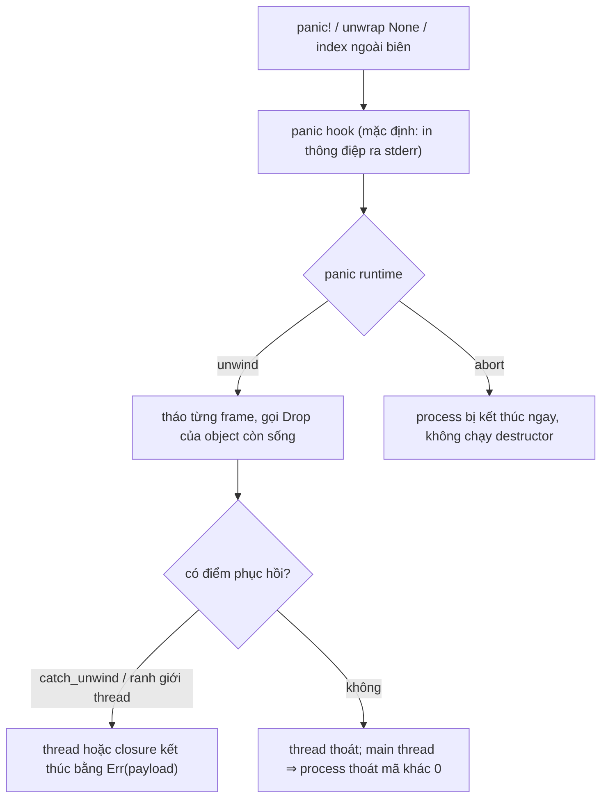

# P10 · Chương 08 — Panic, unwinding, ABI và FFI

> Mọi khẳng định về Rust theo tài liệu bản **1.95.0** (Reference, Nomicon, rustc book, std, Cargo book; một chú thích từ rustc-dev-guide). Chương này **không có thí nghiệm chạy thật**: các đoạn code chỉ để minh họa, không kèm output; chỗ nào là suy luận của người soạn đều ghi rõ.

## Bạn sẽ hiểu được gì

1. **Q1.** `panic!` thực sự làm gì với thread và stack: vì sao có "unwind" và destructor chạy ra sao? → mục 1
2. **Q2.** `panic = "unwind"` khác `panic = "abort"` thế nào, chọn ở đâu, và đổi lại được gì/mất gì? → mục 2
3. **Q3.** `catch_unwind`, ranh giới thread, `UnwindSafe` và mutex poisoning: panic được "chặn" ở đâu và dùng đúng chỗ nào? → mục 3
4. **Q4.** ABI là gì; `"Rust"`, `"C"`, `"system"` khác nhau ra sao và khối `extern`/`extern fn` làm gì? → mục 4
5. **Q5.** Kiểu dữ liệu nào đi qua ranh giới FFI an toàn: `repr(C)`, con trỏ null, opaque struct (và hàm variadic, nói gọn ở phần Đi sâu của mục 4)? → mục 5
6. **Q6.** Điều gì xảy ra khi panic (hoặc exception C++) băng qua ranh giới FFI; `"C-unwind"` giải quyết gì? → mục 6
7. **Q7.** Mở API Rust cho C (hoặc ngôn ngữ khác) thì đặt "tường chắn panic" và quy tắc build ở đâu? → mục 7

## Kiến thức cần trước

- [P2 · Chương 04 — Calling convention và stack frame](../02-cpu/04-calling-convention-va-stack-frame.md): ABI là hợp đồng về thanh ghi/stack (mục 1), frame và bảng unwind (mục 6), `extern "Rust"` so với `extern "C"` ở mức asm (mục 8). Chương này dùng lại các ý đó.
- [P9 · Chương 05 — Error handling](../09-rust-language/05-error-handling.md): khi nào dùng `Result`, khi nào `panic!` (mục 1 và 7). Chương này đào vào *cơ chế bên dưới* panic chứ không nhắc lại tiêu chí chọn.
- [Chương 07 — unsafe, undefined behavior và Miri](07-unsafe-ub-miri.md): UB là gì và vì sao UB ở một phía FFI lan sang phía kia (mục 2). Chương này dùng khái niệm UB khi nói panic băng qua ranh giới FFI là abort hay UB (mục 6–7).

## 1. Panic: dừng đường chạy hiện tại mà vẫn trả tài nguyên (Q1)

> **Trả lời ngắn.** Panic là cách Rust báo "lỗi mà chỗ này không thể xử lý hợp lý": hàm không return bình thường nữa[^ref-panic-intro]. Với chiến lược unwind (mặc định ở đa số target[^ref-panic-default]), thread dừng chạy bình thường rồi *tháo* stack từng frame, gọi destructor như thể mọi hàm return ngay lập tức[^nomicon-unwind]. Nhờ vậy khi chương trình thoát khỏi vùng lỗi, các đối tượng đang giữ tài nguyên đã được dọn[^ref-panic-cleanup].

**Giải thích.**

Hình dung (nhận xét của người soạn): bạn đang xử lý một request HTTP, đi sâu qua năm lớp hàm, mỗi lớp mở một thứ (transaction DB, file tạm, lock). Gặp trạng thái không thể tiếp tục, bạn không thể tự chạy ngược năm lớp để đóng từng thứ. Unwinding là bộ máy làm đúng việc đó thay bạn: đi ngược từng lớp và đóng/trả những gì lớp đó đang giữ.

*Panic xảy ra từ đâu.* Có thể gọi `panic!` tường minh[^ref-panic-macro], và có cấu trúc ngôn ngữ tự panic, ví dụ truy cập mảng ngoài biên[^ref-panic-lang]. Nomicon liệt kê thêm: `unwrap` trên `None`, chia cho 0, và (ở debug build) mọi phép số học có thể tràn; rồi kết luận rằng trừ khi bạn rất cẩn thận kiểm soát code nào chạy, gần như mọi thứ đều có thể unwind và bạn cần sẵn sàng cho điều đó[^nomicon-excsafe-everything].

*Panic nằm ở đâu trên thang xử lý lỗi.* Nomicon mô tả bốn bậc: `Option` cho cái có thể vắng, `Result` cho lỗi xử lý được, panic cho lỗi không xử lý hợp lý được, abort cho thảm họa[^nomicon-tiers].

*Trình tự một lần panic (với `panic=unwind`).*

1. **Panic hook chạy trước.** Hook được gọi khi thread panic, *trước khi* panic runtime được gọi, nên nó chạy với cả runtime unwind lẫn abort[^hook-before] (ngoại lệ: `-C panic=immediate-abort` của rustc không gọi hook, xem mục 2). Hook mặc định in thông điệp ra stderr và dựng backtrace nếu được yêu cầu[^hook-default].
2. **Unwind.** Runtime đi qua các frame Rust giống như `throw` của C++ đi qua frame C++, cho tới điểm phục hồi (ví dụ ranh giới thread); trên đường đi, mọi đối tượng còn sống trong frame có `Drop` sẽ bị gọi `drop`[^ref-panic-unwind].
3. **Dừng ở điểm phục hồi.** Thư viện chuẩn có hai cơ chế: `catch_unwind` (phục hồi ngay trong thread đang panic) và `thread::spawn` (tự thiết lập phục hồi cho thread con để các thread khác tiếp tục)[^ref-panic-recover]. Không có điểm phục hồi nào thì: thread thoát; panic có thể được thấy từ thread khác qua `join`; riêng main thread panic mà không bắt thì ứng dụng thoát với exit code khác 0[^thread-panic].



(Sơ đồ là tóm tắt của người soạn từ các chú thích trong mục này và mục 2.)

*Cái giá.* Cài đặt unwinding hiện tại được tối ưu cho trường hợp *không* unwind: chương trình không unwind thì không tốn chi phí runtime vì sẵn sàng unwind; đổi lại unwind thật sẽ đắt hơn (so với Java). Nomicon dặn đừng xây chương trình dựa vào unwind trong điều kiện bình thường[^nomicon-unwind-cost]. Lý do quay lại với thang lỗi: lỗi thường xuyên đi bằng `Result` (nhận xét của người soạn).

<details><summary>Đi sâu: lịch sử, payload, điểm tiếp giáp với MIR, "unwind" không bắt buộc dùng cơ chế của C++</summary>

- Nomicon kể rằng Rust thuở đầu giống Erlang: task nhẹ, tự kết liễu bằng panic khi gặp trạng thái không chịu nổi[^nomicon-unwind-erlang]. Về sau task nhẹ nhường chỗ cho thread OS nặng; theo Nomicon, trên Rust stable tính đến 1.0 chỉ thread cha bắt được panic, tức bắt panic đòi dựng cả một thread OS, và `catch_unwind` là API cho phép bắt panic mà không cần dựng thread[^nomicon-unwind-hist]. (Đây là mô tả lịch sử trong Nomicon, không phải hành vi cần nhớ khi viết code.)
- Reference nhấn vào hành vi *dọn dẹp*: miễn là bảo đảm dọn tài nguyên được giữ (các đối tượng không còn truy cập được đã được dọn như thể ra khỏi scope bình thường), unwinding có thể được cài đặt mà không dùng đúng cơ chế mà C++ dùng trên target đó[^ref-unwind-impl]. Vậy bảng unwind ở [P2 · Chương 04, mục 6](../02-cpu/04-calling-convention-va-stack-frame.md) là *một* cách cài đặt, không phải điều Reference bắt buộc (suy luận của người soạn từ câu trích).
- Payload: `panic_any` cho phép panic với thông điệp thuộc *bất kỳ* kiểu `Any + Send`, không chỉ chuỗi[^panic-any]. `catch_unwind` trả `Err(cause)` với `cause` chính là đối tượng mà panic được khởi phát[^catch-ret].
- Liên hệ MIR ([Chương 01, mục 4](01-pipeline-rustc.md)): rustc-dev-guide nói lời gọi hàm luôn là *terminator* vì có khả năng unwind[^dev-mir-call]; nên đồ thị luồng điều khiển có thêm đường dọn dẹp (suy luận của người soạn từ câu trích).
- `std::thread::panicking()` cho biết thread hiện tại có đang unwind vì panic không; docs nêu cách dùng điển hình là *đầu độc* tài nguyên chung khi viết unsafe code, kiểm tra trong `drop`[^thread-panicking].

</details>

**Quay lại Q1:** panic dừng đường chạy hiện tại; mặc định nó tháo stack và gọi `Drop`, và hook chạy trước cả hai.

## 2. `unwind` hay `abort`: chọn chiến lược panic (Q2)

> **Trả lời ngắn.** Chiến lược panic là một lựa chọn lúc build: `unwind` (tháo stack, có thể phục hồi) hoặc `abort` (kết thúc process, không phục hồi)[^ref-panic-kinds]. Với `abort` không thể `catch_unwind`[^catch-notall]; docs của `process::abort` nói process kết thúc kiểu đó không chạy destructor nào[^abort-doc], và dưới `panic=abort` thì `panic!` "tương tự" `abort`[^abort-similar]; Nomicon nói panic lúc đó abort process ngay lập tức[^nomicon-panic-abort-note] (suy ra panic cũng không chạy destructor: suy luận của người soạn, có quan sát chạy thật ở [P9 · Chương 05, mục 7](../09-rust-language/05-error-handling.md)). Đổi lại, trình tối ưu được phép giả định unwind không xảy ra, có thể giảm cỡ code và tăng tốc[^ref-panic-abort-opt].

**Giải thích.**

Hình dung (nhận xét của người soạn): trong Kubernetes, bạn có hai chính sách khi một worker lỗi nặng: để nó tự dọn rồi tiếp tục phục vụ (unwind), hoặc cho container chết ngay để orchestrator dựng lại (abort). Cả hai hợp lý; điều cần là *biết mình đã chọn cái nào*.

*Hai bộ xử lý panic của `std`.* Reference nói `std` cung cấp hai panic handler: `unwind` (tháo stack, có khả năng phục hồi) và `abort` (kết thúc process, không phục hồi)[^ref-panic-kinds]. Mặc định với đa số target là `unwind`[^ref-panic-default]. Không phải target nào cũng có handler `unwind`[^ref-panic-notall].

*Chọn bằng cờ hay bằng Cargo.* Cờ `-C panic` của rustc nhận `abort`, `immediate-abort` (kết thúc process và *không* gọi panic hook) hoặc `unwind`; không chỉ định thì mặc định tùy target[^rustc-panic-flag]. Cargo bọc cờ này bằng key `panic` trong profile, với hai giá trị `"unwind"` và `"abort"`[^cargo-panic]. Cả profile `dev` lẫn `release` mặc định đều là `'unwind'`[^cargo-defaults][^cargo-defaults-release] (bảng mặc định đầy đủ của các profile: [P9·08 mục 7](../09-rust-language/08-module-crate-cargo.md)). Ví dụ cấu hình:

```toml
[profile.release]
panic = "abort"
```

*Ba ràng buộc dễ vấp.*

- **Đồ thị crate:** nếu *bất kỳ* crate nào trong đồ thị dùng `abort` thì binary cuối (bin, dylib, cdylib, staticlib) cũng phải `abort`[^rustc-panic-flag]. Reference nêu hệ quả: crate build với `unwind` dùng được handler `abort`, ngược lại thì không[^ref-panic-implication].
- **Test:** Cargo bỏ qua `panic` cho test, benchmark, build script, proc macro; test harness hiện đòi hành vi unwind[^cargo-test-ignore]. Nghĩa là test chạy dưới `unwind` dù `release` đặt `abort` (suy luận của người soạn từ câu trích).
- **Hook vẫn chạy:** dưới `panic=abort`, `panic!` và `process::abort` "tương tự", nhưng `panic!` vẫn gọi panic hook còn `abort` thì không[^abort-similar]. Đó là chỗ bạn log được lý do chết (nhận xét của người soạn).

*Hệ quả cho code.* Dưới `abort` thì `catch_unwind` không có gì để bắt: nó chỉ bắt panic dạng unwind, không bắt panic làm process abort[^catch-notall]. Cách ly "một request panic không giết cả server" kiểu thread-per-request vì vậy phụ thuộc vào `unwind` (nhận xét của người soạn). Hành vi của từng runtime async cụ thể (ví dụ tokio) nằm ngoài các nguồn của chương này.

<details><summary>Đi sâu: <code>process::abort</code>, mất gì khi abort, <code>no_std</code>, đo cỡ binary</summary>

- `process::abort` kết thúc process theo kiểu "bất thường": không destructor nào (trên stack hiện tại hay của thread khác) chạy, buffer IO của Rust (ví dụ `BufWriter`) không được flush, buffer C stdio thường cũng không[^abort-doc]. Trên Unix, process kết thúc bằng tín hiệu `SIGABRT`[^abort-sigabrt]. Nhận xét của người soạn: với service, hệ quả thực tế là mất log/dữ liệu đang nằm trong buffer; nếu cần thoát sạch thì chỉ gọi `abort` ở điểm không còn destructor nào cần chạy (docs khuyến nghị đúng như vậy[^abort-clean]).
- Reference nêu lợi ích của `abort` là trình tối ưu có thể giả định unwinding qua frame Rust là không thể, từ đó cải thiện cả cỡ code lẫn tốc độ[^ref-panic-abort-opt]. Tài liệu không đưa con số; chương này **không đo** mức giảm, vì vậy không nêu số.
- Reference còn nói *unwind handler không bảo đảm mọi panic đều phục hồi được*, chỉ bảo đảm panic qua `panic!` và cơ chế tương tự của thư viện chuẩn là phục hồi được[^ref-panic-notrecover].
- Với `no_std` binary/dylib/cdylib/staticlib, phải tự cung cấp panic handler[^ref-panic-nostd] bằng attribute `panic_handler`[^ref-panic-handler-attr]; phải có đúng một trong đồ thị phụ thuộc[^ref-panic-handler-unique].
- Khi chạy test với chiến lược abort (cờ `panic-abort-tests`, đang ở dạng unstable), Cargo ép mọi dependency build theo `unwind`[^cargo-abort-test].

</details>

**Quay lại Q2:** `unwind` giữ dọn dẹp và khả năng cô lập panic; `abort` bỏ cả hai để lấy code đơn giản hơn cho trình tối ưu — chọn bằng `-C panic` hoặc `panic` trong profile.

## 3. `catch_unwind`, ranh giới thread, `UnwindSafe`, poisoning (Q3)

> **Trả lời ngắn.** Panic dừng ở hai loại điểm: `thread::spawn` (cô lập cả thread con) và `catch_unwind` (bắt ngay trong thread)[^ref-panic-recover]. `catch_unwind` trả `Ok` nếu closure không panic, `Err(nguyên nhân)` nếu có[^catch-ret], nhưng docs không khuyên dùng nó làm cơ chế try/catch thông thường[^catch-notgeneral]. Vì sau khi bắt, dữ liệu có thể đang ở trạng thái dở dang, std có hai lớp cảnh báo: bound `UnwindSafe` (docs gọi là "speed bump")[^unwindsafe-speedbump] và mutex poisoning (docs: chỉ mang tính khuyến cáo)[^mutex-advisory].

**Giải thích.**

Hình dung (nhận xét của người soạn): `catch_unwind` giống `try/catch` quanh một handler của web framework: nên đặt ở *biên* của một đơn vị công việc độc lập (một request, một task), không rải khắp code để điều khiển luồng. Phần luồng lỗi bình thường vẫn là `Result`.

*Nó làm gì.* `catch_unwind` gọi closure; nếu không panic trả `Ok(kết quả)`, nếu panic trả `Err(cause)` với `cause` là đối tượng panic ban đầu[^catch-ret]. Docs nói rõ không nên dùng làm try/catch tổng quát: `Result` hợp hơn cho hàm có thể lỗi thường xuyên[^catch-notgeneral]; và nó có thể không bắt được mọi panic vì panic có thể cài bằng abort[^catch-notall]. Hook (nếu có) chạy *trước* khi panic bị bắt, tức trước khi unwind[^catch-hook].

*Vì sao có `UnwindSafe`.* Docs định nghĩa an toàn-khi-unwind qua hai thành phần: một cấu trúc dữ liệu đang ở trạng thái tạm thời không hợp lệ khi thread panic, và sau đó bất biến bị phá đó bị quan sát[^unwindsafe-two]. Điều quan trọng: nếu không có `unsafe`, panic không thể dẫn tới mất an toàn bộ nhớ[^unwindsafe-nomem]; thứ có thể hỏng là bất biến *logic*[^unwindsafe-logic]. `catch_unwind` đòi closure là `UnwindSafe` để mã hóa khái niệm này vào hệ kiểu[^catch-bound]. Trait này không phải `unsafe trait`, nên không có hợp đồng cứng; docs gọi nó là "speed bump" cảnh báo người dùng `catch_unwind`[^unwindsafe-speedbump]. Ví dụ không-unwind-safe: `&mut T` và `&RefCell<T>`, vì trạng thái khả biến chia sẻ ngang qua ranh giới dễ bị nhìn thấy khi đã hỏng[^unwindsafe-mut]. Muốn tắt gờ này thì bọc `AssertUnwindSafe`[^assertunwindsafe].

*Mutex poisoning.* Mutex của std "bị đầu độc" nếu nhận ra thread đang giữ nó đã panic[^mutex-poison-def]; sau đó `lock`/`try_lock` trả `Result` báo trạng thái, và phần lớn code chỉ `unwrap()` để lan panic giữa các thread, không cho thấy bất biến có thể sai[^mutex-poison]. Poisoning chỉ là khuyến cáo: `PoisonError::into_inner` vẫn trả được guard[^mutex-advisory]. Nomicon giải thích: mutex đầu độc không vì an toàn bộ nhớ[^nomicon-poison-mem], mà để không dùng mù quáng dữ liệu có thể đang bị sửa dở[^nomicon-poison-why]. Chi tiết `RwLock`, `Condvar` và kết quả chạy thật: [P4 · Chương 08, mục 6](../04-concurrency/08-rust-concurrency.md).

*Hai tầng exception safety (Nomicon).* *Minimal*: trong unsafe code phải đủ exception safe để không phá an toàn bộ nhớ; *maximal*: trong safe code nên đủ để chương trình làm đúng[^nomicon-excsafe-levels].

<details><summary>Đi sâu: ví dụ <code>Vec::push_all</code>, <code>resume_unwind</code>, hook toàn cục, bẫy khi drop payload</summary>

- Ví dụ kinh điển của Nomicon: `push_all` đặt `len` trước rồi mới `clone` từng phần tử; `clone` là "quả bom panic" bị bỏ sót, nếu nó panic thì `Vec` có `len` lớn hơn số phần tử đã khởi tạo và việc nhìn/drop `Vec` sẽ đọc bộ nhớ chưa khởi tạo[^nomicon-pushall]. Bài học (nhận xét của người soạn): code unsafe không được để trạng thái bất hợp lệ tồn tại qua một lời gọi code lạ có thể panic.
- `resume_unwind` kích hoạt panic *không* gọi hook; docs nói nó dành để dùng với `catch_unwind`, ví dụ mang một panic qua một lớp code C[^resume]. Nếu panic đang hiện thực bằng abort thì hàm này abort chứ không unwind[^resume-abort].
- Hook là tài nguyên toàn cục[^hook-global], `set_hook` thay hook cũ[^hook-replace], `take_hook` lấy hook hiện tại và khôi phục hook mặc định[^hook-take]. `set_hook` panic nếu gọi từ thread đang panic[^hook-panics].
- Cẩn thận khi drop kết quả `catch_unwind`: nếu là `Err`, nó chứa payload và drop payload có thể lại panic[^catch-drop].
- Docs của `thread::panicking` nói code safe thường không cần tự đầu độc tài nguyên, vì mutex đã tự đầu độc khi thread panic lúc đang giữ lock[^thread-panicking].

</details>

**Quay lại Q3:** panic dừng ở ranh giới thread hoặc `catch_unwind`; và vì dữ liệu có thể dở dang, std chặn bằng `UnwindSafe` và poisoning — hai gờ giảm tốc, không phải bảo đảm tuyệt đối.

## 4. ABI là gì; `extern` khai báo và định nghĩa (Q4)

> **Trả lời ngắn.** ABI quy định hàm gọi hàm bằng cách nào ở mức máy: tham số vào thanh ghi hay stack, trả giá trị ra sao, ai dọn stack[^ref-ext-abi-intro]. ABI `"Rust"` là mặc định và không có bảo đảm ổn định[^ref-abi-rust]; `"C"` khớp ABI mặc định của trình biên dịch C chủ đạo trên target[^ref-abi-c], nên là điểm chung để nói chuyện với code ngoài (Nomicon gọi C là ngôn ngữ chung của thế giới lập trình)[^nomicon-ffi-reprc].

**Giải thích.**

Hình dung (nhận xét của người soạn): ABI giống giao thức dây giữa hai microservice, nhưng ở mức thanh ghi: hai bên phải thống nhất "field nào ở byte nào". Nếu một bên tự ý đổi, gọi vẫn "thành công" ở tầng kết nối nhưng đọc ra rác. Ở đây không có schema registry để bắt lỗi.

*Nền: calling convention.* Chương [P2 · 04](../02-cpu/04-calling-convention-va-stack-frame.md) (mục 1) đã nói ABI là hợp đồng về thanh ghi và stack; Reference định nghĩa lại đúng ý đó cho `extern`: calling convention là giao diện mức thấp của hàm — tham số đặt ở thanh ghi hay stack, giá trị trả về ra sao, ai chịu trách nhiệm dọn stack[^ref-ext-abi-intro].

*ABI `"Rust"`.* Hàm không ghi `extern` dùng ABI này; Reference nói rõ ABI Rust *không cam kết ổn định*[^ref-abi-rust]. Hệ quả (suy luận của người soạn): không bao giờ đặt hàm Rust thường vào thư viện chung rồi cho code ngoài gọi, vì layout gọi có thể đổi giữa các bản compiler. ([P2 · Chương 04, mục 8](../02-cpu/04-calling-convention-va-stack-frame.md) so sánh asm của cùng một hàm biên dịch theo hai ABI.)

*Các ABI chuẩn.* `"C"`[^ref-abi-c]; `"system"` tương đương `"C"` trừ Windows x86_32, nơi nó là `"stdcall"` cho hàm không variadic và `"C"` cho hàm variadic[^ref-ext-system]. Reference khuyên dùng `"system"` khi gọi API Windows không định nghĩa ABI tường minh[^ref-ext-system-win]. Còn có ABI riêng nền tảng (`"win64"`, `"sysv64"`, `"aapcs"`…); nhiều cái cũng có biến thể `-unwind`[^ref-ext-platform-unwind]. Cái nào là "C" thật trên máy bạn phụ thuộc target: `"sysv64"` là System V cho x86_64 và trùng `"C"` trên x86_64 không phải Windows[^ref-ext-sysv64].

*Hai hướng khai báo.*

- **Gọi vào ngoài:** khối `unsafe extern "C" { fn f(...); }`. `unsafe` được xem là bắt buộc về ngữ nghĩa trước từ khóa `extern` trên khối[^ref-ext-unsafe-required] (trước edition 2024 từ khóa này còn tùy chọn[^ref-ext-edition2024]). Hàm trong khối là `unsafe` ngầm trừ khi có qualifier `safe`[^ref-ext-unsafe]; compiler tự dịch giữa ABI Rust và ABI ngoài khi gọi[^ref-ext-foreign-abi]. Nomicon giải thích lý do: thư viện C hay không thread-safe và hầu như mọi hàm nhận con trỏ đều không hợp lệ với mọi đầu vào[^nomicon-ffi-unsafe] (ý chung đã nêu ở [Chương 07, mục 1](07-unsafe-ub-miri.md)). Compiler không kiểm được khai báo có đúng với phía C hay không, nên việc khai báo đúng là một phần của việc giữ binding đúng lúc chạy[^nomicon-ffi-decl]; gọi hàm với ABI sai là một mục trong danh sách UB của Reference[^ref-ub-call] ([Chương 07, mục 2](07-unsafe-ub-miri.md)).
- **Để ngoài gọi vào:** `extern "C" fn` *định nghĩa* trong Rust, cho code ngoài gọi (ví dụ từ C)[^ref-fn-foreign-call]. Muốn ngoài thấy symbol tên đúng thì thêm `#[unsafe(no_mangle)]`, tắt mangling để symbol mang đúng tên định danh của item[^ref-no-mangle]; attribute này `unsafe` vì symbol không mangle có thể đụng tên symbol khác[^ref-no-mangle-unsafe].

```rust
// minh họa; chưa chạy
use std::ffi::c_int;

unsafe extern "C" {
    fn abs(x: c_int) -> c_int;          // gọi vào libc (hàm unsafe ngầm)
}

#[unsafe(no_mangle)]
pub extern "C" fn rust_add(a: c_int, b: c_int) -> c_int {
    a.wrapping_add(b)                   // gọi ra từ C
}

fn main() {
    let v = unsafe { abs(-3) };
    let _ = (v, rust_add(1, 2));
}
```

<details><summary>Đi sâu: <code>link</code>, variadic, static ngoại, ABI mặc định khi bỏ chuỗi</summary>

- Attribute `link` nêu tên thư viện native mà compiler cần liên kết cho các item trong khối `extern`[^ref-link-attr]; Nomicon bổ sung nó là "viên gạch cơ bản" để chỉ cho rustc cách link thư viện native[^nomicon-link].
- Bỏ chuỗi ABI thì mặc định `"C"` (với khối `extern`)[^ref-ext-default]; Reference nói cú pháp bỏ ABI đang bị loại dần nên nên viết rõ[^ref-ext-default-phase].
- Hàm variadic khai báo được trong khối `extern` bằng `...` ở tham số cuối[^ref-ext-variadic]; hàm Rust thường thì không variadic được[^nomicon-no-variadic]. Truyền sai số/kiểu đối số cho hàm variadic có thể gây UB[^ref-ext-variadic-ub], nên `safe` chỉ hợp khi hàm bảo đảm không đụng vào đối số variadic.
- `static` khai báo trong khối `extern` mặc định `unsafe` để truy cập, vì không gì bảo đảm bit pattern ở đó hợp lệ với kiểu đã khai báo[^ref-ext-static].
- Các attribute `no_mangle`/`export_name` mang cùng cảnh báo đụng tên[^ref-no-mangle-unsafe][^ref-export-name-unsafe]; từ edition 2024 phải viết dạng `unsafe(...)`, trước đó có thể không[^ref-no-mangle-ed][^ref-export-name-ed].

</details>

**Quay lại Q4:** ABI là hợp đồng gọi hàm ở mức máy; `"Rust"` không ổn định, `"C"` là mẫu số chung, và `extern` khai báo hai chiều (gọi vào, bị gọi) đều không được compiler kiểm hộ.

## 5. Kiểu dữ liệu qua ranh giới FFI (Q5)

> **Trả lời ngắn.** Kiểu đi qua FFI nên là `repr(C)`, vì C là "ngôn ngữ chung" của thế giới lập trình[^nomicon-ffi-reprc]. Con trỏ có thể null thì dùng `Option` quanh kiểu không-null (ví dụ `Option<extern "C" fn(c_int) -> c_int>`)[^nomicon-ffi-nullable], còn struct mà C giấu nội dung thì biểu diễn bằng kiểu *opaque*[^nomicon-ffi-opaque].

**Giải thích.**

Hình dung (nhận xét của người soạn): qua FFI bạn đang gửi thông điệp cho bên không đọc được schema Rust. Chỉ nên gửi kiểu có "định dạng dây" cố định: số nguyên/số thực kích thước biết trước, con trỏ, struct `repr(C)`. Cái gì Rust được tự do sắp xếp (như `repr(Rust)`) thì đừng gửi.

*Layout.* Nomicon nói: kiểu bạn định đưa qua FFI nên có `repr(C)`[^nomicon-ffi-reprc]. Chi tiết `repr(C)`, `repr(transparent)` và enum có `repr` kiểu nguyên nằm ở [Chương 02, mục 2–4](02-type-layout.md), không nhắc lại ở đây.

*Con trỏ không-null.* Nomicon nhắc: một số kiểu Rust được định nghĩa là không bao giờ null, gồm `&T`, `&mut T`, `Box<T>` và con trỏ hàm `extern "abi" fn()`[^nomicon-ffi-nonnull]. Tạo giá trị không hợp lệ đó là UB, nên với con trỏ C có thể null phải dùng `Option` thay vì ép (transmute)[^nomicon-ffi-nonnull-ub]. Đây là "nullable pointer optimization": enum có đúng hai biến thể, một biến thể không dữ liệu và biến thể kia chứa một trường thuộc các kiểu không-null vừa kể[^nomicon-ffi-nullable-def], được biểu diễn không thêm discriminant (biến thể rỗng là giá trị null)[^nomicon-ffi-nullable-nodisc]; tối ưu này *được bảo đảm* áp dụng cho kiểu đủ điều kiện[^nomicon-ffi-nullable-guar]. `Option<extern "C" fn(c_int) -> c_int>` là cách biểu diễn đúng cho con trỏ hàm C có thể null[^nomicon-ffi-nullable]. Danh sách kiểu mà std hứa `Option<T>` cùng size/ABI với `T`, và khái niệm niche đứng sau, nằm ở [Chương 02, mục 5–6](02-type-layout.md).

*Opaque.* Khi thư viện C không cho bạn thấy nội dung đối tượng[^nomicon-ffi-opaque], Nomicon đưa hai cách: dùng `void *`, biểu diễn trong Rust bằng `c_void`[^nomicon-ffi-cvoid] — cách này "hợp lệ" nhưng Nomicon nói còn làm tốt hơn được, vì struct opaque cho một mức an toàn kiểu nhất định[^nomicon-ffi-opaque-struct]; hoặc tạo kiểu `repr(C)` riêng cho mỗi struct opaque để có kiểu riêng[^nomicon-ffi-opaque-rust].

*Ai sở hữu gì.* Thư viện ngoài thường *giao quyền sở hữu* tài nguyên cho code gọi; khi đó phải dùng destructor của Rust để bảo đảm tài nguyên được giải phóng, nhất là khi có panic[^nomicon-ffi-destructors]. Wrapper nên bọc API thô thành giao diện an toàn, giấu phần unsafe[^nomicon-ffi-wrap].

<details><summary>Đi sâu: vì sao UB ở một phía lây sang phía kia; <code>longjmp</code></summary>

- UB không dừng ở biên ngôn ngữ: Reference nói UB của C làm cả chương trình có UB (kể cả phần Rust), và ngược lại UB trong Rust có thể ảnh hưởng code ngôn ngữ khác qua FFI[^ref-ub-ffi]; chi tiết ở [Chương 07, mục 2](07-unsafe-ub-miri.md). Đây là lý do mọi hàm `extern` đều là biên cần kiểm (nhận xét của người soạn).
- Runtime Rust giả định frame Rust không bị giải phóng mà không chạy destructor của biến cục bộ; C như `longjmp` có thể vi phạm giả định đó[^ref-ub-runtime]. Nhận xét của người soạn: đừng để thư viện C `longjmp` qua frame Rust.
- Nomicon có ví dụ callback: Rust có thể đưa một hàm do mình định nghĩa cho thư viện ngoài, miễn hàm đó được đánh dấu `extern` đúng calling convention; hàm callback được đăng ký qua một lời gọi vào thư viện C rồi được gọi lại từ đó[^nomicon-ffi-callback].
- Nomicon nói thêm: Rust hiện không gọi thẳng được vào thư viện C++, nên ví dụ dùng thư viện có giao diện C[^nomicon-ffi-cpp].

</details>

**Quay lại Q5:** qua FFI chỉ gửi kiểu có layout cố định (`repr(C)`), dùng `Option<kiểu không-null>` cho con trỏ có thể null, opaque cho thứ C giấu, và nhớ ai sở hữu/giải phóng.

## 6. Panic băng qua ranh giới FFI: `-unwind` ABI (Q6)

> **Trả lời ngắn.** Mỗi ABI thuộc nhóm "cho phép unwind" hoặc "không"[^ref-fn-categories]. Panic Rust đi tới ranh giới không cho unwind thì process bị abort an toàn; exception ngoại lai (ví dụ C++) đi vào Rust qua ranh giới như vậy là UB[^nomicon-ffi-boundary]. Muốn panic hoặc exception đi xuyên ranh giới thì phải dùng biến thể `-unwind` của ABI, ví dụ `"C-unwind"`[^nomicon-ffi-unwind].

**Giải thích.**

Hình dung (nhận xét của người soạn): hai tòa nhà dùng hai hệ thống báo cháy khác nhau. Nếu chuông của tòa Rust kêu và dây nối sang tòa C không hiểu tín hiệu đó, hoặc dừng lại ở cửa (abort an toàn) hoặc làm hỏng hệ thống tòa C. Biến thể `-unwind` là bản "dây nối hai hệ thống", chỉ dùng khi cả hai bên đã thiết kế để tương thích.

*Ba quy tắc nền.*

1. Hầu hết ABI có hai biến thể, có và không có hậu tố `-unwind`; ABI Rust *luôn* cho phép unwind nên không có "Rust-unwind"[^ref-fn-unwind-intro]. `"C-unwind"` giống `"C"` nhưng khác ở hành vi khi callee unwind (panic hoặc exception kiểu C++)[^ref-abi-unwind].
2. Hành vi khi unwind chạm ranh giới được xác định bởi *ABI cộng với panic runtime*[^ref-fn-unwind-intro]. Reference tóm bằng một bảng về hành vi khi một thao tác unwind chạm từng loại ranh giới ABI[^ref-fn-table-intro]; người soạn chép lại bên dưới. Cột "panic" gồm cả `panic!` lẫn các thao tác Rust khác gây panic (chỉ số mảng ngoài biên, tràn số nguyên)[^ref-fn-panic-col]. Cột cuối là unwind "native" theo từng target (trên target hỗ trợ exception C++ thì là cơ chế cài đặt chúng); "forced unwinding" như `longjmp` trên Windows hay `pthread_exit` của glibc bị loại khỏi cột này[^ref-fn-native].
3. Unwind vào Rust từ hàm ngoại gọi qua ABI không-unwind, hoặc gọi hàm Rust có thể unwind từ code không hỗ trợ unwind (như C biên dịch với `-fno-exceptions`), đều là UB[^ref-panic-ffi-undef1][^ref-panic-ffi-undef2].

| Panic runtime | ABI của ranh giới | Panic Rust tới đây | Exception ngoại lai (native, không cưỡng bức) tới đây | Nguồn |
|---|---|---|---|---|
| `panic=unwind` | unwinding (`"Rust"`, `"C-unwind"`, …) | unwind tiếp | unwind tiếp | [^ref-fn-row1] |
| `panic=unwind` | không unwind (`"C"`, `"stdcall"`, …) | abort (xem ghi chú dưới bảng) | UB | [^ref-fn-row2][^ref-fn-abort] |
| `panic=abort` | unwinding | abort, không unwind | abort | [^ref-fn-row3] |
| `panic=abort` | không unwind | abort, không unwind | UB | [^ref-fn-row4] |

(Bảng chép lại từ Reference, mỗi dòng có chú thích riêng ở cột cuối; cách phân nhóm ABI "unwinding"/"non-unwinding" theo định nghĩa của Reference[^ref-fn-categories].)

*Chi tiết cần nhớ.* Panic tới ranh giới không unwind: với `panic=unwind`, hoặc *không* destructor nào chạy, hoặc *tất cả* destructor tới ranh giới sẽ chạy — Reference nói *không xác định* trường hợp nào[^ref-fn-abort]. Đừng viết code phụ thuộc cái nào (nhận xét của người soạn). Còn `panic=abort` thì `panic!` abort ngay bất kể ABI của hàm đang panic[^nomicon-panic-abort-note].

*Hàm `extern "C"` panic thì abort an toàn, không phải UB.* Ví dụ Nomicon: `extern "C" fn assert_nonzero(input: u32)` với `assert!(input != 0)`; nếu gọi với 0, runtime *bảo đảm* abort an toàn dù có hay không biên dịch với `panic=abort`[^nomicon-ffi-abort]; dòng 2 của bảng (`panic=unwind`, ABI không unwind) cho cùng kết luận[^ref-fn-row2]. std cũng nói: hàm Rust sẽ bị code không hỗ trợ unwind gọi nên định nghĩa bằng `extern "C"`, vì khi đó panic được tự động bắt và process bị abort; muốn xử lý nhẹ nhàng hơn mới cần `catch_unwind`[^catch-extern-c].

*Đối chiếu với danh sách UB.* Danh sách UB của Reference có một mục "unwind qua frame không cho phép unwind", với ví dụ gọi hàm `"C-unwind"` bị import hoặc transmute thành `"C"`[^ref-ub-call]; Reference cũng xếp vào UB việc unwind từ code ngoại vào Rust qua ABI không-unwind (quy tắc 3 ở trên)[^ref-panic-ffi-undef1]. Hai điều này đọc được là không mâu thuẫn với "panic ⇒ abort an toàn" nếu phân biệt: UB là khi *ABI khai báo không khớp với hàm thật* hoặc khi *exception ngoại lai* đi vào Rust; còn panic của một hàm Rust *định nghĩa* bằng `extern "C"` là trường hợp bảng và Nomicon mô tả là abort (suy luận của người soạn: Reference không nối các đoạn này với nhau). Nguyên tắc thực hành: khai báo ABI phải khớp hàm thật ở cả hai phía; xem thêm [Chương 07, mục 2](07-unsafe-ub-miri.md).

*Một trang Nomicon nói khác.* Trang Nomicon "Unwinding" (cùng bản 1.95.0) viết rằng unwind từ ngôn ngữ khác vào Rust, hoặc từ Rust sang ngôn ngữ khác, là UB và bạn phải bắt mọi panic ở ranh giới FFI[^nomicon-unwinding-ffi]. Đó là phát biểu chung, không phân biệt chuỗi ABI; trang FFI của cùng Nomicon và Reference thì phân biệt theo ABI (panic Rust chạm ranh giới không-unwind ⇒ abort an toàn[^nomicon-ffi-boundary]; `-unwind` cho phép panic xuyên ranh giới[^nomicon-ffi-cunwind]). Chương này theo Reference và trang FFI vì chúng chi tiết hơn và có bảng (nhận xét của người soạn). Điểm chung của mọi nguồn: đừng để panic băng qua FFI một cách vô ý — hoặc `catch_unwind`, hoặc chấp nhận abort, hoặc chủ động dùng `-unwind` ở cả hai phía.

*Dùng `"C-unwind"` đúng chỗ.* Nomicon cho hai ví dụ: hàm Rust `extern "C-unwind"` panic thì được phép unwind qua frame C++[^nomicon-ffi-cunwind] (và nếu frame C++ có object, destructor của chúng sẽ chạy[^nomicon-ffi-cpp-dtor]); và hàm Rust `"C-unwind"` gọi hàm C++ có thể throw: nếu throw xảy ra thì `Box` cục bộ được drop, nếu không thì in giá trị bình thường[^nomicon-ffi-throw].

<details><summary>Đi sâu: bắt exception ngoại lai, "bản Rust khác" cũng là ngoại lai, hạn chế khi rethrow</summary>

- Bắt exception ngoại lai bằng `catch_unwind`, `JoinHandle::join`, hoặc để nó lan ra ngoài `main`/gốc thread: kết quả là một trong hai và *không xác định* cái nào — process abort, hoặc hàm trả `Err` chứa kiểu opaque[^ref-panic-catch-foreign]. Docs `catch_unwind` nói cùng ý và thêm: nếu abort thì abort *sau khi* chạy mọi destructor của `f` và các hàm nó gọi[^catch-foreign].
- Nomicon nhấn: tương tác của `catch_unwind` với exception ngoại lai là không xác định, cũng như tương tác của panic với cơ chế bắt exception của ngôn ngữ khác (đáng chú ý là `try/catch` của C++)[^nomicon-ffi-undef-catch].
- Rust build/liên kết với *bản runtime Rust khác* cũng được coi là "ngoại lai": thư viện dùng `panic!` link với một bản `std`, được gọi từ ứng dụng dùng bản `std` khác, có thể làm cả ứng dụng abort dù chỉ dùng trong thread con[^ref-panic-other-rt].
- Chưa có bảo đảm nào về việc runtime ngoại lai hủy hoặc rethrow payload panic của Rust: unwind sinh từ runtime Rust phải dẫn tới kết thúc process hoặc bị chính runtime đó bắt[^ref-panic-dispose].
- Với `-unwind` ABI, lint `ffi_unwind_calls` đánh dấu mọi lời gọi tới hàm/con trỏ ngoại `-unwind`, hữu ích nếu muốn thư viện sound với mọi panic runtime lúc link[^ref-link-lint].

</details>

**Quay lại Q6:** ranh giới không cho unwind thì panic ⇒ abort, exception ngoại lai ⇒ UB; muốn xuyên ranh giới phải chọn `-unwind` ở cả hai phía.

## 7. Mở API Rust cho C: tường chắn panic và quy tắc build (Q7)

> **Trả lời ngắn.** Hàm `extern "C"` mà panic sẽ abort process an toàn[^nomicon-ffi-abort]; nếu bạn không muốn chết thì phải `catch_unwind` *trước* ranh giới và đổi thành mã lỗi[^nomicon-ffi-catch]. Ngoài ra, nếu artifact có khả năng unwind thì mọi crate trong nó phải build theo `unwind`, nếu không unwind có thể là UB[^ref-link-unwind-prohibited].

**Giải thích.**

Hình dung (nhận xét của người soạn): bạn viết thư viện Rust cho một service C/C++/Go (qua cgo) gọi. Từ phía họ, bạn là "hộp đen" giống một database driver: lỗi phải ra bằng mã lỗi hoặc `errno`, không bao giờ là một exception "chạy lung tung" trong runtime của họ.

*Bước 1 — xuất symbol.* Theo Nomicon, bạn cần `extern "C"` để hàm theo calling convention C, và `no_mangle` để symbol có tên xác định để link[^nomicon-ffi-callrust]. Biên dịch thành thư viện chung bằng `crate-type = ["cdylib"]` trong `Cargo.toml`[^nomicon-ffi-cdylib].

*Bước 2 — chắn panic.* Chọn một trong hai:

- **Chấp nhận abort.** Như ở mục 6, hàm `extern "C"` panic ⇒ process abort an toàn[^nomicon-ffi-abort]. Đơn giản và an toàn, nhưng một lỗi lập trình trong thư viện giết cả process gọi.
- **Chuyển thành mã lỗi.** Nomicon: nếu code Rust có thể panic và bạn không muốn abort khi nó panic thì *phải* dùng `catch_unwind`[^nomicon-ffi-catch]. Ví dụ Nomicon dùng `catch_unwind` trả `0` nếu thành công và `1` nếu `Err`[^nomicon-ffi-catch-ex].

```rust
// minh họa; chưa chạy
use std::panic::catch_unwind;

#[unsafe(no_mangle)]
pub extern "C" fn do_work(x: u32) -> i32 {
    match catch_unwind(|| risky(x)) {
        Ok(v) => v,
        Err(_) => -1,           // báo lỗi cho phía C bằng mã lỗi
    }
}

fn risky(x: u32) -> i32 {
    assert!(x != 0);
    100 / x as i32
}
```

Hãy nhớ giới hạn: `catch_unwind` chỉ bắt panic dạng unwind, không bắt panic làm abort[^nomicon-catch-only]. Nên nếu build `panic=abort` thì "tường chắn" này không hoạt động, vì process đã abort ngay từ `panic!` (hệ quả của câu trích; nhận xét của người soạn).

*Bước 3 — quy tắc build.* Một artifact Rust là "có khả năng unwind" nếu dùng panic handler `unwind`, hoặc chứa crate build `unwind` gọi hàm qua ABI `-unwind`, hoặc gọi qua ABI `"Rust"` vào artifact Rust khác (có bản runtime riêng) mà cái đó có khả năng unwind[^ref-link-potential]. Nếu có khả năng unwind thì *mọi* crate của nó phải build chiến lược `unwind`, nếu không unwind có thể gây UB[^ref-link-unwind-prohibited]. Với `rustc` làm bước link, quy tắc được thực thi tự động; nếu link không qua rustc (kể cả `dlopen`) thì bạn tự lo[^ref-link-note].

<details><summary>Đi sâu: khi nào dùng <code>"C-unwind"</code> thay vì chắn; thiết kế API; checklist</summary>

- Hàm Rust *cố ý* để panic xuyên sang C++ (để C++ `catch`) thì dùng `"C-unwind"` và `panic=unwind`[^nomicon-ffi-cunwind]. Chỉ làm khi hai bên cùng hỗ trợ unwind; nếu phía gọi biên dịch kiểu `-fno-exceptions` thì gọi vào hàm Rust unwind được là UB[^ref-panic-ffi-undef2].
- `resume_unwind` hữu ích để mang panic đã bắt qua một lớp code C rồi ném tiếp (docs gợi ý đúng ý này), vì nó không gọi lại hook[^resume].
- Giữ ranh giới hẹp: nhận/trả kiểu `repr(C)`, con trỏ opaque, mã lỗi (mục 5). Nhận xét của người soạn: đặt wrapper an toàn phía Rust để phần `unsafe` nằm gọn một chỗ; Nomicon nói thư viện có thể chỉ phơi ra giao diện an toàn, cấp cao và giấu phần unsafe bên trong[^nomicon-ffi-wrap].
- Không đặt panic hook làm cơ chế báo lỗi cho phía C (nhận xét của người soạn): hook là tài nguyên toàn cục của process[^hook-global] và chạy trước mọi bước (mục 1).
- Checklist (nhận xét của người soạn, tổng hợp từ các mục trên): (1) mọi hàm xuất đều `extern "C"` hoặc `-unwind`, rõ ràng; (2) đã quyết định abort hay chuyển lỗi; (3) nếu artifact có khả năng unwind thì mọi crate trong nó build `unwind`; (4) kiểu qua ranh giới là `repr(C)`/opaque/`Option<kiểu không-null>`.

</details>

**Quay lại Q7:** panic mặc định abort ở `extern "C"`; muốn thành mã lỗi thì `catch_unwind` trong từng hàm xuất, và artifact có khả năng unwind phải build mọi crate theo `unwind`.

## Liên hệ với Rust

- **Hợp đồng ABI nằm trong ngôn ngữ.** Rust để bạn ghi ABI tường minh trên từng hàm (`extern "C"`, `"C-unwind"`, `"system"`); khai báo ABI không khớp hàm thật là UB[^ref-ub-call], và compiler không kiểm được khai báo ngoại[^nomicon-ffi-decl].
- **Panic là một phần của `Result`?** Không: panic dành cho lỗi lập trình/trạng thái không phục hồi, `Result` cho lỗi thường xuyên. Docs `catch_unwind` nhắc lại đúng điều này[^catch-notgeneral]; tiêu chí chi tiết ở [P9 · 05](../09-rust-language/05-error-handling.md).
- **Ba lớp "phanh" của panic (cách gọi của người soạn):** `Drop` (dọn dẹp khi unwind, do ngôn ngữ bảo đảm[^ref-panic-unwind]), poisoning (đừng dùng mù quáng dữ liệu dở dang) và `UnwindSafe` (cảnh báo ở `catch_unwind`). Hai lớp sau là cơ chế *thư viện/kiểu* chỉ mang tính cảnh báo: poisoning chỉ khuyến cáo[^mutex-advisory], `UnwindSafe` không phải `unsafe trait`[^unwindsafe-speedbump].
- **Danh sách UB của Reference có đúng mục này:** gọi sai ABI hoặc unwind qua frame không cho unwind[^ref-ub-call]; mục đó không đồng nghĩa với "mọi panic chạm `extern "C"` là UB" (xem mục 6 và [Chương 07, mục 2](07-unsafe-ub-miri.md)).
- **Chọn bằng Cargo:** `panic = "abort"` trong profile đổi chiến lược panic của build đó, còn test/bench/build script/proc macro bỏ qua cài đặt này và vẫn unwind[^cargo-test-ignore]; override theo từng package cũng không được đặt `panic`[^cargo-no-override]. Với service backend, quyết định này (nhận xét của người soạn) nên đi kèm câu hỏi "ai khởi động lại tiến trình, và có mất log đang buffer không" (mục 2).

## Tóm tắt

- Panic: hook chạy trước, rồi (với `unwind`) tháo stack gọi `Drop` cho tới điểm phục hồi (ranh giới thread, `catch_unwind`)[^hook-before][^ref-panic-unwind][^ref-panic-recover].
- `-C panic` / `panic` trong profile chọn `unwind` hoặc `abort`; mặc định `unwind` ở đa số target[^ref-panic-default]; `abort` không phục hồi được nên `catch_unwind` vô tác dụng (và, theo suy luận ở mục 2, không chạy destructor), đổi lại trình tối ưu có thể làm code nhỏ/nhanh hơn[^rustc-panic-flag][^cargo-panic][^ref-panic-abort-opt].
- Một crate `abort` trong đồ thị kéo cả binary thành `abort`; test vẫn unwind[^rustc-panic-flag][^cargo-test-ignore].
- `catch_unwind` dành cho biên đơn vị công việc/FFI, không phải try/catch; `UnwindSafe` là "speed bump", còn poisoning chỉ mang tính khuyến cáo[^catch-notgeneral][^unwindsafe-speedbump][^mutex-advisory].
- ABI `"Rust"` không ổn định; `"C"` khớp C compiler chủ đạo của target; `extern` hai chiều đều không được compiler kiểm hộ[^ref-abi-rust][^ref-abi-c][^nomicon-ffi-decl].
- Qua FFI dùng `repr(C)`, `Option<kiểu không-null>` cho con trỏ có thể null, opaque cho thứ bị giấu[^nomicon-ffi-reprc][^nomicon-ffi-nullable][^nomicon-ffi-opaque].
- Ranh giới không-unwind: panic ⇒ abort an toàn, exception ngoại lai ⇒ UB; muốn xuyên thì dùng `-unwind` ở cả hai phía[^nomicon-ffi-boundary][^nomicon-ffi-unwind]. Mục UB "unwind qua frame không cho unwind" trong danh sách của Reference có ví dụ là khai báo ABI không khớp hàm thật (gọi `"C-unwind"` như `"C"`)[^ref-ub-call].
- `extern "C"` panic ⇒ abort; muốn mã lỗi thì `catch_unwind` trước ranh giới (chỉ có tác dụng với `panic=unwind`)[^nomicon-ffi-abort][^nomicon-ffi-catch][^nomicon-catch-only].
- Artifact "có khả năng unwind" phải build mọi crate với `unwind`[^ref-link-unwind-prohibited].

## Câu hỏi tự kiểm tra

1. Panic hook chạy trước hay sau khi stack được unwind? Nó có chạy dưới `panic=abort` không?
2. `catch_unwind` có bắt được panic khi build `panic=abort` không? Vì sao?
3. Đặt `panic = "abort"` trong `[profile.release]` thì `cargo test` hành xử thế nào với panic?
4. Nếu một crate trong đồ thị dùng `abort` thì binary cuối phải thế nào?
5. Vì sao `UnwindSafe` không phải `unsafe trait`, và trait đó làm gì?
6. Mutex poisoning bảo vệ điều gì; có bảo vệ an toàn bộ nhớ không? Có vượt qua được không?
7. ABI `"Rust"` khác `"C"` ở điểm cốt lõi nào, và vì sao hàm Rust thường không nên đưa cho code ngoài gọi?
8. Vì sao `Option<extern "C" fn(c_int) -> c_int>` là cách biểu diễn con trỏ hàm C có thể null?
9. Panic Rust chạm ranh giới `"C"` (với `panic=unwind`) sẽ ra sao? Exception C++ đi vào hàm Rust khai báo `"C"` thì sao?
10. Hàm `extern "C"` của bạn gọi code có thể panic; muốn trả mã lỗi thay vì abort, bạn làm gì, và nó vô tác dụng khi nào?
11. Liệt kê ba điều kiện khiến một artifact Rust được gọi là "có khả năng unwind", và hệ quả của nó.
12. Danh sách UB của Reference có mục "unwind qua frame không cho phép unwind", còn Nomicon nói panic chạm hàm `extern "C"` thì abort an toàn. Hai điều đó khớp nhau thế nào?

<details><summary>Đáp án</summary>

1. Trước. Hook chạy khi thread panic, trước khi panic runtime được gọi, nên chạy với cả runtime unwind và abort[^hook-before]; `abort` thuần (`process::abort`) thì không gọi hook, còn `panic!` dưới `panic=abort` thì có[^abort-similar]. Ngoại lệ: `immediate-abort` không gọi hook[^rustc-panic-flag].
2. Không: `catch_unwind` chỉ bắt panic dạng unwind, không bắt panic làm process abort[^catch-notall][^nomicon-catch-only].
3. Cargo bỏ qua `panic` cho test/bench/build script/proc macro; test harness đòi unwind[^cargo-test-ignore].
4. Phải `abort`[^rustc-panic-flag].
5. Vì không có hợp đồng "chặt" (chỉ là cảnh báo); nó mã hóa khái niệm exception safety vào kiểu, như "speed bump" cho người dùng `catch_unwind`[^unwindsafe-speedbump][^catch-bound].
6. Chống dùng mù quáng dữ liệu có thể đang sửa dở; không liên quan an toàn bộ nhớ (kiểu viết đúng thì vẫn không vi phạm bộ nhớ[^nomicon-poison-mem]); vượt được qua `into_inner`[^nomicon-poison-why][^mutex-advisory].
7. ABI Rust không cam kết ổn định, còn `"C"` khớp C compiler chủ đạo của target[^ref-abi-rust][^ref-abi-c]. Vì thế hàm Rust thường không nên đưa cho code ngoài gọi: cách gọi của nó có thể đổi giữa các bản compiler (suy luận của người soạn từ việc ABI Rust không ổn định).
8. Vì kiểu hàm `extern "abi" fn()` là không-null[^nomicon-ffi-nonnull], và enum hai biến thể (một rỗng, một chứa kiểu không-null) được biểu diễn `None` bằng null, không thêm discriminant[^nomicon-ffi-nullable-def][^nomicon-ffi-nullable-nodisc]; tối ưu này được bảo đảm cho kiểu đủ điều kiện[^nomicon-ffi-nullable-guar], và Nomicon nêu đúng `Option<extern "C" fn(c_int) -> c_int>` là cách biểu diễn con trỏ hàm C có thể null[^nomicon-ffi-nullable].
9. Panic ⇒ process abort an toàn; exception ngoại lai vào Rust ⇒ UB[^nomicon-ffi-boundary]. Với panic, destructor chạy hay không là không xác định[^ref-fn-abort].
10. Bọc phần có thể panic trong `catch_unwind` và đổi `Err` thành mã lỗi[^nomicon-ffi-catch]; vô tác dụng khi build `panic=abort`[^nomicon-catch-only].
11. Dùng handler `unwind`; hoặc có crate build `unwind` gọi hàm `-unwind`; hoặc gọi ABI `"Rust"` vào artifact Rust khác (runtime riêng) cũng có khả năng unwind[^ref-link-potential]. Hệ quả: mọi crate của artifact phải build `unwind`, nếu không có thể UB[^ref-link-unwind-prohibited].
12. UB là khi ABI khai báo không khớp với hàm thật (ví dụ gọi một hàm `"C-unwind"` được import hoặc transmute thành `"C"`)[^ref-ub-call], hoặc khi exception ngoại lai đi vào Rust qua ABI không-unwind[^ref-panic-ffi-undef1][^nomicon-ffi-boundary]; panic của hàm Rust định nghĩa bằng `extern "C"` chạm ranh giới không-unwind là abort an toàn[^nomicon-ffi-abort][^ref-fn-row2]. Reference không nối các đoạn này với nhau; cách đọc trên là suy luận của người soạn (mục 6).

</details>

## Đọc thêm

- [Reference — Panic](https://doc.rust-lang.org/1.95.0/reference/panic.html): panic handler, chiến lược panic, unwinding qua ranh giới FFI.
- [Reference — Functions, mục Unwinding](https://doc.rust-lang.org/1.95.0/reference/items/functions.html): bảng hành vi ABI × panic runtime.
- [Reference — External blocks](https://doc.rust-lang.org/1.95.0/reference/items/external-blocks.html): danh sách ABI, `safe`/`unsafe`, variadic, `link`.
- [Nomicon — Unwinding](https://doc.rust-lang.org/1.95.0/nomicon/unwinding.html) và [Exception Safety](https://doc.rust-lang.org/1.95.0/nomicon/exception-safety.html): lịch sử, chi phí, và cách code unsafe sống chung với panic. Lưu ý: đoạn cuối trang Unwinding nói chung chung rằng unwind qua FFI là UB; mục 6 chương này đối chiếu nó với Reference và trang FFI.
- [Nomicon — FFI](https://doc.rust-lang.org/1.95.0/nomicon/ffi.html): ví dụ gọi vào/ra, callback, opaque, `C-unwind`.
- [`std::panic`](https://doc.rust-lang.org/1.95.0/std/panic/index.html): `catch_unwind`, `set_hook`, `resume_unwind`, `UnwindSafe`.
- [Cargo — Profiles, `panic`](https://doc.rust-lang.org/1.95.0/cargo/reference/profiles.html): cấu hình chiến lược panic theo profile.
- [P2 · Chương 04, mục 1, 6 và 8](../02-cpu/04-calling-convention-va-stack-frame.md): ABI là gì, bảng unwind, so sánh asm của `extern "Rust"` và `extern "C"`.
- [P9 · Chương 05, mục 1 và 7](../09-rust-language/05-error-handling.md): tiêu chí panic vs `Result`; quan sát chạy thật `drop` dưới `panic=abort`.
- [Chương 07 — unsafe, undefined behavior và Miri, mục 2](07-unsafe-ub-miri.md): định nghĩa UB và danh sách UB mà mục 6 đối chiếu.
- [P4 · Chương 08, mục 6](../04-concurrency/08-rust-concurrency.md): poisoning ở mức concurrency (`RwLock`, `Condvar`).

[^ref-panic-intro]: The Rust Reference, Panic — <https://doc.rust-lang.org/1.95.0/reference/panic.html> — "Rust provides a mechanism to prevent a function from returning normally, and instead “panic,” which is a response to an error condition that is typically not expected to be recoverable within the context in which the error is encountered."
[^ref-panic-lang]: The Rust Reference, Panic — <https://doc.rust-lang.org/1.95.0/reference/panic.html> — "Some language constructs, such as out-of-bounds array indexing, panic automatically."
[^nomicon-excsafe-everything]: The Rustonomicon, Exception Safety — <https://doc.rust-lang.org/1.95.0/nomicon/exception-safety.html> — "If you unwrap a None, index out of bounds, or divide by 0, your program will panic. On debug builds, every arithmetic operation can panic if it overflows. Unless you are very careful and tightly control what code runs, pretty much everything can unwind, and you need to be ready for it."
[^nomicon-tiers]: The Rustonomicon, Unwinding — <https://doc.rust-lang.org/1.95.0/nomicon/unwinding.html> — "If something might reasonably be absent, Option is used. If something goes wrong and can reasonably be handled, Result is used. If something goes wrong and cannot reasonably be handled, the thread panics. If something catastrophic happens, the program aborts."
[^nomicon-unwind]: The Rustonomicon, Unwinding — <https://doc.rust-lang.org/1.95.0/nomicon/unwinding.html> — "Panics cause the thread to halt normal execution and unwind its stack, calling destructors as if every function instantly returned."
[^hook-before]: Rust std, panic::set_hook — <https://doc.rust-lang.org/1.95.0/std/panic/fn.set_hook.html> — "The panic hook is invoked when a thread panics, but before the panic runtime is invoked. As such, the hook will run with both the aborting and unwinding runtimes."
[^hook-default]: Rust std, panic::set_hook — <https://doc.rust-lang.org/1.95.0/std/panic/fn.set_hook.html> — "The default hook, which is registered at startup, prints a message to standard error and generates a backtrace if requested."
[^ref-panic-unwind]: The Rust Reference, Panic — <https://doc.rust-lang.org/1.95.0/reference/panic.html> — "When a panic occurs, the unwind handler “unwinds” Rust frames, just as C++’s throw unwinds C++ frames, until the panic reaches the point of recovery (for instance at a thread boundary). This means that as the panic traverses Rust frames, live objects in those frames that implement Drop will have their drop methods called."
[^ref-panic-recover]: The Rust Reference, Panic — <https://doc.rust-lang.org/1.95.0/reference/panic.html> — "The standard library provides two mechanisms for recovering from a panic, std::panic::catch_unwind (which enables recovery within the panicking thread) and std::thread::spawn (which automatically sets up panic recovery for the spawned thread so that other threads may continue running)."
[^thread-panic]: Rust std, thread — <https://doc.rust-lang.org/1.95.0/std/thread/index.html> — "If the panic is not caught the thread will exit, but the panic may optionally be detected from a different thread with join. If the main thread panics without the panic being caught, the application will exit with a non-zero exit code."
[^nomicon-unwind-cost]: The Rustonomicon, Unwinding — <https://doc.rust-lang.org/1.95.0/nomicon/unwinding.html> — "In particular, Rust’s current unwinding implementation is heavily optimized for the “doesn’t unwind” case. If a program doesn’t unwind, there should be no runtime cost for the program being ready to unwind. As a consequence, actually unwinding will be more expensive than in e.g. Java. Don’t build your programs to unwind under normal circumstances."
[^nomicon-unwind-hist]: The Rustonomicon, Unwinding — <https://doc.rust-lang.org/1.95.0/nomicon/unwinding.html> — "Light-weight tasks were killed in the name of heavy-weight OS threads. Still, on stable Rust as of 1.0 panics can only be caught by the parent thread. This means catching a panic requires spinning up an entire OS thread! This unfortunately stands in conflict to Rust’s philosophy of zero-cost abstractions. There is an API called catch_unwind that enables catching a panic without spawning a thread."
[^ref-unwind-impl]: The Rust Reference, Panic — <https://doc.rust-lang.org/1.95.0/reference/panic.html> — "As long as this guarantee of resource-cleanup is preserved, “unwinding” may be implemented without actually using the mechanism used by C++ for the target platform."
[^panic-any]: Rust std, panic::panic_any — <https://doc.rust-lang.org/1.95.0/std/panic/fn.panic_any.html> — "The message can be of any (Any + Send) type, not just strings."
[^catch-ret]: Rust std, panic::catch_unwind — <https://doc.rust-lang.org/1.95.0/std/panic/fn.catch_unwind.html> — "This function will return Ok with the closure’s result if the closure does not panic, and will return Err(cause) if the closure panics. The cause returned is the object with which panic was originally invoked."
[^dev-mir-call]: rustc-dev-guide, The MIR — <https://rustc-dev-guide.rust-lang.org/mir/index.html> — "Function calls like the call to Vec::new are always terminators because of the possibility of unwinding"
[^thread-panicking]: Rust std, thread::panicking — <https://doc.rust-lang.org/1.95.0/std/thread/fn.panicking.html> — "Determines whether the current thread is unwinding because of panic. A common use of this feature is to poison shared resources when writing unsafe code, by checking panicking when the drop is called. This is usually not needed when writing safe code, as Mutexes already poison themselves when a thread panics while holding the lock."
[^ref-panic-kinds]: The Rust Reference, Panic — <https://doc.rust-lang.org/1.95.0/reference/panic.html> — "unwind — unwinds the stack and is potentially recoverable. abort — aborts the process and is non-recoverable."
[^abort-doc]: Rust std, process::abort — <https://doc.rust-lang.org/1.95.0/std/process/fn.abort.html> — "no destructors on the current stack or any other thread’s stack will be run, Rust IO buffers (eg, from BufWriter) will not be flushed, and C stdio buffers will (on most platforms) not be flushed."
[^catch-notall]: Rust std, panic::catch_unwind — <https://doc.rust-lang.org/1.95.0/std/panic/fn.catch_unwind.html> — "This function only catches unwinding panics, not those that abort the process."
[^ref-panic-abort-opt]: The Rust Reference, Panic — <https://doc.rust-lang.org/1.95.0/reference/panic.html> — "When compiling code with the abort panic strategy, the optimizer may assume that unwinding across Rust frames is impossible, which can result in both code-size and runtime speed improvements."
[^ref-panic-default]: The Rust Reference, Panic — <https://doc.rust-lang.org/1.95.0/reference/panic.html> — "The default for most targets is unwind."
[^ref-panic-notall]: The Rust Reference, Panic — <https://doc.rust-lang.org/1.95.0/reference/panic.html> — "Not all targets may provide the unwind handler."
[^rustc-panic-flag]: The rustc book, Codegen options — <https://doc.rust-lang.org/1.95.0/rustc/codegen-options/index.html> — "abort: terminate the process upon panic immediate-abort: terminate the process upon panic, and do not call any panic hooks unwind: unwind the stack upon panic If not specified, the default depends on the target. If any crate in the crate graph uses abort, the final binary (bin, dylib, cdylib, staticlib) must also use abort."
[^cargo-panic]: The Cargo Book, Profiles — <https://doc.rust-lang.org/1.95.0/cargo/reference/profiles.html> — "The panic setting controls the -C panic flag which controls which panic strategy to use. The valid options are: "unwind": Unwind the stack upon panic. "abort": Terminate the process upon panic."
[^cargo-defaults]: The Cargo Book, Profiles — <https://doc.rust-lang.org/1.95.0/cargo/reference/profiles.html> — "overflow-checks = true lto = false panic = 'unwind' incremental = true codegen-units = 256 rpath = false"
[^cargo-defaults-release]: The Cargo Book, Profiles — <https://doc.rust-lang.org/1.95.0/cargo/reference/profiles.html> — "debug-assertions = false overflow-checks = false lto = false panic = 'unwind' incremental = false codegen-units = 16 rpath = false"
[^ref-panic-implication]: The Rust Reference, Panic — <https://doc.rust-lang.org/1.95.0/reference/panic.html> — "An implication is that crates built with the unwind strategy can use the abort panic handler, but the abort strategy cannot use the unwind panic handler."
[^cargo-test-ignore]: The Cargo Book, Profiles — <https://doc.rust-lang.org/1.95.0/cargo/reference/profiles.html> — "Tests, benchmarks, build scripts, and proc macros ignore the panic setting. The rustc test harness currently requires unwind behavior."
[^abort-similar]: Rust std, process::abort — <https://doc.rust-lang.org/1.95.0/std/process/fn.abort.html> — "When panic="abort" is set, either as an argument to rustc or in a crate’s Cargo.toml, panic! and abort are similar. However, panic! will still call the panic hook while abort will not."
[^abort-sigabrt]: Rust std, process::abort — <https://doc.rust-lang.org/1.95.0/std/process/fn.abort.html> — "On Unix, the process will terminate with signal SIGABRT, which typically means that the shell prints “Aborted”."
[^ref-panic-notrecover]: The Rust Reference, Panic — <https://doc.rust-lang.org/1.95.0/reference/panic.html> — "the unwind handler does not guarantee that all panics are recoverable, only that panicking via the panic! macro and similar standard library mechanisms is recoverable."
[^ref-panic-nostd]: The Rust Reference, Panic — <https://doc.rust-lang.org/1.95.0/reference/panic.html> — "Linking a no_std binary, dylib, cdylib, or staticlib will require specifying your own panic handler."
[^ref-panic-handler-unique]: The Rust Reference, Panic — <https://doc.rust-lang.org/1.95.0/reference/panic.html> — "There must be a single panic_handler function in the dependency graph."
[^cargo-abort-test]: The Cargo Book, Profiles — <https://doc.rust-lang.org/1.95.0/cargo/reference/profiles.html> — "See the panic-abort-tests unstable flag which enables abort behavior. Additionally, when using the abort strategy and building a test, all of the dependencies will also be forced to build with the unwind strategy."
[^catch-notgeneral]: Rust std, panic::catch_unwind — <https://doc.rust-lang.org/1.95.0/std/panic/fn.catch_unwind.html> — "It is not recommended to use this function for a general try/catch mechanism. The Result type is more appropriate to use for functions that can fail on a regular basis."
[^catch-hook]: Rust std, panic::catch_unwind — <https://doc.rust-lang.org/1.95.0/std/panic/fn.catch_unwind.html> — "If a custom panic hook has been set, it will be invoked before the panic is caught, before unwinding."
[^unwindsafe-two]: Rust std, panic::UnwindSafe — <https://doc.rust-lang.org/1.95.0/std/panic/trait.UnwindSafe.html> — "A data structure is in a temporarily invalid state when the thread panics. This broken invariant is then later observed."
[^unwindsafe-nomem]: Rust std, panic::UnwindSafe — <https://doc.rust-lang.org/1.95.0/std/panic/trait.UnwindSafe.html> — "Another key aspect of unwind safety in Rust is that, in the absence of unsafe code, a panic cannot lead to memory unsafety."
[^unwindsafe-logic]: Rust std, panic::UnwindSafe — <https://doc.rust-lang.org/1.95.0/std/panic/trait.UnwindSafe.html> — "It is possible, however, for logical invariants to be broken in Rust, which can end up causing behavioral bugs."
[^catch-bound]: Rust std, panic::catch_unwind — <https://doc.rust-lang.org/1.95.0/std/panic/fn.catch_unwind.html> — "The closure provided is required to adhere to the UnwindSafe trait to ensure that all captured variables are safe to cross this boundary. The purpose of this bound is to encode the concept of exception safety in the type system."
[^unwindsafe-speedbump]: Rust std, panic::UnwindSafe — <https://doc.rust-lang.org/1.95.0/std/panic/trait.UnwindSafe.html> — "Note, however, that this is not an unsafe trait, so there is not a succinct contract that this trait is providing. Instead it is intended as more of a “speed bump” to alert users of catch_unwind that broken invariants may be witnessed and may need to be accounted for."
[^unwindsafe-mut]: Rust std, panic::UnwindSafe — <https://doc.rust-lang.org/1.95.0/std/panic/trait.UnwindSafe.html> — "Types such as &mut T and &RefCell\<T> are examples which are not unwind safe. The general idea is that any mutable state which can be shared across catch_unwind is not unwind safe by default. This is because it is very easy to witness a broken invariant outside of catch_unwind as the data is simply accessed as usual."
[^assertunwindsafe]: Rust std, panic::UnwindSafe — <https://doc.rust-lang.org/1.95.0/std/panic/trait.UnwindSafe.html> — "The AssertUnwindSafe wrapper struct can be used to force this trait to be implemented for any closed over variables passed to catch_unwind."
[^mutex-poison]: Rust std, sync::Mutex — <https://doc.rust-lang.org/1.95.0/std/sync/struct.Mutex.html> — "For a mutex, this means that the lock and try_lock methods return a Result which indicates whether a mutex has been poisoned or not. Most usage of a mutex will simply unwrap() these results, propagating panics among threads to ensure that a possibly invalid invariant is not witnessed."
[^mutex-poison-def]: Rust std, sync::Mutex — <https://doc.rust-lang.org/1.95.0/std/sync/struct.Mutex.html> — "The mutexes in this module implement a strategy called “poisoning” where a mutex becomes poisoned if it recognizes that the thread holding it has panicked."
[^mutex-advisory]: Rust std, sync::Mutex — <https://doc.rust-lang.org/1.95.0/std/sync/struct.Mutex.html> — "Poisoning is only advisory: the PoisonError type has an into_inner method which will return the guard that would have otherwise been returned on a successful lock."
[^nomicon-poison-why]: The Rustonomicon, Poisoning — <https://doc.rust-lang.org/1.95.0/nomicon/poisoning.html> — "Mutex poisons not for true safety in the sense that Rust normally cares about. It poisons as a safety-guard against blindly using the data that comes out of a Mutex that has witnessed a panic while locked."
[^nomicon-excsafe-levels]: The Rustonomicon, Exception Safety — <https://doc.rust-lang.org/1.95.0/nomicon/exception-safety.html> — "In unsafe code, we must be exception safe to the point of not violating memory safety. We’ll call this minimal exception safety. In safe code, it is good to be exception safe to the point of your program doing the right thing. We’ll call this maximal exception safety."
[^nomicon-pushall]: The Rustonomicon, Exception Safety — <https://doc.rust-lang.org/1.95.0/nomicon/exception-safety.html> — "set_len, add, and write are all fine; clone is the panic bomb we over-looked. Clone is completely out of our control, and is totally free to panic. If it does, our function will exit early with the length of the Vec set too large. If the Vec is looked at or dropped, uninitialized memory will be read!"
[^resume]: Rust std, panic::resume_unwind — <https://doc.rust-lang.org/1.95.0/std/panic/fn.resume_unwind.html> — "Triggers a panic without invoking the panic hook. This is designed to be used in conjunction with catch_unwind to, for example, carry a panic across a layer of C code."
[^resume-abort]: Rust std, panic::resume_unwind — <https://doc.rust-lang.org/1.95.0/std/panic/fn.resume_unwind.html> — "If this function is called when panics are implemented this way then this function will abort the process, not trigger an unwind."
[^hook-global]: Rust std, panic::set_hook — <https://doc.rust-lang.org/1.95.0/std/panic/fn.set_hook.html> — "The panic hook is a global resource."
[^hook-take]: Rust std, panic::set_hook — <https://doc.rust-lang.org/1.95.0/std/panic/fn.set_hook.html> — "The current hook can be retrieved while reinstating the default hook with the take_hook function."
[^hook-panics]: Rust std, panic::set_hook — <https://doc.rust-lang.org/1.95.0/std/panic/fn.set_hook.html> — "Panics if called from a panicking thread."
[^catch-drop]: Rust std, panic::catch_unwind — <https://doc.rust-lang.org/1.95.0/std/panic/fn.catch_unwind.html> — "Finally, be careful in how you drop the result of this function. If it is Err, it contains the panic payload, and dropping that may in turn panic!"
[^ref-ext-abi-intro]: The Rust Reference, External blocks — <https://doc.rust-lang.org/1.95.0/reference/items/external-blocks.html> — "The ABI specifies the calling convention of the functions in the block. The calling convention defines a low-level interface for functions, such as how arguments are placed in registers or on the stack, how return values are passed, and who is responsible for cleaning up the stack."
[^ref-abi-rust]: The Rust Reference, External blocks — <https://doc.rust-lang.org/1.95.0/reference/items/external-blocks.html> — "The native calling convention for Rust functions and closures. This is the default when a function is declared without using extern fn. The Rust ABI offers no stability guarantees."
[^ref-abi-c]: The Rust Reference, External blocks — <https://doc.rust-lang.org/1.95.0/reference/items/external-blocks.html> — "The “C” ABI matches the default ABI chosen by the dominant C compiler for the target."
[^ref-ext-system]: The Rust Reference, External blocks — <https://doc.rust-lang.org/1.95.0/reference/items/external-blocks.html> — "This is equivalent to extern "C" except on Windows x86_32 where it is equivalent to "stdcall" for non-variadic functions, and equivalent to "C" for variadic functions."
[^ref-ext-system-win]: The Rust Reference, External blocks — <https://doc.rust-lang.org/1.95.0/reference/items/external-blocks.html> — "As the correct underlying ABI on Windows is target-specific, it’s best to use extern "system" when attempting to link Windows API functions that don’t use an explicitly defined ABI."
[^ref-ext-platform-unwind]: The Rust Reference, External blocks — <https://doc.rust-lang.org/1.95.0/reference/items/external-blocks.html> — "Like "C" and "system", most platform-specific ABI strings also have a corresponding -unwind variant; specifically, these are:"
[^ref-ext-sysv64]: The Rust Reference, External blocks — <https://doc.rust-lang.org/1.95.0/reference/items/external-blocks.html> — "“sysv64” is the same as the “C” ABI on non-Windows x86_64 targets."
[^ref-ext-unsafe-required]: The Rust Reference, External blocks — <https://doc.rust-lang.org/1.95.0/reference/items/external-blocks.html> — "The unsafe keyword is semantically required to appear before the extern keyword on external blocks."
[^ref-ext-unsafe]: The Rust Reference, External blocks — <https://doc.rust-lang.org/1.95.0/reference/items/external-blocks.html> — "A function declared in an extern block is implicitly unsafe unless the safe function qualifier is present."
[^ref-ext-foreign-abi]: The Rust Reference, External blocks — <https://doc.rust-lang.org/1.95.0/reference/items/external-blocks.html> — "The Rust compiler automatically translates between the Rust ABI and the foreign ABI."
[^nomicon-ffi-unsafe]: The Rustonomicon, FFI — <https://doc.rust-lang.org/1.95.0/nomicon/ffi.html> — "C libraries often expose interfaces that aren’t thread-safe, and almost any function that takes a pointer argument isn’t valid for all possible inputs since the pointer could be dangling, and raw pointers fall outside of Rust’s safe memory model."
[^nomicon-ffi-decl]: The Rustonomicon, FFI — <https://doc.rust-lang.org/1.95.0/nomicon/ffi.html> — "When declaring the argument types to a foreign function, the Rust compiler cannot check if the declaration is correct, so specifying it correctly is part of keeping the binding correct at runtime."
[^ref-fn-foreign-call]: The Rust Reference, Functions — <https://doc.rust-lang.org/1.95.0/reference/items/functions.html> — "Functions can be called by foreign code, and using an ABI that differs from Rust allows, for example, to provide functions that can be called from other programming languages like C:"
[^ref-no-mangle]: The Rust Reference, Application Binary Interface — <https://doc.rust-lang.org/1.95.0/reference/abi.html> — "The no_mangle attribute may be used on any item to disable standard symbol name mangling. The symbol for the item will be the identifier of the item’s name."
[^ref-no-mangle-unsafe]: The Rust Reference, Application Binary Interface — <https://doc.rust-lang.org/1.95.0/reference/abi.html> — "This attribute is unsafe as an unmangled symbol may collide with another symbol with the same name (or with a well-known symbol), leading to undefined behavior."
[^ref-link-attr]: The Rust Reference, External blocks — <https://doc.rust-lang.org/1.95.0/reference/items/external-blocks.html> — "The link attribute specifies the name of a native library that the compiler should link with for the items within an extern block."
[^nomicon-link]: The Rustonomicon, FFI — <https://doc.rust-lang.org/1.95.0/nomicon/ffi.html> — "The link attribute on extern blocks provides the basic building block for instructing rustc how it will link to native libraries."
[^ref-ext-default]: The Rust Reference, External blocks — <https://doc.rust-lang.org/1.95.0/reference/items/external-blocks.html> — "If the ABI string is not specified, it defaults to "C"."
[^ref-ext-default-phase]: The Rust Reference, External blocks — <https://doc.rust-lang.org/1.95.0/reference/items/external-blocks.html> — "The extern syntax without an explicit ABI is being phased out, so it’s better to always write the ABI explicitly."
[^ref-ext-variadic]: The Rust Reference, External blocks — <https://doc.rust-lang.org/1.95.0/reference/items/external-blocks.html> — "Functions within external blocks may be variadic by specifying ... as the last argument."
[^nomicon-no-variadic]: The Rustonomicon, FFI — <https://doc.rust-lang.org/1.95.0/nomicon/ffi.html> — "Normal Rust functions can not be variadic:"
[^ref-ext-variadic-ub]: The Rust Reference, External blocks — <https://doc.rust-lang.org/1.95.0/reference/items/external-blocks.html> — "The safe qualifier should not be used on a function in an extern block unless that function guarantees that it will not access the variadic arguments at all. Passing an unexpected number of arguments or arguments of unexpected type to a variadic function may lead to undefined behavior."
[^ref-ext-static]: The Rust Reference, External blocks — <https://doc.rust-lang.org/1.95.0/reference/items/external-blocks.html> — "Unless a static item declared in an extern block is qualified as safe, it is unsafe to access that item, whether or not it’s mutable, because there is nothing guaranteeing that the bit pattern at the static’s memory is valid for the type it is declared with, since some arbitrary (e.g. C) code is in charge of initializing the static."
[^ref-no-mangle-ed]: The Rust Reference, Application Binary Interface — <https://doc.rust-lang.org/1.95.0/reference/abi.html> — "Before the 2024 edition it is allowed to use the no_mangle attribute without the unsafe qualification."
[^nomicon-ffi-reprc]: The Rustonomicon, Alternative representations — <https://doc.rust-lang.org/1.95.0/nomicon/other-reprs.html> — "Any type you expect to pass through an FFI boundary should have repr(C), as C is the lingua-franca of the programming world."
[^nomicon-ffi-nullable]: The Rustonomicon, FFI — <https://doc.rust-lang.org/1.95.0/nomicon/ffi.html> — "So Option\<extern "C" fn(c_int) -> c_int> is a correct way to represent a nullable function pointer using the C ABI (corresponding to the C type int (*)(int))."
[^nomicon-ffi-nonnull]: The Rustonomicon, FFI — <https://doc.rust-lang.org/1.95.0/nomicon/ffi.html> — "Certain Rust types are defined to never be null. This includes references (&T, &mut T), boxes (Box\<T>), and function pointers (extern "abi" fn())."
[^nomicon-ffi-nonnull-ub]: The Rustonomicon, FFI — <https://doc.rust-lang.org/1.95.0/nomicon/ffi.html> — "However, trying to construct/work with these invalid values is undefined behavior, so you should use the following workaround instead."
[^nomicon-ffi-nullable-guar]: The Rustonomicon, FFI — <https://doc.rust-lang.org/1.95.0/nomicon/ffi.html> — "This is called an “optimization”, but unlike other optimizations it is guaranteed to apply to eligible types."
[^nomicon-ffi-opaque]: The Rustonomicon, FFI — <https://doc.rust-lang.org/1.95.0/nomicon/ffi.html> — "Sometimes, a C library wants to provide a pointer to something, but not let you know the internal details of the thing it wants."
[^nomicon-ffi-destructors]: The Rustonomicon, FFI — <https://doc.rust-lang.org/1.95.0/nomicon/ffi.html> — "Foreign libraries often hand off ownership of resources to the calling code. When this occurs, we must use Rust’s destructors to provide safety and guarantee the release of these resources (especially in the case of a panic)."
[^nomicon-ffi-wrap]: The Rustonomicon, FFI — <https://doc.rust-lang.org/1.95.0/nomicon/ffi.html> — "A library can choose to expose only the safe, high-level interface and hide the unsafe internal details."
[^ref-ub-ffi]: The Rust Reference, Behavior considered undefined — <https://doc.rust-lang.org/1.95.0/reference/behavior-considered-undefined.html> — "Undefined behavior affects the entire program. For example, calling a function in C that exhibits undefined behavior of C means your entire program contains undefined behaviour that can also affect the Rust code. And vice versa, undefined behavior in Rust can cause adverse affects on code executed by any FFI calls to other languages."
[^ref-ub-runtime]: The Rust Reference, Behavior considered undefined — <https://doc.rust-lang.org/1.95.0/reference/behavior-considered-undefined.html> — "The runtime assumes that a Rust stack frame is not deallocated without executing destructors for local variables owned by the stack frame. This assumption can be violated by C functions like longjmp."
[^ref-ub-call]: The Rust Reference, Behavior considered undefined — <https://doc.rust-lang.org/1.95.0/reference/behavior-considered-undefined.html> — "Calling a function with the wrong call ABI, or unwinding past a stack frame that does not allow unwinding (e.g. by calling a "C-unwind" function imported or transmuted as a "C" function or function pointer)."
[^nomicon-ffi-callback]: The Rustonomicon, FFI — <https://doc.rust-lang.org/1.95.0/nomicon/ffi.html> — "It is possible to pass functions defined in Rust to an external library. The requirement for this is that the callback function is marked as extern with the correct calling convention to make it callable from C code. The callback function can then be sent through a registration call to the C library and afterwards be invoked from there."
[^nomicon-ffi-cpp]: The Rustonomicon, FFI — <https://doc.rust-lang.org/1.95.0/nomicon/ffi.html> — "Rust is currently unable to call directly into a C++ library, but snappy includes a C interface"
[^nomicon-ffi-boundary]: The Rustonomicon, FFI — <https://doc.rust-lang.org/1.95.0/nomicon/ffi.html> — "If an unwinding operation does encounter an ABI boundary that is not permitted to unwind, the behavior depends on the source of the unwinding (Rust panic or a foreign exception): panic will cause the process to safely abort. A foreign exception entering Rust will cause undefined behavior."
[^nomicon-ffi-unwind]: The Rustonomicon, FFI — <https://doc.rust-lang.org/1.95.0/nomicon/ffi.html> — "If you expect Rust panics or foreign (e.g. C++) exceptions to cross an FFI boundary, that boundary must use the appropriate -unwind ABI string."
[^ref-fn-unwind-intro]: The Rust Reference, Functions — <https://doc.rust-lang.org/1.95.0/reference/items/functions.html> — "Most ABI strings come in two variants, one with an -unwind suffix and one without. The Rust ABI always permits unwinding, so there is no Rust-unwind ABI. The choice of ABI, together with the runtime panic handler, determines the behavior when unwinding out of a function."
[^ref-abi-unwind]: The Rust Reference, External blocks — <https://doc.rust-lang.org/1.95.0/reference/items/external-blocks.html> — "Identical to "C" and "system", respectively, but with different behavior when the callee unwinds (by panicking or throwing a C++ style exception)."
[^ref-fn-table-intro]: The Rust Reference, Functions — <https://doc.rust-lang.org/1.95.0/reference/items/functions.html> — "The table below indicates the behavior of an unwinding operation reaching each type of ABI boundary (function declaration or definition using the corresponding ABI string)."
[^ref-fn-categories]: The Rust Reference, Functions — <https://doc.rust-lang.org/1.95.0/reference/items/functions.html> — "The “unwinding” ABI category refers to "Rust" (the implicit ABI of Rust functions not marked extern), "C-unwind", and any other ABI with -unwind in its name. The “non-unwinding” ABI category refers to all other ABI strings, including "C" and "stdcall"."
[^ref-panic-ffi-undef1]: The Rust Reference, Panic — <https://doc.rust-lang.org/1.95.0/reference/panic.html> — "Causing an unwind into Rust code from a foreign function that was called via a function declaration or pointer declared with a non-unwinding ABI, such as "C", "system", etc."
[^ref-panic-ffi-undef2]: The Rust Reference, Panic — <https://doc.rust-lang.org/1.95.0/reference/panic.html> — "Calling a Rust extern function that unwinds (with extern "C-unwind" or another ABI that permits unwinding) from code that does not support unwinding, such as code compiled with GCC or Clang using -fno-exceptions"
[^ref-fn-abort]: The Rust Reference, Functions — <https://doc.rust-lang.org/1.95.0/reference/items/functions.html> — "With panic=unwind, when a panic is turned into an abort by a non-unwinding ABI boundary, either no destructors (Drop calls) will run, or all destructors up until the ABI boundary will run. It is unspecified which of those two behaviors will happen."
[^nomicon-panic-abort-note]: The Rustonomicon, FFI — <https://doc.rust-lang.org/1.95.0/nomicon/ffi.html> — "Compiling with panic=abort will still cause panic! to immediately abort the process, regardless of which ABI is specified by the function that panics."
[^nomicon-ffi-abort]: The Rustonomicon, FFI — <https://doc.rust-lang.org/1.95.0/nomicon/ffi.html> — "If assert_nonzero is called with the argument 0, the runtime is guaranteed to (safely) abort the process, whether or not compiled with panic=abort."
[^catch-extern-c]: Rust std, panic::catch_unwind — <https://doc.rust-lang.org/1.95.0/std/panic/fn.catch_unwind.html> — "Rust functions that are expected to be called from foreign code that does not support unwinding (such as C compiled with -fno-exceptions) should be defined using extern "C", which ensures that if the Rust code panics, it is automatically caught and the process is aborted."
[^nomicon-ffi-cunwind]: The Rustonomicon, FFI — <https://doc.rust-lang.org/1.95.0/nomicon/ffi.html> — "This function (when compiled with panic=unwind) is permitted to unwind C++ stack frames."
[^nomicon-ffi-throw]: The Rustonomicon, FFI — <https://doc.rust-lang.org/1.95.0/nomicon/ffi.html> — "If may_throw does throw an exception, b will be dropped. Otherwise, 5 will be printed."
[^ref-panic-catch-foreign]: The Rust Reference, Panic — <https://doc.rust-lang.org/1.95.0/reference/panic.html> — "Catching a foreign unwinding operation (such as a C++ exception) using std::panic::catch_unwind, std::thread::JoinHandle::join, or by letting it propagate beyond the Rust main() function or thread root will have one of two behaviors, and it is unspecified which will occur: The process aborts. The function returns a Result::Err containing an opaque type."
[^catch-foreign]: Rust std, panic::catch_unwind — <https://doc.rust-lang.org/1.95.0/std/panic/fn.catch_unwind.html> — "The process aborts, after executing all destructors of f and the functions it called."
[^nomicon-ffi-undef-catch]: The Rustonomicon, FFI — <https://doc.rust-lang.org/1.95.0/nomicon/ffi.html> — "Note that the interaction of catch_unwind with foreign exceptions is undefined, as is the interaction of panic with foreign exception-catching mechanisms (notably C++’s try/catch)."
[^ref-panic-other-rt]: The Rust Reference, Panic — <https://doc.rust-lang.org/1.95.0/reference/panic.html> — "Rust code compiled or linked with a different instance of the Rust standard library counts as a “foreign exception” for the purpose of this guarantee. Thus, a library that uses panic! and is linked against one version of the Rust standard library, invoked from an application that uses a different version of the standard library, may cause the entire application to abort even if the library is only used within a child thread."
[^ref-panic-dispose]: The Rust Reference, Panic — <https://doc.rust-lang.org/1.95.0/reference/panic.html> — "There are currently no guarantees about the behavior that occurs when a foreign runtime attempts to dispose of, or rethrow, a Rust panic payload. In other words, an unwind originated from a Rust runtime must either lead to termination of the process or be caught by the same runtime."
[^ref-link-lint]: The Rust Reference, Linkage — <https://doc.rust-lang.org/1.95.0/reference/linkage.html> — "To guarantee that a library will be sound (and linkable with rustc) regardless of the panic runtime used at link-time, the ffi_unwind_calls lint may be used. The lint flags any calls to -unwind foreign functions or function pointers."
[^nomicon-ffi-catch]: The Rustonomicon, FFI — <https://doc.rust-lang.org/1.95.0/nomicon/ffi.html> — "If you are writing Rust code that may panic, and you don’t wish to abort the process if it panics, you must use catch_unwind"
[^nomicon-catch-only]: The Rustonomicon, FFI — <https://doc.rust-lang.org/1.95.0/nomicon/ffi.html> — "Please note that catch_unwind will only catch unwinding panics, not those that abort the process."
[^ref-link-unwind-prohibited]: The Rust Reference, Linkage — <https://doc.rust-lang.org/1.95.0/reference/linkage.html> — "If a Rust artifact is potentially unwinding, then all its crates must be built with the unwind panic strategy. Otherwise, unwinding can cause undefined behavior."
[^ref-link-potential]: The Rust Reference, Linkage — <https://doc.rust-lang.org/1.95.0/reference/linkage.html> — "A Rust artifact is called potentially unwinding if any of the following conditions is met: The artifact uses the unwind panic handler. The artifact contains a crate built with the unwind panic strategy that makes a call to a function using a -unwind ABI. The artifact makes a "Rust" ABI call to code running in another Rust artifact that has a separate copy of the Rust runtime, and that other artifact is potentially unwinding."
[^ref-link-note]: The Rust Reference, Linkage — <https://doc.rust-lang.org/1.95.0/reference/linkage.html> — "If you are using rustc to link, these rules are enforced automatically. If you are not using rustc to link, you must take care to ensure that unwinding is handled consistently across the entire binary. Linking without rustc includes using dlopen or similar facilities where linking is done by the system runtime without rustc being involved."
[^nomicon-ffi-callrust]: The Rustonomicon, FFI — <https://doc.rust-lang.org/1.95.0/nomicon/ffi.html> — "The extern "C" makes this function adhere to the C calling convention, as discussed below in “Foreign Calling Conventions”. The no_mangle attribute turns off Rust’s name mangling, so that it has a well defined symbol to link to."
[^nomicon-ffi-cdylib]: The Rustonomicon, FFI — <https://doc.rust-lang.org/1.95.0/nomicon/ffi.html> — "Then, to compile Rust code as a shared library that can be called from C, add the following to your Cargo.toml: [lib] crate-type = ["cdylib"]"
[^nomicon-ffi-catch-ex]: The Rustonomicon, FFI — <https://doc.rust-lang.org/1.95.0/nomicon/ffi.html> — "let result = catch_unwind(|| { panic!("Oops!"); }); match result { Ok(_) => 0, Err(_) => 1, }"
[^ref-panic-cleanup]: The Rust Reference, Panic — <https://doc.rust-lang.org/1.95.0/reference/panic.html> — "Thus, when normal execution resumes, no-longer-accessible objects will have been “cleaned up” just as if they had gone out of scope normally."
[^nomicon-unwind-erlang]: The Rustonomicon, Unwinding — <https://doc.rust-lang.org/1.95.0/nomicon/unwinding.html> — "In the long-long-ago, Rust was much more like Erlang. Like Erlang, Rust had lightweight tasks, and tasks were intended to kill themselves with a panic when they reached an untenable state."
[^abort-clean]: Rust std, process::abort — <https://doc.rust-lang.org/1.95.0/std/process/fn.abort.html> — "If a clean shutdown is needed, it is recommended to only call this function at a known point where there are no more destructors left to run."
[^ref-panic-handler-attr]: The Rust Reference, Panic — <https://doc.rust-lang.org/1.95.0/reference/panic.html> — "The panic_handler attribute can be applied to a function to define the behavior of panics."
[^hook-replace]: Rust std, panic::set_hook — <https://doc.rust-lang.org/1.95.0/std/panic/fn.set_hook.html> — "Registers a custom panic hook, replacing the previously registered hook."
[^ref-ext-edition2024]: The Rust Reference, External blocks — <https://doc.rust-lang.org/1.95.0/reference/items/external-blocks.html> — "Prior to the 2024 edition, the unsafe keyword is optional. The safe and unsafe item qualifiers are only allowed if the external block itself is marked as unsafe."
[^nomicon-ffi-opaque-struct]: The Rustonomicon, FFI — <https://doc.rust-lang.org/1.95.0/nomicon/ffi.html> — "This is a perfectly valid way of handling the situation. However, we can do a bit better. To solve this, some C libraries will instead create a struct, where the details and memory layout of the struct are private. This gives some amount of type safety. These structures are called ‘opaque’."
[^nomicon-ffi-opaque-rust]: The Rustonomicon, FFI — <https://doc.rust-lang.org/1.95.0/nomicon/ffi.html> — "To do this in Rust, let’s create our own opaque types: #[repr(C)] pub struct Foo { _data: (), _marker: core::marker::PhantomData<(*mut u8, core::marker::PhantomPinned)>, }"
[^ref-fn-panic-col]: The Rust Reference, Functions — <https://doc.rust-lang.org/1.95.0/reference/items/functions.html> — "The panic-unwind column refers to panicking via the panic! macro and similar standard library mechanisms, as well as to any other Rust operations that cause a panic, such as out-of-bounds array indexing or integer overflow."
[^ref-fn-native]: The Rust Reference, Functions — <https://doc.rust-lang.org/1.95.0/reference/items/functions.html> — "Native unwinding is defined per-target. On targets that support throwing and catching C++ exceptions, it refers to the mechanism used to implement this feature. Some platforms implement a form of unwinding referred to as “forced unwinding”; longjmp on Windows and pthread_exit in glibc are implemented this way. Forced unwinding is explicitly excluded from the “Native unwind” column in the table."
[^ref-fn-row1]: The Rust Reference, Functions (bảng Unwinding, tiêu đề cột và dòng 1) — <https://doc.rust-lang.org/1.95.0/reference/items/functions.html> — "panic runtime ABI panic-unwind Native unwind (unforced) panic=unwind unwinding unwind unwind"
[^ref-fn-row2]: The Rust Reference, Functions (bảng Unwinding, dòng 2) — <https://doc.rust-lang.org/1.95.0/reference/items/functions.html> — "panic=unwind non-unwinding abort (see notes below) undefined behavior"
[^ref-fn-row3]: The Rust Reference, Functions (bảng Unwinding, dòng 3) — <https://doc.rust-lang.org/1.95.0/reference/items/functions.html> — "panic=abort unwinding panic aborts without unwinding abort"
[^ref-fn-row4]: The Rust Reference, Functions (bảng Unwinding, dòng 4) — <https://doc.rust-lang.org/1.95.0/reference/items/functions.html> — "panic=abort non-unwinding panic aborts without unwinding undefined behavior"
[^nomicon-poison-mem]: The Rustonomicon, Poisoning — <https://doc.rust-lang.org/1.95.0/nomicon/poisoning.html> — "It is important to note that one cannot violate memory safety with such a type if it is correctly written. After all, it must be minimally exception-safe!"
[^ref-panic-macro]: The Rust Reference, Panic — <https://doc.rust-lang.org/1.95.0/reference/panic.html> — "The standard library provides the capability to explicitly panic via the panic! macro."
[^nomicon-ffi-nullable-def]: The Rustonomicon, FFI — <https://doc.rust-lang.org/1.95.0/nomicon/ffi.html> — "As a special case, an enum is eligible for the “nullable pointer optimization” if it contains exactly two variants, one of which contains no data and the other contains a field of one of the non-nullable types listed above."
[^nomicon-ffi-nullable-nodisc]: The Rustonomicon, FFI — <https://doc.rust-lang.org/1.95.0/nomicon/ffi.html> — "This means no extra space is required for a discriminant; rather, the empty variant is represented by putting a null value into the non-nullable field."
[^ref-export-name-unsafe]: The Rust Reference, Application Binary Interface — <https://doc.rust-lang.org/1.95.0/reference/abi.html> — "This attribute is unsafe as a symbol with a custom name may collide with another symbol with the same name (or with a well-known symbol), leading to undefined behavior."
[^ref-export-name-ed]: The Rust Reference, Application Binary Interface — <https://doc.rust-lang.org/1.95.0/reference/abi.html> — "Before the 2024 edition it is allowed to use the export_name attribute without the unsafe qualification."
[^nomicon-ffi-cpp-dtor]: The Rustonomicon, FFI — <https://doc.rust-lang.org/1.95.0/nomicon/ffi.html> — "If the C++ frames have objects, their destructors will be called."
[^nomicon-unwinding-ffi]: The Rustonomicon, Unwinding — <https://doc.rust-lang.org/1.95.0/nomicon/unwinding.html> — "Rust’s unwinding strategy is not specified to be fundamentally compatible with any other language’s unwinding. As such, unwinding into Rust from another language, or unwinding into another language from Rust is Undefined Behavior. You must absolutely catch any panics at the FFI boundary!"
[^cargo-no-override]: The Cargo Book, Profiles — <https://doc.rust-lang.org/1.95.0/cargo/reference/profiles.html> — "Overrides cannot specify the panic, lto, or rpath settings."
[^nomicon-ffi-cvoid]: The Rustonomicon, FFI — <https://doc.rust-lang.org/1.95.0/nomicon/ffi.html> — "We can represent this in Rust with the c_void type:"
