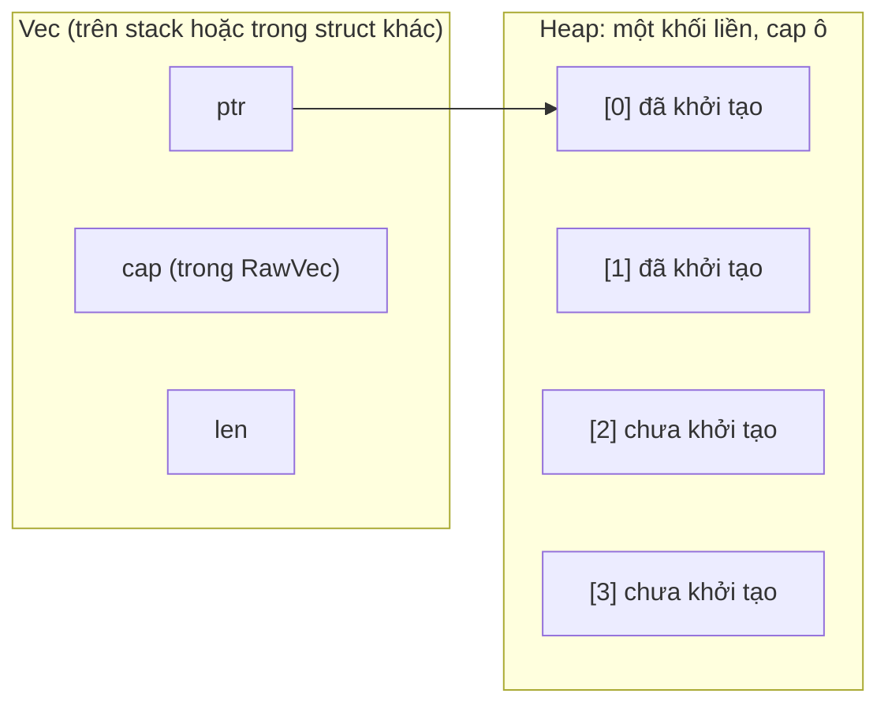
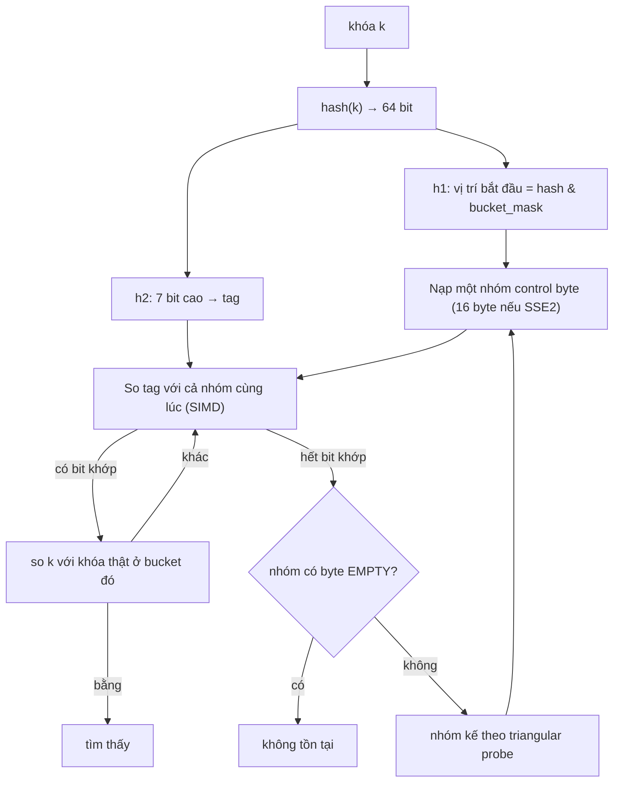
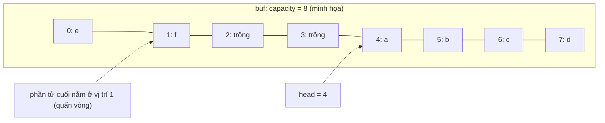
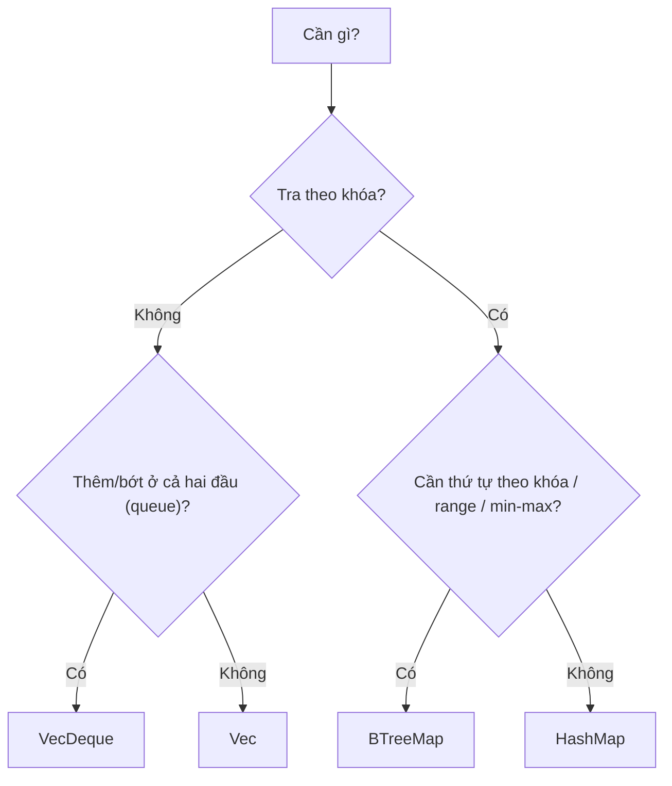

# P10 · Chương 09 — Bên trong collection của std: Vec, String, HashMap, BTreeMap, VecDeque

> Mọi khẳng định về `std` là theo **Rust 1.95.0**: docs `doc.rust-lang.org/1.95.0`, source tag `1.95.0`, và crate `hashbrown` 0.16.1 (bản mà `library/Cargo.lock` của tag 1.95.0 ghim). Chương phân biệt ba loại thông tin: **bảo đảm** (docs hứa, code `unsafe` được phép dựa vào), **chi tiết cài đặt** (đọc từ source 1.95.0, bản sau có thể đổi) và **suy luận của người soạn**. Chương này không chạy thí nghiệm nào: các con số như capacity sau những lần `push` đầu hay "tải thực tế" của bảng băm chỉ được suy ra từ source đọc được và ghi rõ như vậy.

## Bạn sẽ hiểu được gì

1. **Q1.** `Vec<T>` thực sự là gì trong bộ nhớ, `RawVec` làm gì, và khi nào `Vec` không cấp phát? → mục 1
2. **Q2.** Capacity tăng thế nào khi `push` đầy, docs hứa gì, và vì sao `push` vẫn là amortized O(1); `with_capacity`/`reserve`/`shrink_to_fit` dùng ra sao? → mục 2
3. **Q3.** `String` là gì bên trong, vì sao không `s[0]`, và vì sao cắt `&s[a..b]` có thể panic? → mục 3
4. **Q4.** `HashMap` của std bên trong là gì (hashbrown/SwissTable), một lần tra cứu diễn ra thế nào, và "load factor" thật sự là bao nhiêu? → mục 4
5. **Q5.** Vì sao hash mặc định là SipHash có seed ngẫu nhiên, HashDoS là gì, và `RandomState` làm gì? → mục 5
6. **Q6.** `BTreeMap` là B-tree gì, và vì sao docs nói nó thân thiện cache hơn cây nhị phân? → mục 6
7. **Q7.** `VecDeque` là ring buffer thế nào, và vì sao `push_front` O(1) còn `Vec::insert(0, _)` thì không? → mục 7
8. **Q8.** Chọn collection nào: bảng độ phức tạp trong docs đọc ra sao, ký hiệu `*` và `~` nghĩa là gì? → mục 8

## Kiến thức cần trước

- [Chương 02 — Type layout](02-type-layout.md): size/alignment, niche (vì sao `Option<Vec<T>>` không tốn thêm chỗ thuộc về chương đó), ZST.
- [Chương 06 — Heap allocator (Phase 3)](../03-memory/06-heap-allocator.md): `malloc`/`realloc` làm gì; collection chỉ là người dùng của allocator.
- [Chương 06 — Cache và NUMA (Phase 2)](../02-cpu/06-cache-va-numa.md): cache line, locality; cần cho Q4, Q6, Q7.

## 1. `Vec<T>`: ba từ máy và một vùng heap (Q1)

> **Trả lời ngắn.** `Vec<T>` là một struct nhỏ gồm đúng ba thứ: con trỏ tới vùng nhớ, capacity (số phần tử vùng đó chứa được) và len (số phần tử đang dùng)[^vec-triplet]. Các phần tử nằm liền nhau trên heap; `len` phần tử đầu đã khởi tạo, phần còn lại của capacity thì chưa[^vec-heap]. `Vec` rỗng với capacity 0 không cấp phát gì[^vec-noalloc].

**Giải thích.**

*Với service `ingest`.* Giả sử bạn viết `ingest`, một service Rust nhận event qua HTTP rồi ghi xuống đĩa. Mỗi request mang một token session trong header và một body JSON. `ingest` tra session theo token, gom event vào batch, đưa batch vào chỉ mục theo thời gian, và cuối cùng giao batch cho một thread ghi đĩa. Mỗi việc đó dùng một collection của chương này, nên ta sẽ bám theo `ingest` suốt chương (nhận xét của người soạn: đây là ví dụ giả định, không phải code trong repo):

| Việc của `ingest` | Collection | Mục |
|---|---|---|
| Gom event của một batch trước khi ghi | `Vec<Event>` | 1, 2 |
| Giữ tên hiển thị của người dùng | `String` | 3 |
| Tra session theo token trong header | `HashMap<String, Session>` | 4, 5 |
| Trả event theo khoảng thời gian | `BTreeMap<u64, Event>` | 6 |
| Hàng đợi batch chờ thread ghi đĩa | `VecDeque<Batch>` | 7 |

Mục này bắt đầu từ việc đầu tiên: batch `Vec<Event>` nằm trong bộ nhớ thế nào, và vì sao đưa nó cho thread khác lại rẻ.

### 1.1 Ba trường trên stack, dữ liệu trên heap

Docs của `Vec` khẳng định nó "luôn là" một bộ ba (con trỏ, capacity, length), không hơn không kém. Thứ tự các field không được đặc tả, nên bạn chỉ đụng tới chúng qua method[^vec-triplet]. Với batch của `ingest`, điều này có nghĩa là dù batch chứa 10.000 event, bản thân `Vec<Event>` vẫn chỉ là ba từ máy nằm trên stack (hoặc trong struct chứa nó), còn 10.000 event nằm liền nhau trên heap[^vec-heap]. Vì vậy chuyển batch cho thread ghi đĩa (move) chỉ chép ba từ đó chứ không chép event (suy luận của người soạn).

Source 1.95.0 khai báo `Vec` có hai field: `buf: RawVec<T, A>` và `len: usize`[^vec-src]. Con trỏ và capacity vì thế nằm *bên trong* `RawVec`. Con trỏ này không bao giờ null, nên `Vec` được tối ưu null-pointer (niche, xem [Chương 02](02-type-layout.md))[^vec-nonnull].

(Minh họa: `len = 2`, `cap = 4`, giống hình ASCII trong docs `Vec`[^vec-heap].)

### 1.2 `RawVec` lo phần buffer

`RawVec` là lớp lo việc quản lý vùng nhớ: theo comment trong source, nó là tiện ích cấp thấp để cấp phát, cấp phát lại và giải phóng một buffer trên heap, giúp người dùng khỏi phải xử lý các trường hợp góc[^rawvec-doc]. Con trỏ nằm trong field `ptr` của `RawVecInner`[^rawvec-fields]; capacity nằm trong field `cap`, và field này không dùng cho ZST[^rawvec-zst-cap].

Điểm cần nhớ là `RawVec` **không** nhìn vào nội dung. Khi bị drop, nó giải phóng vùng nhớ nhưng không drop các phần tử[^rawvec-nodrop]. Việc drop phần tử vì vậy thuộc về `Vec`, vì chỉ `Vec` biết `len` (suy luận của người soạn).

### 1.3 `Vec` rỗng không cấp phát

`Vec::new`, `vec![]`, `Vec::with_capacity(0)` và `shrink_to_fit` trên `Vec` rỗng đều không cấp phát[^vec-noalloc]. Docs phát biểu điều kiện cấp phát như sau: `Vec` cấp phát khi và chỉ khi `size_of::<T>() * capacity() > 0`[^vec-zst]. Suy ra với ZST, `size_of::<T>()` bằng 0 nên không bao giờ cấp phát (suy luận của người soạn).

Hệ quả cho `ingest` (nhận xét của người soạn): nếu mỗi event mang một `Vec<Tag>` mặc định và đa số event không có tag nào, hàng triệu `Vec` rỗng đó chỉ tốn đúng ba từ máy mỗi cái, chưa gọi allocator lần nào.

### 1.4 Không có small-buffer optimization

Docs nói `Vec` sẽ không bao giờ lưu phần tử trên stack kiểu "small optimization", và đưa ra hai lý do. Lý do thứ nhất: làm vậy khiến code `unsafe` khó thao tác đúng, vì nội dung `Vec` sẽ không có địa chỉ ổn định nếu chỉ bị move, và khó biết `Vec` đã cấp phát hay chưa[^vec-nosso-unsafe]. Lý do thứ hai: nó làm mọi truy cập thêm một nhánh rẽ[^vec-nosso]. Vậy `Vec` không rỗng vẫn cần một lần cấp phát (suy luận của người soạn). Nếu `ingest` cần tránh lần cấp phát đó, bạn phải dùng kiểu khác ngoài `Vec`, chẳng hạn crate bên thứ ba (nhận xét của người soạn).

Đi sâu: <code>RawVecInner</code>, ZST, bộ nhớ không ổn định layout

- `RawVec<T, A>` trong source 1.95.0 bọc một `RawVecInner<A>` không generic theo `T`. Tác giả ghi lý do: tách như vậy giảm lượng code phải monomorphize, vì phần lớn thao tác chỉ cần layout của phần tử chứ không cần kiểu thật[^rawvec-inner]. (Monomorphization: [Chương 04](04-monomorphization.md).)
- Với ZST, `RawVec` không dùng field `cap`; hàm `capacity()` trả `usize::MAX`[^rawvec-zst-cap]. Docs `Vec` cũng cảnh báo `Vec<ZST>` có thể không báo capacity 0[^vec-zst]. Hai điều này khớp nhau (suy luận của người soạn).
- `RawVec::new` tạo capacity 0 nếu `T` có kích thước dương, và `usize::MAX` nếu `T` là ZST[^rawvec-new].
- Docs `Vec` nói rõ ABI không ổn định và layout bộ nhớ (kể cả thứ tự field) không được bảo đảm[^vec-abi]. (Nhận xét của người soạn: vì vậy đừng truyền `Vec<T>` nguyên khối qua ranh giới FFI; tách thành `ptr`/`len`/`cap` bằng `into_raw_parts` rồi dựng lại bằng `from_raw_parts` có điều kiện an toàn riêng, xem docs `Vec` — chương này không phủ chi tiết đó. Chuyện ABI và kiểu đi qua FFI nói chung: [Chương 08](08-panic-abi-ffi.md).)
- Source ghi rằng allocator hiện trả `NonNull<[u8]>` có độ dài đúng bằng kích thước yêu cầu, và nếu điều đó đổi thì capacity ở đây phải đổi theo `ptr.len() / size_of::<T>()`[^rawvec-excess]. Điều này phù hợp với docs `Vec`: allocator được phép trả nhiều hơn yêu cầu, và `capacity()` trả giá trị không nhỏ hơn mức yêu cầu và không lớn hơn mức thực cấp[^vec-cap-guarantee].
- `Vec` bảo đảm không bao giờ cấp phát quá `isize::MAX` byte[^vec-isize].

**Quay lại Q1:** batch `Vec<Event>` của `ingest` là ba từ (ptr, cap, len) trỏ vào một khối heap liền mạch, nên move nó rẻ; `RawVec` giữ ptr và cap, `Vec` giữ thêm len; capacity 0 hoặc ZST thì không cấp phát.

## 2. Capacity tăng thế nào, và `with_capacity`/`reserve`/`shrink_to_fit` (Q2)

> **Trả lời ngắn.** Khi `push` gặp `len == capacity`, `Vec` xin allocator một khối lớn hơn. Allocator có thể mở rộng khối tại chỗ[^alloc-grow-extend]; nếu không đủ chỗ liền kề thì phải cấp vùng mới rồi chép phần tử cũ sang[^book-realloc]. Docs chỉ hứa `push` là amortized O(1) (chi phí trung bình trên một chuỗi thao tác), **không** hứa hệ số nhân nào[^vec-growth-doc]. Source 1.95.0 hiện nhân đôi capacity[^growth-exp], với mức sàn nhỏ tùy kích thước phần tử[^growth-min]; đó là chi tiết cài đặt. Muốn tránh cấp phát lại thì dùng `with_capacity`/`reserve`; muốn trả bộ nhớ thì gọi `shrink_to_fit`, vì collection không bao giờ tự co lại[^vec-noshrink].

**Giải thích.**

*Với service `ingest`.* Batch không biết trước sẽ nhận bao nhiêu event: có lúc 3, có lúc 30.000. Nếu mỗi lần hết chỗ `Vec` chỉ xin thêm đúng một ô thì mỗi `push` phải chép lại cả batch, và `ingest` sẽ chậm dần theo cỡ batch. Mục này cho thấy `Vec` tránh chuyện đó bằng cách nào, và `ingest` nên giúp `Vec` thế nào khi đã biết trước cỡ batch.

### 2.1 `push` đầy: điều kiện kích hoạt

Docs bảo đảm rằng `push` và `insert` không bao giờ cấp phát lại nếu capacity báo cáo còn đủ, và sẽ cấp phát lại khi `len == capacity`. Nói cách khác, capacity mà `Vec` báo là chính xác và tin được[^vec-push-guarantee]. Trong source 1.95.0, `push` chỉ gọi `push_mut`, và `push_mut` kiểm đúng điều kiện đó: `if len == self.buf.capacity() { self.buf.grow_one(); }`[^vec-push-src].

### 2.2 Capacity mới là bao nhiêu

`grow_one` gọi `grow_amortized` với `additional = 1`[^growth-grow-one]. Trong `grow_amortized`, capacity mới là số lớn hơn giữa `2 × capacity cũ` và `len + additional`, rồi lại lấy số lớn hơn giữa mức sàn `min_non_zero_cap` và giá trị đó. Comment trong source ghi rằng đây là cách bảo đảm tăng trưởng mũ[^growth-exp]. Mức sàn có ba bậc: 8 nếu phần tử 1 byte (vì allocator thường làm tròn yêu cầu dưới 8 byte lên ít nhất 8), 4 nếu phần tử ≤ 1 KiB, và 1 nếu lớn hơn (để khỏi lãng phí chỗ cho `Vec` rất ngắn)[^growth-min].

### 2.3 Xin allocator, và vì sao địa chỉ phần tử đổi

`finish_grow` gọi `allocator.grow(ptr, old_layout, new_layout)` nếu đã có vùng nhớ, hoặc `allocate(new_layout)` nếu chưa[^growth-finish]. Allocator *có thể* mở rộng khối tại chỗ, nhưng khi `grow` thành công thì con trỏ cũ không còn dùng được, kể cả khi mở rộng tại chỗ[^alloc-grow-invalid]. Nghĩa là sau một lần `push`, địa chỉ của các event trong batch có thể đã đổi. Sách Rust giải thích đúng điểm này: thêm phần tử có thể phải cấp phát vùng mới và sao chép, và đó là lý do borrow checker cấm giữ tham chiếu tới phần tử trong lúc `push`[^book-realloc].

### 2.4 Amortized O(1) nghĩa là gì

Mỗi lần `push` vượt capacity tốn O(capacity) để chép sang khối lớn hơn. Docs `push` nói chi phí đó được "bù" bởi `capacity` lần chèn O(1) mà khối mới cho phép[^vec-push-doc]. Docs module `collections` định nghĩa chi phí amortized là chi phí tính trên một chuỗi đủ dài các thao tác, nên một thao tác riêng lẻ có thể chậm hơn hoặc nhanh hơn[^coll-amortized-def].

Phép tính sau là toán thuần, suy luận của người soạn. Với nhân đôi, gọi `c` là capacity lớn nhất từng bị đầy trước khi đẩy được phần tử thứ `n` (nên `c < n`). Tổng số phần tử bị sao chép là không quá `c + c/2 + c/4 + … < 2c < 2n`, tức dưới 2 lần sao chép cho mỗi phần tử, một hằng số. Đây là cận trên, vì allocator có thể mở rộng tại chỗ mà không chép. Với `ingest`: số lần batch bị chép giảm theo lôgarit của cỡ batch, và chi phí chép trung bình mỗi event là hằng số.

### 2.5 Capacity cụ thể

Phần này suy từ source ở trên, chương không chạy thử. Với `Vec<u8>` rỗng, lần `push` đầu cho `max(0×2, 1) = 1`, rồi `max(8, 1) = 8`; các lần sau là 16, 32, … Với phần tử 4 byte: 4, 8, 16, … Với phần tử > 1 KiB: 1, 2, 4, … (áp dụng công thức ở 2.2). Docs không bảo đảm các số này. Số đo thật (push 40 phần tử: `Vec<u64>` ra `4 8 16 32 64`, `Vec<u8>` ra `8 16 32 64`, khớp công thức trên) nằm ở [P3·08, mục 4](../03-memory/08-rust-va-bo-nho.md), phần Đi sâu.

### 2.6 Điều docs hứa quanh capacity

Khi `ingest` đã biết cỡ batch (chẳng hạn mỗi lần flush luôn là 1.000 event), nó nên nói trước cho `Vec`. Docs hứa những điều sau:

- `Vec::with_capacity(n)` (và `vec![x; n]`, `vec![a, b, …]`) yêu cầu allocator **đúng** kích thước cho `n` phần tử, không làm tròn lên lũy thừa của 2 hay kích thước nào khác[^vec-exact]. `with_capacity(0)` không cấp phát[^vec-with-cap].
- `reserve(additional)` bảo đảm sau khi gọi, capacity ≥ `len + additional`, và có thể xin dư để tránh cấp phát lặp[^vec-reserve]. `reserve_exact` không cố ý xin dư, nhưng allocator vẫn có thể cho nhiều hơn, nên capacity không dùng làm cận dưới chính xác[^vec-reserve-exact]. Docs khuyên dùng `reserve` nếu còn chèn tiếp.
- `shrink_to_fit` cố bỏ phần capacity dư; kết quả phụ thuộc allocator và vẫn có thể còn dư[^vec-shrink]. `shrink_to(min)` co về không dưới `max(len, min)`[^vec-shrink-to].
- `Vec` không bao giờ tự co, kể cả khi rỗng: rỗng rồi đổ đầy lại về cùng `len` thì không gọi allocator[^vec-noshrink]. Cả module `collections` theo cùng nguyên tắc: tránh tự co để có hiệu năng[^coll-shrink]. Vì vậy thao tác xóa không được tính amortized[^coll-never-shrink].

Một hệ quả (nhận xét của người soạn): nếu `ingest` đọc batch lớn vào `Vec` rồi dùng lại buffer cho batch sau, buffer giữ nguyên capacity đỉnh. Một batch đột biến duy nhất mà RSS không giảm là hành vi theo thiết kế, không phải rò rỉ. Chương [heap allocator](../03-memory/06-heap-allocator.md) giải thích vì sao ngay cả `free` cũng chưa chắc trả RSS cho hệ điều hành.

Đi sâu: các nhánh trong source, <code>reserve</code> khác gì <code>push</code>, docs module về capacity

- `Vec::reserve` gọi `self.buf.reserve(self.len, additional)`[^vec-reserve-src]. `RawVecInner::reserve` chỉ gọi phần chậm `do_reserve_and_handle` → `grow_amortized` khi `needs_to_grow`. Comment giải thích muốn hàm này rẻ khi đã đủ chỗ, thành "một phép so sánh và một lời gọi"[^rawvec-reserve-cheap].
- Vì `reserve` cũng đi qua `grow_amortized`, nó hưởng cùng công thức `max(2×cap, len+additional)`. Tức `reserve(1)` lặp lại vẫn tăng theo mũ. `reserve_exact` thì không, vì nó đi nhánh `grow_exact`[^rawvec-grow-exact]. Đây là suy luận của người soạn từ source; docs không hứa công thức.
- `Vec::shrink_to_fit` chỉ gọi xuống `RawVec` khi `capacity() > len`, để tránh panic "co lên capacity lớn hơn"[^vec-shrink-src].
- `try_allocate_in` không cấp phát khi layout có kích thước 0, vì `Drop` không giải phóng khi capacity 0[^rawvec-nodealloc].
- Docs module `collections` giải thích vì sao có kiểu tăng "có dư": nếu mảng nền luôn vừa khít, mỗi lần chèn phải cấp phát mảng mới và chép lại toàn bộ, điều docs gọi là "không hiệu quả"[^coll-why-array]. Collection không biết trước mình sẽ nhận bao nhiêu phần tử, nên lập trình viên được kỳ vọng "gợi ý" qua `with_capacity`[^coll-with-cap]. Họ `reserve` làm cùng việc đó khi sắp có một đợt phần tử lớn[^coll-reserve].
- `Allocator::grow` hiện là API nightly (`allocator_api`)[^alloc-nightly]; `Vec` dùng nó nội bộ qua trait (`finish_grow` ở trên). Với allocator mặc định (`Global`), source 1.95.0 cài `grow` bằng lời gọi `realloc` khi khối cũ khác 0 byte và căn lề không đổi[^glob-grow-realloc].
- Hợp đồng của `GlobalAlloc::realloc`: ownership chuyển cho allocator, mọi truy cập con trỏ cũ là UB kể cả khi block ở nguyên chỗ, và vùng `0..min(old, new)` giữ nguyên giá trị[^ga-realloc]. (Phần `realloc` của glibc làm gì: [Phase 3](../03-memory/06-heap-allocator.md).)

**Quay lại Q2:** capacity tăng khi `len == capacity`; docs chỉ hứa amortized O(1) chứ không hứa hệ số; source 1.95.0 hiện nhân đôi với mức sàn 8/4/1; với batch của `ingest`, dùng `with_capacity`/`reserve` khi biết trước cỡ và `shrink_to_fit` khi muốn nhả bộ nhớ.

## 3. `String`: `Vec<u8>` đảm bảo UTF-8, và vì sao index theo byte (Q3)

> **Trả lời ngắn.** `String` là một `Vec<u8>` có thêm bất biến "nội dung luôn là UTF-8 hợp lệ"[^str-utf8]. Một ký tự UTF-8 có thể chiếm nhiều byte nên "ký tự thứ i" không tìm được trong O(1), và Rust không cho viết `s[0]`. Thay vào đó bạn cắt theo **byte offset** `&s[a..b]`, và lệnh này panic nếu a hoặc b không rơi vào ranh giới ký tự[^str-slice-src].

**Giải thích.**

*Với service `ingest`.* Mỗi event mang tên hiển thị của người dùng, và tên tiếng Việt đầy chữ có dấu. Giả sử `ingest` muốn cắt tên cho vừa một cột log rộng 10. Viết `&name[..10]` thì gọn, nhưng nếu vị trí cắt rơi giữa một ký tự nhiều byte thì handler panic (nhận xét của người soạn). Mục này giải thích `String` lưu gì bên trong, và vì sao Rust đòi bạn cắt theo byte thay vì theo ký tự.

### 3.1 Biểu diễn

Docs `String` nói nó gồm ba thành phần: con trỏ tới các byte, length và capacity, và length tính bằng **byte**[^str-repr]. Buffer này luôn nằm trên heap[^str-heap]. Source 1.95.0 xác nhận: `pub struct String { vec: Vec<u8>, }`[^str-src]. Sách Rust diễn đạt gọn hơn: `String` là một wrapper quanh `Vec<u8>`[^book-wrapper]. Vì vậy mọi điều ở mục 1 và mục 2 (capacity, tăng trưởng, `reserve`) áp dụng nguyên cho `String`. Chiều ngược lại cũng rẻ: `String::into_bytes` trả chính `Vec<u8>` bên trong[^str-into-bytes].

`String::len` trả độ dài tính bằng byte, không phải số ký tự hay grapheme, nên có thể không khớp với cảm nhận "độ dài" của con người[^str-len].

### 3.2 Vì sao không có `s[i]`

Sách Rust nêu nhiều lý do; lý do mà người làm hệ thống quan tâm là toán tử index được kỳ vọng luôn mất O(1). Với `String` thì Rust phải đi từ đầu tới vị trí đó để đếm xem có bao nhiêu ký tự hợp lệ, nên không thể bảo đảm O(1)[^book-index-o1]. Doc comment trên `String` trong source cũng ghi rằng kiểu index được hỗ trợ là khoảng byte: nó chấp nhận chỉ số byte (để hằng thời gian) và trả `&str` UTF-8[^str-slice-src2].

### 3.3 Cắt chuỗi

`&s[i..j]` panic nếu chỉ số không phải ranh giới ký tự[^str-slice-src]. Sách Rust cho ví dụ cắt giữa một ký tự 2 byte, và chương trình panic lúc chạy với thông báo "byte index 1 is not a char boundary"[^book-slice-panic]. Để tránh panic, bạn có hai công cụ. `str::is_char_boundary(i)` cho biết byte thứ `i` có phải byte đầu của một chuỗi UTF-8, hoặc là cuối chuỗi[^str-boundary]. `str::get(a..b)` là phiên bản không panic của phép cắt[^str-get].

Hệ quả cho `ingest` (nhận xét của người soạn): đừng cắt tên hay log theo "N ký tự" bằng index byte. Hãy dùng `chars()`/`char_indices()` hoặc kiểm tra boundary, nếu không một request có chữ có dấu ở đúng vị trí cắt sẽ làm handler panic.

### 3.4 Deref

`String` triển khai `Deref<Target = str>`, nên thừa hưởng mọi method của `str`, và `&String` tự chuyển thành `&str`[^str-deref]. Hàm của `ingest` nhận `&str` vì thế gọi được với cả `String` lẫn chuỗi literal.

Đi sâu: các method buộc phải ở ranh giới, UTF-8 chiếm bao nhiêu byte

- Nhiều method sửa chuỗi `assert!` ranh giới ký tự trước khi thao tác trên `Vec<u8>` nền, ví dụ `insert`: `assert!(self.is_char_boundary(idx));`[^str-insert-src]. Tức là bất biến UTF-8 được giữ bằng kiểm tra lúc chạy chứ không phải bằng kiểu.
- Docs `String` chỉ ra UTF-8 là mã hóa độ dài biến thiên nên `String` thường nhỏ hơn mảng `char` tương ứng (mỗi `char` 4 byte)[^str-utf8-width]. Chương [type layout](02-type-layout.md) nói về `char`.
- Docs `str::is_char_boundary` coi đầu và cuối chuỗi (`index == len`) là ranh giới, và trả `false` nếu `index > len`[^str-boundary].

**Quay lại Q3:** `String` = `Vec<u8>` + bất biến UTF-8; `len` và mọi chỉ số là byte; không index từng ký tự vì không O(1); `ingest` muốn cắt tên phải cắt đúng ranh giới ký tự, nếu không sẽ panic.

## 4. `HashMap`: hashbrown, SwissTable và load factor (Q4)

> **Trả lời ngắn.** Docs mô tả `HashMap` của std là bảng băm dùng quadratic probing và tra cứu bằng SIMD[^hm-desc], và là bản port Rust của SwissTable của Google[^hm-swiss]. Ở 1.95.0 phần bảng là crate `hashbrown` 0.16.1[^hm-lock]. Mỗi bucket có một byte điều khiển; tra cứu so khớp byte điều khiển của cả một nhóm bucket cùng lúc, và chỉ so khóa thật ở những bucket khớp[^hb-find]. Theo source, bảng không chứa quá 7/8 số bucket[^hb-load].

**Giải thích.**

*Với service `ingest`.* Mỗi request vào đều bắt đầu bằng một lần `sessions.get(token)`: `sessions` là `HashMap<String, Session>` còn `token` lấy từ header. Đây là đường nóng của `ingest`, nên ta cần biết một lần tra cứu thực sự chạm vào những gì trong bộ nhớ, và bảng đầy tới mức nào thì phải nở ra.

### 4.1 Nguồn gốc: hashbrown

`std::collections::HashMap` chứa một field `base: base::HashMap<K, V, S, A>` với `use hashbrown::hash_map as base;`[^hm-base]. `Cargo.lock` của workspace library ở tag 1.95.0 ghim `hashbrown` phiên bản 0.16.1[^hm-lock]. Docs hashbrown tự mô tả: bản port của SwissTable, làm sao để thay thế trực tiếp `HashMap`/`HashSet` của std[^hb-doc]. Docs std chỉ nói "bản port của SwissTable" và dẫn bài nói CppCon[^hm-swiss]. Vì vậy cấu trúc chi tiết dưới đây là từ **source hashbrown 0.16.1**, tức chi tiết cài đặt.

### 4.2 Cấu trúc: bucket và control byte

Bảng là một mảng bucket với số bucket là lũy thừa của 2, kèm một mảng *control byte* (một byte mỗi bucket):

- Byte điều khiển bằng `0b1111_1111` là bucket **trống**, `0b1000_0000` là bucket **đã xóa** (tombstone)[^hb-tag-consts], còn bucket đầy thì top bit là 0[^hb-tag-full]. Với bucket đầy, 7 bit thấp của byte là **7 bit cao của hash**[^hb-top7] (gọi là tag, hay h2).
- Vị trí bắt đầu lấy từ các bit thấp của hash: `pos = h1(hash) & bucket_mask`, trong đó `h1` chỉ là ép hash 64 bit về `usize`[^hb-h1]. Phép `&` với `bucket_mask` tương đương `hash % buckets` vì số bucket là lũy thừa của 2[^hb-pos].

### 4.3 Một lần tra cứu

Khi `ingest` gọi `sessions.get(token)`, hàm `find_inner` làm như sau. Nó tính `tag_hash` và `probe_seq` từ hash của token, rồi lặp: nạp một `Group` byte điều khiển tại `probe_seq.pos`; với mỗi bit khớp tag trong nhóm, tính `index = (pos + bit) & bucket_mask` và gọi hàm so khóa `eq(index)`; nếu nhóm có byte `EMPTY` thì trả `None`, nếu không thì sang nhóm tiếp[^hb-find]. Lý do dừng khi gặp `EMPTY` là một chuỗi probe không bao giờ "vượt" qua bucket trống của mình. Đây là suy luận của người soạn từ cấu trúc, phù hợp với việc source yêu cầu luôn có ít nhất một bucket trống (xem 4.5).

Điểm đáng giá của thiết kế này: phần lớn lần tra cứu chỉ đọc một nhóm byte điều khiển nằm liền nhau, rồi so khóa thật ở rất ít bucket, thay vì so khóa ở từng bucket một (nhận xét của người soạn).

### 4.4 SIMD và probe

Với x86/x86_64 có SSE2, `Group` quét 16 bucket một lần[^hb-sse2-doc]. Nếu máy không có SIMD phù hợp thì hashbrown dùng bản `generic`[^hb-generic-cfg]. Chi tiết lệnh SSE2 và trường hợp aarch64/NEON nằm ở phần Đi sâu.

Khi nhóm đầu tiên không có khóa cần tìm và cũng không có ô trống, hashbrown sang nhóm khác. Dãy probe dựa trên số tam giác: nhảy 1 nhóm, rồi 2, rồi 3…; vì số bucket là lũy thừa của 2 nên probe ghé thăm mọi nhóm đúng một lần[^hb-probe]. Docs std gọi cách này là "quadratic probing"[^hm-desc] (suy luận của người soạn: số tam giác là một dạng thăm dò bậc hai).

### 4.5 Load factor và tăng trưởng

Docs std không nêu con số tải tối đa; nó chỉ có ở source hashbrown 0.16.1. Với bảng đủ lớn, source bắt buộc 1/8 số bucket phải trống, tức tải tối đa 87,5%[^hb-load]. Số phần tử tối đa của bảng lớn là `(buckets / 8) * 7`[^hb-cap-large]. Bảng nhỏ (≤ 8 bucket) luôn chừa một ô trống[^hb-cap-small], vì cần ít nhất một bucket trống để tra cứu khóa vắng mặt chắc chắn dừng được[^hb-small-empty].

Khi bảng chạm ngưỡng đó, hashbrown phải tăng. `reserve` chỉ làm việc nặng khi `additional > growth_left`, với `growth_left` là số ô còn chèn được trước khi chạm ngưỡng tải tối đa[^hb-reserve]. Khi đó nó cấp một bảng mới lớn hơn bằng `resize_inner`[^hb-resize-doc], và `resize_inner` băm lại từng phần tử đang có (gọi `hasher`) rồi đặt vào bảng mới[^hb-resize-hash]. Vì vậy một lần `insert` của `ingest` thỉnh thoảng tốn O(n), cùng lý do amortized như `Vec` ở mục 2 (suy luận của người soạn). Con số thực tế: với bảng lớn lên bằng `insert` liên tục, tải dao động xấp xỉ giữa 43,75% và 87,5% (phép tính trên giấy ở phần Đi sâu, không chạy thử).

### 4.6 Capacity và thứ tự duyệt

Docs std về capacity của `HashMap`: map mới tạo có capacity 0 và không cấp phát cho tới lần chèn đầu[^hm-cap-zero]. `with_capacity(n)` giữ chỗ cho *ít nhất* `n` phần tử và được phép cấp nhiều hơn[^hm-with-cap]. `reserve` tương tự `Vec::reserve`[^hm-reserve]. `shrink_to_fit` co "theo luật nội bộ" và có thể chừa chỗ theo chính sách resize[^hm-shrink].

Thứ tự duyệt là tùy ý ("arbitrary order")[^hm-arbitrary], nên đừng dựa vào nó để trả event theo thứ tự nào. Theo docs hiện tại, duyệt tốn O(capacity) chứ không phải O(len), vì iterator cũng ghé các bucket trống[^hm-iter-cap]. Hệ quả (nhận xét của người soạn): `sessions` từng phình rất lớn rồi xóa gần hết vẫn duyệt chậm cho tới khi `shrink_to_fit`.

Đi sâu: SIMD theo kiến trúc, tombstone, tính tải thực tế, bảng nhỏ

- **Lệnh SSE2.** Hàm `match_tag` dùng `_mm_cmpeq_epi8` (so sánh từng byte) rồi `_mm_movemask_epi8` (gom thành mặt nạ bit)[^hb-sse2-cmp]. Source hashbrown cũng ghi nguyên nhân chọn SSE2 mà không chọn AVX: không cần dispatch lúc chạy, và xác suất khớp giảm mạnh sau vài bucket đầu[^hb-sse2-doc].
- **aarch64.** Trên aarch64 little-endian có NEON, source chọn module `neon`[^hb-neon-cfg]. Máy Apple Silicon thuộc nhóm này (nhận xét của người soạn). Cùng khối cấu hình còn một comment của tác giả nói đã thử NEON nhưng đa số lệnh NEON có độ trễ nhiều chu kỳ, triệt tiêu lợi ích so với bản generic[^hb-neon-comment]. Comment đó nằm cạnh một nhánh `neon` đang tồn tại nên có thể đã cũ (suy luận của người soạn); vì vậy đừng giả định NEON luôn nhanh hơn bản generic.
- **Hằng và hàm byte điều khiển.** `EMPTY = 0b1111_1111`, `DELETED = 0b1000_0000`[^hb-tag-consts]. "Đầy" khi top bit xóa[^hb-tag-full]; "đặc biệt" (EMPTY hoặc DELETED) khi top bit đặt[^hb-tag-special]. Phân biệt EMPTY với DELETED chỉ cần kiểm 1 bit[^hb-tag-special-empty], là bit thấp nhất (suy ra từ hai hằng số, suy luận của người soạn). `match_empty_or_deleted` đọc thẳng top bit từng byte[^hb-sse2-high].
- **Vì sao có `DELETED`.** Comment trong hàm `erase` giải thích rằng không thể đơn giản đặt byte vừa xóa thành `EMPTY`, vì `find_inner` có thể gặp byte `EMPTY` đó trước khi tìm thấy phần tử cần tìm và dừng tìm[^hb-erase]. Nếu bucket nằm trong một dải liền ít nhất `Group::WIDTH` byte đầy hoặc đã xóa thì phải đặt `DELETED` để `find_inner` đi tiếp[^hb-erase-rule]. Còn nếu nhóm quanh nó đã có byte `EMPTY` thì đặt `EMPTY` là an toàn[^hb-erase-empty]. Chính vì vậy `reserve_rehash_inner` có nhánh băm lại tại chỗ "khi có nhiều chỗ trống bị khóa bởi các entry DELETED"[^hb-rehash-inplace].
- **Chi tiết tăng trưởng.** `reserve_rehash_inner` tính `new_items = items + additional` và `full_capacity`. Nếu `new_items <= full_capacity / 2` thì băm lại **tại chỗ** (vì nhiều chỗ bị tombstone chiếm)[^hb-rehash-inplace]. Còn không thì cấp bảng mới với capacity `max(new_items, full_capacity + 1)`[^hb-resize-cap].
- **Từ capacity sang số bucket.** Nếu capacity yêu cầu ≥ 15 thì lấy `cap * 8 / 7` rồi làm tròn lên lũy thừa của 2[^hb-roundup]. Nếu < 15 thì đi nhánh riêng chỉ chọn 4, 8 hoặc 16 bucket (xem bullet về bảng nhỏ bên dưới).
- **Tính tải thực tế (suy luận của người soạn, phép tính trên giấy từ `reserve_rehash_inner` và `capacity_to_buckets`, không chạy thử).** Với bảng `B ≥ 16` bucket lớn lên nhờ `insert` liên tục, bảng đầy ở `7B/8` phần tử. Phần tử kế tiếp gọi `reserve_rehash_inner` với `new_items = 7B/8 + 1`, nên capacity yêu cầu là `max(new_items, full_capacity + 1) = 7B/8 + 1`, và `(7B/8 + 1) * 8 / 7 = B + 1` theo phép chia nguyên; làm tròn lên lũy thừa 2 cho `2B` bucket. Ngay sau lần tăng, tải là `(7B/8 + 1) / 2B`, xấp xỉ 43,75% (ví dụ 15 phần tử trong 32 bucket là khoảng 46,9%), rồi tăng dần tới 87,5% ngay trước lần tăng kế. Vậy với bảng lớn lên bằng `insert`, tải thực tế dao động xấp xỉ giữa 43,75% và 87,5%. Bảng rất nhỏ hoặc bảng tạo bằng `with_capacity` có thể khác, ví dụ bảng 4 bucket chứa tối đa 3 phần tử, tức 75%.
- **Bảng nhỏ** (capacity yêu cầu < 15) được xử lý riêng: source nâng mức capacity tối thiểu tùy kích thước phần tử để không lãng phí byte đệm theo căn lề của mảng control[^hb-small-table]. Mức nâng chọn theo cặp (độ rộng `Group`, kích thước phần tử): comment lấy ví dụ `Group` 16 byte như x86_64 SSE2, và mã có cả nhánh cho `Group` 8 byte[^hb-min-cap]. Sau đó source bỏ qua bảng 2 bucket (chỉ chứa được 1 phần tử) để nhảy thẳng tới bảng 4 bucket chứa được 3 phần tử[^hb-small-4].
- **Logic error.** Nếu khóa mutate khiến hash/eq đổi khi đang nằm trong map, hoặc cài đặt `Hash`/`Eq` sai, đó là *logic error*: hành vi không đặc tả nhưng được bao bọc trong `HashMap` đó và không gây UB. Hậu quả có thể gồm panic, kết quả sai, abort, rò bộ nhớ, và vòng lặp vô hạn[^hm-logic].

**Quay lại Q4:** `sessions` của `ingest` là hashbrown (SwissTable): bảng 2^k bucket kèm một byte điều khiển mỗi bucket (7 bit hash cao). Tra cứu so một nhóm byte bằng SIMD rồi mới so khóa; theo source, tải tối đa 7/8, và khi đầy thì băm lại sang bảng lớn hơn.

## 5. SipHash, HashDoS và `RandomState` (Q5)

> **Trả lời ngắn.** Hash mặc định của `HashMap` được chọn để chống tấn công HashDoS, nên có seed ngẫu nhiên lấy từ nguồn ngẫu nhiên của hệ thống[^hm-hashdos]. Thuật toán hiện là SipHash 1-3, nhưng docs cho phép đổi bất cứ lúc nào[^hm-sip]. Mỗi `RandomState` mang cặp khóa riêng, nên hai map khác nhau băm cùng một khóa ra kết quả khác nhau[^rs-doc]. Đổi lại, SipHash không phải nhanh nhất cho khóa nhỏ[^hm-sip-perf], nên docs cho phép thay hasher[^hm-replace].

**Giải thích.**

*Với service `ingest`.* Token trong header `X-Session` do client gửi lên, tức là người ngoài kiểm soát khóa của `sessions`. Đó chính là loại khóa mà một kẻ tấn công có thể chọn sao cho nhiều khóa rơi vào cùng chỗ. Mục này giải thích vì sao `HashMap` mặc định có SipHash và seed ngẫu nhiên, và khi nào `ingest` có thể đổi sang hasher nhanh hơn.

### 5.1 Vấn đề: HashDoS

Docs module `collections` nêu rằng `HashMap` dùng chi phí kỳ vọng. Về lý thuyết, dù rất khó xảy ra, `HashMap` có thể có hiệu năng tệ hơn kỳ vọng nhiều[^coll-expected]. Nguyên nhân là tính xác suất của hashing: có thể tạo ra hash trùng với một số khóa đầu vào, và xử lý trùng cần thêm tính toán[^coll-expected2].

Nếu khóa do bên ngoài kiểm soát (header, tham số query, JSON key trong request) và hash đoán được, kẻ tấn công có thể cố ý làm nhiều khóa trùng nhau. Đó là ý của "HashDoS" (suy luận của người soạn từ tên gọi; docs chỉ viết "HashDoS attacks" mà không định nghĩa chi tiết).

### 5.2 Giải pháp mặc định

Docs `HashMap` nói thuật toán băm mặc định được chọn để chống HashDoS và có seed ngẫu nhiên. Seed được tạo "best-effort" từ nguồn ngẫu nhiên mạnh của host, mà không chặn chương trình[^hm-hashdos]. Vì vậy chất lượng seed phụ thuộc chất lượng nguồn entropy của hệ thống lúc tạo, và lúc khởi động khi entropy thấp, seed có thể kém hơn[^hm-seed-quality].

Thuật toán mặc định "hiện tại" là SipHash 1-3, và có thể đổi bất cứ lúc nào[^hm-sip]. Docs `DefaultHasher` nhắc cùng ý: thuật toán bên trong không được đặc tả, đừng dựa vào hash giữa các bản phát hành[^dh-unspec]. Source 1.95.0 đúng như vậy: `DefaultHasher` bọc `SipHasher13`[^rs-dh-src], và `RandomState::build_hasher` tạo nó từ cặp khóa `k0`, `k1` của `RandomState`[^rs-build-src].

### 5.3 `RandomState`

Một instance `RandomState` sinh ra các hasher giống nhau, còn hai instance khác nhau "khó có khả năng" cho cùng kết quả với cùng giá trị[^rs-doc]. `HashMap::new()` dùng `RandomState` mặc định, và bạn có thể thay trên từng map bằng `with_hasher`/`with_capacity_and_hasher`[^hm-replace].

Docs `DefaultHasher::new` còn nói các `DefaultHasher` tạo bằng `new`/`default` giống nhau, nhưng không bảo đảm giống mọi `DefaultHasher` khác[^dh-new]. Vậy đó không phải hash ổn định để lưu đĩa hay chia shard giữa các tiến trình hoặc phiên bản (suy luận của người soạn).

### 5.4 Đổi lại cái gì

Docs nói SipHash khá cạnh tranh với khóa cỡ vừa. Nhưng với khóa nhỏ như số nguyên và khóa lớn như chuỗi dài, thuật toán khác sẽ nhanh hơn, dù chúng thường không chống HashDoS[^hm-sip-perf]. Nhận xét của người soạn: nếu `ingest` có một `HashMap<u64, _>` nội bộ mà khóa không do người ngoài kiểm soát, đổi hasher là tối ưu phổ biến. Với `sessions`, khóa lấy từ request, thì đừng đổi nếu chưa hiểu rủi ro.

### 5.5 Hợp đồng `Hash`/`Eq`

Khóa phải cài `Eq` và `Hash`. Nếu cài tay thì phải giữ `k1 == k2 → hash(k1) == hash(k2)`, vi phạm là logic error[^hm-eq-hash]. Hậu quả của logic error là không đặc tả, nhưng được bao bọc trong map đó và không gây UB[^hm-logic].

Đi sâu: vì sao <code>RandomState::new</code> cộng 1 vào khóa, cache theo thread

- Source `RandomState::new` ghi lịch sử: ban đầu mỗi lần tạo gọi sinh số ngẫu nhiên hai lần; sau khi thấy chậm khi tạo nhiều map trên một thread, nó **cache bộ khóa đầu tiên theo từng thread**[^rs-cache]. Sau đó phát hiện rằng nếu thứ tự duyệt xác định thì cho phép một dạng DoS, nên mỗi lần tạo `RandomState` tăng một trong hai seed thêm 1, để mỗi `HashMap` có thứ tự duyệt khác nhau[^rs-incr].
- Hệ quả (suy luận của người soạn từ hai đoạn trên): các `RandomState` cùng thread chỉ khác nhau ở một khóa tăng dần. Tính "ngẫu nhiên" giữa các map phần lớn đến từ việc đổi seed, còn bộ khóa gốc lấy từ OS một lần mỗi thread.
- Docs `HashMap` cảnh báo ở `with_hasher`/`with_capacity_and_hasher`: hasher thường được sinh ngẫu nhiên để map chống lại các tấn công gây nhiều va chạm và hiệu năng rất tệ; đặt tay có thể mở ra vector tấn công DoS[^hm-with-hasher-warn].

**Quay lại Q5:** `sessions` của `ingest` có khóa do người ngoài gửi, nên hash mặc định chống HashDoS bằng seed ngẫu nhiên (SipHash 1-3 hiện nay, không bảo đảm); chi phí là chậm hơn hash đơn giản cho khóa nhỏ, và có thể thay hasher trên từng map.

## 6. `BTreeMap`: B-tree và cache (Q6)

> **Trả lời ngắn.** `BTreeMap` là map có thứ tự dựa trên B-tree: mỗi node chứa nguyên một mảng phần tử thay vì một phần tử[^bt-bg1]. Docs nói rõ lý do: cây nhị phân cân bằng cần ít so sánh nhất về lý thuyết, nhưng mỗi phần tử một node heap riêng khiến mỗi lần chèn là một lần cấp phát và mỗi so sánh có thể là một cache miss[^bt-bst]. B-tree gom B-1 đến 2B-1 phần tử vào một mảng liền để giảm cấp phát và tăng hiệu quả cache, đổi lại phải so sánh nhiều hơn[^bt-b].

**Giải thích.**

*Với service `ingest`.* Ngoài `sessions`, `ingest` còn phải trả lời `GET /events?from=…&to=…`: lấy mọi event trong một khoảng thời gian. Nó giữ `by_ts: BTreeMap<u64, Event>` khóa theo timestamp, và truy vấn khoảng chạy bằng `range`. Mục này giải thích vì sao cấu trúc cây ấy xếp nhiều phần tử vào một node, thay vì dùng cây nhị phân như giáo trình thuật toán hay dạy.

### 6.1 Docs nói gì

`BTreeMap` là bản đồ có thứ tự dựa trên B-Tree[^bt-desc]. Khóa cần `Ord`, nghĩa là hai khóa luôn so sánh được với nhau[^bt-ord]. Iterator trả mục theo thứ tự khóa, mỗi mục tốn worst-case lôgarit và amortized hằng số[^bt-iter]. Phần "Background" trong docs giải thích B-tree giống BST nhưng thích ứng với "độ hạt tự nhiên" mà máy hiện đại tiêu thụ dữ liệu: mỗi node chứa cả một mảng[^bt-bg1].

### 6.2 Vì sao nhanh hơn BST trong thực tế

Docs gọi B-Tree là một sự đánh đổi cơ bản giữa hiệu quả cache và việc giảm tối đa công sức tìm kiếm[^bt-compromise]. BST cân bằng hoàn hảo cần số so sánh tối thiểu `log2 n`. Nhưng mỗi phần tử nằm ở một node heap riêng, nên mỗi lần chèn là một lần cấp phát heap, và mỗi so sánh có thể là cache miss do gián tiếp (indirection)[^bt-bst]. B-Tree để mỗi node chứa B-1 đến 2B-1 phần tử trong một mảng liền. Số lần cấp phát giảm B lần và tìm kiếm thân thiện cache hơn, nhưng số so sánh trung bình tăng[^bt-b]. (Cache line và vì sao truy cập liền mạch rẻ: [Chương cache](../02-cpu/06-cache-va-numa.md).)

### 6.3 Tìm trong node

Docs nói tìm tuần tự hiệu quả cache nhất, còn tìm nhị phân tối ưu số so sánh. Hiện cài đặt dùng tìm tuần tự "ngây thơ", vì nó hiệu quả với node nhỏ chứa phần tử rẻ so sánh, và nhóm tác giả muốn xem xét chiến lược theo B sau này[^bt-linear]. Với tìm tuần tự, tìm một phần tử ngẫu nhiên kỳ vọng tốn `B * log(n)` so sánh, thường tệ hơn BST về số so sánh, nhưng "trên thực tế hiệu năng rất tốt"[^bt-comp].

### 6.4 Cái giá và cái được

Theo bảng `collections`, `BTreeMap` có `get`/`insert`/`remove` và `range` đều O(log n), `append` O(n+m)[^coll-row-bt]. `HashMap` thì O(1) kỳ vọng nhưng không có `range`[^coll-row-hm]. Docs gợi ý dùng `BTreeMap` khi cần map sắp theo khóa, lấy một dải mục theo yêu cầu, hoặc quan tâm khóa nhỏ nhất/lớn nhất[^coll-use-bt].

Với `ingest` (nhận xét của người soạn): `by_ts` là đúng chỗ cho `BTreeMap::range`, vì truy vấn khoảng thời gian kiểu `WHERE ts BETWEEN a AND b` là việc `HashMap` không làm được. Tương tự với "timeline" sự kiện hay phân trang theo khóa.

Đi sâu: kích thước node trong source 1.95.0

- Source `node.rs` hiện đặt `B = 6` và `CAPACITY = 2 * B - 1` (= 11); số phần tử tối thiểu sau khi tách node là `B - 1`[^bt-node-const]. Các số này là chi tiết cài đặt.
- Một `LeafNode<K, V>` chứa con trỏ cha và chỉ số trong cha[^bt-leaf-parent], `len: u16`[^bt-leaf-len-field], và hai mảng riêng: `keys: [MaybeUninit<K>; CAPACITY]` và `vals: [MaybeUninit<V>; CAPACITY]`[^bt-leaf]. Chỉ `len` phần tử đầu của mỗi mảng đã khởi tạo[^bt-leaf-len]. (Suy luận của người soạn: khóa nằm liền nhau và tách khỏi giá trị nên quét khóa trong node không kéo giá trị vào cache.)
- `InternalNode` thêm mảng `edges` có `2 * B` con trỏ tới node con[^bt-edges]; `len + 1` con trỏ hợp lệ[^bt-internal].
- Sửa khóa làm thứ tự `Ord` đổi khi đang ở trong map là logic error, hành vi không đặc tả nhưng không UB[^bt-logic]. Đây là cùng lớp lỗi với `HashMap`.

**Quay lại Q6:** B-tree xếp nhiều phần tử trong một node liền để giảm số cấp phát và cache miss so với cây nhị phân, trả giá bằng nhiều so sánh hơn; docs gọi đó là sự đánh đổi giữa cache-efficiency và số so sánh, và `by_ts` của `ingest` hưởng thêm `range`.

## 7. `VecDeque`: ring buffer (Q7)

> **Trả lời ngắn.** `VecDeque` là hàng đợi hai đầu cài bằng ring buffer có thể tăng kích thước[^vd-desc]. Nó là một mảng liền, trong đó phần tử đầu nằm ở vị trí `head` và dãy phần tử "quấn vòng" khi hết mảng[^vd-struct]. Vì thế thêm/bớt ở cả hai đầu chỉ là dịch `head` hoặc `len`, không phải dời cả dãy như `Vec::insert(0, _)`. Đổi lại các phần tử không nhất thiết liền nhau trong bộ nhớ[^vd-contig].

**Giải thích.**

*Với service `ingest`.* Thread nhận request đẩy batch đã đầy vào một hàng đợi, và thread ghi đĩa lấy batch cũ nhất ra trước (FIFO). Bạn có thể dùng `Vec`: `push` để thêm, `remove(0)` để lấy. Nhưng bảng chi phí của docs cho `Vec::remove(i)` là O(n−i)[^coll-row-vec], nên với `i = 0` mọi phần tử còn lại bị dịch, và hàng đợi càng dài lấy càng chậm. `VecDeque` giải quyết đúng điểm này.

### 7.1 Biểu diễn

Source 1.95.0: `VecDeque` có ba field: `head`, `len`, `buf: RawVec<T, A>`[^vd-struct-src]. Comment ghi `self[0]`, nếu tồn tại, là `buf[head]`, và `head < buf.capacity()` (trừ khi capacity 0 thì `head == 0`)[^vd-struct]. Còn `len` là số phần tử đã khởi tạo bắt đầu từ `head` và có thể quấn vòng[^vd-struct-src]. `VecDeque` dùng cùng `RawVec` như `Vec` (xem mục 1), nên capacity, `with_capacity` và tăng trưởng dùng chung cơ chế. Docs `with_capacity` hứa "ít nhất" `capacity` phần tử[^vd-cap].

### 7.2 Đổi chỉ số logic sang vị trí vật lý

Vị trí vật lý của phần tử logic `idx` là `wrap_add(head, idx)`[^vd-physical]. Hàm `wrap_index(logical, capacity)` trừ `capacity` nếu `logical >= capacity`, ngược lại giữ nguyên[^vd-wrap]. Tức là capacity **không** bị ép là lũy thừa của 2, và quấn vòng dùng phép trừ có điều kiện (suy luận của người soạn từ code; docs không nêu).

(Minh họa của người soạn: 6 phần tử logic `a b c d e f` bắt đầu ở `head = 4`, chạy tới hết mảng rồi quấn về 0.)

### 7.3 `push_back` và `push_front`

Ở 1.95.0, `push_back` và `push_front` chỉ gọi `push_back_mut`/`push_front_mut`[^vd-push-wrapper]. `push_back_mut` kiểm đầy: `if self.is_full() { self.grow(); }`[^vd-push-back-src], rồi ghi tại vị trí vật lý của chỉ số `len` cũ[^vd-push-back-src2]. `push_front_mut` cũng kiểm đầy, rồi lùi `head` một bước: `self.head = self.wrap_sub(self.head, 1);`[^vd-push-front-src]. Do đó cả hai là O(1) khi không phải tăng (suy luận của người soạn từ code). Hơn hẳn `Vec::insert(0, x)`, vốn dịch toàn bộ phần tử sau vị trí chèn sang phải[^vec-insert].

### 7.4 Chèn/xóa ở giữa

Bảng `collections`: `VecDeque` có `insert(i)`/`remove(i)`/`split_off(i)` là O(min(i, n−i))[^coll-row-vd], còn `Vec` là O(n−i)[^coll-row-vec]. Tức xóa ở đầu cũng rẻ. Suy luận của người soạn: với `i = 0` thì `min(0, n) = 0`, nên đầu trước là O(1), khớp với việc dùng làm queue. Docs `VecDeque` nêu cách dùng "mặc định" của kiểu này làm queue: `push_back` để thêm, `pop_front` để lấy ra[^vd-default]. Đó chính là hàng đợi batch của `ingest`.

### 7.5 Khi tăng trưởng

`grow` ghi chú "nhân đôi buffer", gọi `self.buf.grow_one()` rồi `handle_capacity_increase`[^vd-grow]. Nhiệm vụ của hàm sau: sau khi cấp lại, phần đầu và phần đuôi quấn vòng có thể đang nằm sai chỗ, nên nó chọn dời *đoạn liền nhỏ hơn* trong ba trường hợp A/B/C[^vd-capinc] (xem phần Đi sâu).

### 7.6 Truy cập như slice

Vì có thể quấn vòng, docs đưa `as_slices`, trả hai slice theo thứ tự[^vd-as-slices]. Docs cũng có `make_contiguous`: xoay lại thành một slice, không cấp phát, giữ nguyên thứ tự, hữu ích để sắp xếp[^vd-make-contiguous]. Nếu từng gọi `make_contiguous` thì slice thứ hai của `as_slices` rỗng[^vd-as-slices].

Về cache (nhận xét của người soạn): ring buffer vẫn là một vùng liền mạch nên quét tuần tự thân thiện cache gần như `Vec`. Docs `collections` nói khi hòa nhau, `Vec` thường nhanh hơn `VecDeque`, và `VecDeque` thường nhanh hơn `LinkedList`[^coll-tie].

Đi sâu: <code>handle_capacity_increase</code> — A, B, C

Comment trong source minh họa ba trường hợp sau khi buffer lớn lên từ `old_capacity` lên `new_capacity`, với `H` là `head` và `L` là phần tử cuối[^vd-capinc]:

- **A:** dãy phần tử không quấn vòng (`head <= old_capacity - len`) → không cần làm gì.
- **B:** dãy quấn vòng nhưng phần đuôi (đã quấn về đầu mảng) ngắn hơn phần đầu và chỗ mới đủ chứa → sao chép phần đuôi sang sau chỗ cũ (`copy_nonoverlapping(0, old_capacity, tail_len)`).
- **C:** ngược lại → dời phần đầu về cuối mảng mới (`new_head = new_capacity - head_len`) và cập nhật `head`.

Ngoài lề code: ở C, source ghi chú không dùng được `copy_nonoverlapping` vì với `head_len = 2` và `new_capacity = old_capacity + 1` thì hai vùng chồng nhau[^vd-copy-overlap].

**Quay lại Q7:** `VecDeque` = một mảng liền + `head` + `len` với chỉ số quấn vòng; hàng đợi batch của `ingest` thêm ở cuối và lấy ở đầu đều O(1) mà không dời phần tử, đổi lại dữ liệu có thể nằm ở hai đoạn.

## 8. Chọn collection nào (Q8)

> **Trả lời ngắn.** Docs `std::collections` khuyên: cứ dùng `Vec` hoặc `HashMap` trước; các collection khác tối ưu cho những trường hợp riêng, khá hẹp[^coll-vec-or-hashmap]. Bảng độ phức tạp trong docs dùng `n` là kích thước, `i` là chỉ số, `*` là chi phí amortized, `~` là chi phí kỳ vọng[^coll-notation]. Xóa không được tính amortized vì collection không tự co[^coll-never-shrink].

**Giải thích.**

*Với service `ingest`.* Sau bảy mục, `ingest` đã dùng cả năm collection, và mỗi chỗ ta chọn theo việc cần làm chứ không theo cảm giác: batch là `Vec`, hàng đợi batch là `VecDeque`, `sessions` là `HashMap`, `by_ts` là `BTreeMap`. Mục này tổng hợp cách chọn đó thành quy tắc, và cách đọc bảng chi phí của docs mà không đọc sai.

### 8.1 Danh sách "dùng khi" của docs

Mỗi collection có một danh sách tình huống nên dùng:

- `Vec`: thu thập phần tử để xử lý sau, chuỗi có thứ tự và chỉ thêm ở (hoặc gần) cuối, stack, mảng co giãn[^coll-use-vec].
- `VecDeque`: một `Vec` hỗ trợ chèn hiệu quả ở cả hai đầu, hàng đợi, deque[^coll-use-vd].
- `HashMap`: ánh xạ khóa bất kỳ tới giá trị bất kỳ, cache, map không cần thêm tính năng[^coll-use-hm].
- `BTreeMap`: map sắp theo khóa, lấy dải theo yêu cầu, nhỏ/lớn nhất, tìm khóa liền trước/liền sau[^coll-use-bt].
- `LinkedList`: chỉ khi cần `Vec`/`VecDeque` kích thước không biết trước mà **không chịu được amortization**, hoặc cần tách/nối danh sách hiệu quả, hoặc "bạn chắc chắn thật sự muốn" danh sách liên kết đôi[^coll-use-ll].

### 8.2 Bảng chi phí

Ký hiệu: `n` kích thước, `m` kích thước collection thứ hai, `i` chỉ số[^coll-notation]. Bảng dưới chép lại bảng docs 1.95.0, với các cột `get(i)`, `insert(i)`, `remove(i)`, `append(Vec(m))`, `split_off(i)`, `range`, `append`[^coll-table-head]:

| Collection | get(i) | insert(i) | remove(i) | append(Vec(m)) | split_off(i) | range | append |
|---|---|---|---|---|---|---|---|
| `Vec`[^coll-row-vec] | O(1) | O(n−i)* | O(n−i) | O(m)* | O(n−i) | N/A | N/A |
| `VecDeque`[^coll-row-vd] | O(1) | O(min(i, n−i))* | O(min(i, n−i)) | O(m)* | O(min(i, n−i)) | N/A | N/A |
| `LinkedList`[^coll-row-ll] | O(min(i, n−i)) | O(min(i, n−i)) | O(min(i, n−i)) | O(1) | O(min(i, n−i)) | N/A | N/A |
| `HashMap`[^coll-row-hm] | O(1)~ | O(1)~* | O(1)~ | N/A | N/A | N/A | N/A |
| `BTreeMap`[^coll-row-bt] | O(log(n)) | O(log(n)) | O(log(n)) | N/A | N/A | O(log(n)) | O(n+m) |

Docs ghi chú thêm rằng khi hòa, `Vec` thường nhanh hơn `VecDeque`, và `VecDeque` thường nhanh hơn `LinkedList`[^coll-tie]. Với `Set`, mọi thao tác có chi phí của thao tác tương đương trên `Map`[^coll-set]. Docs cũng giải thích rằng thao tác thêm đôi khi cần resize O(n)[^coll-resize-note]. Chi phí amortized chia khoản đó cho một chuỗi dài thao tác, còn từng thao tác lẻ có thể chậm hoặc nhanh hơn[^coll-amortized-def]. `HashMap` dùng chi phí kỳ vọng vì tính xác suất của hashing[^coll-expected].

### 8.3 Hai chỗ bảng dễ đọc sai

Đây là suy luận của người soạn từ bảng và docs.

- "O(1)~" của `HashMap` là *kỳ vọng*, và với `insert` còn có `*` vì đôi khi phải băm lại toàn bộ bảng (Q4). Bảng không nói gì về hằng số: một lần tra cứu hash-map chạm một nhóm control byte rồi bucket, còn `BTreeMap` chạm vài node. Vì vậy quyết định "cái nào nhanh hơn" cho dữ liệu thật của `ingest` không rút ra được từ ký hiệu O.
- "O(n−i)" của `Vec::insert` là chi phí dịch các phần tử sau `i`. Thêm vào cuối (`i = n`) là hằng số amortized, và đó là lý do `push` nhanh.

### 8.4 Cây quyết định ngắn

Cây dưới là nhận xét của người soạn, dựa trên danh sách "dùng khi" của docs:

Đi sâu: mục "Performance" và "Capacity Management" của docs <code>collections</code>

- Docs lưu ý tên method thực tế có thể khác tên trong bảng ở một số collection[^coll-table-names].
- "Capacity Management": nhiều collection có constructor/method nhắc tới capacity vì chúng thường xây trên một mảng[^coll-why-array]. `with_capacity` nên dùng khi biết chính xác (hoặc ít nhất có cận trên hợp lý) số phần tử sẽ chèn[^coll-with-cap]. Họ `reserve` là gợi ý khi dự đoán một đợt phần tử lớn[^coll-reserve]. `shrink_to_fit` thu mảng nền về mức nhỏ nhất đủ chứa phần tử[^coll-shrink]. `capacity` dùng để gỡ lỗi hoặc đi kèm `reserve`[^coll-capacity-method].
- Cụ thể từng lớp: `Vec::with_capacity` yêu cầu đúng kích thước[^vec-exact]; `HashMap::with_capacity` được phép cấp nhiều hơn[^hm-with-cap]; `VecDeque::with_capacity` hứa "ít nhất"[^vd-cap].

**Quay lại Q8:** mặc định `Vec`/`HashMap`; `VecDeque` cho queue, `BTreeMap` cho thứ tự và range; đọc bảng O(·) với ý nghĩa của `*` (amortized) và `~` (kỳ vọng), và nhớ rằng nó nói về cách tăng theo `n`, không nói về hằng số.

## Liên hệ với Rust

Với `ingest`, chương này không bắt bạn đổi dòng code nào. Nó chỉ cho thấy vì sao các quy tắc của Rust về `Vec`, `String` và `HashMap` lại có hình dạng như vậy (nhận xét của người soạn).

- **Borrow checker và realloc.** `push` có thể di chuyển vùng nhớ[^alloc-grow-invalid], nên Rust cấm giữ tham chiếu tới phần tử trong lúc `push`. Sách Rust dùng chính lý do này[^book-realloc]: quy tắc mượn (borrowing rules) ngăn chương trình rơi vào tình huống đó[^book-borrow]. Tức là việc compiler từ chối code `ingest` giữ tham chiếu tới event trong batch qua một lần `push` là hệ quả trực tiếp của cấu trúc `Vec` chương này mô tả. Cơ chế borrow checker: [Chương 06](06-borrow-checker.md).
- **`unsafe` và bảo đảm.** Docs `Vec` tuyên bố nhiều bảo đảm, nhờ đó code `unsafe` có chỗ dựa (nhận xét của người soạn). Ví dụ `Vec<T>` có thể chuyển qua lại với `Box<[T]>` không cấp phát/không dời khi `len == capacity`[^vec-boxed]. Phần capacity dư là các phần tử "chưa khởi tạo về mặt logic" nằm liền sau `len` phần tử đã khởi tạo[^vec-heap]. Vì vậy ghi vào đó rồi gọi `set_len` là hợp lệ, với điều kiện `new_len <= capacity()` và các phần tử `old_len..new_len` đã được khởi tạo[^vec-set-len]. Cần phân biệt "bảo đảm" (đáng dựa vào) với "hiện tại" (không đáng): hệ số nhân capacity, giá trị `min_non_zero_cap`, `B = 6` của `BTreeMap`, SipHash 1-3, tải 7/8 của hashbrown đều là chi tiết cài đặt. Với SipHash 1-3, chính docs ghi là "hiện tại" và có thể đổi[^hm-sip]. Chương [UB và Miri](07-unsafe-ub-miri.md) nói vì sao dựa vào chúng là rủi ro.
- **Kiểu layout.** `Vec`/`String` là ba từ máy trên stack; niche của con trỏ không-null cho `Option<Vec<T>>` không tốn thêm chỗ, xem [Chương 02](02-type-layout.md).
- **Hasher là tham số kiểu.** `HashMap<K, V, S = RandomState>` có `S` là tham số kiểu[^hm-replace]. Thay hasher là đổi kiểu, và monomorphization (xem [Chương 04](04-monomorphization.md)) sinh code riêng cho từng cặp.

## Tóm tắt

- `Vec<T>` là bộ ba (ptr, cap, len). Source thực hiện bằng `RawVec` (ptr+cap) và `len`; capacity 0 hoặc ZST không cấp phát.
- Docs chỉ hứa `push` amortized O(1), không hứa hệ số tăng. Source 1.95.0 hiện nhân đôi với mức sàn 8/4/1 phần tử tùy kích thước phần tử (1 byte / ≤ 1 KiB / lớn hơn).
- `with_capacity(n)` yêu cầu đúng `n` phần tử; `reserve` có thể xin dư; `reserve_exact` không cố ý dư. Không collection nào tự co lại, và `shrink_to_fit` là cách trả bộ nhớ.
- `String` = `Vec<u8>` + UTF-8 hợp lệ. `len` và chỉ số cắt là byte; cắt sai ranh giới ký tự thì panic; không có `s[i]` vì không O(1).
- `HashMap` = hashbrown 0.16.1 (SwissTable): bảng 2^k bucket, byte điều khiển với 7 bit hash, so khớp cả nhóm bằng SIMD, probe tam giác, tải tối đa 7/8, tăng trưởng bằng băm lại.
- Hash mặc định có seed ngẫu nhiên (SipHash 1-3 hiện nay, docs cho phép đổi) để chống HashDoS. `RandomState` mang cặp khóa riêng, và thay hasher được bằng `with_hasher`.
- `BTreeMap` = B-tree: mỗi node chứa B-1…2B-1 phần tử trong mảng liền. Docs giải thích vì sao đó là sự đánh đổi cache-efficiency và số so sánh; source hiện `B = 6`, tìm tuần tự trong node.
- `VecDeque` = ring buffer (`head`, `len`, `RawVec`); hai đầu O(1); có thể cần `make_contiguous` để có một slice.
- Bảng `collections`: `*` amortized, `~` kỳ vọng; mặc định `Vec`/`HashMap`.

## Câu hỏi tự kiểm tra

1. `Vec<T>` gồm những thành phần nào, và docs hứa gì về thứ tự các field?
2. Khi nào `Vec` không cấp phát bộ nhớ?
3. `push` vào `Vec` đầy: docs hứa gì về chi phí và hệ số tăng? Source 1.95.0 hiện làm gì?
4. `Vec::with_capacity(10)` và `Vec::new()` + 10 lần `push` khác nhau chỗ nào về số lần gọi allocator (theo docs và source)?
5. Vì sao `reserve_exact` không nên dùng nếu còn chèn tiếp?
6. Vì sao `String` không cho `s[0]`, và `&s[0..1]` có thể làm gì?
7. Trong hashbrown, byte điều khiển chứa thông tin gì, và một lần tra cứu dừng khi nào?
8. "Load factor" của `HashMap` std là bao nhiêu và nguồn của con số đó là gì (docs hay source)?
9. HashDoS là gì (theo docs `collections`/`HashMap`), và `RandomState` góp phần chống nó thế nào?
10. Vì sao `BTreeMap` dùng node nhiều phần tử, và nó trả giá gì?
11. `VecDeque::push_front` làm gì ở mức `head`/`len`, và vì sao nhanh hơn `Vec::insert(0, x)`?
12. Trong bảng `collections`, ký hiệu `*` và `~` khác nhau thế nào? `HashMap::insert` mang cả hai — vì sao?

Đáp án

1. Con trỏ, capacity, length: docs gọi là "bộ ba, không hơn không kém", và thứ tự field hoàn toàn không đặc tả[^vec-triplet]. Source: `buf: RawVec` (ptr+cap) và `len`[^vec-src].
2. Khi capacity 0 (qua `Vec::new`, `vec![]`, `with_capacity(0)`, `shrink_to_fit` trên Vec rỗng)[^vec-noalloc]. Với ZST cũng vậy: `Vec` cấp phát khi và chỉ khi `size_of::<T>() * capacity() > 0`[^vec-zst].
3. Docs: amortized O(1), không bảo đảm chiến lược hay hệ số[^vec-growth-doc]. Chi phí O(capacity) mỗi lần chép được bù bởi `capacity` lần chèn O(1)[^vec-push-doc]. Source 1.95.0: `max(2×cap, len+additional)` rồi `max(min_non_zero_cap, …)`[^growth-exp], với mức sàn tùy kích thước phần tử[^growth-min]. Đó là chi tiết cài đặt.
4. `with_capacity(10)` yêu cầu đúng 10 phần tử một lần[^vec-exact]. `new` + `push` thì chạy `grow_amortized` mỗi khi `len == capacity`[^vec-push-src], theo công thức nhân đôi[^growth-exp]. Số lần cụ thể phụ thuộc kích thước phần tử qua `min_non_zero_cap`[^growth-min].
5. Docs: allocator có thể cho nhiều hơn nên capacity không đáng tin là tối thiểu, và khuyên dùng `reserve` nếu còn chèn[^vec-reserve-exact]. `reserve_exact` không cố ý xin dư nên các `push` tiếp theo dễ gây cấp phát lại (suy luận của người soạn).
6. Index theo `usize` phải O(1) nhưng tìm ký tự thứ i phải đi từ đầu[^book-index-o1]. `&s[a..b]` dùng byte và panic nếu không ở ranh giới ký tự[^str-slice-src]. Sách Rust cho ví dụ panic khi cắt giữa ký tự[^book-slice-panic].
7. Mỗi bucket một byte: EMPTY (`0b1111_1111`) hoặc DELETED (`0b1000_0000`)[^hb-tag-consts], hay 7 bit hash cao khi bucket đầy[^hb-top7]. Tra cứu dừng khi tìm thấy khóa bằng nhau ở bucket có tag khớp, hoặc khi nhóm hiện tại có EMPTY mà không thấy khóa[^hb-find].
8. Docs std không nêu con số; theo source hashbrown 0.16.1, yêu cầu 1/8 bucket trống, tức tải tối đa 87,5%[^hb-load]. Bảng ≤ 8 bucket chừa ít nhất một ô trống[^hb-cap-small]. Với bảng lớn lên bằng `insert`, tải thực tế dao động xấp xỉ giữa 43,75% và 87,5% (phép tính của người soạn ở phần Đi sâu mục 4). Đó là chi tiết cài đặt.
9. Docs: tấn công khai thác khả năng tạo hash trùng để buộc thêm tính toán[^coll-expected2]. `HashMap` mặc định dùng thuật toán chống HashDoS với seed ngẫu nhiên[^hm-hashdos]. `RandomState` mang cặp khóa riêng nên hai instance khó cho cùng hash[^rs-doc].
10. Giảm số cấp phát (B lần) và tăng hiệu quả cache nhờ mảng liền trong node[^bt-b]; trả giá bằng nhiều so sánh hơn. Cây nhị phân thì mỗi phần tử một node heap riêng[^bt-bst].
11. `push_front` đầy thì `grow`, rồi lùi `head` một bước (`wrap_sub`) và ghi vào đó[^vd-push-front-src]. `Vec::insert(0, x)` phải dịch mọi phần tử sang phải[^vec-insert].
12. `*` là amortized (chi phí trung bình khi có resize), `~` là kỳ vọng (xác suất do băm)[^coll-notation]. `HashMap::insert` là `O(1)~*`[^coll-row-hm], vì cả băm xác suất lẫn băm lại khi tăng bảng[^coll-expected].

## Đọc thêm

- [Docs `std::collections`](https://doc.rust-lang.org/1.95.0/std/collections/index.html) — đọc nguyên văn mục "Performance" và "Capacity Management" mà chương này trích.
- [Docs `Vec`, mục Guarantees](https://doc.rust-lang.org/1.95.0/std/vec/struct.Vec.html) — danh sách đầy đủ điều `Vec` hứa và không hứa.
- [`raw_vec/mod.rs` tag 1.95.0](https://raw.githubusercontent.com/rust-lang/rust/1.95.0/library/alloc/src/raw_vec/mod.rs) — `grow_amortized`, `min_non_zero_cap`, `finish_grow`.
- [`hashbrown` 0.16.1 trên docs.rs](https://docs.rs/hashbrown/0.16.1/hashbrown/) — API và liên kết tới talk CppCon về SwissTable.
- [`hashbrown` v0.16.1 `raw/mod.rs`](https://raw.githubusercontent.com/rust-lang/hashbrown/v0.16.1/src/raw/mod.rs) — `find_inner`, `reserve_rehash_inner`, `bucket_mask_to_capacity`.
- [Docs `BTreeMap`, mục Background](https://doc.rust-lang.org/1.95.0/std/collections/struct.BTreeMap.html) — vì sao B-tree thay vì BST.
- [Sách Rust, ch08-02: Strings](https://doc.rust-lang.org/1.95.0/book/ch08-02-strings.html) — vì sao không index chuỗi, ví dụ panic khi cắt giữa ký tự.
- [Chương 06 Phase 2 — Cache và NUMA](../02-cpu/06-cache-va-numa.md) — cơ sở cho các nhận xét về locality.
- [Chương 06 Phase 3 — Heap allocator](../03-memory/06-heap-allocator.md) — allocator mà `RawVec` gọi tới.
- [Chương 02 — Type layout](02-type-layout.md) — layout của `Vec`/`String`, niche, ZST.

[^vec-triplet]: Rust std, Vec — <https://doc.rust-lang.org/1.95.0/std/vec/struct.Vec.html> — "Most fundamentally, Vec is and always will be a (pointer, capacity, length) triplet. No more, no less. The order of these fields is completely unspecified, and you should use the appropriate methods to modify these."
[^vec-nonnull]: Rust std, Vec — <https://doc.rust-lang.org/1.95.0/std/vec/struct.Vec.html> — "The pointer will never be null, so this type is null-pointer-optimized."
[^vec-heap]: Rust std, Vec — <https://doc.rust-lang.org/1.95.0/std/vec/struct.Vec.html> — "If a Vec has allocated memory, then the memory it points to is on the heap (as defined by the allocator Rust is configured to use by default), and its pointer points to len initialized, contiguous elements in order (what you would see if you coerced it to a slice), followed by capacity - len logically uninitialized, contiguous elements."
[^vec-noalloc]: Rust std, Vec — <https://doc.rust-lang.org/1.95.0/std/vec/struct.Vec.html> — "if you construct a Vec with capacity 0 via Vec::new, vec![], Vec::with_capacity(0), or by calling shrink_to_fit on an empty Vec, it will not allocate memory."
[^vec-zst]: Rust std, Vec — <https://doc.rust-lang.org/1.95.0/std/vec/struct.Vec.html> — "Note that in this case the Vec might not report a capacity of 0. Vec will allocate if and only if size_of::\<T>() * capacity() > 0."
[^vec-src]: rust-lang/rust tag 1.95.0, library/alloc/src/vec/mod.rs — <https://raw.githubusercontent.com/rust-lang/rust/1.95.0/library/alloc/src/vec/mod.rs> — "buf: RawVec\<T, A>, len: usize,"
[^vec-isize]: rust-lang/rust tag 1.95.0, library/alloc/src/vec/mod.rs — <https://raw.githubusercontent.com/rust-lang/rust/1.95.0/library/alloc/src/vec/mod.rs> — "Vectors ensure they never allocate more than isize::MAX bytes."
[^rawvec-nodrop]: rust-lang/rust tag 1.95.0, library/alloc/src/raw_vec/mod.rs — <https://raw.githubusercontent.com/rust-lang/rust/1.95.0/library/alloc/src/raw_vec/mod.rs> — "This type does not in anyway inspect the memory that it manages. When dropped it will free its memory, but it won't try to drop its contents."
[^vec-nosso]: Rust std, Vec — <https://doc.rust-lang.org/1.95.0/std/vec/struct.Vec.html> — "It would penalize the general case, incurring an additional branch on every access."
[^rawvec-inner]: rust-lang/rust tag 1.95.0, library/alloc/src/raw_vec/mod.rs — <https://raw.githubusercontent.com/rust-lang/rust/1.95.0/library/alloc/src/raw_vec/mod.rs> — "Like a RawVec, but only generic over the allocator, not the type. As such, all the methods need the layout passed-in as a parameter. Having this separation reduces the amount of code we need to monomorphize, as most operations don't need the actual type, just its layout."
[^rawvec-zst-cap]: rust-lang/rust tag 1.95.0, library/alloc/src/raw_vec/mod.rs — <https://raw.githubusercontent.com/rust-lang/rust/1.95.0/library/alloc/src/raw_vec/mod.rs> — "Never used for ZSTs; it's capacity()'s responsibility to return usize::MAX in that case."
[^rawvec-new]: rust-lang/rust tag 1.95.0, library/alloc/src/raw_vec/mod.rs — <https://raw.githubusercontent.com/rust-lang/rust/1.95.0/library/alloc/src/raw_vec/mod.rs> — "If T has positive size, then this makes a RawVec with capacity 0. If T is zero-sized, then it makes a RawVec with capacity usize::MAX."
[^vec-abi]: Rust std, Vec — <https://doc.rust-lang.org/1.95.0/std/vec/struct.Vec.html> — "the ABI is not stable and Vec makes no guarantees about its memory layout (including the order of fields)."
[^rawvec-excess]: rust-lang/rust tag 1.95.0, library/alloc/src/raw_vec/mod.rs — <https://raw.githubusercontent.com/rust-lang/rust/1.95.0/library/alloc/src/raw_vec/mod.rs> — "Allocators currently return a NonNull<[u8]> whose length matches the size requested. If that ever changes, the capacity here should change to ptr.len() / size_of::\<T>()."
[^vec-cap-guarantee]: Rust std, Vec — <https://doc.rust-lang.org/1.95.0/std/vec/struct.Vec.html> — "It is guaranteed that the Vec::capacity method returns a value that is at least the requested capacity and not more than the allocated capacity."
[^vec-growth-doc]: Rust std, Vec — <https://doc.rust-lang.org/1.95.0/std/vec/struct.Vec.html> — "Vec does not guarantee any particular growth strategy when reallocating when full, nor when reserve is called. The current strategy is basic and it may prove desirable to use a non-constant growth factor. Whatever strategy is used will of course guarantee O(1) amortized push."
[^growth-exp]: rust-lang/rust tag 1.95.0, library/alloc/src/raw_vec/mod.rs — <https://raw.githubusercontent.com/rust-lang/rust/1.95.0/library/alloc/src/raw_vec/mod.rs> — "This guarantees exponential growth. The doubling cannot overflow because cap <= isize::MAX and the type of cap is usize. let cap = cmp::max(self.cap.as_inner() * 2, required_cap); let cap = cmp::max(min_non_zero_cap(elem_layout.size()), cap);"
[^growth-min]: rust-lang/rust tag 1.95.0, library/alloc/src/raw_vec/mod.rs — <https://raw.githubusercontent.com/rust-lang/rust/1.95.0/library/alloc/src/raw_vec/mod.rs> — "Tiny Vecs are dumb. Skip to: 8 if the element size is 1, because any heap allocator is likely to round up a request of less than 8 bytes to at least 8 bytes. 4 if elements are moderate-sized (<= 1 KiB). 1 otherwise, to avoid wasting too much space for very short Vecs."
[^growth-grow-one]: rust-lang/rust tag 1.95.0, library/alloc/src/raw_vec/mod.rs — <https://raw.githubusercontent.com/rust-lang/rust/1.95.0/library/alloc/src/raw_vec/mod.rs> — "if let Err(err) = unsafe { self.grow_amortized(self.cap.as_inner(), 1, elem_layout) } {"
[^growth-finish]: rust-lang/rust tag 1.95.0, library/alloc/src/raw_vec/mod.rs — <https://raw.githubusercontent.com/rust-lang/rust/1.95.0/library/alloc/src/raw_vec/mod.rs> — "self.alloc.grow(ptr, old_layout, new_layout) } } else { self.alloc.allocate(new_layout) };"
[^alloc-grow-invalid]: Rust std, Allocator — <https://doc.rust-lang.org/1.95.0/std/alloc/trait.Allocator.html> — "Any access to the old ptr is Undefined Behavior, even if the allocation was grown in-place. The newly returned pointer is the only valid pointer for accessing this memory now."
[^ga-realloc]: Rust std, GlobalAlloc — <https://doc.rust-lang.org/1.95.0/std/alloc/trait.GlobalAlloc.html> — "The range 0..min(layout.size(), new_size) of the new memory block is guaranteed to have the same values as the original block."
[^book-realloc]: The Rust Programming Language, ch08-01 — <https://doc.rust-lang.org/1.95.0/book/ch08-01-vectors.html> — "adding a new element onto the end of the vector might require allocating new memory and copying the old elements to the new space, if there isn’t enough room to put all the elements next to each other where the vector is currently stored."
[^vec-push-guarantee]: Rust std, Vec — <https://doc.rust-lang.org/1.95.0/std/vec/struct.Vec.html> — "push and insert will never (re)allocate if the reported capacity is sufficient. push and insert will (re)allocate if len == capacity. That is, the reported capacity is completely accurate, and can be relied on."
[^vec-push-src]: rust-lang/rust tag 1.95.0, library/alloc/src/vec/mod.rs — <https://raw.githubusercontent.com/rust-lang/rust/1.95.0/library/alloc/src/vec/mod.rs> — "if len == self.buf.capacity() { self.buf.grow_one(); }"
[^vec-push-doc]: Rust std, Vec — <https://doc.rust-lang.org/1.95.0/std/vec/struct.Vec.html> — "Takes amortized O(1) time. If the vector’s length would exceed its capacity after the push, O(capacity) time is taken to copy the vector’s elements to a larger allocation. This expensive operation is offset by the capacity O(1) insertions it allows."
[^coll-amortized-def]: Rust std, std::collections — <https://doc.rust-lang.org/1.95.0/std/collections/index.html> — "Amortized costs are calculated to account for the time cost of such resize operations over a sufficiently large series of operations."
[^vec-exact]: Rust std, Vec — <https://doc.rust-lang.org/1.95.0/std/vec/struct.Vec.html> — "all of vec![e_1, e_2, ..., e_n], vec![x; n], and Vec::with_capacity(n) produce a Vec that requests an allocation of the exact size needed for precisely n elements from the allocator, and no other size (such as, for example: a size rounded up to the nearest power of 2)."
[^vec-with-cap]: Rust std, Vec — <https://doc.rust-lang.org/1.95.0/std/vec/struct.Vec.html> — "The vector will be able to hold at least capacity elements without reallocating. This method is allowed to allocate for more elements than capacity. If capacity is zero, the vector will not allocate."
[^vec-reserve]: Rust std, Vec — <https://doc.rust-lang.org/1.95.0/std/vec/struct.Vec.html> — "Reserves capacity for at least additional more elements to be inserted in the given Vec\<T>. The collection may reserve more space to speculatively avoid frequent reallocations. After calling reserve, capacity will be greater than or equal to self.len() + additional."
[^vec-reserve-exact]: Rust std, Vec — <https://doc.rust-lang.org/1.95.0/std/vec/struct.Vec.html> — "Note that the allocator may give the collection more space than it requests. Therefore, capacity can not be relied upon to be precisely minimal. Prefer reserve if future insertions are expected."
[^vec-shrink]: Rust std, Vec — <https://doc.rust-lang.org/1.95.0/std/vec/struct.Vec.html> — "The behavior of this method depends on the allocator, which may either shrink the vector in-place or reallocate. The resulting vector might still have some excess capacity, just as is the case for with_capacity."
[^vec-shrink-to]: Rust std, Vec — <https://doc.rust-lang.org/1.95.0/std/vec/struct.Vec.html> — "The capacity will remain at least as large as both the length and the supplied value."
[^vec-noshrink]: Rust std, Vec — <https://doc.rust-lang.org/1.95.0/std/vec/struct.Vec.html> — "Vec will never automatically shrink itself, even if completely empty. This ensures no unnecessary allocations or deallocations occur. Emptying a Vec and then filling it back up to the same len should incur no calls to the allocator."
[^coll-shrink]: Rust std, std::collections — <https://doc.rust-lang.org/1.95.0/std/collections/index.html> — "For optimal performance, collections will generally avoid shrinking themselves."
[^coll-never-shrink]: Rust std, std::collections — <https://doc.rust-lang.org/1.95.0/std/collections/index.html> — "Rust’s collections never automatically shrink, so removal operations aren’t amortized."
[^vec-reserve-src]: rust-lang/rust tag 1.95.0, library/alloc/src/vec/mod.rs — <https://raw.githubusercontent.com/rust-lang/rust/1.95.0/library/alloc/src/vec/mod.rs> — "pub fn reserve(&mut self, additional: usize) { self.buf.reserve(self.len, additional); }"
[^rawvec-reserve-cheap]: rust-lang/rust tag 1.95.0, library/alloc/src/raw_vec/mod.rs — <https://raw.githubusercontent.com/rust-lang/rust/1.95.0/library/alloc/src/raw_vec/mod.rs> — "Callers expect this function to be very cheap when there is already sufficient capacity. Therefore, we move all the resizing and error-handling logic from grow_amortized and handle_reserve behind a call, while making sure that this function is likely to be inlined as just a comparison and a call if the comparison fails."
[^vec-shrink-src]: rust-lang/rust tag 1.95.0, library/alloc/src/vec/mod.rs — <https://raw.githubusercontent.com/rust-lang/rust/1.95.0/library/alloc/src/vec/mod.rs> — "The capacity is never less than the length, and there's nothing to do when they are equal, so we can avoid the panic case in RawVec::shrink_to_fit by only calling it with a greater capacity."
[^rawvec-nodealloc]: rust-lang/rust tag 1.95.0, library/alloc/src/raw_vec/mod.rs — <https://raw.githubusercontent.com/rust-lang/rust/1.95.0/library/alloc/src/raw_vec/mod.rs> — "Don't allocate here because Drop will not deallocate when capacity is 0."
[^coll-why-array]: Rust std, std::collections — <https://doc.rust-lang.org/1.95.0/std/collections/index.html> — "If the backing array was exactly the right size at all times, then every time an element is inserted, the collection would have to grow the array to fit it."
[^coll-with-cap]: Rust std, std::collections — <https://doc.rust-lang.org/1.95.0/std/collections/index.html> — "Any with_capacity constructor will instruct the collection to allocate enough space for the specified number of elements. Ideally this will be for exactly that many elements, but some implementation details may prevent this."
[^coll-reserve]: Rust std, std::collections — <https://doc.rust-lang.org/1.95.0/std/collections/index.html> — "When anticipating a large influx of elements, the reserve family of methods can be used to hint to the collection how much room it should make for the coming items."
[^coll-capacity-method]: Rust std, std::collections — <https://doc.rust-lang.org/1.95.0/std/collections/index.html> — "if ever you’re interested in what the actual capacity of the collection is, most collections provide a capacity method to query this information on demand."
[^str-utf8]: Rust std, String — <https://doc.rust-lang.org/1.95.0/std/string/struct.String.html> — "Strings are always valid UTF-8."
[^str-src]: rust-lang/rust tag 1.95.0, library/alloc/src/string.rs — <https://raw.githubusercontent.com/rust-lang/rust/1.95.0/library/alloc/src/string.rs> — "pub struct String { vec: Vec\<u8>, }"
[^str-slice-src]: rust-lang/rust tag 1.95.0, library/alloc/src/string.rs — <https://raw.githubusercontent.com/rust-lang/rust/1.95.0/library/alloc/src/string.rs> — "Note this will panic if the byte indices provided are not character boundaries"
[^str-slice-src2]: rust-lang/rust tag 1.95.0, library/alloc/src/string.rs — <https://raw.githubusercontent.com/rust-lang/rust/1.95.0/library/alloc/src/string.rs> — "It should accept byte indices (to be constant-time) and return a &str which is UTF-8 encoded."
[^str-repr]: Rust std, String — <https://doc.rust-lang.org/1.95.0/std/string/struct.String.html> — "A String is made up of three components: a pointer to some bytes, a length, and a capacity. The pointer points to the internal buffer which String uses to store its data. The length is the number of bytes currently stored in the buffer, and the capacity is the size of the buffer in bytes."
[^str-heap]: Rust std, String — <https://doc.rust-lang.org/1.95.0/std/string/struct.String.html> — "This buffer is always stored on the heap."
[^book-wrapper]: The Rust Programming Language, ch08-02 — <https://doc.rust-lang.org/1.95.0/book/ch08-02-strings.html> — "A String is a wrapper over a Vec\<u8>."
[^str-into-bytes]: Rust std, String — <https://doc.rust-lang.org/1.95.0/std/string/struct.String.html> — "Converts a String into a byte vector."
[^str-len]: Rust std, String — <https://doc.rust-lang.org/1.95.0/std/string/struct.String.html> — "Returns the length of this String, in bytes, not chars or graphemes. In other words, it might not be what a human considers the length of the string."
[^book-index-o1]: The Rust Programming Language, ch08-02 — <https://doc.rust-lang.org/1.95.0/book/ch08-02-strings.html> — "indexing operations are expected to always take constant time (O(1)). But it isn’t possible to guarantee that performance with a String, because Rust would have to walk through the contents from the beginning to the index to determine how many valid characters there were."
[^book-slice-panic]: The Rust Programming Language, ch08-02 — <https://doc.rust-lang.org/1.95.0/book/ch08-02-strings.html> — "If we were to try to slice only part of a character’s bytes with something like &hello[0..1], Rust would panic at runtime in the same way as if an invalid index were accessed in a vector"
[^str-boundary]: Rust std, str — <https://doc.rust-lang.org/1.95.0/std/primitive.str.html> — "Checks that index-th byte is the first byte in a UTF-8 code point sequence or the end of the string."
[^str-deref]: Rust std, String — <https://doc.rust-lang.org/1.95.0/std/string/struct.String.html> — "String implements Deref\<Target = str>, and so inherits all of str’s methods."
[^str-insert-src]: rust-lang/rust tag 1.95.0, library/alloc/src/string.rs — <https://raw.githubusercontent.com/rust-lang/rust/1.95.0/library/alloc/src/string.rs> — "pub fn insert(&mut self, idx: usize, ch: char) { assert!(self.is_char_boundary(idx));"
[^str-utf8-width]: Rust std, String — <https://doc.rust-lang.org/1.95.0/std/string/struct.String.html> — "Because UTF-8 is a variable width encoding, Strings are typically smaller than an array of the same chars"
[^hm-desc]: Rust std, HashMap — <https://doc.rust-lang.org/1.95.0/std/collections/struct.HashMap.html> — "A hash map implemented with quadratic probing and SIMD lookup."
[^hm-swiss]: Rust std, HashMap — <https://doc.rust-lang.org/1.95.0/std/collections/struct.HashMap.html> — "The hash table implementation is a Rust port of Google’s SwissTable."
[^hm-base]: rust-lang/rust tag 1.95.0, library/std/src/collections/hash/map.rs — <https://raw.githubusercontent.com/rust-lang/rust/1.95.0/library/std/src/collections/hash/map.rs> — "base: base::HashMap\<K, V, S, A>,"
[^hm-lock]: rust-lang/rust tag 1.95.0, library/Cargo.lock — <https://raw.githubusercontent.com/rust-lang/rust/1.95.0/library/Cargo.lock> — "name = "hashbrown" version = "0.16.1""
[^hb-doc]: hashbrown 0.16.1, crate docs — <https://docs.rs/hashbrown/0.16.1/hashbrown/> — "This crate is a Rust port of Google’s high-performance SwissTable hash map, adapted to make it a drop-in replacement for Rust’s standard HashMap and HashSet types."
[^hb-find]: hashbrown v0.16.1, src/raw/mod.rs — <https://raw.githubusercontent.com/rust-lang/hashbrown/v0.16.1/src/raw/mod.rs> — "for bit in group.match_tag(tag_hash) { // This is the same as (probe_seq.pos + bit) % self.buckets() because the number // of buckets is a power of two, and self.bucket_mask = self.buckets() - 1. let index = (probe_seq.pos + bit) & self.bucket_mask; if likely(eq(index)) { return Some(index); } } if likely(group.match_empty().any_bit_set()) { return None; } probe_seq.move_next(self.bucket_mask);"
[^hb-tag-consts]: hashbrown v0.16.1, src/control/tag.rs — <https://raw.githubusercontent.com/rust-lang/hashbrown/v0.16.1/src/control/tag.rs> — "Control tag value for an empty bucket. pub(crate) const EMPTY: Tag = Tag(0b1111_1111); /// Control tag value for a deleted bucket. pub(crate) const DELETED: Tag = Tag(0b1000_0000);"
[^hb-tag-full]: hashbrown v0.16.1, src/control/tag.rs — <https://raw.githubusercontent.com/rust-lang/hashbrown/v0.16.1/src/control/tag.rs> — "Checks whether a control tag represents a full bucket (top bit is clear)."
[^hb-tag-special-empty]: hashbrown v0.16.1, src/control/tag.rs — <https://raw.githubusercontent.com/rust-lang/hashbrown/v0.16.1/src/control/tag.rs> — "Checks whether a special control value is EMPTY (just check 1 bit)."
[^hb-top7]: hashbrown v0.16.1, src/control/tag.rs — <https://raw.githubusercontent.com/rust-lang/hashbrown/v0.16.1/src/control/tag.rs> — "Grab the top 7 bits of the hash."
[^hb-pos]: hashbrown v0.16.1, src/raw/mod.rs — <https://raw.githubusercontent.com/rust-lang/hashbrown/v0.16.1/src/raw/mod.rs> — "This is the same as hash as usize % self.buckets() because the number of buckets is a power of two, and self.bucket_mask = self.buckets() - 1."
[^hb-sse2-doc]: hashbrown v0.16.1, src/control/group/mod.rs — <https://raw.githubusercontent.com/rust-lang/hashbrown/v0.16.1/src/control/group/mod.rs> — "Use the SSE2 implementation if possible: it allows us to scan 16 buckets at once instead of 8. We don't bother with AVX since it would require runtime dispatch and wouldn't gain us much anyways: the probability of finding a match drops off drastically after the first few buckets."
[^hb-sse2-cmp]: hashbrown v0.16.1, src/control/group/sse2.rs — <https://raw.githubusercontent.com/rust-lang/hashbrown/v0.16.1/src/control/group/sse2.rs> — "let cmp = x86::_mm_cmpeq_epi8(self.0, x86::_mm_set1_epi8(tag.0 as i8)); BitMask(x86::_mm_movemask_epi8(cmp) as u16)"
[^hb-sse2-high]: hashbrown v0.16.1, src/control/group/sse2.rs — <https://raw.githubusercontent.com/rust-lang/hashbrown/v0.16.1/src/control/group/sse2.rs> — "A tag is EMPTY or DELETED iff the high bit is set"
[^hb-neon-cfg]: hashbrown v0.16.1, src/control/group/mod.rs — <https://raw.githubusercontent.com/rust-lang/hashbrown/v0.16.1/src/control/group/mod.rs> — "target_arch = "aarch64", target_feature = "neon", // NEON intrinsics are currently broken on big-endian targets."
[^hb-generic-cfg]: hashbrown v0.16.1, src/control/group/mod.rs — <https://raw.githubusercontent.com/rust-lang/hashbrown/v0.16.1/src/control/group/mod.rs> — "mod generic; use generic as imp;"
[^hb-probe]: hashbrown v0.16.1, src/raw/mod.rs — <https://raw.githubusercontent.com/rust-lang/hashbrown/v0.16.1/src/raw/mod.rs> — "Probe sequence based on triangular numbers, which is guaranteed (since our table size is a power of two) to visit every group of elements exactly once."
[^hb-load]: hashbrown v0.16.1, src/raw/mod.rs — <https://raw.githubusercontent.com/rust-lang/hashbrown/v0.16.1/src/raw/mod.rs> — "Otherwise require 1/8 buckets to be empty (87.5% load)"
[^hb-cap-small]: hashbrown v0.16.1, src/raw/mod.rs — <https://raw.githubusercontent.com/rust-lang/hashbrown/v0.16.1/src/raw/mod.rs> — "For tables with 1/2/4/8 buckets, we always reserve one empty slot."
[^hb-cap-large]: hashbrown v0.16.1, src/raw/mod.rs — <https://raw.githubusercontent.com/rust-lang/hashbrown/v0.16.1/src/raw/mod.rs> — "For larger tables we reserve 12.5% of the slots as empty."
[^hb-small-empty]: hashbrown v0.16.1, src/raw/mod.rs — <https://raw.githubusercontent.com/rust-lang/hashbrown/v0.16.1/src/raw/mod.rs> — "For small tables we require at least 1 empty bucket so that lookups are guaranteed to terminate if an element doesn't exist in the table."
[^hb-roundup]: hashbrown v0.16.1, src/raw/mod.rs — <https://raw.githubusercontent.com/rust-lang/hashbrown/v0.16.1/src/raw/mod.rs> — "Any overflows will have been caught by the checked_mul. Also, any rounding errors from the division above will be cleaned up by next_power_of_two (which can't overflow because of the previous division)."
[^hb-small-table]: hashbrown v0.16.1, src/raw/mod.rs — <https://raw.githubusercontent.com/rust-lang/hashbrown/v0.16.1/src/raw/mod.rs> — "In general, buckets * table_layout.size >= table_layout.ctrl_align must be true to avoid these edges. This is implemented by adjusting the minimum capacity upwards for small items."
[^hb-reserve]: hashbrown v0.16.1, src/raw/mod.rs — <https://raw.githubusercontent.com/rust-lang/hashbrown/v0.16.1/src/raw/mod.rs> — "if unlikely(additional > self.table.growth_left) {"
[^hb-rehash-inplace]: hashbrown v0.16.1, src/raw/mod.rs — <https://raw.githubusercontent.com/rust-lang/hashbrown/v0.16.1/src/raw/mod.rs> — "if new_items <= full_capacity / 2 { // Rehash in-place without re-allocating if we have plenty of spare // capacity that is locked up due to DELETED entries."
[^hb-resize-cap]: hashbrown v0.16.1, src/raw/mod.rs — <https://raw.githubusercontent.com/rust-lang/hashbrown/v0.16.1/src/raw/mod.rs> — "usize::max(new_items, full_capacity + 1),"
[^hb-resize-doc]: hashbrown v0.16.1, src/raw/mod.rs — <https://raw.githubusercontent.com/rust-lang/hashbrown/v0.16.1/src/raw/mod.rs> — "Allocates a new table of a different size and moves the contents of the current table into it."
[^hm-cap-zero]: Rust std, HashMap — <https://doc.rust-lang.org/1.95.0/std/collections/struct.HashMap.html> — "The hash map is initially created with a capacity of 0, so it will not allocate until it is first inserted into."
[^hm-with-cap]: Rust std, HashMap — <https://doc.rust-lang.org/1.95.0/std/collections/struct.HashMap.html> — "The hash map will be able to hold at least capacity elements without reallocating. This method is allowed to allocate for more elements than capacity. If capacity is zero, the hash map will not allocate."
[^hm-reserve]: Rust std, HashMap — <https://doc.rust-lang.org/1.95.0/std/collections/struct.HashMap.html> — "Reserves capacity for at least additional more elements to be inserted in the HashMap. The collection may reserve more space to speculatively avoid frequent reallocations."
[^hm-shrink]: Rust std, HashMap — <https://doc.rust-lang.org/1.95.0/std/collections/struct.HashMap.html> — "Shrinks the capacity of the map as much as possible. It will drop down as much as possible while maintaining the internal rules and possibly leaving some space in accordance with the resize policy."
[^hm-arbitrary]: rust-lang/rust tag 1.95.0, library/std/src/collections/hash/map.rs — <https://raw.githubusercontent.com/rust-lang/rust/1.95.0/library/std/src/collections/hash/map.rs> — "An iterator visiting all key-value pairs in arbitrary order."
[^hm-iter-cap]: Rust std, HashMap — <https://doc.rust-lang.org/1.95.0/std/collections/struct.HashMap.html> — "In the current implementation, iterating over keys takes O(capacity) time instead of O(len) because it internally visits empty buckets too."
[^hm-logic]: Rust std, HashMap — <https://doc.rust-lang.org/1.95.0/std/collections/struct.HashMap.html> — "The behavior resulting from either logic error is not specified, but will be encapsulated to the HashMap that observed the logic error and not result in undefined behavior. This could include panics, incorrect results, aborts, memory leaks, and non-termination."
[^hm-hashdos]: Rust std, HashMap — <https://doc.rust-lang.org/1.95.0/std/collections/struct.HashMap.html> — "By default, HashMap uses a hashing algorithm selected to provide resistance against HashDoS attacks. The algorithm is randomly seeded, and a reasonable best-effort is made to generate this seed from a high quality, secure source of randomness provided by the host without blocking the program."
[^hm-sip]: Rust std, HashMap — <https://doc.rust-lang.org/1.95.0/std/collections/struct.HashMap.html> — "The default hashing algorithm is currently SipHash 1-3, though this is subject to change at any point in the future."
[^hm-sip-perf]: Rust std, HashMap — <https://doc.rust-lang.org/1.95.0/std/collections/struct.HashMap.html> — "While its performance is very competitive for medium sized keys, other hashing algorithms will outperform it for small keys such as integers as well as large keys such as long strings, though those algorithms will typically not protect against attacks such as HashDoS."
[^hm-replace]: Rust std, HashMap — <https://doc.rust-lang.org/1.95.0/std/collections/struct.HashMap.html> — "The hashing algorithm can be replaced on a per-HashMap basis using the default, with_hasher, and with_capacity_and_hasher methods."
[^hm-eq-hash]: Rust std, HashMap — <https://doc.rust-lang.org/1.95.0/std/collections/struct.HashMap.html> — "In other words, if two keys are equal, their hashes must be equal. Violating this property is a logic error."
[^rs-doc]: Rust std, RandomState — <https://doc.rust-lang.org/1.95.0/std/hash/struct.RandomState.html> — "A particular instance RandomState will create the same instances of Hasher, but the hashers created by two different RandomState instances are unlikely to produce the same result for the same values."
[^dh-unspec]: Rust std, DefaultHasher — <https://doc.rust-lang.org/1.95.0/std/hash/struct.DefaultHasher.html> — "The internal algorithm is not specified, and so it and its hashes should not be relied upon over releases."
[^dh-new]: Rust std, DefaultHasher — <https://doc.rust-lang.org/1.95.0/std/hash/struct.DefaultHasher.html> — "This hasher is not guaranteed to be the same as all other DefaultHasher instances, but is the same as all other DefaultHasher instances created through new or default."
[^rs-dh-src]: rust-lang/rust tag 1.95.0, library/std/src/hash/random.rs — <https://raw.githubusercontent.com/rust-lang/rust/1.95.0/library/std/src/hash/random.rs> — "since = "1.7.0")] pub struct DefaultHasher(SipHasher13);"
[^rs-build-src]: rust-lang/rust tag 1.95.0, library/std/src/hash/random.rs — <https://raw.githubusercontent.com/rust-lang/rust/1.95.0/library/std/src/hash/random.rs> — "DefaultHasher(SipHasher13::new_with_keys(self.k0, self.k1))"
[^rs-cache]: rust-lang/rust tag 1.95.0, library/std/src/hash/random.rs — <https://raw.githubusercontent.com/rust-lang/rust/1.95.0/library/std/src/hash/random.rs> — "trap we cache the first set of randomly generated keys per-thread."
[^rs-incr]: rust-lang/rust tag 1.95.0, library/std/src/hash/random.rs — <https://raw.githubusercontent.com/rust-lang/rust/1.95.0/library/std/src/hash/random.rs> — "Later in #36481 it was discovered that exposing a deterministic iteration order allows a form of DOS attack. To counter that we increment one of the seeds on every RandomState creation, giving every corresponding HashMap a different iteration order."
[^coll-expected]: Rust std, std::collections — <https://doc.rust-lang.org/1.95.0/std/collections/index.html> — "HashMap uses expected costs. It is theoretically possible, though very unlikely, for HashMap to experience significantly worse performance than the expected cost."
[^coll-expected2]: Rust std, std::collections — <https://doc.rust-lang.org/1.95.0/std/collections/index.html> — "This is due to the probabilistic nature of hashing - i.e. it is possible to generate a duplicate hash given some input key that will require extra computation to correct."
[^bt-desc]: Rust std, BTreeMap — <https://doc.rust-lang.org/1.95.0/std/collections/struct.BTreeMap.html> — "An ordered map based on a B-Tree."
[^bt-ord]: Rust std, BTreeMap — <https://doc.rust-lang.org/1.95.0/std/collections/struct.BTreeMap.html> — "That means that keys must be of a type that implements the Ord trait, such that two keys can always be compared to determine their Ordering."
[^bt-iter]: Rust std, BTreeMap — <https://doc.rust-lang.org/1.95.0/std/collections/struct.BTreeMap.html> — "produce their items in key order, and take worst-case logarithmic and amortized constant time per item returned."
[^bt-bg1]: Rust std, BTreeMap — <https://doc.rust-lang.org/1.95.0/std/collections/struct.BTreeMap.html> — "A B-tree is (like) a binary search tree, but adapted to the natural granularity that modern machines like to consume data at. This means that each node contains an entire array of elements, instead of just a single element."
[^bt-compromise]: Rust std, BTreeMap — <https://doc.rust-lang.org/1.95.0/std/collections/struct.BTreeMap.html> — "B-Trees represent a fundamental compromise between cache-efficiency and actually minimizing the amount of work performed in a search."
[^bt-bst]: Rust std, BTreeMap — <https://doc.rust-lang.org/1.95.0/std/collections/struct.BTreeMap.html> — "In particular, every element is stored in its own individually heap-allocated node. This means that every single insertion triggers a heap-allocation, and every comparison is a potential cache-miss due to the indirection."
[^bt-b]: Rust std, BTreeMap — <https://doc.rust-lang.org/1.95.0/std/collections/struct.BTreeMap.html> — "A B-Tree instead makes each node contain B-1 to 2B-1 elements in a contiguous array. By doing this, we reduce the number of allocations by a factor of B, and improve cache efficiency in searches. However, this does mean that searches will have to do more comparisons on average."
[^bt-linear]: Rust std, BTreeMap — <https://doc.rust-lang.org/1.95.0/std/collections/struct.BTreeMap.html> — "Currently, our implementation simply performs naive linear search. This provides excellent performance on small nodes of elements which are cheap to compare."
[^bt-comp]: Rust std, BTreeMap — <https://doc.rust-lang.org/1.95.0/std/collections/struct.BTreeMap.html> — "Using linear search, searching for a random element is expected to take B * log(n) comparisons, which is generally worse than a BST. In practice, however, performance is excellent."
[^bt-logic]: Rust std, BTreeMap — <https://doc.rust-lang.org/1.95.0/std/collections/struct.BTreeMap.html> — "It is a logic error for a key to be modified in such a way that the key’s ordering relative to any other key, as determined by the Ord trait, changes while it is in the map."
[^bt-node-const]: rust-lang/rust tag 1.95.0, library/alloc/src/collections/btree/node.rs — <https://raw.githubusercontent.com/rust-lang/rust/1.95.0/library/alloc/src/collections/btree/node.rs> — "const B: usize = 6; pub(super) const CAPACITY: usize = 2 * B - 1; pub(super) const MIN_LEN_AFTER_SPLIT: usize = B - 1;"
[^bt-leaf]: rust-lang/rust tag 1.95.0, library/alloc/src/collections/btree/node.rs — <https://raw.githubusercontent.com/rust-lang/rust/1.95.0/library/alloc/src/collections/btree/node.rs> — "keys: [MaybeUninit\<K>; CAPACITY], vals: [MaybeUninit\<V>; CAPACITY],"
[^bt-leaf-len]: rust-lang/rust tag 1.95.0, library/alloc/src/collections/btree/node.rs — <https://raw.githubusercontent.com/rust-lang/rust/1.95.0/library/alloc/src/collections/btree/node.rs> — "The arrays storing the actual data of the node. Only the first len elements of each array are initialized and valid."
[^bt-internal]: rust-lang/rust tag 1.95.0, library/alloc/src/collections/btree/node.rs — <https://raw.githubusercontent.com/rust-lang/rust/1.95.0/library/alloc/src/collections/btree/node.rs> — "The pointers to the children of this node. len + 1 of these are considered initialized and valid"
[^vd-desc]: Rust std, VecDeque — <https://doc.rust-lang.org/1.95.0/std/collections/struct.VecDeque.html> — "A double-ended queue implemented with a growable ring buffer."
[^vd-default]: Rust std, VecDeque — <https://doc.rust-lang.org/1.95.0/std/collections/struct.VecDeque.html> — "to use push_back to add to the queue, and pop_front to remove from the queue."
[^vd-contig]: Rust std, VecDeque — <https://doc.rust-lang.org/1.95.0/std/collections/struct.VecDeque.html> — "Since VecDeque is a ring buffer, its elements are not necessarily contiguous in memory."
[^vd-struct]: rust-lang/rust tag 1.95.0, library/alloc/src/collections/vec_deque/mod.rs — <https://raw.githubusercontent.com/rust-lang/rust/1.95.0/library/alloc/src/collections/vec_deque/mod.rs> — "self[0], if it exists, is buf[head]. // head < buf.capacity(), unless buf.capacity() == 0 when head == 0."
[^vd-struct-src]: rust-lang/rust tag 1.95.0, library/alloc/src/collections/vec_deque/mod.rs — <https://raw.githubusercontent.com/rust-lang/rust/1.95.0/library/alloc/src/collections/vec_deque/mod.rs> — "head: usize, // the number of initialized elements, starting from the one at head and potentially wrapping around. // if len == 0, the exact value of head is unimportant. // if T is zero-Sized, then self.len <= usize::MAX, otherwise self.len <= isize::MAX as usize. len: usize, buf: RawVec\<T, A>,"
[^vd-cap]: Rust std, VecDeque — <https://doc.rust-lang.org/1.95.0/std/collections/struct.VecDeque.html> — "Creates an empty deque with space for at least capacity elements."
[^vd-physical]: rust-lang/rust tag 1.95.0, library/alloc/src/collections/vec_deque/mod.rs — <https://raw.githubusercontent.com/rust-lang/rust/1.95.0/library/alloc/src/collections/vec_deque/mod.rs> — "fn to_physical_idx(&self, idx: usize) -> usize { self.wrap_add(self.head, idx) }"
[^vd-wrap]: rust-lang/rust tag 1.95.0, library/alloc/src/collections/vec_deque/mod.rs — <https://raw.githubusercontent.com/rust-lang/rust/1.95.0/library/alloc/src/collections/vec_deque/mod.rs> — "if logical_index >= capacity { logical_index - capacity } else { logical_index }"
[^vd-push-back-src]: rust-lang/rust tag 1.95.0, library/alloc/src/collections/vec_deque/mod.rs — <https://raw.githubusercontent.com/rust-lang/rust/1.95.0/library/alloc/src/collections/vec_deque/mod.rs> — "if self.is_full() { self.grow(); } let len = self.len;"
[^vd-push-back-src2]: rust-lang/rust tag 1.95.0, library/alloc/src/collections/vec_deque/mod.rs — <https://raw.githubusercontent.com/rust-lang/rust/1.95.0/library/alloc/src/collections/vec_deque/mod.rs> — "let len = self.len; self.len += 1; unsafe { self.buffer_write(self.to_physical_idx(len), value) }"
[^vd-push-front-src]: rust-lang/rust tag 1.95.0, library/alloc/src/collections/vec_deque/mod.rs — <https://raw.githubusercontent.com/rust-lang/rust/1.95.0/library/alloc/src/collections/vec_deque/mod.rs> — "if self.is_full() { self.grow(); } self.head = self.wrap_sub(self.head, 1);"
[^vd-grow]: rust-lang/rust tag 1.95.0, library/alloc/src/collections/vec_deque/mod.rs — <https://raw.githubusercontent.com/rust-lang/rust/1.95.0/library/alloc/src/collections/vec_deque/mod.rs> — "Double the buffer size. This method is inline(never), so we expect it to only be called in cold paths."
[^vd-capinc]: rust-lang/rust tag 1.95.0, library/alloc/src/collections/vec_deque/mod.rs — <https://raw.githubusercontent.com/rust-lang/rust/1.95.0/library/alloc/src/collections/vec_deque/mod.rs> — "Frobs the head and tail sections around to handle the fact that we just reallocated."
[^vd-copy-overlap]: rust-lang/rust tag 1.95.0, library/alloc/src/collections/vec_deque/mod.rs — <https://raw.githubusercontent.com/rust-lang/rust/1.95.0/library/alloc/src/collections/vec_deque/mod.rs> — "can't use copy_nonoverlapping here, because if e.g. head_len = 2 and new_capacity = old_capacity + 1, then the heads overlap."
[^vd-as-slices]: Rust std, VecDeque — <https://doc.rust-lang.org/1.95.0/std/collections/struct.VecDeque.html> — "Returns a pair of slices which contain, in order, the contents of the deque."
[^vd-make-contiguous]: Rust std, VecDeque — <https://doc.rust-lang.org/1.95.0/std/collections/struct.VecDeque.html> — "This method does not allocate and does not change the order of the inserted elements. As it returns a mutable slice, this can be used to sort a deque."
[^vec-insert]: Rust std, Vec — <https://doc.rust-lang.org/1.95.0/std/vec/struct.Vec.html> — "Inserts an element at position index within the vector, shifting all elements after it to the right."
[^vec-boxed]: Rust std, Vec — <https://doc.rust-lang.org/1.95.0/std/vec/struct.Vec.html> — "If len == capacity, then a Vec\<T> can be converted to and from a Box<[T]> without reallocating or moving the elements."
[^coll-vec-or-hashmap]: Rust std, std::collections — <https://doc.rust-lang.org/1.95.0/std/collections/index.html> — "you should probably just use Vec or HashMap. These two collections cover most use cases for generic data storage and processing."
[^coll-notation]: Rust std, std::collections — <https://doc.rust-lang.org/1.95.0/std/collections/index.html> — "Operations which have an amortized cost are suffixed with a *. Operations with an expected cost are suffixed with a ~."
[^coll-use-vec]: Rust std, std::collections — <https://doc.rust-lang.org/1.95.0/std/collections/index.html> — "You want a sequence of elements in a particular order, and will only be appending to (or near) the end. You want a stack."
[^coll-use-vd]: Rust std, std::collections — <https://doc.rust-lang.org/1.95.0/std/collections/index.html> — "You want a Vec that supports efficient insertion at both ends of the sequence. You want a queue. You want a double-ended queue (deque)."
[^coll-use-hm]: Rust std, std::collections — <https://doc.rust-lang.org/1.95.0/std/collections/index.html> — "You want to associate arbitrary keys with an arbitrary value. You want a cache. You want a map, with no extra functionality."
[^coll-use-bt]: Rust std, std::collections — <https://doc.rust-lang.org/1.95.0/std/collections/index.html> — "You want a map sorted by its keys. You want to be able to get a range of entries on-demand. You’re interested in what the smallest or largest key-value pair is."
[^coll-use-ll]: Rust std, std::collections — <https://doc.rust-lang.org/1.95.0/std/collections/index.html> — "You want a Vec or VecDeque of unknown size, and can’t tolerate amortization. You want to efficiently split and append lists. You are absolutely certain you really, truly, want a doubly linked list."
[^coll-table-head]: Rust std, std::collections — <https://doc.rust-lang.org/1.95.0/std/collections/index.html> — "get(i) insert(i) remove(i) append(Vec(m)) split_off(i) range append"
[^coll-row-vec]: Rust std, std::collections — <https://doc.rust-lang.org/1.95.0/std/collections/index.html> — "Vec O(1) O(n-i)* O(n-i) O(m)* O(n-i) N/A N/A"
[^coll-row-vd]: Rust std, std::collections — <https://doc.rust-lang.org/1.95.0/std/collections/index.html> — "VecDeque O(1) O(min(i, n-i))* O(min(i, n-i)) O(m)* O(min(i, n-i)) N/A N/A"
[^coll-row-ll]: Rust std, std::collections — <https://doc.rust-lang.org/1.95.0/std/collections/index.html> — "LinkedList O(min(i, n-i)) O(min(i, n-i)) O(min(i, n-i)) O(1) O(min(i, n-i)) N/A N/A"
[^coll-row-hm]: Rust std, std::collections — <https://doc.rust-lang.org/1.95.0/std/collections/index.html> — "HashMap O(1)~ O(1)~* O(1)~ N/A N/A N/A N/A"
[^coll-row-bt]: Rust std, std::collections — <https://doc.rust-lang.org/1.95.0/std/collections/index.html> — "BTreeMap O(log(n)) O(log(n)) O(log(n)) N/A N/A O(log(n)) O(n+m)"
[^coll-tie]: Rust std, std::collections — <https://doc.rust-lang.org/1.95.0/std/collections/index.html> — "Note that where ties occur, Vec is generally going to be faster than VecDeque, and VecDeque is generally going to be faster than LinkedList."
[^coll-set]: Rust std, std::collections — <https://doc.rust-lang.org/1.95.0/std/collections/index.html> — "For Sets, all operations have the cost of the equivalent Map operation."
[^coll-resize-note]: Rust std, std::collections — <https://doc.rust-lang.org/1.95.0/std/collections/index.html> — "Calling operations that add to a collection will occasionally require a collection to be resized - an extra operation that takes O(n) time."
[^coll-table-names]: Rust std, std::collections — <https://doc.rust-lang.org/1.95.0/std/collections/index.html> — "note that the names of actual methods may differ from the tables below on certain collections."
[^alloc-grow-extend]: Rust std, Allocator — <https://doc.rust-lang.org/1.95.0/std/alloc/trait.Allocator.html> — "To accomplish this, the allocator may extend the allocation referenced by ptr to fit the new layout."
[^hb-small-4]: hashbrown v0.16.1, src/raw/mod.rs — <https://raw.githubusercontent.com/rust-lang/hashbrown/v0.16.1/src/raw/mod.rs> — "We don't bother with a table size of 2 buckets since that can only hold a single element. Instead, we skip directly to a 4 bucket table which can hold 3 elements."
[^str-get]: rust-lang/rust tag 1.95.0, library/alloc/src/string.rs — <https://raw.githubusercontent.com/rust-lang/rust/1.95.0/library/alloc/src/string.rs> — "For a non-panicking version of string slicing, see get."
[^rawvec-grow-exact]: rust-lang/rust tag 1.95.0, library/alloc/src/raw_vec/mod.rs — <https://raw.githubusercontent.com/rust-lang/rust/1.95.0/library/alloc/src/raw_vec/mod.rs> — "self.grow_exact(len, additional, elem_layout)?;"
[^book-borrow]: The Rust Programming Language, ch08-01 — <https://doc.rust-lang.org/1.95.0/book/ch08-01-vectors.html> — "The borrowing rules prevent programs from ending up in that situation."
[^hm-with-hasher-warn]: Rust std, HashMap — <https://doc.rust-lang.org/1.95.0/std/collections/struct.HashMap.html> — "Warning: hasher is normally randomly generated, and is designed to allow HashMaps to be resistant to attacks that cause many collisions and very poor performance. Setting it manually using this function can expose a DoS attack vector."
[^rawvec-doc]: rust-lang/rust tag 1.95.0, library/alloc/src/raw_vec/mod.rs — <https://raw.githubusercontent.com/rust-lang/rust/1.95.0/library/alloc/src/raw_vec/mod.rs> — "A low-level utility for more ergonomically allocating, reallocating, and deallocating a buffer of memory on the heap without having to worry about all the corner cases involved."
[^rawvec-fields]: rust-lang/rust tag 1.95.0, library/alloc/src/raw_vec/mod.rs — <https://raw.githubusercontent.com/rust-lang/rust/1.95.0/library/alloc/src/raw_vec/mod.rs> — "struct RawVecInner\<A: Allocator = Global> { ptr: Unique\<u8>,"
[^vec-nosso-unsafe]: Rust std, Vec — <https://doc.rust-lang.org/1.95.0/std/vec/struct.Vec.html> — "It would make it more difficult for unsafe code to correctly manipulate a Vec. The contents of a Vec wouldn’t have a stable address if it were only moved, and it would be more difficult to determine if a Vec had actually allocated memory."
[^alloc-nightly]: Rust std, Allocator — <https://doc.rust-lang.org/1.95.0/std/alloc/trait.Allocator.html> — "This is a nightly-only experimental API. (allocator_api #32838)"
[^glob-grow-realloc]: rust-lang/rust tag 1.95.0, library/alloc/src/alloc.rs — <https://raw.githubusercontent.com/rust-lang/rust/1.95.0/library/alloc/src/alloc.rs> — "old_size if old_layout.align() == new_layout.align() => unsafe { let new_size = new_layout.size(); // realloc probably checks for new_size >= old_layout.size() or something similar. hint::assert_unchecked(new_size >= old_layout.size()); let raw_ptr = realloc(ptr.as_ptr(), old_layout, new_size);"
[^vec-set-len]: Rust std, Vec — <https://doc.rust-lang.org/1.95.0/std/vec/struct.Vec.html> — "new_len must be less than or equal to capacity(). The elements at old_len..new_len must be initialized."
[^vd-push-wrapper]: rust-lang/rust tag 1.95.0, library/alloc/src/collections/vec_deque/mod.rs — <https://raw.githubusercontent.com/rust-lang/rust/1.95.0/library/alloc/src/collections/vec_deque/mod.rs> — "pub fn push_back(&mut self, value: T) { let _ = self.push_back_mut(value); }"
[^hb-h1]: hashbrown v0.16.1, src/raw/mod.rs — <https://raw.githubusercontent.com/rust-lang/hashbrown/v0.16.1/src/raw/mod.rs> — "fn h1(hash: u64) -> usize { // On 32-bit platforms we simply ignore the higher hash bits. hash as usize }"
[^hb-neon-comment]: hashbrown v0.16.1, src/control/group/mod.rs — <https://raw.githubusercontent.com/rust-lang/hashbrown/v0.16.1/src/control/group/mod.rs> — "I attempted an implementation on ARM using NEON instructions, but it turns out that most NEON instructions have multi-cycle latency, which in the end outweighs any gains over the generic implementation."
[^hb-resize-hash]: hashbrown v0.16.1, src/raw/mod.rs — <https://raw.githubusercontent.com/rust-lang/hashbrown/v0.16.1/src/raw/mod.rs> — "for full_byte_index in self.full_buckets_indices() { // This may panic. let hash = hasher(self, full_byte_index);"
[^hb-tag-special]: hashbrown v0.16.1, src/control/tag.rs — <https://raw.githubusercontent.com/rust-lang/hashbrown/v0.16.1/src/control/tag.rs> — "Checks whether a control tag represents a special value (top bit is set)."
[^hb-erase]: hashbrown v0.16.1, src/raw/mod.rs — <https://raw.githubusercontent.com/rust-lang/hashbrown/v0.16.1/src/raw/mod.rs> — "You can't just mark the byte to be erased as Tag::EMPTY, because otherwise the find_inner function may stumble upon an Tag::EMPTY byte before finding the desired element and stop searching."
[^hb-erase-rule]: hashbrown v0.16.1, src/raw/mod.rs — <https://raw.githubusercontent.com/rust-lang/hashbrown/v0.16.1/src/raw/mod.rs> — "If we are in a contiguous Group of FULL or Tag::DELETED bytes (the number of FULL or Tag::DELETED bytes before and after is greater than or equal to Group::WIDTH), then we must mark our byte as Tag::DELETED in order for the find_inner function to go further."
[^hb-erase-empty]: hashbrown v0.16.1, src/raw/mod.rs — <https://raw.githubusercontent.com/rust-lang/hashbrown/v0.16.1/src/raw/mod.rs> — "On the other hand, if there is at least one Tag::EMPTY slot in the Group, then the find_inner function will still stumble upon an Tag::EMPTY byte, so we can safely mark our erased byte as Tag::EMPTY as well."
[^hb-min-cap]: hashbrown v0.16.1, src/raw/mod.rs — <https://raw.githubusercontent.com/rust-lang/hashbrown/v0.16.1/src/raw/mod.rs> — "(16, 0..=1) => 14, (16, 2..=3) => 7, (8, 0..=1) => 7, _ => 3,"
[^hm-seed-quality]: Rust std, HashMap — <https://doc.rust-lang.org/1.95.0/std/collections/struct.HashMap.html> — "In particular, seeds generated when the system’s entropy pool is abnormally low such as during system boot may be of a lower quality."
[^bt-leaf-parent]: rust-lang/rust tag 1.95.0, library/alloc/src/collections/btree/node.rs — <https://raw.githubusercontent.com/rust-lang/rust/1.95.0/library/alloc/src/collections/btree/node.rs> — "This node's index into the parent node's edges array."
[^bt-leaf-len-field]: rust-lang/rust tag 1.95.0, library/alloc/src/collections/btree/node.rs — <https://raw.githubusercontent.com/rust-lang/rust/1.95.0/library/alloc/src/collections/btree/node.rs> — "The number of keys and values this node stores. len: u16,"
[^bt-edges]: rust-lang/rust tag 1.95.0, library/alloc/src/collections/btree/node.rs — <https://raw.githubusercontent.com/rust-lang/rust/1.95.0/library/alloc/src/collections/btree/node.rs> — "edges: [MaybeUninit\<BoxedNode\<K, V>>; 2 * B],"
