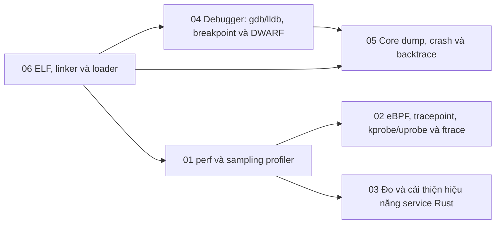

# P11 · Tổng quan — Đo đạc và gỡ lỗi

> Trang này chỉ điều hướng: mục tiêu, bản đồ chương, thứ tự đọc, sách gốc và câu hỏi tổng hợp. Mọi khẳng định kỹ thuật có chú thích nằm trong từng chương; các lời khuyên về thứ tự đọc là của người soạn.

## Mục tiêu của phase

Phase này trả lời câu hỏi "chương trình đang làm gì, và vì sao nó chậm hoặc chết" bằng công cụ của Linux và của Rust: `perf` và sampling profiler, tracing bằng ftrace/eBPF/kprobe/uprobe, đo và cải thiện hiệu năng một service Rust, debugger và DWARF, core dump và backtrace, rồi ELF, linker và loader, tức là định dạng file mà mọi công cụ trên phải đọc. Phase đứng trên P1 (system call, signal, `/proc`), P2 (stack frame, pipeline, cache) và P3 (address space, allocator); đây là nhận xét của người soạn về thứ tự học. Đích đến là khi một service Rust chậm, treo hay crash, bạn biết chọn công cụ nào, nó nói chuyện với kernel ra sao, và vì sao nó cần debuginfo, quyền hay cấu hình build nào mới đọc được kết quả.

## Bản đồ chương

Mũi tên nghĩa là chương đích dùng khái niệm của chương nguồn (nhận xét của người soạn về thứ tự học).

## Các chương

| Chương | Nội dung chính |
|---|---|
| [01 — perf và sampling profiler](01-perf-va-sampling-profiler.md) | Vì sao đo trước khi tối ưu; event, PMU, hardware vs software event; `perf_event_open(2)`; `perf stat` vs `perf record`/`perf report`, tần số lấy mẫu và skid; stack unwinding bằng frame pointer, DWARF, LBR; symbol, debuginfo, demangle; on-CPU vs off-CPU và flame graph; `perf_event_paranoid`, `CAP_PERFMON` và container. |
| [02 — eBPF, tracepoint, kprobe/uprobe và ftrace](02-ebpf-va-tracing.md) | Tracing vs sampling và hai quy luật chi phí; ftrace và tracefs; tracepoint tĩnh vs kprobe/uprobe động; eBPF (verifier, map, helper, program type, attach point); đọc một one-liner bpftrace; USDT; nguồn gốc overhead; `CAP_BPF`, `CAP_PERFMON` và container; uprobe trên symbol Rust, crate `tracing` vs eBPF. |
| [03 — Đo và cải thiện hiệu năng service Rust](03-hieu-nang-service-rust.md) | Benchmark đo sai thế nào, warm-up, nhiễu, `std::hint::black_box`; phân phối và percentile; `opt-level`, `codegen-units`, LTO, `panic`; PGO bốn bước; cờ build để profile đọc được; đếm allocation bằng `GlobalAlloc`, đổi allocator; `tracing` (span, event, subscriber), `Span::enter` qua `.await`, `tokio-console`; latency đuôi của service Tokio. |
| [04 — Debugger: gdb/lldb, breakpoint và DWARF](04-debugger-va-dwarf.md) | Debugger điều khiển process bằng `ptrace(2)`; software breakpoint (`int3`, `brk`); single-step, hardware breakpoint, watchpoint; symbol table vs debug info; DWARF (`.debug_info`, `.debug_line`, location list), `<optimized out>`, inline; backtrace bằng frame pointer, CFI, `.eh_frame`; debuglink, build ID, debuginfod, split DWARF; attach, `ptrace_scope`/Yama và container; `rust-gdb`, `rust-lldb`, `-C debuginfo`. |
| [05 — Core dump, crash và backtrace](05-core-dump-va-backtrace.md) | Signal sinh core; vì sao không thấy file core, `RLIMIT_CORE`; `core_pattern`, `systemd-coredump`, container; nội dung core, `coredump_filter`, đọc bằng gdb; `panic!` vs crash, `panic = "abort"`, `process::abort`; `RUST_BACKTRACE`, `Backtrace`, panic hook; stack overflow, guard page, SIGSEGV handler của std; lấy stack mọi thread của process treo. |
| [06 — ELF, linker và loader](06-elf-linker-loader.md) | Header, section vs segment; symbol, relocation, linker; `execve` nạp ELF, `PT_INTERP`, `ld.so`; thứ tự tìm thư viện (`LD_LIBRARY_PATH`, `RPATH`/`RUNPATH`, `ld.so.cache`); PLT/GOT, lazy binding, RELRO; PIE và ASLR; static vs dynamic, glibc vs musl, symbol versioning; crate type, target `*-musl`, `-C relocation-model`, `strip`, kích thước binary. |

## Thứ tự đọc

Đọc 01 → 06 theo số là ổn. Gợi ý của người soạn: 01 là cổng vào của cả phase (symbol, debuginfo, unwinding xuất hiện lại ở các chương sau); 02 và 03 tiếp theo 01, hai chương này đọc theo thứ tự nào cũng được; 04 → 05 là cặp (debugger rồi core dump). Chương 06 nói về định dạng file mà 01, 04 và 05 đều phải đọc, nên nếu bạn thấy thuật ngữ section, symbol hay `.eh_frame` còn lạ, đọc 06 trước rồi quay lại 01 hoặc 04 cũng hợp lý.

## Lộ trình đọc sách gốc

Các nguồn dưới đây đều là nguồn mà chương của phase đã dùng; mở đọc song song với chương tương ứng. Không bắt buộc: chương đã tự chứa phần cần thiết. Nhiều trang là tài liệu sống (kernel docs, GDB manual, Performance Book) và không ghim phiên bản.

- [perf_event_open(2)](https://manpages.debian.org/bookworm/manpages-dev/perf_event_open.2.en.html) — chương 01, 02.
- [perf-record(1)](https://manpages.debian.org/bookworm/linux-perf/perf-record.1.en.html) — chương 01.
- [perf-report(1)](https://manpages.debian.org/bookworm/linux-perf/perf-report.1.en.html) — chương 01.
- [perf-stat(1)](https://manpages.debian.org/bookworm/linux-perf/perf-stat.1.en.html) — chương 01.
- [Linux kernel docs — Perf events and tool security](https://docs.kernel.org/admin-guide/perf-security.html) — chương 01, 02.
- [Brendan Gregg — Flame Graphs](https://www.brendangregg.com/flamegraphs.html) — chương 01.
- [Brendan Gregg — Off-CPU Analysis](https://www.brendangregg.com/offcpuanalysis.html) — chương 01.
- [The Rust Performance Book — Profiling](https://nnethercote.github.io/perf-book/profiling.html) — chương 01, 03.
- [Linux kernel docs — ftrace](https://docs.kernel.org/trace/ftrace.html) — chương 02.
- [Linux kernel docs — Using the Linux Kernel Tracepoints](https://docs.kernel.org/trace/tracepoints.html) — chương 02.
- [Linux kernel docs — Kernel Probes (Kprobes)](https://docs.kernel.org/trace/kprobes.html) — chương 02.
- [Linux kernel docs — Uprobe-tracer](https://docs.kernel.org/trace/uprobetracer.html) — chương 02.
- [Linux kernel docs — eBPF verifier](https://docs.kernel.org/bpf/verifier.html) — chương 02.
- [bpf(2)](https://manpages.debian.org/bookworm/manpages-dev/bpf.2.en.html) — chương 02.
- [bpftrace(8)](https://manpages.debian.org/bookworm/bpftrace/bpftrace.8.en.html) — chương 02.
- [bpftrace — reference guide v0.17.0](https://raw.githubusercontent.com/iovisor/bpftrace/v0.17.0/docs/reference_guide.md) — chương 02.
- [bpftrace — one-liner tutorial v0.17.0](https://raw.githubusercontent.com/iovisor/bpftrace/v0.17.0/docs/tutorial_one_liners.md) — chương 02.
- [tracing 0.1.41 — docs.rs](https://docs.rs/tracing/0.1.41/tracing/) — chương 02.
- [The Rust Performance Book — Benchmarking](https://nnethercote.github.io/perf-book/benchmarking.html) — chương 03.
- [The Rust Performance Book — Build Configuration](https://nnethercote.github.io/perf-book/build-configuration.html) — chương 03.
- [The Rust Performance Book — Heap Allocations](https://nnethercote.github.io/perf-book/heap-allocations.html) — chương 03.
- [The rustc book — Profile-guided Optimization](https://doc.rust-lang.org/1.95.0/rustc/profile-guided-optimization.html) — chương 03.
- [std::hint::black_box](https://doc.rust-lang.org/1.95.0/std/hint/fn.black_box.html) — chương 03.
- [Criterion.rs Book — Analysis Process](https://bheisler.github.io/criterion.rs/book/analysis.html) — chương 03.
- [hdrhistogram 7.5.4 — docs.rs](https://docs.rs/hdrhistogram/7.5.4/hdrhistogram/) — chương 03.
- [tracing 0.1.44 — docs.rs](https://docs.rs/tracing/0.1.44/tracing/) — chương 03.
- [console-subscriber 0.5.0 — docs.rs](https://docs.rs/console-subscriber/0.5.0/console_subscriber/) — chương 03.
- [Google SRE book — Monitoring Distributed Systems](https://sre.google/sre-book/monitoring-distributed-systems/) — chương 03.
- [ptrace(2)](https://manpages.debian.org/bookworm/manpages-dev/ptrace.2.en.html) — chương 04.
- [DWARF Debugging Information Format Version 5](https://dwarfstd.org/doc/DWARF5.pdf) — chương 04.
- [GDB manual — Debugging Information in Separate Files](https://sourceware.org/gdb/current/onlinedocs/gdb/Separate-Debug-Files.html) — chương 04.
- [GDB manual — Setting Breakpoints](https://sourceware.org/gdb/current/onlinedocs/gdb/Set-Breaks.html) — chương 04.
- [GDB manual — Rust](https://sourceware.org/gdb/current/onlinedocs/gdb/Rust.html) — chương 04.
- [rustc-dev-guide — Debugging support in the Rust compiler](https://rustc-dev-guide.rust-lang.org/debugging-support-in-rustc.html) — chương 04.
- [Linux kernel docs — Yama](https://docs.kernel.org/admin-guide/LSM/Yama.html) — chương 04.
- [core(5)](https://manpages.debian.org/bookworm/manpages/core.5.en.html) — chương 05.
- [signal(7)](https://manpages.debian.org/bookworm/manpages/signal.7.en.html) — chương 05.
- [systemd-coredump(8)](https://manpages.debian.org/bookworm/systemd-coredump/systemd-coredump.8.en.html) — chương 05.
- [GDB manual — How to Produce a Core File from Your Program](https://sourceware.org/gdb/current/onlinedocs/gdb/Core-File-Generation.html) — chương 05.
- [std::backtrace](https://doc.rust-lang.org/1.95.0/std/backtrace/index.html) — chương 05.
- [std::panic::set_hook](https://doc.rust-lang.org/1.95.0/std/panic/fn.set_hook.html) — chương 05.
- [rust-lang/rust 1.95.0 — library/std/src/sys/pal/unix/stack_overflow.rs](https://raw.githubusercontent.com/rust-lang/rust/1.95.0/library/std/src/sys/pal/unix/stack_overflow.rs) — chương 05.
- [elf(5)](https://manpages.debian.org/bookworm/manpages/elf.5.en.html) — chương 06 (và 04).
- [ld.so(8)](https://manpages.debian.org/bookworm/manpages/ld.so.8.en.html) — chương 06.
- [Drepper — How To Write Shared Libraries](https://akkadia.org/drepper/dsohowto.pdf) — chương 06.
- [System V gABI — Dynamic Linking](https://refspecs.linuxfoundation.org/elf/gabi4+/ch5.dynamic.html) — chương 06.
- [The Rust Reference — Linkage](https://doc.rust-lang.org/1.95.0/reference/linkage.html) — chương 06.
- [musl wiki — Functional differences from glibc](https://wiki.musl-libc.org/functional-differences-from-glibc.html) — chương 06.

## Câu hỏi tổng hợp xuyên chương

Không có đáp án ở đây; mỗi câu trỏ về chương cần đọc lại.

1. Vì sao `perf record` trên bản release của một service Rust có thể cho flame graph toàn địa chỉ hex hoặc stack cụt, và cần đổi cấu hình build, cờ `perf` nào để đọc được? ([chương 01](01-perf-va-sampling-profiler.md), [chương 03](03-hieu-nang-service-rust.md), [chương 06](06-elf-linker-loader.md)).
2. Sampling và tracing khác nhau ở đâu, chi phí của mỗi kiểu tăng theo đại lượng nào, và khi nào bạn chọn `perf`, khi nào chọn uprobe/bpftrace? ([chương 01](01-perf-va-sampling-profiler.md), [chương 02](02-ebpf-va-tracing.md)).
3. Chạy `perf`, `bpftrace` hay `gdb` trong container thường gặp lỗi quyền: mỗi công cụ cần `sysctl` hoặc capability nào, và vì sao? ([chương 01](01-perf-va-sampling-profiler.md), [chương 02](02-ebpf-va-tracing.md), [chương 04](04-debugger-va-dwarf.md); P8 [chương 05](../08-containers/05-bao-mat-container.md) cho capability và seccomp mặc định của Docker, [chương 01](../08-containers/01-container-la-gi.md) cho bối cảnh container).
4. Từ một địa chỉ trong backtrace đến tên hàm và số dòng: symbol table, `.debug_line`, `.eh_frame` và build ID mỗi thứ đóng vai gì, và `strip` làm mất cái nào? ([chương 04](04-debugger-va-dwarf.md), [chương 06](06-elf-linker-loader.md), [chương 01](01-perf-va-sampling-profiler.md)).
5. Một service Rust chết mà không có file core: những lý do nào có thể xảy ra, và một `panic!` có sinh core không? ([chương 05](05-core-dump-va-backtrace.md); P10 [chương 08](../10-rust-internals/08-panic-abi-ffi.md)).
6. Một process treo, không chết: lấy stack của mọi thread bằng cách nào, và cần sẵn debuginfo gì để đọc được? ([chương 05](05-core-dump-va-backtrace.md), [chương 04](04-debugger-va-dwarf.md)).
7. Khi p99 của một service Tokio tăng mà trung bình không đổi, bạn khoanh vùng bằng số đo nào, và `tracing`, `tokio-console`, off-CPU flame graph đóng góp gì? ([chương 03](03-hieu-nang-service-rust.md), [chương 01](01-perf-va-sampling-profiler.md); P7 [chương 09](../07-io-async/09-async-trong-production.md)).
8. Binary musl tĩnh và binary glibc động khác nhau ở những điểm nào khi chạy trong container, và kiểu liên kết ảnh hưởng thế nào đến khả năng debug và profile? ([chương 06](06-elf-linker-loader.md), [chương 04](04-debugger-va-dwarf.md); P8 [chương 08](../08-containers/08-rust-trong-container.md)).

## Lab

Lab của phase này là [Lab P11 — Đo đạc và gỡ lỗi](../labs/11-do-dac-va-go-loi-lab.md) (crate `labs/crates/lab-observability`). Mỗi chương có một chương trình có hành vi cố ý để đo hoặc gỡ lỗi: `hotspot` (chương 01), `trace_target` (02), `latency` và `spans` (03), `debug_target` (04), `crash_lab` (05), `elf_probe` và `aslr_probe` (06). Phần chạy được trên macOS có output thật. Các lệnh cần Linux như `perf`, `bpftrace`, `gdb`, core dump và `readelf` được ghi rõ là **chưa chạy**; lab cũng nói công cụ nào container của repo đã có và công cụ nào bạn phải cài thêm. Nếu muốn đo một chương trình lớn hơn, xem mục "Đo và gỡ lỗi server này với P11" trong [Capstone](../labs/capstone.md).
