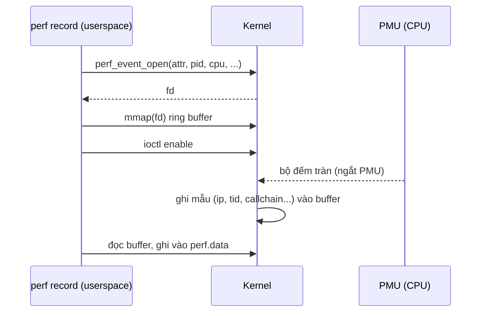
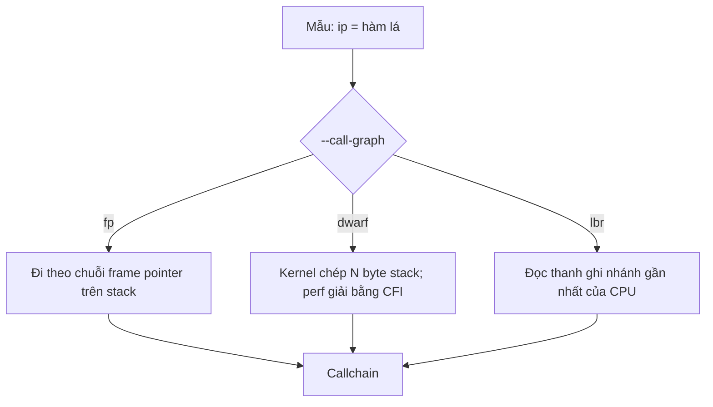

# P11 · Chương 01 — perf và sampling profiler

> Phạm vi: mọi khẳng định về `perf`, kernel và `perf_event_open` trong chương này là về **Linux** (man page Debian bookworm và kernel docs). Chương **không có thí nghiệm**: các dòng lệnh chỉ để minh họa cách dùng và không kèm output giả định, còn mọi con số trong thân bài đều lấy từ nguồn trích dẫn. Trang kernel docs là bản "latest" (tiêu đề ghi `7.3.0-rc6`), không ghim phiên bản; man page `perf` là của gói `linux-perf` trên Debian bookworm.

## Bạn sẽ hiểu được gì

1. **Q1.** Vì sao phải đo trước khi tối ưu, và `perf` là công cụ đo gì? → mục 1
2. **Q2.** Event là gì; hardware event (PMU) khác software event ra sao; vì sao số bộ đếm phần cứng có hạn lại quan trọng? → mục 2
3. **Q3.** `perf_event_open(2)` làm gì; `perf` nói chuyện với kernel thế nào? → mục 3
4. **Q4.** `perf stat` khác `perf record`/`perf report` ở đâu; tần số lấy mẫu và *skid* nghĩa là gì? → mục 4
5. **Q5.** Làm sao biết "ai gọi ai": stack unwinding bằng frame pointer, DWARF, LBR khác nhau thế nào; `Children` và `Self` là gì? → mục 5
6. **Q6.** Địa chỉ trở thành tên hàm và số dòng nhờ đâu (symbol, debuginfo, demangle), và build Rust cần cấu hình gì? → mục 6
7. **Q7.** On-CPU và off-CPU khác nhau thế nào; flame graph là gì và đọc ra sao? → mục 7
8. **Q8.** `perf_event_paranoid`, `CAP_PERFMON` là gì; vì sao `perf` hay không chạy được trong container? → mục 8

## Kiến thức cần trước

Chương này dựa vào ba chỗ ở các phase trước:

- [Chương 04 (CPU) — Calling convention và stack frame](../02-cpu/04-calling-convention-va-stack-frame.md): stack frame, frame pointer, `.eh_frame`. Mục 5 và 6 dựa trực tiếp vào đó.
- [Chương 05 (CPU) — Pipeline và speculation](../02-cpu/05-pipeline-va-speculation.md): lệnh chạy gối đầu, đoán nhánh. Bạn cần nó để hiểu `branch-misses`, IPC và skid.
- [Chương 02 (Linux) — System call](../01-linux/02-system-call.md) và [Chương 04 (Linux) — File descriptor và VFS](../01-linux/04-file-descriptor-va-vfs.md): `perf_event_open` là một syscall trả về fd.

## 1. Đo trước khi tối ưu; `perf` là gì (Q1)

> **Trả lời ngắn.** Muốn biết đoạn code nào đáng sửa thì phải có số đo. Profiler cho biết phần nào của chương trình "nóng", tức chạy đủ thường xuyên để ảnh hưởng thời gian chạy[^pb-hot]. `perf` là công cụ profiling của Linux, dựng trên một hệ con của kernel đếm được cả bộ đếm phần cứng của CPU lẫn bộ đếm phần mềm của kernel[^perf-desc].

**Giải thích.**

*Với service `quote`.* Hãy hình dung `quote`, một service Rust chạy trên Linux, nhận request tính giá đơn hàng rồi trả JSON. Sau lần release gần nhất, p99 của `POST /quote` tăng. Cả đội đoán nguyên nhân là serialize JSON, mất một tuần tối ưu mà p99 không nhúc nhích, vì thời gian thật sự nằm ở chỗ chờ khóa. Ta sẽ bám theo tình huống này suốt chương (ví dụ giả định của người soạn, không phải code trong repo và không có số đo nào đi kèm). Câu hỏi của mục này: vì sao phải đo trước, và `perf` đo được gì cho `quote`?

### 1.1 Đoán thì dễ sai

Chuyện của `quote` là kịch bản quen thuộc: cảm giác mách một nghi phạm, nhưng nghi phạm đó không phải thủ phạm. Profiler tồn tại để thay cảm giác bằng số đo: nó chỉ ra hàm nào chiếm nhiều thời gian chạy nhất, và bạn chỉ sửa những chỗ đó (nhận xét của người soạn).

### 1.2 Công cụ

Rust Performance Book liệt kê `perf` là profiler đa dụng, dùng bộ đếm phần cứng và chạy trên Linux[^pb-perf]. Trên macOS thì công cụ tương đương là Instruments, đi kèm Xcode[^pb-instruments]. Chương này chỉ nói về `perf`, nên phần thực hành cần một máy hoặc VM Linux (nhận xét của người soạn).

### 1.3 Ba lệnh, ba việc

`perf` có ba lệnh bạn sẽ dùng liên tục, và mỗi lệnh trả lời một câu hỏi khác nhau:

- `perf stat` chạy một lệnh và thu thống kê bộ đếm của nó[^stat-desc].
- `perf record` chạy một lệnh và ghi profile vào file `perf.data`, không hiển thị gì[^record-desc].
- `perf report` đọc `perf.data` rồi hiển thị profile[^report-desc].

Với `quote`, trình tự thường là: `stat` để biết tổng quan, `record` để biết thời gian đi vào hàm nào, `report` để đọc kết quả, rồi sửa và đo lại bằng đúng quy trình đó.


### 1.4 Điều profiler này không trả lời

Quay lại p99 của `quote`. Sampling bằng ngắt timer theo từng CPU chỉ cho ra profile *on-CPU* (mục 7)[^off-timer], nên thread đang ngủ chờ I/O hay chờ khóa không xuất hiện trong đó. Ngoài ra, `perf record` với event dựa trên chu kỳ hoặc đồng hồ CPU cũng chỉ lấy mẫu lúc thread đang chạy trên CPU (suy luận của người soạn; man page không nói thẳng). Hệ quả là nếu p99 của `quote` đến từ chỗ chờ khóa, profile on-CPU sẽ chỉ cho bạn những hàm đang chạy, không chỉ cho bạn chỗ chờ. "Hàm nào nóng" chỉ là một nửa câu chuyện về latency (nhận xét của người soạn).

<details><summary>Đi sâu: các profiler khác trong hệ sinh thái Rust, và cargo flamegraph</summary>

- Rust Performance Book liệt kê nhiều công cụ đã dùng thành công trên chương trình Rust. Trong đó có `samply`, một sampling profiler cho kết quả xem được bằng Firefox Profiler[^pb-samply].
- Lệnh Cargo `flamegraph` dùng perf hoặc DTrace để profile rồi vẽ flame graph[^pb-list].
- Cachegrind và Callgrind đếm lệnh theo từng hàm và từng dòng nguồn, kèm dữ liệu mô phỏng cache và branch prediction[^pb-list-cg].
- DHAT giúp tìm phần code gây nhiều cấp phát bộ nhớ[^pb-dhat]. Nhóm công cụ này đo theo kiểu *khác* (mô phỏng hoặc instrument), không phải sampling bằng PMU, nên chương này không đi sâu.
- Cùng một câu hỏi "chậm ở đâu" có thể cần công cụ khác nhau. Chọn theo triệu chứng: CPU cao thì sampling on-CPU, latency cao mà CPU thấp thì off-CPU (mục 7). Đây là nhận xét của người soạn.

</details>

**Quay lại Q1:** tối ưu cần số đo; `perf` là bộ công cụ Linux dựa trên bộ đếm của CPU và kernel, với `stat` để đếm, `record` để lấy mẫu, `report` để đọc. Với `quote`, nó cho biết hàm nào ăn CPU nhưng chưa nói được `quote` chờ ở đâu.

## 2. Event, PMU, hardware và software event (Q2)

> **Trả lời ngắn.** *Event* là một loại sự kiện mà kernel hoặc CPU đếm được: chu kỳ CPU, lệnh đã hoàn tất, đoán sai nhánh, page fault, context switch… Hardware event do bộ đếm nằm trong CPU (PMU, Performance Monitoring Unit) đếm[^perf-desc]. Software event do kernel tự đếm, kể cả khi máy không có hỗ trợ phần cứng[^peo-sw]. Số bộ đếm phần cứng có hạn: nếu bạn đòi đo nhiều event hơn số bộ đếm thì kernel phải luân phiên (multiplexing), và giá trị cuối chỉ là ước lượng; chương trình đọc `time_enabled`/`time_running` để tự hiệu chỉnh[^peo-mux].

**Giải thích.**

*Với service `quote`.* Chạy `perf stat` lên `quote` là nhờ kernel đếm giùm vài thứ: bao nhiêu chu kỳ CPU, bao nhiêu lệnh, bao nhiêu page fault. Mỗi thứ đó là một *event*. Hai nguồn đếm khác nhau (CPU và kernel) dẫn tới hai độ tin cậy khác nhau, và mục này giải thích chỗ khác đó để bạn khỏi đọc nhầm con số.

### 2.1 Hardware event: CPU đếm

PMU là phần cứng trong CPU, gồm một số bộ đếm, mỗi bộ được cài để đếm một loại sự kiện phần cứng (nhận xét của người soạn). `perf_event_open` định nghĩa kiểu `PERF_TYPE_HARDWARE` gồm các event phần cứng "tổng quát hóa" do kernel cung cấp[^peo-hwtype]. Không phải event nào cũng có trên mọi nền tảng[^peo-hw-avail]. Dưới đây là vài event hay gặp, kèm điều man page nói về chúng:

| Event | Man page mô tả | Cần cẩn thận |
|---|---|---|
| `cpu-cycles` | tổng số chu kỳ[^peo-cycles] | khi CPU đổi tần số (frequency scaling) |
| `instructions` | số lệnh đã retire (hoàn tất)[^peo-instr] | có thể bị ảnh hưởng, nhất là bởi số ngắt phần cứng |
| `branch-misses` | số lệnh nhánh bị đoán sai[^peo-brmiss] | liên hệ chương [pipeline](../02-cpu/05-pipeline-va-speculation.md) |
| `cache-misses` | thường là LLC miss[^peo-cm] (LLC = last-level cache, tầng cache cuối trước RAM; giải thích của người soạn) | dùng cùng `cache-references` để tính tỉ lệ miss |
| `cache-references` | thường là truy cập LLC, có thể gồm prefetch và tin nhắn coherency[^peo-cr] | tùy thiết kế CPU |
| `ref-cycles` | tổng chu kỳ, không bị ảnh hưởng bởi frequency scaling[^peo-refcycles] | so với `cpu-cycles` |

Hai event ở đầu bảng cho ra một chỉ số rất hay dùng. Chia số lệnh cho số chu kỳ ta được "lệnh mỗi chu kỳ", gọi là IPC, và `perf stat` in con số này cạnh dòng `instructions` với nhãn `insn per cycle`[^stat-ipc]. IPC thấp gợi ý CPU hay bị đứng, chẳng hạn chờ bộ nhớ hoặc đoán sai nhánh (chương [pipeline](../02-cpu/05-pipeline-va-speculation.md)). Đó là diễn giải của người soạn chứ không phải khẳng định của man page.

### 2.2 Software event: kernel đếm

Kiểu `PERF_TYPE_SOFTWARE` gồm các event do chính kernel định nghĩa, có sẵn cả khi không có hỗ trợ phần cứng[^peo-sw]. Với `quote`, các event này trả lời những câu như "thread của tôi có hay bị chuyển CPU không?":

- `cpu-clock`: đồng hồ CPU độ phân giải cao, theo từng CPU[^peo-cpuclock].
- `task-clock`: đồng hồ riêng của task đang chạy[^peo-taskclock].
- `page-faults`: số page fault[^peo-pf].
- `context-switches`: số lần chuyển context[^peo-cs].

Page fault còn được tách làm hai. `minor` là loại không cần I/O đĩa để xử lý[^peo-pfmin]. `major` là loại phải có I/O đĩa[^peo-pfmaj].

### 2.3 Khi bộ đếm không đủ: multiplexing

PMU chỉ có một số "khe" bộ đếm cố định. Nếu `perf stat -e` xin nhiều event hơn số khe thì mỗi event chỉ chạy một phần thời gian, và kernel báo `time_enabled` cùng `time_running` để chương trình tự suy ra giá trị ước lượng[^peo-mux]. Hệ quả thực tế với `quote` (suy luận của người soạn): hỏi quá nhiều event phần cứng một lúc thì con số bạn nhận không còn là đếm chính xác, mà là ước lượng nội suy.

### 2.4 Trong VM và container

Giả sử bạn chạy `perf stat` cho `quote` ngay trong một VM. Event nào đòi tính năng phần cứng mà CPU không có thì syscall trả lỗi. `ENODEV` là lỗi khi event dùng tính năng mà CPU hiện tại không hỗ trợ[^peo-enodev]. `EOPNOTSUPP` là lỗi khi event đòi tính năng không có hỗ trợ phần cứng, trong đó có việc lấy mẫu mà không có ngắt PMU[^peo-eopnotsupp]. Có lẽ đó là lý do trên một số VM không đo được hardware event mà software event như `cpu-clock` vẫn chạy; man page không nói riêng về VM (suy luận của người soạn).

<details><summary>Đi sâu: các kiểu event, PMU động, group, pinned</summary>

- Ngoài `PERF_TYPE_HARDWARE` và `PERF_TYPE_SOFTWARE`, man page còn liệt kê tracepoint của kernel (điểm đo đặt sẵn trong code kernel; giải thích của người soạn), event cache phần cứng (`PERF_TYPE_HW_CACHE`), event thô theo từng CPU (`PERF_TYPE_RAW`) và breakpoint phần cứng[^peo-types].
- Từ Linux 2.6.38, `perf_event_open()` hỗ trợ nhiều PMU: giá trị cho trường `type` lấy từ `/sys/bus/event_source/devices/<pmu>/type`[^peo-dynpmu].
- Một fd tương ứng một event, nhưng có thể gom nhóm để đo nhiều event cùng lúc[^peo-fd-group].
- Cờ `pinned` yêu cầu bộ đếm luôn nằm trên CPU nếu có thể. Nếu không đặt được (không đủ bộ đếm hoặc xung đột) thì bộ đếm vào trạng thái lỗi và `read(2)` trả 0 cho tới khi bật/tắt lại[^peo-pinned].
- Các event `stalled-cycles-frontend/backend` ("stalled cycles during issue/retirement") có từ Linux 3.0[^peo-stalled].
- `perf stat -d` (lặp tối đa 3 lần) in thêm event chi tiết về cache dữ liệu L1/LLC, rồi dTLB/iTLB, rồi prefetch[^stat-detailed].

</details>

**Quay lại Q2:** event là thứ đếm được; hardware event do PMU trong CPU đếm, software event do kernel đếm; vì bộ đếm phần cứng ít nên đo quá nhiều event một lúc thì bị multiplexing và chỉ nhận số ước lượng.

## 3. `perf_event_open(2)`: cổng vào của kernel (Q3)

> **Trả lời ngắn.** `perf_event_open` là syscall tạo một file descriptor đại diện cho **một** event cần đo[^peo-fd]. Với event *đếm*, bạn `read(2)` fd để lấy con số; với event *lấy mẫu*, kernel ghi liên tục các mẫu vào một buffer mà bạn `mmap(2)` ra[^peo-flavors]. glibc không có wrapper nên phải gọi qua `syscall(2)`[^peo-nowrap]. Công cụ `perf` là một chương trình userspace dựa trên syscall này (nhận xét của người soạn; man page `perf_event_open` không mô tả công cụ `perf`).

**Giải thích.**

*Với service `quote`.* `perf` là một chương trình thường, chạy ở user space như `quote`. Vậy làm sao nó biết CPU đang chạy hàm nào của `quote`? Nó phải nhờ kernel, và cổng để nhờ là `perf_event_open`. Cách dùng giống `socket()` ở chỗ bạn khai báo mình muốn gì rồi nhận về một fd (nhận xét của người soạn): ở đây là cái gì cần đo (event), đo ai (process nào) và trên CPU nào.

### 3.1 Chữ ký và phạm vi đo

Man page ghi chữ ký `syscall(SYS_perf_event_open, struct perf_event_attr *attr, pid_t pid, int cpu, int group_fd, unsigned long flags)`[^peo-nowrap]. Trong đó `pid` và `cpu` chọn phạm vi đo[^peo-pidcpu]:

| `pid` | `cpu` | Đo gì |
|---|---|---|
| `0` | `-1` | thread đang gọi, trên mọi CPU[^peo-pidcpu] |
| `> 0` | `-1` | process/thread được chỉ định, trên mọi CPU[^peo-pid-any] |
| `-1` | `>= 0` | mọi process/thread trên CPU đó; đòi `CAP_PERFMON` (capability: một quyền đặc biệt tách riêng khỏi root, xem mục 8; từ Linux 5.8) hoặc `CAP_SYS_ADMIN`, hoặc `perf_event_paranoid` nhỏ hơn 1[^peo-sysw] |
| `-1` | `-1` | không hợp lệ, trả lỗi[^peo-invalid] |

Để đo riêng `quote` đang chạy, bạn nhắm vào pid của nó như ở dòng thứ hai. Đo mọi thứ trên một CPU (dòng thứ ba) thì đòi quyền cao hơn, và chuyện đó dẫn sang mục 8.

### 3.2 Đếm và lấy mẫu

Event có hai kiểu dùng. Event *đếm* cho tổng số lần sự kiện xảy ra, thường lấy bằng `read(2)`. Event *lấy mẫu* thì định kỳ ghi số đo vào một buffer, và bạn truy cập buffer đó qua `mmap(2)`[^peo-flavors]. Với `perf stat` thì đếm là đủ, còn `perf record` cần lấy mẫu.

Event bật tắt được bằng `ioctl(2)` hoặc `prctl(2)`. Khi tắt, nó không đếm và không sinh tràn (overflow), nhưng vẫn tồn tại và giữ nguyên giá trị đếm[^peo-enable].

### 3.3 Luồng lấy mẫu

Event lấy mẫu có `sample_period > 0`. Cứ khi bộ đếm tràn, dữ liệu được yêu cầu sẽ ghi vào buffer `mmap`, còn trường `sample_type` quyết định ghi những gì[^peo-sampling]. Muốn biết lúc nào có tràn, bạn theo dõi fd bằng `poll(2)`, `select(2)` hoặc `epoll(7)`, hoặc bắt bằng signal handler[^peo-overflow]. Nói cách khác fd của perf chờ được bằng đúng các cơ chế chờ I/O quen thuộc (chương [Linux 04](../01-linux/04-file-descriptor-va-vfs.md)).



(Sơ đồ là tóm tắt của người soạn từ các mô tả trong man page; chi tiết ngắt PMU phụ thuộc phần cứng.)

### 3.4 Tài nguyên

Mỗi event đã cấu hình là một fd, và fd tính vào `RLIMIT_NOFILE`. Một phiên `perf record` thường cần ít nhất (số event) × (số CPU được theo dõi) fd[^ksec-fd]. Buffer `mmap` thì bị giới hạn bởi `perf_event_mlock_kb`, mặc định 516 kB cho người dùng không đặc quyền[^peo-mlock]. Hai giới hạn này là lý do `perf record -a` trên máy nhiều core có thể vấp `EMFILE` hoặc lỗi bộ nhớ (suy luận của người soạn, từ hai nguồn trên).

<details><summary>Đi sâu: trường <code>sample_type</code>, <code>exclude_kernel</code>, <code>precise_ip</code>, đọc <code>read_format</code></summary>

- `sample_type` chọn các trường ghi vào mỗi mẫu. `PERF_SAMPLE_IP` ghi con trỏ lệnh[^peo-sampleip]. `PERF_SAMPLE_CALLCHAIN` ghi stack backtrace[^peo-callchain]. Ngoài ra còn `PERF_SAMPLE_BRANCH_STACK`, `PERF_SAMPLE_REGS_USER` và `PERF_SAMPLE_STACK_USER` (mục 5).
- `exclude_kernel` loại các event xảy ra trong kernel space[^peo-exkernel].
- Man page nêu các trường hợp thường gây `EACCES` cho process không đặc quyền: gắn vào process của user khác, theo dõi mọi process trên một CPU (`pid = -1`), và không đặt `exclude_kernel` khi `paranoid` đòi hỏi[^peo-eacces].
- `read_format` quy định dữ liệu `read(2)` trả về, kể cả `time_enabled`/`time_running` để hiệu chỉnh multiplexing[^peo-timerun].
- Man page nhấn mạnh syscall này là đặc thù Linux, không nên dùng trong chương trình cần portable[^peo-notportable].
- Cách "chính thức" kiểm tra kernel có hỗ trợ `perf_event_open` là xem file `/proc/sys/kernel/perf_event_paranoid` có tồn tại không[^peo-exist].

</details>

**Quay lại Q3:** `perf_event_open` cấp một fd cho mỗi event; đọc fd để đếm, `mmap` fd để lấy mẫu; `perf` chỉ là chương trình dùng syscall đó để lấy số cho `quote`.

## 4. `perf stat` vs `perf record`: lấy mẫu, tần số và skid (Q4)

> **Trả lời ngắn.** `perf stat` trả về **tổng** từng bộ đếm cho cả lần chạy, nhưng không nói đoạn code nào gây ra. `perf record` thì **lấy mẫu**: cứ sau mỗi N event (hoặc theo một tần số), kernel chụp lại "đang chạy lệnh ở đâu", rồi `perf report` gộp các mẫu thành bảng cho thấy hàm nào chiếm nhiều mẫu nhất. Vì lúc chụp CPU đã chạy tiếp vài lệnh, địa chỉ ghi được có thể lệch khỏi lệnh gây ra event. Đó là *skid*[^peo-skid].

**Giải thích.**

*Với service `quote`.* Bạn muốn trả lời hai câu về `quote`: một lần chạy tốn tổng cộng bao nhiêu, và tốn vào hàm nào. Câu đầu là việc của `perf stat`, câu sau là việc của `perf record`. Chạy theo đúng thứ tự đó, vì `stat` rẻ và cho bạn biết có đáng đào sâu hay không.

### 4.1 `perf stat`: tổng số

`perf stat` chạy lệnh và thu thống kê bộ đếm[^stat-desc]. Output mẫu trong man page có dòng `task-clock` kèm "CPUs utilized"[^stat-taskclock]. Cũng trong output đó, dòng `instructions` đi kèm `insn per cycle`[^stat-ipc]. Với `quote`, hãy dùng nó đầu tiên để trả lời các câu lớn: `quote` có bị CPU-bound không (task-clock gần số core đã dùng thì có), IPC ra sao, page fault và context switch có nhiều không. Chỉ khi đó mới đào sâu hơn (nhận xét của người soạn). Man page cho `perf stat` thêm ba tùy chọn hay dùng:

- `--repeat` lặp lệnh nhiều lần[^stat-repeat].
- `-I` in theo từng khoảng thời gian[^stat-interval].
- `-a` đo toàn hệ thống[^stat-all].

### 4.2 `perf record`: lấy mẫu

`perf record` cho bạn chọn mật độ lấy mẫu theo hai cách:

- **Theo chu kỳ**: `-c N` là "event period to sample"[^rec-count], tức cứ N event thì ghi một mẫu.
- **Theo tần số**: `-F f` là profile ở tần số `f`, còn `max` dùng trần của sysctl `kernel.perf_event_max_sample_rate`[^rec-freq]. (Sysctl là tham số kernel chỉnh được lúc chạy, nằm dưới `/proc/sys/`; giải thích của người soạn.)

Ở mức syscall, cách thứ hai là đặt `sample_freq` cùng cờ `freq`. Kernel tự điều chỉnh chu kỳ để cố đạt tần số mong muốn, và nhịp điều chỉnh là một timer tick[^peo-freq]. Trần mặc định là 100000 mẫu/giây, và đặt quá cao có thể làm máy nghẽn hoặc treo[^peo-maxrate]. Ví dụ lệnh cho `quote`: `perf record -F 99 -g -- ./quote`. Con số 99 chỉ là ví dụ phổ biến, man page không quy định.

Một chi tiết hữu ích khi đo service: `-D msecs` trì hoãn việc bật event. Man page ghi rằng việc này giúp lọc giai đoạn khởi động của chương trình, vì giai đoạn đó thường rất khác phần còn lại[^rec-delay]. Với `quote` đó là lúc nạp config và dựng connection pool (ví dụ của người soạn).

### 4.3 `perf report`: đọc kết quả

Mặc định `perf report` gộp mẫu theo ba khóa `comm` (tên process), `dso` (binary hoặc thư viện) và `symbol` (hàm)[^rep-default-sort]. Cột `overhead` được man page định nghĩa là "tỷ lệ phần trăm của mẫu"[^rep-overhead], và ta đọc đó là phần mẫu thuộc hàm của dòng (diễn giải của người soạn). Vì đây là thống kê nên số mẫu ít thì nhiễu lớn. Số mẫu thu được xấp xỉ tần số nhân thời gian đo trên mỗi CPU (cả hai ý này là suy luận của người soạn).

### 4.4 Skid

Man page định nghĩa skid là số lệnh thực thi giữa lúc event xảy ra và lúc kernel kịp dừng để ghi lại event. Skid càng nhỏ thì quy event về đúng lệnh càng chính xác, nhưng phần cứng thường hạn chế mức nhỏ nhất đạt được[^peo-skid]. Trường `precise_ip` điều khiển mức này: `0` là skid tùy ý, `1` là skid hằng số, `2` là yêu cầu skid 0, `3` là bắt buộc skid 0[^peo-prec].

Vì sao có skid? Nguyên nhân có lẽ là CPU chạy nhiều lệnh gối đầu và không theo thứ tự (chương [pipeline](../02-cpu/05-pipeline-va-speculation.md)), nên khi ngắt đến, "lệnh hiện tại" không trùng với lệnh đã gây ra event (suy luận của người soạn). Hệ quả thực hành cho `quote` (nhận xét của người soạn): đọc kết quả ở mức *hàm* thì ổn, còn đọc ở mức *từng dòng hay từng lệnh* thì phải nhớ rằng mẫu có thể lệch sang lệnh phía sau.

<details><summary>Đi sâu: <code>-F max</code>, <code>--strict-freq</code>, <code>-c</code> vs <code>-F</code>, tùy chọn khác của <code>perf record</code></summary>

- `perf record -F max` dùng giá trị hiện hành của sysctl `kernel.perf_event_max_sample_rate` và "sẽ giảm dần (throttle) xuống tần số tối đa hiện hành" nếu cần; có thêm `--strict-freq`[^rec-freq].
- Sysctl `perf_event_max_sample_rate` đặt trần tần số lấy mẫu. Đặt quá cao thì người dùng có thể lấy mẫu ở tốc độ ảnh hưởng toàn máy[^peo-maxrate].
- `--switch-events` ghi event chuyển ngữ cảnh (`PERF_RECORD_SWITCH`)[^rec-switch]. Man page không nhắc off-CPU; việc nó hữu ích cho phân tích off-CPU (mục 7) là nhận xét của người soạn.
- `-s/--sort` của `perf report` còn có `srcline` (tên file và số dòng, cần DWARF)[^rep-srcline] và nhiều khóa khác như `pid`, `cpu`, `dso`.
- Man page `perf stat` có mục phân tích "top-down" (frontend bound, backend bound, bad speculation) ở các tùy chọn nâng cao[^stat-topdown]; chương này không đi sâu.

</details>

**Quay lại Q4:** `stat` cho tổng số đếm; `record` lấy mẫu theo chu kỳ hoặc tần số rồi `report` gộp theo hàm; skid là độ lệch giữa lệnh thật sự gây event và lệnh được ghi lại.

## 5. Stack unwinding: frame pointer, DWARF, LBR (Q5)

> **Trả lời ngắn.** Một mẫu chỉ có địa chỉ lệnh đang chạy, tức hàm lá. Muốn biết *ai gọi nó* thì phải lần ngược stack (unwinding) để có callchain[^peo-callchain]. `perf record --call-graph` có ba cách: `fp` (đi theo chuỗi frame pointer), `dwarf` (giải bằng bảng CFI của DWARF, định dạng thông tin debug chuẩn; xem mục 6) và `lbr` (đọc thanh ghi ghi nhánh nhảy gần nhất của phần cứng)[^rec-cg-valid]. Mặc định cho user space là `fp`[^rec-cg-default]. Nếu binary không giữ frame pointer mà bạn vẫn dùng `fp` thì call graph sẽ sai[^rec-fomit].

**Giải thích.**

*Với service `quote`.* Giả sử `perf report` cho thấy `memcpy` chiếm phần lớn số mẫu của `quote`. Khi đó sửa chính `memcpy` là vô ích; câu hỏi đúng là hàm nào của `quote` gọi nó nhiều đến thế (ví dụ và nhận xét của người soạn). Để trả lời, mỗi mẫu phải mang theo cả chuỗi hàm đang gọi nhau, và mục này nói cách lấy chuỗi đó ra.

### 5.1 Callchain là gì và bật bằng gì

Ở mức syscall, `PERF_SAMPLE_CALLCHAIN` ghi lại callchain, tức stack backtrace của mẫu[^peo-callchain]. Ở mức công cụ, `perf record -g` bật ghi call graph cho cả kernel space lẫn user space[^rec-g]. Cách giải stack của **kernel space** phụ thuộc bộ unwinder trong cấu hình kernel (`CONFIG_UNWINDER_FRAME_POINTER` hoặc `CONFIG_UNWINDER_ORC`), còn tùy chọn bạn đặt chỉ điều khiển user space[^rec-cg-kernel]. Vì `quote` là code user space nên từ đây ta chỉ bàn ba cách cho user space.

### 5.2 `fp`: đi theo frame pointer

`fp` là cách mặc định cho user space[^rec-cg-default]. Mỗi frame lưu con trỏ tới frame của caller, nên perf chỉ việc đi theo chuỗi con trỏ đó, và cách này rẻ (nhận xét của người soạn). Cơ chế frame pointer đã giải thích ở chương [calling convention](../02-cpu/04-calling-convention-va-stack-frame.md) mục 6.

Hạn chế của `fp` là nó cần binary giữ frame pointer. Nếu code biên dịch với `-fomit-frame-pointer` (bỏ frame pointer) thì `fp` cho call graph "giả"; man page khuyên dùng `dwarf` nếu perf được link với libunwind hoặc libdw[^rec-fomit]. Số frame tối đa lấy theo sysctl `kernel.perf_event_max_stack`, và bạn đổi được bằng `--call-graph fp,32`[^rec-fpmax]. Mặc định của sysctl này là 127, theo kernel docs bản "latest"[^ksys-maxstack].

### 5.3 `dwarf`: chép stack rồi giải

Khi bật `dwarf`, perf ghi thêm một **bản chép stack người dùng** vào mỗi mẫu. Kích thước mặc định là 8192 byte, đổi được bằng `--call-graph dwarf,4096`[^rec-dwarf]. Ở mức syscall đó là `PERF_SAMPLE_STACK_USER`: "ghi stack user level, cho phép unwind stack"[^peo-stackuser]. Số byte thực sự chép (`dyn_size`) có thể nhỏ hơn số yêu cầu[^peo-dynsize].

Việc giải ngược dùng thông tin CFI (Call Frame Information) của DWARF[^rec-cg-valid], cùng họ với bảng `.eh_frame` trong chương [calling convention](../02-cpu/04-calling-convention-va-stack-frame.md). Cái giá (suy luận của người soạn): file `perf.data` phình theo kích thước chép mỗi mẫu, và stack sâu hơn lượng chép thì bị cụt.

### 5.4 `lbr`: đọc thanh ghi nhánh

LBR là Last Branch Record. Phần cứng ghi lại các nhánh nhảy gần nhất, và `perf` dựng call graph từ các thanh ghi LBR. Cách này không cần tùy chọn biên dịch, nhưng chỉ có trên nền tảng Intel mới (như Haswell), chỉ lấy được call chain của user, và không dùng cùng lúc với branch stack sampling[^rec-lbr]. Ở mức syscall, nó ứng với `PERF_SAMPLE_BRANCH_STACK`: bản ghi các nhánh gần đây từ phần cứng lấy mẫu nhánh (như Intel LBR), và không phải phần cứng nào cũng hỗ trợ[^peo-branch].



### 5.5 `Self` và `Children`

Khi đã có callchain, `perf report` có hai cột. **Self** là tổng chu kỳ hoặc mẫu mà *chính* hàm đó chạy[^rep-self]. **Children** cộng thêm mọi mẫu rơi vào các hàm con, để bạn thấy tổng chi phí của hàm cha ngay cả khi bản thân nó chạy ít[^rep-children]. Vì mỗi giá trị Children đã gồm self của các con, tổng cột này có thể vượt 100%[^rep-sum]. Cột Children bật mặc định, tắt bằng `--no-children`[^rep-nochildren].

Với `quote`, dùng Children để hỏi "nhánh nào của chương trình tốn nhất" (ví dụ cả đường xử lý request), và dùng Self để hỏi "hàm nào tự nó tốn nhất" (nhận xét của người soạn).

<details><summary>Đi sâu: stack depth, <code>--stitch-lbr</code>, vì sao frame pointer hay bị bỏ, JIT</summary>

- Số frame của callchain báo về bị giới hạn bởi trường `sample_max_stack` (từ Linux 4.8)[^peo-maxstack-field]. Ngoài ra còn sysctl `perf_event_max_contexts_per_stack`, mặc định 8[^ksys-maxctx].
- `perf report --stitch-lbr` ghép các LBR để có call graph đầy đủ hơn. Man page nói cách này không hoàn hảo và có thể dựng sai (ví dụ với `setjmp`/`longjmp`)[^rep-stitch].
- Gregg, người tạo ra flame graph[^flame-origin], viết rằng nhiều ứng dụng biên dịch với `-fomit-frame-pointer` của gcc, và điều đó làm hỏng việc đi stack bằng frame pointer. Runtime có JIT (biên dịch lúc chạy) thì còn thiếu symbol[^off-fp].
- Với Rust: compiler có thể bỏ frame pointer, ảnh hưởng chất lượng stack trace khi profiling[^pb-fp]. Mặc định của rustc khi không ép bật là "phụ thuộc target"[^cg-fp-default]. Bằng chứng theo từng target nằm ở chương [calling convention](../02-cpu/04-calling-convention-va-stack-frame.md) mục 6.

</details>

**Quay lại Q5:** callchain lấy bằng một trong ba cách: `fp` (rẻ nhưng cần frame pointer), `dwarf` (chép stack, giải bằng CFI) hay `lbr` (phần cứng Intel). Sau đó `Self` đo chi phí của chính hàm còn `Children` đo chi phí cả nhánh, nên với `quote` ta biết được ai gọi `memcpy`.

## 6. Symbol, debuginfo và demangle: từ địa chỉ ra tên hàm (Q6)

> **Trả lời ngắn.** Mẫu chỉ chứa địa chỉ. Tên hàm lấy từ *symbol table* của binary, còn tên file và số dòng cần *debuginfo* (DWARF)[^rep-srcline]. Cargo mặc định cho profile `release` là không có debuginfo[^prof-debug]. Strip mạnh (`symbols`) có thể làm trace "không đọc nổi"[^cg-strip-sym]. Tên hàm Rust bị mangle (dạng `_ZN…` hoặc `_R…`) nên cần demangle[^pb-mangle].

**Giải thích.**

*Với service `quote`.* Bạn build `quote` bằng `cargo build --release` rồi `perf record`. Kết quả có thể đủ để thấy tên hàm nhưng không có số dòng, hoặc tệ hơn là chỉ có số hex hay những cái tên như `_ZN…`. Cả ba triệu chứng đều xuất phát từ cùng một khoảng cách: mẫu chỉ có địa chỉ, còn thứ bạn cần là tên hàm và dòng code. Mục này nói khoảng cách đó được lấp bằng gì, và cấu hình Rust nào quyết định có lấp được hay không.

### 6.1 Từ địa chỉ ra tên và dòng

Mẫu ghi `ip`, tức con trỏ lệnh[^peo-sampleip]. `perf report` ánh xạ nó về `dso` và `symbol`[^rep-default-sort]. Riêng khóa `srcline` (file và dòng) thì đòi thông tin DWARF[^rep-srcline]. Symbol và debuginfo là hai thứ khác nhau, và rustc điều khiển riêng từng thứ.

### 6.2 Debuginfo trong rustc và Cargo

Cờ `-C debuginfo` của rustc nhận bốn giá trị: `0`/`none` (không có gì, mặc định), `line-tables-only`, `1`/`limited` và `2`/`full`[^cg-debuginfo]. `-g` là bí danh của `-C debuginfo=2`[^cg-g]. Giá trị cần nhớ cho profiling là `line-tables-only`: nó sinh lượng debuginfo tối thiểu đủ để backtrace có tên file và số dòng, không có thông tin biến hay tham số[^cg-ltonly].

Phía Cargo, khóa `debug` của profile điều khiển cờ `-C debuginfo`[^prof-debugdesc]. Giá trị `0`, `false` hoặc `"none"` là mặc định của `release`[^prof-debug]. (Bảng đầy đủ các khóa mặc định của `dev` và `release` nằm ở [Chương 08 (Rust), mục 7](../09-rust-language/08-module-crate-cargo.md).) Vì vậy Rust Performance Book khuyên: để profile build release hiệu quả, bạn có thể cần bật debuginfo dòng nguồn[^pb-debug]. Cách bật là đặt `debug = "line-tables-only"` trong `[profile.release]`[^pb-debugline].

### 6.3 Symbol table và `strip`

`-C strip` điều khiển việc lược bỏ debuginfo và dữ liệu phụ trợ lúc link, với ba mức:

- `none`: debuginfo và symbol giữ nguyên[^cg-strip-none].
- `debuginfo`: bỏ các section debuginfo. Backtrace "gần như còn nguyên" nhưng debugger như gdb hay lldb khó dùng[^cg-strip-di].
- `symbols`: bỏ cả phần còn lại của symbol table. Trên nền tảng dựa vào symbol table cho backtrace và profiling, điều này có thể gây hại tới mức trace không đọc nổi[^cg-strip-sym].

Phía Cargo, khóa `strip` có mặc định `"none"`[^prof-strip]. Ghép với mục 6.2 ta rút ra (suy luận của người soạn từ các mục trên): profile `release` mặc định giữ symbol, nên có tên hàm, nhưng không có debuginfo, nên không có số dòng. Nếu `quote` đặt `strip = "symbols"` để giảm kích thước binary thì `perf` chỉ thấy địa chỉ, và bạn nên build riêng một bản cho profiling.

Còn một giới hạn nữa: dù đã bật debuginfo cho code của `quote`, bạn vẫn không có thông tin chi tiết cho code thư viện chuẩn, vì bản std phát hành không build kèm debuginfo[^pb-std].

### 6.4 Mangling

Rust mã hóa tên hàm trong object code. Profiler không biết điều đó sẽ in ra những tên bắt đầu bằng `_ZN` hoặc `_R`[^pb-mangle]. `perf report` có tùy chọn demangle, bật mặc định và tắt bằng `--no-demangle`[^rep-demangle].

Phía Rust, rustc có hai định dạng mangling. Định dạng *legacy* là mặc định hiện thời trên beta/stable[^mang-legacy]. Cờ `-C symbol-mangling-version=v0` chọn lược đồ v0[^cg-mangling]. Nếu profiler hiển thị tên khó đọc, Rust Performance Book gợi ý thử chuyển sang v0[^pb-v0]. Để giải mã tên, bạn có `rustfilt`, một CLI[^mang-rustfilt]. Các bản mới của gdb và lldb cũng đã có sẵn hỗ trợ demangle Rust[^mang-gdb].

<details><summary>Đi sâu: <code>split-debuginfo</code>, <code>--demangle-kernel</code>, <code>--symfs</code>, <code>line-directives-only</code>, vì sao chọn <code>line-tables-only</code></summary>

- `split-debuginfo` điều khiển debuginfo nằm trong file thực thi hay cạnh nó. Mặc định của Cargo là `unpacked` trên macOS cho profile có debuginfo[^prof-split]. Mặc định của rustc trên macOS lại là `packed`[^cg-split].
- Ngoài bốn giá trị ở mục 6.2, rustc còn có `line-directives-only`, dành cho target nvptx[^cg-linedirectives].
- `perf report --demangle-kernel` giải mã tên symbol kernel (cho kernel C++), tách khỏi `--demangle`[^rep-demangle-kernel]. Nó không liên quan Rust.
- Man page `perf report` có `--symfs=<directory>`, tìm các file chứa symbol theo đường dẫn tương đối so với thư mục đó[^rep-symfs]. Tùy chọn này hữu ích khi binary build ở nơi khác (nhận xét của người soạn).
- Chọn `debug = "line-tables-only"` thay vì `true` là lựa chọn của người soạn để giảm kích thước; Performance Book dùng đúng giá trị này[^pb-debugline]. Mức đó sinh debuginfo tối thiểu cho backtrace có tên file và số dòng[^cg-ltonly]. Việc nó đủ cho `perf report -s srcline` là suy luận của người soạn, vì man page chỉ đòi phải có thông tin gỡ lỗi DWARF[^rep-srcline].

</details>

**Quay lại Q6:** tên hàm cần symbol table, số dòng cần debuginfo, tên Rust còn phải demangle. Với `quote`, build để profiling nên giữ symbol, bật `line-tables-only` và (nếu dùng `fp`) giữ frame pointer.

## 7. On-CPU vs off-CPU; flame graph (Q7)

> **Trả lời ngắn.** *On-CPU* là thời gian thread đang chạy trên CPU. *Off-CPU* là thời gian nó chờ vì bị chặn: I/O, khóa, timer, paging/swapping[^off-def]. Sampling cài bằng ngắt timer theo từng CPU (cách cài đặt thường gặp) chỉ cho profile on-CPU[^off-timer], nên với một service mà thread chủ yếu đang chờ, nguyên nhân sẽ không lộ ra trong profile on-CPU (suy luận của người soạn). Vì vậy cần thêm off-CPU analysis, phần bổ sung cho phân tích CPU[^off-comp]. *Flame graph* là cách vẽ một tập stack đã lấy mẫu: chiều rộng một ô là tần suất frame xuất hiện, chiều cao là độ sâu stack, và trục ngang **không** phải thời gian[^flame-sum].

**Giải thích.**

*Với service `quote`.* Quay lại p99 của `POST /quote`. Có hai kịch bản khác hẳn nhau. Nếu CPU của `quote` cao thì thời gian đang đốt trên CPU, và profile on-CPU là công cụ đúng. Nếu p99 cao mà CPU thấp thì các handler thread phần lớn đang chờ, ví dụ chờ khóa hay chờ database, và profile on-CPU gần như không thấy gì. Case của đội `quote` ở mục 1 thuộc kịch bản thứ hai. Mục này nói cách nhìn cả hai nửa, rồi cách đọc flame graph, là hình vẽ bạn sẽ gặp nhiều nhất khi xem profile.

### 7.1 On-CPU

Sampling thường được cài bằng ngắt timer theo từng CPU. Mỗi lần ngắt, nó xem process nào đang bị ngắt, và vì thế chỉ tạo ra profile on-CPU[^off-timer]. Ta suy ra `perf record` với event dựa trên chu kỳ hoặc đồng hồ CPU (mục 4) cũng hoạt động như vậy (suy luận của người soạn).

### 7.2 Off-CPU

Off-CPU analysis đo và nghiên cứu thời gian off-CPU kèm ngữ cảnh như stack trace. Nó bổ sung cho phân tích CPU để hiểu được 100% thời gian của thread[^off-comp]. Có hai cách làm:

- **Tracing**: chỉ trace các hàm kernel chuyển thread ra khỏi CPU, cùng timestamp và stack user-land[^off-trace].
- **Sampling**: lấy mẫu stack của thread đang bị chặn. Hoặc dùng wall-time profiler, loại lấy mẫu mọi thread mọi lúc rồi lọc ra phần off-CPU[^off-wall].

Sampling off-CPU hiếm gặp vì ngắt timer theo CPU chỉ thấy cái đang chạy. Muốn thấy thread bị chặn thì phải đặt timer trong từng thread, hoặc để kernel duyệt mọi thread theo chu kỳ[^off-sampling-hard]. Tracing là cách tác giả (Gregg) dùng chính, nhưng sự kiện scheduler có thể lên tới hàng triệu mỗi giây nên overhead đáng kể[^off-warn]. Công cụ phổ biến cho việc này đang tới nhờ eBPF và kernel 4.8+[^off-ebpf].

Phía `perf`, bạn ghi event chuyển ngữ cảnh được bằng `--switch-events`[^rec-switch]. Ngoài ra còn có software event `context-switches`[^peo-cs]. Cách ghi off-CPU hoàn chỉnh (tracepoint scheduler, eBPF) nằm ngoài phạm vi chương này.

### 7.3 Lọc thời gian chờ không đồng bộ

Với off-CPU còn một bẫy nữa. Một thread chờ việc, như worker rảnh trong thread pool, là đang chờ không đồng bộ, và đó không phải latency của request. Gregg lọc bằng instrumentation mức ứng dụng: ông xác định đoạn mã nhạy thời gian (như trong một query MySQL), để thời gian chờ trong đó là đồng bộ với workload[^off-filter]. Với `quote` chạy trên tokio, worker rảnh đang park sẽ chiếm phần lớn thời gian off-CPU nếu bạn không lọc (suy luận của người soạn).

### 7.4 Flame graph

Gregg tóm tắt flame graph như sau. Trục x là quần thể stack đã lấy mẫu, sắp theo bảng chữ cái, **không phải** dòng thời gian. Trục y là độ sâu stack, tính từ 0 ở dưới. Mỗi hình chữ nhật là một stack frame, và frame càng rộng thì càng xuất hiện nhiều trong các stack. Cạnh trên cho thấy cái gì đang on-CPU, còn bên dưới là tổ tiên của nó. Màu gốc là ngẫu nhiên, để phân biệt các ô kề nhau[^flame-sum].

Từ định nghĩa đó, cách đọc là (nhận xét của người soạn):

1. Đọc từ dưới lên. Ô dưới cùng là điểm vào (ví dụ `main` hoặc thread entry), mỗi tầng trên là một hàm con được gọi.
2. Tìm ô **rộng ở trên cùng** (cao nguyên). Đó là hàm tự nó tốn nhiều mẫu, vì cạnh trên là cái đang chạy. Gregg cũng có thói quen "quét từ trên xuống để tìm cao nguyên"[^flame-plateau].
3. Ô rộng ở giữa mà phía trên hẹp nghĩa là chi phí nằm ở các con của nó, không phải ở chính nó.
4. Vị trí ngang vô nghĩa về thời gian. Thứ tự trái phải chỉ là bảng chữ cái, mục đích để gộp frame tối đa[^flame-chart].
5. Màu, nếu ngẫu nhiên, không mang ý nghĩa.

Một flame graph minh họa cho `quote` (số liệu bịa cho dễ nhìn, **không phải** output thật):

```
                                  [ serde::to_vec      ]
   [ hash::sha256 ]  [ db::decode ][ handler::build    ]
   [ handler::auth  ][ handler::run                    ]
   [ worker_thread main loop                           ]
```

Ở ví dụ này `handler::run` rộng và các con của nó chia nhau chi phí, còn `serde::to_vec` có cạnh trên rộng nên là ứng viên "tự nó tốn".

### 7.5 Công cụ

Flame graph vẽ được từ mọi dữ liệu profile có stack trace[^flame-any]. Trên Linux có sẵn chức năng `perf script report flamegraph`[^flame-perf]. Với Rust, lệnh Cargo `flamegraph` dùng perf hoặc DTrace để profile rồi hiển thị flame graph[^pb-list].

<details><summary>Đi sâu: icicle graph, flame chart, sunburst; nguồn gốc</summary>

- *Icicle graph* là flame graph đảo ngược trục y; `flamegraph.pl` tạo được bằng `--inverted`[^flame-icicle].
- *Flame chart* đặt thời gian lên trục x thay vì bảng chữ cái, nên thấy được quy luật theo thời gian nhưng không hợp với đa luồng[^flame-chart-def]. Flame graph sắp theo bảng chữ cái để gộp frame tối đa và thấy bức tranh tổng thể[^flame-chart].
- Gregg kể ông tạo flame graph khi phân tích vấn đề hiệu năng MySQL[^flame-origin]. Ông chuyển từ trace hàm sang lấy mẫu có thời gian để tránh overhead của function tracing làm nhiễu mục tiêu[^flame-switch].
- Off-CPU analysis cần stack trace dùng được. Ứng dụng biên dịch với `-fomit-frame-pointer` hoặc VM runtime JIT làm stack thiếu hoặc chỉ có hex[^off-fp]. Điều này khớp với mục 5 và 6 của chương.

</details>

**Quay lại Q7:** on-CPU là đang chạy, off-CPU là đang chờ; sampling theo timer chỉ thấy on-CPU nên cần off-CPU analysis cho latency do chờ (như case `quote`); flame graph vẽ stack đã lấy mẫu, rộng là hay xuất hiện, trục ngang không phải thời gian.

## 8. `perf_event_paranoid`, capability và container (Q8)

> **Trả lời ngắn.** Dữ liệu perf có thể làm lộ thông tin nhạy cảm của process bị theo dõi[^ksec-risk], nên Linux giới hạn quyền dùng nó. Với process không đặc quyền, mức giới hạn do sysctl `kernel.perf_event_paranoid` quyết định và mặc định là 2[^ksys-default]. Ở mức 2, process chỉ đo được chính nó, và chỉ phần xảy ra ở user space[^ksec-level2]. `CAP_PERFMON` làm process không đặc quyền được xử lý như đặc quyền với các thao tác perf[^ksec-perfmon]. Trong container, seccomp profile mặc định của Docker chặn `perf_event_open`[^dock-block], trừ khi container có `CAP_PERFMON`: JSON ghim Moby `v28.0.0` có khối `ALLOW` riêng cho syscall này theo capability đó[^moby-perfmon].

**Giải thích.**

*Với service `quote`.* `quote` được đóng gói thành container Docker và chạy trên một máy chủ. Khi p99 tăng, bạn vào container, gõ `perf record` và nhận lỗi quyền, hoặc `perf` chạy được nhưng không thấy kernel stack. Hai chuyện đó đều là chủ ý của Linux, không phải lỗi cài đặt. Mục này nói Linux chặn những gì, và cần cấp đúng quyền gì cho `quote`.

### 8.1 Vì sao phải hạn chế

Kernel docs nói rằng dùng perf_events có thể gây rủi ro đáng kể là làm lộ dữ liệu nhạy cảm mà process bị theo dõi truy cập[^ksec-risk]. Dữ liệu thu được gồm cả giá trị thanh ghi ngữ cảnh thực thi (như RIP, RSP, RBP trên x86_64)[^ksec-regs]. Với `quote`, chuyện này nghĩa là một người đo được `quote` cũng có thể nhìn vào bên trong nó.

### 8.2 Hai tầng kiểm soát

Process đặc quyền (root) bỏ qua mọi kiểm tra[^ksec-priv]. Process không đặc quyền thì chịu kiểm tra theo credential[^ksec-unpriv]. Nếu process không đặc quyền có `CAP_PERFMON` thì nó được coi như đặc quyền cho thao tác perf[^ksec-perfmon]. `CAP_SYS_ADMIN` vẫn mở vì tương thích ngược, nhưng không được khuyến khích cho mục đích monitoring[^ksec-sysadmin]. Trước Linux 5.9, process không đặc quyền còn phải qua kiểm tra ptrace (`PTRACE_MODE_READ_REALCREDS`), nên `CAP_SYS_PTRACE` có thể thay thế. Từ 5.9 chỉ cần `CAP_PERFMON`[^ksec-ptrace].

### 8.3 Các mức `perf_event_paranoid`

Bảng dưới lấy từ kernel docs (bản "latest"), cho phạm vi của process không đặc quyền:

| Giá trị | Phạm vi cho process không đặc quyền |
|---|---|
| `-1` | không hạn chế về phạm vi và quyền truy cập[^ksec-m1] |
| `>= 0` | gồm đo theo process và toàn hệ thống, nhưng loại raw tracepoint và ftrace function tracepoint[^ksec-0] |
| `>= 1` | chỉ đo theo process, loại đo toàn hệ thống; có cả user và kernel[^ksec-1] |
| `>= 2` | chỉ đo theo process, và chỉ event xảy ra ở user space[^ksec-level2] |

Man page `perf_event_open` liệt kê các mức tương tự: `2` là "chỉ cho đo user space (mặc định từ Linux 4.6)", còn `1` cho cả kernel và user (mặc định trước 4.6)[^peo-paranoid-levels]. Sysctl này điều khiển việc dùng hệ thống performance events của người dùng không có `CAP_PERFMON`, và mặc định là 2[^ksys-default].

Hệ quả cho `quote` (suy luận của người soạn): ở mặc định, một user thường chỉ `perf record` được chương trình của chính mình và chỉ thấy phần user-space. Muốn thấy kernel stack, như chi phí syscall, hoặc đo toàn máy thì cần thêm quyền.

### 8.4 Lỗi hay gặp

Lỗi hay gặp nhất là `EACCES`, xảy ra khi event đòi `CAP_PERFMON` hoặc `CAP_SYS_ADMIN`, hoặc đòi mức `paranoid` thoáng hơn mức hiện tại. Man page nêu ba trường hợp thường gặp: gắn vào process của user khác, đo mọi process trên một CPU, và không đặt `exclude_kernel` khi `paranoid` đòi hỏi[^peo-eacces].

### 8.5 Trong container

Docker mô tả seccomp profile mặc định là một *allowlist*. Bảng các syscall đáng kể bị chặn có `perf_event_open`, với lý do "tracing/profiling syscall có thể làm lộ nhiều thông tin trên host"[^dock-block]. Docker cho phép chạy không dùng profile mặc định bằng `unconfined`[^dock-unconf].

Bảng đó chỉ mô tả trường hợp container không có capability thêm. Trong file `default.json` ghim tag Moby `v28.0.0`, `perf_event_open` có một khối `SCMP_ACT_ALLOW` riêng với điều kiện `CAP_PERFMON`[^moby-perfmon]. Khối này nằm ngoài khối `CAP_SYS_ADMIN` đã nêu ở [Chương 05 (Container), mục 5](../08-containers/05-bao-mat-container.md). Vì vậy với profile mặc định, chỉ cần `--cap-add PERFMON` là seccomp đã cho qua, không cần profile riêng hay `unconfined`. Đây là đọc trực tiếp từ JSON của tag đó, và engine khác bản `v28.0.0` có thể dùng JSON khác. Quyền kernel (`perf_event_paranoid`, `CAP_PERFMON`) vẫn áp dụng sau seccomp.

Hướng chung (nhận xét của người soạn) là cấp đúng `CAP_PERFMON` cho container của `quote` thay vì `CAP_SYS_ADMIN`, `--privileged` hay `unconfined`, đúng với khuyến nghị "least privilege" của kernel[^ksec-perfmon-lp]. Lưu ý thêm: container dùng chung kernel với host, nên perf trong container đo bằng chính cơ chế kernel đó (nhận xét của người soạn). Chương này không khẳng định `perf_event_paranoid` có tách riêng theo namespace hay không.

### 8.6 Docker Desktop trên macOS

Container ở đây chạy trong một VM Linux (xem chương [Container là gì](../08-containers/01-container-la-gi.md)). Nếu VM không lộ PMU thì hardware event trả lỗi như mục 2.4 (suy luận của người soạn).

<details><summary>Đi sâu: nhóm "perf_users", <code>setcap</code>, <code>perf_event_mlock_kb</code>, CAP_SYSLOG</summary>

- Kernel docs hướng dẫn tạo nhóm người dùng perf đặc quyền: gán nhóm cho binary `perf` rồi chạy `setcap "cap_perfmon,cap_sys_ptrace,cap_syslog=ep" perf`[^ksec-setcap].
- `CAP_SYSLOG` cho phép đọc địa chỉ bộ nhớ kernel từ `/proc/kallsyms`[^ksec-syslog].
- Nếu libcap không hỗ trợ `cap_perfmon`, event mặc định thành `cycles:u`, và cách xử lý là chỉ định rõ `-e cycles`[^ksec-libcap].
- `perf_event_mlock_kb` đặt giới hạn bộ nhớ theo từng CPU cho mapping buffer perf. Nó mở rộng `RLIMIT_MEMLOCK` chỉ cho vùng nhớ dùng để thu event[^ksec-mlock]. Mặc định là 516 kB cho user không đặc quyền[^peo-mlock].
- Ví dụ trong kernel docs: máy 8 core với mlock 516 KiB thì có 4128 KiB dùng chung cho các phiên đo, nên chạy nhiều phiên đo song song phải chia bằng `--mmap-pages`[^ksec-mmappages].
- Process có `CAP_IPC_LOCK` được bỏ qua `RLIMIT_MEMLOCK` và `perf_event_mlock_kb`[^ksec-ipclock].
- Về số fd: một phiên `perf record` cần ít nhất (số event) × (số CPU) fd, nên dễ chạm `RLIMIT_NOFILE` trên máy lớn[^ksec-fd].

</details>

**Quay lại Q8:** perf bị giới hạn vì làm lộ dữ liệu; mặc định user thường chỉ đo user-space của chính mình (`paranoid = 2`), `CAP_PERFMON` mở rộng quyền đó, và seccomp mặc định của Docker chặn `perf_event_open` cho tới khi container của `quote` được thêm `CAP_PERFMON`.

## Liên hệ với Rust

Với `quote` viết bằng Rust, chương này không đòi bạn đổi dòng code nào. Nó chỉ đòi bạn đổi cách *build*, để `perf` đọc được kết quả. Bảng dưới gom các cấu hình đó cho Rust 1.95.0; còn cách đo là phần còn lại của chương.

| Mục đích | Cấu hình | Nguồn |
|---|---|---|
| Có tên file/dòng trong profile release | `[profile.release] debug = "line-tables-only"` | Rust Performance Book[^pb-debugline]; ý nghĩa `line-tables-only`[^cg-ltonly] |
| Có frame pointer cho `--call-graph fp` | `RUSTFLAGS="-C force-frame-pointers=yes"` hoặc `rustflags` trong `config.toml` | Rust Performance Book[^pb-fp-flag]; rustc[^cg-fp-flag] |
| Tên hàm đọc được | cân nhắc `-C symbol-mangling-version=v0`; dùng `rustfilt` | Rust Performance Book[^pb-v0]; rustc[^mang-rustfilt] |
| Không strip symbol | giữ `strip = "none"` (mặc định) | Cargo[^prof-strip]; rustc[^cg-strip-sym] |
| Cấu hình riêng cho profiling, không đụng release | profile tùy biến với `inherits` | Cargo[^prof-custom] |

Để `quote` có profile riêng cho việc đo mà không đụng bản release, bạn có thể thêm một profile tùy biến (ví dụ minh họa, không chạy):

```toml
[profile.profiling]
inherits = "release"
debug = "line-tables-only"
```

Cargo yêu cầu profile tùy biến phải có `inherits`, để biết kế thừa từ profile nào khi một khóa không được đặt[^prof-custom]. Bạn chọn profile bằng `--profile`, và kết quả build nằm trong thư mục mang tên profile đó trong `target`[^prof-outdir]. Vậy `cargo build --profile profiling` sẽ ra `target/profiling/` (suy luận từ quy tắc đặt tên thư mục theo profile). Bạn cũng ghi đè được từng khóa bằng biến môi trường `CARGO_PROFILE_<name>_DEBUG`, tiện cho CI[^env-debug].

Hai lưu ý (nhận xét của người soạn):

- `force-frame-pointers` làm đổi code sinh ra, vì nó ép dùng một thanh ghi làm frame pointer (xem [chương calling convention](../02-cpu/04-calling-convention-va-stack-frame.md)). Do đó bản build này không giống hệt production. Còn `line-tables-only` chỉ thêm thông tin tra cứu. Nếu không muốn đổi code, hãy dùng `--call-graph dwarf` (mục 5) và chấp nhận `perf.data` phình to.
- Với service async dùng tokio, callchain on-CPU thường kết thúc ở các hàm `poll` của task, không phải "request". Muốn biết request nào chậm vì chờ thì cần off-CPU hoặc tracing (mục 7). Đây là suy luận của người soạn, chưa dẫn nguồn riêng.

## Tóm tắt

- Đo trước, sửa sau: profiler tìm đoạn "nóng" thay cho trực giác[^pb-hot]. `perf` là công cụ Linux cho việc này[^pb-perf].
- `perf stat` chạy lệnh và đếm tổng bộ đếm[^stat-desc]. `perf record` lấy mẫu rồi ghi vào `perf.data`[^record-desc]. `perf report` đọc file đó và hiển thị[^report-desc].
- Hardware event do PMU đếm, software event do kernel đếm. Bộ đếm phần cứng có hạn nên quá nhiều event gây multiplexing và chỉ nhận số ước lượng[^peo-mux].
- `perf_event_open` cấp một fd cho mỗi event: `read` để đếm, `mmap` để nhận mẫu[^peo-flavors]. glibc không có wrapper cho nó[^peo-nowrap].
- Lấy mẫu theo chu kỳ bằng `-c`[^rec-count]. Lấy mẫu theo tần số bằng `-F`[^rec-freq]. Skid làm địa chỉ ghi được có thể lệch vài lệnh[^peo-skid].
- Callchain có ba cách: `fp`, `dwarf` (chép stack) và `lbr` (Intel)[^rec-cg-valid]. `fp` là mặc định và cần frame pointer[^rec-cg-default]. `Self` là chi phí riêng của hàm[^rep-self]. `Children` gồm cả các con[^rep-children].
- Tên hàm cần symbol, dòng nguồn cần debuginfo[^rep-srcline]. Release mặc định không có debuginfo[^prof-debug]. `strip = "symbols"` có thể làm trace không đọc nổi[^cg-strip-sym]. Tên Rust bị mangle[^pb-mangle].
- Profile on-CPU không thấy thời gian chờ, và off-CPU bổ sung phần còn lại[^off-comp]. Flame graph có chiều rộng là mức hay xuất hiện, còn trục ngang không phải thời gian[^flame-sum].
- Quyền dùng perf phụ thuộc `perf_event_paranoid`, mặc định 2[^ksys-default]. `CAP_PERFMON` mở rộng quyền đó[^ksec-perfmon]. Seccomp mặc định của Docker chặn `perf_event_open`[^dock-block]. Container có `CAP_PERFMON` thì được mở lại[^moby-perfmon].

## Câu hỏi tự kiểm tra

1. Ba lệnh `perf stat`, `perf record`, `perf report` mỗi lệnh làm gì?
2. Hardware event và software event khác nhau ở đâu? Nêu hai ví dụ mỗi loại.
3. Vì sao đo quá nhiều hardware event một lúc cho kết quả chỉ là ước lượng?
4. `perf_event_open` trả về gì; event đếm và event lấy mẫu thu kết quả bằng cách nào?
5. `-F` và `-c` của `perf record` khác nhau thế nào? Trần mặc định của tần số là bao nhiêu và vì sao có trần?
6. Skid là gì? Man page định nghĩa nó thế nào và `precise_ip` điều khiển gì?
7. So sánh ba cách unwinding `fp`, `dwarf`, `lbr`: mỗi cách cần gì và có hạn chế gì?
8. `Self` và `Children` trong `perf report` khác nhau thế nào; vì sao tổng `Children` vượt 100%?
9. Release build của Rust mặc định có debuginfo không? Cần đặt gì để có tên file/số dòng trong profile?
10. Vì sao `strip = "symbols"` làm hại profiling? Tên `_ZN…` hoặc `_R…` là gì?
11. Profile on-CPU khác off-CPU thế nào; tình huống backend nào profile on-CPU không đủ?
12. Đọc flame graph: trục x, trục y, chiều rộng một ô nghĩa là gì? Trục x có phải thời gian không?
13. `perf_event_paranoid = 2` cho phép user thường đo gì? `CAP_PERFMON` thay đổi điều gì?
14. Vì sao `perf record` có thể thất bại trong container Docker mặc định?

<details><summary>Đáp án</summary>

1. `stat` chạy lệnh và thu thống kê bộ đếm[^stat-desc]. `record` chạy lệnh và ghi profile vào `perf.data` mà không hiển thị gì[^record-desc]. `report` đọc profile đó và hiển thị[^report-desc].
2. Hardware event do CPU/PMU đếm[^perf-desc]. `cpu-cycles` đếm tổng chu kỳ[^peo-cycles]. `instructions` đếm lệnh đã retire[^peo-instr]. `branch-misses` đếm lệnh nhánh bị đoán sai[^peo-brmiss]. Software event do kernel đếm, kể cả khi không có hỗ trợ phần cứng[^peo-sw]. `context-switches` đếm số lần chuyển context[^peo-cs]. `page-faults` đếm số page fault[^peo-pf].
3. Khi số event vượt số khe bộ đếm PMU, các event chỉ chạy một phần thời gian. Chương trình dùng `time_enabled`/`time_running` để ước lượng giá trị cuối[^peo-mux].
4. Một fd cho một event[^peo-fd]. Event đếm lấy bằng `read(2)`, còn event lấy mẫu ghi vào buffer `mmap(2)`[^peo-flavors].
5. `-c` đặt chu kỳ mẫu, mỗi N event một mẫu[^rec-count]. `-F` đặt tần số, và `max` dùng trần sysctl[^rec-freq]. Trần mặc định là 100000 mẫu/giây, và đặt quá cao có thể làm máy nghẽn hoặc treo[^peo-maxrate].
6. Skid là số lệnh chạy giữa lúc event xảy ra và lúc kernel ghi lại event[^peo-skid]. `precise_ip` điều khiển mức skid từ 0 (tùy ý) đến 3 (bắt buộc 0)[^peo-prec].
7. `fp` cần frame pointer, mặc định cho user space, và sai nếu build bỏ frame pointer[^rec-fomit]. `dwarf` chép stack (mặc định 8192 byte) rồi giải bằng CFI[^rec-dwarf]. `lbr` dùng thanh ghi nhánh phần cứng, không cần tùy chọn biên dịch nhưng chỉ có trên Intel mới và chỉ lấy call chain user[^rec-lbr].
8. `Self` là tổng chu kỳ hoặc mẫu của chính hàm đó[^rep-self]. `Children` cộng cả các hàm con[^rep-children]. Tổng `Children` vượt 100% vì mỗi giá trị đã gồm self của các con[^rep-sum].
9. Không: mặc định `release` là không có debuginfo[^prof-debug]. Bạn đặt `debug = "line-tables-only"` trong `[profile.release]`[^pb-debugline]. Hoặc dùng profile tùy biến kế thừa `release`[^prof-custom].
10. Vì nó bỏ cả phần symbol table còn lại, và trên nền tảng dựa vào symbol table để profiling, trace có thể không đọc nổi[^cg-strip-sym]. Còn `_ZN…`/`_R…` là tên Rust đã bị mangle[^pb-mangle].
11. On-CPU là thread đang chạy, off-CPU là đang chờ I/O, khóa, timer…[^off-def] Sampling bằng ngắt timer theo CPU (cách thường gặp) chỉ thấy on-CPU[^off-timer]. Off-CPU analysis bổ sung cho phân tích CPU để hiểu 100% thời gian thread[^off-comp]. Tình huống latency cao nhưng CPU thấp, tức thread chủ yếu chờ, là ví dụ cần off-CPU (suy luận của người soạn).
12. Trục x là quần thể stack sắp theo bảng chữ cái, không phải thời gian. Trục y là độ sâu stack. Ô càng rộng thì càng hay xuất hiện trong các stack[^flame-sum].
13. Ở mức 2, user thường chỉ đo theo process và chỉ event ở user space[^ksec-level2]. `CAP_PERFMON` làm process không đặc quyền được coi như đặc quyền với thao tác perf[^ksec-perfmon].
14. Seccomp profile mặc định của Docker là allowlist không có `perf_event_open` cho container thường[^dock-block]. JSON ghim `v28.0.0` mở nó khi container có `CAP_PERFMON`[^moby-perfmon], nên `--cap-add PERFMON` là đủ ở tầng seccomp. Cũng có thể chạy `unconfined`[^dock-unconf], nhưng làm vậy quá rộng (nhận xét của người soạn).

</details>

## Đọc thêm

- [Chương 04 (CPU) — Calling convention và stack frame](../02-cpu/04-calling-convention-va-stack-frame.md) mục 6: frame pointer và `.eh_frame` mà mục 5 dựa vào.
- [Chương 05 (CPU) — Pipeline và speculation](../02-cpu/05-pipeline-va-speculation.md): giải thích `branch-misses`, IPC và (suy luận) nguồn gốc skid.
- [Chương 04 (Linux) — File descriptor và VFS](../01-linux/04-file-descriptor-va-vfs.md): vì sao `perf_event_open` trả về fd và tính vào `RLIMIT_NOFILE`.
- [Chương 05 (Container) — Bảo mật container](../08-containers/05-bao-mat-container.md): seccomp và capability, nền của mục 8.
- Man page [`perf_event_open(2)`](https://manpages.debian.org/bookworm/manpages-dev/perf_event_open.2.en.html): nguồn chính cho mục 2–4, có ví dụ C.
- [`perf-record(1)`](https://manpages.debian.org/bookworm/linux-perf/perf-record.1.en.html) và [`perf-report(1)`](https://manpages.debian.org/bookworm/linux-perf/perf-report.1.en.html): toàn bộ tùy chọn `--call-graph`, `-F`, `--sort`, mục "OVERHEAD CALCULATION".
- [Perf events and tool security](https://docs.kernel.org/admin-guide/perf-security.html): `CAP_PERFMON`, `perf_event_paranoid`, tài nguyên.
- [Rust Performance Book — Profiling](https://nnethercote.github.io/perf-book/profiling.html): debuginfo, frame pointer, demangle cho Rust.
- [Brendan Gregg — Flame Graphs](https://www.brendangregg.com/flamegraphs.html) và [Off-CPU Analysis](https://www.brendangregg.com/offcpuanalysis.html): định nghĩa gốc và phân tích off-CPU.

[^pb-hot]: The Rust Performance Book, Profiling — <https://nnethercote.github.io/perf-book/profiling.html> — "which parts of the program are “hot” (executed frequently enough to affect runtime) and worth modifying. This is best done via profiling."
[^perf-desc]: perf(1), DESCRIPTION (Debian bookworm, linux-perf) — <https://manpages.debian.org/bookworm/linux-perf/perf.1.en.html> — "It covers hardware level (CPU/PMU, Performance Monitoring Unit) features and software features (software counters, tracepoints) as well."
[^pb-perf]: The Rust Performance Book, Profiling — <https://nnethercote.github.io/perf-book/profiling.html> — "perf is a general-purpose profiler that uses hardware performance counters. Hotspot and Firefox Profiler are good for viewing data recorded by perf. It works on Linux."
[^pb-instruments]: The Rust Performance Book, Profiling — <https://nnethercote.github.io/perf-book/profiling.html> — "Instruments is a general-purpose profiler that comes with Xcode on macOS."
[^stat-desc]: perf-stat(1), DESCRIPTION (Debian bookworm, linux-perf) — <https://manpages.debian.org/bookworm/linux-perf/perf-stat.1.en.html> — "This command runs a command and gathers performance counter statistics from it."
[^record-desc]: perf-record(1), DESCRIPTION (Debian bookworm, linux-perf) — <https://manpages.debian.org/bookworm/linux-perf/perf-record.1.en.html> — "This command runs a command and gathers a performance counter profile from it, into perf.data - without displaying anything."
[^report-desc]: perf-report(1), DESCRIPTION (Debian bookworm, linux-perf) — <https://manpages.debian.org/bookworm/linux-perf/perf-report.1.en.html> — "This command displays the performance counter profile information recorded via perf record."
[^pb-list]: The Rust Performance Book, Profiling — <https://nnethercote.github.io/perf-book/profiling.html> — "flamegraph is a Cargo command that uses perf/DTrace to profile your code and then displays the results in a flame graph."
[^pb-list-cg]: The Rust Performance Book, Profiling — <https://nnethercote.github.io/perf-book/profiling.html> — "Cachegrind & Callgrind give global, per-function, and per-source-line instruction counts and simulated cache and branch prediction data."
[^pb-samply]: The Rust Performance Book, Profiling — <https://nnethercote.github.io/perf-book/profiling.html> — "samply is a sampling profiler that produces profiles that can be viewed in the Firefox Profiler."
[^pb-dhat]: The Rust Performance Book, Profiling — <https://nnethercote.github.io/perf-book/profiling.html> — "DHAT is good for finding which parts of the code are causing a lot of allocations, and for giving insight into peak memory usage."
[^rep-overhead]: perf-report(1), --fields — <https://manpages.debian.org/bookworm/linux-perf/perf-report.1.en.html> — "overhead: Overhead percentage of sample"
[^cg-split]: rustc book 1.95.0, Codegen options (split-debuginfo) — <https://doc.rust-lang.org/1.95.0/rustc/codegen-options/index.html> — "packed - This is the default for Windows MSVC and macOS."
[^cg-linedirectives]: rustc book 1.95.0, Codegen options (debuginfo) — <https://doc.rust-lang.org/1.95.0/rustc/codegen-options/index.html> — "line-directives-only: line info directives only. For the nvptx* targets this enables profiling."
[^flame-switch]: Brendan Gregg, Flame Graphs (Origin) — <https://www.brendangregg.com/flamegraphs.html> — "the overhead of function tracing was too high, perturbing the target, and the final visualization was too dense to read when spanning multiple seconds. I switched to timed sampling (profiling) to solve the overhead problem"
[^peo-sw]: perf_event_open(2), perf_event_attr.type (Debian bookworm) — <https://manpages.debian.org/bookworm/manpages-dev/perf_event_open.2.en.html> — "This indicates one of the software-defined events provided by the kernel (even if no hardware support is available)."
[^peo-mux]: perf_event_open(2), read_format (Debian bookworm) — <https://manpages.debian.org/bookworm/manpages-dev/perf_event_open.2.en.html> — "Multiplexing happens if the number of events is more than the number of available PMU counter slots. In that case the events run only part of the time and the time_enabled and time running values can be used to scale an estimated value for the count."
[^peo-hwtype]: perf_event_open(2), perf_event_attr.type (Debian bookworm) — <https://manpages.debian.org/bookworm/manpages-dev/perf_event_open.2.en.html> — "This indicates one of the "generalized" hardware events provided by the kernel."
[^peo-hw-avail]: perf_event_open(2), config (Debian bookworm) — <https://manpages.debian.org/bookworm/manpages-dev/perf_event_open.2.en.html> — "Not all of these are available on all platforms."
[^peo-cycles]: perf_event_open(2), PERF_COUNT_HW_CPU_CYCLES (Debian bookworm) — <https://manpages.debian.org/bookworm/manpages-dev/perf_event_open.2.en.html> — "Total cycles. Be wary of what happens during CPU frequency scaling."
[^peo-instr]: perf_event_open(2), PERF_COUNT_HW_INSTRUCTIONS (Debian bookworm) — <https://manpages.debian.org/bookworm/manpages-dev/perf_event_open.2.en.html> — "Retired instructions. Be careful, these can be affected by various issues, most notably hardware interrupt counts."
[^peo-brmiss]: perf_event_open(2), PERF_COUNT_HW_BRANCH_MISSES (Debian bookworm) — <https://manpages.debian.org/bookworm/manpages-dev/perf_event_open.2.en.html> — "PERF_COUNT_HW_BRANCH_MISSES Mispredicted branch instructions."
[^peo-cm]: perf_event_open(2), PERF_COUNT_HW_CACHE_MISSES (Debian bookworm) — <https://manpages.debian.org/bookworm/manpages-dev/perf_event_open.2.en.html> — "Cache misses. Usually this indicates Last Level Cache misses; this is intended to be used in conjunction with the PERF_COUNT_HW_CACHE_REFERENCES event to calculate cache miss rates."
[^peo-cr]: perf_event_open(2), PERF_COUNT_HW_CACHE_REFERENCES (Debian bookworm) — <https://manpages.debian.org/bookworm/manpages-dev/perf_event_open.2.en.html> — "Cache accesses. Usually this indicates Last Level Cache accesses but this may vary depending on your CPU. This may include prefetches and coherency messages; again this depends on the design of your CPU."
[^peo-refcycles]: perf_event_open(2), PERF_COUNT_HW_REF_CPU_CYCLES (Debian bookworm) — <https://manpages.debian.org/bookworm/manpages-dev/perf_event_open.2.en.html> — "Total cycles; not affected by CPU frequency scaling."
[^stat-ipc]: perf-stat(1), ví dụ output (Debian bookworm, linux-perf) — <https://manpages.debian.org/bookworm/linux-perf/perf-stat.1.en.html> — "instructions:u # 1.36 insn per cycle"
[^peo-cpuclock]: perf_event_open(2), PERF_COUNT_SW_CPU_CLOCK (Debian bookworm) — <https://manpages.debian.org/bookworm/manpages-dev/perf_event_open.2.en.html> — "This reports the CPU clock, a high-resolution per-CPU timer."
[^peo-taskclock]: perf_event_open(2), PERF_COUNT_SW_TASK_CLOCK (Debian bookworm) — <https://manpages.debian.org/bookworm/manpages-dev/perf_event_open.2.en.html> — "This reports a clock count specific to the task that is running."
[^peo-pf]: perf_event_open(2), PERF_COUNT_SW_PAGE_FAULTS (Debian bookworm) — <https://manpages.debian.org/bookworm/manpages-dev/perf_event_open.2.en.html> — "This reports the number of page faults."
[^peo-cs]: perf_event_open(2), PERF_COUNT_SW_CONTEXT_SWITCHES (Debian bookworm) — <https://manpages.debian.org/bookworm/manpages-dev/perf_event_open.2.en.html> — "PERF_COUNT_SW_CONTEXT_SWITCHES This counts context switches."
[^peo-pfmin]: perf_event_open(2), PERF_COUNT_SW_PAGE_FAULTS_MIN (Debian bookworm) — <https://manpages.debian.org/bookworm/manpages-dev/perf_event_open.2.en.html> — "This counts the number of minor page faults. These did not require disk I/O to handle."
[^peo-pfmaj]: perf_event_open(2), PERF_COUNT_SW_PAGE_FAULTS_MAJ (Debian bookworm) — <https://manpages.debian.org/bookworm/manpages-dev/perf_event_open.2.en.html> — "This counts the number of major page faults. These required disk I/O to handle."
[^peo-enodev]: perf_event_open(2), ERRORS (Debian bookworm) — <https://manpages.debian.org/bookworm/manpages-dev/perf_event_open.2.en.html> — "Returned when the event involves a feature not supported by the current CPU."
[^peo-eopnotsupp]: perf_event_open(2), ERRORS (Debian bookworm) — <https://manpages.debian.org/bookworm/manpages-dev/perf_event_open.2.en.html> — "Returned if an event requiring a specific hardware feature is requested but there is no hardware support. This includes requesting low-skid events if not supported, branch tracing if it is not available, sampling if no PMU interrupt is available, and branch stacks for software events."
[^peo-types]: perf_event_open(2), perf_event_attr.type (Debian bookworm) — <https://manpages.debian.org/bookworm/manpages-dev/perf_event_open.2.en.html> — "This indicates a tracepoint provided by the kernel tracepoint infrastructure."
[^peo-dynpmu]: perf_event_open(2), dynamic PMU (Debian bookworm) — <https://manpages.debian.org/bookworm/manpages-dev/perf_event_open.2.en.html> — "Since Linux 2.6.38, perf_event_open() can support multiple PMUs."
[^peo-fd-group]: perf_event_open(2), DESCRIPTION (Debian bookworm) — <https://manpages.debian.org/bookworm/manpages-dev/perf_event_open.2.en.html> — "Each file descriptor corresponds to one event that is measured; these can be grouped together to measure multiple events simultaneously."
[^peo-pinned]: perf_event_open(2), pinned (Debian bookworm) — <https://manpages.debian.org/bookworm/manpages-dev/perf_event_open.2.en.html> — "The pinned bit specifies that the counter should always be on the CPU if at all possible."
[^peo-stalled]: perf_event_open(2), PERF_COUNT_HW_STALLED_CYCLES_FRONTEND (Debian bookworm) — <https://manpages.debian.org/bookworm/manpages-dev/perf_event_open.2.en.html> — "PERF_COUNT_HW_STALLED_CYCLES_FRONTEND (since Linux 3.0) Stalled cycles during issue."
[^stat-detailed]: perf-stat(1), -d (Debian bookworm, linux-perf) — <https://manpages.debian.org/bookworm/linux-perf/perf-stat.1.en.html> — "print more detailed statistics, can be specified up to 3 times"
[^peo-fd]: perf_event_open(2), DESCRIPTION (Debian bookworm) — <https://manpages.debian.org/bookworm/manpages-dev/perf_event_open.2.en.html> — "A call to perf_event_open() creates a file descriptor that allows measuring performance information."
[^peo-flavors]: perf_event_open(2), DESCRIPTION (Debian bookworm) — <https://manpages.debian.org/bookworm/manpages-dev/perf_event_open.2.en.html> — "A sampling event periodically writes measurements to a buffer that can then be accessed via mmap(2)."
[^peo-nowrap]: perf_event_open(2), SYNOPSIS (Debian bookworm) — <https://manpages.debian.org/bookworm/manpages-dev/perf_event_open.2.en.html> — "Note: glibc provides no wrapper for perf_event_open(), necessitating the use of syscall(2)."
[^peo-pidcpu]: perf_event_open(2), pid/cpu (Debian bookworm) — <https://manpages.debian.org/bookworm/manpages-dev/perf_event_open.2.en.html> — "This measures the calling process/thread on any CPU."
[^peo-pid-any]: perf_event_open(2), pid/cpu (Debian bookworm) — <https://manpages.debian.org/bookworm/manpages-dev/perf_event_open.2.en.html> — "This measures the specified process/thread on any CPU."
[^peo-sysw]: perf_event_open(2), pid/cpu (Debian bookworm) — <https://manpages.debian.org/bookworm/manpages-dev/perf_event_open.2.en.html> — "This measures all processes/threads on the specified CPU. This requires CAP_PERFMON (since Linux 5.8) or CAP_SYS_ADMIN capability or a /proc/sys/kernel/perf_event_paranoid value of less than 1."
[^peo-invalid]: perf_event_open(2), pid/cpu (Debian bookworm) — <https://manpages.debian.org/bookworm/manpages-dev/perf_event_open.2.en.html> — "This setting is invalid and will return an error."
[^peo-enable]: perf_event_open(2), DESCRIPTION (Debian bookworm) — <https://manpages.debian.org/bookworm/manpages-dev/perf_event_open.2.en.html> — "When an event is disabled it does not count or generate overflows but does continue to exist and maintain its count value."
[^peo-sampling]: perf_event_open(2), sample_period (Debian bookworm) — <https://manpages.debian.org/bookworm/manpages-dev/perf_event_open.2.en.html> — "When an overflow occurs, requested data is recorded in the mmap buffer. The sample_type field controls what data is recorded on each overflow."
[^peo-overflow]: perf_event_open(2), Overflow handling (Debian bookworm) — <https://manpages.debian.org/bookworm/manpages-dev/perf_event_open.2.en.html> — "Overflow conditions can be captured by monitoring the event file descriptor with poll(2), select(2), or epoll(7)."
[^ksec-fd]: Perf events and tool security, Open file descriptors (kernel docs) — <https://docs.kernel.org/admin-guide/perf-security.html> — "Ordinarily, a Perf sampling session (perf record) requires an amount of open perf_event file descriptors that is not less than the number of monitored events multiplied by the number of monitored CPUs."
[^peo-mlock]: perf_event_open(2), /proc/sys/kernel/perf_event_mlock_kb (Debian bookworm) — <https://manpages.debian.org/bookworm/manpages-dev/perf_event_open.2.en.html> — "Maximum number of pages an unprivileged user can mlock(2). The default is 516 (kB)."
[^peo-sampleip]: perf_event_open(2), PERF_SAMPLE_IP (Debian bookworm) — <https://manpages.debian.org/bookworm/manpages-dev/perf_event_open.2.en.html> — "PERF_SAMPLE_IP Records instruction pointer."
[^peo-callchain]: perf_event_open(2), PERF_SAMPLE_CALLCHAIN (Debian bookworm) — <https://manpages.debian.org/bookworm/manpages-dev/perf_event_open.2.en.html> — "Records the callchain (stack backtrace)."
[^peo-exkernel]: perf_event_open(2), exclude_kernel (Debian bookworm) — <https://manpages.debian.org/bookworm/manpages-dev/perf_event_open.2.en.html> — "If this bit is set, the count excludes events that happen in kernel space."
[^peo-eacces]: perf_event_open(2), EACCES (Debian bookworm) — <https://manpages.debian.org/bookworm/manpages-dev/perf_event_open.2.en.html> — "Some common cases where an unprivileged process may encounter this error: attaching to a process owned by a different user; monitoring all processes on a given CPU (i.e., specifying the pid argument as -1); and not setting exclude_kernel when the paranoid setting requires it."
[^peo-timerun]: perf_event_open(2), read_format (Debian bookworm) — <https://manpages.debian.org/bookworm/manpages-dev/perf_event_open.2.en.html> — "Total time the event was enabled and running. Normally these values are the same."
[^peo-notportable]: perf_event_open(2), STANDARDS (Debian bookworm) — <https://manpages.debian.org/bookworm/manpages-dev/perf_event_open.2.en.html> — "This perf_event_open() system call Linux-specific and should not be used in programs intended to be portable."
[^peo-exist]: perf_event_open(2), NOTES (Debian bookworm) — <https://manpages.debian.org/bookworm/manpages-dev/perf_event_open.2.en.html> — "The official way of knowing if perf_event_open() support is enabled is checking for the existence of the file /proc/sys/kernel/perf_event_paranoid."
[^peo-skid]: perf_event_open(2), precise_ip (Debian bookworm) — <https://manpages.debian.org/bookworm/manpages-dev/perf_event_open.2.en.html> — "Skid is how many instructions execute between an event of interest happening and the kernel being able to stop and record the event. Smaller skid is better and allows more accurate reporting of which events correspond to which instructions, but hardware is often limited with how small this can be."
[^stat-taskclock]: perf-stat(1), ví dụ output (Debian bookworm, linux-perf) — <https://manpages.debian.org/bookworm/linux-perf/perf-stat.1.en.html> — "task-clock:u (msec) # 1.004 CPUs utilized"
[^stat-repeat]: perf-stat(1), -r, --repeat (Debian bookworm, linux-perf) — <https://manpages.debian.org/bookworm/linux-perf/perf-stat.1.en.html> — "repeat command and print average + stddev (max: 100). 0 means forever."
[^stat-interval]: perf-stat(1), -I, --interval-print (Debian bookworm, linux-perf) — <https://manpages.debian.org/bookworm/linux-perf/perf-stat.1.en.html> — "Print count deltas every N milliseconds (minimum: 1ms)"
[^stat-all]: perf-stat(1), -a (Debian bookworm, linux-perf) — <https://manpages.debian.org/bookworm/linux-perf/perf-stat.1.en.html> — "system-wide collection from all CPUs (default if no target is specified)"
[^rec-count]: perf-record(1), -c (Debian bookworm, linux-perf) — <https://manpages.debian.org/bookworm/linux-perf/perf-record.1.en.html> — "-c, --count= Event period to sample."
[^rec-freq]: perf-record(1), -F (Debian bookworm, linux-perf) — <https://manpages.debian.org/bookworm/linux-perf/perf-record.1.en.html> — "Profile at this frequency. Use max to use the currently maximum allowed frequency, i.e. the value in the kernel.perf_event_max_sample_rate sysctl. Will throttle down to the currently maximum allowed frequency."
[^peo-freq]: perf_event_open(2), sample_freq (Debian bookworm) — <https://manpages.debian.org/bookworm/manpages-dev/perf_event_open.2.en.html> — "sample_freq can be used if you wish to use frequency rather than period. In this case, you set the freq flag. The kernel will adjust the sampling period to try and achieve the desired rate. The rate of adjustment is a timer tick."
[^peo-maxrate]: perf_event_open(2), /proc/sys/kernel/perf_event_max_sample_rate (Debian bookworm) — <https://manpages.debian.org/bookworm/manpages-dev/perf_event_open.2.en.html> — "This sets the maximum sample rate. Setting this too high can allow users to sample at a rate that impacts overall machine performance and potentially lock up the machine. The default value is 100000 (samples per second)."
[^rep-default-sort]: perf-report(1), --sort (Debian bookworm, linux-perf) — <https://manpages.debian.org/bookworm/linux-perf/perf-report.1.en.html> — "By default, comm, dso and symbol keys are used."
[^rec-delay]: perf-record(1), -D (Debian bookworm, linux-perf) — <https://manpages.debian.org/bookworm/linux-perf/perf-record.1.en.html> — "Note, delaying enabling of events is useful to filter out the startup phase of the program, which is often very different."
[^peo-prec]: perf_event_open(2), precise_ip (Debian bookworm) — <https://manpages.debian.org/bookworm/manpages-dev/perf_event_open.2.en.html> — "0 SAMPLE_IP can have arbitrary skid. 1 SAMPLE_IP must have constant skid. 2 SAMPLE_IP requested to have 0 skid. 3 SAMPLE_IP must have 0 skid."
[^rec-switch]: perf-record(1), --switch-events (Debian bookworm, linux-perf) — <https://manpages.debian.org/bookworm/linux-perf/perf-record.1.en.html> — "Record context switch events i.e. events of type PERF_RECORD_SWITCH or PERF_RECORD_SWITCH_CPU_WIDE."
[^rep-srcline]: perf-report(1), --sort srcline (Debian bookworm, linux-perf) — <https://manpages.debian.org/bookworm/linux-perf/perf-report.1.en.html> — "srcline: filename and line number executed at the time of sample. The DWARF debugging info must be provided."
[^stat-topdown]: perf-stat(1), --topdown (Debian bookworm, linux-perf) — <https://manpages.debian.org/bookworm/linux-perf/perf-stat.1.en.html> — "by breaking the cycles consumed down into frontend bound, backend bound, bad speculation and retiring."
[^rec-cg-default]: perf-record(1), --call-graph (Debian bookworm, linux-perf) — <https://manpages.debian.org/bookworm/linux-perf/perf-record.1.en.html> — "Default is "fp" (for user space)."
[^rec-cg-valid]: perf-record(1), --call-graph (Debian bookworm, linux-perf) — <https://manpages.debian.org/bookworm/linux-perf/perf-record.1.en.html> — "Valid options are "fp" (frame pointer), "dwarf" (DWARF's CFI - Call Frame Information) or "lbr" (Hardware Last Branch Record facility)."
[^rec-lbr]: perf-record(1), --call-graph (Debian bookworm, linux-perf) — <https://manpages.debian.org/bookworm/linux-perf/perf-record.1.en.html> — "Using the "lbr" method doesn't require any compiler options. It will produce call graphs from the hardware LBR registers. The main limitation is that it is only available on new Intel platforms, such as Haswell. It can only get user call chain. It doesn't work with branch stack sampling at the same time."
[^rec-fomit]: perf-record(1), --call-graph (Debian bookworm, linux-perf) — <https://manpages.debian.org/bookworm/linux-perf/perf-record.1.en.html> — "In some systems, where binaries are build with gcc --fomit-frame-pointer, using the "fp" method will produce bogus call graphs, using "dwarf", if available (perf tools linked to the libunwind or libdw library) should be used instead."
[^rec-g]: perf-record(1), -g (Debian bookworm, linux-perf) — <https://manpages.debian.org/bookworm/linux-perf/perf-record.1.en.html> — "Enables call-graph (stack chain/backtrace) recording for both kernel space and user space."
[^rec-cg-kernel]: perf-record(1), --call-graph (Debian bookworm, linux-perf) — <https://manpages.debian.org/bookworm/linux-perf/perf-record.1.en.html> — "The unwinding method used for kernel space is dependent on the unwinder used by the active kernel configuration, i.e CONFIG_UNWINDER_FRAME_POINTER (fp) or CONFIG_UNWINDER_ORC (orc)"
[^rec-fpmax]: perf-record(1), --call-graph (Debian bookworm, linux-perf) — <https://manpages.debian.org/bookworm/linux-perf/perf-record.1.en.html> — "When "fp" recording is used, perf tries to save stack enties up to the number specified in sysctl.kernel.perf_event_max_stack by default."
[^ksys-maxstack]: Documentation for /proc/sys/kernel/, perf_event_max_stack (kernel docs) — <https://docs.kernel.org/admin-guide/sysctl/kernel.html> — "otherwise writing to this file will return -EBUSY. The default value is 127."
[^rec-dwarf]: perf-record(1), --call-graph (Debian bookworm, linux-perf) — <https://manpages.debian.org/bookworm/linux-perf/perf-record.1.en.html> — "When "dwarf" recording is used, perf also records (user) stack dump when sampled. Default size of the stack dump is 8192 (bytes)."
[^peo-stackuser]: perf_event_open(2), PERF_SAMPLE_STACK_USER (Debian bookworm) — <https://manpages.debian.org/bookworm/manpages-dev/perf_event_open.2.en.html> — "Records the user level stack, allowing stack unwinding."
[^peo-dynsize]: perf_event_open(2), PERF_RECORD_SAMPLE (Debian bookworm) — <https://manpages.debian.org/bookworm/manpages-dev/perf_event_open.2.en.html> — "dyn_size is the amount of data actually dumped (can be less than size)."
[^peo-branch]: perf_event_open(2), PERF_SAMPLE_BRANCH_STACK (Debian bookworm) — <https://manpages.debian.org/bookworm/manpages-dev/perf_event_open.2.en.html> — "This provides a record of recent branches, as provided by CPU branch sampling hardware (such as Intel Last Branch Record). Not all hardware supports this feature."
[^rep-self]: perf-report(1), OVERHEAD CALCULATION (Debian bookworm, linux-perf) — <https://manpages.debian.org/bookworm/linux-perf/perf-report.1.en.html> — "The self overhead is simply calculated by adding all period values of the entry - usually a function (symbol)."
[^rep-children]: perf-report(1), OVERHEAD CALCULATION (Debian bookworm, linux-perf) — <https://manpages.debian.org/bookworm/linux-perf/perf-report.1.en.html> — "The children overhead is calculated by adding all period values of the child functions so that it can show the total overhead of the higher level functions even if they don’t directly execute much."
[^rep-sum]: perf-report(1), OVERHEAD CALCULATION (Debian bookworm, linux-perf) — <https://manpages.debian.org/bookworm/linux-perf/perf-report.1.en.html> — "It might be confusing that the sum of all the children overhead values exceeds 100% since each of them is already an accumulation of self overhead of its child functions."
[^rep-nochildren]: perf-report(1), --children (Debian bookworm, linux-perf) — <https://manpages.debian.org/bookworm/linux-perf/perf-report.1.en.html> — "Enabled by default, disable with --no-children."
[^peo-maxstack-field]: perf_event_open(2), sample_max_stack (Debian bookworm) — <https://manpages.debian.org/bookworm/manpages-dev/perf_event_open.2.en.html> — "sample_max_stack (since Linux 4.8) When sample_type includes PERF_SAMPLE_CALLCHAIN, this field specifies how many stack frames to report when generating the callchain."
[^ksys-maxctx]: Documentation for /proc/sys/kernel/, perf_event_max_contexts_per_stack (kernel docs) — <https://docs.kernel.org/admin-guide/sysctl/kernel.html> — "otherwise writing to this file will return -EBUSY. The default value is 8."
[^rep-stitch]: perf-report(1), --stitch-lbr (Debian bookworm, linux-perf) — <https://manpages.debian.org/bookworm/linux-perf/perf-report.1.en.html> — "But this approach is not full proof. There can be cases where it creates incorrect call stacks from incorrect matches. The known limitations include exception handing such as setjmp/longjmp will have calls/returns not match."
[^off-fp]: Brendan Gregg, Off-CPU Analysis — <https://www.brendangregg.com/offcpuanalysis.html> — "Many applications are compiled with the -fomit-frame-pointer gcc option, breaking frame pointer-based stack walking."
[^pb-fp]: The Rust Performance Book, Profiling (Frame pointers) — <https://nnethercote.github.io/perf-book/profiling.html> — "The Rust compiler may optimize away frame pointers, which can hurt the quality of profiling information such as stack traces."
[^cg-fp-default]: rustc book 1.95.0, Codegen options (force-frame-pointers) — <https://doc.rust-lang.org/1.95.0/rustc/codegen-options/index.html> — "The default behaviour, if frame pointers are not force-enabled, depends on the target."
[^prof-debug]: Cargo Reference 1.95.0, Profiles (debug) — <https://doc.rust-lang.org/1.95.0/cargo/reference/profiles.html> — "0, false, or "none": no debug info at all, default for release"
[^cg-strip-sym]: rustc book 1.95.0, Codegen options (strip) — <https://doc.rust-lang.org/1.95.0/rustc/codegen-options/index.html> — "On platforms which depend on this symbol table for backtraces, profiling, and similar, this can affect them so negatively as to make the trace incomprehensible."
[^pb-mangle]: The Rust Performance Book, Profiling (Symbol Demangling) — <https://nnethercote.github.io/perf-book/profiling.html> — "Rust uses a form of name mangling to encode function names in compiled code. If a profiler is unaware of this, its output may contain symbol names beginning with _ZN or _R"
[^cg-debuginfo]: rustc book 1.95.0, Codegen options (debuginfo) — <https://doc.rust-lang.org/1.95.0/rustc/codegen-options/index.html> — "0 or none: no debug info at all (the default)."
[^cg-g]: rustc book 1.95.0, Codegen options (debuginfo) — <https://doc.rust-lang.org/1.95.0/rustc/codegen-options/index.html> — "Note: The -g flag is an alias for -C debuginfo=2."
[^cg-ltonly]: rustc book 1.95.0, Codegen options (debuginfo) — <https://doc.rust-lang.org/1.95.0/rustc/codegen-options/index.html> — "line-tables-only: line tables only. Generates the minimal amount of debug info for backtraces with filename/line number info, but not anything else, i.e. no variable or function parameter info."
[^prof-debugdesc]: Cargo Reference 1.95.0, Profiles (debug) — <https://doc.rust-lang.org/1.95.0/cargo/reference/profiles.html> — "The debug setting controls the -C debuginfo flag which controls the amount of debug information included in the compiled binary."
[^pb-debug]: The Rust Performance Book, Profiling (Debug Info) — <https://nnethercote.github.io/perf-book/profiling.html> — "To profile a release build effectively you might need to enable source line debug info."
[^pb-debugline]: The Rust Performance Book, Profiling (Debug Info) — <https://nnethercote.github.io/perf-book/profiling.html> — "[profile.release] debug = "line-tables-only""
[^cg-strip-none]: rustc book 1.95.0, Codegen options (strip) — <https://doc.rust-lang.org/1.95.0/rustc/codegen-options/index.html> — "none - debuginfo and symbols are not modified."
[^cg-strip-di]: rustc book 1.95.0, Codegen options (strip) — <https://doc.rust-lang.org/1.95.0/rustc/codegen-options/index.html> — "This should leave backtraces mostly-intact but may make using a debugger like gdb or lldb ineffectual."
[^prof-strip]: Cargo Reference 1.95.0, Profiles (strip) — <https://doc.rust-lang.org/1.95.0/cargo/reference/profiles.html> — "Possible string values of strip are "none", "debuginfo", and "symbols". The default is "none"."
[^pb-std]: The Rust Performance Book, Profiling (Debug Info) — <https://nnethercote.github.io/perf-book/profiling.html> — "This is because shipped versions of the Rust standard library are not built with debug info."
[^rep-demangle]: perf-report(1), --demangle (Debian bookworm, linux-perf) — <https://manpages.debian.org/bookworm/linux-perf/perf-report.1.en.html> — "Demangle symbol names to human readable form. It’s enabled by default, disable with --no-demangle."
[^mang-legacy]: rustc book 1.95.0, Symbol Mangling — <https://doc.rust-lang.org/1.95.0/rustc/symbol-mangling/index.html> — "The legacy version (which is currently the default on beta/stable) is not described here."
[^cg-mangling]: rustc book 1.95.0, Codegen options (symbol-mangling-version) — <https://doc.rust-lang.org/1.95.0/rustc/codegen-options/index.html> — "This option controls the name mangling format for encoding Rust item names for the purpose of generating object code and linking."
[^pb-v0]: The Rust Performance Book, Profiling (Symbol Demangling) — <https://nnethercote.github.io/perf-book/profiling.html> — "it may be worth changing the mangling format from the default legacy format to the newer v0 format."
[^mang-rustfilt]: rustc book 1.95.0, Symbol Mangling (Decoding) — <https://doc.rust-lang.org/1.95.0/rustc/symbol-mangling/index.html> — "rustfilt is a CLI tool which can demangle names."
[^mang-gdb]: rustc book 1.95.0, Symbol Mangling (Decoding) — <https://doc.rust-lang.org/1.95.0/rustc/symbol-mangling/index.html> — "Recent versions of gdb and lldb have built-in support for demangling Rust identifiers."
[^prof-split]: Cargo Reference 1.95.0, Profiles (split-debuginfo) — <https://doc.rust-lang.org/1.95.0/cargo/reference/profiles.html> — "The default value for this option is unpacked on macOS for profiles that have debug information otherwise enabled."
[^rep-demangle-kernel]: perf-report(1), --demangle-kernel (Debian bookworm, linux-perf) — <https://manpages.debian.org/bookworm/linux-perf/perf-report.1.en.html> — "Demangle kernel symbol names to human readable form (for C++ kernels)."
[^rep-symfs]: perf-report(1), --symfs (Debian bookworm, linux-perf) — <https://manpages.debian.org/bookworm/linux-perf/perf-report.1.en.html> — "Look for files with symbols relative to this"
[^off-def]: Brendan Gregg, Off-CPU Analysis — <https://www.brendangregg.com/offcpuanalysis.html> — "Off-CPU: where time is spent waiting while blocked on I/O, locks, timers, paging/swapping, etc."
[^off-timer]: Brendan Gregg, Off-CPU Analysis — <https://www.brendangregg.com/offcpuanalysis.html> — "Sampling is usually implemented as per-CPU timer interrupts, that then examine the currently running process that was interrupted: producing an on-CPU profile."
[^off-comp]: Brendan Gregg, Off-CPU Analysis — <https://www.brendangregg.com/offcpuanalysis.html> — "Off-CPU analysis is complementary to CPU analysis, so that 100% of thread time can be understood."
[^off-trace]: Brendan Gregg, Off-CPU Analysis — <https://www.brendangregg.com/offcpuanalysis.html> — "With this approach, only the kernel functions that switch the thread off-CPU are traced, along with timestamps and user-land stack traces."
[^off-wall]: Brendan Gregg, Off-CPU Analysis — <https://www.brendangregg.com/offcpuanalysis.html> — "It can also be accomplished by a wall-time profiler: one that samples all threads all the time, regardless of whether they are on- or off-CPU."
[^off-sampling-hard]: Brendan Gregg, Off-CPU Analysis — <https://www.brendangregg.com/offcpuanalysis.html> — "An off-CPU sampler must work in a different way: either setting up timers in each application thread to wake them up and capture stacks, or having the kernel walk all threads at an interval and capture their stacks."
[^off-warn]: Brendan Gregg, Off-CPU Analysis — <https://www.brendangregg.com/offcpuanalysis.html> — "WARNING: With off-CPU tracing, be aware that scheduler events can be very frequent – in extreme cases, millions of events per second"
[^off-ebpf]: Brendan Gregg, Off-CPU Analysis — <https://www.brendangregg.com/offcpuanalysis.html> — "That is now changing with eBPF and newer Linux kernels (4.8+)."
[^off-filter]: Brendan Gregg, Off-CPU Analysis — <https://www.brendangregg.com/offcpuanalysis.html> — "I just need to identify that the application is in a time sensitive code path (eg, during a MySQL query), so that the latency is synchronous to the workload."
[^flame-sum]: Brendan Gregg, Flame Graphs (Summary) — <https://www.brendangregg.com/flamegraphs.html> — "The x-axis shows the stack profile population, sorted alphabetically (it is not the passage of time), and the y-axis shows stack depth, counting from zero at the bottom. Each rectangle represents a stack frame. The wider a frame is is, the more often it was present in the stacks. The top edge shows what is on-CPU, and beneath it is its ancestry. Original flame graphs use random colors to help visually differentiate adjacent frames."
[^flame-plateau]: Brendan Gregg, Flame Graphs (Variations) — <https://www.brendangregg.com/flamegraphs.html> — "I'm also used to scanning them top-down to look for plateaus."
[^flame-chart]: Brendan Gregg, Flame Graphs (Variations) — <https://www.brendangregg.com/flamegraphs.html> — "Flame graphs reorder the x-axis samples alphabetically, which maximizes frame merging, and better shows the big picture of the profile."
[^flame-any]: Brendan Gregg, Flame Graphs (Operating Systems) — <https://www.brendangregg.com/flamegraphs.html> — "Flame graphs can also be generated from any profile data that contains stack traces, including from the following profiling tools:"
[^flame-perf]: Brendan Gregg, Flame Graphs (Operating Systems) — <https://www.brendangregg.com/flamegraphs.html> — "Linux: perf (perf script report flamegraph)"
[^flame-icicle]: Brendan Gregg, Flame Graphs (Variations) — <https://www.brendangregg.com/flamegraphs.html> — "Icicle charts are flame graphs upside down. Some people prefer it that way. My flamegraph.pl creates them using --inverted."
[^flame-chart-def]: Brendan Gregg, Flame Graphs (Variations) — <https://www.brendangregg.com/flamegraphs.html> — "flame charts put the passage of time on the x-axis instead of the alphabet."
[^flame-origin]: Brendan Gregg, Flame Graphs (Origin) — <https://www.brendangregg.com/flamegraphs.html> — "I invented flame graphs when working on a MySQL performance issue and needed to understand CPU usage quickly and in depth."
[^ksec-risk]: Perf events and tool security, Overview (kernel docs) — <https://docs.kernel.org/admin-guide/perf-security.html> — "can impose a considerable risk of leaking sensitive data accessed by monitored processes."
[^ksys-default]: Documentation for /proc/sys/kernel/, perf_event_paranoid (kernel docs) — <https://docs.kernel.org/admin-guide/sysctl/kernel.html> — "Controls use of the performance events system by unprivileged users (without CAP_PERFMON). The default value is 2."
[^ksec-level2]: Perf events and tool security, Unprivileged users (kernel docs) — <https://docs.kernel.org/admin-guide/perf-security.html> — "scope includes per-process performance monitoring only. CPU and system events happened when executing in user space only can be monitored and captured for later analysis."
[^ksec-perfmon]: Perf events and tool security, perf_events access control (kernel docs) — <https://docs.kernel.org/admin-guide/perf-security.html> — "Unprivileged processes with enabled CAP_PERFMON capability are treated as privileged processes with respect to perf_events performance monitoring and observability operations, thus, bypass scope permissions checks in the kernel."
[^dock-block]: Docker Docs, Seccomp security profiles for Docker (Significant syscalls blocked by the default profile) — <https://docs.docker.com/engine/security/seccomp/> — "Tracing/profiling syscall, which could leak a lot of information on the host."
[^ksec-regs]: Perf events and tool security, Overview (kernel docs) — <https://docs.kernel.org/admin-guide/perf-security.html> — "Content of architectural execution context registers (e.g., RIP, RSP, RBP on x86_64), process user and kernel space memory addresses and data"
[^ksec-priv]: Perf events and tool security, perf_events access control (kernel docs) — <https://docs.kernel.org/admin-guide/perf-security.html> — "Privileged processes bypass all kernel security permission checks so perf_events performance monitoring is fully available to privileged processes without access, scope and resource restrictions."
[^ksec-unpriv]: Perf events and tool security, perf_events access control (kernel docs) — <https://docs.kernel.org/admin-guide/perf-security.html> — "Unprivileged processes are subject to a full security permission check based on the process’s credentials"
[^ksec-sysadmin]: Perf events and tool security, perf_events access control (kernel docs) — <https://docs.kernel.org/admin-guide/perf-security.html> — "For backward compatibility reasons the access to perf_events monitoring and observability operations is also open for CAP_SYS_ADMIN privileged processes but CAP_SYS_ADMIN usage for secure monitoring and observability use cases is discouraged with respect to the CAP_PERFMON capability."
[^ksec-ptrace]: Perf events and tool security, perf_events access control (kernel docs) — <https://docs.kernel.org/admin-guide/perf-security.html> — "Starting from Linux v5.9 CAP_SYS_PTRACE capability is not required and CAP_PERFMON is enough to be provided for processes to make performance monitoring and observability operations."
[^ksec-m1]: Perf events and tool security, Unprivileged users (kernel docs) — <https://docs.kernel.org/admin-guide/perf-security.html> — "Impose no scope and access restrictions on using perf_events performance monitoring."
[^ksec-0]: Perf events and tool security, Unprivileged users (kernel docs) — <https://docs.kernel.org/admin-guide/perf-security.html> — "scope includes per-process and system wide performance monitoring but excludes raw tracepoints and ftrace function tracepoints monitoring."
[^ksec-1]: Perf events and tool security, Unprivileged users (kernel docs) — <https://docs.kernel.org/admin-guide/perf-security.html> — "scope includes per-process performance monitoring only and excludes system wide performance monitoring."
[^peo-paranoid-levels]: perf_event_open(2), /proc/sys/kernel/perf_event_paranoid (Debian bookworm) — <https://manpages.debian.org/bookworm/manpages-dev/perf_event_open.2.en.html> — "allow only user-space measurements (default since Linux 4.6)."
[^dock-unconf]: Docker Docs, Seccomp security profiles for Docker (Run without the default seccomp profile) — <https://docs.docker.com/engine/security/seccomp/> — "You can pass unconfined to run a container without the default seccomp profile."
[^moby-perfmon]: Moby v28.0.0, profiles/seccomp/default.json — <https://raw.githubusercontent.com/moby/moby/v28.0.0/profiles/seccomp/default.json> — "perf_event_open" ], "action": "SCMP_ACT_ALLOW", "includes": { "caps": [ "CAP_PERFMON"
[^ksec-perfmon-lp]: Perf events and tool security, perf_events access control (kernel docs) — <https://docs.kernel.org/admin-guide/perf-security.html> — "CAP_PERFMON implements the principle of least privilege"
[^ksec-setcap]: Perf events and tool security, Privileged Perf users groups (kernel docs) — <https://docs.kernel.org/admin-guide/perf-security.html> — "# setcap "cap_perfmon,cap_sys_ptrace,cap_syslog=ep" perf"
[^ksec-syslog]: Perf events and tool security, perf_events access control (kernel docs) — <https://docs.kernel.org/admin-guide/perf-security.html> — "CAP_SYSLOG capability permits reading kernel space memory addresses from /proc/kallsyms file."
[^ksec-libcap]: Perf events and tool security, Privileged Perf users groups (kernel docs) — <https://docs.kernel.org/admin-guide/perf-security.html> — "Using a libcap without support for CAP_PERFMON will make cap_get_flag(caps, 38, CAP_EFFECTIVE, &val) fail, which will lead the default event to be ‘cycles:u’, so as a workaround explicitly ask for the ‘cycles’ event"
[^ksec-mlock]: Perf events and tool security, Memory allocation (kernel docs) — <https://docs.kernel.org/admin-guide/perf-security.html> — "but only for memory regions mapped specifically for capturing monitored performance events and related data."
[^ksec-mmappages]: Perf events and tool security, Memory allocation (kernel docs) — <https://docs.kernel.org/admin-guide/perf-security.html> — "the user is required to manually distribute the available 4128 KiB between the monitoring processes, for example, using the --mmap-pages Perf record mode option."
[^ksec-ipclock]: Perf events and tool security, Memory allocation (kernel docs) — <https://docs.kernel.org/admin-guide/perf-security.html> — "RLIMIT_MEMLOCK and perf_event_mlock_kb resource constraints are ignored for processes with the CAP_IPC_LOCK capability."
[^pb-fp-flag]: The Rust Performance Book, Profiling (Frame pointers) — <https://nnethercote.github.io/perf-book/profiling.html> — "To force the compiler to use frame pointers, use the -C force-frame-pointers=yes flag."
[^cg-fp-flag]: rustc book 1.95.0, Codegen options (force-frame-pointers) — <https://doc.rust-lang.org/1.95.0/rustc/codegen-options/index.html> — "This flag forces the use of frame pointers."
[^prof-custom]: Cargo Reference 1.95.0, Profiles (Custom profiles) — <https://doc.rust-lang.org/1.95.0/cargo/reference/profiles.html> — "When defining a custom profile, you must specify the inherits key to specify which profile the custom profile inherits settings from when the setting is not specified."
[^prof-outdir]: Cargo Reference 1.95.0, Profiles (Custom profiles) — <https://doc.rust-lang.org/1.95.0/cargo/reference/profiles.html> — "The output for each profile will be placed in a directory of the same name as the profile in the target directory."
[^env-debug]: Cargo Reference 1.95.0, Environment variables — <https://doc.rust-lang.org/1.95.0/cargo/reference/environment-variables.html> — "CARGO_PROFILE_\<name>_DEBUG — What kind of debug info to include, see profile.\<name>.debug."
