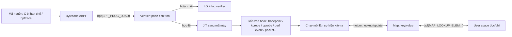

# P11 · Chương 02 — eBPF, tracepoint, kprobe/uprobe và ftrace

> Mọi khẳng định về kernel là về **Linux**. Nguồn là tài liệu kernel `docs.kernel.org` (trang không ghim phiên bản, nên có thể mới hơn kernel bạn đang chạy), man page Debian bookworm (`bpf(2)`, `perf_event_open(2)`, `capabilities(7)`, `bpf-helpers(7)`, `bpftrace(8)`; bản bpftrace trong bookworm là 0.17.0[^bt-ver]), reference guide và tutorial bpftrace gắn tag `v0.17.0`, cùng docs Rust 1.95.0 và docs.rs có ghim phiên bản. Chương này **không** có thí nghiệm: các dòng lệnh là minh họa lấy từ tài liệu, không kèm output do người soạn chạy.

## Bạn sẽ hiểu được gì

1. **Q1.** Tracing khác sampling ở đâu, và vì sao chi phí của hai kiểu này tăng theo hai quy luật khác nhau? → mục 1
2. **Q2.** ftrace và tracefs là gì; một thư mục toàn file điều khiển được tracer của kernel thế nào? → mục 2
3. **Q3.** Tracepoint (tĩnh) khác kprobe/uprobe (động) ở cơ chế, độ ổn định và cách dùng ra sao? → mục 3
4. **Q4.** eBPF là gì: verifier, map, helper, program type, attach point khớp với nhau thế nào? → mục 4
5. **Q5.** Một one-liner bpftrace đọc như thế nào (không cần chạy)? → mục 5
6. **Q6.** USDT là gì và khác uprobe ở chỗ nào? → mục 6
7. **Q7.** Chi phí (overhead) của từng cơ chế đến từ đâu và giảm bằng cách nào? → mục 7
8. **Q8.** Cần quyền gì (`CAP_BPF`, `CAP_PERFMON`…) và container thay đổi điều gì? → mục 8

Phần **Liên hệ với Rust** (mục 9): uprobe trên symbol Rust (mangling, inline, strip), và crate `tracing` khác eBPF tracing ra sao.

## Kiến thức cần trước

- [Chương 01 — perf và sampling profiler](01-perf-va-sampling-profiler.md): `perf_event_open`, sampling, flame graph; chương này dùng lại khái niệm sampling để đối chiếu với tracing.
- [Phase 1 · Chương 02 — System call](../01-linux/02-system-call.md): `bpf()` và `perf_event_open()` đều là syscall; tracepoint `syscalls:*` móc vào chính đường vào/ra syscall.
- [Phase 8 · Chương 01 — Container là gì](../08-containers/01-container-la-gi.md): container dùng chung kernel của host (cần cho mục 8).

## 1. Tracing và sampling (Q1)

> **Trả lời ngắn.** Tracing là gắn một đoạn code nhỏ vào một điểm trong kernel hoặc chương trình, và đoạn code đó chạy **mỗi lần** điểm ấy được đi qua[^tp-called]. Bạn thấy đủ từng sự kiện, nhưng điểm càng nóng thì càng tốn: với kprobe (mục 3), tài liệu kernel đo mỗi lần chạy cỡ micro-giây[^kprobe-hit-cost]. Sampling chỉ ghi trạng thái theo chu kỳ, sau mỗi N sự kiện[^pe-sample-def]. Bạn cũng có thể đặt một tần số mong muốn và để kernel tự chỉnh period[^pe-sample-freq]. Vì vậy chi phí của sampling do tốc độ lấy mẫu bạn đặt quyết định (suy luận của người soạn), nhưng đổi lại kết quả chỉ là thống kê, không phải danh sách đầy đủ.

**Giải thích.**

*Với service `orders`.* Hãy hình dung `orders`, một service Rust chạy trên host Linux, nhận vài nghìn request mỗi giây. Một buổi chiều p99 của `POST /orders` tăng vọt, và bạn không muốn deploy lại bản có thêm log (nhận xét của người soạn: đây là tình huống giả định, không phải code trong repo; ta bám theo `orders` suốt chương). Lúc đó có hai câu hỏi khác nhau: "CPU đang tốn ở đâu nói chung?" và "request nào chậm, chậm ở bước nào?". Hai câu hỏi dẫn tới hai cách quan sát, và chi phí của chúng tăng theo hai quy luật khác nhau.

### 1.1 Tracing: chạy handler mỗi lần sự kiện xảy ra

Tracing gắn một hàm nhỏ (handler) vào một điểm móc, và hàm đó chạy mỗi lần điểm móc được đi qua. Với tracepoint, tức điểm móc do kernel đặt sẵn (mục 3 nói kỹ), hàm bạn gắn vào được gọi mỗi lần tracepoint chạy, ngay trong ngữ cảnh của code gọi[^tp-called]. Kprobe, điểm móc gắn động, cũng vậy: tài liệu kprobes đo bằng cách bắn liên tục vào một điểm và báo 1–2 triệu hit mỗi giây tùy kiến trúc, trên CPU thời 2005[^kprobe-hit-cost].

Với `orders`, điều này có nghĩa là nếu bạn móc một hàm kernel mà service gọi 1 triệu lần mỗi giây thì bạn trả chi phí handler 1 triệu lần mỗi giây. Chi phí do tải của hệ thống quyết định, không do bạn chọn (suy luận của người soạn). Bù lại, bạn thấy từng lần gọi: thao tác nào, lúc nào, lần nào chậm.

### 1.2 Sampling: chạy theo nhịp

Sampling ghi lại trạng thái theo một nhịp chứ không theo từng sự kiện. `perf_event_open(2)` chia event làm hai loại: *counting*, tức đếm tổng số lần xảy ra, và *sampled*[^pe-flavors]. Event kiểu sampled ghi định kỳ số đo vào một buffer mà user space đọc qua `mmap(2)`[^pe-sampling-buf].

"Định kỳ" ở đây có hai dạng. Dạng thứ nhất: event sinh thông báo overflow sau mỗi `sample_period` sự kiện, và lúc đó dữ liệu được ghi vào buffer[^pe-sample-def]. Dạng thứ hai: bạn đặt `sample_freq` và kernel tự chỉnh period để đạt tần số mong muốn[^pe-sample-freq].

bpftrace dùng dạng sau qua probe `profile`: nó bắn trên từng CPU theo chu kỳ bạn chỉ định[^bt-profile]. Bên dưới, probe này chạy trên `perf_events`[^btref-profile-perf]. Tutorial của bpftrace chọn 99 Hz chứ không phải 100 Hz, vì muốn tần số đủ cao để thấy cả bức tranh lớn lẫn nhỏ mà không làm nhiễu hiệu năng, và tránh số tròn vì lấy mẫu có thể trùng nhịp với các hoạt động định kỳ khác[^bttut-99hz].

### 1.3 Chọn cách nào cho `orders`

| | Tracing (tracepoint, kprobe, uprobe) | Sampling (`perf` timer/cycles, `profile:hz:99`) |
|---|---|---|
| Khi nào handler chạy | Mỗi lần điểm móc được chạy tới[^tp-called] | Mỗi chu kỳ, hoặc mỗi N sự kiện[^pe-sample-def] |
| Chi phí tăng theo | Tần suất của sự kiện bị móc | Tần số lấy mẫu bạn chọn |
| Trả lời tốt | "Thao tác này mất bao lâu, lần nào chậm?", đếm chính xác, quan hệ trước–sau | "CPU đang tốn ở đâu nói chung?" |
| Trả lời kém | Sự kiện quá dày (hàm gọi hàng triệu lần/giây) | Sự kiện hiếm, ngắn, rơi giữa hai lần lấy mẫu (suy luận của người soạn) |

Với `orders`, câu hỏi "p99 của handler này tới từ đâu" cần tracing, vì bạn muốn thấy từng request chậm. Câu hỏi "CPU 80% mà không biết đang chạy hàm nào" cần sampling. Hai công cụ bổ sung nhau (nhận xét của người soạn); [chương 01](01-perf-va-sampling-profiler.md) nói về nhánh sampling.

<details><summary>Đi sâu: các con số trong tài liệu kernel và giới hạn tần số mẫu</summary>

- Tài liệu kprobes ghi rằng trên CPU thông dụng năm 2005, một kprobe hit tốn 0.5–1.0 micro-giây[^kprobe-hit-cost]. Return probe hit lâu hơn 50–75%[^kretprobe-cost]. Đây là số đo của phần cứng cũ; chỉ dùng để thấy bậc độ lớn, không dùng làm dự báo cho máy bạn.
- Sampling cũng không miễn phí: kernel có giới hạn `perf_event_max_sample_rate`, và tài liệu cảnh báo đặt quá cao có thể khiến người dùng lấy mẫu ở tần số làm giảm hiệu năng toàn máy, thậm chí treo máy[^pe-max-rate].
- Tracing và sampling có thể dùng *cùng* một cơ chế bên dưới. `perf_event_open` nhận cả event sampling lẫn `PERF_TYPE_TRACEPOINT`, tức tracepoint của kernel[^pe-type-tp]. Nó cũng nhận các PMU động `kprobe` và `uprobe`[^pe-kuprobe-pmu].

</details>

**Quay lại Q1:** tracing = chạy handler mỗi sự kiện (đầy đủ, chi phí theo tần suất sự kiện); sampling = chạy theo chu kỳ (thống kê, chi phí theo tần số mẫu).

## 2. ftrace và tracefs (Q2)

> **Trả lời ngắn.** ftrace là bộ tracing có sẵn trong kernel, sinh ra để giúp developer xem bên trong kernel đang diễn ra chuyện gì[^ftrace-intro]. Bạn điều khiển nó bằng cách đọc và ghi các file trong hệ thống file `tracefs`[^ftrace-tracefs]. Hệ thống file này thường gắn ở `/sys/kernel/tracing`[^ftrace-mount]. Chọn tracer, bật event, rồi đọc kết quả từ file `trace` hoặc `trace_pipe`.

**Giải thích.**

*Với service `orders`.* Giả sử p99 của `orders` tăng đúng lúc service nhận kết nối, và bạn nghi lỗi nằm trong kernel: không biết kernel gọi những hàm nào khi `orders` `accept` rồi `read`. Host production chỉ có shell, không cài thêm công cụ nào. ftrace hợp với tình huống này, vì tài liệu có hẳn các ví dụ điều khiển tracer chỉ bằng tracefs, không dùng công cụ user-land nào[^ftrace-no-userland].

### 2.1 tracefs

Chọn bất kỳ tùy chọn ftrace nào khi build kernel thì tracefs được cấu hình theo, và thư mục `/sys/kernel/tracing` xuất hiện[^ftrace-mount]. Trong thư mục đó là cả file điều khiển lẫn file hiển thị kết quả[^ftrace-tracefs]. Cách cũ là đi qua debugfs, thường ở `/sys/kernel/debug/tracing`; khi mount debugfs, tracefs cũng được tự mount vào đó để tương thích ngược[^ftrace-debugfs].

### 2.2 Chọn thứ muốn quan sát

ftrace thực chất là một khung gồm nhiều tiện ích tracing, không chỉ là "function tracer" mà người ta hay nhắc[^ftrace-framework]. Ba nhóm file bạn dùng ở bước này:

- **Tracer.** `available_tracers` liệt kê các tracer đã biên dịch vào kernel[^ftrace-avail-tracers]. Ghi tên một tracer vào `current_tracer` để chọn[^ftrace-current-tracer]. Tracer `function` theo dõi lúc *vào* các hàm kernel mà ftrace trace được[^ftrace-fn-tracer] (không phải hàm nào cũng trace được, phần Đi sâu nói vì sao). Tracer `function_graph` theo dõi cả lúc vào lẫn lúc ra, nên vẽ được đồ thị lời gọi hàm[^ftrace-fngraph].
- **Event.** Thư mục `events/` chứa các *event tracepoint* (còn gọi là static tracepoint) đã biên dịch vào kernel, xếp theo hệ thống con[^ftrace-events-dir]. `available_events` liệt kê event bật được[^ftrace-avail-events]. Ghi tên event vào `set_event` để bật nó[^ftrace-set-event].
- **Điểm móc động.** `kprobe_events` dùng để thêm điểm móc động (xem mục 3)[^ftrace-kprobe-events].

### 2.3 Bật/tắt ghi và đọc kết quả

`tracing_on` cho biết và đặt việc ghi vào ring buffer có bật hay không. Ghi `0` chỉ tắt việc *ghi* vào ring buffer, còn overhead của tracing vẫn có thể còn đó[^ftrace-tracing-on].

Kết quả đọc từ hai file, khác nhau ở chỗ có "tiêu thụ" dữ liệu hay không:

| File | Hành vi |
|---|---|
| `trace` | Không phải consumer, nên nếu tracing đang tắt thì mỗi lần đọc cho cùng kết quả[^ftrace-trace-file]. Mở để ghi với `O_TRUNC` thì xóa nội dung ring buffer[^ftrace-trace-trunc]. |
| `trace_pipe` | Đọc sẽ block tới khi có dữ liệu mới[^ftrace-pipe-block]. Dữ liệu đã đọc bị tiêu thụ, lần đọc tuần tự sau không thấy lại[^ftrace-pipe-consume]. |

Buffer của ftrace được định nghĩa theo từng CPU: mỗi CPU một buffer để ghi nguyên tử và không bị cache bouncing[^ftrace-percpu]. Hệ quả (suy luận của người soạn): thứ tự sự kiện giữa các CPU được ghép lại khi đọc dựa vào timestamp, không phải từ một hàng đợi toàn cục duy nhất.

### 2.4 Ghép lại

Minh họa của người soạn, dựng từ các file nêu ở trên:

```sh
cd /sys/kernel/tracing
echo function > current_tracer   # chọn tracer
cat trace_pipe                    # đọc, block đến khi có dữ liệu
echo nop > current_tracer        # tắt tracer
```

(Các lệnh trên không có output kèm theo vì không chạy.) Trên host của `orders`, bạn đọc `trace_pipe` trong lúc gửi một request, rồi xem kernel gọi những hàm nào.

<details><summary>Đi sâu: vì sao function tracer gần như không tốn gì khi tắt (dynamic ftrace)</summary>

- Khi `CONFIG_DYNAMIC_FTRACE` được bật, hệ thống chạy với overhead gần như bằng không lúc function tracing đang tắt[^ftrace-dyn-zero].
- Cơ chế bắt đầu từ compiler. gcc chèn một lời gọi `mcount` ở đầu mọi hàm kernel (do cờ `-pg`)[^ftrace-mcount]. Từ gcc 4.6, trên x86 có `-mfentry` để gọi `__fentry__` thay thế (gọi trước khi tạo stack frame)[^ftrace-fentry].
- Lúc khởi động, trước khi SMP khởi tạo, code dynamic ftrace quét bảng các vị trí này và đổi chúng thành `nop`[^ftrace-nops]. Nó cũng ghi lại các vị trí vào danh sách `available_filter_functions`[^ftrace-recorded].
- Khi bật tracing, các `nop` bị vá ngược thành lời gọi vào hạ tầng ftrace. Cách sửa code phụ thuộc kiến trúc; cách mới mà tài liệu mô tả là đặt breakpoint tại vị trí cần sửa, đồng bộ các CPU, sửa phần còn lại của lệnh, đồng bộ lần nữa rồi gỡ breakpoint[^ftrace-patch].
- Vì biết chính xác từng vị trí, ftrace chọn được hàm nào bị trace: ghi tên hàm vào `set_ftrace_filter` thì chỉ các hàm đó được trace[^ftrace-filter]. `available_filter_functions` liệt kê hàm ftrace đã xử lý và trace được[^ftrace-avail-filter].
- Không phải hàm nào cũng trace được: có phần bị chặn bằng `notrace`, và các hàm inline không được trace[^ftrace-notrace]. (Liên hệ Rust, mục 9: hàm bị inline thì không còn là một điểm để móc, điều này cũng đúng với uprobe.)
- `trace_marker` cho phép *ứng dụng* ghi chuỗi vào ring buffer của ftrace, hữu ích để đồng bộ user space với sự kiện kernel[^ftrace-marker]. Một service Rust như `orders` có thể mở file này và ghi dấu "bắt đầu request X" để đặt cạnh các event kernel trong cùng dòng thời gian (nhận xét của người soạn).
- Thống kê ring buffer mỗi CPU có trường `overrun`: số event bị mất do ghi đè khi buffer đầy[^ftrace-overrun].

</details>

**Quay lại Q2:** ftrace là framework tracing trong kernel, tracefs là bề mặt điều khiển bằng file; bạn chọn tracer hoặc event rồi đọc `trace` hay `trace_pipe`, và nhờ vá `nop`↔call lúc chạy nên gần như miễn phí khi tắt.

## 3. Tracepoint (tĩnh) và kprobe/uprobe (động) (Q3)

> **Trả lời ngắn.** Tracepoint là điểm móc do người viết kernel **đặt sẵn** trong code, cho bạn đăng ký một hàm probe lúc runtime[^tp-hook]. Khi chưa có probe nào thì nó gần như không tốn gì[^tp-off]. Kprobe thì chèn điểm móc vào **gần như bất kỳ lệnh nào** của kernel (trừ danh sách cấm) lúc kernel đang chạy, mặc định bằng cách thay lệnh đó bằng một breakpoint[^kprobe-int3]. Uprobe là phiên bản tương tự cho user space[^uprobe-similar]. Đổi lại, chỗ gắn của kprobe là chi tiết cài đặt nội bộ, không có cam kết ổn định[^qa-kprobe-abi]. Với uprobe, bạn còn phải tự cung cấp offset của điểm cần móc trong object[^uprobe-offset].

**Giải thích.**

*Với service `orders`.* Muốn biết `orders` làm gì với file, bạn có ba chỗ để móc. Chỗ thứ nhất là tracepoint ở lúc vào syscall `openat`, một điểm dev kernel đã đặt sẵn. Chỗ thứ hai là kprobe vào một hàm nội bộ như `vfs_read`, chỗ không ai đặt sẵn cho bạn. Chỗ thứ ba là uprobe vào một hàm nằm trong chính binary `orders`. Ba loại này khác nhau ở chỗ ai đặt điểm móc, và từ đó kéo theo khác nhau về độ ổn định.

### 3.1 Tracepoint

Muốn có một tracepoint, dev kernel cần hai thứ: một định nghĩa đặt trong header, và câu lệnh gọi tracepoint trong code C[^tp-two]. Tracepoint là hook nhẹ, truyền được số tham số tùy ý, với prototype khai báo trong header[^tp-proto]. Khi tracepoint "tắt" (chưa có probe), nó chỉ tốn một chút thời gian để kiểm tra điều kiện rẽ nhánh, cộng vài byte cho lời gọi hàm ở cuối hàm và một cấu trúc dữ liệu ở section riêng[^tp-off]. Kernel còn dùng `static_key` và jump label để việc kiểm tra bật/tắt không cần rẽ nhánh có điều kiện[^tp-static-key]. Khi "bật" (có probe), hàm của bạn được gọi mỗi lần tracepoint chạy, trong ngữ cảnh của bên gọi[^tp-called].

Cách dễ nhất để dùng tracepoint là qua trace event. Macro `TRACE_EVENT` định nghĩa tracepoint và đồng thời phơi nó thành một *trace event* trong thư mục `/sys/kernel/tracing/events`[^tp-trace-event]. Hạ tầng event tracing cho phép dùng tracepoint mà không cần viết kernel module để đăng ký probe[^ev-intro]. Nhưng không phải tracepoint nào cũng dùng được kiểu này: dev kernel phải cung cấp phần định nghĩa cách lưu và in thông tin[^ev-not-all].

### 3.2 Kprobe

Kprobes cho phép bạn đột nhập động vào gần như mọi hàm kernel và thu thông tin hiệu năng mà không làm gián đoạn hệ thống[^kprobe-intro]. Các bước diễn ra như sau:

1. Khi đăng ký, kprobes sao chép lệnh bị móc và thay (các) byte đầu của lệnh bằng lệnh breakpoint (`int3` trên x86)[^kprobe-int3].
2. Khi CPU chạm breakpoint thì trap xảy ra, thanh ghi được lưu, quyền điều khiển qua kprobes, và kprobes gọi `pre_handler`[^kprobe-trap].
3. Kprobes chạy từng bước (single-step) bản *sao* của lệnh gốc, không chạy tại chỗ. Lý do là chạy tại chỗ thì phải gỡ breakpoint tạm thời, và việc đó mở một cửa sổ nhỏ cho CPU khác chạy lọt qua điểm móc[^kprobe-singlestep].
4. Sau đó kprobes gọi `post_handler` (nếu có) và tiếp tục với lệnh kế tiếp[^kprobe-post].

Kprobe chỉ bắt được lúc *vào* hàm. Để bắt lúc hàm trả về, ta dùng kretprobe: `register_kretprobe()` đặt một kprobe ở đầu hàm, lưu địa chỉ trả về của hàm rồi thay bằng địa chỉ một "trampoline". Khi hàm `ret`, trampoline bị chạm, handler trả về được gọi, rồi kprobes nhảy về địa chỉ trả về đã lưu[^kretprobe-how].

### 3.3 Uprobe

Uprobe giống kprobe nhưng dành cho user space[^uprobe-similar]. Điểm khác nằm ở cách chỉ định vị trí: giao diện uprobe event yêu cầu bạn tự tính offset của điểm móc trong object[^uprobe-offset]. Cú pháp là `p[:[GRP/][EVENT]] PATH:OFFSET [FETCHARGS]`[^uprobe-syntax]. Trong đó `PATH` là đường dẫn tới file thực thi hoặc thư viện[^uprobe-path]. Ví dụ trong tài liệu: `zfree` trong `/bin/zsh` nằm ở địa chỉ `0x446420` và object được nạp ở `0x00400000`, nên offset là `0x46420`[^uprobe-zsh-ex]. Bộ nhớ lấy ra từ uprobe chỉ có thể là user space[^uprobe-usermem].

Với `orders`, uprobe cho bạn móc vào một hàm Rust của chính service, miễn là bạn tìm được symbol và offset của nó. Mục 9 nói chuyện đó khó đến đâu với binary Rust.

### 3.4 Ba loại, đặt cạnh nhau

| | Tracepoint | Kprobe | Uprobe |
|---|---|---|---|
| Ai đặt điểm móc | Dev kernel, lúc viết code[^tp-hook] | Bạn, lúc chạy[^kprobe-intro] | Bạn, lúc chạy[^uprobe-similar] |
| Phạm vi | Chỗ dev kernel đã chọn | "Hầu như mọi" lệnh kernel, trừ blacklist[^kprobe-blacklist] | File thực thi hoặc thư viện user space[^uprobe-path] |
| Đối số | Có kiểu theo prototype khai báo[^tp-proto] | Lấy từ thanh ghi (`$argN`, "best effort"; đối số truyền qua stack không được hỗ trợ)[^kprobetrace-arg-best] | Lấy từ thanh ghi hoặc bộ nhớ user space[^uprobe-fetch] |
| Ổn định giữa các bản kernel/binary | Kernel không cam kết ABI[^qa-tp-abi] | Không cam kết[^qa-kprobe-abi] | Phụ thuộc symbol của binary; xem mục 9 |

Có ba cách giao tiếp với các điểm móc này. Cách thứ nhất là qua tracefs: kprobe dùng `kprobe_events`, uprobe dùng `uprobe_events`, còn `dynamic_events` gom chúng lại thành một giao diện thống nhất[^kprobetrace-dynamic]. Uprobe-tracer cũng nói y như vậy về giao diện đó[^uprobe-dynamic]. Cách thứ hai là `perf_event_open` với PMU động `kprobe`/`uprobe` (từ Linux 4.17)[^pe-kuprobe-pmu]. Cách thứ ba là qua eBPF (mục 4).

Về độ ổn định, man page bpftrace nói tracepoint *thường* có giao diện ổn định hơn kprobe, vì nó không phụ thuộc việc một hàm kernel còn tồn tại[^bt-tracepoint-stable]. Nhưng tài liệu BPF của kernel nói rõ tracepoint gắn với chi tiết cài đặt nội bộ nên có thể vỡ ở kernel mới[^qa-tp-abi]. Cách đọc (suy luận của người soạn): "ổn định" của bpftrace là so sánh tương đối với kprobe, còn khi hai bên lệch nhau thì lấy tài liệu kernel làm chuẩn. Tracepoint ít đổi hơn tên hàm nội bộ, nhưng đừng coi nó là hợp đồng cứng.

<details><summary>Đi sâu: tối ưu bằng lệnh nhảy, blacklist, return probe và phần tử "stable"</summary>

- *Jump optimization.* Nếu kernel build với `CONFIG_OPTPROBES=y` (tự bật trên x86/x86-64 với kernel non-preemptive) và tham số `debug.kprobes_optimization` bằng 1, kprobes cố giảm chi phí mỗi hit bằng cách dùng lệnh nhảy thay vì breakpoint tại điểm móc[^kprobe-optimize]. Khi đăng ký, kprobes luôn đặt kprobe breakpoint thường trước, nên nếu không tối ưu được thì vẫn có probe ở đó[^kprobe-optinit].
- *Blacklist.* Kprobes không probe được chính nó: probe vào những hàm đó có thể gây trap đệ quy (ví dụ double fault) hoặc handler lồng không bao giờ được gọi[^kprobe-blacklist-why]. Kprobes kiểm tra địa chỉ với blacklist và từ chối đăng ký nếu trúng[^kprobe-blacklist]. Phiên bản event của kprobe nói rõ: probe được ở đâu kprobes probe được, tức mọi hàm trừ những hàm có chú thích `__kprobes`/`nokprobe_inline` và `NOKPROBE_SYMBOL`[^kprobetrace-where].
- *`maxactive` của kretprobe.* Đây là số instance của hàm có thể được probe đồng thời; đặt quá thấp thì chỉ mất probe, không phải thảm họa[^kretprobe-nmissed].
- *Đối số của kprobe.* Fetcharg `$argN` của kprobe event chỉ cho probe ở đầu hàm (offset 0) và là "best effort", vì tùy kiểu mà đối số có thể nằm trên stack; chỉ đối số truyền qua thanh ghi được hỗ trợ[^kprobetrace-arg-best].
- *Đối số trong bpftrace.* `arg0`, `arg1`… lấy từ thanh ghi CPU[^bt-arg-regs]. bpftrace không nhận ra chữ ký hàm nên không biết số lượng hay kiểu đối số, người dùng phải tự ép kiểu[^bt-no-signature]. Bẫy kinh điển: đối số số thực thường đi qua thanh ghi riêng nên không đếm vào `argN`. Theo ví dụ của man page, trong hàm `func(int a, double d, int x)` thì `x` là `arg1` chứ không phải `arg2`[^bt-float-arg].
- *Offset uprobe và ASLR.* Trong ví dụ zsh, tài liệu gọi `0x46420` là offset của `zfree` trong object `/bin/zsh`, object được nạp ở `0x00400000`[^uprobe-zsh-ex]. Hiệu `0x446420 − 0x400000` cho đúng giá trị đó, nhưng đó là cách tính của ví dụ này, không phải công thức chung cho mọi binary (suy luận của người soạn). Về cache symbol, bpftrace mặc định chỉ cache kết quả phân giải symbol khi ASLR (ngẫu nhiên hóa bố cục bộ nhớ) tắt[^bt-aslr-cache]; lý do (suy luận của người soạn) là địa chỉ symbol có thể đổi giữa các lần chạy khi ASLR bật. bpftrace cho viết `uprobe:binary:func`[^bt-uprobe-syntax]. Với thư viện, chỉ cần tên thư viện thay vì đường dẫn đầy đủ[^bt-uprobe-lib].
- *Uretprobe cũng thay địa chỉ trả về.* Để uretprobe hoạt động, kernel chạy một helper đặc biệt ở đầu hàm user space để ghi đè địa chỉ trả về trên stack; tài liệu bpftrace nêu rằng điều này gây vấn đề với các ngôn ngữ có runtime riêng như Go (kèm ví dụ crash)[^bt-uretprobe-go]. Tài liệu không nói gì về Rust ở điểm này, nên chương này không khẳng định.
- *Ba nguồn nói về "ổn định".* Tutorial bpftrace viết gọn hơn man page: tracepoint "có API ổn định"[^bttut-tp-stable]. Đó là cách nói giản lược; xem đoạn so sánh ngay trước phần Đi sâu này.

</details>

**Quay lại Q3:** tracepoint là điểm móc có sẵn do dev kernel đặt, gần như miễn phí khi tắt; kprobe/uprobe chèn breakpoint động vào gần như mọi lệnh, linh hoạt nhưng gắn với chi tiết cài đặt và (với uprobe) cần offset do bạn cung cấp.

## 4. eBPF: chương trình nhỏ chạy trong kernel (Q4)

> **Trả lời ngắn.** eBPF cho phép user nạp vào kernel một chương trình nhỏ qua syscall `bpf()`. Trước khi chạy, *verifier* trong kernel phân tích tĩnh để bảo đảm chương trình kết thúc và an toàn[^bpf-safe]. Chương trình gắn vào các sự kiện như packet đến hay tracing event[^bpf-events]. Nó chỉ được gọi một tập *helper* cố định, tức các hàm có sẵn trong kernel[^bpf-helpers-fixed]. Nó trao đổi dữ liệu với user space hoặc với chương trình khác qua *map*, tức bảng key/value[^bpf-map-exchange]. Nhờ vậy bạn tracing, lọc, tổng hợp ngay trong kernel mà không cần viết kernel module (nhận xét của người soạn).

**Giải thích.**

*Với service `orders`.* Ở mục 1, để thấy request nào chậm bạn cần tracing, nghĩa là chạy handler mỗi lần sự kiện xảy ra. Nhưng nếu mỗi lần như vậy bạn đẩy một event ra user space rồi mới tính toán, `orders` sẽ gánh cả chi phí chuyển dữ liệu (nhận xét của người soạn). eBPF giải bài đó: bạn nạp một đoạn code nhỏ vào kernel để nó tự cộng dồn, ví dụ "mỗi lần `orders` gọi `read`, ghi lại mất bao lâu" thành histogram, và user space chỉ đọc kết quả cuối. Vì đoạn code đó chạy trong kernel, kernel phải chắc nó không làm hỏng máy. Mục này kể lại các mảnh ghép làm việc đó.



(Sơ đồ trên là tổng hợp của người soạn từ các mảnh ghép 4.1–4.7 bên dưới, mỗi mảnh có nguồn riêng; mũi tên "Verifier → JIT" và thứ tự các bước là cách vẽ của người soạn.)

### 4.1 Nạp chương trình

`bpf()` là syscall thực hiện nhiều thao tác liên quan tới extended BPF[^bpf-syscall]. Để nạp chương trình, bạn dùng `BPF_PROG_LOAD`: kernel verify rồi nạp chương trình, trả về một file descriptor gắn với chương trình đó[^bpf-progload]. (Về syscall nói chung xem [Phase 1 · Chương 02](../01-linux/02-system-call.md).) Chương trình viết bằng một dạng C bị hạn chế, rồi clang biên dịch thành bytecode eBPF[^bpf-restricted-c]. Mô tả này đến từ man page bản bookworm, khá cũ; muốn biết kernel hiện hành cho phép những gì trong C bị hạn chế thì phải đọc thêm tài liệu kernel, và chương này không khẳng định gì về các giới hạn đó ngoài vòng lặp (xem mục 4.2).

### 4.2 Verifier: kernel không tin chương trình bạn nạp

Verifier xác định chương trình an toàn qua hai bước. Bước đầu kiểm tra DAG để cấm vòng lặp và các lỗi đồ thị luồng điều khiển khác, trong đó có việc phát hiện lệnh không với tới được[^ver-dag]. Bước hai bắt đầu từ lệnh đầu tiên, đi qua mọi đường có thể, mô phỏng thực thi từng lệnh và theo dõi thay đổi của thanh ghi và stack[^ver-simulate]. Mô tả "cấm vòng lặp" này đã cũ: một nguồn khác nói từ Linux 5.3 verifier đủ thông minh để chấp nhận vòng lặp mà nó chứng minh được là dừng, gọi là *bounded loop*[^ebpfdocs-loops].

Hai quy tắc làm verifier hữu ích cho người dùng. Thứ nhất, lệnh load/store chỉ được phép với thanh ghi có kiểu con trỏ hợp lệ (context, map, stack), và bị kiểm tra biên lẫn căn lề[^ver-ptr-types]. Thứ hai, truy cập map trả về một loại "con trỏ có thể NULL", chỉ trở thành con trỏ dùng được sau khi bạn kiểm tra khác NULL[^ver-map-null]. Tức là chương trình tracing của bạn phải tự kiểm tra lúc tra map không ra gì.

### 4.3 Helper: lối duy nhất ra khỏi sandbox

Helper là các hàm có sẵn trong kernel mà chương trình gọi. Chúng thuộc một danh sách trắng do kernel định nghĩa, và mỗi program type chỉ gọi được một tập con[^helpers-whitelist]. Lời gọi helper được biên dịch gọi thẳng vào hàm kernel, không cần FFI, nên tài liệu nói không có overhead của lời gọi[^helpers-no-ffi]. Verifier kiểm tra thanh ghi khớp ràng buộc đối số của helper[^ver-func-args].

Ngoài helper và kfunc, chương trình không gọi được hàm kernel nào khác[^qa-no-arbitrary-call]. Muốn đọc bộ nhớ tùy ý, chương trình tracing phải đi qua các helper `bpf_probe_read()` và `bpf_probe_read_str()`[^qa-no-arbitrary-mem]. Một vài helper hay gặp khi tracing. `bpf_probe_read_user` đọc bộ nhớ user[^helper-read-user]. `bpf_ktime_get_ns` trả thời gian từ lúc boot theo nano-giây[^helper-ktime]. Một helper khác trả về tgid và pid hiện tại[^helper-pidtgid].

### 4.4 Map: nơi chương trình giữ và trao đổi dữ liệu

Map là cấu trúc dữ liệu chung cho nhiều loại dữ liệu khác nhau[^bpf-map-generic]. Key và value đối xử như blob nhị phân, bạn chỉ khai báo kích thước của chúng lúc tạo map. Nhiều chương trình eBPF truy cập song song cùng một map được[^bpf-map-fd]. Có nhiều kiểu map: hash, array, bloom filter, radix tree…[^maps-types]

Chương trình truy cập map qua helper, còn user space truy cập qua syscall `bpf` với các lệnh tạo, tra, cập nhật và xóa[^maps-access]. Verifier dùng `key_size` và `value_size` để từ chối chương trình đọc ngoài biên giá trị[^bpf-map-verify]. Ở ví dụ `orders`, map là chỗ histogram được cộng dồn trong kernel, rồi user space đọc ra.

### 4.5 Program type: quyết định chương trình thấy gì

Kiểu chương trình (`prog_type`) quyết định tập con helper được gọi, và quyết định "đầu vào" (context) của chương trình[^bpf-progtype-ctx]. Ví dụ chương trình tracing nhận một tập giá trị thanh ghi, còn socket filter nhận packet mạng[^bpf-progtype-ctx]. Trong số các kiểu mà man page liệt kê có `BPF_PROG_TYPE_KPROBE` và `BPF_PROG_TYPE_TRACEPOINT`[^bpf-progtype-list].

### 4.6 Attach point: quyết định chương trình chạy khi nào

Sau khi nạp, chương trình phải gắn vào một sự kiện; cách gắn tùy hệ con của kernel. Với perf event, bạn gắn bằng `ioctl(event_fd, PERF_EVENT_IOC_SET_BPF, prog_fd)` lên fd do `perf_event_open(2)` tạo, từ Linux 4.1[^bpf-attach-perf].

libbpf thêm một lớp tiện lợi: tên section ELF mô tả cách tự gắn. Với kprobe, định dạng là `kprobe/<function>[+<offset>]`[^libbpf-kprobe]. Với uprobe là `uprobe/<path>:<function>[+<offset>]`[^libbpf-uprobe]. Với USDT là `usdt/<path>:<provider>:<name>`[^libbpf-usdt].

### 4.7 Vòng đời

Chương trình thường do process nạp và tự gỡ khi process đó thoát; có trường hợp như `tc-bpf` thì nó còn sống trong kernel nhờ subsystem giữ tham chiếu[^bpf-lifetime]. Một object eBPF chỉ bị giải phóng khi mọi file descriptor tham chiếu tới nó đã đóng[^bpf-object-fd].

<details><summary>Đi sâu: giới hạn verifier, theo dõi kiểu giá trị, JIT, ABI, license, BTF/CO-RE</summary>

- *Giới hạn tài nguyên.* Verifier có các giới hạn nội bộ. Số lệnh tối đa được khám phá khi phân tích hiện đặt ở 1 triệu[^qa-verifier-limits]. Mọi program type bị giới hạn 512 byte stack[^qa-stack-512].
- *Theo dõi giá trị thanh ghi.* Verifier theo dõi khoảng giá trị có thể của từng thanh ghi và từng ô stack bằng `struct bpf_reg_state`[^ver-regstate]. Thanh ghi chưa từng được ghi thì không đọc được[^ver-unreadable]. Ở đầu chương trình, `R1` chứa con trỏ tới context (kiểu `PTR_TO_CTX`)[^ver-r1-ctx]. Sau lời gọi hàm kernel, `R1–R5` bị reset thành không đọc được còn `R0` mang kiểu trả về; `R6–R9` do callee lưu nên giữ nguyên qua lời gọi[^ver-callee].
- *Gọi helper và quy ước C.* eBPF thiết kế để JIT một-một sang thanh ghi phần cứng: toàn bộ thanh ghi eBPF ánh xạ 1-1 sang thanh ghi phần cứng trên x86_64, aarch64…[^cl-reg-map] Chương trình chỉ có một đối số `ctx` đặt sẵn ở `R1`[^cl-ctx-r1]. Theo quy ước eBPF, một helper cũng không thể có quá năm đối số[^helpers-five-args].
- *JIT.* Kernel có trình biên dịch JIT dịch bytecode eBPF sang mã máy để chạy nhanh hơn; trước Linux 4.15 JIT tắt mặc định[^bpf-jit]. Đó là mô tả từ man page bản bookworm; kernel mới có thể cấu hình khác, ví dụ từ Linux 4.15 tồn tại tùy chọn `CONFIG_BPF_JIT_ALWAYS_ON`[^bpf-jit-always].
- *Giữ ổn định và ngoại lệ.* Ngoại lệ với ABI ổn định là chương trình tracing dùng `bpf_probe_read()` để duyệt cấu trúc dữ liệu nội bộ kernel và biên dịch với header nội bộ; loại chương trình này có thể vỡ khi kernel đổi[^qa-abi-exception]. Chức năng mới thường được thêm qua kfunc chứ không qua helper mới, và kfunc không thuộc API ổn định[^qa-kfunc].
- *License.* Chuỗi license khi nạp phải tương thích GPL thì mới gọi được các helper đánh dấu `gpl_only`[^bpf-license].
- *Log verifier.* Bạn có thể yêu cầu log để hiểu vì sao chương trình bị coi là không an toàn; định dạng log có thể đổi bất cứ lúc nào khi verifier tiến hóa[^bpf-vlog].
- *BTF và CO-RE.* BTF là định dạng metadata mã hóa thông tin debug liên quan tới chương trình/map BPF[^btf-def]. libbpf dùng BTF cùng compiler để hỗ trợ CO-RE (Compile Once – Run Everywhere): một binary chạy được trên nhiều phiên bản và cấu hình kernel[^co-re]. Đây là lời giải của cộng đồng BPF cho bài toán "chương trình tracing đọc cấu trúc nội bộ kernel dễ vỡ" nêu ở trên (suy luận của người soạn, ghép từ hai nguồn trích).

</details>

**Quay lại Q4:** eBPF là chương trình nạp qua `bpf()`, được verifier duyệt, gắn vào hook, gọi helper có kiểm soát và trao đổi dữ liệu qua map; program type quyết định context và helper, attach point quyết định *khi nào* nó chạy.

## 5. Đọc một one-liner bpftrace (Q5)

> **Trả lời ngắn.** bpftrace là ngôn ngữ tracing bậc cao chạy trên BPF, hỗ trợ cả tracing tĩnh lẫn động cho kernel và user space[^bt-desc]. Mỗi chương trình gồm các *action block* có dạng `probe /predicate/ { action }`[^bt-structure]: probe nói *khi nào* chạy, predicate (tùy chọn) là điều kiện lọc, action là code chạy. Đọc một one-liner là đọc ba phần đó từ trái sang phải, rồi tra xem biến nào là map (`@`), biến nào là builtin (`pid`, `comm`, `args->…`).

**Giải thích.**

*Với service `orders`.* Bạn cần trả lời nhanh bốn câu hỏi về `orders`: nó mở những file nào, gọi syscall nào nhiều nhất, mỗi lần `vfs_read` mất bao lâu, và CPU đang ở đâu trong kernel. Mỗi câu là một dòng bpftrace. Bốn dòng dưới đây là one-liner của tutorial bpftrace, nên chúng chưa lọc theo process; trên host thật có nhiều process khác ngoài `orders`, và bạn sẽ thêm predicate lọc theo `comm` (nhận xét của người soạn). Trước hết cần biết cách đọc.

### 5.1 Khung đọc

1. **Probe.** Mỗi probe bắt đầu bằng một *provider* (ví dụ `kprobe`) rồi tới danh sách option cách nhau bằng dấu `:`[^bt-probe-fmt]. Nhiều probe có thể dùng chung một action, và hỗ trợ wildcard như `kprobe:tcp_*`[^bt-wildcard]. Muốn biết hệ thống hiện có probe nào thì dùng `bpftrace -l` với pattern[^bt-list]. Thêm `-v` để xem các đối số (`args`)[^bt-list-v].
2. **Predicate.** Đây là điều kiện tùy chọn; chỉ khi thỏa thì action mới chạy[^bt-predicate].
3. **Action.** Là danh sách câu lệnh ngăn bằng `;`, đặt trong `{}`[^bt-action].
4. **Biến.** Biến `$tên` là scratch, nằm trên BPF stack và chỉ tồn tại trong lúc action block chạy[^bt-scratch]. Biến `@tên` là map, tồn tại suốt vòng đời của bpftrace và truy cập được từ mọi action block lẫn user space[^bt-map-var]. Map có thể là mảng kết hợp `@name[key] = expression`[^bt-assoc]. Chương trình dừng khi Ctrl-C hoặc gọi `exit()`, và lúc thoát, mọi map đã có dữ liệu được in ra[^btref-print-maps].

### 5.2 Bốn one-liner

Bốn one-liner lấy từ tutorial bpftrace v0.17.0. Ta đọc từng cái.

**(a) Mỗi lần mở file, in tên process và đường dẫn.**

```text
tracepoint:syscalls:sys_enter_openat { printf("%s %s\n", comm, str(args->filename)); }
```

- Probe `tracepoint:syscalls:sys_enter_openat` là tracepoint (tracing tĩnh của kernel) tại lúc syscall `openat()` được *vào*[^bttut-openat]. Tutorial ưu tiên tracepoint hơn kprobe vì nói tracepoint có API ổn định[^bttut-tp-stable]. Nhưng như mục 3 đã nói, kernel không cam kết ABI cho tracepoint[^qa-tp-abi].
- `comm` là builtin chứa tên process hiện tại[^bttut-comm]. `args->filename` lấy trường `filename` trong struct `args`, và `str()` đổi con trỏ thành chuỗi nó trỏ tới[^bttut-args-str]. Các trường của `args` xem được bằng `bpftrace -l ... -v`[^bt-tp-args].
- Vì sao tracepoint tên `openat` chứ không phải `open`? Tutorial lưu ý rằng trên hệ Linux hiện đại (glibc ≥ 2.26), wrapper `open` luôn gọi syscall `openat`[^bttut-openat]. (Về quan hệ giữa libc wrapper và syscall xem [Phase 1 · Chương 02](../01-linux/02-system-call.md).)

**(b) Đếm syscall theo tên process.**

```text
tracepoint:raw_syscalls:sys_enter { @[comm] = count(); }
```

- `@` là map, `[comm]` là key (như mảng kết hợp), và `count()` là hàm map đếm số lần được gọi. Kết quả là tần suất syscall theo tên process, và map tự in khi bpftrace kết thúc[^bttut-count].
- `count()` dùng một kiểu map tối ưu (PER_CPU) nên nhanh hơn `@++`; hệ quả là map đó không truy cập được như một số nguyên thường[^bt-count-percpu].

**(c) Đo thời gian mỗi `vfs_read` (kprobe + kretprobe).**

```text
kprobe:vfs_read { @start[tid] = nsecs; }
kretprobe:vfs_read /@start[tid]/ { @ns[comm] = hist(nsecs - @start[tid]); delete(@start[tid]); }
```

Trong tutorial đây là một dòng; ở đây tách hai dòng cho dễ đọc. Đây là mẫu đo latency kinh điển, nên ta đọc theo thứ tự thực thi:

- `kprobe:vfs_read` chạy lúc *vào* hàm và ghi `nsecs` (nano-giây kể từ boot[^bttut-nsecs]) vào map `@start`. Khóa theo thread ID, và làm vậy được vì một thread kernel chỉ chạy một syscall tại một thời điểm[^bttut-tid-key].
- `kretprobe:vfs_read` chạy lúc *ra*. Predicate `/@start[tid]/` kiểm tra đã thấy lúc vào hay chưa, để loại trường hợp bpftrace khởi động giữa lúc đang đọc nên chỉ bắt được lúc ra[^bttut-pred].
- `hist(...)` tạo histogram log2[^bt-hist]. `delete(...)` giải phóng phần tử[^bttut-delete].
- Vì sao phải lưu qua map? Return probe không có quyền truy cập đối số đầu vào của hàm, chỉ có giá trị trả về (`retval`); cách làm thường dùng là cất đối số vào map lúc vào hàm rồi lấy lại ở return probe[^bt-kretprobe-args]. Cùng lý do đó ta cần map để mang `nsecs` từ probe này sang probe kia (suy luận của người soạn).

**(d) Sampling stack kernel ở 99 Hz.**

```text
profile:hz:99 { @[kstack] = count(); }
```

- `profile:hz:99` bắn trên mọi CPU ở 99 Hz[^bttut-99hz]. `kstack` là builtin trả về stack trace kernel, dùng làm key của map để đếm tần suất; kết quả hợp để vẽ flame graph[^bttut-kstack]. Đây chính là sampling của mục 1, nối thẳng với [chương 01](01-perf-va-sampling-profiler.md).

**Một one-liner cho user space.** Từ man page bpftrace:

```text
bpftrace -e 'uprobe:libc:malloc { printf("Allocated %d bytes\n", arg0); }'
```

Với thư viện, chỉ cần ghi tên thay vì đường dẫn đầy đủ[^bt-uprobe-lib]. `arg0` là đối số thứ nhất, lấy từ thanh ghi[^bt-arg-regs].

<details><summary>Đi sâu: những chỗ bpftrace âm thầm cho kết quả "lạ"</summary>

- *Lỗi helper bị nuốt.* Mặc định lỗi từ các helper (`bpf-helpers(7)`) bị bỏ qua im lặng, có thể dẫn tới kết quả kỳ lạ[^bt-k-flag]. Cờ `-k` bật phát hiện lỗi (trừ lỗi từ `probe_read_*`), còn `-kk` gồm cả `probe_read_*`.
- *Chuỗi bị cắt.* `str()` cấp sẵn một số byte nhất định trên BPF stack (mặc định `BPFTRACE_STRLEN` là 64), và tài liệu nhắc BPF stack nhỏ (512 byte)[^bt-strlen].
- *Giới hạn số khóa map.* `BPFTRACE_MAP_KEYS_MAX` mặc định 4096, là số khóa tối đa trong một map[^bt-map-keys]. Nghĩa là một one-liner khóa theo thứ lớn (ví dụ từng địa chỉ) có thể chạm trần.
- *Mất event.* Nếu thấy nhiều event bị rơi, có thể bpftrace xử lý ring buffer không kịp. Tăng `BPFTRACE_PERF_RB_PAGES` (mặc định 64 trang mỗi CPU) cho phép xếp thêm event, đổi lại tốn bộ nhớ[^bt-rb-pages].
- *Không có số thực.* BPF không hỗ trợ số thực nên bpftrace cũng không[^bt-float].
- *Biến theo kiểu.* Kiểu của biến được xác định ở lần gán đầu tiên và không đổi sau đó[^bt-var-type].
- *Đối số uprobe có tên.* Nếu binary có DWARF thì đối số hàm có sẵn trong struct `args`[^bt-uprobe-dwarf]. (Với Rust: xem cấu hình `debug` ở mục 9.)

</details>

**Quay lại Q5:** đọc `probe /predicate/ { action }`, nhận ra `@map`, `$scratch` và builtin; `kprobe` + `kretprobe` + map theo `tid` là mẫu chuẩn để đo latency, còn `profile:hz:N` là mẫu chuẩn để sampling.

## 6. USDT: điểm quan sát tĩnh trong user space (Q6)

> **Trả lời ngắn.** USDT (User Statically-Defined Tracing) là các điểm tracing tĩnh trong phần mềm user-level, do tác giả phần mềm đặt sẵn, giống tracepoint của kernel nhưng nằm trong ứng dụng[^btref-usdt-def]. Công cụ gắn vào bằng tên `binary:[namespace]:probe`[^btref-usdt-syntax], không cần biết địa chỉ hàm. Khác uprobe gắn vào hàm hoặc offset bất kỳ, USDT là điểm do tác giả *công bố*, nên có thể được ghi tài liệu và ổn định[^btref-static-def].

**Giải thích.**

*Với service `orders`.* Ở mục 3, để móc uprobe vào hàm xử lý request của `orders`, bạn phải tự tìm symbol và offset, và chúng đổi mỗi lần build lại. Nếu tác giả `orders` đặt sẵn hai probe tên "bắt đầu request" và "xong request" thì người vận hành attach theo tên, không cần biết hàm nào nằm ở đâu (nhận xét của người soạn: ví dụ giả định). Đó là ý tưởng của USDT: tracepoint của kernel, nhưng do tác giả ứng dụng đặt.

### 6.1 Static và dynamic tracing theo cách bpftrace định nghĩa

Tài liệu bpftrace phân biệt hai loại. *Static tracing* là các điểm đo viết cứng trong code; vì cố định nên chúng có thể là một phần của API ổn định và được ghi tài liệu[^btref-static-def]. *Dynamic tracing* là sửa văn bản lệnh lúc chạy để đo bất kỳ sự kiện phần mềm nào. Mục tiêu thường không cần hỗ trợ gì đặc biệt ngoài một bảng symbol bpftrace đọc được, và vì đo toàn bộ text nên nó không được xem là API ổn định[^btref-dynamic-def]. USDT thuộc loại đầu.

### 6.2 Cú pháp

Có ba dạng: `usdt:binary_path:probe_name`, `usdt:binary_path:[probe_namespace]:probe_name`, hoặc với thư viện `usdt:library_path:...`. `probe_namespace` là tùy chọn nếu `probe_name` duy nhất trong binary[^btref-usdt-syntax]. Nếu binary có nhiều probe cùng tên ở hai namespace khác nhau, bpftrace báo lỗi yêu cầu chỉ rõ namespace hoặc dùng `*`[^btref-usdt-ns]. Đối số probe đọc qua `arg0`, `arg1`… như các probe khác; ví dụ trong reference guide bpftrace dùng `str(arg0)`[^btref-usdt-args]. libbpf cũng có kiểu section `usdt/<path>:<provider>:<name>`[^libbpf-usdt].

### 6.3 Semaphore

"Semaphore" ở đây là biến cờ mà probe dùng để bỏ qua việc chuẩn bị đối số tốn kém khi probe chưa có ai theo dõi. Theo tài liệu `dtrace(1)` của SystemTap, công cụ tracing tự đặt và xóa cờ này khi script liên quan đang chạy[^dtrace-semaphores].

Với bpftrace, nếu môi trường và bpftrace hỗ trợ uprobe refcount thì USDT semaphore được kích hoạt tự động cho mọi process khi attach probe[^btref-usdt-sem]. Nếu không, bạn phải truyền `-p PID` hoặc `--usdt-file-activation`. Cờ sau tìm trong `/proc` các process đã map binary đó với quyền thực thi và chỉ chạy một lần lúc attach, nên process mới sinh ra sau đó không được kích hoạt[^btref-usdt-actfile]. Cờ `-p` giới hạn USDT vào PID đó[^bt-p-usdt]. Cờ `-c` giới hạn vào child process[^bt-c-usdt].

<details><summary>Đi sâu: crate <code>usdt</code> cho Rust</summary>

- Crate `usdt` (phiên bản 0.6.0 khi soạn) phơi các probe USDT từ chương trình Rust[^usdt-intro]. Probe được viết bằng ngôn ngữ D hoặc trực tiếp bằng Rust[^usdt-overview].
- Trên Linux, crate ghi rõ hỗ trợ x86-64 Linux qua việc phát ra probe SystemTap v3; ARM chưa được test nhưng "có thể chạy do tình cờ"[^usdt-platform]. Các probe thấy được qua `dtrace` hoặc qua bpftrace trên Linux[^usdt-bpftrace].
- Đối số truyền bằng closure, nên chỉ được đánh giá khi probe thật sự được bật. Việc này cho phép truyền đối số tốn kém để dựng mà chỉ trả giá khi probe được bật[^usdt-closure].
- Các bản crate cũ dùng feature `asm` để bật inline assembly (từng cần nightly Rust); ở 0.6.0 tài liệu nói mọi phiên bản Rust được hỗ trợ đều có inline assembly nên feature `asm` là no-op[^usdt-asm].
- Phía code C/SystemTap, để hiểu "probe được đặt ra sao": một probe tĩnh được ứng dụng định nghĩa bằng macro `STAP_PROBE1(PROVIDER,LABEL,arg1)` trong `sys/sdt.h`[^stap-mark]. Công cụ `dtrace` biến file mô tả probe `.d` thành header (`-h`) hoặc object file định nghĩa probe (`-G`)[^dtrace-gen]. Cách probe được lưu trong binary và kernel dò ra nó thế nào (lệnh nào nằm tại điểm probe, metadata ở đâu) không thuộc các nguồn đã đọc nên không được khẳng định ở đây.

</details>

**Quay lại Q6:** USDT là tracepoint của ứng dụng: do tác giả đặt, có tên và đối số công bố, attach theo tên chứ không theo địa chỉ; trong Rust có crate `usdt` để tạo chúng.

## 7. Chi phí (overhead) của tracing (Q7)

> **Trả lời ngắn.** Chi phí = (số lần điểm móc chạy) × (chi phí mỗi lần) + chi phí đưa dữ liệu ra (suy luận của người soạn). Tracepoint gần như không tốn gì khi **tắt**[^tp-off]. ftrace cũng vậy[^ftrace-dyn-zero]. Khi **bật**, theo số đo trong tài liệu kernel, mỗi lần chạy handler tốn cỡ micro-giây với kprobe thường[^kprobe-hit-cost]. Với kprobe đã được tối ưu thành lệnh nhảy, con số là khoảng 0.07–0.1 micro-giây[^kprobe-opt-cost]. Phần đưa dữ liệu ra khỏi kernel (in từng event, ring buffer) thường mới là thứ làm nặng (suy luận của người soạn, xem các nguồn về `bpf_trace_printk` và ring buffer bên dưới).

**Giải thích.**

*Với service `orders`.* Giả sử `orders` gọi `read` hàng trăm nghìn lần mỗi giây trên host (nhận xét của người soạn: con số giả định). Nếu bạn móc `vfs_read` để đo độ trễ thì mỗi lần gọi là một lần chạy handler, và chi phí tăng đúng bằng tải của service bạn đang đo. Để biết nên móc kiểu nào, ta tách chi phí làm hai phần: chi phí của chính điểm móc, và chi phí đưa dữ liệu ra.

### 7.1 Chi phí của điểm móc

| Lớp | Chi phí khi tắt | Chi phí khi bật |
|---|---|---|
| Tracepoint | Chút thời gian kiểm tra điều kiện rẽ nhánh và chút dung lượng[^tp-off]. Có thể dùng static key/jump label để tránh rẽ nhánh[^tp-static-key] | Gọi hàm probe mỗi lần chạy[^tp-called] |
| ftrace function tracer | Với `CONFIG_DYNAMIC_FTRACE`, gần như không tốn gì[^ftrace-dyn-zero] | Đổi `nop` thành call, rồi ghi ring buffer. `tracing_on=0` chỉ dừng *ghi*, overhead có thể vẫn còn[^ftrace-tracing-on] |
| Kprobe thường | Không có điểm móc | 0.5–1.0 µs/hit trên CPU năm 2005[^kprobe-hit-cost]. Return probe lâu hơn 50–75%[^kretprobe-cost] |
| Kprobe tối ưu hóa (jump) | — | Điển hình 0.07–0.1 µs/hit[^kprobe-opt-cost]. Trong bảng của tài liệu, x86-64 Xeon E5410 là 0.99 µs (k) so với 0.06 µs (optimized)[^kprobe-opt-table] |
| Return probe | — | Chạm trampoline thêm một lần nữa nên đắt hơn kprobe[^kretprobe-how] |
| Gọi helper trong eBPF | — | Gọi thẳng vào hàm kernel đã biên dịch nên không có overhead lời gọi[^helpers-no-ffi] |
| Uprobe | — | Không nguồn nào trong số đã đọc đưa số đo chi phí uprobe, nên chương này không đưa số; hãy tự đo trên máy của bạn (nhận xét của người soạn). Man page bpftrace chỉ nói uprobe chịu cùng hạn chế như kprobe, không nói về chi phí[^bt-uprobe-same] |

### 7.2 Đưa dữ liệu ra

Bốn thứ phổ biến, theo tài liệu:

- Helper `bpf_trace_printk()` chậm và chỉ nên dùng để debug[^helper-printk-slow]. `bpf_perf_event_output()` có hiệu năng tốt hơn khi chia sẻ dữ liệu với user space, và phù hợp với streaming[^helper-perf-out].
- Với bpftrace, `count()` dùng map PER_CPU để tăng hiệu năng[^bt-count-percpu]. `BPFTRACE_MAX_PROBES` lớn có thể gây overhead hiệu năng cao, thậm chí treo hoặc crash máy[^bt-max-probes]. Ring buffer nhỏ có thể làm rơi event[^bt-rb-pages].
- Với ftrace, `overrun` đếm số event mất do buffer đầy bị ghi đè[^ftrace-overrun].
- Với eBPF trampoline (kfunc/kretfunc trong bpftrace), man page nói kernel gọi vào chương trình BPF với overhead gần như bằng không[^bt-kfunc-overhead]. Đây là một cơ chế khác kprobe, dựa trên thông tin kiểu BTF[^bt-kfunc-btf].

### 7.3 Giảm chi phí khi quan sát `orders`

Bốn quy tắc thực hành (nhận xét của người soạn, suy ra từ mô hình chi phí ở trên, không phải số đo):

1. Lọc bằng predicate ngay tại probe thay vì in rồi `grep`.
2. Tổng hợp bằng map (`count`, `hist`, `stats`) thay vì in từng event.
3. Chọn tracepoint thay vì kprobe nếu có, và đừng móc hàm gọi hàng triệu lần mỗi giây nếu chỉ cần một con số thống kê.
4. Bật theo `-p PID` hoặc theo cgroup thay vì toàn máy khi có thể. Với `orders`, tức là chỉ nhắm vào process của nó.

<details><summary>Đi sâu: vì sao các số "2005" vẫn hữu ích, và thứ gì không có số</summary>

- Tài liệu kprobes ghi con số 0.5–1.0 µs cho kprobe thường trên "CPU điển hình năm 2005"[^kprobe-hit-cost]. Kprobe tối ưu thì có mục riêng ghi "điển hình 0.07–0.1 µs"[^kprobe-opt-cost]. Mục đó kèm một bảng đo trên các CPU x86 cụ thể[^kprobe-opt-table]. Hai nhóm số cho thấy thứ tự lớn: kprobe thường cỡ nửa micro-giây đến 1 micro-giây, còn tối ưu cỡ vài chục đến một trăm nano-giây. Bạn không nên ngoại suy ra số của phần cứng hiện tại (suy luận của người soạn).
- Điều kiện để kprobe có thể "optimized" là các kiểm tra an toàn ở vùng bị thay (nằm trọn trong một hàm, không có lệnh nhảy vào giữa vùng…)[^kprobe-optsafety]. Nếu không thỏa thì kprobe breakpoint thường vẫn có hiệu lực[^kprobe-optinit].
- Chi phí "khi bật" của eBPF còn gồm chính thân chương trình (số lệnh, lời gọi map). Tài liệu kernel nói eBPF được thiết kế để JIT một-một sang mã máy, điều này mở ra khả năng để backend GCC/LLVM sinh mã eBPF tối ưu chạy gần nhanh như mã biên dịch trực tiếp[^cl-fast]. Đây là mô tả thiết kế, không phải số đo; chương này không có số đo cụ thể cho thân chương trình.
- Sampling profile có chi phí tỷ lệ với tần số (suy luận của người soạn); vì thế tutorial bpftrace chọn 99 Hz "không quá cao"[^bttut-99hz].

</details>

**Quay lại Q7:** chi phí tỷ lệ với *tần suất sự kiện* × *chi phí mỗi hit* + *đường ra dữ liệu*; tắt gần như miễn phí, bật tốn từ chục ns tới µs mỗi hit tùy cơ chế; giảm bằng lọc sớm, tổng hợp trong map và chọn điểm móc ít nóng.

## 8. Quyền: `CAP_BPF`, `CAP_PERFMON` và container (Q8)

> **Trả lời ngắn.** Từ Linux 5.8 có hai capability tách khỏi `CAP_SYS_ADMIN`. `CAP_BPF` cho các thao tác BPF đặc quyền[^cap-bpf-since]. `CAP_PERFMON` cho các cơ chế performance monitoring như `perf_event_open(2)`[^cap-perfmon-since]. `CAP_SYS_ADMIN` vẫn làm được các thao tác BPF đó, nhưng capability nhẹ hơn được ưu tiên[^cap-sysadmin-bpf]. Container mặc định thì **không** có `BPF`, `PERFMON` hay `SYS_ADMIN`[^docker-not-default]. Các container lại chạy chung một kernel[^docker-shares-kernel], nên một container có đủ quyền có thể quan sát cả hoạt động bên ngoài container của nó (suy luận của người soạn, trên Linux).

**Giải thích.**

*Với service `orders`.* Giả sử `orders` chạy trong một container, và lúc xử lý sự cố bạn muốn chạy bpftrace ngay trong container (hoặc cạnh nó). Câu hỏi là cần cấp quyền gì, và cấp xong thì bpftrace nhìn thấy những gì nằm ngoài container của `orders` (nhận xét của người soạn: ví dụ giả định). Hai câu hỏi này khác nhau, nên ta xét riêng.

### 8.1 Các capability và sysctl

| Capability / sysctl | Nội dung |
|---|---|
| `CAP_BPF` (≥ 5.8) | Thao tác BPF đặc quyền[^cap-bpf]. Tách khỏi `CAP_SYS_ADMIN` từ Linux 5.8[^cap-bpf-since] |
| `CAP_PERFMON` (≥ 5.8) | Các cơ chế performance monitoring, gồm `perf_event_open(2)` và thao tác BPF có ảnh hưởng hiệu năng[^cap-perfmon]. Cũng tách khỏi `CAP_SYS_ADMIN` từ Linux 5.8[^cap-perfmon-since] |
| `CAP_SYS_ADMIN` | Có thể làm các thao tác BPF mà `CAP_BPF` cho phép; `CAP_BPF` là lựa chọn nhẹ hơn được ưu tiên[^cap-sysadmin-bpf] |
| `kernel.unprivileged_bpf_disabled = 1` | Tắt `bpf()` không đặc quyền: không có `CAP_SYS_ADMIN` hay `CAP_BPF` thì trả `-EPERM`; đặt 1 thì không thể bỏ cho tới khi khởi động lại[^sysctl-unpriv] |

Phần quyền riêng của `perf_event_open(2)` gồm `perf_event_paranoid`, `CAP_PERFMON` bỏ qua kiểm tra phạm vi, `CAP_SYS_PTRACE` không còn cần từ Linux 5.9, `CAP_SYS_ADMIN` bị khuyến khích bỏ, `CAP_SYSLOG` cho `/proc/kallsyms`, nhóm `perf_users` và `setcap`. Tất cả nằm ở [Chương 01, mục 8](01-perf-va-sampling-profiler.md); chương này không nhắc lại.

Về `bpf()`, man page bookworm ghi rằng trước Linux 4.4 mọi lệnh `bpf()` đều cần `CAP_SYS_ADMIN`[^bpf-pre44]. Từ 4.4, user không đặc quyền được tạo các chương trình giới hạn kiểu `BPF_PROG_TYPE_SOCKET_FILTER` và map liên quan[^bpf-unpriv-sf]. Man page bản này ghi lỗi `EPERM` theo `CAP_SYS_ADMIN`[^bpf-eperm]; man `capabilities(7)` và tài liệu sysctl mới hơn nhắc `CAP_BPF`, nên dùng hai nguồn đó khi cần.

### 8.2 Container, chuyện thứ nhất: quyền để chạy công cụ tracing

Docker tự cấp một danh sách capability mặc định[^docker-default-caps]. `BPF`, `PERFMON`, `SYS_ADMIN`… nằm trong bảng "không cấp mặc định và có thể thêm"[^docker-not-default]. Theo mô tả của Docker, `BPF` cho phép tạo BPF map, nạp BTF, lấy code JIT… và nhiều hơn[^docker-bpf]. `PERFMON` cho phép các thao tác đặc quyền về hiệu năng và quan sát qua `perf_events`…[^docker-perfmon]

`--privileged` cấp toàn bộ capability[^docker-privileged]. Muốn cấp lẻ thì dùng `--cap-add`[^docker-capadd]. Trong Kubernetes, bạn thêm hoặc bỏ capability bằng trường `capabilities` trong `securityContext` của manifest container[^k8s-caps].

Còn seccomp thì sao? Trong `default.json` ghim tag Moby `v28.0.0`, `bpf` có một khối `SCMP_ACT_ALLOW` riêng với điều kiện `CAP_BPF`[^moby-bpf]. `perf_event_open` cũng có khối riêng với điều kiện `CAP_PERFMON`[^moby-perfmon], ngoài khối `CAP_SYS_ADMIN`. Vì vậy với profile mặc định, chỉ cần `--cap-add BPF`/`PERFMON`, không cần profile seccomp riêng hay `unconfined` (suy luận của người soạn); engine khác bản `v28.0.0` có thể dùng JSON khác. Chi tiết cấu trúc profile: [Chương 05 (Container), mục 5](../08-containers/05-bao-mat-container.md).

### 8.3 Container, chuyện thứ hai: phạm vi những gì nhìn thấy

Mọi container chạy chung một kernel[^docker-shares-kernel], và tracepoint/kprobe là cơ chế của kernel đó (mục 3). Vì thế một tiến trình tracing có đủ quyền có thể quan sát cả host, không chỉ container của nó. Đây là suy luận của người soạn từ hai khẳng định trên; nguồn đã đọc không mô tả cô lập tracing theo namespace nên chương này không khẳng định gì hơn.

Docker Desktop (macOS/Windows) có một VM Linux chạy các container[^docker-vmm]. Vậy "kernel chung" ở đó là kernel của VM Linux chứ không phải kernel macOS (suy luận của người soạn; xem [Chương 01 (Container), mục 4](../08-containers/01-container-la-gi.md)), và mọi nội dung chương này chỉ áp dụng cho kernel Linux.

Còn một chuyện về *tên đường dẫn*. bpftrace lưu ý rằng `--usdt-file-activation` so khớp theo đường dẫn file, nên nếu bpftrace chạy ở host mà process `execve` từ mount namespace riêng hoặc thư mục bind-mount thì có thể không hoạt động đúng[^btref-usdt-mntns]. Cách xử lý là chạy bpftrace trong namespace phù hợp, tức trong container[^btref-usdt-workaround].

<details><summary>Đi sâu: các điều cần kiểm lại trên máy của bạn</summary>

- Quyền thực tế phụ thuộc kernel, bản phân phối và LSM; chương này chỉ trích tài liệu. Để biết một process đang có capability nào, man `capabilities(7)` cho biết xem `/proc/pid/status` (hoặc `/proc/pid/task/TID/status`) được[^cap-status].
- `perf_event_paranoid` tồn tại là cách "chính thức" để biết kernel có hỗ trợ `perf_event_open()` hay không[^pe-paranoid-exist].
- Man page bpftrace nói tiến trình con chạy với `-c` có cùng quyền với chính bpftrace (thường là root)[^bt-c-priv]. Tức không nên dùng `-c` để chạy lệnh không tin cậy (suy luận của người soạn).
- Docker `--privileged` cũng cho truy cập mọi thiết bị trên host[^docker-privileged].

</details>

**Quay lại Q8:** `CAP_BPF` cho BPF đặc quyền, `CAP_PERFMON` cho perf và quan sát; container mặc định không có (cần `--cap-add` hoặc `securityContext`), và vì các container chung một kernel nên quyền tracing mạnh có thể nhìn ra ngoài phạm vi container (suy luận của người soạn).

## 9. Liên hệ với Rust

### 9.1 uprobe/eBPF trên symbol Rust

Giả sử bạn muốn móc uprobe vào hàm xử lý request của chính `orders`. Mục này đi qua sáu câu hỏi bạn phải trả lời trước khi móc được. Đây là ứng dụng của mục 3–6 vào binary Rust; mọi bước là khái niệm, không chạy.

**Bước 1: symbol có còn không?** Uprobe và bpftrace dựa vào bảng symbol của binary: mục tiêu dynamic tracing thường không cần hỗ trợ gì đặc biệt ngoài một bảng symbol mà bpftrace đọc được[^btref-dynamic-def]. Cargo có tùy chọn `strip` điều khiển cờ `-C strip` của rustc, chỉ định strip symbol hay debuginfo khỏi binary[^cargo-strip]. Docs Cargo ghi profile `release` mặc định có `strip = "none"` và `debug = false`[^cargo-release-defaults] (bảng đầy đủ các khóa mặc định: [Chương 08 (Rust), mục 7](../09-rust-language/08-module-crate-cargo.md)). Từ đó (suy luận của người soạn) binary release mặc định vẫn giữ symbol nên uprobe theo tên hàm dùng được. Nhưng nếu bạn đặt `strip = "symbols"` hoặc `strip = true` thì `orders` mất thứ để móc vào; cargo ghi `strip = true` tương đương `"symbols"`[^cargo-strip-true].

**Bước 2: tên symbol là gì?** rustc mã hóa ("mangle") tên để mỗi symbol duy nhất khi sinh code[^rustc-mangle-intro]. Phiên bản mangling chọn bằng `-C symbol-mangling-version`. Bản "legacy" hiện là mặc định trên beta/stable và không được mô tả trong sách rustc[^rustc-legacy]. Bản "v0" bắt đầu bằng `_R`[^rustc-v0-prefix]. Nó mã hóa thông tin tham số generic theo cách đảo ngược được[^rustc-v0-generic]. Sách cũng nói rõ v0 *không* được trình bày như ABI ổn định của Rust[^rustc-v0-unstable]. Vì vậy (suy luận của người soạn) đừng viết script hay dashboard phụ thuộc vào đúng chuỗi mangled; hãy giải mã bằng công cụ. gdb và lldb bản mới có hỗ trợ demangle sẵn[^rustc-demangle-tools]. CLI `rustfilt` cũng demangle tên[^rustc-rustfilt]. Man page bpftrace 0.17 chỉ nhắc đến C++ demangling của stack user-space[^bt-cpp-demangle]; nguồn đã đọc không nói bpftrace demangle được symbol Rust hay không, nên chương này không khẳng định.

**Bước 3: dùng tên cố định thay vì tên mangled.** Thuộc tính `no_mangle` tắt mangling chuẩn: symbol của item chính là tên định danh, và item được export công khai[^ref-nomangle]. Reference nói thuộc tính này `unsafe` vì symbol không mangle có thể va chạm với symbol khác cùng tên, kể cả symbol nổi tiếng[^ref-nomangle-unsafe]. Cú pháp từ edition 2024 là `#[unsafe(no_mangle)]`; trước edition 2024 được phép dùng không có `unsafe`[^ref-nomangle-2024]. Nếu `orders` có một hàm "mốc" quan trọng, ví dụ điểm bắt đầu xử lý request, bạn có thể đặt nó là `extern "C"` với `#[unsafe(no_mangle)]` để có tên ổn định cho uprobe móc vào. Đánh đổi là thêm bề mặt `unsafe` và nguy cơ va chạm tên (nhận xét của người soạn).

**Bước 4: hàm có còn là một hàm không?** `rustc` tự động inline hàm khi thấy đáng làm[^ref-inline-auto]. Thuộc tính `#[inline]` chỉ là gợi ý có chép code của hàm vào chỗ gọi hay không[^ref-inline-hint]. Hàm đã inline hoàn toàn thì không còn một điểm vào riêng để uprobe móc (suy luận của người soạn); ftrace cũng nói các hàm inline không được trace[^ftrace-notrace]. Với code generic, monomorphization biến nó thành code cụ thể bằng cách điền các kiểu đã dùng[^rust-mono]. Hệ quả (suy luận của người soạn) là một hàm generic có thể có nhiều symbol, mỗi instance một cái, và v0 mã hóa tham số generic vào tên[^rustc-v0-generic]. (Xem [Phase 10 · Chương 04 — Monomorphization](../10-rust-internals/04-monomorphization.md).)

**Bước 5: đối số.** bpftrace không biết chữ ký hàm nên người dùng phải tự ép kiểu[^bt-no-signature]. Còn `argN` lấy từ thanh ghi[^bt-arg-regs]. Với binary có DWARF thì `args` có sẵn[^bt-uprobe-dwarf]. Nhưng release mặc định có `debug = false`[^cargo-release-defaults], nên cần bật debuginfo nếu muốn đối số có tên (suy luận của người soạn). Cargo mô tả `debug` điều khiển cờ `-C debuginfo`, tức lượng thông tin debug trong binary[^cargo-debug].

**Bước 6: uretprobe.** Nguồn đã đọc chỉ có ví dụ Go, nơi địa chỉ trả về bị ghi đè gây lỗi với runtime riêng[^bt-uretprobe-go]. Chương này không có nguồn để nói về Rust, nên hãy coi uretprobe trên Rust là chưa được đảm bảo cho tới khi bạn tự kiểm tra trên binary của mình (nhận xét của người soạn).

### 9.2 Crate `tracing` khác eBPF tracing thế nào

`tracing` (docs.rs 0.1.41) là framework để *instrument* chương trình Rust, thu thông tin chẩn đoán có cấu trúc dựa trên sự kiện[^tracing-intro]. Tài liệu nêu bối cảnh hệ thống async như Tokio: các task bị ghép trên cùng một thread nên event và dòng log của chúng trộn lẫn, khó theo dõi luồng logic[^tracing-async].

Khái niệm lõi có hai thứ. *Span* có thời điểm bắt đầu và kết thúc, có thể được vào và ra, và lồng thành cây[^tracing-span]. *Event* là một khoảnh khắc[^tracing-event]. Span và event được ghi nhận hoặc tổng hợp bởi các *Subscriber*[^tracing-subscribers]. Thư viện `tracing` tự nó không chứa Subscriber nào, chúng do các crate khác cung cấp[^tracing-no-sub]. Event sinh ra ngoài ngữ cảnh một subscriber thì không được thu thập[^tracing-no-collect].

| | `tracing` | eBPF tracing (kprobe/uprobe/tracepoint/USDT) |
|---|---|---|
| Chạy ở đâu | Trong chính process Rust, ở user space; code do bạn đặt macro vào | Chương trình chạy trong kernel sau khi verifier kiểm tra[^bpf-safe]. Một process nạp nó và gắn vào sự kiện[^bpf-events], không cần sửa process bị quan sát (suy luận của người soạn) |
| Cần sửa/biên dịch lại chương trình? | Có: phải thêm `span!`/`event!`/`#[instrument]` (feature `attributes`)[^tracing-attributes] | Không với uprobe/kprobe, vì gắn vào symbol hay địa chỉ có sẵn[^uprobe-similar]. Có với USDT, vì phải đặt probe trong code[^usdt-intro] |
| Nhìn thấy gì | Dữ liệu *bạn* chọn ghi: span, field có kiểu, ngữ cảnh nhân quả[^tracing-span] | Hàm, syscall, tracepoint ở bất kỳ process nào cùng kernel; đối số thô từ thanh ghi hoặc bộ nhớ[^bt-arg-regs]. bpftrace không biết chữ ký hàm[^bt-no-signature] |
| Chi phí khi không ai nghe | Nếu không subscriber nào quan tâm tới metadata thì span/event không bao giờ được dựng[^tracing-never-built]. Có feature chọn mức verbosity tĩnh[^tracing-static-level] | Tracepoint tắt gần như miễn phí[^tp-off]; uprobe chưa gắn thì không có điểm móc (suy luận của người soạn) |
| Ổn định | Là API Rust do bạn kiểm soát | Tên hàm/offset là chi tiết cài đặt; tracepoint không cam kết ABI[^qa-tp-abi]. Mangling v0 không phải ABI[^rustc-v0-unstable] |
| Ngữ cảnh async | Span vào/ra theo luồng thực thi[^tracing-span]. `Span::enter` có thể cho trace sai nếu guard bị giữ qua `await`[^tracing-enter-await] | Nhìn theo thread/CPU: khóa `@start[tid]` đúng với syscall vì một thread chỉ chạy một syscall tại một thời điểm[^bttut-tid-key] |

Có một chỗ dễ nhầm khi ghép hai công cụ (nhận xét của người soạn). Mẹo "khóa theo `tid`" của tutorial bpftrace dựa trên tính chất của *syscall*: một thread một lúc chỉ chạy một syscall[^bttut-tid-key]. Task async của Rust thì khác, vì nhiều task được ghép trên cùng một thread[^tracing-async]. Nên nếu `orders` là service async và bạn đo "một request kéo dài bao lâu" bằng `@start[tid]` ở mức hàm Rust, các request sẽ bị trộn lẫn. Đó là lý do `tracing` có span, vào/ra theo luồng thực thi[^tracing-span], còn eBPF thuận lợi hơn ở mức kernel/syscall. Hai công cụ bổ sung nhau. Muốn nối chúng, bạn có thể xuất probe USDT từ chương trình Rust bằng crate `usdt`[^usdt-bpftrace]. Hoặc ghi dấu vào `trace_marker` của ftrace[^ftrace-marker]. Cả hai là hướng đi, chương này không chạy thử.

<details><summary>Đi sâu: các feature và giới hạn của <code>tracing</code> có liên quan</summary>

- Feature `log` phát log record khi chưa có subscriber `tracing`. Feature `log-always` luôn phát log record cùng với span/event, và chỉ nên đặt ở ứng dụng thu trace và log riêng[^tracing-log-features].
- Feature `attributes` bật `#[instrument]`. Nó mặc định bật, nhưng kéo theo `syn` làm tăng thời gian biên dịch với crate chưa dùng `syn`[^tracing-attributes-feature].
- Subscriber cài đặt toàn cục bằng `set_global_default`[^tracing-global]. Có thể ghi đè theo thread bằng `with_default`, nhưng chỉ áp dụng cho thread hiện tại[^tracing-with-default].
- Ecosystem có subscriber đẩy trace sang các hệ thống distributed tracing tương thích OpenTelemetry (`tracing-opentelemetry`)[^tracing-otel]. Đó vẫn là đường *trong tiến trình*: dữ liệu do Subscriber chạy trong chính chương trình thu, không dựa vào probe kernel hay uprobe (suy luận của người soạn).

</details>

**Tổng kết mục 9:** uprobe trên Rust phụ thuộc vào việc symbol còn tồn tại, tên mangled (không ổn định), việc inline/monomorphization và cấu hình `strip`/`debug`; `tracing` là instrumentation trong tiến trình có ngữ cảnh nhân quả theo task, còn eBPF là quan sát từ ngoài ở mức kernel/hàm. Dùng chung được nhưng không thay thế nhau.

## Tóm tắt

- Tracing chạy handler mỗi sự kiện[^tp-called], nên chi phí tỷ lệ với tần suất sự kiện. Sampling chạy theo chu kỳ[^pe-sample-def], nên chi phí theo tốc độ lấy mẫu bạn đặt (suy luận của người soạn).
- ftrace được điều khiển bằng file trong tracefs (`/sys/kernel/tracing`)[^ftrace-mount]: `current_tracer`, `set_event`, `tracing_on`. File `trace` không tiêu thụ dữ liệu[^ftrace-trace-file]. `trace_pipe` thì tiêu thụ dữ liệu đã đọc[^ftrace-pipe-consume].
- Dynamic ftrace đổi lời gọi `mcount`/`__fentry__` thành `nop` lúc khởi động[^ftrace-nops]. Nhờ vậy nó gần như không tốn gì khi tắt[^ftrace-dyn-zero].
- Tracepoint là điểm móc tĩnh do dev kernel đặt[^tp-hook]. Kprobe chèn breakpoint động vào lệnh kernel (trừ danh sách cấm)[^kprobe-int3]. Uprobe là phiên bản tương tự cho user space[^uprobe-similar]. Nó cần offset do người dùng cung cấp[^uprobe-offset].
- Chỗ gắn của kprobe không phải ABI ổn định[^qa-kprobe-abi]. Tracepoint cũng vậy[^qa-tp-abi].
- eBPF là chương trình nạp bằng `bpf()`, được verifier duyệt tĩnh[^bpf-safe]. Nó gắn vào sự kiện như packet hay tracing[^bpf-events]. Với perf event thì gắn qua `ioctl`[^bpf-attach-perf]. Nó chỉ gọi helper trong danh sách trắng theo program type[^helpers-whitelist]. Nó trao đổi dữ liệu qua map[^bpf-map-exchange].
- bpftrace có dạng `probe /predicate/ { action }`[^bt-structure]. `@` là map[^bt-map-var] và `$` là scratch. `kprobe` + `kretprobe` + map theo `tid` là mẫu đo latency[^bttut-tid-key].
- USDT là điểm tĩnh do tác giả ứng dụng đặt[^btref-usdt-def], attach theo tên. Rust có crate `usdt` để tạo chúng[^usdt-intro].
- Chi phí = tần suất × chi phí mỗi hit + đường ra dữ liệu. Kprobe tối ưu hóa (jump) rẻ hơn kprobe breakpoint[^kprobe-opt-cost]. `bpf_trace_printk` chậm[^helper-printk-slow]. Nên tổng hợp trong map thay vì in từng event[^bt-count-percpu].
- Quyền: `CAP_BPF` có từ Linux 5.8, tách khỏi `CAP_SYS_ADMIN`[^cap-bpf-since]. `CAP_PERFMON` cũng vậy[^cap-perfmon-since]. Container mặc định không có chúng[^docker-not-default]. Các container chạy chung một kernel[^docker-shares-kernel].
- Với Rust, uprobe phụ thuộc vào symbol. Cấu hình `strip` có thể xóa nó[^cargo-strip]. Mangling v0 không phải ABI ổn định[^rustc-v0-unstable]. rustc còn tự inline hàm[^ref-inline-auto]. `tracing` là instrumentation trong process[^tracing-intro], khác eBPF quan sát từ ngoài.

## Câu hỏi tự kiểm tra

1. Tracing khác sampling ở đâu, và vì sao chi phí của chúng tăng theo hai quy luật khác nhau?
<details><summary>Đáp án</summary>

Tracing chạy handler mỗi lần điểm móc được thực thi[^tp-called]. Sampling ghi định kỳ theo `sample_period`[^pe-sample-def]. Hoặc theo `sample_freq`, khi kernel tự chỉnh period[^pe-sample-freq]. Chi phí tracing tăng theo tần suất sự kiện, còn chi phí sampling theo tốc độ lấy mẫu bạn đặt (suy luận của người soạn). Tutorial bpftrace chọn 99 Hz vì đủ thấy bức tranh nhưng không nhiễu hiệu năng, và tránh đồng pha với hoạt động định kỳ[^bttut-99hz].

</details>

2. Vì sao `cat trace` hai lần có thể ra cùng kết quả còn `cat trace_pipe` thì không?
<details><summary>Đáp án</summary>

`trace` không phải consumer, nên khi tracing tắt mỗi lần đọc cho cùng kết quả[^ftrace-trace-file]. `trace_pipe` là consumer. Đọc sẽ block tới khi có dữ liệu mới[^ftrace-pipe-block]. Đọc xong thì dữ liệu bị tiêu thụ[^ftrace-pipe-consume].

</details>

3. Vì sao function tracer gần như không tốn gì khi tắt?
<details><summary>Đáp án</summary>

Với dynamic ftrace, các lời gọi `mcount`/`__fentry__` ở đầu hàm được đổi thành `nop` lúc khởi động[^ftrace-nops]. Nhờ vậy gần như không có overhead khi function tracing tắt[^ftrace-dyn-zero]. Khi bật thì chúng được vá ngược thành lời gọi vào hạ tầng ftrace. Cách sửa phụ thuộc kiến trúc; cách mới theo tài liệu là đặt breakpoint, đồng bộ CPU, sửa, rồi đồng bộ lại[^ftrace-patch].

</details>

4. Mô tả các bước kprobe thực hiện khi CPU chạm điểm móc, và vì sao nó chạy bản sao lệnh thay vì chạy tại chỗ.
<details><summary>Đáp án</summary>

Kprobe thay byte đầu của lệnh bằng breakpoint[^kprobe-int3]. CPU chạm breakpoint thì trap và gọi `pre_handler`[^kprobe-trap]. Sau đó kprobes single-step bản sao lệnh, gọi `post_handler` rồi tiếp tục với lệnh kế tiếp[^kprobe-post]. Chạy tại chỗ thì phải gỡ breakpoint tạm thời, và việc đó mở cửa sổ cho CPU khác chạy lọt qua điểm móc[^kprobe-singlestep].

</details>

5. Vì sao ví dụ zsh trong tài liệu uprobe dùng offset `0x46420` dù `objdump` in địa chỉ `0x446420`?
<details><summary>Đáp án</summary>

Tài liệu gọi `0x46420` là offset của `zfree` trong object `/bin/zsh` nạp ở `0x00400000`[^uprobe-zsh-ex]; `0x446420 − 0x400000 = 0x46420`. Người dùng phải tự tính offset này[^uprobe-offset]. (Phép trừ là cách tính của ví dụ, không phải công thức chung: suy luận của người soạn.)

</details>

6. Verifier làm hai bước nào, và "con trỏ có thể NULL" từ map ảnh hưởng chương trình ra sao?
<details><summary>Đáp án</summary>

Bước 1 kiểm tra DAG, theo tài liệu là để cấm vòng lặp và các lỗi CFG như lệnh không với tới được[^ver-dag]. (Mô tả đó cũ: từ Linux 5.3 vòng lặp có chặn được chấp nhận[^ebpfdocs-loops].) Bước 2 mô phỏng mọi đường từ lệnh đầu, theo dõi thanh ghi và stack[^ver-simulate]. Truy cập map trả về loại con trỏ-có-thể-NULL, chỉ dùng được sau khi kiểm tra khác NULL[^ver-map-null].

</details>

7. Program type quyết định hai thứ gì? Cho ví dụ khác biệt tracing và socket filter.
<details><summary>Đáp án</summary>

Nó quyết định tập con helper được phép gọi và context đầu vào[^bpf-progtype-ctx]. Tracing nhận tập giá trị thanh ghi, còn socket filter nhận packet mạng[^bpf-progtype-ctx].

</details>

8. Đọc `kprobe:vfs_read { @start[tid] = nsecs; } kretprobe:vfs_read /@start[tid]/ { @ns[comm] = hist(nsecs - @start[tid]); delete(@start[tid]); }`: vì sao cần map và predicate?
<details><summary>Đáp án</summary>

Return probe không có đối số đầu vào, chỉ có giá trị trả về, nên cần lưu thông tin ở lúc vào hàm vào map[^bt-kretprobe-args]. Khóa theo `tid` vì một thread chỉ chạy một syscall tại một thời điểm[^bttut-tid-key]. Predicate loại trường hợp bpftrace khởi động giữa lúc đang đọc nên chỉ thấy lúc ra[^bttut-pred].

</details>

9. USDT khác uprobe thế nào, và vì sao đối số của macro probe trong crate `usdt` là closure?
<details><summary>Đáp án</summary>

USDT là điểm tĩnh do tác giả đặt, có thể ổn định và ghi tài liệu[^btref-static-def]. Uprobe là động, gắn vào hàm tùy ý, không được xem là API ổn định[^btref-dynamic-def]. Closure chỉ được gọi khi probe được bật, nên đối số tốn kém chỉ trả giá lúc đó[^usdt-closure].

</details>

10. Cần quyền gì để chạy bpftrace không dùng root, và container Docker mặc định thiếu gì?
<details><summary>Đáp án</summary>

`CAP_BPF` có từ Linux 5.8, tách khỏi `CAP_SYS_ADMIN`[^cap-bpf-since]. `CAP_PERFMON` cũng vậy[^cap-perfmon-since]. Ngoài ra, sysctl `perf_event_paranoid` chặn hoặc mở quyền đo cho user không đặc quyền[^pe-paranoid-2]. `unprivileged_bpf_disabled` làm điều tương tự cho `bpf()`[^sysctl-unpriv]. Docker mặc định không cấp `BPF`, `PERFMON`, `SYS_ADMIN`[^docker-not-default]. (Quyền chính xác cho từng chức năng bpftrace phải xem thêm; chương này chỉ trích tài liệu quyền cơ bản.)

</details>

11. Vì sao uprobe trên một hàm Rust có thể không gắn được hoặc không ổn định giữa các lần build?
<details><summary>Đáp án</summary>

Hàm có thể bị inline, vì rustc tự inline khi đáng làm[^ref-inline-auto]. Symbol cũng có thể bị strip[^cargo-strip]. Tên mangled không phải ABI ổn định[^rustc-v0-unstable]. Code generic thì có thể có nhiều instance[^rust-mono]. Dùng `#[unsafe(no_mangle)]` cho tên cố định thì đổi lại rủi ro va chạm symbol[^ref-nomangle-unsafe].

</details>

12. `tracing` và eBPF tracing khác ở đâu về chỗ chạy, về việc cần biên dịch lại, và về ngữ cảnh async?
<details><summary>Đáp án</summary>

`tracing` chạy trong process và cần thêm macro hoặc attribute vào code[^tracing-intro]. eBPF/uprobe gắn từ ngoài vào symbol có sẵn[^uprobe-similar]. Chương trình eBPF chạy trong kernel[^bpf-safe]. Task async ghép trên cùng thread[^tracing-async], nên khóa `tid` kiểu bpftrace không tách được từng request ở mức hàm Rust (suy luận của người soạn). Span của `tracing` thì đi theo luồng thực thi[^tracing-span].

</details>

## Đọc thêm

- [Ftrace — Function Tracer](https://docs.kernel.org/trace/ftrace.html): danh sách file tracefs, các tracer, dynamic ftrace đầy đủ.
- [Using the Linux Kernel Tracepoints](https://docs.kernel.org/trace/tracepoints.html): cách định nghĩa tracepoint, `DECLARE_TRACE` vs `TRACE_EVENT`.
- [Kernel Probes (Kprobes)](https://docs.kernel.org/trace/kprobes.html): cơ chế breakpoint, kretprobe, jump optimization, blacklist, bảng overhead.
- [Kprobe-based Event Tracing](https://docs.kernel.org/trace/kprobetrace.html) và [Uprobe-tracer](https://docs.kernel.org/trace/uprobetracer.html): cú pháp `kprobe_events`/`uprobe_events`, fetcharg và kiểu.
- [eBPF verifier](https://docs.kernel.org/bpf/verifier.html): theo dõi kiểu thanh ghi, giới hạn, ví dụ chương trình bị từ chối.
- [BPF Design Q&A](https://docs.kernel.org/bpf/bpf_design_QA.html): ABI ổn định, giới hạn verifier, bộ nhớ tùy ý.
- [bpf(2)](https://manpages.debian.org/bookworm/manpages-dev/bpf.2.en.html) và [bpf-helpers(7)](https://manpages.debian.org/bookworm/manpages/bpf-helpers.7.en.html): lệnh `bpf()`, program type, danh sách helper.
- [bpftrace(8)](https://manpages.debian.org/bookworm/bpftrace/bpftrace.8.en.html) và [Tutorial one-liners v0.17.0](https://raw.githubusercontent.com/iovisor/bpftrace/v0.17.0/docs/tutorial_one_liners.md): ngôn ngữ, probe, ví dụ có chú giải.
- [capabilities(7)](https://manpages.debian.org/bookworm/manpages/capabilities.7.en.html) và [Perf events and tool security](https://docs.kernel.org/admin-guide/perf-security.html): `CAP_BPF`, `CAP_PERFMON`, cách cấp quyền theo nguyên tắc tối thiểu.
- [Symbol Mangling — rustc book](https://doc.rust-lang.org/1.95.0/rustc/symbol-mangling/index.html) và [v0 Symbol Format](https://doc.rust-lang.org/1.95.0/rustc/symbol-mangling/v0.html): hiểu tên symbol Rust.
- [`tracing` 0.1.41](https://docs.rs/tracing/0.1.41/tracing/) và [`usdt` 0.6.0](https://docs.rs/usdt/0.6.0/usdt/): span/event/subscriber; probe USDT từ Rust.
- [Chương 01 — perf và sampling profiler](01-perf-va-sampling-profiler.md): nhánh sampling của cùng bài toán.
- [Phase 1 · Chương 02 — System call](../01-linux/02-system-call.md): `bpf()`/`perf_event_open()` là syscall; tracepoint syscall.

[^bt-ver]: bpftrace(8), Debian bookworm — <https://manpages.debian.org/bookworm/bpftrace/bpftrace.8.en.html> — "Source file: bpftrace.8.en.gz (from bpftrace 0.17.0-1)"
[^tp-called]: Linux kernel docs, Using the Linux Kernel Tracepoints — <https://docs.kernel.org/trace/tracepoints.html> — "the function you provide is called each time the tracepoint is executed, in the execution context of the caller."
[^kprobe-hit-cost]: Linux kernel docs, Kernel Probes (Kprobes), Probe Overhead — <https://docs.kernel.org/trace/kprobes.html> — "On a typical CPU in use in 2005, a kprobe hit takes 0.5 to 1.0 microseconds to process. Specifically, a benchmark that hits the same probepoint repeatedly, firing a simple handler each time, reports 1-2 million hits per second, depending on the architecture."
[^kretprobe-cost]: Linux kernel docs, Kernel Probes (Kprobes), Probe Overhead — <https://docs.kernel.org/trace/kprobes.html> — "A return-probe hit typically takes 50-75% longer than a kprobe hit."
[^pe-flavors]: perf_event_open(2), Debian bookworm — <https://manpages.debian.org/bookworm/manpages-dev/perf_event_open.2.en.html> — "Events come in two flavors: counting and sampled."
[^pe-sampling-buf]: perf_event_open(2), Debian bookworm — <https://manpages.debian.org/bookworm/manpages-dev/perf_event_open.2.en.html> — "A sampling event periodically writes measurements to a buffer that can then be accessed via mmap(2)."
[^pe-sample-def]: perf_event_open(2), Debian bookworm — <https://manpages.debian.org/bookworm/manpages-dev/perf_event_open.2.en.html> — "generates an overflow notification every N events, where N is given by sample_period. A sampling event has sample_period > 0. When an overflow occurs, requested data is recorded in the mmap buffer."
[^pe-sample-freq]: perf_event_open(2), Debian bookworm — <https://manpages.debian.org/bookworm/manpages-dev/perf_event_open.2.en.html> — "In this case, you set the freq flag. The kernel will adjust the sampling period to try and achieve the desired rate."
[^pe-max-rate]: perf_event_open(2), Debian bookworm — <https://manpages.debian.org/bookworm/manpages-dev/perf_event_open.2.en.html> — "Setting this too high can allow users to sample at a rate that impacts overall machine performance and potentially lock up the machine."
[^pe-type-tp]: perf_event_open(2), Debian bookworm — <https://manpages.debian.org/bookworm/manpages-dev/perf_event_open.2.en.html> — "This indicates a tracepoint provided by the kernel tracepoint infrastructure."
[^pe-kuprobe-pmu]: perf_event_open(2), Debian bookworm — <https://manpages.debian.org/bookworm/manpages-dev/perf_event_open.2.en.html> — "These two dynamic PMUs create a kprobe/uprobe and attach it to the file descriptor generated by perf_event_open."
[^bt-profile]: bpftrace(8), Debian bookworm, profile — <https://manpages.debian.org/bookworm/bpftrace/bpftrace.8.en.html> — "Profile probes fire on each CPU on the specified interval."
[^btref-profile-perf]: bpftrace reference guide v0.17.0 — <https://raw.githubusercontent.com/iovisor/bpftrace/v0.17.0/docs/reference_guide.md> — "These operate using perf_events (a Linux kernel facility, which is also used by the `perf` command)."
[^bttut-99hz]: bpftrace one-liner tutorial v0.17.0, Lesson 9 — <https://raw.githubusercontent.com/iovisor/bpftrace/v0.17.0/docs/tutorial_one_liners.md> — "We want frequent enough to catch both the big and small picture of execution, but not too frequent as to perturb performance. 100 Hertz is enough. But we don't want 100 exactly, as sampling may occur in lockstep with other timed activities, hence 99."
[^ftrace-intro]: Linux kernel docs, ftrace — <https://docs.kernel.org/trace/ftrace.html> — "Ftrace is an internal tracer designed to help out developers and designers of systems to find what is going on inside the kernel."
[^ftrace-framework]: Linux kernel docs, ftrace — <https://docs.kernel.org/trace/ftrace.html> — "Although ftrace is typically considered the function tracer, it is really a framework of several assorted tracing utilities."
[^ftrace-tracefs]: Linux kernel docs, ftrace — <https://docs.kernel.org/trace/ftrace.html> — "Ftrace uses the tracefs file system to hold the control files as well as the files to display output."
[^ftrace-mount]: Linux kernel docs, ftrace — <https://docs.kernel.org/trace/ftrace.html> — "When tracefs is configured into the kernel (which selecting any ftrace option will do) the directory /sys/kernel/tracing will be created."
[^ftrace-debugfs]: Linux kernel docs, ftrace — <https://docs.kernel.org/trace/ftrace.html> — "For backward compatibility, when mounting the debugfs file system, the tracefs file system will be automatically mounted at:"
[^ftrace-avail-tracers]: Linux kernel docs, ftrace — <https://docs.kernel.org/trace/ftrace.html> — "This holds the different types of tracers that have been compiled into the kernel."
[^ftrace-current-tracer]: Linux kernel docs, ftrace — <https://docs.kernel.org/trace/ftrace.html> — "This is used to set or display the current tracer that is configured."
[^ftrace-fn-tracer]: Linux kernel docs, ftrace — <https://docs.kernel.org/trace/ftrace.html> — "Function call tracer to trace all kernel functions."
[^ftrace-fngraph]: Linux kernel docs, ftrace — <https://docs.kernel.org/trace/ftrace.html> — "whereas the function graph tracer traces on both entry and exit of the functions."
[^ftrace-events-dir]: Linux kernel docs, ftrace — <https://docs.kernel.org/trace/ftrace.html> — "It holds event tracepoints (also known as static tracepoints) that have been compiled into the kernel."
[^ftrace-avail-events]: Linux kernel docs, ftrace — <https://docs.kernel.org/trace/ftrace.html> — "A list of events that can be enabled in tracing."
[^ftrace-set-event]: Linux kernel docs, ftrace — <https://docs.kernel.org/trace/ftrace.html> — "By echoing in the event into this file, will enable that event."
[^ftrace-kprobe-events]: Linux kernel docs, ftrace — <https://docs.kernel.org/trace/ftrace.html> — "Enable dynamic trace points. See Kprobe-based Event Tracing."
[^ftrace-tracing-on]: Linux kernel docs, ftrace — <https://docs.kernel.org/trace/ftrace.html> — "Note, this only disables writing to the ring buffer, the tracing overhead may still be occurring."
[^ftrace-trace-file]: Linux kernel docs, ftrace — <https://docs.kernel.org/trace/ftrace.html> — "Note, this file is not a consumer."
[^ftrace-trace-trunc]: Linux kernel docs, ftrace — <https://docs.kernel.org/trace/ftrace.html> — "Opening this file for writing with the O_TRUNC flag clears the ring buffer content."
[^ftrace-pipe-block]: Linux kernel docs, ftrace — <https://docs.kernel.org/trace/ftrace.html> — "Reads from this file will block until new data is retrieved."
[^ftrace-pipe-consume]: Linux kernel docs, ftrace — <https://docs.kernel.org/trace/ftrace.html> — "Once data is read from this file, it is consumed, and will not be read again with a sequential read."
[^ftrace-percpu]: Linux kernel docs, ftrace — <https://docs.kernel.org/trace/ftrace.html> — "there’s a separate buffer for each CPU to allow writes to be done atomically, and free from cache bouncing."
[^ftrace-no-userland]: Linux kernel docs, ftrace — <https://docs.kernel.org/trace/ftrace.html> — "Here are typical examples of using the tracers when controlling them only with the tracefs interface (without using any user-land utilities)."
[^ftrace-dyn-zero]: Linux kernel docs, ftrace, dynamic ftrace — <https://docs.kernel.org/trace/ftrace.html> — "If CONFIG_DYNAMIC_FTRACE is set, the system will run with virtually no overhead when function tracing is disabled."
[^ftrace-mcount]: Linux kernel docs, ftrace, dynamic ftrace — <https://docs.kernel.org/trace/ftrace.html> — "the mcount function call (placed at the start of every kernel function, produced by the -pg switch in gcc), starts of pointing to a simple return."
[^ftrace-fentry]: Linux kernel docs, ftrace, dynamic ftrace — <https://docs.kernel.org/trace/ftrace.html> — "Starting with gcc version 4.6, the -mfentry has been added for x86"
[^ftrace-nops]: Linux kernel docs, ftrace, dynamic ftrace — <https://docs.kernel.org/trace/ftrace.html> — "On boot up, before SMP is initialized, the dynamic ftrace code scans this table and updates all the locations into nops."
[^ftrace-recorded]: Linux kernel docs, ftrace, dynamic ftrace — <https://docs.kernel.org/trace/ftrace.html> — "It also records the locations, which are added to the available_filter_functions list."
[^ftrace-patch]: Linux kernel docs, ftrace, dynamic ftrace — <https://docs.kernel.org/trace/ftrace.html> — "The new method of modifying the function tracepoints is to place a breakpoint at the location to be modified, sync all CPUs, modify the rest of the instruction not covered by the breakpoint."
[^ftrace-filter]: Linux kernel docs, ftrace — <https://docs.kernel.org/trace/ftrace.html> — "Echoing names of functions into this file will limit the trace to only those functions."
[^ftrace-avail-filter]: Linux kernel docs, ftrace — <https://docs.kernel.org/trace/ftrace.html> — "This lists the functions that ftrace has processed and can trace."
[^ftrace-notrace]: Linux kernel docs, ftrace, dynamic ftrace — <https://docs.kernel.org/trace/ftrace.html> — "They may be prevented by either a notrace, or blocked another way and all inline functions are not traced."
[^ftrace-marker]: Linux kernel docs, ftrace — <https://docs.kernel.org/trace/ftrace.html> — "This is a very useful file for synchronizing user space with events happening in the kernel."
[^ftrace-overrun]: Linux kernel docs, ftrace — <https://docs.kernel.org/trace/ftrace.html> — "The number of lost events due to overwriting when the buffer was full."
[^tp-hook]: Linux kernel docs, Using the Linux Kernel Tracepoints — <https://docs.kernel.org/trace/tracepoints.html> — "A tracepoint placed in code provides a hook to call a function (probe) that you can provide at runtime."
[^tp-off]: Linux kernel docs, Using the Linux Kernel Tracepoints — <https://docs.kernel.org/trace/tracepoints.html> — "except for adding a tiny time penalty (checking a condition for a branch) and space penalty (adding a few bytes for the function call at the end of the instrumented function and adds a data structure in a separate section)."
[^tp-two]: Linux kernel docs, Using the Linux Kernel Tracepoints — <https://docs.kernel.org/trace/tracepoints.html> — "A tracepoint definition, placed in a header file. The tracepoint statement, in C code."
[^tp-static-key]: Linux kernel docs, Using the Linux Kernel Tracepoints — <https://docs.kernel.org/trace/tracepoints.html> — "uses the static_key of the tracepoint to allow the if statement to be implemented with jump labels and avoid conditional branches."
[^tp-trace-event]: Linux kernel docs, Using the Linux Kernel Tracepoints — <https://docs.kernel.org/trace/tracepoints.html> — "and also exposes the tracepoint as a trace event in /sys/kernel/tracing/events directory."
[^tp-proto]: Linux kernel docs, Using the Linux Kernel Tracepoints — <https://docs.kernel.org/trace/tracepoints.html> — "They are lightweight hooks that can pass an arbitrary number of parameters, whose prototypes are described in a tracepoint declaration placed in a header file."
[^ev-intro]: Linux kernel docs, Event Tracing — <https://docs.kernel.org/trace/events.html> — "can be used without creating custom kernel modules to register probe functions using the event tracing infrastructure."
[^ev-not-all]: Linux kernel docs, Event Tracing — <https://docs.kernel.org/trace/events.html> — "Not all tracepoints can be traced using the event tracing system; the kernel developer must provide code snippets which define how the tracing information is saved into the tracing buffer, and how the tracing information should be printed."
[^kprobe-intro]: Linux kernel docs, Kernel Probes (Kprobes) — <https://docs.kernel.org/trace/kprobes.html> — "Kprobes enables you to dynamically break into any kernel routine and collect debugging and performance information non-disruptively."
[^kprobe-int3]: Linux kernel docs, Kernel Probes (Kprobes) — <https://docs.kernel.org/trace/kprobes.html> — "When a kprobe is registered, Kprobes makes a copy of the probed instruction and replaces the first byte(s) of the probed instruction with a breakpoint instruction (e.g., int3 on i386 and x86_64)."
[^kprobe-trap]: Linux kernel docs, Kernel Probes (Kprobes) — <https://docs.kernel.org/trace/kprobes.html> — "When a CPU hits the breakpoint instruction, a trap occurs, the CPU’s registers are saved, and control passes to Kprobes via the notifier_call_chain mechanism. Kprobes executes the “pre_handler” associated with the kprobe, passing the handler the addresses of the kprobe struct and the saved registers."
[^kprobe-singlestep]: Linux kernel docs, Kernel Probes (Kprobes) — <https://docs.kernel.org/trace/kprobes.html> — "This would open a small time window when another CPU could sail right past the probepoint."
[^kprobe-post]: Linux kernel docs, Kernel Probes (Kprobes) — <https://docs.kernel.org/trace/kprobes.html> — "Execution then continues with the instruction following the probepoint."
[^kretprobe-how]: Linux kernel docs, Kernel Probes (Kprobes), return probes — <https://docs.kernel.org/trace/kprobes.html> — "Kprobes’ trampoline handler calls the user-specified return handler associated with the kretprobe, then sets the saved instruction pointer to the saved return address"
[^kretprobe-nmissed]: Linux kernel docs, Kernel Probes (Kprobes) — <https://docs.kernel.org/trace/kprobes.html> — "It’s not a disaster if you set maxactive too low; you’ll just miss some probes."
[^kprobe-optimize]: Linux kernel docs, Kernel Probes (Kprobes) — <https://docs.kernel.org/trace/kprobes.html> — "Kprobes tries to reduce probe-hit overhead by using a jump instruction instead of a breakpoint instruction at each probepoint."
[^kprobe-optinit]: Linux kernel docs, Kernel Probes (Kprobes) — <https://docs.kernel.org/trace/kprobes.html> — "So, even if it’s not possible to optimize this particular probepoint, there’ll be a probe there."
[^kprobe-optsafety]: Linux kernel docs, Kernel Probes (Kprobes) — <https://docs.kernel.org/trace/kprobes.html> — "Before optimizing a probe, Kprobes performs the following safety checks:"
[^kprobe-opt-cost]: Linux kernel docs, Kernel Probes (Kprobes), Optimized Probe Overhead — <https://docs.kernel.org/trace/kprobes.html> — "Typically, an optimized kprobe hit takes 0.07 to 0.1 microseconds to process."
[^kprobe-opt-table]: Linux kernel docs, Kernel Probes (Kprobes), Optimized Probe Overhead — <https://docs.kernel.org/trace/kprobes.html> — "x86-64: Intel(R) Xeon(R) E5410, 2.33GHz, 4656.90 bogomips k = 0.99 usec; b = 0.43; o = 0.06; r = 1.24; rb = 0.68; ro = 0.30"
[^kprobe-blacklist-why]: Linux kernel docs, Kernel Probes (Kprobes), Blacklist — <https://docs.kernel.org/trace/kprobes.html> — "Probing (trapping) such functions can cause a recursive trap (e.g. double fault) or the nested probe handler may never be called."
[^kprobe-blacklist]: Linux kernel docs, Kernel Probes (Kprobes), Blacklist — <https://docs.kernel.org/trace/kprobes.html> — "Kprobes checks the given probe address against the blacklist and rejects registering it, if the given address is in the blacklist."
[^kprobetrace-where]: Linux kernel docs, Kprobe-based Event Tracing — <https://docs.kernel.org/trace/kprobetrace.html> — "So it can probe wherever kprobes can probe (this means, all functions except those with __kprobes/nokprobe_inline annotation and those marked NOKPROBE_SYMBOL)."
[^kprobetrace-dynamic]: Linux kernel docs, Kprobe-based Event Tracing — <https://docs.kernel.org/trace/kprobetrace.html> — "That interface will provide unified access to other dynamic events too."
[^kprobetrace-arg-best]: Linux kernel docs, Kprobe-based Event Tracing — <https://docs.kernel.org/trace/kprobetrace.html> — "this argument access is best effort, because depending on the argument type, it may be passed on the stack. But this only support the arguments via registers."
[^uprobe-similar]: Linux kernel docs, Uprobe-tracer — <https://docs.kernel.org/trace/uprobetracer.html> — "Uprobe based trace events are similar to kprobe based trace events."
[^uprobe-offset]: Linux kernel docs, Uprobe-tracer — <https://docs.kernel.org/trace/uprobetracer.html> — "However unlike kprobe-event tracer, the uprobe event interface expects the user to calculate the offset of the probepoint in the object."
[^uprobe-dynamic]: Linux kernel docs, Uprobe-tracer — <https://docs.kernel.org/trace/uprobetracer.html> — "That interface will provide unified access to other dynamic events too."
[^uprobe-syntax]: Linux kernel docs, Uprobe-tracer — <https://docs.kernel.org/trace/uprobetracer.html> — "p[:[GRP/][EVENT]] PATH:OFFSET [FETCHARGS] : Set a uprobe"
[^uprobe-path]: Linux kernel docs, Uprobe-tracer — <https://docs.kernel.org/trace/uprobetracer.html> — "PATH : Path to an executable or a library."
[^uprobe-fetch]: Linux kernel docs, Uprobe-tracer — <https://docs.kernel.org/trace/uprobetracer.html> — "@ADDR : Fetch memory at ADDR (ADDR should be in userspace)"
[^uprobe-usermem]: Linux kernel docs, Uprobe-tracer — <https://docs.kernel.org/trace/uprobetracer.html> — "uprobe events can access only user-space memory."
[^uprobe-zsh-ex]: Linux kernel docs, Uprobe-tracer — <https://docs.kernel.org/trace/uprobetracer.html> — "0x46420 is the offset of zfree in object /bin/zsh that is loaded at 0x00400000."
[^qa-tp-abi]: Linux kernel docs, BPF Design Q&A — <https://docs.kernel.org/bpf/bpf_design_QA.html> — "Tracepoints are tied to internal implementation details hence they are subject to change and can break with newer kernels."
[^qa-kprobe-abi]: Linux kernel docs, BPF Design Q&A — <https://docs.kernel.org/bpf/bpf_design_QA.html> — "The places to which kprobes can attach are internal implementation details, which means that they are subject to change and can break with newer kernels."
[^bt-tracepoint-stable]: bpftrace(8), Debian bookworm, tracepoint — <https://manpages.debian.org/bookworm/bpftrace/bpftrace.8.en.html> — "The advantage of tracepoints is that they generally provide a more stable interface than kprobe s do, they do not depend on the existence of a kernel function."
[^bttut-tp-stable]: bpftrace one-liner tutorial v0.17.0, Lesson 3 — <https://raw.githubusercontent.com/iovisor/bpftrace/v0.17.0/docs/tutorial_one_liners.md> — "Tracepoints are preferred over kprobes (kernel dynamic tracing, introduced in lesson 6), since tracepoints have stable API."
[^bt-arg-regs]: bpftrace(8), Debian bookworm, builtins — <https://manpages.debian.org/bookworm/bpftrace/bpftrace.8.en.html> — "nth argument passed to the function being traced. These are extracted from the CPU registers."
[^bt-no-signature]: bpftrace(8), Debian bookworm, kprobe — <https://manpages.debian.org/bookworm/bpftrace/bpftrace.8.en.html> — "bpftrace does not detect the function signature so it is not aware of the argument count or their type."
[^bt-float-arg]: bpftrace(8), Debian bookworm, kprobe — <https://manpages.debian.org/bookworm/bpftrace/bpftrace.8.en.html> — "Due to d being a floating point x is accessed through arg1 where one might expect arg2."
[^bt-aslr-cache]: bpftrace(8), Debian bookworm, environment variables — <https://manpages.debian.org/bookworm/bpftrace/bpftrace.8.en.html> — "By default, bpftrace caches the results of symbols resolutions only when ASLR (Address Space Layout Randomization) is disabled."
[^bt-uprobe-syntax]: bpftrace(8), Debian bookworm, uprobe — <https://manpages.debian.org/bookworm/bpftrace/bpftrace.8.en.html> — "uprobe s or user-space probes are the user-space equivalent of kprobe s."
[^bt-uprobe-lib]: bpftrace(8), Debian bookworm, uprobe — <https://manpages.debian.org/bookworm/bpftrace/bpftrace.8.en.html> — "When tracing libraries, it is sufficient to specify the library name instead of a full path."
[^bt-uprobe-same]: bpftrace(8), Debian bookworm, uprobe — <https://manpages.debian.org/bookworm/bpftrace/bpftrace.8.en.html> — "The same limitations that apply kprobe and kretprobe also apply to uprobe s and uretprobe s."
[^bt-uretprobe-go]: bpftrace(8), Debian bookworm, uprobe — <https://manpages.debian.org/bookworm/bpftrace/bpftrace.8.en.html> — "the kernel runs a special helper on user-space function entry which overrides the return address on the stack. This can cause issues with languages that have their own runtime like Golang:"
[^bt-kretprobe-args]: bpftrace(8), Debian bookworm, kprobe — <https://manpages.debian.org/bookworm/bpftrace/bpftrace.8.en.html> — "Return probes do not have access to the function (input) arguments, only to the return value (through retval)."
[^bpf-safe]: bpf(2), Debian bookworm — <https://manpages.debian.org/bookworm/manpages-dev/bpf.2.en.html> — "Each eBPF program is a set of instructions that is safe to run until its completion. An in-kernel verifier statically determines that the eBPF program terminates and is safe to execute."
[^bpf-events]: bpf(2), Debian bookworm — <https://manpages.debian.org/bookworm/manpages-dev/bpf.2.en.html> — "eBPF programs can be attached to different events. These events can be the arrival of network packets, tracing events, classification events by network queueing disciplines"
[^bpf-helpers-fixed]: bpf(2), Debian bookworm — <https://manpages.debian.org/bookworm/manpages-dev/bpf.2.en.html> — "Beyond storing data, eBPF programs may call a fixed set of in-kernel helper functions."
[^bpf-map-exchange]: bpf(2), Debian bookworm — <https://manpages.debian.org/bookworm/manpages-dev/bpf.2.en.html> — "Maps are accessible from eBPF programs and are used to exchange data between eBPF programs and between eBPF programs and user-space programs."
[^bpf-syscall]: bpf(2), Debian bookworm — <https://manpages.debian.org/bookworm/manpages-dev/bpf.2.en.html> — "The bpf() system call performs a range of operations related to extended Berkeley Packet Filters."
[^bpf-progload]: bpf(2), Debian bookworm — <https://manpages.debian.org/bookworm/manpages-dev/bpf.2.en.html> — "Verify and load an eBPF program, returning a new file descriptor associated with the program."
[^bpf-restricted-c]: bpf(2), Debian bookworm — <https://manpages.debian.org/bookworm/manpages-dev/bpf.2.en.html> — "eBPF programs can be written in a restricted C that is compiled (using the clang compiler) into eBPF bytecode."
[^bpf-map-generic]: bpf(2), Debian bookworm — <https://manpages.debian.org/bookworm/manpages-dev/bpf.2.en.html> — "eBPF maps are a generic data structure for storage of different data types."
[^bpf-map-fd]: bpf(2), Debian bookworm — <https://manpages.debian.org/bookworm/manpages-dev/bpf.2.en.html> — "Different eBPF programs can access the same maps in parallel."
[^bpf-map-verify]: bpf(2), Debian bookworm — <https://manpages.debian.org/bookworm/manpages-dev/bpf.2.en.html> — "the program will be rejected, since it accesses the value pointer beyond the specified 1 byte value_size limit."
[^bpf-progtype-ctx]: bpf(2), Debian bookworm — <https://manpages.debian.org/bookworm/manpages-dev/bpf.2.en.html> — "the input (context) for a tracing program is a set of register values, while for a socket filter it is a network packet."
[^bpf-progtype-list]: bpf(2), Debian bookworm — <https://manpages.debian.org/bookworm/manpages-dev/bpf.2.en.html> — "BPF_PROG_TYPE_KPROBE, BPF_PROG_TYPE_SCHED_CLS, BPF_PROG_TYPE_SCHED_ACT, BPF_PROG_TYPE_TRACEPOINT, BPF_PROG_TYPE_XDP,"
[^bpf-attach-perf]: bpf(2), Debian bookworm — <https://manpages.debian.org/bookworm/manpages-dev/bpf.2.en.html> — "Since Linux 4.1, the following call may be used to attach the eBPF program referred to by the file descriptor prog_fd to a perf event file descriptor, event_fd, that was created by a previous call to perf_event_open(2):"
[^bpf-lifetime]: bpf(2), Debian bookworm — <https://manpages.debian.org/bookworm/manpages-dev/bpf.2.en.html> — "Generally, eBPF programs are loaded by the user process and automatically unloaded when the process exits."
[^bpf-object-fd]: bpf(2), Debian bookworm — <https://manpages.debian.org/bookworm/manpages-dev/bpf.2.en.html> — "An eBPF object is deallocated only after all file descriptors referring to the object have been closed."
[^bpf-license]: bpf(2), Debian bookworm — <https://manpages.debian.org/bookworm/manpages-dev/bpf.2.en.html> — "license is a license string, which must be GPL compatible to call helper functions marked gpl_only."
[^bpf-vlog]: bpf(2), Debian bookworm — <https://manpages.debian.org/bookworm/manpages-dev/bpf.2.en.html> — "The format of the output can change at any time as the verifier evolves."
[^bpf-jit]: bpf(2), Debian bookworm — <https://manpages.debian.org/bookworm/manpages-dev/bpf.2.en.html> — "The kernel contains a just-in-time (JIT) compiler that translates eBPF bytecode into native machine code for better performance. Before Linux 4.15, the JIT compiler is disabled by default"
[^bpf-jit-always]: bpf(2), Debian bookworm — <https://manpages.debian.org/bookworm/manpages-dev/bpf.2.en.html> — "Since Linux 4.15, the kernel may configured with the CONFIG_BPF_JIT_ALWAYS_ON option."
[^bpf-pre44]: bpf(2), Debian bookworm — <https://manpages.debian.org/bookworm/manpages-dev/bpf.2.en.html> — "Prior to Linux 4.4, all bpf() commands require the caller to have the CAP_SYS_ADMIN capability."
[^bpf-unpriv-sf]: bpf(2), Debian bookworm — <https://manpages.debian.org/bookworm/manpages-dev/bpf.2.en.html> — "From Linux 4.4 onwards, an unprivileged user may create limited programs of type BPF_PROG_TYPE_SOCKET_FILTER and associated maps."
[^bpf-eperm]: bpf(2), Debian bookworm — <https://manpages.debian.org/bookworm/manpages-dev/bpf.2.en.html> — "The call was made without sufficient privilege (without the CAP_SYS_ADMIN capability)."
[^helpers-whitelist]: bpf-helpers(7), Debian bookworm — <https://manpages.debian.org/bookworm/manpages/bpf-helpers.7.en.html> — "Since there are several eBPF program types, and that they do not run in the same context, each program type can only call a subset of those helpers."
[^helpers-no-ffi]: bpf-helpers(7), Debian bookworm — <https://manpages.debian.org/bookworm/manpages/bpf-helpers.7.en.html> — "Internally, eBPF programs call directly into the compiled helper functions without requiring any foreign-function interface."
[^helpers-five-args]: bpf-helpers(7), Debian bookworm — <https://manpages.debian.org/bookworm/manpages/bpf-helpers.7.en.html> — "Due to eBPF conventions, a helper can not have more than five arguments."
[^helper-read-user]: bpf-helpers(7), Debian bookworm — <https://manpages.debian.org/bookworm/manpages/bpf-helpers.7.en.html> — "Safely attempt to read size bytes from user space address unsafe_ptr and store the data in dst."
[^helper-ktime]: bpf-helpers(7), Debian bookworm — <https://manpages.debian.org/bookworm/manpages/bpf-helpers.7.en.html> — "Return the time elapsed since system boot, in nanoseconds."
[^helper-pidtgid]: bpf-helpers(7), Debian bookworm — <https://manpages.debian.org/bookworm/manpages/bpf-helpers.7.en.html> — "A 64-bit integer containing the current tgid and pid, and created as such: current_task->tgid << 32 | current_task->pid."
[^helper-printk-slow]: bpf-helpers(7), Debian bookworm — <https://manpages.debian.org/bookworm/manpages/bpf-helpers.7.en.html> — "Also, note that bpf_trace_printk() is slow, and should only be used for debugging purposes."
[^helper-perf-out]: bpf-helpers(7), Debian bookworm — <https://manpages.debian.org/bookworm/manpages/bpf-helpers.7.en.html> — "bpf_perf_event_output() achieves better performance than bpf_trace_printk() for sharing data with user space, and is much better suitable for streaming data from eBPF programs."
[^ver-dag]: Linux kernel docs, eBPF verifier — <https://docs.kernel.org/bpf/verifier.html> — "First step does DAG check to disallow loops and other CFG validation. In particular it will detect programs that have unreachable instructions."
[^ver-simulate]: Linux kernel docs, eBPF verifier — <https://docs.kernel.org/bpf/verifier.html> — "Second step starts from the first insn and descends all possible paths. It simulates execution of every insn and observes the state change of registers and stack."
[^ver-ptr-types]: Linux kernel docs, eBPF verifier — <https://docs.kernel.org/bpf/verifier.html> — "load/store instructions are allowed only with registers of valid types, which are PTR_TO_CTX, PTR_TO_MAP, PTR_TO_STACK. They are bounds and alignment checked."
[^ver-map-null]: Linux kernel docs, eBPF verifier — <https://docs.kernel.org/bpf/verifier.html> — "map accesses (see BPF maps) return this type, which becomes a PTR_TO_MAP_VALUE when checked != NULL."
[^ver-func-args]: Linux kernel docs, eBPF verifier — <https://docs.kernel.org/bpf/verifier.html> — "The eBPF verifier will check that registers match argument constraints."
[^ver-regstate]: Linux kernel docs, eBPF verifier — <https://docs.kernel.org/bpf/verifier.html> — "the verifier must track the range of possible values in each register and also in each stack slot."
[^ver-r1-ctx]: Linux kernel docs, eBPF verifier — <https://docs.kernel.org/bpf/verifier.html> — "At the start of the program the register R1 contains a pointer to context and has type PTR_TO_CTX."
[^ver-callee]: Linux kernel docs, eBPF verifier — <https://docs.kernel.org/bpf/verifier.html> — "After kernel function call, R1-R5 are reset to unreadable and R0 has a return type of the function. Since R6-R9 are callee saved, their state is preserved across the call."
[^qa-verifier-limits]: Linux kernel docs, BPF Design Q&A — <https://docs.kernel.org/bpf/bpf_design_QA.html> — "Like the maximum number of instructions that can be explored during program analysis. Currently, that limit is set to 1 million."
[^qa-stack-512]: Linux kernel docs, BPF Design Q&A — <https://docs.kernel.org/bpf/bpf_design_QA.html> — "Currently all program types are limited to 512 bytes of stack space"
[^qa-no-arbitrary-call]: Linux kernel docs, BPF Design Q&A — <https://docs.kernel.org/bpf/bpf_design_QA.html> — "BPF programs can only call specific functions exposed as BPF helpers or kfuncs."
[^qa-no-arbitrary-mem]: Linux kernel docs, BPF Design Q&A — <https://docs.kernel.org/bpf/bpf_design_QA.html> — "Tracing bpf programs can read arbitrary memory with bpf_probe_read() and bpf_probe_read_str() helpers."
[^qa-abi-exception]: Linux kernel docs, BPF Design Q&A — <https://docs.kernel.org/bpf/bpf_design_QA.html> — "However there is one specific exception to tracing programs which are using helpers like bpf_probe_read() to walk kernel internal data structures and compile with kernel internal headers."
[^qa-kfunc]: Linux kernel docs, BPF Design Q&A — <https://docs.kernel.org/bpf/bpf_design_QA.html> — "New BPF functionality is generally added through the use of kfuncs instead of new helpers. Kfuncs are not considered part of the stable API"
[^cl-reg-map]: Linux kernel docs, Classic BPF vs eBPF — <https://docs.kernel.org/bpf/classic_vs_extended.html> — "Thus, all eBPF registers map one to one to HW registers on x86_64, aarch64"
[^cl-ctx-r1]: Linux kernel docs, Classic BPF vs eBPF — <https://docs.kernel.org/bpf/classic_vs_extended.html> — "For practical reasons all eBPF programs have only one argument ‘ctx’ which is already placed into R1"
[^cl-fast]: Linux kernel docs, Classic BPF vs eBPF — <https://docs.kernel.org/bpf/classic_vs_extended.html> — "eBPF is designed to be JITed with one to one mapping, which can also open up the possibility for GCC/LLVM compilers to generate optimized eBPF code through an eBPF backend that performs almost as fast as natively compiled code."
[^maps-types]: Linux kernel docs, BPF maps — <https://docs.kernel.org/bpf/maps.html> — "There are several storage types available, including hash, array, bloom filter and radix-tree."
[^maps-access]: Linux kernel docs, BPF maps — <https://docs.kernel.org/bpf/maps.html> — "BPF maps are accessed from user space via the bpf syscall, which provides commands to create maps, lookup elements, update elements and delete elements."
[^libbpf-kprobe]: Linux kernel docs, libbpf Program Types and ELF Sections — <https://docs.kernel.org/bpf/libbpf/program_types.html> — "The kprobe attach format is kprobe/\<function>[+\<offset>]."
[^libbpf-uprobe]: Linux kernel docs, libbpf Program Types and ELF Sections — <https://docs.kernel.org/bpf/libbpf/program_types.html> — "The uprobe attach format is uprobe[.s]/\<path>:\<function>[+\<offset>]."
[^libbpf-usdt]: Linux kernel docs, libbpf Program Types and ELF Sections — <https://docs.kernel.org/bpf/libbpf/program_types.html> — "The usdt attach format is usdt/\<path>:\<provider>:\<name>."
[^btf-def]: Linux kernel docs, BPF Type Format (BTF) — <https://docs.kernel.org/bpf/btf.html> — "BTF (BPF Type Format) is the metadata format which encodes the debug info related to BPF program/map."
[^co-re]: Linux kernel docs, libbpf overview — <https://docs.kernel.org/bpf/libbpf/libbpf_overview.html> — "BPF CO-RE brings together BTF type information, libbpf, and the compiler to produce a single executable binary that you can run on multiple kernel versions and configurations."
[^bt-desc]: bpftrace(8), Debian bookworm — <https://manpages.debian.org/bookworm/bpftrace/bpftrace.8.en.html> — "bpftrace is a high-level tracing language and runtime for Linux based on BPF. It supports static and dynamic tracing for both the kernel and user-space."
[^bt-structure]: bpftrace(8), Debian bookworm, language — <https://manpages.debian.org/bookworm/bpftrace/bpftrace.8.en.html> — "Each script consists of an preamble and one or more action blocks."
[^bt-predicate]: bpftrace(8), Debian bookworm, language — <https://manpages.debian.org/bookworm/bpftrace/bpftrace.8.en.html> — "The predicate is optional condition that must be met for the action to be executed."
[^bt-action]: bpftrace(8), Debian bookworm, language — <https://manpages.debian.org/bookworm/bpftrace/bpftrace.8.en.html> — "An action is a semicolon (;) separated list of statements and always enclosed by brackets {}"
[^bt-probe-fmt]: bpftrace(8), Debian bookworm, probes — <https://manpages.debian.org/bookworm/bpftrace/bpftrace.8.en.html> — "Each probe starts with a provider (e.g. kprobe) followed by a colon (:) separated list of options."
[^bt-wildcard]: bpftrace(8), Debian bookworm, probes — <https://manpages.debian.org/bookworm/bpftrace/bpftrace.8.en.html> — "It is possible to associate multiple probes with a single action as long as the action is valid for all specified probes."
[^bt-list]: bpftrace(8), Debian bookworm, listing probes — <https://manpages.debian.org/bookworm/bpftrace/bpftrace.8.en.html> — "Probe listing is the method to discover which probes are supported by the current system."
[^bt-list-v]: bpftrace(8), Debian bookworm, listing probes — <https://manpages.debian.org/bookworm/bpftrace/bpftrace.8.en.html> — "The verbose flag (-v) can be specified to inspect arguments (args) for providers that support it:"
[^bt-tp-args]: bpftrace(8), Debian bookworm, tracepoint — <https://manpages.debian.org/bookworm/bpftrace/bpftrace.8.en.html> — "Tracepoint arguments are available in the args struct which can be inspected with verbose listing"
[^bt-scratch]: bpftrace(8), Debian bookworm, variables — <https://manpages.debian.org/bookworm/bpftrace/bpftrace.8.en.html> — "are kept on the BPF stack and only exists during the execution of the action block and cannot be accessed outside of the program."
[^bt-map-var]: bpftrace(8), Debian bookworm, variables — <https://manpages.debian.org/bookworm/bpftrace/bpftrace.8.en.html> — "These exist for the lifetime of bpftrace itself and can be accessed from all action blocks and user-space."
[^bt-assoc]: bpftrace(8), Debian bookworm, variables — <https://manpages.debian.org/bookworm/bpftrace/bpftrace.8.en.html> — "Associative arrays are a collection of elements indexed by a key"
[^btref-print-maps]: bpftrace reference guide v0.17.0 — <https://raw.githubusercontent.com/iovisor/bpftrace/v0.17.0/docs/reference_guide.md> — "When a program exits, all populated maps are printed"
[^bt-count-percpu]: bpftrace(8), Debian bookworm, count — <https://manpages.debian.org/bookworm/bpftrace/bpftrace.8.en.html> — "count() function uses a map type optimized for this (PER_CPU), increasing performance."
[^bt-hist]: bpftrace(8), Debian bookworm, hist — <https://manpages.debian.org/bookworm/bpftrace/bpftrace.8.en.html> — "Create a log2 histogram of n."
[^bttut-openat]: bpftrace one-liner tutorial v0.17.0, Lesson 3 — <https://raw.githubusercontent.com/iovisor/bpftrace/v0.17.0/docs/tutorial_one_liners.md> — "Note: In modern Linux systems (glibc >= 2.26) the `open` wrapper always calls the `openat` syscall."
[^bttut-comm]: bpftrace one-liner tutorial v0.17.0, Lesson 3 — <https://raw.githubusercontent.com/iovisor/bpftrace/v0.17.0/docs/tutorial_one_liners.md> — "`comm` is a builtin variable that has the current process's name."
[^bttut-args-str]: bpftrace one-liner tutorial v0.17.0, Lesson 3 — <https://raw.githubusercontent.com/iovisor/bpftrace/v0.17.0/docs/tutorial_one_liners.md> — "`str()` turns a pointer into the string it points to."
[^bttut-count]: bpftrace one-liner tutorial v0.17.0, Lesson 4 — <https://raw.githubusercontent.com/iovisor/bpftrace/v0.17.0/docs/tutorial_one_liners.md> — "Maps are automatically printed when bpftrace ends (eg, via Ctrl-C)."
[^bttut-nsecs]: bpftrace one-liner tutorial v0.17.0, Lesson 7 — <https://raw.githubusercontent.com/iovisor/bpftrace/v0.17.0/docs/tutorial_one_liners.md> — "nsecs: Nanoseconds since boot. This is a high resolution timestamp counter than can be used to time events."
[^bttut-tid-key]: bpftrace one-liner tutorial v0.17.0, Lesson 7 — <https://raw.githubusercontent.com/iovisor/bpftrace/v0.17.0/docs/tutorial_one_liners.md> — "because kernel threads can only be executing one syscall at a time, we can use the thread ID as the unique identifier, as each thread cannot be executing more than one."
[^bttut-pred]: bpftrace one-liner tutorial v0.17.0, Lesson 7 — <https://raw.githubusercontent.com/iovisor/bpftrace/v0.17.0/docs/tutorial_one_liners.md> — "This filter checks that the start time was seen and recorded."
[^bttut-delete]: bpftrace one-liner tutorial v0.17.0, Lesson 7 — <https://raw.githubusercontent.com/iovisor/bpftrace/v0.17.0/docs/tutorial_one_liners.md> — "delete(@start[tid]): this frees the variable."
[^bttut-kstack]: bpftrace one-liner tutorial v0.17.0, Lesson 9 — <https://raw.githubusercontent.com/iovisor/bpftrace/v0.17.0/docs/tutorial_one_liners.md> — "kstack: Returns the kernel stack trace. This is used as a key for the map, so that it can be frequency counted. The output of this is ideal to be visualized as a flame graph."
[^bt-k-flag]: bpftrace(8), Debian bookworm, options — <https://manpages.debian.org/bookworm/bpftrace/bpftrace.8.en.html> — "Errors from bpf-helpers(7) are silently ignored by default which can lead to strange results."
[^bt-strlen]: bpftrace(8), Debian bookworm, environment variables — <https://manpages.debian.org/bookworm/bpftrace/bpftrace.8.en.html> — "Beware that the BPF stack is small (512 bytes)."
[^bt-map-keys]: bpftrace(8), Debian bookworm, environment variables — <https://manpages.debian.org/bookworm/bpftrace/bpftrace.8.en.html> — "This is the maximum number of keys that can be stored in a map."
[^bt-rb-pages]: bpftrace(8), Debian bookworm, environment variables — <https://manpages.debian.org/bookworm/bpftrace/bpftrace.8.en.html> — "It may be useful to bump the value higher so more events can be queued up. The tradeoff is that bpftrace will use more memory."
[^bt-float]: bpftrace(8), Debian bookworm, data types — <https://manpages.debian.org/bookworm/bpftrace/bpftrace.8.en.html> — "Floating-point numbers are not supported by BPF and therefore not by bpftrace."
[^bt-var-type]: bpftrace(8), Debian bookworm, variables — <https://manpages.debian.org/bookworm/bpftrace/bpftrace.8.en.html> — "The data type of a variable is automatically determined during first assignment and cannot be changed afterwards."
[^bt-uprobe-dwarf]: bpftrace(8), Debian bookworm, uprobe — <https://manpages.debian.org/bookworm/bpftrace/bpftrace.8.en.html> — "If the traced binary has DWARF included, function arguments are available in the args struct"
[^bt-max-probes]: bpftrace(8), Debian bookworm, environment variables — <https://manpages.debian.org/bookworm/bpftrace/bpftrace.8.en.html> — "Increasing the value will consume more memory, increase startup times and can incur high performance overhead or even freeze or crash the system."
[^bt-kfunc-overhead]: bpftrace(8), Debian bookworm, kfunc — <https://manpages.debian.org/bookworm/bpftrace/bpftrace.8.en.html> — "They make use of eBPF trampolines which allows kernel code to call into BPF programs with near zero overhead."
[^bt-kfunc-btf]: bpftrace(8), Debian bookworm, kfunc — <https://manpages.debian.org/bookworm/bpftrace/bpftrace.8.en.html> — "kfunc s make use of BTF type information"
[^bt-cpp-demangle]: bpftrace(8), Debian bookworm, environment variables — <https://manpages.debian.org/bookworm/bpftrace/bpftrace.8.en.html> — "C++ symbol demangling in user space stack traces is enabled by default."
[^bt-p-usdt]: bpftrace(8), Debian bookworm, options — <https://manpages.debian.org/bookworm/bpftrace/bpftrace.8.en.html> — "When using USDT probes they will be attached to only this process."
[^bt-c-usdt]: bpftrace(8), Debian bookworm, options — <https://manpages.debian.org/bookworm/bpftrace/bpftrace.8.en.html> — "Run COMMAND as a child process. When the child terminates bpftrace stops as well"
[^bt-c-priv]: bpftrace(8), Debian bookworm, options — <https://manpages.debian.org/bookworm/bpftrace/bpftrace.8.en.html> — "The child process runs with the same privileges as bpftrace itself (usually root)."
[^btref-usdt-def]: bpftrace reference guide v0.17.0, terminology — <https://raw.githubusercontent.com/iovisor/bpftrace/v0.17.0/docs/reference_guide.md> — "User Statically-Defined Tracing: static tracing points for user-level software. Some applications support USDT."
[^btref-usdt-syntax]: bpftrace reference guide v0.17.0, usdt — <https://raw.githubusercontent.com/iovisor/bpftrace/v0.17.0/docs/reference_guide.md> — "Where `probe_namespace` is optional if `probe_name` is unique within the binary."
[^btref-usdt-ns]: bpftrace reference guide v0.17.0, usdt — <https://raw.githubusercontent.com/iovisor/bpftrace/v0.17.0/docs/reference_guide.md> — "INFO: please specify a unique namespace or use '*' to attach to all matched probes"
[^btref-usdt-args]: bpftrace reference guide v0.17.0, usdt arguments — <https://raw.githubusercontent.com/iovisor/bpftrace/v0.17.0/docs/reference_guide.md> — "# bpftrace -e 'usdt:/root/tick:loop { printf(\"%s: %d\\n\", str(arg0), arg1); }'"
[^btref-usdt-sem]: bpftrace reference guide v0.17.0, usdt — <https://raw.githubusercontent.com/iovisor/bpftrace/v0.17.0/docs/reference_guide.md> — "If both your environment and bpftrace support uprobe refcounts, then USDT semaphores are automatically activated for all processes upon probe attachment"
[^btref-usdt-actfile]: bpftrace reference guide v0.17.0, usdt — <https://raw.githubusercontent.com/iovisor/bpftrace/v0.17.0/docs/reference_guide.md> — "Note that file activation occurs only once (during attach time)."
[^btref-usdt-mntns]: bpftrace reference guide v0.17.0, usdt — <https://raw.githubusercontent.com/iovisor/bpftrace/v0.17.0/docs/reference_guide.md> — "This means that if bpftrace runs from the root host, things may not work as expected if there are processes"
[^btref-usdt-workaround]: bpftrace reference guide v0.17.0, usdt — <https://raw.githubusercontent.com/iovisor/bpftrace/v0.17.0/docs/reference_guide.md> — "One workaround is to run bpftrace inside the appropriate namespaces (ie the container)."
[^btref-static-def]: bpftrace reference guide v0.17.0, terminology — <https://raw.githubusercontent.com/iovisor/bpftrace/v0.17.0/docs/reference_guide.md> — "Hard-coded instrumentation points in code. Since these are fixed, they may be provided as part of a stable API, and documented."
[^btref-dynamic-def]: bpftrace reference guide v0.17.0, terminology — <https://raw.githubusercontent.com/iovisor/bpftrace/v0.17.0/docs/reference_guide.md> — "Target software usually does not need special capabilities to support dynamic tracing, other than a symbol table that bpftrace can read. Since this instruments all software text, it is not considered a stable API"
[^usdt-intro]: usdt 0.6.0, docs.rs — <https://docs.rs/usdt/0.6.0/usdt/> — "This crate provides methods for compiling definitions of DTrace probes into Rust code, allowing rich, low-overhead instrumentation of userland Rust programs."
[^usdt-overview]: usdt 0.6.0, docs.rs — <https://docs.rs/usdt/0.6.0/usdt/> — "USDT probes may be defined in the D language or inline in Rust code."
[^usdt-platform]: usdt 0.6.0, docs.rs (crate page) — <https://docs.rs/crate/usdt/0.6.0> — "x86-64 Linux, through the emission of SystemTap v3 probes. ARM support is not tested, but may work by accident."
[^usdt-bpftrace]: usdt 0.6.0, docs.rs (crate page) — <https://docs.rs/crate/usdt/0.6.0> — "These are visible via the dtrace command-line tool, or via bpftrace on Linux platforms."
[^usdt-closure]: usdt 0.6.0, docs.rs — <https://docs.rs/usdt/0.6.0/usdt/> — "As the lambda is only called if the probe is actually enabled, this allows passing arguments to the probe that are potentially expensive to construct."
[^usdt-asm]: usdt 0.6.0, docs.rs — <https://docs.rs/usdt/0.6.0/usdt/> — "Currently, all supported versions of Rust support inline assembly, and the asm feature is a no-op."
[^cap-bpf]: capabilities(7), Debian bookworm — <https://manpages.debian.org/bookworm/manpages/capabilities.7.en.html> — "Employ privileged BPF operations; see bpf(2) and bpf-helpers(7)."
[^cap-bpf-since]: capabilities(7), Debian bookworm — <https://manpages.debian.org/bookworm/manpages/capabilities.7.en.html> — "This capability was added in Linux 5.8 to separate out BPF functionality from the overloaded CAP_SYS_ADMIN capability."
[^cap-perfmon]: capabilities(7), Debian bookworm — <https://manpages.debian.org/bookworm/manpages/capabilities.7.en.html> — "Employ various performance-monitoring mechanisms, including:"
[^cap-perfmon-since]: capabilities(7), Debian bookworm — <https://manpages.debian.org/bookworm/manpages/capabilities.7.en.html> — "This capability was added in Linux 5.8 to separate out performance monitoring functionality from the overloaded CAP_SYS_ADMIN capability."
[^cap-sysadmin-bpf]: capabilities(7), Debian bookworm — <https://manpages.debian.org/bookworm/manpages/capabilities.7.en.html> — "perform the same BPF operations as are governed by CAP_BPF (but the latter, weaker capability is preferred for accessing that functionality)."
[^cap-status]: capabilities(7), Debian bookworm — <https://manpages.debian.org/bookworm/manpages/capabilities.7.en.html> — "The /proc/pid/task/TID/status file can be used to view the capability sets of a thread."
[^sysctl-unpriv]: Linux kernel docs, sysctl/kernel — <https://docs.kernel.org/admin-guide/sysctl/kernel.html> — "Writing 1 to this entry will disable unprivileged calls to bpf(); once disabled, calling bpf() without CAP_SYS_ADMIN or CAP_BPF will return -EPERM."
[^pe-paranoid-2]: perf_event_open(2), Debian bookworm — <https://manpages.debian.org/bookworm/manpages-dev/perf_event_open.2.en.html> — "allow only user-space measurements (default since Linux 4.6)."
[^pe-paranoid-exist]: perf_event_open(2), Debian bookworm — <https://manpages.debian.org/bookworm/manpages-dev/perf_event_open.2.en.html> — "The existence of the perf_event_paranoid file is the official method for determining if a kernel supports perf_event_open()."
[^docker-shares-kernel]: Docker Docs, What is a container — <https://docs.docker.com/get-started/docker-concepts/the-basics/what-is-a-container/> — "A container is simply an isolated process with all of the files it needs to run. If you run multiple containers, they all share the same kernel"
[^docker-default-caps]: Docker Docs, docker run, runtime privilege and Linux capabilities — <https://docs.docker.com/engine/containers/run/> — "By default, Docker has a default list of capabilities that are kept."
[^docker-not-default]: Docker Docs, docker run, runtime privilege and Linux capabilities — <https://docs.docker.com/engine/containers/run/> — "The next table shows the capabilities which are not granted by default and may be added."
[^docker-bpf]: Docker Docs, docker run, runtime privilege and Linux capabilities — <https://docs.docker.com/engine/containers/run/> — "Allow creating BPF maps, loading BPF Type Format (BTF) data, retrieve JITed code of BPF programs, and more."
[^docker-perfmon]: Docker Docs, docker run, runtime privilege and Linux capabilities — <https://docs.docker.com/engine/containers/run/> — "Allow system performance and observability privileged operations using perf_events, i915_perf and other kernel subsystems"
[^moby-bpf]: Moby v28.0.0, profiles/seccomp/default.json — <https://raw.githubusercontent.com/moby/moby/v28.0.0/profiles/seccomp/default.json> — "bpf" ], "action": "SCMP_ACT_ALLOW", "includes": { "caps": [ "CAP_BPF"
[^moby-perfmon]: Moby v28.0.0, profiles/seccomp/default.json — <https://raw.githubusercontent.com/moby/moby/v28.0.0/profiles/seccomp/default.json> — "perf_event_open" ], "action": "SCMP_ACT_ALLOW", "includes": { "caps": [ "CAP_PERFMON"
[^docker-vmm]: Docker Docs, Virtual Machine Manager — <https://docs.docker.com/desktop/features/vmm/> — "Docker Desktop supports multiple Virtual Machine Managers (VMMs) to power the Linux VM that runs containers."
[^docker-privileged]: Docker Docs, docker run, runtime privilege and Linux capabilities — <https://docs.docker.com/engine/containers/run/> — "The --privileged flag gives all capabilities to the container."
[^docker-capadd]: Docker Docs, docker run, runtime privilege and Linux capabilities — <https://docs.docker.com/engine/containers/run/> — "the operator can have fine grain control over the capabilities using --cap-add and --cap-drop."
[^k8s-caps]: Kubernetes Docs, Configure a Security Context for a Pod or Container — <https://kubernetes.io/docs/tasks/configure-pod-container/security-context/> — "To add or drop Linux capabilities for a Container, include the capabilities field in the securityContext section of the Container manifest."
[^cargo-strip]: The Cargo Book 1.95.0, Profiles — <https://doc.rust-lang.org/1.95.0/cargo/reference/profiles.html> — "The strip option controls the -C strip flag, which directs rustc to strip either symbols or debuginfo from a binary."
[^cargo-strip-true]: The Cargo Book 1.95.0, Profiles — <https://doc.rust-lang.org/1.95.0/cargo/reference/profiles.html> — "strip = true is equivalent to strip = \"symbols\"."
[^cargo-debug]: The Cargo Book 1.95.0, Profiles — <https://doc.rust-lang.org/1.95.0/cargo/reference/profiles.html> — "The debug setting controls the -C debuginfo flag which controls the amount of debug information included in the compiled binary."
[^cargo-release-defaults]: The Cargo Book 1.95.0, Profiles — <https://doc.rust-lang.org/1.95.0/cargo/reference/profiles.html> — "[profile.release] opt-level = 3 debug = false"
[^rustc-mangle-intro]: The rustc book 1.95.0, Symbol Mangling — <https://doc.rust-lang.org/1.95.0/rustc/symbol-mangling/index.html> — "Symbol name mangling is used by rustc to encode a unique name for symbols that are used during code generation."
[^rustc-legacy]: The rustc book 1.95.0, Symbol Mangling — <https://doc.rust-lang.org/1.95.0/rustc/symbol-mangling/index.html> — "The legacy version (which is currently the default on beta/stable) is not described here."
[^rustc-demangle-tools]: The rustc book 1.95.0, Symbol Mangling — <https://doc.rust-lang.org/1.95.0/rustc/symbol-mangling/index.html> — "Recent versions of gdb and lldb have built-in support for demangling Rust identifiers."
[^rustc-rustfilt]: The rustc book 1.95.0, Symbol Mangling — <https://doc.rust-lang.org/1.95.0/rustc/symbol-mangling/index.html> — "rustfilt is a CLI tool which can demangle names."
[^rustc-v0-prefix]: The rustc book 1.95.0, v0 Symbol Format — <https://doc.rust-lang.org/1.95.0/rustc/symbol-mangling/v0.html> — "A mangled symbol starts with the two characters _R which is a prefix to identify the symbol as a Rust symbol."
[^rustc-v0-generic]: The rustc book 1.95.0, v0 Symbol Format — <https://doc.rust-lang.org/1.95.0/rustc/symbol-mangling/v0.html> — "It encodes information about generic parameters in a reversible way."
[^rustc-v0-unstable]: The rustc book 1.95.0, v0 Symbol Format — <https://doc.rust-lang.org/1.95.0/rustc/symbol-mangling/v0.html> — "The v0 format is not presented as a stable ABI for Rust."
[^ref-nomangle]: The Rust Reference 1.95.0, ABI — <https://doc.rust-lang.org/1.95.0/reference/abi.html> — "The no_mangle attribute may be used on any item to disable standard symbol name mangling."
[^ref-nomangle-unsafe]: The Rust Reference 1.95.0, ABI — <https://doc.rust-lang.org/1.95.0/reference/abi.html> — "This attribute is unsafe as an unmangled symbol may collide with another symbol with the same name (or with a well-known symbol), leading to undefined behavior."
[^ref-nomangle-2024]: The Rust Reference 1.95.0, ABI — <https://doc.rust-lang.org/1.95.0/reference/abi.html> — "Before the 2024 edition it is allowed to use the no_mangle attribute without the unsafe qualification."
[^ref-inline-auto]: The Rust Reference 1.95.0, Code generation attributes — <https://doc.rust-lang.org/1.95.0/reference/attributes/codegen.html> — "rustc automatically inlines functions when doing so seems worthwhile."
[^ref-inline-hint]: The Rust Reference 1.95.0, Code generation attributes — <https://doc.rust-lang.org/1.95.0/reference/attributes/codegen.html> — "The inline attribute suggests whether a copy of the attributed function’s code should be placed in the caller rather than generating a call to the function."
[^rust-mono]: The Rust Programming Language 1.95.0, ch. 10.1 — <https://doc.rust-lang.org/1.95.0/book/ch10-01-syntax.html> — "Monomorphization is the process of turning generic code into specific code by filling in the concrete types that are used when compiled."
[^tracing-intro]: tracing 0.1.41, docs.rs — <https://docs.rs/tracing/0.1.41/tracing/> — "tracing is a framework for instrumenting Rust programs to collect structured, event-based diagnostic information."
[^tracing-async]: tracing 0.1.41, docs.rs — <https://docs.rs/tracing/0.1.41/tracing/> — "In asynchronous systems like Tokio, interpreting traditional log messages can often be quite challenging. Since individual tasks are multiplexed on the same thread, associated events and log lines are intermixed making it difficult to trace the logic flow."
[^tracing-span]: tracing 0.1.41, docs.rs — <https://docs.rs/tracing/0.1.41/tracing/> — "unlike a log message, a span in tracing has a beginning and end time, may be entered and exited by the flow of execution, and may exist within a nested tree of similar spans."
[^tracing-event]: tracing 0.1.41, docs.rs — <https://docs.rs/tracing/0.1.41/tracing/> — "An Event represents a moment in time."
[^tracing-subscribers]: tracing 0.1.41, docs.rs — <https://docs.rs/tracing/0.1.41/tracing/> — "As Spans and Events occur, they are recorded or aggregated by implementations of the Subscriber trait."
[^tracing-never-built]: tracing 0.1.41, docs.rs — <https://docs.rs/tracing/0.1.41/tracing/> — "For performance reasons, if no currently active subscribers express interest in a given set of metadata by returning true, then the corresponding Span or Event will never be constructed."
[^tracing-no-sub]: tracing 0.1.41, docs.rs — <https://docs.rs/tracing/0.1.41/tracing/> — "This library does not contain any Subscriber implementations; these are provided by other crates."
[^tracing-no-collect]: tracing 0.1.41, docs.rs — <https://docs.rs/tracing/0.1.41/tracing/> — "Any trace events generated outside the context of a subscriber will not be collected."
[^tracing-enter-await]: tracing 0.1.41, docs.rs — <https://docs.rs/tracing/0.1.41/tracing/> — "Span::enter may produce incorrect traces if the returned drop guard is held across an await point."
[^tracing-static-level]: tracing 0.1.41, docs.rs — <https://docs.rs/tracing/0.1.41/tracing/> — "A set of features controlling the static verbosity level."
[^tracing-attributes]: tracing 0.1.41, docs.rs — <https://docs.rs/tracing/0.1.41/tracing/> — "attributes: Includes support for the #[instrument] attribute."
[^tracing-attributes-feature]: tracing 0.1.41, docs.rs — <https://docs.rs/tracing/0.1.41/tracing/> — "This is on by default, but does bring in the syn crate as a dependency, which may add to the compile time of crates that do not already use it."
[^tracing-log-features]: tracing 0.1.41, docs.rs — <https://docs.rs/tracing/0.1.41/tracing/> — "log-always: Emit log records from all tracing spans and events, even if a tracing subscriber has been set."
[^tracing-global]: tracing 0.1.41, docs.rs — <https://docs.rs/tracing/0.1.41/tracing/> — "The simplest way to use a subscriber is to call the set_global_default function:"
[^tracing-with-default]: tracing 0.1.41, docs.rs — <https://docs.rs/tracing/0.1.41/tracing/> — "Note that the override only applies to the currently executing thread; other threads will not see the change from with_default."
[^tracing-otel]: tracing 0.1.41, docs.rs — <https://docs.rs/tracing/0.1.41/tracing/> — "tracing-opentelemetry provides a subscriber for emitting traces to OpenTelemetry-compatible distributed tracing systems."
[^ver-unreadable]: Linux kernel docs, eBPF verifier — <https://docs.kernel.org/bpf/verifier.html> — "If register was never written to, it's not readable:"
[^ebpfdocs-loops]: eBPF Docs, Loops — <https://docs.ebpf.io/linux/concepts/loops> — "Since v5.3 the verifier is smart enough to determine if a loop will stop or not. These are referred to as \"bounded loops\"."
[^stap-mark]: stapprobes(3stap), Debian bookworm (systemtap-doc), process.mark — <https://manpages.debian.org/bookworm/systemtap-doc/stapprobes.3stap.en.html> — "A .mark probe gets called via a static probe which is defined in the application by STAP_PROBE1(PROVIDER,LABEL,arg1), which are macros defined in sys/sdt.h."
[^dtrace-semaphores]: dtrace(1), Debian bookworm (systemtap-sdt-dev), SEMAPHORES — <https://manpages.debian.org/bookworm/systemtap-sdt-dev/dtrace.1.en.html> — "Semaphores are flag variables used by probes as a way of bypassing potentially costly processing to prepare arguments for probes that may not even be active. They are automatically set/cleared by systemtap when a relevant script is running"
[^dtrace-gen]: dtrace(1), Debian bookworm (systemtap-sdt-dev) — <https://manpages.debian.org/bookworm/systemtap-sdt-dev/dtrace.1.en.html> — "The dtrace command converts probe descriptions defined in file.d into a probe header file via the -h option or a probe description file via the -G option."
