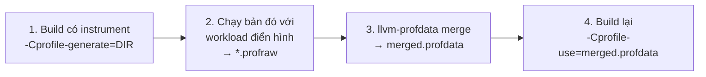
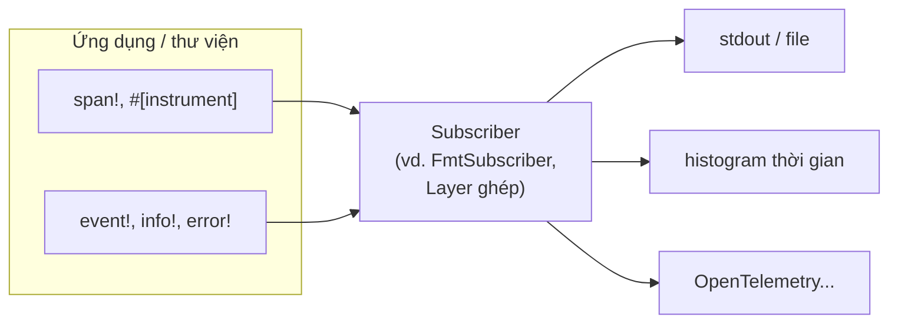

# P11 · Chương 03 — Đo và cải thiện hiệu năng service Rust

> Chương này nói về **phương pháp** và **cấu hình**, không đưa ra con số hiệu năng của riêng người soạn: người soạn không chạy benchmark (theo hợp đồng của dự án). Mọi con số như "10–20%" là lời của tài liệu được trích, đúng như tài liệu đó nói và không hứa gì cho dự án của bạn. Một số nguồn là **trang sống** (không ghim phiên bản; nội dung có thể đổi): *The Rust Performance Book* (`nnethercote.github.io/perf-book`), sách Criterion.rs, *Site Reliability Engineering* của Google. Phần còn lại ghim phiên bản: Rust 1.95.0, `tracing` 0.1.44, `tokio` 1.53.2, `hdrhistogram` 7.5.4, `console-subscriber` 0.5.0, README `tokio-console-v0.1.13`.

## Bạn sẽ hiểu được gì

1. **Q1.** Vì sao một benchmark viết vội thường đo sai, và warm-up, nhiễu, `std::hint::black_box` giúp được gì (và không giúp được gì)? → mục 1
2. **Q2.** Vì sao phải nhìn phân phối/percentile thay vì trung bình, và ghi lại nó bằng cách nào? → mục 2
3. **Q3.** `opt-level`, `codegen-units`, LTO, `panic` đổi gì ở tốc độ chạy và thời gian build? → mục 3
4. **Q4.** PGO (profile-guided optimization) là gì, quy trình bốn bước ra sao, bẫy ở đâu? → mục 4
5. **Q5.** Tìm chỗ nóng bằng profiler nào, và bản build cần những cờ gì để profile đọc được? → mục 5
6. **Q6.** Cấp phát heap tốn gì, đếm allocation bằng `GlobalAlloc` thế nào, khi nào đáng đổi allocator? → mục 6
7. **Q7.** Crate `tracing` có span, event, subscriber là gì; vì sao `Span::enter` qua `.await` làm sai trace; `tokio-console` thêm gì? → mục 7
8. **Q8.** Latency đuôi (tail) của một service Rust/Tokio đến từ đâu và khoanh vùng ra sao? → mục 8

## Kiến thức cần trước

- [P11 · Chương 01 — perf và sampling profiler](01-perf-va-sampling-profiler.md): `perf stat/record`, flame graph, symbol và debuginfo. Chương này dùng lại các công cụ đó; ở đây chỉ nói phần riêng của Rust.
- [P3 · Chương 06 — Heap allocator](../03-memory/06-heap-allocator.md): free list, arena, `brk`/`mmap`, jemalloc/mimalloc và `#[global_allocator]` ở mức khái niệm.
- [P7 · Chương 08 — Tokio](../07-io-async/08-tokio.md): runtime, scheduler, vì sao không được chặn trong async, `spawn_blocking`.

## 1. Benchmark đúng cách: warm-up, nhiễu, `black_box` (Q1)

> **Trả lời ngắn.** Hai nguồn sai chính của benchmark viết vội là *trình biên dịch tối ưu mất đoạn code bạn định đo*[^bb-elim] và *đo trên máy chưa "nóng", đang ồn*[^crit-warm][^crit-quiet]. `black_box` là cách nói với trình biên dịch "đừng giả định gì về giá trị này"[^bb-def], còn warm-up và máy yên tĩnh xử lý phần còn lại. Wall-time dễ dao động, nên có thể cần thêm số đo ít nhiễu hơn như số lệnh[^pb-var][^pb-instr].

**Giải thích.**

Hình dung (nhận xét của người soạn): bạn cân thử một chiếc xe bằng cách bấm giờ ngay lúc xe vừa nổ máy nguội, trên con đường đang kẹt, rồi trình biên dịch "thông minh" nhận ra bạn chẳng bao giờ dùng kết quả nên... không chạy chiếc xe nữa. Kết quả 0 ns trông rất đẹp và hoàn toàn vô nghĩa.

*Lỗi 1 — đoạn code bị tối ưu mất.* Tài liệu `black_box` đưa ví dụ một hàm thuần `contains` gọi trong vòng lặp mà kết quả không ai dùng, rồi liệt kê những gì trình biên dịch về lý thuyết được phép làm: kéo lời gọi ra khỏi vòng lặp, inline, thay bằng hằng `true` vì đầu vào biết lúc biên dịch, và xóa luôn lời gọi vì kết quả không được dùng[^bb-nothing]. Tài liệu nói không chắc mọi thứ xảy ra cùng lúc, nhưng trình biên dịch hoàn toàn có thể làm một số trong đó và khiến benchmark "rất thiếu chính xác"[^bb-elim].

*Cách chữa — `std::hint::black_box`.* Đây là hàm đồng nhất (trả đúng giá trị nhận vào) được dặn trình biên dịch "bi quan tối đa" về việc nó có thể làm gì với giá trị đó[^bb-def]. Trong thực hành nó phục vụ hai việc: ngăn trình biên dịch tối ưu dựa trên giá trị `black_box` trả về, và buộc giá trị truyền vào phải được tính ra dù kết quả không dùng[^bb-purposes]. Quy tắc dùng: bọc *đầu vào* của hàm cần đo bằng `black_box` để trình biên dịch không thể tối ưu theo cách phi thực tế[^bb-inputs]; bọc *kết quả* để phép tính không bị xóa (ví dụ trong docs bọc cả lời gọi lẫn hai đối số, nhờ đó thân `benchmark` không thể bỏ lời gọi[^bb-example]).

```rust
use std::hint::black_box;

fn contains(haystack: &[&str], needle: &str) -> bool {
    haystack.iter().any(|x| x == &needle)
}

// Minh họa theo ví dụ trong docs của black_box; chưa chạy trong chương này.
pub fn benchmark() {
    let haystack = vec!["abc", "def", "ghi", "jkl", "mno"];
    let needle = "ghi";
    for _ in 0..10 {
        black_box(contains(black_box(&haystack), black_box(needle)));
    }
}
```

*Giới hạn.* `black_box` chỉ được cung cấp theo kiểu "best-effort": mức độ nó chặn được tối ưu hóa tùy nền tảng và backend sinh code[^bb-bestef], và chương trình không được dựa vào nó cho tính đúng đắn ngoài việc nó là hàm đồng nhất[^bb-correct]. Với benchmark thì đủ dùng; đừng coi nó là bảo đảm tuyệt đối. (Nhận xét của người soạn: nếu số đo tốt đến mức khó tin, hãy nghi trước là code đã bị tối ưu mất, thay vì mừng.)

*Lỗi 2 — chưa warm-up.* Criterion chạy hàm cần đo lặp lại trong một khoảng warm-up cấu hình được (mặc định ba giây); với hàm Rust, mục đích là làm nóng cache của bộ xử lý và cache của file system nếu có[^crit-warm]. Thuật toán warm-up của Criterion: chạy một lần, rồi hai, bốn… cho đến khi tổng thời gian vượt ngưỡng warm-up[^crit-warm-alg]. (Nhận xét của người soạn: Rust biên dịch sẵn nên không có pha JIT như Java, nhưng cache CPU, page chưa được map, trạng thái allocator vẫn "lạnh" ở lần chạy đầu.)

*Lỗi 3 — nhiễu.* Criterion khuyên chạy benchmark trên máy yên tĩnh và thiết kế để mỗi vòng lặp làm khối lượng việc xấp xỉ nhau[^crit-quiet]. *Rust Performance Book* thêm một điểm tinh tế: wall-time (thời gian thực trôi qua trên đồng hồ, thứ người dùng cảm nhận) dễ có phương sai cao[^pb-var], và thay đổi nhỏ về bố cục bộ nhớ cũng gây dao động đáng kể nhưng thoáng qua[^pb-layout]; vì vậy các số đo ít nhiễu hơn như số chu kỳ hoặc số lệnh có thể là phương án thay thế hợp lý[^pb-instr]. Khi so sánh hai lần chạy, Criterion có ngưỡng nhiễu cấu hình được vì các dao động không lường trước hiếm khi là thứ người đo quan tâm[^crit-noise].


*Sơ đồ trên là tóm tắt của người soạn từ các đoạn vừa nêu (warm-up[^crit-warm-alg], `black_box`[^bb-inputs], ngưỡng nhiễu[^crit-noise]); không phải sơ đồ của tài liệu nào.*

<details><summary>Đi sâu: Criterion xử lý outlier thế nào, công cụ nào có sẵn, microbenchmark thôi chưa đủ</summary>

- Criterion không đo từng lần lặp mà chỉ đo cả mẫu (sample)[^crit-sample]; ước lượng thời gian mỗi lần lặp lấy từ độ dốc của đường thẳng hồi quy vẽ số lần lặp theo thời gian của các mẫu[^crit-regress]. Vì thế nó không cho bạn phân phối latency *của từng request* — đó là việc của mục 2 (suy luận của người soạn từ việc Criterion chỉ đo cả mẫu).
- Criterion phân loại outlier (mẫu lệch xa phần còn lại) bằng một biến thể của phương pháp Tukey, dựa trên khoảng tứ phân vị IQR[^crit-tukey], và in cảnh báo, nhưng *không loại* outlier khỏi dữ liệu: chúng vẫn đi vào phân tích[^crit-outlier].
- Sách Rust Performance Book liệt kê công cụ: bộ benchmark có sẵn của Rust chỉ chạy trên nightly vì dùng tính năng chưa ổn định; Criterion và Divan tinh vi hơn[^pb-tools]. Nó cũng khuyên có nhiều workload đại diện cho cách dùng thật, input thật là tốt nhất, microbenchmark và stress test dùng có chừng mực[^pb-workload].
- Build cho `cargo bench` dùng profile `bench`, kế thừa profile `release`[^cargo-bench-inherits]. Nghĩa là benchmark chạy với tối ưu hóa; chạy bản dev (không tối ưu) thì không có ý nghĩa: sách Performance Book nói tăng tốc 10–100 lần so với bản dev là phổ biến[^pb-release].
- Thái độ thực dụng của sách: đừng quá lo phải có hệ thống benchmark hoàn hảo; benchmark tầm thường vẫn tốt hơn không có[^pb-mediocre].

</details>

**Quay lại Q1:** benchmark sai vì code bị tối ưu mất, vì máy lạnh và ồn; `black_box` bọc đầu vào/kết quả, warm-up và máy yên tĩnh là điều kiện tối thiểu, và `black_box` chỉ là "best-effort".

## 2. Phân phối và percentile thay vì trung bình (Q2)

> **Trả lời ngắn.** Trung bình che mất đuôi: một service có latency trung bình 100 ms ở 1.000 request/giây vẫn có thể có 1% request mất tới 5 giây[^sre-100ms]. Cách rẻ nhất để thấy đuôi là đếm số request rơi vào từng khoảng latency (histogram) thay vì lưu từng giá trị[^sre-bucket]. Trong Rust, crate `hdrhistogram` làm đúng việc này với chi phí bộ nhớ cố định và truy vấn được theo quantile[^hdr-fixed][^hdr-quantile].

**Giải thích.**

Hình dung (nhận xét của người soạn): thời gian chờ ở sân bay. Trung bình 20 phút nghe ổn, nhưng nếu 1 trong 100 hành khách bị kẹt 3 tiếng thì đó là người viết đánh giá một sao. Trung bình không cho bạn biết ai là người đó.

Giải nghĩa (của người soạn): *percentile thứ 99* (p99) là mức latency mà 99% số request nhanh hơn hoặc bằng nó; p50 là trung vị (một nửa số request nhanh hơn); p99,9 là mốc 99,9%.

*Vì sao trung bình đánh lừa.* SRE book cảnh báo: khi thiết kế monitoring từ đầu, rất dễ chọn trung bình của một đại lượng (latency trung bình, CPU trung bình, độ đầy trung bình của DB)[^sre-mean]. Với latency cũng vậy: ví dụ trong sách là service trung bình 100 ms ở 1.000 request/giây mà 1% request có thể mất 5 giây[^sre-100ms]. Chú thích của sách: nếu 1% request chậm gấp 50 lần trung bình thì 99% còn lại nhanh gấp khoảng hai lần trung bình[^sre-fn23]; nghĩa là *không đo phân phối thì "đa số request gần mức trung bình" chỉ là hy vọng* (ý của chú thích cuối trang đó, người soạn diễn đạt lại).

*Đuôi bị khuếch đại khi gọi nhiều backend.* Nếu người dùng phụ thuộc vào nhiều service như vậy để dựng một trang, percentile thứ 99 của một backend có thể dễ dàng trở thành phản hồi trung vị của frontend[^sre-fan]. (Nhận xét của người soạn: đây chính là lý do p99 của service nội bộ quan trọng hơn con số trung bình khi service bạn nằm giữa một chuỗi gọi.)

*Ghi lại phân phối thế nào.* Sách SRE gợi ý cách đơn giản nhất: đếm số request theo từng khoảng latency (0–10 ms, 10–30 ms, 30–100 ms, …) thay vì lưu từng latency[^sre-bucket], và chia ranh giới theo cấp số nhân (hệ số khoảng 3) là cách dễ để trực quan hóa phân phối[^sre-expo]. Percentile thứ 99 theo cửa sổ ngắn (ví dụ một phút) còn là tín hiệu sớm của bão hòa[^sre-p99-sat].

*Trong Rust.* `hdrhistogram` mô tả "HDR histogram" là cấu trúc cho phép phân tích nhanh và chính xác các vùng cực trị của dữ liệu có phân phối không chuẩn, như latency[^hdr-desc]. Nó giữ chi phí cố định cả về không gian và thời gian[^hdr-fixed], và hỏi được giá trị tại một quantile bất kỳ[^hdr-quantile].

```rust
use hdrhistogram::Histogram;

// Minh họa theo ví dụ trong docs của hdrhistogram 7.5.4; chưa chạy trong chương này.
fn main() {
    // giá trị trong [1, 3.600.000], giữ 2 chữ số có nghĩa (ví dụ: micro/mili-giây tùy bạn quy ước)
    let mut hist = Histogram::<u64>::new_with_bounds(1, 60 * 60 * 1000, 2).unwrap();
    for sample in [12_u64, 15, 14, 13, 4_900] {
        hist.record(sample).unwrap();
    }
    println!("p50  = {}", hist.value_at_quantile(0.50));
    println!("p99  = {}", hist.value_at_quantile(0.99));
    println!("p999 = {}", hist.value_at_quantile(0.999));
}
```

Đối số cuối của `new_with_bounds` là độ chính xác tính bằng số chữ số có nghĩa (significant digits)[^hdr-precision]; docs mô tả đúng ví dụ này là đếm giá trị trong khoảng [1..3600000] với độ chính xác 1%, dùng để theo dõi latency từ 1 ms đến 1 giờ[^hdr-bounds].

<details><summary>Đi sâu: quantile hay percentile, monitoring ≠ profiling, và các cách ghi ở lớp tracing</summary>

- `hdrhistogram` ưu tiên làm việc với *quantile* (số trong [0, 1]) hơn *percentile* (số trong [0, 100]) để giảm mất chính xác do số dấu phẩy động[^hdr-quant-pct]. Vì vậy p99,9 là `value_at_quantile(0.999)`.
- Kiểu đếm của histogram (ví dụ `u64`) có thể đổi để tiết kiệm bộ nhớ, đổi lại nguy cơ bão hòa nếu quá nhiều mẫu rơi vào cùng một ô[^hdr-u64].
- Crate `tracing-timing` (crate bên thứ ba mà docs của `tracing` liệt kê) cung cấp subscriber đo thời gian giữa các cặp event và tạo histogram[^tr-timing] — nghĩa là có thể gắn đo phân phối vào instrumentation sẵn có (mục 7).
- Sách SRE nhấn mạnh: quan sát CPU trung bình theo phút sẽ không lộ các đỉnh ngắn nhưng gây latency đuôi cao[^sre-cpu]. (Nhận xét của người soạn: cửa sổ lấy mẫu của metric phải ngắn hơn đuôi bạn muốn bắt.)

</details>

**Quay lại Q2:** báo cáo phân phối (p50/p99/p99,9) bằng histogram, vì trung bình có thể đẹp trong khi 1% request chậm gấp hàng chục lần và gây hại nhất khi gọi nhiều service nối tiếp.

## 3. Cấu hình build: opt-level, codegen-units, LTO, panic (Q3)

> **Trả lời ngắn.** Profile `release` mặc định đã tối ưu (`opt-level = 3`) và đặt `lto = false`, `codegen-units = 16`, `panic = 'unwind'`[^cargo-release-defaults]. Đặt `codegen-units = 1` có thể cho code nhanh hơn nhưng build chậm hơn[^rustc-cgu]; LTO (tối ưu lúc link) tối ưu xuyên crate với giá là thời gian link dài hơn[^rustc-lto]; `panic = "abort"` có thể giảm kích thước và tăng tốc nhẹ nhưng bạn mất unwind (tháo ngược stack khi panic)[^pb-panic][^book-unwind]. Mọi thay đổi đều phải đo bằng workload của bạn.

**Giải thích.**

Hình dung (nhận xét của người soạn): biên dịch giống làm bánh theo lô. Chia việc cho nhiều thợ (codegen unit) thì nhanh xong nhưng mỗi thợ chỉ thấy phần bột của mình, không tối ưu được công thức xuyên các phần. Một thợ duy nhất (codegen-units = 1) thấy hết nên làm được tốt hơn, nhưng lâu. LTO là cho thợ nhìn cả các crate khác nhau khi gần xong.

*`opt-level`.* Cargo: mức tối ưu cao hơn có thể cho code chạy nhanh hơn với giá thời gian biên dịch dài hơn, và có thể sắp xếp lại code làm khó debug hơn[^cargo-opt]. Các mức 0–3, `"s"`, `"z"`; có thể có kết quả bất ngờ như mức 3 chậm hơn mức 2, nên cần thử và đánh giá lại khi rustc đổi[^cargo-opt-surprise]. rustc: `-O` là bí danh của `-C opt-level=3`[^rustc-O].

*`codegen-units`.* Khi crate bị chia thành nhiều codegen unit, LLVM xử lý song song; tăng song song có thể rút thời gian biên dịch nhưng có thể sinh code chậm hơn, còn đặt bằng 1 có thể cải thiện hiệu năng code sinh ra với giá biên dịch chậm hơn[^rustc-cgu]. Mặc định là 16 cho build không incremental và 256 cho incremental[^rustc-cgu-default]; profile `release` dùng 16 (build không incremental)[^cargo-release-defaults].

*LTO (link-time optimization).* Cờ này cho LLVM dùng tối ưu hóa lúc link, dựa trên phân tích toàn chương trình, để code tốt hơn với giá thời gian link lâu hơn[^rustc-lto]. Cargo có các giá trị: `"fat"`/`true` tối ưu xuyên mọi crate trong đồ thị phụ thuộc[^cargo-lto-fat]; `"thin"` tương tự nhưng ít thời gian hơn mà vẫn đạt lợi ích gần bằng[^cargo-lto-thin]; `false` là "thin local LTO" chỉ trong crate hiện tại (xuyên các codegen unit của nó) và `"off"` tắt hẳn[^cargo-lto-false]. Một cái bẫy: nếu không chỉ định `lto`, rustc vẫn có thể làm thin local LTO, nhưng tắt khi `codegen-units` bằng 1 hoặc `opt-level = 0`[^rustc-lto-cgu1]; vì thế `lto = false` *khác* `lto = "off"`[^pb-lto-off].

*`panic`.* `unwind` tháo ngược stack khi panic: Rust đi ngược lên stack và dọn dữ liệu của từng hàm đi qua; `abort` kết thúc chương trình ngay mà không dọn dẹp[^book-unwind][^rustc-panic]. Performance Book: nếu không cần unwind (ví dụ không dùng `catch_unwind`) thì `panic = "abort"` có thể giảm kích thước binary, tăng tốc nhẹ và có thể rút ngắn compile[^pb-panic]. Nhưng với server Tokio, **đánh đổi này thực chất là đổi hành vi**: khi unwind, panic trong một task được `JoinHandle` báo qua `JoinError`[^tokio-jh-panic]; với `abort`, tiến trình chết thay vì chỉ một task (suy luận của người soạn từ hai nguồn trên — nguồn chỉ nói `abort` "kết thúc tiến trình khi panic", không nói gì riêng về Tokio). Chọn `abort` cho service nghĩa là chấp nhận crash cả process, nên cần supervisor khởi động lại (Kubernetes…) — nhận xét của người soạn.

*Tổ hợp tham khảo.* Sách Performance Book nêu: để tối đa tốc độ chạy, cân nhắc `codegen-units = 1`, `lto = "fat"`, allocator thay thế và `panic = "abort"`[^pb-max]. Một cờ khác, `-C target-cpu=native`, bảo rustc dùng bộ xử lý của máy host[^rustc-cpu-native] để sinh lệnh riêng cho CPU đó; chỉ hợp lý nếu không cần tương thích với CPU cũ/khác[^pb-cpu]. (Suy luận của người soạn: container build trên CI rồi chạy trên node khác loại CPU thì `native` có thể sinh lệnh mà CPU đích không có; khi đó tiến trình có thể nhận tín hiệu SIGILL, tức "Illegal Instruction"[^sig-ill]. Hãy chỉ định `target-cpu` cụ thể và kiểm tra trước khi triển khai.)

```toml
# Cargo.toml — minh họa một profile riêng để so sánh với release thường (chưa chạy)
[profile.release-tuned]
inherits = "release"
codegen-units = 1
lto = "fat"
# panic = "abort"   # chỉ khi chấp nhận crash cả process (xem mục này)
```

Cargo bắt buộc profile tùy biến phải có khóa `inherits`[^cargo-custom], và chỉ đọc cấu hình profile ở `Cargo.toml` gốc của workspace; profile khai báo trong dependency bị bỏ qua[^cargo-ws-profiles].

<details><summary>Đi sâu: bảng mặc định, các ngoại lệ, và build-override</summary>

- Mặc định `release`: `opt-level = 3`, `debug = false`, `strip = "none"`, `debug-assertions = false`, `overflow-checks = false`, `lto = false`, `panic = 'unwind'`, `incremental = false`, `codegen-units = 16`[^cargo-release-defaults]. Mặc định `dev`: `opt-level = 0`, `debug-assertions = true`, `overflow-checks = true`, `incremental = true`, `codegen-units = 256`[^cargo-dev-defaults].
- Tổ hợp `lto` và `codegen-units` của rustc khi chỉ định `-C lto`: một mình `lto` là 16 codegen unit rồi fat LTO xuyên crate; `codegen-units=1` cộng `lto` là 1 unit với fat LTO[^rustc-lto-matrix].
- Sách Performance Book viết LTO "có thể cải thiện tốc độ chạy 10–20% hoặc hơn" và giảm kích thước nhị phân, với giá thời gian biên dịch tệ hơn[^pb-lto]; còn đặt `codegen-units = 1` có thể cải thiện tốc độ và kích thước với giá thời gian biên dịch[^pb-cgu]. Đó là lời của sách, không phải bảo đảm: Cargo nhấn mạnh nên tự thử, có thể có kết quả bất ngờ[^cargo-opt-surprise].
- Build dependency (build script, proc macro) mặc định không tối ưu (`opt-level = 0`, `codegen-units = 256`) để build nhanh[^cargo-build-override]; muốn đổi thì khai báo `[profile.release.build-override]`, vì Cargo cho phép ghi đè cấu hình profile cho từng package và cho crate chạy lúc build[^cargo-overrides].
- Với `cargo test`, `cargo bench`, build script và proc macro, Cargo bỏ qua `panic`; test harness hiện đòi hành vi unwind[^cargo-panic-ignored].

</details>

**Quay lại Q3:** `release` mặc định cân bằng giữa thời gian build và tốc độ chạy; `codegen-units = 1`, LTO, `panic = "abort"`, `target-cpu` đẩy về phía tốc độ chạy với giá thời gian build hoặc hành vi khi panic, và chỉ chọn sau khi đo.

## 4. PGO: tối ưu theo hồ sơ chạy thật (Q4)

> **Trả lời ngắn.** PGO thu dữ liệu về cách chương trình chạy điển hình (nhánh nào hay đi…) rồi dùng nó để quyết định inlining, bố trí code máy, cấp phát thanh ghi…[^pgo-concept]. Quy trình bốn bước: build bản có instrument, chạy nó để sinh file `.profraw`, gộp thành `.profdata` bằng `llvm-profdata`, rồi build lại với `-Cprofile-use`[^pgo-steps]. Chất lượng kết quả phụ thuộc workload bạn chạy ở bước hai.

**Giải thích.**

Hình dung (nhận xét của người soạn): hãng taxi lập sơ đồ phân luồng giờ cao điểm sau khi quan sát xe thật chạy một tuần, thay vì chỉ nhìn bản đồ. PGO là "tuần quan sát" đó: compiler biết hàm nào nóng, nhánh nào hầu như luôn đi, nên đặt chúng gần nhau và inline đúng chỗ.

Giải nghĩa (của người soạn): *inlining* là chép thân hàm được gọi vào ngay chỗ gọi; *machine-code layout* là thứ tự đặt các khối lệnh máy trong binary; *register allocation* là chọn giá trị nào được giữ trong thanh ghi CPU. Cả ba đều nằm trong danh sách rustc book nêu là thứ PGO giúp quyết định[^pgo-concept].

*Hai cách thu dữ liệu.* Có thể chạy chương trình dưới một profiler (như `perf`) hoặc tạo bản instrumented (có sẵn mã thu dữ liệu). Cách sau thường cho dữ liệu chính xác hơn và là cách rustc hỗ trợ[^pgo-instr].



*Bốn bước.* (1) biên dịch với instrumentation, ví dụ `rustc -Cprofile-generate=/tmp/pgo-data main.rs`; (2) chạy chương trình đã instrument để sinh `.profraw`; (3) chuyển `.profraw` thành `.profdata` bằng công cụ `llvm-profdata` của LLVM; (4) biên dịch lại, dùng dữ liệu đó, ví dụ `rustc -Cprofile-use=merged.profdata main.rs`[^pgo-steps]. Chạy bản instrument nhiều lần sẽ dùng lại và cập nhật tại chỗ các file `.profraw` tương ứng[^pgo-multi]. `llvm-profdata` lấy dễ nhất qua `rustup component add llvm-tools-preview`, nhưng thành phần này không đưa nó vào `PATH`[^pgo-llvmtools].

*Với Cargo.* Tài liệu rustc dùng biến `RUSTFLAGS` để truyền cờ PGO cho mọi crate, kèm vài chú ý: truyền `--target` để cờ không áp lên build script (vì không muốn build script sinh hàng đống `.profraw`)[^pgo-cargo-target]; dùng `--release` vì đó là nơi PGO có ý nghĩa nhất[^pgo-release]; dùng đường dẫn tuyệt đối cho `-Cprofile-generate`/`-Cprofile-use` vì Cargo có thể gọi rustc từ các thư mục làm việc khác nhau[^pgo-abs]; xóa dữ liệu cũ trước khi build instrument[^pgo-leftover]. Bước cuối: ví dụ của sách ghi chú "mọi cờ rustc phải giống nhau" — trong ví dụ đó bước 1 và bước 4 đều có `-O`, chỉ khác cờ PGO[^pgo-same-flags].

*Với một service.* Bước 2 là chỗ khó nhất: "workload điển hình" của service là gì? (Nhận xét của người soạn: nên chạy bản instrument với lưu lượng đại diện — ví dụ replay lưu lượng thật hoặc load test có mix endpoint giống production — vì tài liệu chỉ nói PGO dựa trên "quá trình chạy điển hình"[^pgo-concept]; profile lệch với thực tế có thể tối ưu sai chỗ. Đây là suy luận của người soạn.)

<details><summary>Đi sâu: cảnh báo thiếu profile, cargo-pgo, giới hạn phân phối</summary>

- Khuyến nghị thêm `-Cllvm-args=-pgo-warn-missing-function` ở pha `-Cprofile-use`: mặc định LLVM không cảnh báo khi thiếu dữ liệu profile cho một hàm, bật cờ này giúp phát hiện cấu hình sai[^pgo-warn].
- Hỗ trợ PGO của rustc dựa hoàn toàn trên LLVM, tương đương `-fprofile-generate`/`-fprofile-use` của Clang[^pgo-llvm].
- Công cụ cộng đồng `cargo-pgo` có API dòng lệnh dễ dùng, làm thay phần việc thủ công[^pgo-cargo-pgo].
- Performance Book: PGO có thể tăng tốc 10% hoặc hơn[^pb-pgo] (lời của sách, không phải bảo đảm); là kỹ thuật nâng cao, tốn công cài đặt, đáng làm trong một số trường hợp[^pb-pgo-effort]; và không hỗ trợ cho binary phát hành trên crates.io qua `cargo install`[^pb-pgo-cargo-install].
- Chương này không dạy `cargo-pgo`/BOLT chi tiết vì không có trong phạm vi nguồn đã ghim ngoài các đoạn trên.

</details>

**Quay lại Q4:** PGO là build hai lần quanh một lần chạy thu dữ liệu; cú pháp rõ ràng trong rustc book, còn chất lượng phụ thuộc vào việc workload lúc thu có đại diện cho production hay không.

## 5. Tìm chỗ nóng: profiler và cờ build để đọc được kết quả (Q5)

> **Trả lời ngắn.** Đo trước, tối ưu sau: chương trình có "chỗ nóng" (thực thi đủ thường xuyên để ảnh hưởng thời gian chạy) và bạn nên tìm chúng bằng profiler[^pp-hot]. Với Rust, build release có thể thiếu thông tin để profiler đọc: có thể cần `debug = "line-tables-only"` để có số dòng, có thể cần `-C force-frame-pointers=yes` để stack trace tốt, và symbol Rust bị mangle nên có thể cần demangle[^pp-debug][^pp-fp][^pp-mangle].

**Giải thích.**

Hình dung (nhận xét của người soạn): sửa ống nước mà không biết chỗ rò. Bạn có thể thay hết ống nhà (viết lại mọi thứ bằng `unsafe` cho "nhanh") mà vẫn ngập vì mối nối trong bếp. Profiler là camera nhiệt.

*Chọn công cụ.* Performance Book liệt kê các profiler đã được dùng thành công với Rust: `perf` (dùng bộ đếm phần cứng, chạy trên Linux)[^pp-perf]; Instruments đi kèm Xcode trên macOS[^pp-instruments]; `samply`, profiler lấy mẫu có thể xem trong Firefox Profiler, chạy trên Mac/Linux/Windows[^pp-samply]; `flamegraph` là lệnh Cargo dùng perf/DTrace để vẽ flame graph[^pp-flame]; Cachegrind và Callgrind cho số lệnh và dữ liệu mô phỏng cache/dự đoán nhánh theo hàm và dòng[^pp-cachegrind]. Cách dùng `perf` và đọc flame graph xem [P11 · Chương 01](01-perf-va-sampling-profiler.md).

*Build để profile.* Để profile một bản release hiệu quả có thể cần bật debug info mức dòng: thêm `debug = "line-tables-only"` vào `[profile.release]`[^pp-debug]. Cargo mô tả mức đó là tạo thông tin tối thiểu cho backtrace với tên file/số dòng, không có thông tin biến hay tham số[^cargo-line-tables]. Lưu ý: ngay cả vậy bạn vẫn không có thông tin chi tiết cho code thư viện chuẩn, vì bản std phát hành không build kèm debug info[^pp-std].

*Frame pointer.* Frame pointer là thanh ghi trỏ vào khung stack của hàm đang chạy; chuỗi các khung này là thứ profiler đi ngược để dựng call stack (đã giải thích ở [P11 · Chương 01 mục 5](01-perf-va-sampling-profiler.md)). Trình biên dịch có thể bỏ frame pointer, làm giảm chất lượng stack trace trong profile; có thể ép bằng `RUSTFLAGS="-C force-frame-pointers=yes"`[^pp-fp].

*Symbol bị mangle.* Rust mã hóa tên hàm (name mangling); profiler không biết sẽ hiện tên bắt đầu bằng `_ZN` hoặc `_R`; có thể dùng `rustfilt`, hoặc đổi định dạng sang `v0` bằng `-C symbol-mangling-version=v0`[^pp-mangle].

*Strip symbol hại profile.* `strip = "symbols"` có thể làm chương trình khó debug và profile hơn[^pb-strip]; nên giữ symbol ở bản dùng để profile (nhận xét của người soạn, suy ra từ câu trên).

<details><summary>Đi sâu: các profiler khác, và hai mức debuginfo</summary>

- DHAT dùng để tìm phần code gây nhiều allocation và hiểu đỉnh bộ nhớ; `dhat-rs` là bản thay thế thử nghiệm kém mạnh hơn một chút, cần sửa chương trình nhẹ nhưng chạy trên mọi nền tảng[^pp-dhat]; `heaptrack` và `bytehound` là profiler heap trên Linux[^pp-heaptrack]. Phần allocation xem mục 6.
- Coz làm *causal profiling* để ước lượng tiềm năng tối ưu, có hỗ trợ Rust qua `coz-rs`, chạy trên Linux[^pp-coz].
- Cargo liệt kê các mức `debug`: `"line-tables-only"`, `1`/`"limited"` (thông tin mức module chi tiết hơn line-tables-only) và `2`/`"full"`, mặc định của dev là full[^cargo-debug-levels]; mặc định của release là `debug = false`, tức không có debug info[^cargo-release-defaults].
- Cargo cũng nói tối ưu cao có thể sắp xếp lại code làm khó dùng với debugger[^cargo-opt] — với profiler mẫu thì stack có thể "không giống source"; đó là lý do inline làm flame graph khó đọc (nhận xét của người soạn).

</details>

**Quay lại Q5:** profile trước khi tối ưu; build release cần `line-tables-only`, tốt nhất là frame pointer, giữ symbol, demangle — nếu không, flame graph sẽ toàn địa chỉ và tên `_ZN…`.

## 6. Heap allocation: đếm, giảm, đổi allocator (Q6)

> **Trả lời ngắn.** Mỗi lần cấp phát (và giải phóng) heap thường khá tốn: tùy allocator, nó có thể phải lấy khóa toàn cục, thao tác cấu trúc dữ liệu không đơn giản và có khi gọi system call[^pb-heap-cost]. Nếu profiler thấy `malloc`/`free` nóng thì nên giảm tốc độ cấp phát hoặc thử allocator khác[^pb-heap-prof]; công cụ chuyên dụng là DHAT[^pb-dhat]. Trong Rust bạn cũng có thể tự đếm bằng cách đặt một `GlobalAlloc` bọc ngoài `System` — nhưng không được kỳ vọng mọi allocation trong source thật sự xảy ra[^ga-notrely].

**Giải thích.**

Hình dung (nhận xét của người soạn): `Vec::new()` trong vòng lặp nóng giống mỗi lần cần cái bút lại đi ra kho trung tâm, ký sổ, nhận bút, rồi mang trả. Nếu kho có một cửa duy nhất thì mọi nhân viên xếp hàng. Giữ sẵn bút trong túi (tái dùng buffer) rẻ hơn nhiều.

*Chi phí.* Performance Book nói cấp phát heap "vừa phải đắt", chi tiết tùy allocator, và cấp phát nhỏ không nhất thiết rẻ hơn cấp phát lớn[^pb-heap-small]. Cơ chế allocator (header, free list, arena, thread cache, `brk`/`mmap`) đã giải thích ở [P3 · Chương 06](../03-memory/06-heap-allocator.md); chương này chỉ bàn cách đo và đổi.

*Tìm ra allocation nóng.* Nếu profiler tổng quát thấy `malloc`, `free` và các hàm liên quan nóng thì đáng giảm allocation rate hoặc dùng allocator khác[^pb-heap-prof]. DHAT xác định chính xác điểm cấp phát nóng và tốc độ cấp phát; theo kinh nghiệm với rustc, giảm 10 allocation trên mỗi triệu lệnh có thể cho cải thiện đo được (khoảng 1%)[^pb-dhat-rustc] — đó là kinh nghiệm của dự án rustc, không phải quy luật.

*Giảm allocation.* Khi biết kích thước tối thiểu hoặc chính xác của vector, đặt trước bằng `Vec::with_capacity`, `Vec::reserve` hoặc `Vec::reserve_exact`[^pb-withcap]. `SmallVec` giảm số allocation khi dùng đúng chỗ nhưng không bảo đảm nhanh hơn; cần đo để xác nhận[^pb-smallvec]. Có thể viết test kiểm tra snippet cấp phát đúng lượng heap mong đợi bằng tính năng heap usage testing của `dhat-rs`[^pb-dhat-test].

*Tự đếm bằng `GlobalAlloc`.* `GlobalAlloc` là trait cho allocator có thể đăng ký làm mặc định của thư viện chuẩn qua thuộc tính `#[global_allocator]`[^ga-desc]. Ý tưởng: bọc `System`, tăng bộ đếm nguyên tử trong `alloc`:

```rust
use std::alloc::{GlobalAlloc, Layout, System};
use std::sync::atomic::{AtomicUsize, Ordering::Relaxed};

pub static ALLOCS: AtomicUsize = AtomicUsize::new(0);
pub static BYTES: AtomicUsize = AtomicUsize::new(0);

struct Counting;

// Minh họa; chưa chạy trong chương này. Không dùng Mutex/Vec/println! trong alloc.
unsafe impl GlobalAlloc for Counting {
    unsafe fn alloc(&self, layout: Layout) -> *mut u8 {
        ALLOCS.fetch_add(1, Relaxed);
        BYTES.fetch_add(layout.size(), Relaxed);
        unsafe { System.alloc(layout) }
    }
    unsafe fn dealloc(&self, ptr: *mut u8, layout: Layout) {
        unsafe { System.dealloc(ptr, layout) }
    }
}

#[global_allocator]
static GLOBAL: Counting = Counting;
```

Đọc `ALLOCS` trước và sau một đoạn code cho số allocation giữa hai thời điểm (nhận xét của người soạn: nếu tiến trình có thread khác đang chạy, số đếm là *toàn tiến trình*, không riêng đoạn code của bạn — dùng test đơn luồng hoặc `dhat-rs` để cô lập).

*Ba cạm bẫy từ docs của `GlobalAlloc`.* (a) Allocator không được unwind (panic) — đó là hành vi không xác định[^ga-unwind]. (b) Docs cấm dựa vào việc allocation thật sự xảy ra, vì optimizer có thể bỏ hoặc chuyển xuống stack; "có allocation hay không" không thuộc hành vi chương trình, kể cả khi một allocator có thể phát hiện qua việc in ra hay có side effect khác[^ga-notrely][^ga-notbehavior]. Vì thế số đếm của bạn là *quan sát trên một bản build cụ thể* chứ không phải thuộc tính ngôn ngữ (suy luận của người soạn: so sánh trước/sau trên cùng cấu hình build, và đừng assert cứng số đếm trong test cross-version). (c) Tái nhập: nhiều cấu trúc của thư viện chuẩn có thể tự cấp phát, nên rất dễ tạo allocator đệ quy vô hạn[^ga-reent]; ví dụ `std::sync::Mutex` trên vài nền tảng có thể cấp phát nên rất rắc rối trong allocator[^ga-mutex]; nên giữ trong các tính năng của `core`[^ga-core].

*Đổi allocator.* Có thể thay allocator hệ thống của chương trình Rust bằng allocator khác; hiệu quả tùy chương trình và allocator, có thể cải thiện lớn về tốc độ và bộ nhớ, nhưng cũng có thể tăng kích thước binary và thời gian biên dịch[^pb-altalloc][^pb-altalloc-cost]. Hai lựa chọn được sách nêu: jemalloc (Linux/Mac, crate `tikv-jemallocator`)[^pb-jemalloc] và mimalloc (nhiều nền tảng, crate `mimalloc`)[^pb-mimalloc]. Việc gắn allocator là một dòng `#[global_allocator] static GLOBAL: ... = ...;` như đã nêu ở [P3 · Chương 06 mục 10](../03-memory/06-heap-allocator.md).

<details><summary>Đi sâu: yêu cầu hợp đồng của <code>realloc</code> và hạn chế của số đếm</summary>

- `realloc` thu nhỏ hoặc mở rộng khối đến `new_size`; nếu trả con trỏ khác null thì quyền sở hữu khối chuyển sang allocator, con trỏ cũ không được truy cập nữa dù khối giữ nguyên chỗ, và vùng `0..min(layout.size(), new_size)` của khối mới được bảo đảm giống khối cũ[^ga-realloc]. Nếu bạn viết allocator đếm và override `realloc`, nhớ giữ hợp đồng này. Ví dụ `Counting` ở trên không override `realloc`, nên một `Vec` mở rộng đi qua bản mặc định của trait; trong source 1.95.0, bản mặc định gọi `self.alloc` cho khối mới rồi sao chép và gọi `self.dealloc` cho khối cũ[^ga-realloc-default], nghĩa là lần mở rộng đó được đếm như một lần `alloc` (chi tiết cài đặt, có thể đổi; docs không hứa điều này). (Suy luận của người soạn: vì không dùng `System.realloc`, allocator đếm có thể làm mất khả năng mở rộng tại chỗ của allocator thật, nên thời gian đo qua nó có thể khác bản không bọc.)
- Performance Book cũng nhắc: allocator hệ thống mỗi nền tảng có điểm mạnh riêng, nên hiệu quả khác nhau theo nền tảng[^pb-altalloc].
- Trên Linux jemalloc còn có thể cấu hình dùng transparent huge pages để tăng tốc, có thể đổi lấy nhiều bộ nhớ hơn[^pb-jemalloc-thp].

</details>

**Quay lại Q6:** allocation là chi phí đo được; thấy `malloc`/`free` nóng thì dùng DHAT hoặc bộ đếm `GlobalAlloc` để biết ở đâu, giảm bằng `with_capacity`/tái dùng, và chỉ đổi allocator sau khi đo — docs không hứa mọi allocation trong source thực sự xảy ra.

## 7. Quan sát runtime: `tracing` và `tokio-console` (Q7)

> **Trả lời ngắn.** `tracing` là framework để gắn instrumentation có cấu trúc vào chương trình Rust[^tr-what]. Ba khái niệm lõi: *span* (một khoảng thời gian có đầu có cuối), *event* (một thời điểm) và *subscriber* (thứ ghi/tổng hợp chúng)[^tr-span][^tr-event][^tr-sub]. Trong async đừng giữ guard của `Span::enter` qua `.await`: docs nói làm vậy cho trace sai[^tr-enter-warn]; dùng `#[instrument]`, `Instrument` hoặc `in_scope`. `tokio-console` là công cụ chẩn đoán task Tokio, cần `tokio_unstable`[^con-unstable].

**Giải thích.**

Hình dung (nhận xét của người soạn): log là ảnh chụp, span là đoạn phim. Log "xử lý xong request" cho bạn một khoảnh khắc; span `handle_request` cho bạn thấy request vào lúc nào, ra lúc nào, bên trong gọi DB hết bao lâu.

*Vì sao log thường không đủ trong async.* Tài liệu `tracing` nói: ở hệ thống async như Tokio, đọc log truyền thống khó vì nhiều task bị ghép trên cùng một thread nên log của các tác vụ xen lẫn nhau, khó lần theo luồng logic[^tr-async]. `tracing` mở rộng log bằng cách ghi sự kiện có cấu trúc kèm thông tin về thời gian và quan hệ nhân quả; khác với một dòng log, span có thời điểm bắt đầu và kết thúc, có thể được vào và ra theo luồng thực thi, và lồng nhau thành cây[^tr-span-nest].

*Span, event, subscriber.* Span biểu diễn một khoảng thời gian; chương trình "vào" span khi bắt đầu làm việc trong ngữ cảnh đó và "ra" khi dừng[^tr-span]. Event là một điểm thời gian, thường đặt trong span, ví dụ "request trả về với status code nào"[^tr-event]. Subscriber là thứ nhận thông báo khi event xảy ra và khi span được vào/ra, để ghi hoặc tổng hợp[^tr-sub]. Thư viện `tracing` không có sẵn subscriber; đó là việc của các crate khác[^tr-nosub], ví dụ `tracing-subscriber` có `FmtSubscriber` in ra stdout[^tr-ts]; tài liệu Tokio hướng dẫn đăng ký subscriber sớm nhất có thể trong `main`[^tokio-tracing-early]. Event ngoài ngữ cảnh của subscriber nào sẽ không được thu[^tr-global].



*Sơ đồ là của người soạn; docs của `tracing` liệt kê `tracing-timing` (histogram) và `tracing-opentelemetry` (xuất trace sang hệ OpenTelemetry) là các crate bên thứ ba[^tr-timing][^tr-otel].*

*Chi phí.* Subscriber có thể lọc theo metadata (`enabled`); theo docs, nếu không subscriber nào đang hoạt động quan tâm đến metadata của một span/event thì span/event đó không bao giờ được dựng[^tr-enabled]. (Suy luận của người soạn: do đó instrumentation ở mức TRACE trên đường nóng có thể rẻ khi bị lọc, nhưng bạn nên đo chi phí khi bật.) Attribute `#[instrument]` ghi tham số của hàm thành field bằng `fmt::Debug`[^tr-instrument]; muốn tránh ghi những thứ lớn hoặc không cần, dùng `skip(...)`[^tr-skip] (nhận xét của người soạn: tham số lớn bị format trên đường nóng là một nguồn chậm kín đáo).

*Bẫy async: `Span::enter`.* Docs của `Span::enter` cảnh báo: trong code async, nên dùng rất cẩn thận hoặc tránh hẳn; giữ guard trả về qua điểm `.await` sẽ cho trace sai[^tr-enter-warn]. Lý do: khi async fn dừng ở `.await`, scope hiện tại bị thoát nhưng các giá trị trong scope *không bị drop*, nên task khác bắt đầu chạy trong khi vẫn "ở trong" span đó[^tr-enter-why]. Thay thế: `Span::in_scope` cho đoạn đồng bộ, vì closure thoát span trước điểm await kế tiếp[^tr-in-scope]; `Future::instrument` gắn span vào future, vào span mỗi lần future được poll và ra khi future yield[^tr-instrument-combinator]; và `#[instrument]` sinh code đúng khi dùng trên `async fn`[^tr-instrument-async].

```rust
use tracing::{info_span, Instrument};

// Minh họa theo docs của Span/Instrument (tracing 0.1.44); chưa chạy trong chương này.
async fn handle(req_id: u64) {
    let span = info_span!("handle", req_id);
    async move {
        // nếu yield ở đây, span được thoát và vào lại khi tiếp tục
        // db_query().await;
    }
    .instrument(span)
    .await
}
```

*`tokio-console`.* Đây là công cụ debug/profile cho ứng dụng async, thu và hiển thị dữ liệu chẩn đoán về task, resource, operation[^con-what]; gồm phần instrumentation nhúng trong ứng dụng và phần consumer như ứng dụng dòng lệnh `tokio-console`[^con-what]. Crate `console-subscriber` cài phần instrumentation dưới dạng một `Layer` của `tracing-subscriber` và một server gRPC xuất telemetry[^con-impl]. Yêu cầu: tính năng `tracing` của Tokio và cờ cfg `tokio_unstable` — vì support `tracing` trong runtime Tokio được coi là thử nghiệm[^con-experimental][^con-unstable]. Bản README ghim cũng dặn target `tokio` và `runtime` phải bật ở mức TRACE; dùng `console_subscriber::init()` thì tự bật[^con-targets].

Tool này có một số cảnh báo (lint) về các mẫu task đáng ngờ: task bị drop mà chưa từng được đánh thức (`lost-waker`)[^con-lost], task chưa từng yield (`never-yielded`)[^con-never], và task tự đánh thức mình quá nhiều so với tổng số lần đánh thức (`self-wakes`)[^con-self]. (Nhận xét của người soạn: README không nói các cảnh báo này liên quan latency; riêng `never-yielded` liên hệ trực tiếp với mục 8, vì task không yield giữ chặt worker.)

<details><summary>Đi sâu: Layer, tracing-log, và cấu hình của console-subscriber</summary>

- `tracing-subscriber` cung cấp trait `Layer` để ghép nhiều thành phần thành một subscriber có nhiều hành vi[^tokio-tracing-layer]; `console-subscriber` là một `Layer` như vậy[^con-impl].
- Cầu nối với crate `log`: feature `log` làm span/event phát log record khi không có subscriber `tracing` nào hoạt động; `log-always` phát log cả khi đã có subscriber, dành cho ứng dụng thu log và trace riêng[^tr-log].
- `tracing-timing` dựng histogram từ khoảng thời gian giữa các cặp event[^tr-timing] — kết nối trực tiếp với mục 2.
- `console-subscriber` có `retention(Duration)` để chỉnh thời gian giữ dữ liệu task đã hoàn thành; theo ví dụ trong docs đặt là 60 giây[^con-retention].
- Console chỉ dùng với Tokio 1.7.0 trở lên, vì hiện chỉ runtime đó cài instrumentation cần thiết[^con-tokio-only].
- Overhead của `tokio-console`/`tracing` trong service production: nguồn đã ghim không nêu số; cần tự đo (nhận xét của người soạn).

</details>

**Quay lại Q7:** span là đoạn thời gian, event là điểm thời gian, subscriber ghi lại chúng; trong async dùng `#[instrument]`/`Instrument`/`in_scope`, không giữ `enter` qua `.await`, và `tokio-console` cho thấy trạng thái task Tokio khi bật `tokio_unstable`.

## 8. Latency đuôi trong service Rust/Tokio (Q8)

> **Trả lời ngắn.** Docs Tokio nêu những thứ làm *một* worker không chạy được các task khác kịp lúc: code chặn thread trong task[^tokio-noblock] và task chạy lâu không yield[^tokio-coop]. Đó là các nguồn có khả năng kéo đuôi latency của service Tokio (suy luận của người soạn: docs không dùng từ "tail latency"); cấp phát heap, vốn có thể phải lấy khóa toàn cục hoặc gọi system call[^pb-heap-cost], là ứng viên thứ ba. Runtime chỉ bảo đảm công bằng nếu không task nào chặn thread[^tokio-fair], và không bảo đảm công bằng giữa các task[^tokio-fair-neg]. Cách làm việc: đo phân phối (mục 2), chia thời gian request thành span (mục 7), rồi profile (mục 5).

**Giải thích.**

Hình dung (nhận xét của người soạn): một quầy thu ngân phục vụ nhiều hàng. Nếu một khách ở quầy 1 đứng làm thủ tục dài (task chặn), mọi người trong hàng của quầy đó chờ, dù các quầy khác rảnh. Trung bình thời gian chờ vẫn đẹp vì phần lớn khách ở quầy khác; p99 thì xấu vì nhóm khách xui xẻo.

*Vì sao đuôi đáng lo hơn trung bình.* Xem lại mục 2: 1% request chậm là bình thường với service trung bình nhanh[^sre-100ms], và khi gọi nhiều backend, p99 của một backend dễ trở thành trung vị phía frontend[^sre-fan].

*Nguồn 1 — chặn thread.* Tokio chạy nhiều task xen kẽ trên cùng một thread; task nên không gọi system call hoặc thao tác có thể chặn thread vì sẽ ngăn các task khác cùng thread chạy[^tokio-noblock]. Docs liệt kê hai cách: `task::spawn_blocking` và `task::block_in_place`[^tokio-blocking-apis]. Docs còn nhắc rằng gọi hàm không-async từ code async vẫn nằm trong ngữ cảnh async nên cũng phải tránh chặn ở đó, gồm cả destructor của object bị hủy trong code async[^tokio-destructors]. Chi tiết từng cơ chế: [P7 · Chương 08 mục 4](../07-io-async/08-tokio.md).

*Nguồn 2 — task chạy lâu mà không yield.* Đa nhiệm hợp tác: task được chạy cho đến khi nó yield[^tokio-coop], nên một vòng lặp CPU dài giữa hai điểm `.await` chiếm worker; `tokio-console` có cảnh báo `never-yielded` cho kiểu task này[^con-never].

*Nguồn 3 — công bằng chỉ có điều kiện.* Docs Tokio chỉ bảo đảm công bằng nếu số task không tăng không giới hạn và không task nào chặn thread[^tokio-fair]; nói chính xác, nếu mọi lần `poll` đều quay về trong một thời gian hữu hạn thì task được đánh thức sẽ được lập lịch trong một độ trễ tối đa hữu hạn[^tokio-fair-formal] (suy luận của người soạn: một lần `poll` chạy lâu làm tăng giả định về thời gian `poll`, nên cận trễ này tăng theo, vì docs nói cận đó phụ thuộc vào các giả định). Ngoài ra không có bảo đảm về thứ tự hay mức công bằng giữa các task: runtime có thể lập lịch A năm lần trước B dù cả hai sẵn sàng, chỉ bảo đảm B rồi sẽ được lập lịch[^tokio-fair-neg]. Tokio cũng đưa ra bảo đảm kiểu "tối đa bao nhiêu đơn vị thời gian" cho việc đánh thức task có sự kiện IO hoặc timer, với cùng giả định[^tokio-io-timer].

*Nguồn 4 — cấp phát.* Cấp phát heap có thể phải lấy khóa toàn cục hoặc gọi system call tùy allocator[^pb-heap-cost]; hiệu ứng thực tế phụ thuộc allocator và workload (mục 6, và [P3·06](../03-memory/06-heap-allocator.md)).

*Quy trình khoanh vùng (nhận xét của người soạn, kết hợp các mục trên):*

1. Ghi latency vào histogram theo endpoint; so sánh p50 với p99/p99,9 (mục 2).
2. Bọc từng pha của request trong span (parse, DB, serialize…) và xem pha nào kéo đuôi (mục 7).
3. Kiểm tra `tokio-console`: task nào có poll time dài hoặc `never-yielded` (mục 7).
4. Profile CPU bằng flame graph để tìm đoạn nóng/chặn (mục 5, [P11·01](01-perf-va-sampling-profiler.md)); heap profile nếu `malloc` nóng (mục 6).
5. Sửa một thứ, benchmark lại theo mục 1, so sánh *phân phối* chứ không chỉ trung bình.

<details><summary>Đi sâu: lập lịch của Tokio ảnh hưởng đuôi thế nào</summary>

- Trong runtime đa luồng (docs ghi rõ hành vi chi tiết này "có thể đổi" ở phiên bản sau[^tokio-detail-warn]): hàng đợi toàn cục được kiểm tra khi hàng đợi local rỗng hoặc khi worker đã lấy `global_queue_interval` task liên tiếp từ hàng đợi local; nếu không đặt, runtime tự tính theo heuristic nhắm đến khoảng 10 ms giữa các lần kiểm tra, dựa trên metric `worker_mean_poll_time`[^tokio-gqi]. (Nhận xét của người soạn: nghĩa là poll time trung bình của task ảnh hưởng trực tiếp tần suất task ở hàng đợi chung được xét tới.)
- Runtime kiểm tra sự kiện IO/timer khi không còn task sẵn sàng hoặc đã lập lịch 61 task liên tiếp; hằng 61 đổi được bằng `event_interval`[^tokio-event-interval].
- Docs của `spawn_blocking` nói nó chạy hàm chặn trên một thread pool riêng cho các tác vụ chặn[^tokio-sb-pool], và task `spawn_blocking` đã chạy thì không `abort` được[^tokio-sb-abort]. Pool này có giới hạn thread (mặc định 512 theo docs của `max_blocking_threads`)[^tokio-blocking-limit]; khi hết thread rảnh và đã đạt giới hạn, task chờ trong hàng đợi[^tokio-blocking-queue]. (Nhận xét của người soạn: đẩy việc CPU nặng sang pool này giữ worker async rảnh, nhưng tải nặng vẫn có thể xếp hàng ở đó.)
- `tokio::task::yield_now` cho task nhường runtime một lần để task khác chạy[^tokio-yield].

</details>

**Quay lại Q8:** latency đuôi trong service Tokio thường do một worker bị chiếm (chặn, vòng lặp dài không yield) hoặc do công bằng/cấp phát không đều; hãy khoanh vùng bằng histogram + span + `tokio-console` + profile thay vì đoán.

## Tóm tắt

- Benchmark: dùng `black_box` cho đầu vào/kết quả[^bb-inputs], warm-up[^crit-warm], máy yên tĩnh[^crit-quiet]; `black_box` chỉ best-effort[^bb-bestef].
- Wall-time dễ nhiễu vì cả bố cục bộ nhớ[^pb-layout]; số lệnh/chu kỳ là phương án ít nhiễu hơn[^pb-instr].
- Trung bình che đuôi: 100 ms trung bình vẫn có thể có 1% request 5 giây[^sre-100ms]; ghi histogram[^sre-bucket], ví dụ `hdrhistogram`[^hdr-quantile].
- `release` mặc định: `opt-level = 3`, `lto = false`, `codegen-units = 16`, `panic = 'unwind'`[^cargo-release-defaults]; `codegen-units = 1` và LTO đổi build chậm lấy code có thể nhanh hơn[^rustc-cgu][^rustc-lto]; `panic = "abort"` kết thúc tiến trình thay vì tháo stack[^rustc-panic] và có thể tăng tốc nhẹ[^pb-panic].
- PGO: instrument → chạy → `llvm-profdata merge` → build lại với `-Cprofile-use`; ví dụ của rustc book ghi chú "mọi cờ rustc phải giống nhau" ở bước cuối[^pgo-steps][^pgo-same-flags].
- Profile: `debug = "line-tables-only"`, frame pointer, demangle; std phát hành không có debug info[^pp-debug][^pp-fp][^pp-std].
- Cấp phát heap tốn (khóa toàn cục, system call)[^pb-heap-cost]; DHAT hoặc `GlobalAlloc` đếm; docs không hứa mọi allocation trong source xảy ra[^ga-notrely].
- `tracing`: span/event/subscriber[^tr-sub]; không giữ `Span::enter` qua `.await`[^tr-enter-warn]; `tokio-console` cần `tokio_unstable`[^con-unstable].
- Đuôi latency: chặn thread, task không yield, công bằng có điều kiện[^tokio-noblock][^tokio-fair].

## Câu hỏi tự kiểm tra

1. Vì sao một benchmark trả về 0 ns cho một hàm thuần có thể là lỗi của phép đo, và `black_box` sửa thế nào?
<details><summary>Đáp án</summary>

Trình biên dịch có thể xóa lời gọi hàm thuần mà kết quả không được dùng, hoặc thay bằng hằng vì đầu vào biết lúc biên dịch[^bb-nothing][^bb-elim]. `black_box` bọc đầu vào/kết quả để trình biên dịch phải xem giá trị là không dự đoán được và phải tính ra[^bb-purposes][^bb-inputs].

</details>

2. `black_box` có bảo đảm tuyệt đối chặn mọi tối ưu hóa không?
<details><summary>Đáp án</summary>

Không. Docs nói nó chỉ ở mức best-effort, tùy nền tảng và backend sinh code[^bb-bestef], và chương trình không dựa vào nó cho tính đúng đắn ngoài việc nó là hàm đồng nhất[^bb-correct].

</details>

3. Warm-up làm gì cho benchmark hàm Rust (không có JIT)?
<details><summary>Đáp án</summary>

Criterion nói với hàm Rust, warm-up nhằm làm nóng cache bộ xử lý và cache file system nếu có[^crit-warm]; thuật toán là chạy 1, 2, 4… lần đến khi vượt ngưỡng thời gian[^crit-warm-alg].

</details>

4. Vì sao SRE book khuyên đếm request theo khoảng latency thay vì lưu trung bình?
<details><summary>Đáp án</summary>

Vì trung bình che đuôi: 100 ms trung bình vẫn có 1% request 5 giây[^sre-100ms]; histogram phân biệt được trung bình chậm với đuôi rất chậm[^sre-bucket].

</details>

5. `hdrhistogram` tính p99,9 bằng lời gọi nào, và vì sao dùng đối số 0.999?
<details><summary>Đáp án</summary>

`value_at_quantile(0.999)`[^hdr-quantile]; thư viện làm việc với quantile trong [0, 1] thay vì percentile trong [0, 100] để giảm mất chính xác do số dấu phẩy động[^hdr-quant-pct].

</details>

6. `lto = false` và `lto = "off"` khác nhau thế nào trong Cargo?
<details><summary>Đáp án</summary>

`false` là thin local LTO chỉ trong crate hiện tại (và không LTO nếu codegen units là 1 hoặc opt-level là 0); `"off"` tắt hẳn[^cargo-lto-false][^pb-lto-off].

</details>

7. Đặt `codegen-units = 1` đánh đổi gì?
<details><summary>Đáp án</summary>

Có thể cải thiện hiệu năng code sinh ra nhưng biên dịch chậm hơn; mặc định 16 (không incremental) hoặc 256 (incremental)[^rustc-cgu][^rustc-cgu-default].

</details>

8. Bốn bước của PGO với rustc là gì, và vì sao "mọi cờ phải giống nhau"?
<details><summary>Đáp án</summary>

Build instrument, chạy sinh `.profraw`, `llvm-profdata` tạo `.profdata`, build lại với `-Cprofile-use`[^pgo-steps]; rustc book dặn mọi cờ rustc phải giống nhau ở bước cuối[^pgo-same-flags] (lý do kỹ thuật không được nêu trong nguồn).

</details>

9. Cần cấu hình gì để flame graph của build release có số dòng và stack tốt?
<details><summary>Đáp án</summary>

`debug = "line-tables-only"`[^pp-debug], tùy chọn `-C force-frame-pointers=yes`[^pp-fp], giữ symbol (không `strip`)[^pb-strip], và demangle hoặc dùng mangling `v0`[^pp-mangle]. Std không có debug info[^pp-std].

</details>

10. Vì sao không nên assert cứng số allocation đếm được bằng `GlobalAlloc` làm bất biến của chương trình?
<details><summary>Đáp án</summary>

Docs: không được dựa vào việc allocation thật sự xảy ra vì optimizer có thể loại bỏ hoặc chuyển xuống stack, và việc có allocation hay không không thuộc hành vi chương trình[^ga-notrely][^ga-notbehavior].

</details>

11. Vì sao giữ guard của `Span::enter` qua `.await` làm sai trace, và ba cách thay thế?
<details><summary>Đáp án</summary>

Khi yield, scope bị thoát nhưng guard không drop, nên task khác chạy trong lúc vẫn ở trong span[^tr-enter-why]. Thay bằng `Span::in_scope`[^tr-in-scope], `Future::instrument`[^tr-instrument-combinator], hoặc `#[instrument]` trên `async fn`[^tr-instrument-async].

</details>

12. Vì sao một task chặn thread làm tăng p99 của các request không liên quan?
<details><summary>Đáp án</summary>

Các task chạy xen kẽ trên cùng thread; task chặn ngăn các task khác trên thread đó chạy[^tokio-noblock], và bảo đảm công bằng của Tokio chỉ có điều kiện không task nào chặn thread[^tokio-fair]. Phần "p99 tăng" là suy luận từ mục 2 và 8.

</details>

## Đọc thêm

- [The Rust Performance Book](https://nnethercote.github.io/perf-book/) (trang sống): các chương Benchmarking, Build Configuration, Profiling, Heap Allocations — gần như toàn bộ danh mục kỹ thuật của chương này, ngắn gọn.
- [Rustc book — Profile-guided Optimization](https://doc.rust-lang.org/1.95.0/rustc/profile-guided-optimization.html): quy trình PGO đầy đủ cho `rustc` và Cargo.
- [Cargo reference — Profiles](https://doc.rust-lang.org/1.95.0/cargo/reference/profiles.html): mọi khóa `opt-level`, `lto`, `codegen-units`, `panic`, `debug`, `strip` và mặc định.
- [`std::hint::black_box`](https://doc.rust-lang.org/1.95.0/std/hint/fn.black_box.html): ví dụ đầy đủ về lý do cần `black_box`.
- [`std::alloc::GlobalAlloc`](https://doc.rust-lang.org/1.95.0/std/alloc/trait.GlobalAlloc.html): hợp đồng an toàn khi tự viết allocator, kể cả mục Re-entrance.
- [`tracing` 0.1.44](https://docs.rs/tracing/0.1.44/tracing/) và [`Span::enter`](https://docs.rs/tracing/0.1.44/tracing/struct.Span.html): span/event/subscriber, cảnh báo async.
- [SRE book — Monitoring Distributed Systems](https://sre.google/sre-book/monitoring-distributed-systems/) (trang sống), mục "Worrying About Your Tail": vì sao dùng histogram thay trung bình.
- [P11 · Chương 01 — perf](01-perf-va-sampling-profiler.md), [P3 · Chương 06 — Heap allocator](../03-memory/06-heap-allocator.md), [P7 · Chương 08 — Tokio](../07-io-async/08-tokio.md).

[^bb-def]: std::hint::black_box, Description — <https://doc.rust-lang.org/1.95.0/std/hint/fn.black_box.html> — "An identity function that hints to the compiler to be maximally pessimistic about what black_box could do."
[^bb-bestef]: std::hint::black_box, Description — <https://doc.rust-lang.org/1.95.0/std/hint/fn.black_box.html> — "The extent to which it can block optimisations may vary depending upon the platform and code-gen backend used."
[^bb-correct]: std::hint::black_box, Description — <https://doc.rust-lang.org/1.95.0/std/hint/fn.black_box.html> — "Programs cannot rely on black_box for correctness, beyond it behaving as the identity function."
[^bb-elim]: std::hint::black_box, When is this useful? — <https://doc.rust-lang.org/1.95.0/std/hint/fn.black_box.html> — "It is not likely that all of the above happens, but the compiler is definitely able to make some optimizations that could result in a very inaccurate benchmark."
[^bb-nothing]: std::hint::black_box, When is this useful? — <https://doc.rust-lang.org/1.95.0/std/hint/fn.black_box.html> — "Nothing is done with the result of contains: delete this function call entirely"
[^bb-purposes]: std::hint::black_box, How to use this — <https://doc.rust-lang.org/1.95.0/std/hint/fn.black_box.html> — "It forces the value passed to black_box to be calculated, even if the return value of black_box is unused"
[^bb-inputs]: std::hint::black_box, How to use this — <https://doc.rust-lang.org/1.95.0/std/hint/fn.black_box.html> — "When benchmarking a function, you usually want to wrap its inputs in black_box so the compiler cannot make optimizations that would be unrealistic in real-life use."
[^crit-warm]: Criterion.rs Book, Command-Line Output (trang sống) — <https://bheisler.github.io/criterion.rs/book/user_guide/command_line_output.html> — "Every Criterion.rs benchmark iterates the benchmarked function automatically for a configurable warmup period (by default, for three seconds). For Rust function benchmarks, this is to warm up the processor caches and (if applicable) file system caches."
[^crit-warm-alg]: Criterion.rs Book, Analysis Process (trang sống) — <https://bheisler.github.io/criterion.rs/book/analysis.html> — "The warmup period is quite simple. The routine is executed once, then twice, four times and so on until the total accumulated execution time is greater than the configured warm up time."
[^crit-quiet]: Criterion.rs Book, Command-Line Output (trang sống) — <https://bheisler.github.io/criterion.rs/book/user_guide/command_line_output.html> — "In order to ensure reliable results, benchmarks should be run on a quiet computer and should be designed to do approximately the same amount of work for each iteration."
[^crit-noise]: Criterion.rs Book, Analysis Process, Comparison (trang sống) — <https://bheisler.github.io/criterion.rs/book/analysis.html> — "Since these sorts of unpredictable fluctuations are rarely of interest while benchmarking, there is also a configurable noise threshold."
[^crit-sample]: Criterion.rs Book, Analysis Process, Measurement (trang sống) — <https://bheisler.github.io/criterion.rs/book/analysis.html> — "Note that Criterion.rs does not measure each individual iteration, only the complete sample."
[^crit-outlier]: Criterion.rs Book, Analysis Process, Outlier Classification (trang sống) — <https://bheisler.github.io/criterion.rs/book/analysis.html> — "Note, however, that outlier samples are not dropped from the data, and are used in the following analysis steps along with all other samples."
[^pb-var]: The Rust Performance Book, Benchmarking (trang sống) — <https://nnethercote.github.io/perf-book/benchmarking.html> — "Wall-time is an obvious choice in many cases because it corresponds to what users perceive. However, it can suffer from high variance."
[^pb-layout]: The Rust Performance Book, Benchmarking (trang sống) — <https://nnethercote.github.io/perf-book/benchmarking.html> — "In particular, tiny changes in memory layout can cause significant but ephemeral performance fluctuations."
[^pb-instr]: The Rust Performance Book, Benchmarking (trang sống) — <https://nnethercote.github.io/perf-book/benchmarking.html> — "Therefore, other metrics with lower variance (such as cycles or instruction counts) may be a reasonable alternative."
[^pb-tools]: The Rust Performance Book, Benchmarking (trang sống) — <https://nnethercote.github.io/perf-book/benchmarking.html> — "Rust's built-in benchmark tests are a simple starting point, but they use unstable features and therefore only work on nightly Rust."
[^pb-workload]: The Rust Performance Book, Benchmarking (trang sống) — <https://nnethercote.github.io/perf-book/benchmarking.html> — "Ideally, you would have a variety of workloads that represent realistic usage of your program. Workloads using real-world inputs are best, but microbenchmarks and stress tests can be useful in moderation."
[^pb-mediocre]: The Rust Performance Book, Benchmarking (trang sống) — <https://nnethercote.github.io/perf-book/benchmarking.html> — "Mediocre benchmarking is far better than no benchmarking."
[^pb-release]: The Rust Performance Book, Build Configuration (trang sống) — <https://nnethercote.github.io/perf-book/build-configuration.html> — "In comparison, release builds are much more optimized, omit debug assertions and integer overflow checks, and omit debug info. 10-100x speedups over dev builds are common!"
[^cargo-bench-inherits]: Cargo Book, Profiles, bench — <https://doc.rust-lang.org/1.95.0/cargo/reference/profiles.html> — "The bench profile inherits the settings from the release profile."
[^sre-mean]: Google SRE book, Monitoring Distributed Systems, Worrying About Your Tail (trang sống) — <https://sre.google/sre-book/monitoring-distributed-systems/> — "When building a monitoring system from scratch, it's tempting to design a system based upon the mean of some quantity: the mean latency, the mean CPU usage of your nodes, or the mean fullness of your databases."
[^sre-100ms]: Google SRE book, Monitoring Distributed Systems, Worrying About Your Tail (trang sống) — <https://sre.google/sre-book/monitoring-distributed-systems/> — "If you run a web service with an average latency of 100 ms at 1,000 requests per second, 1% of requests might easily take 5"
[^sre-fan]: Google SRE book, Monitoring Distributed Systems, Worrying About Your Tail (trang sống) — <https://sre.google/sre-book/monitoring-distributed-systems/> — "If your users depend on several such web services to render their page, the 99th percentile of one backend can easily become the median response of your frontend."
[^sre-bucket]: Google SRE book, Monitoring Distributed Systems, Worrying About Your Tail (trang sống) — <https://sre.google/sre-book/monitoring-distributed-systems/> — "collect request counts bucketed by latencies (suitable for rendering a histogram), rather than actual latencies"
[^sre-expo]: Google SRE book, Monitoring Distributed Systems, Worrying About Your Tail (trang sống) — <https://sre.google/sre-book/monitoring-distributed-systems/> — "Distributing the histogram boundaries approximately exponentially (in this case by factors of roughly 3) is often an easy way to visualize the distribution of your requests."
[^sre-fn23]: Google SRE book, Monitoring Distributed Systems, chú thích 23 (trang sống) — <https://sre.google/sre-book/monitoring-distributed-systems/> — "1% of your requests are 50x the average, it means that the rest of your requests are about twice as fast as the average."
[^sre-p99-sat]: Google SRE book, Monitoring Distributed Systems, Saturation (trang sống) — <https://sre.google/sre-book/monitoring-distributed-systems/> — "Measuring your 99th percentile response time over some small window (e.g., one minute) can give a very early signal of saturation."
[^sre-cpu]: Google SRE book, Monitoring Distributed Systems, Choosing an Appropriate Resolution for Measurements (trang sống) — <https://sre.google/sre-book/monitoring-distributed-systems/> — "Observing CPU load over the time span of a minute won't reveal even quite long-lived spikes that drive high tail latencies."
[^hdr-desc]: hdrhistogram 7.5.4, crate docs — <https://docs.rs/hdrhistogram/7.5.4/hdrhistogram/> — "The resulting HDR histogram allows for fast and accurate analysis of the extreme ranges of data with non-normal distributions, like latency."
[^hdr-fixed]: hdrhistogram 7.5.4, crate docs — <https://docs.rs/hdrhistogram/7.5.4/hdrhistogram/> — "The HDR Histogram maintains a fixed cost in both space and time."
[^hdr-quantile]: hdrhistogram 7.5.4, crate docs, Querying — <https://docs.rs/hdrhistogram/7.5.4/hdrhistogram/> — "At any time, the histogram can be queried to return interesting statistical measurements, such as the total number of recorded samples, or the value at a given quantile:"
[^hdr-quant-pct]: hdrhistogram 7.5.4, crate docs, Floating point issues — <https://docs.rs/hdrhistogram/7.5.4/hdrhistogram/> — "To minimize FP precision losses, we favor working with quantiles rather than percentiles. A quantile represents a portion of a set with a number in [0, 1]. A percentile is the same concept, except it uses the range [0, 100]."
[^hdr-u64]: hdrhistogram 7.5.4, crate docs — <https://docs.rs/hdrhistogram/7.5.4/hdrhistogram/> — "at the cost of a risk of saturating if a large number of samples end up in the same bin."
[^tr-timing]: tracing 0.1.44, crate docs, Related Crates — <https://docs.rs/tracing/0.1.44/tracing/> — "Additionally, there are also several third-party crates which are not maintained by the tokio project. These include: tracing-timing implements inter-event timing metrics on top of tracing. It provides a subscriber that records the time elapsed between pairs of tracing events and generates histograms."
[^cargo-release-defaults]: Cargo Book, Profiles, release — <https://doc.rust-lang.org/1.95.0/cargo/reference/profiles.html> — "The default settings for the release profile are: [profile.release] opt-level = 3 debug = false split-debuginfo = '...' # Platform-specific. strip = "none" debug-assertions = false overflow-checks = false lto = false panic = 'unwind' incremental = false codegen-units = 16 rpath = false"
[^cargo-dev-defaults]: Cargo Book, Profiles, dev — <https://doc.rust-lang.org/1.95.0/cargo/reference/profiles.html> — "The default settings for the dev profile are: [profile.dev] opt-level = 0 debug = true split-debuginfo = '...' # Platform-specific. strip = "none" debug-assertions = true overflow-checks = true lto = false panic = 'unwind' incremental = true codegen-units = 256 rpath = false"
[^cargo-opt]: Cargo Book, Profiles, opt-level — <https://doc.rust-lang.org/1.95.0/cargo/reference/profiles.html> — "Higher optimization levels may produce faster runtime code at the expense of longer compiler times. Higher levels may also change and rearrange the compiled code which may make it harder to use with a debugger."
[^cargo-opt-surprise]: Cargo Book, Profiles, opt-level — <https://doc.rust-lang.org/1.95.0/cargo/reference/profiles.html> — "There may be surprising results, such as level 3 being slower than 2,"
[^cargo-lto-thin]: Cargo Book, Profiles, lto — <https://doc.rust-lang.org/1.95.0/cargo/reference/profiles.html> — "Performs thin LTO. This is similar to fat, but takes substantially less time to run while still achieving performance gains similar to fat."
[^cargo-lto-false]: Cargo Book, Profiles, lto — <https://doc.rust-lang.org/1.95.0/cargo/reference/profiles.html> — "Performs thin local LTO which performs thin LTO on the local crate only across its codegen units. No LTO is performed if codegen units is 1 or opt-level is 0. "off": Disables LTO."
[^cargo-custom]: Cargo Book, Profiles, Custom profiles — <https://doc.rust-lang.org/1.95.0/cargo/reference/profiles.html> — "When defining a custom profile, you must specify the inherits key to specify which profile the custom profile inherits settings from when the setting is not specified."
[^cargo-ws-profiles]: Cargo Book, Profiles — <https://doc.rust-lang.org/1.95.0/cargo/reference/profiles.html> — "Cargo only looks at the profile settings in the Cargo.toml manifest at the root of the workspace. Profile settings defined in dependencies will be ignored."
[^cargo-build-override]: Cargo Book, Profiles, Build Dependencies — <https://doc.rust-lang.org/1.95.0/cargo/reference/profiles.html> — "To compile quickly, all profiles, by default, do not optimize build dependencies (build scripts, proc macros, and their dependencies), and avoid computing debug info when a build dependency is not used as a runtime dependency. The default settings for build overrides are: [profile.dev.build-override] opt-level = 0 codegen-units = 256"
[^cargo-panic-ignored]: Cargo Book, Profiles, panic — <https://doc.rust-lang.org/1.95.0/cargo/reference/profiles.html> — "Tests, benchmarks, build scripts, and proc macros ignore the panic setting. The rustc test harness currently requires unwind behavior."
[^cargo-line-tables]: Cargo Book, Profiles, debug — <https://doc.rust-lang.org/1.95.0/cargo/reference/profiles.html> — "Generates the minimal amount of debug info for backtraces with filename/line number info, but not anything else, i.e. no variable or function parameter info."
[^cargo-debug-levels]: Cargo Book, Profiles, debug — <https://doc.rust-lang.org/1.95.0/cargo/reference/profiles.html> — "1 or "limited": debug info without type or variable-level information. Generates more detailed module-level info than line-tables-only. 2, true, or "full": full debug info, default for dev"
[^rustc-O]: rustc book, Codegen options, opt-level — <https://doc.rust-lang.org/1.95.0/rustc/codegen-options/index.html> — "Note: The -O flag is an alias for -C opt-level=3."
[^rustc-cgu]: rustc book, Codegen options, codegen-units — <https://doc.rust-lang.org/1.95.0/rustc/codegen-options/index.html> — "When a crate is split into multiple codegen units, LLVM is able to process them in parallel. Increasing parallelism may speed up compile times, but may also produce slower code. Setting this to 1 may improve the performance of generated code, but may be slower to compile."
[^rustc-cgu-default]: rustc book, Codegen options, codegen-units — <https://doc.rust-lang.org/1.95.0/rustc/codegen-options/index.html> — "The default value, if not specified, is 16 for non-incremental builds. For incremental builds the default is 256 which allows caching to be more granular."
[^rustc-lto]: rustc book, Codegen options, lto — <https://doc.rust-lang.org/1.95.0/rustc/codegen-options/index.html> — "This flag controls whether LLVM uses link time optimizations to produce better optimized code, using whole-program analysis, at the cost of longer linking time."
[^rustc-lto-cgu1]: rustc book, Codegen options, lto — <https://doc.rust-lang.org/1.95.0/rustc/codegen-options/index.html> — "When -C lto is not specified, LTO is disabled if codegen units is 1 or optimizations are disabled (-C opt-level=0)."
[^rustc-lto-matrix]: rustc book, Codegen options, lto — <https://doc.rust-lang.org/1.95.0/rustc/codegen-options/index.html> — "codegen-units=1 + lto: 1 codegen unit, fat LTO across crates."
[^rustc-panic]: rustc book, Codegen options, panic — <https://doc.rust-lang.org/1.95.0/rustc/codegen-options/index.html> — "abort: terminate the process upon panic"
[^pb-cgu]: The Rust Performance Book, Build Configuration, Codegen Units (trang sống) — <https://nnethercote.github.io/perf-book/build-configuration.html> — "You may be able to improve runtime speed and reduce binary size, at the cost of increased compile times, by setting the number of units to one."
[^pb-lto]: The Rust Performance Book, Build Configuration, Link-time Optimization (trang sống) — <https://nnethercote.github.io/perf-book/build-configuration.html> — "Link-time optimization (LTO) is a whole-program optimization technique that can improve runtime speed by 10-20% or more, and also reduce binary size, at the cost of worse compile times."
[^pb-lto-off]: The Rust Performance Book, Build Configuration, Link-time Optimization (trang sống) — <https://nnethercote.github.io/perf-book/build-configuration.html> — "Note that this is different to the lto = false option, which, as mentioned above, leaves thin local LTO enabled."
[^pb-panic]: The Rust Performance Book, Build Configuration, Abort on panic! (trang sống) — <https://nnethercote.github.io/perf-book/build-configuration.html> — "This might reduce binary size and increase runtime speed slightly, and may even reduce compile times slightly."
[^pb-max]: The Rust Performance Book, Build Configuration, Summary (trang sống) — <https://nnethercote.github.io/perf-book/build-configuration.html> — "If you want to maximize runtime speed, consider all of the following: codegen-units = 1, lto = "fat", an alternative allocator, and panic = "abort"."
[^pb-cpu]: The Rust Performance Book, Build Configuration, CPU Specific Instructions (trang sống) — <https://nnethercote.github.io/perf-book/build-configuration.html> — "If you do not care about the compatibility of your binary on older (or other types of) processors, you can tell the compiler to generate the newest (and potentially fastest) instructions specific to a certain CPU architecture"
[^pb-strip]: The Rust Performance Book, Build Configuration, Strip Symbols (trang sống) — <https://nnethercote.github.io/perf-book/build-configuration.html> — "However, stripping symbols may make your compiled program more difficult to debug and profile."
[^tokio-jh-panic]: tokio 1.53.2, module task — <https://docs.rs/tokio/1.53.2/tokio/task/index.html> — "if the spawned task panics, awaiting its JoinHandle will return a JoinError."
[^pgo-concept]: rustc book, Profile-guided Optimization — <https://doc.rust-lang.org/1.95.0/rustc/profile-guided-optimization.html> — "The basic concept of PGO is to collect data about the typical execution of a program (e.g. which branches it is likely to take) and then use this data to inform optimizations such as inlining, machine-code layout, register allocation, etc."
[^pgo-instr]: rustc book, Profile-guided Optimization — <https://doc.rust-lang.org/1.95.0/rustc/profile-guided-optimization.html> — "The latter usually provides more accurate data and it is also what is supported by rustc."
[^pgo-steps]: rustc book, Profile-guided Optimization, Usage — <https://doc.rust-lang.org/1.95.0/rustc/profile-guided-optimization.html> — "Convert the .profraw file into a .profdata file using LLVM's llvm-profdata tool"
[^pgo-multi]: rustc book, Profile-guided Optimization, Usage — <https://doc.rust-lang.org/1.95.0/rustc/profile-guided-optimization.html> — "Running an instrumented binary multiple times, on the other hand, will re-use the respective .profraw files, updating them in place."
[^pgo-llvmtools]: rustc book, Profile-guided Optimization, Usage — <https://doc.rust-lang.org/1.95.0/rustc/profile-guided-optimization.html> — "Note that installing the llvm-tools-preview component won't add llvm-profdata to the PATH."
[^pgo-same-flags]: rustc book, Profile-guided Optimization, Usage — <https://doc.rust-lang.org/1.95.0/rustc/profile-guided-optimization.html> — "STEP 4: Use the merged .profdata file during optimization. All rustc flags have to be the same."
[^pgo-cargo-target]: rustc book, Profile-guided Optimization, A Complete Cargo Workflow — <https://doc.rust-lang.org/1.95.0/rustc/profile-guided-optimization.html> — "We pass the --target flag to Cargo, which prevents the RUSTFLAGS arguments to be passed to Cargo build scripts. We don't want the build scripts to generate a bunch of .profraw files."
[^pgo-release]: rustc book, Profile-guided Optimization, A Complete Cargo Workflow — <https://doc.rust-lang.org/1.95.0/rustc/profile-guided-optimization.html> — "We pass --release to Cargo because that's where PGO makes the most sense."
[^pgo-abs]: rustc book, Profile-guided Optimization, A Complete Cargo Workflow — <https://doc.rust-lang.org/1.95.0/rustc/profile-guided-optimization.html> — "It is recommended to use absolute paths for the argument of -Cprofile-generate and -Cprofile-use."
[^pgo-leftover]: rustc book, Profile-guided Optimization, A Complete Cargo Workflow — <https://doc.rust-lang.org/1.95.0/rustc/profile-guided-optimization.html> — "It is good practice to make sure that there is no left-over profiling data from previous compilation sessions."
[^pgo-warn]: rustc book, Profile-guided Optimization, Troubleshooting — <https://doc.rust-lang.org/1.95.0/rustc/profile-guided-optimization.html> — "It is recommended to pass -Cllvm-args=-pgo-warn-missing-function during the -Cprofile-use phase."
[^pgo-llvm]: rustc book, Profile-guided Optimization, Further Reading — <https://doc.rust-lang.org/1.95.0/rustc/profile-guided-optimization.html> — "rustc's PGO support relies entirely on LLVM's implementation of the feature and is equivalent to what Clang offers via the -fprofile-generate / -fprofile-use flags."
[^pgo-cargo-pgo]: rustc book, Profile-guided Optimization, Community Maintained Tools — <https://doc.rust-lang.org/1.95.0/rustc/profile-guided-optimization.html> — "you may choose to go with cargo-pgo, which has an intuitive command-line API and saves you the trouble of doing all the manual work."
[^pb-pgo]: The Rust Performance Book, Build Configuration, Profile-guided Optimization (trang sống) — <https://nnethercote.github.io/perf-book/build-configuration.html> — "Profile-guided optimization (PGO) is a compilation model where you compile your program, run it on sample data while collecting profiling data, and then use that profiling data to guide a second compilation of the program. This can improve runtime speed by 10% or more."
[^pb-pgo-effort]: The Rust Performance Book, Build Configuration, Profile-guided Optimization (trang sống) — <https://nnethercote.github.io/perf-book/build-configuration.html> — "It is an advanced technique that takes some effort to set up, but is worthwhile in some cases."
[^pb-pgo-cargo-install]: The Rust Performance Book, Build Configuration, Profile-guided Optimization (trang sống) — <https://nnethercote.github.io/perf-book/build-configuration.html> — "Unfortunately, PGO is not supported for binaries hosted on crates.io and distributed via cargo install, which limits its usability."
[^pp-hot]: The Rust Performance Book, Profiling (trang sống) — <https://nnethercote.github.io/perf-book/profiling.html> — "When optimizing a program, you also need a way to determine which parts of the program are "hot" (executed frequently enough to affect runtime) and worth modifying. This is best done via profiling."
[^pp-perf]: The Rust Performance Book, Profiling (trang sống) — <https://nnethercote.github.io/perf-book/profiling.html> — "perf is a general-purpose profiler that uses hardware performance counters. Hotspot and Firefox Profiler are good for viewing data recorded by perf. It works on Linux."
[^pp-instruments]: The Rust Performance Book, Profiling (trang sống) — <https://nnethercote.github.io/perf-book/profiling.html> — "Instruments is a general-purpose profiler that comes with Xcode on macOS."
[^pp-samply]: The Rust Performance Book, Profiling (trang sống) — <https://nnethercote.github.io/perf-book/profiling.html> — "samply is a sampling profiler that produces profiles that can be viewed in the Firefox Profiler. It works on Mac, Linux, and Windows."
[^pp-flame]: The Rust Performance Book, Profiling (trang sống) — <https://nnethercote.github.io/perf-book/profiling.html> — "flamegraph is a Cargo command that uses perf/DTrace to profile your code and then displays the results in a flame graph."
[^pp-cachegrind]: The Rust Performance Book, Profiling (trang sống) — <https://nnethercote.github.io/perf-book/profiling.html> — "Cachegrind & Callgrind give global, per-function, and per-source-line instruction counts and simulated cache and branch prediction data."
[^pp-dhat]: The Rust Performance Book, Profiling (trang sống) — <https://nnethercote.github.io/perf-book/profiling.html> — "DHAT is good for finding which parts of the code are causing a lot of allocations, and for giving insight into peak memory usage. It can also be used to identify hot calls to memcpy. It works on Linux and some other Unixes. dhat-rs is an experimental alternative that is a little less powerful and requires minor changes to your Rust program, but works on all platforms."
[^pp-heaptrack]: The Rust Performance Book, Profiling (trang sống) — <https://nnethercote.github.io/perf-book/profiling.html> — "heaptrack and bytehound are heap profiling tools. They work on Linux."
[^pp-coz]: The Rust Performance Book, Profiling (trang sống) — <https://nnethercote.github.io/perf-book/profiling.html> — "Coz performs causal profiling to measure optimization potential, and has Rust support via coz-rs. It works on Linux."
[^pp-debug]: The Rust Performance Book, Profiling, Debug Info (trang sống) — <https://nnethercote.github.io/perf-book/profiling.html> — "To profile a release build effectively you might need to enable source line debug info."
[^pp-std]: The Rust Performance Book, Profiling, Debug Info (trang sống) — <https://nnethercote.github.io/perf-book/profiling.html> — "This is because shipped versions of the Rust standard library are not built with debug info."
[^pp-fp]: The Rust Performance Book, Profiling, Frame pointers (trang sống) — <https://nnethercote.github.io/perf-book/profiling.html> — "The Rust compiler may optimize away frame pointers, which can hurt the quality of profiling information such as stack traces."
[^pp-mangle]: The Rust Performance Book, Profiling, Symbol Demangling (trang sống) — <https://nnethercote.github.io/perf-book/profiling.html> — "If you are having trouble with symbol demangling while profiling, it may be worth changing the mangling format from the default legacy format to the newer v0 format."
[^pb-heap-cost]: The Rust Performance Book, Heap Allocations (trang sống) — <https://nnethercote.github.io/perf-book/heap-allocations.html> — "Heap allocations are moderately expensive. The exact details depend on which allocator is in use, but each allocation (and deallocation) typically involves acquiring a global lock, doing some non-trivial data structure manipulation, and possibly executing a system call."
[^pb-heap-small]: The Rust Performance Book, Heap Allocations (trang sống) — <https://nnethercote.github.io/perf-book/heap-allocations.html> — "Small allocations are not necessarily cheaper than large allocations."
[^pb-heap-prof]: The Rust Performance Book, Heap Allocations, Profiling (trang sống) — <https://nnethercote.github.io/perf-book/heap-allocations.html> — "If a general-purpose profiler shows malloc, free, and related functions as hot, then it is likely worth trying to reduce the allocation rate and/or using an alternative allocator."
[^pb-dhat]: The Rust Performance Book, Heap Allocations, Profiling (trang sống) — <https://nnethercote.github.io/perf-book/heap-allocations.html> — "DHAT is an excellent profiler to use when reducing allocation rates. It works on Linux and some other Unixes. It precisely identifies hot allocation sites and their allocation rates."
[^pb-dhat-rustc]: The Rust Performance Book, Heap Allocations, Profiling (trang sống) — <https://nnethercote.github.io/perf-book/heap-allocations.html> — "experience with rustc has shown that reducing allocation rates by 10 allocations per million instructions executed can have measurable performance improvements (e.g. ~1%)."
[^pb-withcap]: The Rust Performance Book, Heap Allocations, Vec (trang sống) — <https://nnethercote.github.io/perf-book/heap-allocations.html> — "If you know the minimum or exact size of a vector, you can reserve a specific capacity with Vec::with_capacity, Vec::reserve, or Vec::reserve_exact."
[^pb-smallvec]: The Rust Performance Book, Heap Allocations, SmallVec (trang sống) — <https://nnethercote.github.io/perf-book/heap-allocations.html> — "SmallVec reliably reduces the allocation rate when used appropriately, but its use does not guarantee improved performance."
[^pb-dhat-test]: The Rust Performance Book, Heap Allocations (trang sống) — <https://nnethercote.github.io/perf-book/heap-allocations.html> — "you can use the heap usage testing feature of dhat-rs to write tests that check particular code snippets allocate the expected amount of heap memory."
[^pb-altalloc]: The Rust Performance Book, Build Configuration, Alternative Allocators (trang sống) — <https://nnethercote.github.io/perf-book/build-configuration.html> — "It is possible to replace the default (system) heap allocator used by a Rust program with an alternative allocator. The exact effect will depend on the individual program and the alternative allocator chosen, but large improvements in runtime speed and large reductions in memory usage have been seen in practice."
[^pb-altalloc-cost]: The Rust Performance Book, Build Configuration, Alternative Allocators (trang sống) — <https://nnethercote.github.io/perf-book/build-configuration.html> — "The use of an alternative allocator is also likely to increase binary size and compile times."
[^pb-jemalloc]: The Rust Performance Book, Build Configuration, jemalloc (trang sống) — <https://nnethercote.github.io/perf-book/build-configuration.html> — "One popular alternative allocator for Linux and Mac is jemalloc, usable via the tikv-jemallocator crate."
[^pb-jemalloc-thp]: The Rust Performance Book, Build Configuration, jemalloc (trang sống) — <https://nnethercote.github.io/perf-book/build-configuration.html> — "Furthermore, on Linux, jemalloc can be configured to use transparent huge pages (THP). This can further speed up programs, possibly at the cost of higher memory usage."
[^pb-mimalloc]: The Rust Performance Book, Build Configuration, mimalloc (trang sống) — <https://nnethercote.github.io/perf-book/build-configuration.html> — "Another alternative allocator that works on many platforms is mimalloc, usable via the mimalloc crate."
[^ga-desc]: std::alloc::GlobalAlloc, Description — <https://doc.rust-lang.org/1.95.0/std/alloc/trait.GlobalAlloc.html> — "A memory allocator that can be registered as the standard library's default through the #[global_allocator] attribute."
[^ga-unwind]: std::alloc::GlobalAlloc, Safety — <https://doc.rust-lang.org/1.95.0/std/alloc/trait.GlobalAlloc.html> — "It's undefined behavior if global allocators unwind."
[^ga-notrely]: std::alloc::GlobalAlloc, Safety — <https://doc.rust-lang.org/1.95.0/std/alloc/trait.GlobalAlloc.html> — "You must not rely on allocations actually happening, even if there are explicit heap allocations in the source."
[^ga-notbehavior]: std::alloc::GlobalAlloc, Safety — <https://doc.rust-lang.org/1.95.0/std/alloc/trait.GlobalAlloc.html> — "Whether allocations happen or not is not part of the program behavior, even if it could be detected via an allocator that tracks allocations by printing or otherwise having side effects."
[^ga-reent]: std::alloc::GlobalAlloc, Re-entrance — <https://doc.rust-lang.org/1.95.0/std/alloc/trait.GlobalAlloc.html> — "When implementing a global allocator, one has to be careful not to create an infinitely recursive implementation by accident, as many constructs in the Rust standard library may allocate in their implementation."
[^ga-mutex]: std::alloc::GlobalAlloc, Re-entrance — <https://doc.rust-lang.org/1.95.0/std/alloc/trait.GlobalAlloc.html> — "For example, on some platforms, std::sync::Mutex may allocate, so using it is highly problematic in a global allocator."
[^ga-core]: std::alloc::GlobalAlloc, Re-entrance — <https://doc.rust-lang.org/1.95.0/std/alloc/trait.GlobalAlloc.html> — "For this reason, one should generally stick to library features available through core, and avoid using std in a global allocator."
[^ga-realloc]: std::alloc::GlobalAlloc::realloc — <https://doc.rust-lang.org/1.95.0/std/alloc/trait.GlobalAlloc.html> — "The range 0..min(layout.size(), new_size) of the new memory block is guaranteed to have the same values as the original block."
[^tr-what]: tracing 0.1.44, crate docs — <https://docs.rs/tracing/0.1.44/tracing/> — "tracing is a framework for instrumenting Rust programs to collect structured, event-based diagnostic information."
[^tr-async]: tracing 0.1.44, crate docs — <https://docs.rs/tracing/0.1.44/tracing/> — "In asynchronous systems like Tokio, interpreting traditional log messages can often be quite challenging. Since individual tasks are multiplexed on the same thread, associated events and log lines are intermixed making it difficult to trace the logic flow."
[^tr-span-nest]: tracing 0.1.44, crate docs — <https://docs.rs/tracing/0.1.44/tracing/> — "unlike a log message, a span in tracing has a beginning and end time, may be entered and exited by the flow of execution, and may exist within a nested tree of similar spans."
[^tr-span]: tracing 0.1.44, crate docs, Spans — <https://docs.rs/tracing/0.1.44/tracing/> — "Unlike a log line that represents a moment in time, a span represents a period of time with a beginning and an end."
[^tr-event]: tracing 0.1.44, crate docs, Events — <https://docs.rs/tracing/0.1.44/tracing/> — "In general, events should be used to represent points in time within a span — a request returned with a given status code, n new items were taken from a queue, and so on."
[^tr-sub]: tracing 0.1.44, crate docs, Subscribers — <https://docs.rs/tracing/0.1.44/tracing/> — "As Spans and Events occur, they are recorded or aggregated by implementations of the Subscriber trait."
[^tr-enabled]: tracing 0.1.44, crate docs, Subscribers — <https://docs.rs/tracing/0.1.44/tracing/> — "For performance reasons, if no currently active subscribers express interest in a given set of metadata by returning true, then the corresponding Span or Event will never be constructed."
[^tr-nosub]: tracing 0.1.44, crate docs, In executables — <https://docs.rs/tracing/0.1.44/tracing/> — "This library does not contain any Subscriber implementations; these are provided by other crates."
[^tr-global]: tracing 0.1.44, crate docs, In executables — <https://docs.rs/tracing/0.1.44/tracing/> — "Any trace events generated outside the context of a subscriber will not be collected."
[^tr-ts]: tracing 0.1.44, crate docs, Related Crates — <https://docs.rs/tracing/0.1.44/tracing/> — "tracing-subscriber provides Subscriber implementations and utilities for working with Subscribers."
[^tr-instrument]: tracing 0.1.44, crate docs, Using the Macros — <https://docs.rs/tracing/0.1.44/tracing/> — "A function annotated with #[instrument] will create and enter a span with that function's name every time the function is called, with arguments to that function will be recorded as fields using fmt::Debug."
[^tr-skip]: Tokio topics, Getting started with Tracing — <https://tokio.rs/tokio/topics/tracing> — "skip(self) indicates that emitted span should not record Handler's debug representation."
[^tr-enter-warn]: tracing 0.1.44, Span::enter — <https://docs.rs/tracing/0.1.44/tracing/struct.Span.html> — "Warning: in asynchronous code that uses async/await syntax, Span::enter should be used very carefully or avoided entirely. Holding the drop guard returned by Span::enter across .await points will result in incorrect traces."
[^tr-enter-why]: tracing 0.1.44, Span::enter — <https://docs.rs/tracing/0.1.44/tracing/struct.Span.html> — "This means that another task will begin executing while remaining in the entered span. This results in an incorrect trace."
[^tr-in-scope]: tracing 0.1.44, Span::enter — <https://docs.rs/tracing/0.1.44/tracing/struct.Span.html> — "the span will always be exited before the next await point."
[^tr-instrument-combinator]: tracing 0.1.44, Span::enter — <https://docs.rs/tracing/0.1.44/tracing/struct.Span.html> — "This will enter the span every time the future is polled, and exit it whenever the future yields."
[^tr-instrument-async]: tracing 0.1.44, Span::enter — <https://docs.rs/tracing/0.1.44/tracing/struct.Span.html> — "The #[instrument] attribute macro can automatically generate correct code when used on an async function:"
[^tr-log]: tracing 0.1.44, crate docs, Emitting Log Records — <https://docs.rs/tracing/0.1.44/tracing/> — "Enabling the log-always feature will cause log records to be emitted even if a tracing Subscriber is set."
[^tokio-tracing-early]: Tokio topics, Getting started with Tracing — <https://tokio.rs/tokio/topics/tracing> — "In most circumstances, you should register your tracing subscriber as early as possible in your main function."
[^tokio-tracing-layer]: Tokio topics, Getting started with Tracing — <https://tokio.rs/tokio/topics/tracing> — "the tracing-subscriber crate provides a Layer trait that represents a component that may be composed together with other Layers to form a Subscriber."
[^con-what]: console-subscriber 0.5.0, crate docs, Overview — <https://docs.rs/console-subscriber/0.5.0/console_subscriber/> — "tokio-console is a debugging and profiling tool for asynchronous Rust applications, which collects and displays in-depth diagnostic data on the asynchronous tasks, resources, and operations in an application."
[^con-impl]: console-subscriber 0.5.0, crate docs, Overview — <https://docs.rs/console-subscriber/0.5.0/console_subscriber/> — "It provides a type implementing the Layer trait from tracing-subscriber, for collecting and aggregating the runtime's tracing data, and a gRPC server that exports telemetry to clients."
[^con-experimental]: console-subscriber 0.5.0, crate docs, Enabling Tokio Instrumentation — <https://docs.rs/console-subscriber/0.5.0/console_subscriber/> — "Currently, the tracing support in the tokio runtime is considered experimental."
[^con-unstable]: console-subscriber 0.5.0, crate docs, Enabling Tokio Instrumentation — <https://docs.rs/console-subscriber/0.5.0/console_subscriber/> — "The tokio_unstable cfg flag, which enables experimental APIs in Tokio, must be enabled."
[^con-tokio-only]: console-subscriber 0.5.0, crate docs, Getting Started — <https://docs.rs/console-subscriber/0.5.0/console_subscriber/> — "Currently, the only runtime that implements this instrumentation is Tokio version 1.7.0 and newer."
[^con-retention]: console-subscriber 0.5.0, crate docs, Configuration — <https://docs.rs/console-subscriber/0.5.0/console_subscriber/> — "set how long the console will retain data from completed tasks"
[^con-targets]: tokio-console v0.1.13, README — <https://raw.githubusercontent.com/tokio-rs/console/tokio-console-v0.1.13/README.md> — "these targets are enabled automatically."
[^con-lost]: tokio-console v0.1.13, README, --warn — <https://raw.githubusercontent.com/tokio-rs/console/tokio-console-v0.1.13/README.md> — "Warns when a task is dropped without being woken."
[^con-never]: tokio-console v0.1.13, README, --warn — <https://raw.githubusercontent.com/tokio-rs/console/tokio-console-v0.1.13/README.md> — "Warns when a task has never yielded."
[^con-self]: tokio-console v0.1.13, README, --warn — <https://raw.githubusercontent.com/tokio-rs/console/tokio-console-v0.1.13/README.md> — "Warns when a task wakes itself more than a certain percentage of its total wakeups."
[^tokio-noblock]: tokio 1.53.2, module task — <https://docs.rs/tokio/1.53.2/tokio/task/index.html> — "Tasks should generally not perform system calls or other operations that could block a thread, as this would prevent other tasks running on the same thread from executing as well."
[^tokio-coop]: tokio 1.53.2, module task — <https://docs.rs/tokio/1.53.2/tokio/task/index.html> — "a task is allowed to run until it yields, indicating to the Tokio runtime's scheduler that it cannot currently continue executing."
[^tokio-blocking-apis]: tokio 1.53.2, module task — <https://docs.rs/tokio/1.53.2/tokio/task/index.html> — "Instead, Tokio provides two APIs for running blocking operations in an asynchronous context: task::spawn_blocking and task::block_in_place."
[^tokio-destructors]: tokio 1.53.2, module task — <https://docs.rs/tokio/1.53.2/tokio/task/index.html> — "This includes destructors of objects destroyed in async code."
[^tokio-sb-abort]: tokio 1.53.2, module task — <https://docs.rs/tokio/1.53.2/tokio/task/index.html> — "Be aware that tasks spawned using spawn_blocking cannot be aborted because they are not async."
[^tokio-yield]: tokio 1.53.2, module task — <https://docs.rs/tokio/1.53.2/tokio/task/index.html> — "Calling and awaiting this function will cause the current task to yield to the Tokio runtime's scheduler, allowing other tasks to be scheduled."
[^tokio-fair]: tokio 1.53.2, module runtime, Fairness — <https://docs.rs/tokio/1.53.2/tokio/runtime/index.html> — "If the total number of tasks does not grow without bound, and no task is blocking the thread, then it is guaranteed that tasks are scheduled fairly."
[^tokio-fair-neg]: tokio 1.53.2, module runtime, Fairness — <https://docs.rs/tokio/1.53.2/tokio/runtime/index.html> — "There is also no guarantee that the runtime is equally fair to all tasks. For example, if the runtime has two tasks A and B that are both ready, then the runtime may schedule A five times before it schedules B."
[^tokio-io-timer]: tokio 1.53.2, module runtime, Fairness — <https://docs.rs/tokio/1.53.2/tokio/runtime/index.html> — "Tokio guarantees that it will wake tasks with an IO or timer event within some maximum number of time units."
[^tokio-gqi]: tokio 1.53.2, module runtime, Detailed runtime behavior — <https://docs.rs/tokio/1.53.2/tokio/runtime/index.html> — "then the runtime will dynamically compute it using a heuristic that targets 10ms intervals between each check of the global queue (based on the worker_mean_poll_time metric)."
[^tokio-event-interval]: tokio 1.53.2, module runtime, Detailed runtime behavior — <https://docs.rs/tokio/1.53.2/tokio/runtime/index.html> — "The runtime will check for new IO or timer events whenever there are no tasks ready to be scheduled, or when it has scheduled 61 tasks in a row. The number 61 may be changed using the event_interval setting."
[^bb-example]: std::hint::black_box, When is this useful? — <https://doc.rust-lang.org/1.95.0/std/hint/fn.black_box.html> — "Treats the call to contains and its result as volatile: the body of benchmark cannot optimize this away"
[^crit-regress]: Criterion.rs Book, Analysis Process, Linear Regression (trang sống) — <https://bheisler.github.io/criterion.rs/book/analysis.html> — "The slope of that line gives an estimate of the time per iteration."
[^crit-tukey]: Criterion.rs Book, Analysis Process, Outlier Classification (trang sống) — <https://bheisler.github.io/criterion.rs/book/analysis.html> — "Each sample is classified using a modified version of Tukey's Method, which will be summarized here. First, the interquartile range (IQR) is calculated from the difference between the 25th and 75th percentile."
[^hdr-precision]: hdrhistogram 7.5.4, crate docs, HdrHistogram — <https://docs.rs/hdrhistogram/7.5.4/hdrhistogram/> — "Value precision is expressed as the number of significant digits in the value recording, and provides control over value quantization behavior across the value range and the subsequent value resolution at any given level."
[^hdr-bounds]: hdrhistogram 7.5.4, crate docs, Recording samples — <https://docs.rs/hdrhistogram/7.5.4/hdrhistogram/> — "create a Histogram that can count values in the [1..3600000] range with 1% precision, which could be used to track latencies in the range [1 msec..1 hour]"
[^cargo-lto-fat]: Cargo Book, Profiles, lto — <https://doc.rust-lang.org/1.95.0/cargo/reference/profiles.html> — "Performs fat LTO which attempts to perform optimizations across all crates within the dependency graph."
[^cargo-overrides]: Cargo Book, Profiles, Overrides — <https://doc.rust-lang.org/1.95.0/cargo/reference/profiles.html> — "Profile settings can be overridden for specific packages and build-time crates."
[^book-unwind]: The Rust Programming Language, ch. 9.1, Unwinding the Stack or Aborting in Response to a Panic — <https://doc.rust-lang.org/1.95.0/book/ch09-01-unrecoverable-errors-with-panic.html> — "By default, when a panic occurs, the program starts unwinding, which means Rust walks back up the stack and cleans up the data from each function it encounters. However, walking back and cleaning up is a lot of work. Rust therefore allows you to choose the alternative of immediately aborting, which ends the program without cleaning up."
[^rustc-cpu-native]: rustc book, Codegen options, target-cpu — <https://doc.rust-lang.org/1.95.0/rustc/codegen-options/index.html> — "Special values include: native can be passed to use the processor of the host machine."
[^sig-ill]: signal(7), Standard signals — <https://manpages.debian.org/bookworm/manpages/signal.7.en.html> — "SIGILL P1990 Core Illegal Instruction"
[^tr-otel]: tracing 0.1.44, crate docs, Related Crates — <https://docs.rs/tracing/0.1.44/tracing/> — "tracing-opentelemetry provides a subscriber for emitting traces to OpenTelemetry-compatible distributed tracing systems."
[^ga-realloc-default]: core::alloc::GlobalAlloc, phương thức realloc mặc định, source Rust 1.95.0 (chi tiết cài đặt) — <https://raw.githubusercontent.com/rust-lang/rust/1.95.0/library/core/src/alloc/global.rs> — "let new_ptr = unsafe { self.alloc(new_layout) };"
[^tokio-sb-pool]: tokio 1.53.2, module task, spawn_blocking — <https://docs.rs/tokio/1.53.2/tokio/task/index.html> — "it instead spawns a blocking function on a dedicated thread pool for blocking tasks."
[^tokio-blocking-limit]: tokio 1.53.2, runtime::Builder::max_blocking_threads — <https://docs.rs/tokio/1.53.2/tokio/runtime/struct.Builder.html> — "It's recommended to not set this limit too low in order to avoid hanging on operations requiring spawn_blocking. The default value is 512."
[^tokio-blocking-queue]: tokio 1.53.2, runtime::Builder::max_blocking_threads, Queue Behavior — <https://docs.rs/tokio/1.53.2/tokio/runtime/struct.Builder.html> — "If no idle thread is available and no more threads are allowed to be spawned, the task will remain in the queue until one of the busy threads pick it up."
[^tokio-fair-formal]: tokio 1.53.2, module runtime, Fairness — <https://docs.rs/tokio/1.53.2/tokio/runtime/index.html> — "Then, there is some number MAX_DELAY such that when a task is woken, it will be scheduled by the runtime within MAX_DELAY time units."
[^tokio-detail-warn]: tokio 1.53.2, module runtime, Multi threaded runtime (behavior at the time of writing) — <https://docs.rs/tokio/1.53.2/tokio/runtime/index.html> — "This section describes how the multi thread runtime behaves today. This behavior may change in future versions of Tokio."
