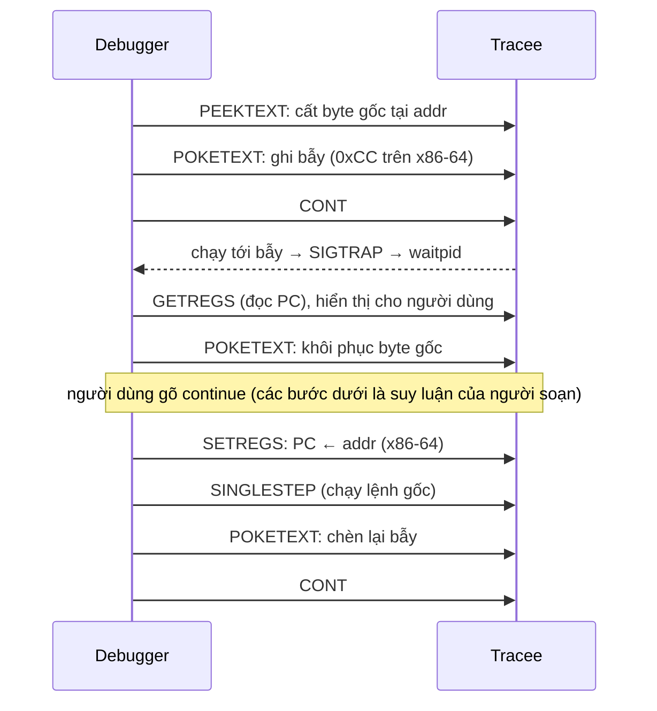
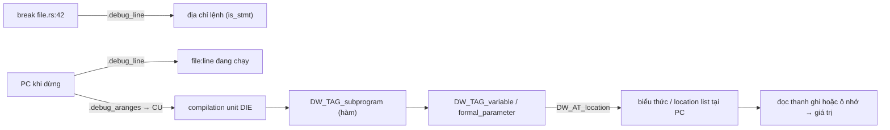

# P11 · Chương 04 — Debugger: gdb/lldb, breakpoint và DWARF

> Mọi khẳng định về kernel/syscall là về **Linux** (man page Debian bookworm, kernel docs, source kernel v6.8); chỗ nào nói về x86-64 hay AArch64 thì ghi rõ. Chương này **không có thí nghiệm**: câu lệnh `gdb`/`lldb` trong bài chỉ để minh họa cú pháp, không kèm output. Tài liệu GDB trích từ trang "current" của sourceware.org (trang sống, không ghim số phiên bản — nội dung có thể đổi theo bản GDB); đặc tả DWARF là bản 5 (dwarfstd.org); Rust là bản 1.95.0.

## Bạn sẽ hiểu được gì

1. **Q1.** Debugger điều khiển một process khác bằng cơ chế nào của kernel (`ptrace(2)`), và nó có thể làm những gì với process đó? → mục 1
2. **Q2.** Software breakpoint hoạt động ra sao (`int3` trên x86-64, `brk` trên AArch64), vì sao debugger phải gỡ breakpoint khi dừng? → mục 2
3. **Q3.** Single-step, hardware breakpoint và watchpoint khác software breakpoint thế nào, và giới hạn của chúng là gì? → mục 3
4. **Q4.** Symbol table khác debug info chỗ nào; binary đã `strip` còn debug được tới đâu? → mục 4
5. **Q5.** DWARF chứa gì (`.debug_info`, `.debug_line`, location list), và vì sao biến bị `<optimized out>` hay hàm bị inline? → mục 5
6. **Q6.** Debugger in backtrace bằng cách nào: frame pointer, CFI và `.eh_frame`? → mục 6
7. **Q7.** Debug info có thể nằm ngoài binary không (debuglink, build ID, debuginfod, split DWARF)? → mục 7
8. **Q8.** Gắn debugger vào process đang chạy cần quyền gì (`ptrace_scope`/Yama, capability) và trong container/Kubernetes thì sao? → mục 8

Mục 9 gom phần **liên hệ với Rust** (`rust-gdb`, `rust-lldb`, pretty printer, các cờ `-C debuginfo`, `-C split-debuginfo`, `-C strip`).

## Kiến thức cần trước

- [Chương 02 — System call](../01-linux/02-system-call.md): mục 6 đã giới thiệu `ptrace(2)` qua `strace`; chương này dùng lại các request đó cho debugger.
- [Chương 05 — Signal](../01-linux/05-signal.md): `SIGTRAP`, signal-delivery-stop.
- [Chương 06 — User, quyền, /proc, /sys](../01-linux/06-user-quyen-proc-sys.md): uid, capability.
- [Chương 04 (CPU) — Calling convention và stack frame](../02-cpu/04-calling-convention-va-stack-frame.md): prologue/epilogue, frame pointer, `.eh_frame`; mục 6 của chương này chỉ bổ sung phía debugger.

## 1. Debugger là một process dùng `ptrace(2)` (Q1)

> **Trả lời ngắn.** Debugger không có đặc quyền ma thuật: nó là một process bình thường, nhờ syscall `ptrace(2)` để quan sát và điều khiển process khác (gọi là *tracee*), kể cả đọc/sửa bộ nhớ và thanh ghi của tracee[^ptrace-def]. Tracee dừng lại mỗi khi có signal đến, debugger biết qua `waitpid`, rồi đọc/sửa trạng thái và cho chạy tiếp[^ptrace-stop][^ptrace-wait][^ptrace-inspect].

**Giải thích.**

Hình dung (nhận xét của người soạn): ptrace giống thẻ vào phòng máy chỉ mở khi máy đã *tạm dừng*. Kỹ thuật viên (debugger) không can thiệp được lúc máy đang chạy; họ bấm dừng, vào đọc/sửa bộ nhớ và thanh ghi, rồi bấm chạy tiếp.

*Bước 1 — thiết lập quan hệ tracer/tracee.* Hai cách bắt đầu (con gọi `PTRACE_TRACEME` rồi `execve`, hoặc gắn vào process có sẵn bằng `PTRACE_ATTACH`/`PTRACE_SEIZE`) đã giải thích ở [Chương 02 (Linux), mục 6.2](../01-linux/02-system-call.md). Điều cần nhớ cho debugger: quan hệ này là **theo từng thread**, "tracee" luôn nghĩa là một thread chứ không phải cả process đa luồng[^ptrace-perthread]. (Nhận xét của người soạn: `gdb -p PID` thuộc kiểu attach — xem mục 8; còn khi bạn nhờ gdb tự khởi chạy chương trình thì `PTRACE_TRACEME` là cách tự nhiên, nhưng chương này không kiểm mã nguồn GDB để biết nó dùng request nào.)

*Bước 2 — tracee dừng, tracer được báo.* Cơ chế tracee dừng mỗi lần nhận signal và tracer biết qua `waitpid(2)` đã nói ở [Chương 02 (Linux), mục 6.2](../01-linux/02-system-call.md). Debugger "dừng ở breakpoint" thực chất là chuyện đó: breakpoint sinh ra một signal `SIGTRAP` (mục 2).

*Bước 3 — đọc/ghi khi tracee đang dừng.* Hầu hết request chỉ dùng được khi tracee đang ở trạng thái dừng[^ptrace-stopped-only]. Các request debugger dùng nhiều nhất:

| Việc debugger cần | Request | Ý nghĩa (theo man page) |
|---|---|---|
| Đọc một từ nhớ của tracee | `PTRACE_PEEKTEXT`/`PEEKDATA` | đọc một "word" tại địa chỉ `addr` trong bộ nhớ tracee[^ptrace-peek] |
| Ghi một từ nhớ | `PTRACE_POKETEXT`/`POKEDATA` | chép word vào địa chỉ `addr` của tracee[^ptrace-poke] |
| Đọc thanh ghi | `PTRACE_GETREGS`, `PTRACE_GETFPREGS` (không có trên mọi kiến trúc[^ptrace-notall]; mini-strace aarch64 ở [Chương 02 (Linux), mục 6.2](../01-linux/02-system-call.md) dùng `PTRACE_GETREGSET`) | chép thanh ghi đa dụng/dấu phẩy động của tracee về tracer[^ptrace-getregs] |
| Chạy tiếp | `PTRACE_CONT` | khởi động lại tracee, có thể kèm số signal để chuyển cho nó[^ptrace-cont] |
| Chạy đúng một lệnh | `PTRACE_SINGLESTEP` | dừng lại sau khi thực thi một lệnh máy[^ptrace-step] |

*Bước 4 — nhả ra.* Khi xong, `PTRACE_DETACH` cho tracee chạy tiếp ở chế độ bình thường, không bị trace[^ptrace-detach].

```mermaid
sequenceDiagram
  participant D as Debugger (tracer)
  participant K as Kernel
  participant T as Tracee
  D->>K: fork; con gọi PTRACE_TRACEME rồi execve
  K-->>T: tracee chạy chương trình, dừng khi nhận signal
  T-->>K: dừng (signal-delivery-stop)
  K-->>D: waitpid trả về, mô tả lý do dừng
  D->>K: PTRACE_GETREGS (hoặc GETREGSET) / PEEKTEXT (đọc trạng thái)
  D->>K: PTRACE_POKETEXT (sửa nếu cần)
  D->>K: PTRACE_CONT hoặc PTRACE_SINGLESTEP
  K-->>T: chạy tiếp
```

<details><summary>Đi sâu: ATTACH vs SEIZE, EXITKILL, giới hạn của "word", macOS</summary>

- `PTRACE_ATTACH` gửi `SIGSTOP` cho tracee và tracee chưa chắc đã dừng khi lời gọi trả về — phải `waitpid` để chờ[^ptrace-attach]. `PTRACE_SEIZE` (từ Linux 3.4) khác ở chỗ không dừng process khi gắn[^ptrace-seize].
- `PTRACE_O_EXITKILL` (từ Linux 3.8) gửi `SIGKILL` cho tracee nếu tracer thoát; man page nói hữu ích cho các "ptrace jailer" muốn tracee không thoát khỏi tầm kiểm soát[^ptrace-exitkill].
- Mỗi lần `PEEK`/`POKE` chỉ chuyển một word[^ptrace-peek][^ptrace-poke]. (Suy luận của người soạn: đọc một vùng lớn bằng nhiều lần PEEK tốn nhiều syscall; đó là lý do tồn tại các đường khác như `process_vm_readv(2)`, nhưng chương này không đi vào chúng.)
- Trên Linux không có không gian địa chỉ code/data tách biệt nên `PEEKTEXT` và `PEEKDATA` hiện tương đương[^ptrace-peek].
- macOS: `ptrace` bị System Integrity Protection hạn chế — process muốn dùng nó phải được code-sign với chứng chỉ máy tin cậy, theo ghi chú trong rustc-dev-guide (trang này là ghi chú bài giảng, có thể lỗi thời)[^rdg-sip]. Chi tiết ký (signing) nằm ngoài phạm vi chương.

</details>

**Quay lại Q1:** debugger điều khiển process khác bằng `ptrace(2)`: tracee dừng khi có signal, tracer đợi bằng `waitpid`, đọc/ghi bộ nhớ-thanh ghi lúc đang dừng rồi cho chạy tiếp.

## 2. Software breakpoint: `int3` và `brk` (Q2)

> **Trả lời ngắn.** Để dừng tại một địa chỉ, debugger thay lệnh máy ở đó bằng một lệnh "bẫy" đặc biệt; khi CPU chạy tới, bẫy kích hoạt và chương trình trao quyền lại cho debugger[^gdb-bp-replace][^gdb-z0]. Trên x86-64 lệnh đó là `int3` (một byte, `0xCC`), trên AArch64 là `brk`; kernel chuyển bẫy thành `SIGTRAP` gửi cho tracee[^k-int3][^k-brk][^k-do-int3][^k-arm-traps]. Khi dừng, GDB gỡ breakpoint ra để bộ nhớ trông như ban đầu[^gdb-restore].

**Giải thích.**

Hình dung (nhận xét của người soạn): bạn đọc công thức nấu ăn cho đầu bếp. Muốn họ dừng đúng bước 7, bạn dán một mẩu giấy "GỌI TÔI" đè lên bước 7. Đầu bếp đọc tới mẩu giấy thì dừng và gọi. Muốn họ làm tiếp bước 7 thật, bạn bóc mẩu giấy, để họ làm đúng một bước, rồi dán lại.

*Bước 1 — tìm địa chỉ.* Người dùng gõ `break file.rs:42` hoặc `break tên_hàm`. Debugger đổi dòng nguồn thành địa chỉ lệnh nhờ bảng dòng của DWARF (mục 5)[^dw-line-intro]: bảng này gắn cờ "recommended breakpoint location" cho những lệnh nên đặt breakpoint[^dw-isstmt].

*Bước 2 — chèn bẫy.* GDB mô tả cơ chế: nó thay mã chương trình tại địa chỉ breakpoint bằng một lệnh đặc biệt, khi thực thi thì trao quyền lại cho debugger[^gdb-bp-replace]. Giao thức từ xa của GDB nói cùng ý: software breakpoint là thay lệnh tại `addr` bằng lệnh breakpoint hoặc lệnh trap[^gdb-z0]. (Suy luận của người soạn: với `ptrace`, đó là một `PTRACE_PEEKTEXT` để cất lệnh gốc rồi `PTRACE_POKETEXT` để ghi bẫy (mục 1); vì mỗi lần chỉ chuyển một word, debugger phải đọc cả word, đổi đúng byte đầu rồi ghi lại.)

- **x86-64:** lệnh bẫy là `int3`, dài một byte, opcode `0xCC` — nguồn là định nghĩa `INT3_INSN_SIZE`/`INT3_INSN_OPCODE` trong source kernel[^k-int3]; phần uprobes của kernel cũng định nghĩa breakpoint phần mềm là `0xcc`, dài 1 byte[^k-uprobe-x86].
- **AArch64:** lệnh bẫy là `brk` với một immediate 16 bit đặt ở bit [20:5] của lệnh, nên cùng một lệnh `brk` có nhiều biến thể; kernel dùng các giá trị immediate khác nhau để phân biệt người dùng (`kprobes`, `uprobes`, `kgdb`…)[^k-brk]. Mỗi lệnh A64 dài 4 byte, nên bẫy `brk` cũng 4 byte[^k-brk-enc][^k-arm-size].

*Bước 3 — chạy tới bẫy.* Debugger gọi `PTRACE_CONT`. Khi CPU thực thi lệnh bẫy, nó gây exception; kernel x86 xử lý `int3` bằng cách gửi `SIGTRAP` cho process[^k-do-int3], còn AArch64 gắn handler `BRK` với `SIGTRAP`/`TRAP_BRKPT`[^k-arm-traps]. Tracee ở trạng thái traced nên dừng khi nhận signal và tracer được báo qua `waitpid`[^ptrace-stop][^ptrace-wait].

*Bước 4 — debugger "dọn" trước khi cho người dùng xem.* Mặc định GDB chỉ chèn breakpoint khi chương trình được resume, và ngay khi chương trình dừng thì khôi phục lệnh gốc; mục đích là tránh để lại bẫy trong target nếu GDB đột ngột mất kết nối[^gdb-restore]. (Suy luận của người soạn: vì vậy lệnh `x/i` hay `disassemble` lúc dừng thường không thấy `0xCC` lạ.)

*Bước 5 — đi tiếp qua breakpoint.* Nếu cứ `CONT` ngay khi PC đang nằm đúng lệnh vừa bị thay, bẫy sẽ nổ lại ngay. GDB có một chế độ gọi là *displaced stepping*: single-step qua breakpoint mà không gỡ breakpoint khỏi tiến trình, bằng cách chạy một bản sao lệnh gốc ở chỗ khác[^gdb-displaced]; ngụ ý của câu đó là cách thông thường phải gỡ breakpoint rồi mới single-step. (Suy luận của người soạn từ câu đó, không có trích dẫn trực tiếp cho từng bước: debugger khôi phục lệnh gốc, `PTRACE_SINGLESTEP` đúng một lệnh, chèn lại bẫy rồi `CONT`.)

*PC khi dừng.* Trên x86-64, code uprobes của kernel (cũng dựa trên bẫy này) tính địa chỉ của lệnh breakpoint từ các thanh ghi đã lưu sau khi gặp bẫy bằng `instruction_pointer(regs) - UPROBE_SWBP_INSN_SIZE`, với `UPROBE_SWBP_INSN` là `0xcc` và kích thước 1[^k-uprobe-swbp][^k-uprobe-x86]; hàm `int3_emulate_call` cũng lấy `regs->ip - INT3_INSN_SIZE` làm địa chỉ của lệnh bị vá[^k-ip]. Nghĩa là trên x86-64 `ip` đã lưu nằm *sau* byte `int3` một byte. Trên AArch64, bản cài đặt `uprobe_get_swbp_addr` trả thẳng `instruction_pointer(regs)` không trừ gì[^k-uprobe-arm64], tức PC vẫn chỉ vào chính lệnh `brk`. (Suy luận của người soạn: `PTRACE_GETREGS` (hoặc `PTRACE_GETREGSET` trên kiến trúc không có nó, xem bảng ở mục 1) cho debugger thấy cùng giá trị `ip` đã lưu đó, nên trên x86-64 debugger phải trừ 1 rồi ghi lại bằng `PTRACE_SETREGS`[^ptrace-setregs] trước khi chạy lệnh gốc; trên AArch64 thì không phải trừ.)



<details><summary>Đi sâu: breakpoint có điều kiện, always-inserted, tự chọn hardware, uprobes</summary>

- **Breakpoint có điều kiện** do GDB tự đánh giá: mỗi lần bẫy nổ, GDB kiểm tra điều kiện; đúng thì dừng, sai thì cho chạy tiếp[^gdb-cond]. (Suy luận của người soạn: mỗi lần "nổ nhưng không dừng" vẫn tốn một vòng dừng–`waitpid`–đọc–resume qua ptrace, nên điều kiện trên đường nóng làm chương trình chậm đáng kể. Với lời gọi 10⁶ lần/giây nên đặt điều kiện ở chính code hoặc dùng breakpoint khác.)
- **`set breakpoint always-inserted on`** giữ breakpoint trong target liên tục thay vì chèn lúc resume và gỡ lúc dừng; chế độ mặc định là `off`[^gdb-always].
- **Tự chọn phần cứng/phần mềm:** với một số target GDB tự quyết định dùng hardware hay software breakpoint tùy địa chỉ là read-only hay read-write; `hbreak` luôn dùng hardware[^gdb-autohw].
- **Cùng một mánh, nơi khác:** kernel tự dùng bẫy này cho `uprobes` — chú thích trong `brk-imm.h` ghi immediate `0x005` dành cho cài đặt uprobes[^k-brk]; trên x86 header `text-patching.h` của kernel còn định nghĩa `INT3_INSN_OPCODE` cạnh các hàm `text_poke_bp` và `int3_emulate_*`, tức int3 cũng được dùng khi vá code đang chạy[^k-int3]. (Suy luận của người soạn: vì kernel tự xử lý bẫy nên uprobe của `perf`/eBPF không cần một tracer dừng tracee qua `ptrace`, do đó nhẹ hơn debugger đầy đủ.)
- Tên các lệnh tương ứng giữa gdb và lldb: `break test.c:12` trong GDB ứng với `breakpoint set --file test.c --line 12` trong LLDB[^lldb-map-bp].

</details>

**Quay lại Q2:** software breakpoint là thay lệnh tại địa chỉ đích bằng lệnh bẫy (`int3`/`brk`); CPU chạy tới thì kernel gửi `SIGTRAP`, debugger nhận qua `waitpid`, và gỡ bẫy ra khi dừng.

## 3. Single-step, hardware breakpoint và watchpoint (Q3)

> **Trả lời ngắn.** *Single-step* bắt CPU dừng sau đúng một lệnh (`PTRACE_SINGLESTEP`)[^ptrace-step]. *Hardware breakpoint/watchpoint* dùng thanh ghi debug của CPU để dừng khi chạy tới một địa chỉ hoặc khi có truy cập vào một vùng nhớ (ghi, hoặc đọc), mà không phải sửa code[^gdb-z1][^k-uapi-rw]; số lượng rất ít — trên x86 chỉ có bốn thanh ghi địa chỉ[^k-uapi-dr]. Watchpoint phần mềm thì phải single-step toàn bộ chương trình nên chậm hàng trăm lần[^gdb-watch-sw].

**Giải thích.**

Hình dung (nhận xét của người soạn): muốn biết ai động vào két sắt. *Watchpoint phần mềm* là cử một người đứng cạnh két và soi từng người đi ngang — chắc chắn nhưng rất chậm. *Watchpoint phần cứng* là gắn cảm biến vào két — nhanh, nhưng ngân sách chỉ đủ cho bốn cảm biến.

*Single-step.* Man page ghi: `PTRACE_SINGLESTEP` khởi động lại tracee như `PTRACE_CONT` nhưng sắp đặt để nó dừng sau khi thực thi một lệnh; với tracer, tracee trông như bị dừng vì nhận `SIGTRAP`[^ptrace-step][^ptrace-sigtrap-step]. Cơ chế phần cứng bên dưới do kiến trúc quy định:

- **x86-64:** kernel bật cờ `TF` (trap flag) trong thanh ghi cờ của tracee[^k-step] (nhận xét của người soạn: theo thiết kế x86, CPU gây exception debug sau mỗi lệnh khi `TF` bật); khi exception debug báo bước đơn (`DR_STEP`) hoặc trúng thanh ghi debug (`DR_TRAP_BITS`), kernel gửi `SIGTRAP`[^k-do-debug].
- **AArch64:** kernel đặt bit `SS` trong `pstate` của tracee[^k-arm-ss]; sự kiện hardware single-step được nối với `SIGTRAP`/`TRAP_TRACE`[^k-arm-traps].

Các lệnh GDB dựa trên cơ chế này: `stepi` thực thi đúng một lệnh máy rồi trả quyền cho GDB[^gdb-stepi]; `step` chạy tới khi gặp dòng nguồn khác[^gdb-step] và chỉ dừng ở lệnh đầu của một dòng[^gdb-step-line]. Muốn biết "dòng" ở đâu thì GDB cần bảng dòng DWARF (mục 5)[^dw-line-step]. Hệ quả: hàm không có thông tin dòng thì `step` không chui vào, chạy cho đến khi tới hàm có debug info[^gdb-step-nodebug]; muốn đi từng lệnh trong hàm đó phải dùng `stepi`.

*Hardware breakpoint và watchpoint.* CPU có vài thanh ghi debug. Trên x86, header kernel mô tả: các thanh ghi 0–3 chứa địa chỉ muốn bẫy[^k-uapi-dr]; thanh ghi điều khiển chọn kiểu truy cập (các hằng `DR_RW_EXECUTE`, `DR_RW_WRITE`, `DR_RW_READ`) và độ dài 1/2/4/8 byte[^k-uapi-rw]. (Nhận xét của người soạn: theo thiết kế phần cứng x86, mã `DR_RW_READ` bẫy cả đọc lẫn ghi; header không nói điều này.) Trên AArch64, kernel phân biệt ba sự kiện debug phần cứng: breakpoint, single-step và watchpoint[^k-arm-esr].

GDB có hai lệnh phía người dùng:

- `hbreak` đặt breakpoint phần cứng, tức dừng tại lệnh mà *không đổi lệnh*[^gdb-hbreak]; vì thanh ghi có hạn nên số breakpoint tối đa bị giới hạn[^gdb-hbreak-limit]. Giao thức từ xa mô tả nó là cơ chế "không phụ thuộc vào việc sửa bộ nhớ target"[^gdb-z1] — hữu ích khi code nằm trong vùng không ghi được.
- `watch expr` dừng khi chương trình *ghi* vào biểu thức và giá trị đổi[^gdb-watch-simple]. GDB đặt watchpoint phần cứng nếu có thể, báo thay đổi đúng tại lệnh gây ra; nếu không thì rơi về watchpoint phần mềm, chạy chậm hơn và báo ở dòng tiếp theo, không phải đúng lệnh[^gdb-watch-prefer].

<details><summary>Đi sâu: vì sao watchpoint phần mềm chậm, DR6/DR7, watch theo thread, LLDB</summary>

- GDB nói thẳng cơ chế phần mềm: single-step chương trình và kiểm tra giá trị biến sau mỗi bước, chậm "hàng trăm lần" so với chạy bình thường[^gdb-watch-sw]; watchpoint phần cứng thì không làm chương trình chậm đi[^gdb-watch-hw]. Mỗi bước trong chế độ phần mềm là một vòng `SINGLESTEP`→`waitpid`→đọc bộ nhớ (suy luận của người soạn).
- `set can-use-hw-watchpoints 0` ép GDB chỉ dùng watchpoint phần mềm[^gdb-watch-prefer]. Watchpoint giới hạn theo thread (`watch expr thread N`) chỉ chạy được với watchpoint phần cứng[^gdb-watch-thread].
- Header uapi x86 của kernel còn định nghĩa thanh ghi trạng thái `DR_STATUS` (số 6) để biết thanh ghi nào gây bẫy và thanh ghi điều khiển `DR_CONTROL` (số 7)[^k-uapi-dr]; các cờ `DR_TRAP0…3` cho biết `db0…db3` nào kích hoạt[^k-uapi-trap].
- Giao thức remote của GDB có gói `Z2` để chèn write watchpoint tại một địa chỉ[^gdb-z2], còn `Z1` là hardware breakpoint[^gdb-z1].
- LLDB: `watch global_var` của GDB tương ứng `watchpoint set variable global_var`[^lldb-map-watch].
- (Nhận xét của người soạn.) Với backend engineer: chỉ bốn watchpoint phần cứng nghĩa là "watch cả struct lớn" sẽ rơi về phần mềm và rất chậm; thay vì vậy hãy watch đúng một trường (4 hoặc 8 byte) hoặc đặt breakpoint có điều kiện.

</details>

**Quay lại Q3:** single-step dùng cờ của CPU để dừng sau mỗi lệnh; hardware breakpoint/watchpoint dùng vài thanh ghi debug (x86: bốn) nên nhanh nhưng ít, còn watchpoint phần mềm phải single-step cả chương trình.

## 4. Symbol table và debug info khác nhau thế nào (Q4)

> **Trả lời ngắn.** *Symbol table* (`.symtab`, `.dynsym`) là bảng symbol của file ELF: mỗi mục có tên, giá trị, kích thước và loại, và ELF dùng bảng này để định vị và relocate các định nghĩa/tham chiếu symbol[^elf-symdef][^elf-sym64]. Nói gọn (nhận xét của người soạn): nó cho biết hàm/biến toàn cục tên gì, nằm ở đâu. *Debug info* (DWARF) mới chứa kiểu dữ liệu, biến cục bộ, dòng nguồn, thông tin inline[^dw-die][^dw-line-intro]. GDB phân biệt hai loại: symbol "không có debug info" chỉ đến từ symbol table của executable[^gdb-nondebug], và với biến loại này GDB không biết kiểu[^gdb-nodebuginfo].

**Giải thích.**

Hình dung (nhận xét của người soạn): symbol table là *danh bạ điện thoại* — tên và số, không hơn. Debug info là *hồ sơ chi tiết từng nhân viên*: phòng ban nào, đang cầm việc gì, cầm ở bàn nào. Danh bạ đủ để "gọi đúng số" (đặt breakpoint theo tên hàm), không đủ để biết hôm nay người đó đang làm gì (giá trị biến cục bộ).

*Symbol table.* Trong ELF, `.symtab` giữ một symbol table[^elf-symtab] còn `.dynsym` giữ symbol table cho dynamic linking[^elf-dynsym]. Section có cờ `SHF_ALLOC` thì chiếm bộ nhớ lúc chạy[^elf-alloc]; `.dynsym` được ghi nhận với cờ này[^elf-dynsym]. Không phải mọi symbol đều còn: `-C strip=symbols` của rustc bỏ phần còn lại của symbol table (mục 9)[^rustc-strip-symbols].

*Debug info.* DWARF chuẩn hóa thứ nằm ngoài symbol table: mô tả từng thực thể trong chương trình bằng các "debugging information entry" (mục 5)[^dw-die]. Trong ELF, bảng dòng nằm ở section `.debug_line` do đặc tả DWARF đặt tên[^dw-line-sect]; còn man page `elf(5)` chỉ liệt kê một section `.debug` chung với ghi chú rằng nội dung của nó không được đặc tả[^elf-debug], nên đừng tìm `.debug` khi muốn đọc DWARF mà hãy tìm các section `.debug_*`.

Bảng so sánh (ô có chú thích là đối chiếu từ nguồn; ô không có chú thích là suy luận/nhận xét của người soạn):

| | Symbol table | Debug info (DWARF) |
|---|---|---|
| Nội dung | mỗi symbol có tên, giá trị, kích thước, loại[^elf-sym64] | cây DIE: kiểu, biến cục bộ, tham số, inline, vị trí biến[^dw-die][^dw-loclist] |
| Dòng nguồn ↔ địa chỉ | không có (suy luận: nguồn chỉ gắn thông tin này với `.debug_line` của DWARF) | có (`.debug_line`)[^dw-line-intro] |
| Ai đọc | linker, dynamic loader, debugger (nhận xét của người soạn) | debugger, công cụ backtrace có dòng (nhận xét của người soạn) |
| `bt` có tên hàm? | có (suy luận từ khái niệm non-debugging symbol[^gdb-nondebug]) | có, kèm dòng nguồn khi có `.debug_line` |
| `print var` có kiểu? | không: GDB báo thiếu kiểu[^gdb-nodebuginfo] | có |

*Hệ quả khi chỉ có symbol.* GDB vẫn thấy biến tồn tại nhờ symbol table của linker/loader (ví dụ ELF dynamic symbol table) nhưng symbol đó không chứa kiểu[^gdb-nodebuginfo]; GDB phân loại chúng là "non-debugging symbol", tức symbol đến từ symbol table của executable chứ không phải từ debug info như DWARF[^gdb-nondebug].

<details><summary>Đi sâu: gdbserver không cần symbol, strip trên máy đích</summary>

- `gdbserver` (chương trình nhỏ chạy trên máy đích, nói chuyện với GDB từ xa) không cần symbol table của chương trình; có thể `strip` để tiết kiệm chỗ, vì GDB trên máy host làm toàn bộ việc xử lý symbol[^gdbserver-strip]. Đây là mô hình "binary mỏng trên production, debug info ở máy dev" (nhận xét của người soạn) — xem mục 7 để biết cách ghép lại.
- Nếu muốn backtrace có dòng/tệp mà không mang theo toàn bộ debug info thì cần mức "chỉ bảng dòng": rustc có `line-tables-only` đúng cho mục đích này[^rustc-lines] (mục 9).

</details>

**Quay lại Q4:** symbol table là bảng tên/giá trị của symbol cho linker và dynamic linking; debug info DWARF mới có kiểu, biến cục bộ, dòng nguồn. Với binary chỉ có symbol, GDB coi chúng là non-debugging symbol và không có kiểu[^gdb-nondebug][^gdb-nodebuginfo]; việc đặt breakpoint theo tên hàm và backtrace có tên là suy luận của người soạn từ khái niệm đó.

## 5. DWARF chứa gì và vì sao biến bị "optimized out" (Q5)

> **Trả lời ngắn.** DWARF mô tả chương trình bằng một **cây** các *debugging information entry* (DIE), mỗi DIE có một tag và các attribute[^dw-die][^dw-tree]. Bảng dòng trong `.debug_line` cho biết lệnh máy nào ứng với dòng nào[^dw-line-intro][^dw-line-sect]. Vị trí một biến được mô tả bằng biểu thức DWARF hoặc *location list* khi nó đổi chỗ trong đời nó[^dw-loclist]. Khi trình tối ưu bỏ hay dời một biến, debugger không còn nơi nào để đọc và hiện `<optimized out>`[^gdb-optout-args][^gdb-optout].

**Giải thích.**

Hình dung (nhận xét của người soạn): DWARF như tòa nhà có ba loại bảng. Một *sơ đồ cây* (`.debug_info`): công ty → phòng → nhân viên. Một *bảng tra* (`.debug_line`): "ở lệnh này, bạn đang ở dòng 42". Và *lịch làm việc* của từng biến (location list): "từ lệnh A tới B biến `x` ở thanh ghi `rbx`, sau B nằm ở `[rsp+8]`".

*Cây DIE.* Đặc tả viết: DWARF dùng một chuỗi DIE để mô tả chương trình nguồn ở mức thấp; mỗi DIE gồm một tag và một chuỗi attribute[^dw-die]. Quan hệ sở hữu giữa các DIE tạo thành cây; con của một nút là các DIE mà nút đó sở hữu[^dw-tree]. Vì còn có tham chiếu chéo (biến → kiểu) nên nếu tính cả quan hệ này thì thành đồ thị chứ không còn là cây[^dw-graph]. Cây được lưu dạng "phẳng" trong section `.debug_info`: mỗi DIE bắt đầu bằng một mã trỏ vào bảng abbreviation rồi tới các giá trị attribute[^dw-abbrev-info]; các bảng abbreviation nằm ở section `.debug_abbrev`[^dw-abbrev]. Để tra ngược "địa chỉ này thuộc compilation unit nào", debugger quét bảng địa chỉ (`.debug_aranges`)[^dw-aranges].

*Bảng dòng.* `.debug_line` cho phép debugger gắn vị trí nguồn với địa chỉ lệnh máy: người dùng nói "tệp X dòng N", debugger tìm địa chỉ; ngược lại hiển thị địa chỉ theo tệp và dòng, và single-step theo dòng[^dw-line-intro][^dw-line-step]. Section này được tham chiếu từ DIE của compilation unit trong `.debug_info`[^dw-line-sect]. Mỗi hàng trong bảng có cờ `is_stmt`: "lệnh hiện tại là vị trí breakpoint được khuyến nghị"[^dw-isstmt]; và compiler có thể ghi dòng 0 cho lệnh không quy về dòng nguồn nào được[^dw-line0]. (Suy luận của người soạn: dòng 0 là một trong những lý do `step` ở bản tối ưu có lúc không dừng ở dòng bạn mong đợi; GDB cũng nói code đã tối ưu có thể chạy theo đường không khớp từng dòng nguồn[^gdb-optim].)

*Vị trí biến.* Attribute `DW_AT_location` mô tả vị trí biến lúc chạy. Nếu biến có thể đổi chỗ trong đời nó (thanh ghi này rồi ô nhớ kia) thì dùng location list thay cho một mô tả đơn[^dw-loclist]; danh sách nằm ở section `.debug_loclists` (hoặc `.debug_loclists.dwo` cho split DWARF)[^dw-loclists-sect]. Nếu một biến định nghĩa không có location hoặc location rỗng thì đặc tả coi biến "tồn tại trong source nhưng không tồn tại trong chương trình thực thi"[^dw-noloc]. Có cả trường hợp giá trị biết nhưng không nằm đâu cả: `DW_OP_stack_value` nói đối tượng không có trong bộ nhớ nhưng giá trị vẫn biết, là giá trị đỉnh stack biểu thức[^dw-stackval].



*Inline.* Khi compiler inline hàm, thân hàm bị chép vào từng chỗ gọi thay vì nhảy tới một routine dùng chung[^gdb-inline], nên không còn lệnh `call`. DWARF vẫn ghi lại: entry của hàm được inline có attribute `DW_AT_inline`[^dw-inl], và tag `DW_TAG_inlined_subroutine` biểu diễn "một lần inline cụ thể của một hàm"[^dw-inl-tag]. Nhờ vậy GDB vẫn hiển thị hàm inline như hàm thường: có trong backtrace, xem được đối số/biến cục bộ, `step` vào, `next` bỏ qua, `finish` thoát[^gdb-inline]; GDB chỉ làm được điều đó khi compiler đã ghi thông tin inline vào debug info[^gdb-inline-dwarf].

*`<optimized out>`.* GDB cảnh báo rằng với chương trình biên dịch có tối ưu (`-g -O`) trình tối ưu đã sắp xếp lại code, và debugger hiển thị đúng cái *thật sự có đó*; ví dụ biến khai báo mà không dùng thì GDB không bao giờ thấy vì compiler đã tối ưu nó biến mất[^gdb-optim]. Tài liệu cũng thừa nhận GDB chính xác hơn khi tắt tối ưu[^gdb-optim-better]. Khi giá trị tham số không được lưu trong stack frame, GDB hiển thị nó là `<optimized out>`[^gdb-optout-args]. Ví dụ trong tài liệu GDB về tail call: GDB không biết hàm `a` đã tự gọi mình qua `b` bao nhiêu lần; vì các lần gọi đó sửa biến `i` nên GDB không chắc giá trị nó biết có đúng, và in `<optimized out>`[^gdb-optout].

<details><summary>Đi sâu: tham số hằng số trong hàm inline, DWARF 5 loclists, bảng abbreviation, cảnh báo phiên bản</summary>

- Tham số hình thức "có giá trị hằng nhưng không có location" thường sinh ra khi hàm inline nhận một tham số thực hằng số — ví dụ trong đặc tả DWARF[^dw-inl-param]. (Suy luận của người soạn: đó là lý do khi debug bản `--release` đôi khi bạn thấy tham số in ra giá trị nhưng "không thể lấy địa chỉ".)
- Dạng `loclist` (và `DW_AT_loclists_base`) là mới ở DWARF 5, nhằm giảm gần hết relocation cần cho location list[^dw-loclist-v5]. Mặc định rustc phát DWARF phiên bản 4 trên hầu hết nền tảng (Linux, macOS); `-C dwarf-version=5` đổi sang 5[^rustc-dwarf].
- Dòng trong bảng không bảo đảm đơn điệu: sau tối ưu, dòng nguồn có thể xen kẽ vì lệnh được xếp lại (suy luận của người soạn từ cơ chế `is_stmt` và dòng 0 ở trên; không có số đo).
- Cảnh báo phiên bản: trang GDB-Rust trong manual vẫn ghi "Rust compiler (version 1.8)" khi nói về lỗ hổng debug info[^gdb-rust-stale]. Hãy coi danh sách hạn chế đó là *có thể lỗi thời* và đối chiếu với bản GDB/rustc bạn đang dùng.

</details>

**Quay lại Q5:** DWARF là cây DIE (`.debug_info`) cộng bảng dòng (`.debug_line`) cộng location list; vì tối ưu làm biến đổi chỗ hoặc biến mất, nên debugger có khi không có chỗ đọc và báo `<optimized out>`.

## 6. Backtrace: frame pointer, CFI và `.eh_frame` (Q6)

> **Trả lời ngắn.** Để in backtrace, debugger phải "đi ngược" từ stack frame hiện tại sang frame của hàm gọi. Có hai nguồn thông tin: chuỗi frame pointer (nếu code duy trì; xem chương CPU, nơi có dẫn chứng), hoặc bảng **Call Frame Information (CFI)** trong DWARF, thường nằm ở `.eh_frame` (hoặc `.debug_frame`)[^dw-cfi][^lsb-ehframe]. CFI nói, tại từng địa chỉ lệnh, địa chỉ frame (CFA) tính thế nào và thanh ghi nào được lưu ở đâu; debugger *ảo* "unwind" từng bước mà không đổi trạng thái thật của process[^dw-virtual][^dw-virtual2].

**Giải thích.**

Hình dung (nhận xét của người soạn): bạn dừng giữa chuyến đi và muốn lần ngược con đường đã đi. Frame pointer là sợi chỉ nối từng điểm dừng; CFI là cuốn sổ ghi "nếu đang đứng ở mốc này thì điểm dừng trước nằm cách bao xa".

Chương CPU ([mục 6](../02-cpu/04-calling-convention-va-stack-frame.md)) đã giải thích prologue/epilogue và hai cách unwind; ở đây chỉ nêu phần phía debugger.

*Khung gọi (frame) theo GDB.* GDB chia call stack thành các phần liền nhau gọi là stack frame; mỗi frame là dữ liệu gắn với một lần gọi một hàm, gồm đối số, biến cục bộ và địa chỉ đang thực thi[^gdb-frames].

*CFI theo DWARF.* Đặc tả nêu bối cảnh: debugger cần xem và sửa trạng thái của bất kỳ lần kích hoạt hàm nào đang nằm trên call stack[^dw-cfi]. Khung gọi được nhận diện bằng một địa chỉ gọi là Canonical Frame Address (CFA), thường định nghĩa là giá trị stack pointer tại chỗ gọi ở frame trước[^dw-cfa]. Một debugger "virtually unwind" theo từng bước: bắt đầu từ activation hiện tại, nó khôi phục ảo các thanh ghi mà activation đó đã bảo toàn rồi tính CFA và vị trí code của activation tiền nhiệm[^dw-virtual]; gọi là "ảo" vì trạng thái thật của target process không đổi[^dw-virtual2].

*Vì sao cần bảng chứ không chỉ một quy tắc.* Prologue/epilogue không phải lúc nào cũng nằm gọn đầu và cuối hàm: epilogue thường bị nhân đôi tại mỗi chỗ return[^dw-prologue]. (Suy luận của người soạn từ câu đó: vì thế thông tin unwind phải được mô tả theo *địa chỉ lệnh*, không theo hàm.)

*`.eh_frame`.* Đặc tả LSB nói thông tin này nằm trong các section đặc biệt `.eh_frame` và `.eh_framehdr`, dùng cho runtime của các ngôn ngữ có exception để biết call frame nào cần unwind khi xử lý exception[^lsb-ehframe]. Định dạng `.eh_frame` giống `.debug_frame` của DWARF về cấu trúc và mục đích nhưng có khác biệt tinh tế[^lsb-ehframe-similar]. (Nhận xét của người soạn: trong thực tế một bảng CFI phục vụ cả hai: debugger lấy backtrace và runtime tháo stack khi panic/exception. Chương [Panic, ABI, FFI](../10-rust-internals/08-panic-abi-ffi.md) nói về phía panic.)

<details><summary>Đi sâu: cờ rustc liên quan, khi không có CFI</summary>

- `-C force-unwind-tables` ép sinh bảng unwind; nếu tắt mà target cần bảng này thì rustc báo lỗi[^rustc-unwind]. `-C force-frame-pointers` ép dùng frame pointer; mặc định phụ thuộc target[^rustc-fp].
- Cắt debug info ít ảnh hưởng tới backtrace, theo tài liệu rustc: `-C strip=debuginfo` "nên giữ backtrace gần như nguyên vẹn" dù có thể làm gdb/lldb vô hiệu[^rustc-strip-debuginfo]; trái lại `-C strip=symbols` có thể làm backtrace khó đọc đến mức "không thể hiểu" trên những nền tảng dựa vào symbol table[^rustc-strip-symbols].
- Trong Rust, backtrace có tệp/dòng cần debug info: `std::backtrace` nói với đa số nền tảng, muốn có tên tệp và số dòng thì chương trình phải biên dịch với debug info[^std-backtrace].

</details>

**Quay lại Q6:** debugger lần ngược stack bằng frame pointer hoặc bằng bảng CFI (`.eh_frame`/`.debug_frame`), thứ mô tả theo từng địa chỉ lệnh cách tính CFA và vị trí các thanh ghi đã lưu, rồi "unwind ảo" mà không đổi process thật.

## 7. Debug info nằm ngoài binary: debuglink, build ID, debuginfod, split DWARF (Q7)

> **Trả lời ngắn.** Debug info thường rất lớn, có khi lớn hơn cả phần code, nên nhiều hệ thống để nó ở file riêng và chỉ cài khi cần debug[^gdb-sep-why]. GDB ghép hai file bằng **debug link** (tên file + CRC32) hoặc **build ID** (chuỗi định danh duy nhất có mặt ở cả hai file)[^gdb-debuglink-name][^gdb-buildid], và có thể tải file thiếu từ server `debuginfod` theo build ID[^gdb-debuginfod]. "Split DWARF" là chuyện khác: cho phép phần lớn DWARF ở lại file object, không qua linker, để link nhanh hơn[^dw-split][^dw-split-link].

**Giải thích.**

Hình dung (nhận xét của người soạn): image production mỏng (binary đã `strip`) và một kho "bản đồ chi tiết" (file debug info) tra cứu bằng *vân tay* (build ID). Khi có sự cố, bạn mang đúng bản đồ có cùng vân tay ra đối chiếu.

*Cách 1 — debug link.* Executable chứa section `.gnu_debuglink`[^gdb-debuglink-sec]; nó nêu tên file debug (thường `executable.debug`) và một CRC 32 bit của file debug để GDB kiểm tra file debug và executable đến từ cùng một lần build[^gdb-debuglink-name].

*Cách 2 — build ID.* Executable chứa một build ID, chuỗi bit duy nhất cũng có mặt ở file debug tương ứng[^gdb-buildid]. Bản mặc định dùng SHA1 cho 160 bit (40 ký tự hex)[^gdb-buildid-sha]; section cùng giá trị có mặt trong binary gốc, bản đã strip, và file debug[^gdb-buildid-sha]. Tên file debug *không* ghi sẵn mà tính từ build ID: GDB tìm trong thư mục con `.build-id` của các thư mục debug toàn cục một file `nn/nnnnnnnn.debug` với `nn` là hai ký tự hex đầu của build ID[^gdb-buildid-path]. Man page `elf(5)` mô tả section `.note.gnu.build-id` dùng để giữ một ID định danh duy nhất nội dung ảnh ELF[^elf-buildid].

*Cách 3 — debuginfod.* `debuginfod` là HTTP server phân phối file ELF, DWARF và source; GDB (qua libdebuginfod) có thể hỏi server theo build ID để tải debug info, executable và source còn thiếu theo yêu cầu[^gdb-debuginfod]. Khi không tìm thấy file debug cục bộ mà debuginfod bật, GDB mới thử tải[^gdb-sep-order].

*Tạo ra cặp file.* Binutils có `objcopy` để tạo cặp executable/file debug (`objcopy --only-keep-debug foo foo.debug`, rồi `strip -g foo`); muốn dùng debug link thì thêm `objcopy --add-gnu-debuglink=foo.debug foo`[^gdb-objcopy].

*Split DWARF (khác với "debug info ngoài binary").* Đặc tả DWARF 5 mô tả: producer có thể chia debug info sao cho phần lớn nằm lại trong từng file object, không qua linker[^dw-split]; điều đó giảm thời gian link vì linker phải xử lý ít thông tin hơn[^dw-split-link]. Phần thứ nhất đi qua linker vẫn gồm bảng dòng, bảng frame và các bảng truy cập nhanh[^dw-first-part]; một *skeleton compilation unit* là mô tả tối thiểu chỉ ra compilation unit "split" chứa phần còn lại (và là phần lớn) của mô tả[^dw-skel]. Ở rustc (mục 9), `-C split-debuginfo` cho ra các file `*.dwp` (chế độ `packed`) hoặc `*.dwo` (chế độ `unpacked`) trên nền tảng ngoài macOS và Windows[^rustc-split-packed][^rustc-split-unpacked]. (Suy luận của người soạn: đó là hiện thân của split DWARF trong đặc tả; tài liệu rustc không nói thẳng điều này.)

<details><summary>Đi sâu: kiểm tra khớp, thư mục tìm, thứ tự, gdbserver</summary>

- GDB so sánh build ID của executable đang chạy với file nạp trong GDB; nếu lệch thì tùy `set exec-file-mismatch` (`ask` mặc định, `warn`, `off`)[^gdb-mismatch].
- Thứ tự tìm file debug theo ví dụ trong manual với build ID `abcdef1234`: `/usr/lib/debug/.build-id/ab/cdef1234.debug`, rồi `/usr/bin/ls.debug`, `/usr/bin/.debug/ls.debug`, `/usr/lib/debug/usr/bin/ls.debug`; nếu vẫn không thấy và debuginfod bật thì mới tải[^gdb-sep-order].
- File debug nên là một "executable thường" có đủ section với cùng tên, địa chỉ, kích thước như bản gốc nhưng không cần chứa dữ liệu — như `.bss`[^gdb-sep-format].
- Vì `gdbserver` không cần symbol table nên có thể chạy bản đã `strip` ở máy đích, còn GDB trên máy host giữ debug info[^gdbserver-strip].
- (Nhận xét của người soạn.) Với container: image production thường không mang debug info; hãy lưu file debug theo build ID ở nơi bạn kiểm soát (hoặc chạy một debuginfod nội bộ) để khi cần có thể ghép lại mà không build lại.

</details>

**Quay lại Q7:** debug info có thể tách thành file riêng, ghép bằng debug link (tên + CRC) hoặc build ID, tải từ debuginfod theo build ID; còn split DWARF là kỹ thuật giảm thời gian link bằng cách để DWARF ở file object.

## 8. Attach vào process đang chạy: quyền, `ptrace_scope`, container (Q8)

> **Trả lời ngắn.** `gdb -p PID` hay lệnh `attach` là kiểu "gắn vào process có sẵn" của ptrace (`PTRACE_ATTACH` hoặc `PTRACE_SEIZE`[^ptrace-traceme]; chương này không kiểm GDB dùng request nào). Kernel chỉ cho phép nếu qua được "ptrace access mode check": cùng uid *và* target còn "dumpable", hoặc có `CAP_SYS_PTRACE`[^ptrace-perm-attach][^ptrace-acc3][^ptrace-acc4]. Trên hệ có Yama LSM, `/proc/sys/kernel/yama/ptrace_scope` thắt thêm: giá trị 1 (mặc định theo man page) chỉ cho attach vào process con cháu, trừ khi có `CAP_SYS_PTRACE`[^ptrace-yama-conf][^ptrace-yama-1]. Trong container, Docker mặc định bỏ `CAP_SYS_PTRACE`[^docker-ptrace]; Kubernetes có ephemeral container để debug khi image thiếu công cụ[^k8s-ephem-use], và `kubectl debug --target` nhắm vào process namespace của container đích (cần container runtime hỗ trợ)[^k8s-target].

**Giải thích.**

Hình dung (nhận xét của người soạn): attach giống việc bước vào phòng điều khiển của người khác. Cửa có nhiều khóa: cùng chủ (uid) mới được thử mở; chủ phải để cửa không đánh dấu "cấm" (dumpable); rồi còn quy định tòa nhà (Yama): chỉ người tạo ra căn phòng đó (cha của process) mới được vào; ai có thẻ quản trị (`CAP_SYS_PTRACE`) thì mở được hết.

*Bước 1 — attach làm gì với process.* GDB: việc đầu tiên sau khi sắp xếp debug process là dừng nó[^gdb-attach-stop]; sau đó dùng mọi lệnh bình thường: đặt breakpoint, step, continue, sửa bộ nhớ. Muốn process chạy tiếp thì `continue`[^gdb-attach-stop]. Khi xong `detach` để giải phóng; thoát GDB khi đang attach cũng là detach, còn process do `run` khởi chạy thì bị kill[^gdb-detach]. Phía kernel, `PTRACE_ATTACH` gửi `SIGSTOP`[^ptrace-attach]; `PTRACE_SEIZE` thì không dừng process khi gắn[^ptrace-seize]. LLDB: `process attach --pid 123` hoặc `--name`, kèm `--waitfor` để chờ process mang tên đó xuất hiện rồi attach[^lldb-attach].

*Bước 2 — kernel kiểm tra quyền.* Man page: quyền thực hiện `PTRACE_ATTACH` do kiểm tra `PTRACE_MODE_ATTACH_REALCREDS`[^ptrace-perm-attach]. Thuật toán kiểm tra gồm nhiều bước; những bước đáng nhớ:

1. Từ chối nếu *không* thỏa một trong hai: (a) uid/gid thật, hiệu lực, saved của target khớp với của caller; hoặc (b) caller có `CAP_SYS_PTRACE` trong user namespace của target[^ptrace-acc3].
2. Từ chối nếu thuộc tính "dumpable" của target khác 1 và caller không có `CAP_SYS_PTRACE`[^ptrace-acc4]. Ví dụ `prctl(PR_SET_DUMPABLE)`: process không dumpable thì không attach bằng `PTRACE_ATTACH` được[^prctl-dumpable].
3. Gọi interface của LSM (`security_ptrace_access_check()`); kết quả tùy LSM[^ptrace-acc5]. Yama là một LSM ở bước này.

*Bước 3 — Yama và `ptrace_scope`.* Trên hệ có Yama, file `/proc/sys/kernel/yama/ptrace_scope` (từ Linux 3.4) giới hạn khả năng trace process bằng `ptrace()`, kéo theo cả `strace` và `gdb`[^ptrace-yama-conf]. Lý do ghi trong man page `ptrace(2)`: nếu một process bị chiếm quyền, kẻ tấn công có thể attach vào các process nhạy cảm khác của cùng user (như GPG agent, SSH session) để lấy thêm credential còn nằm trong bộ nhớ và mở rộng cuộc tấn công[^ptrace-yama-goal].

| Giá trị | Ý nghĩa |
|---|---|
| 0 — "classic ptrace permissions" | không thêm hạn chế nào ngoài những gì commoncap và LSM khác đã áp[^ptrace-yama-0] |
| 1 — "restricted ptrace" (**mặc định**) | caller phải có `CAP_SYS_PTRACE` hoặc có quan hệ định trước với target; mặc định quan hệ đó là target phải là *con cháu* của caller[^ptrace-yama-1] |
| 2 — "admin-only attach" | chỉ process có `CAP_SYS_PTRACE` mới attach được[^ptrace-yama-2] |
| 3 — "no attach" | không ai attach được; ghi xong thì không đổi lại được[^ptrace-yama-3] |

Tài liệu kernel nêu ví dụ cụ thể về mode 1: `gdb EXE` và `strace EXE` (debugger khởi chạy chương trình) vẫn chạy, còn `gdb --pid=PID` và `strace -p PID` cần `CAP_SYS_PTRACE` (tức root)[^yama-doc-parent]. Một target có thể dùng `prctl(PR_SET_PTRACER)` để khai báo thêm một PID được phép attach, như thể đó là tổ tiên trực tiếp[^prctl-ptracer].

*Bước 4 — gdbserver.* `gdbserver --attach comm pid` attach vào process đang chạy trên máy đích[^gdbserver-attach]. Cảnh báo của chính tài liệu: gdbserver không có bảo mật tích hợp, đừng chạy nối với mạng công cộng vì kết nối GDB cho quyền truy cập máy đích với đúng quyền của user chạy gdbserver[^gdbserver-sec].

*Bước 5 — trong container và Kubernetes.* Tài liệu Docker nói default seccomp profile là *allowlist* các syscall được phép[^docker-allowlist]. Trong bảng các syscall bị chặn hiệu dụng có `ptrace`: chặn ở kernel trước 4.8 để tránh bypass seccomp; còn việc trace process tùy ý thì đã bị chặn sẵn nhờ việc bỏ `CAP_SYS_PTRACE`, vì nó có thể làm lộ nhiều thông tin của host[^docker-ptrace]. Theo định nghĩa của `capabilities(7)`, `CAP_SYS_PTRACE` chính là quyền trace process tùy ý bằng ptrace[^cap-sysptrace]. Nghĩa là: muốn `gdb -p` trong container phải được cấp lại capability đó (nhận xét của người soạn — trên production hãy cân nhắc kỹ). Cấu trúc JSON của profile (khối `CAP_SYS_PTRACE`, khối `minKernel: 4.8` cho phép riêng `ptrace`) ở [Chương 05 (Container), mục 5](../08-containers/05-bao-mat-container.md).

Cách Kubernetes giải quyết, theo docs: *ephemeral container* hữu ích cho troubleshoot tương tác khi `kubectl exec` không đủ vì container đã crash hoặc image không có công cụ debug[^k8s-ephem-use]. Lệnh `kubectl debug -it POD --image=… --target=CONTAINER` thêm một container debug; tham số `--target` nhắm vào process namespace của container khác[^k8s-target] (docs lưu ý runtime phải hỗ trợ `--target`, nếu không container có thể không khởi động hoặc có process namespace riêng). Nếu pod bật chia sẻ process namespace thì process của mọi container thấy được nhau, kể cả mọi thứ trong `/proc` (như mật khẩu truyền qua đối số hay biến môi trường)[^k8s-share-vis], và truy cập được filesystem container khác qua `/proc/$pid/root`[^k8s-share-root]. Ví dụ trong docs: gửi `SIGHUP` tới process của container khác yêu cầu capability `SYS_PTRACE`[^k8s-share-ptrace]. (Suy luận của người soạn: attach bằng `gdb -p` từ ephemeral container vào process của container khác cũng cần capability này, vì đó là ptrace chứ không phải chỉ gửi signal.)

<details><summary>Đi sâu: tạo user namespace làm yếu Yama, dumpable, PR_SET_PTRACER, nhắc nhở vận hành</summary>

- Man page cảnh báo với giá trị 1 và 2: tạo user namespace mới thực chất gỡ bảo vệ của Yama, vì process ở namespace cha có UID khớp người tạo namespace con có mọi capability (kể cả `CAP_SYS_PTRACE`) trong namespace con[^ptrace-yama-userns].
- Tài liệu kernel nói mode 0 tương đương: process có thể `PTRACE_ATTACH` vào bất kỳ process khác cùng uid miễn là target còn dumpable[^yama-doc-mode0].
- Mặc định 1 có trong cả man page lẫn code kernel v6.8, nơi biến `ptrace_scope` được khởi tạo bằng `YAMA_SCOPE_RELATIONAL`[^yama-src]; vì giá trị này đổi được lúc chạy qua sysctl nên distro/hệ cụ thể có thể khác (suy luận của người soạn, chưa kiểm distro nào).
- `PR_SET_DUMPABLE`: thuộc tính này quyết định có tạo core dump hay không và bị reset về giá trị trong `/proc/sys/fs/suid_dumpable` khi các ID của process đổi hoặc khi nó `execve` một chương trình set-user-ID/set-group-ID[^prctl-dumpable]; hệ quả là process setuid thường không attach được dù cùng user (suy luận của người soạn từ hai câu trên).
- `PR_SET_PTRACER` chỉ có nghĩa khi Yama bật ở mode 1; truyền `PR_SET_PTRACER_ANY` vô hiệu hóa hạn chế Yama cho process gọi[^prctl-ptracer]. Tài liệu kernel cho biết crash handler của KDE, Chromium, Firefox dùng cơ chế này[^yama-doc-ptracer].
- (Nhận xét của người soạn.) Đừng "chữa" lỗi `Operation not permitted` khi `gdb -p` bằng cách hạ `ptrace_scope` xuống 0 trên máy dùng chung: Yama ra đời chính vì rủi ro mà tài liệu trích ở trên. Dùng `sudo` hoặc `CAP_SYS_PTRACE` có phạm vi, hoặc chạy lại chương trình dưới debugger.

</details>

**Quay lại Q8:** attach thành công khi qua kiểm tra access mode (cùng uid + dumpable, hoặc `CAP_SYS_PTRACE`) và Yama (`ptrace_scope`); container mặc định thiếu `CAP_SYS_PTRACE` nên cần cấp thêm, hoặc dùng ephemeral container với `--target` để nhắm vào process namespace của container đích.

## 9. Liên hệ với Rust

Phần này gom những điểm cụ thể của Rust 1.95.0. Cấu trúc chung (ptrace, breakpoint, DWARF) ở trên không đổi — Rust chọn đi theo hướng "mở rộng GDB/LLDB để hiểu Rust" thay vì viết debugger riêng[^rdg-extend], và dùng DWARF làm định dạng debug trên Linux và macOS[^rdg-dwarf].

### 9.1 Mức debug info: `-C debuginfo` và profile Cargo

`rustc -C debuginfo=` nhận các mức sau[^rustc-debuginfo]:

| Giá trị | Nội dung (theo rustc book) |
|---|---|
| `0`/`none` | không có debug info (mặc định của rustc)[^rustc-debuginfo] |
| `line-directives-only` | chỉ chỉ thị dòng; rustc book nói mức này dành cho target nvptx, còn các trường hợp khác nên dùng `line-tables-only`[^rustc-ldo] |
| `line-tables-only` | chỉ bảng dòng: "tối thiểu cho backtrace có tên tệp/số dòng", không có thông tin biến/tham số[^rustc-lines] |
| `1`/`limited` | debug info không có thông tin kiểu hay mức biến[^rustc-limited] |
| `2`/`full` | đầy đủ; `-g` là bí danh của `-C debuginfo=2`[^rustc-g] |

Cargo: profile `release` mặc định `debug = false` (không debug info) và `opt-level = 3`[^cargo-rel]; profile `dev` mặc định `opt-level = 0` và `debug = true`[^cargo-dev]. Trong tài liệu profile, `0/false/"none"` là mặc định cho release và `2/true/"full"` là mặc định cho dev[^cargo-debug-rel][^cargo-debug-dev]. (Bảng đầy đủ các khóa mặc định: [Chương 08 (Rust), mục 7](../09-rust-language/08-module-crate-cargo.md).) Hệ quả:

- Debug build (`cargo build`) có debug info đầy đủ, không tối ưu: ít `<optimized out>`, ít inline (suy luận của người soạn từ `opt-level = 0` và các đoạn GDB ở mục 5).
- Binary `--release` mặc định không có debug info → `std::backtrace` không báo được tên tệp/số dòng[^std-backtrace]; breakpoint theo `file:line` không dùng được vì không có `.debug_line` (suy luận của người soạn từ mục 5).
- (Nhận xét của người soạn.) Tổ hợp thực dụng cho service chạy production: bản `release` với `debug = "line-tables-only"` để panic backtrace có dòng, hoặc `debug = true` rồi tách debug info ra ngoài (mục 9.2) để binary gọn mà vẫn debug được.

### 9.2 Tách và cắt: `-C split-debuginfo`, `-C strip`

`-C split-debuginfo` điều khiển việc phát "split debuginfo"; mặc định phụ thuộc nền tảng và không phải mọi giá trị chạy được ở mọi nơi[^rustc-split-def]:

- `off`: mặc định cho nền tảng ELF; DWARF nằm trong section của chính executable[^rustc-split-def].
- `packed`: gom hết debug info vào một file riêng — `*.pdb` trên Windows MSVC, thư mục `*.dSYM` trên macOS, `*.dwp` trên nền tảng khác[^rustc-split-packed].
- `unpacked`: debug info nằm trong file riêng cho *từng compilation unit*; trên Unix khác macOS là các file `*.dwo`[^rustc-split-unpacked].
- Cả ba đều chạy trên Linux và Apple[^rustc-split-note].

Cargo có cùng thiết lập `split-debuginfo` trong profile, nhưng tài liệu nhấn mạnh Cargo và rustc có mặc định *khác nhau*, nên chương trình không nên giả định[^cargo-split-note]; ví dụ mặc định của Cargo trên macOS là `unpacked` cho profile có debug info[^cargo-split-mac]. (Suy luận của người soạn: khái niệm "skeleton + split unit" ở mục 7 là nền của các file `*.dwo`/`*.dwp`; tài liệu rustc không nói thẳng.)

`-C strip` bỏ thông tin lúc link[^rustc-strip-debuginfo]: `none`, `debuginfo` (bỏ section debug và symbol debug; "nên giữ backtrace gần nguyên vẹn" nhưng có thể làm gdb/lldb vô hiệu), `symbols` (bỏ cả phần còn lại của symbol table, có thể làm trace "không thể hiểu" trên nền tảng dựa vào symbol, nên thường tránh nếu cần crash-reporting)[^rustc-strip-symbols]. Cargo: `strip` mặc định `"none"`, `strip = true` tương đương `"symbols"`[^cargo-strip].

Các cờ liên quan tới mục 6: `-C force-frame-pointers` và `-C force-unwind-tables`[^rustc-fp][^rustc-unwind]; `-C dwarf-version` chọn phiên bản DWARF (mặc định 4 trên hầu hết nền tảng)[^rustc-dwarf].

### 9.3 `rust-gdb` và `rust-lldb`

`rust-gdb` là một script shell mỏng bọc `gdb`. Đọc source tag 1.95.0 cho thấy nó: tìm thư mục chứa module Python pretty printer ở `$(rustc --print sysroot)/lib/rustlib/etc`, rồi chạy GDB với các tham số bổ sung để nạp pretty printer[^rust-gdb-run]. Hai tham số đáng chú ý: `add-auto-load-safe-path` cho thư mục đó (GDB đòi `auto-load safe-path` cấu hình đúng khi tự nạp script, xem 9.4) và `set substitute-path /rustc/<commit-hash> <sysroot>/lib/rustlib/src/rust`[^rust-gdb-subst]. Cái sau ánh xạ đường dẫn mã nguồn std *lúc biên dịch* (ghi trong DWARF) sang bản `rust-src` trên máy bạn, để GDB hiển thị được dòng nguồn của thư viện chuẩn (suy luận của người soạn từ tên tham số và đường dẫn trong script).

`rust-lldb` tương tự: tìm lldb (ưu tiên bản trong sysroot rustlib), rồi chạy `lldb` kèm `--one-line-before-file` để import `lldb_lookup.py` và `--source-before-file` để nạp file lệnh[^rust-lldb-run]. Bảng đối ứng lệnh hay dùng: `attach 123` trong GDB ↔ `process attach --pid 123` trong LLDB[^lldb-map-attach]; `bt` ↔ `thread backtrace` (hoặc `bt`)[^lldb-map-bt].

Hạn chế đã biết, theo rustc-dev-guide (đây là ghi chú bài giảng, có thể lỗi thời): DWARF không phân biệt struct và tuple, nên rustc phát trường tên `__0`, `__1`… và debugger tự nhận ra dãy tên đó để cho phép viết `x.0`[^rdg-limits]; trait hoàn toàn không được phát vào DWARF nên gọi `x.method()` kiểu trait method không chạy được như bình thường[^rdg-traits]. Manual GDB cũng liệt kê: evaluator Rust của GDB chưa hiện thực `Drop` — đối tượng do evaluator tạo ra sẽ không bao giờ bị hủy[^gdb-rust-nodrop] — và GDB không suy luận kiểu cho generic nên bạn phải tự ghi tham số kiểu khi gọi hàm generic[^gdb-rust-generic]. Cùng nhận định chung: tài liệu rustc-dev-guide nói "GDB nhìn chung chạy tốt hơn trên Linux"[^rdg-gdb-better].

Để rustc tự mô tả thêm *vtable* cho trait object, rustc phát DIE cho vtable có attribute `DW_AT_containing_type` trỏ tới kiểu thật, nhờ vậy debugger "mổ" được con trỏ trait object và tìm đúng payload — đây là một phần mở rộng ngoài chuẩn DWARF[^rdg-ext].

### 9.4 Pretty printer: `.debug_gdb_scripts` và `#[debugger_visualizer]`

*Cơ chế GDB.* GDB cho phép pretty-print giá trị bằng code Python, giúp hiển thị đối tượng phức tạp gọn hơn[^gdb-pp]. Cách script đến được GDB mà không cần người dùng gõ gì: khi nạp một object file, GDB tìm section tên `.debug_gdb_scripts`; nội dung là danh sách các entry kết thúc bằng byte 0, mỗi entry chỉ định script cần nạp[^gdb-scripts-sect]. Script inline đòi `auto-load safe-path` cấu hình đúng, và đường dẫn cần đưa vào safe-path là đường dẫn của chính file chứa section đó[^gdb-scripts-safe]. (Suy luận của người soạn: `add-auto-load-safe-path` mà `rust-gdb` thêm cho thư mục `lib/rustlib/etc` phục vụ việc nạp các file script của Rust nằm ở đó; script inline trong binary của bạn là chuyện safe-path riêng.)

*Phía rustc.* Mô-đun `gdb.rs` trong `rustc_codegen_llvm` (tag 1.95.0) tạo biến `__rustc_debug_gdb_scripts_section__` đặt vào section `.debug_gdb_scripts`[^rs-gdbrs-section]. Entry đầu luôn là `gdb_load_rust_pretty_printers.py` của thư viện chuẩn[^rs-gdbrs-std]; sau đó là các pretty printer khai báo bằng `#[debugger_visualizer]`, nhúng inline[^rs-gdbrs-inline]. Section chỉ phát ra cho *crate lá* (binary, cdylib…), không phát cho rlib, để tránh vi phạm ODR khi link: mỗi rlib có thể mang bộ visualizer khác nhau[^rs-gdbrs-leaf].

Script nạp sẽ đăng ký các printer của Rust với objfile hiện hành[^rs-gdbload]. Ví dụ `StdVecProvider` — printer cho `Vec` — đọc trực tiếp trường `len` và `buf.inner.ptr` của kiểu `Vec`[^rs-vec-provider]. (Suy luận của người soạn: vì printer bám theo tên trường *private* của `std`, nó phải được cập nhật cùng bản `rustc`; đó là lý do pretty printer đi kèm toolchain, và dùng `rust-gdb` của toolchain nào thì khớp với std của toolchain đó. Tên trường nội bộ không phải API ổn định.)

*Attribute `#[debugger_visualizer]`.* Reference mô tả: nó nhúng file visualizer vào debug info để cải thiện hiển thị giá trị[^ref-dv-intro]; chỉ áp dụng cho module hoặc crate root[^ref-dv-pos]; có hai khóa `natvis_file` (Windows MSVC) và `gdb_script_file` — Natvis chỉ nhúng được trên target `-windows-msvc`[^ref-dv-natvis].

### 9.5 Inline, `<optimized out>` và đừng ngạc nhiên

Mọi cơ chế ở mục 5 áp dụng nguyên cho Rust (suy luận của người soạn từ `opt-level = 3` ở release và các đoạn GDB ở mục 5): bản `--release` đã tối ưu thì có thể có `<optimized out>`, frame inline, bước nhảy dòng. GDB nói thẳng: nếu biên dịch lại được mà không tối ưu thì dễ theo dõi chương trình hơn[^gdb-optim-better]. (Nhận xét của người soạn: với Rust, đặt `opt-level = 1` hoặc `debug = true` + `opt-level = 3` cho riêng crate cần soi trong profile `[profile.release.package.*]` là cách tiết kiệm; mình không có nguồn trong chương này cho hành vi cụ thể nên đây chỉ là gợi ý.)

## Tóm tắt

- Debugger là process thường dùng `ptrace(2)`; tracee dừng khi có signal, debugger đợi bằng `waitpid`, đọc/ghi bộ nhớ và thanh ghi lúc đang dừng[^ptrace-def][^ptrace-wait].
- Software breakpoint = thay lệnh tại địa chỉ đích bằng bẫy (`int3` 1 byte `0xCC` trên x86-64, `brk` trên AArch64); kernel đổi bẫy thành `SIGTRAP`; GDB mặc định gỡ bẫy khi dừng[^gdb-bp-replace][^k-int3][^k-arm-traps][^gdb-restore].
- Single-step dùng cờ của CPU (`TF` trên x86, `SS` trên AArch64)[^k-step][^k-arm-ss]; hardware breakpoint/watchpoint dùng thanh ghi debug — x86 chỉ có bốn thanh ghi địa chỉ[^k-uapi-dr]; watchpoint phần mềm chậm hàng trăm lần[^gdb-watch-sw].
- Symbol table (mỗi symbol có tên, giá trị, kích thước, loại[^elf-sym64]) khác debug info DWARF (kiểu, biến, dòng, inline); symbol không có debug info thì GDB không biết kiểu[^gdb-nondebug][^gdb-nodebuginfo].
- DWARF: cây DIE (`.debug_info`) + bảng dòng (`.debug_line`) + location list; tối ưu làm biến đổi chỗ hoặc biến mất → `<optimized out>`[^dw-die][^dw-line-sect][^dw-loclist][^gdb-optout].
- Backtrace dùng frame pointer hoặc CFI (`.eh_frame`/`.debug_frame`), unwind "ảo" mà không đổi process thật[^dw-cfi][^dw-virtual2].
- Debug info có thể ở file riêng (debug link + CRC, build ID, debuginfod); split DWARF là kỹ thuật khác để giảm thời gian link[^gdb-debuglink-name][^gdb-buildid][^gdb-debuginfod][^dw-split-link].
- Attach cần qua kiểm tra access mode (cùng uid + dumpable, hoặc `CAP_SYS_PTRACE`) và Yama (`ptrace_scope` mặc định 1 theo man page: chỉ con cháu)[^ptrace-acc3][^ptrace-acc4][^ptrace-yama-1]; Docker mặc định bỏ `CAP_SYS_PTRACE`[^docker-ptrace].
- Rust: `rust-gdb`/`rust-lldb` bọc debugger kèm pretty printer; `.debug_gdb_scripts` đưa script vào binary; `-C debuginfo`, `-C split-debuginfo`, `-C strip` điều khiển lượng debug info[^rust-gdb-run][^rs-gdbrs-section][^rustc-debuginfo][^rustc-split-def][^rustc-strip-debuginfo].

## Câu hỏi tự kiểm tra

1. Vì sao debugger chỉ đọc/ghi được bộ nhớ của tracee khi nó đang dừng, và tracer biết tracee dừng bằng cách nào?
<details><summary>Đáp án</summary>

Hầu hết request ptrace đòi tracee ở trạng thái dừng[^ptrace-stopped-only]; tracee dừng mỗi lần nhận signal và tracer được báo ở lần `waitpid` kế tiếp[^ptrace-stop][^ptrace-wait].

</details>

2. Mô tả chuỗi sự kiện từ lúc đặt breakpoint tại một địa chỉ đến lúc debugger nhận quyền điều khiển.
<details><summary>Đáp án</summary>

Debugger thay lệnh tại địa chỉ bằng lệnh bẫy[^gdb-bp-replace] (`int3` 0xCC trên x86-64[^k-int3], `brk` trên AArch64[^k-brk]); CPU chạy tới bẫy, kernel gửi `SIGTRAP`[^k-do-int3][^k-arm-traps]; tracee dừng, tracer nhận qua `waitpid`[^ptrace-stop][^ptrace-wait].

</details>

3. Vì sao sau khi dừng, GDB mặc định khôi phục lệnh gốc thay vì để bẫy nguyên đó?
<details><summary>Đáp án</summary>

Để tránh để lại bẫy trong target nếu GDB đột ngột mất kết nối; chế độ `always-inserted` đổi hành vi này[^gdb-restore][^gdb-always].

</details>

4. Vì sao watchpoint phần mềm chậm hơn phần cứng tới mức nào, và x86 cho bao nhiêu thanh ghi địa chỉ?
<details><summary>Đáp án</summary>

Phần mềm: GDB single-step và kiểm tra giá trị mỗi bước, chậm hàng trăm lần[^gdb-watch-sw]; phần cứng không làm chậm[^gdb-watch-hw]. x86: các thanh ghi debug 0–3 chứa địa chỉ cần bẫy, tức bốn[^k-uapi-dr].

</details>

5. Một binary chỉ có `.symtab`, không có `.debug_*`: `break tên_hàm`, `bt`, `print biến_cục_bộ` làm được những gì?
<details><summary>Đáp án</summary>

Symbol table là nguồn của các "non-debugging symbol" nên GDB biết tên symbol[^gdb-nondebug]; đặt breakpoint theo tên và thấy tên hàm trong backtrace là suy luận của người soạn từ đó. Còn thiếu kiểu, biến cục bộ và dòng nguồn[^gdb-nodebuginfo][^dw-line-intro].

</details>

6. Vì sao `is_stmt` trong `.debug_line` quan trọng với việc đặt `break file:line`?
<details><summary>Đáp án</summary>

`is_stmt` đánh dấu lệnh là "vị trí breakpoint được khuyến nghị"[^dw-isstmt]; `.debug_line` là cầu nối giữa nguồn và địa chỉ[^dw-line-intro].

</details>

7. Giải thích vì sao `print x` có thể ra `<optimized out>` dù biến `x` có trong source.
<details><summary>Đáp án</summary>

Trình tối ưu đã sắp xếp lại/xoá code nên debugger hiển thị đúng cái thật sự có[^gdb-optim]; location list/không có location nghĩa là không có chỗ đọc tại PC đó[^dw-loclist][^dw-noloc]; GDB hiển thị giá trị không được lưu là `<optimized out>`[^gdb-optout-args]; ví dụ tail call trong manual GDB[^gdb-optout].

</details>

8. CFA là gì và vì sao thông tin unwind phải theo từng địa chỉ lệnh?
<details><summary>Đáp án</summary>

CFA là địa chỉ nhận diện call frame, thường là giá trị stack pointer tại chỗ gọi ở frame trước[^dw-cfa]; prologue/epilogue không luôn nằm gọn đầu/cuối hàm (epilogue thường bị nhân đôi tại mỗi return)[^dw-prologue].

</details>

9. Khác nhau giữa "debug info ở file riêng" (debug link/build ID) và "split DWARF"? Binary production nên làm gì để vẫn debug được sau này?
<details><summary>Đáp án</summary>

Debug link và build ID là cách GDB tìm và ghép file debug với executable[^gdb-debuglink-name][^gdb-buildid]; split DWARF là cách producer chia DWARF để không qua linker, giảm thời gian link[^dw-split][^dw-split-link]. Lưu file debug theo build ID hoặc chạy debuginfod[^gdb-debuginfod].

</details>

10. `gdb -p PID` cho `Operation not permitted` dù cùng user. Liệt kê các nguyên nhân có thể có theo tài liệu.
<details><summary>Đáp án</summary>

Yama `ptrace_scope` = 1 chỉ cho con cháu[^ptrace-yama-1]; target không dumpable[^ptrace-acc4][^prctl-dumpable]; uid/gid không khớp và không có `CAP_SYS_PTRACE`[^ptrace-acc3]; trong container thiếu `CAP_SYS_PTRACE`[^docker-ptrace]; LSM khác từ chối[^ptrace-acc5].

</details>

11. `rust-gdb` thêm gì vào lệnh gọi `gdb`, và vì sao release build mặc định không cho bạn backtrace có số dòng?
<details><summary>Đáp án</summary>

Nó thêm `add-auto-load-safe-path` và `set substitute-path` rồi chạy gdb với pretty printer của toolchain[^rust-gdb-run][^rust-gdb-subst]. Release mặc định `debug = false`[^cargo-rel][^cargo-debug-rel]; backtrace có dòng cần debug info[^std-backtrace].

</details>

12. `-C strip=debuginfo` và `-C strip=symbols` khác nhau thế nào về hệ quả với backtrace và debugger?
<details><summary>Đáp án</summary>

`debuginfo`: backtrace gần như nguyên vẹn nhưng gdb/lldb có thể vô hiệu[^rustc-strip-debuginfo]; `symbols`: bỏ nốt symbol table, có thể làm trace "không thể hiểu" trên nền tảng dựa vào nó[^rustc-strip-symbols].

</details>

## Đọc thêm

- [ptrace(2)](https://manpages.debian.org/bookworm/manpages-dev/ptrace.2.en.html): toàn bộ request, stop, và mục "Ptrace access mode checking" cùng `ptrace_scope`.
- [Chương 02 — System call, mục 6](../01-linux/02-system-call.md): cách `strace` dùng cùng cơ chế ptrace cho syscall.
- [Kernel docs — Yama](https://docs.kernel.org/admin-guide/LSM/Yama.html): lý do, các mode, `PR_SET_PTRACER`.
- [GDB manual — Breakpoints](https://sourceware.org/gdb/current/onlinedocs/gdb/Set-Breaks.html) và [Watchpoints](https://sourceware.org/gdb/current/onlinedocs/gdb/Set-Watchpoints.html): `hbreak`, `watch`, cơ chế chèn/gỡ bẫy.
- [GDB manual — Separate Debug Files](https://sourceware.org/gdb/current/onlinedocs/gdb/Separate-Debug-Files.html): debug link, build ID, đường tìm file.
- [GDB manual — Optimized Code](https://sourceware.org/gdb/current/onlinedocs/gdb/Optimized-Code.html): inline và tail call khi debug bản tối ưu.
- [DWARF 5 standard](https://dwarfstd.org/doc/DWARF5.pdf): đặc tả `.debug_info`, `.debug_line`, CFI (chương 6), split DWARF (mục 7.3.2).
- [LLDB — GDB to LLDB command map](https://lldb.llvm.org/use/map.html): bảng đối ứng lệnh.
- [rustc book — codegen options](https://doc.rust-lang.org/1.95.0/rustc/codegen-options/index.html): `debuginfo`, `split-debuginfo`, `strip`.
- [Cargo — Profiles](https://doc.rust-lang.org/1.95.0/cargo/reference/profiles.html): `debug`, `split-debuginfo`, `strip` theo profile.
- [Chương 04 (CPU) — Calling convention và stack frame](../02-cpu/04-calling-convention-va-stack-frame.md): frame pointer, `.eh_frame`.
- [Chương 05 (Container) — Bảo mật container](../08-containers/05-bao-mat-container.md): capability và seccomp mặc định của container.
- [Chương 08 (Rust internals) — Panic, ABI, FFI](../10-rust-internals/08-panic-abi-ffi.md): unwinding khi panic.

[^ptrace-def]: ptrace(2), Linux man-pages (Debian bookworm) — <https://manpages.debian.org/bookworm/manpages-dev/ptrace.2.en.html> — "and examine and change the tracee's memory and registers. It is primarily used to implement breakpoint debugging and system call tracing."
[^ptrace-traceme]: ptrace(2), Linux man-pages (Debian bookworm) — <https://manpages.debian.org/bookworm/manpages-dev/ptrace.2.en.html> — "A process can initiate a trace by calling fork(2) and having the resulting child do a PTRACE_TRACEME, followed (typically) by an execve(2). Alternatively, one process may commence tracing another process using PTRACE_ATTACH or PTRACE_SEIZE."
[^ptrace-perthread]: ptrace(2), Linux man-pages (Debian bookworm) — <https://manpages.debian.org/bookworm/manpages-dev/ptrace.2.en.html> — "Attachment and subsequent commands are per thread: in a multithreaded process, every thread can be individually attached to a (potentially different) tracer, or left not attached and thus not debugged."
[^ptrace-stop]: ptrace(2), Linux man-pages (Debian bookworm) — <https://manpages.debian.org/bookworm/manpages-dev/ptrace.2.en.html> — "While being traced, the tracee will stop each time a signal is delivered, even if the signal is being ignored. (An exception is SIGKILL, which has its usual effect.)"
[^ptrace-wait]: ptrace(2), Linux man-pages (Debian bookworm) — <https://manpages.debian.org/bookworm/manpages-dev/ptrace.2.en.html> — "The tracer will be notified at its next call to waitpid(2) (or one of the related "wait" system calls); that call will return a status value containing information that indicates the cause of the stop in the tracee."
[^ptrace-inspect]: ptrace(2), Linux man-pages (Debian bookworm) — <https://manpages.debian.org/bookworm/manpages-dev/ptrace.2.en.html> — "While the tracee is stopped, the tracer can use various ptrace requests to inspect and modify the tracee. The tracer then causes the tracee to continue, optionally ignoring the delivered signal (or even delivering a different signal instead)."
[^ptrace-stopped-only]: ptrace(2), Linux man-pages (Debian bookworm) — <https://manpages.debian.org/bookworm/manpages-dev/ptrace.2.en.html> — "Most ptrace commands (all except PTRACE_ATTACH, PTRACE_SEIZE, PTRACE_TRACEME, PTRACE_INTERRUPT, and PTRACE_KILL) require the tracee to be in a ptrace-stop, otherwise they fail with ESRCH."
[^ptrace-peek]: ptrace(2), Linux man-pages (Debian bookworm) — <https://manpages.debian.org/bookworm/manpages-dev/ptrace.2.en.html> — "Read a word at the address addr in the tracee's memory, returning the word as the result of the ptrace() call. Linux does not have separate text and data address spaces, so these two requests are currently equivalent."
[^ptrace-poke]: ptrace(2), Linux man-pages (Debian bookworm) — <https://manpages.debian.org/bookworm/manpages-dev/ptrace.2.en.html> — "Copy the word data to the address addr in the tracee's memory."
[^ptrace-getregs]: ptrace(2), Linux man-pages (Debian bookworm) — <https://manpages.debian.org/bookworm/manpages-dev/ptrace.2.en.html> — "Copy the tracee's general-purpose or floating-point registers, respectively, to the address data in the tracer."
[^ptrace-notall]: ptrace(2), Linux man-pages (Debian bookworm) — <https://manpages.debian.org/bookworm/manpages-dev/ptrace.2.en.html> — "PTRACE_GETREGS and PTRACE_GETFPREGS are not present on all architectures."
[^ptrace-cont]: ptrace(2), Linux man-pages (Debian bookworm) — <https://manpages.debian.org/bookworm/manpages-dev/ptrace.2.en.html> — "Restart the stopped tracee process. If data is nonzero, it is interpreted as the number of a signal to be delivered to the tracee; otherwise, no signal is delivered."
[^ptrace-step]: ptrace(2), Linux man-pages (Debian bookworm) — <https://manpages.debian.org/bookworm/manpages-dev/ptrace.2.en.html> — "Restart the stopped tracee as for PTRACE_CONT, but arrange for the tracee to be stopped at the next entry to or exit from a system call, or after execution of a single instruction, respectively."
[^ptrace-sigtrap-step]: ptrace(2), Linux man-pages (Debian bookworm) — <https://manpages.debian.org/bookworm/manpages-dev/ptrace.2.en.html> — "From the tracer's perspective, the tracee will appear to have been stopped by receipt of a SIGTRAP."
[^ptrace-detach]: ptrace(2), Linux man-pages (Debian bookworm) — <https://manpages.debian.org/bookworm/manpages-dev/ptrace.2.en.html> — "When the tracer is finished tracing, it can cause the tracee to continue executing in a normal, untraced mode via PTRACE_DETACH."
[^ptrace-attach]: ptrace(2), Linux man-pages (Debian bookworm) — <https://manpages.debian.org/bookworm/manpages-dev/ptrace.2.en.html> — "The tracee is sent a SIGSTOP, but will not necessarily have stopped by the completion of this call; use waitpid(2) to wait for the tracee to stop."
[^ptrace-seize]: ptrace(2), Linux man-pages (Debian bookworm) — <https://manpages.debian.org/bookworm/manpages-dev/ptrace.2.en.html> — "Unlike PTRACE_ATTACH, PTRACE_SEIZE does not stop the process."
[^ptrace-exitkill]: ptrace(2), Linux man-pages (Debian bookworm) — <https://manpages.debian.org/bookworm/manpages-dev/ptrace.2.en.html> — "Send a SIGKILL signal to the tracee if the tracer exits. This option is useful for ptrace jailers that want to ensure that tracees can never escape the tracer's control."
[^ptrace-perm-attach]: ptrace(2), Linux man-pages (Debian bookworm) — <https://manpages.debian.org/bookworm/manpages-dev/ptrace.2.en.html> — "Permission to perform a PTRACE_ATTACH is governed by a ptrace access mode PTRACE_MODE_ATTACH_REALCREDS check; see below."
[^ptrace-acc3]: ptrace(2), Linux man-pages (Debian bookworm) — <https://manpages.debian.org/bookworm/manpages-dev/ptrace.2.en.html> — "Deny access if neither of the following is true: The real, effective, and saved-set user IDs of the target match the caller's user ID, and the real, effective, and saved-set group IDs of the target match the caller's group ID. The caller has the CAP_SYS_PTRACE capability in the user namespace of the target."
[^ptrace-acc4]: ptrace(2), Linux man-pages (Debian bookworm) — <https://manpages.debian.org/bookworm/manpages-dev/ptrace.2.en.html> — "Deny access if the target process "dumpable" attribute has a value other than 1 (SUID_DUMP_USER; see the discussion of PR_SET_DUMPABLE in prctl(2)), and the caller does not have the CAP_SYS_PTRACE capability in the user namespace of the target process."
[^ptrace-acc5]: ptrace(2), Linux man-pages (Debian bookworm) — <https://manpages.debian.org/bookworm/manpages-dev/ptrace.2.en.html> — "The kernel LSM security_ptrace_access_check() interface is invoked to see if ptrace access is permitted. The results depend on the LSM(s)."
[^ptrace-yama-conf]: ptrace(2), Linux man-pages (Debian bookworm) — <https://manpages.debian.org/bookworm/manpages-dev/ptrace.2.en.html> — "the /proc/sys/kernel/yama/ptrace_scope file (available since Linux 3.4) can be used to restrict the ability to trace a process with ptrace() (and thus also the ability to use tools such as strace(1) and gdb(1))."
[^ptrace-yama-goal]: ptrace(2), Linux man-pages (Debian bookworm) — <https://manpages.debian.org/bookworm/manpages-dev/ptrace.2.en.html> — "The goal of such restrictions is to prevent attack escalation whereby a compromised process can ptrace-attach to other sensitive processes (e.g., a GPG agent or an SSH session) owned by the user in order to gain additional credentials that may exist in memory and thus expand the scope of the attack."
[^ptrace-yama-0]: ptrace(2), Linux man-pages (Debian bookworm) — <https://manpages.debian.org/bookworm/manpages-dev/ptrace.2.en.html> — "No additional restrictions on operations that perform PTRACE_MODE_ATTACH checks (beyond those imposed by the commoncap and other LSMs)."
[^ptrace-yama-1]: ptrace(2), Linux man-pages (Debian bookworm) — <https://manpages.debian.org/bookworm/manpages-dev/ptrace.2.en.html> — "When performing an operation that requires a PTRACE_MODE_ATTACH check, the calling process must either have the CAP_SYS_PTRACE capability in the user namespace of the target process or it must have a predefined relationship with the target process. By default, the predefined relationship is that the target process must be a descendant of the caller."
[^ptrace-yama-2]: ptrace(2), Linux man-pages (Debian bookworm) — <https://manpages.debian.org/bookworm/manpages-dev/ptrace.2.en.html> — "Only processes with the CAP_SYS_PTRACE capability in the user namespace of the target process may perform PTRACE_MODE_ATTACH operations or trace children that employ PTRACE_TRACEME."
[^ptrace-yama-3]: ptrace(2), Linux man-pages (Debian bookworm) — <https://manpages.debian.org/bookworm/manpages-dev/ptrace.2.en.html> — "No process may perform PTRACE_MODE_ATTACH operations or trace children that employ PTRACE_TRACEME. Once this value has been written to the file, it cannot be changed."
[^ptrace-yama-userns]: ptrace(2), Linux man-pages (Debian bookworm) — <https://manpages.debian.org/bookworm/manpages-dev/ptrace.2.en.html> — "With respect to values 1 and 2, note that creating a new user namespace effectively removes the protection offered by Yama."
[^yama-doc-parent]: Linux kernel docs, Yama — <https://docs.kernel.org/admin-guide/LSM/Yama.html> — "A more general solution is to only allow ptrace directly from a parent to a child process (i.e. direct "gdb EXE" and "strace EXE" still work), or with CAP_SYS_PTRACE (i.e. "gdb --pid=PID", and "strace -p PID" still work as root)."
[^yama-doc-mode0]: Linux kernel docs, Yama — <https://docs.kernel.org/admin-guide/LSM/Yama.html> — "a process can PTRACE_ATTACH to any other process running under the same uid, as long as it is dumpable"
[^yama-doc-ptracer]: Linux kernel docs, Yama — <https://docs.kernel.org/admin-guide/LSM/Yama.html> — "For example, this is used by KDE, Chromium, and Firefox's crash handlers, and by Wine for allowing only Wine processes to ptrace each other."
[^prctl-ptracer]: prctl(2), Linux man-pages (Debian bookworm) — <https://manpages.debian.org/bookworm/manpages-dev/prctl.2.en.html> — "When a "ptracer process ID" is passed in arg2, the caller is declaring that the ptracer process can ptrace(2) the calling process as if it were a direct process ancestor."
[^prctl-dumpable]: prctl(2), Linux man-pages (Debian bookworm) — <https://manpages.debian.org/bookworm/manpages-dev/prctl.2.en.html> — "Processes that are not dumpable can not be attached via ptrace(2) PTRACE_ATTACH; see ptrace(2) for further details."
[^cap-sysptrace]: capabilities(7), Linux man-pages (Debian bookworm) — <https://manpages.debian.org/bookworm/manpages/capabilities.7.en.html> — "Trace arbitrary processes using ptrace(2);"
[^docker-allowlist]: Docker docs, Seccomp security profiles for Docker — <https://docs.docker.com/engine/security/seccomp/> — "Docker's default seccomp profile is an allowlist which specifies the calls that are allowed."
[^docker-ptrace]: Docker docs, Seccomp security profiles for Docker — <https://docs.docker.com/engine/security/seccomp/> — "Tracing/profiling syscall. Blocked in Linux kernel versions before 4.8 to avoid seccomp bypass. Tracing/profiling arbitrary processes is already blocked by dropping CAP_SYS_PTRACE, because it could leak a lot of information on the host."
[^k8s-ephem-use]: Kubernetes docs, Ephemeral Containers — <https://kubernetes.io/docs/concepts/workloads/pods/ephemeral-containers/> — "Ephemeral containers are useful for interactive troubleshooting when kubectl exec is insufficient because a container has crashed or a container image doesn't include debugging utilities."
[^k8s-target]: Kubernetes docs, Debug Running Pods — <https://kubernetes.io/docs/tasks/debug/debug-application/debug-running-pod/> — "This command adds a new busybox container and attaches to it. The --target parameter targets the process namespace of another container."
[^k8s-share-vis]: Kubernetes docs, Share Process Namespace between Containers in a Pod — <https://kubernetes.io/docs/tasks/configure-pod-container/share-process-namespace/> — "Processes are visible to other containers in the pod. This includes all information visible in /proc, such as passwords that were passed as arguments or environment variables."
[^k8s-share-root]: Kubernetes docs, Share Process Namespace between Containers in a Pod — <https://kubernetes.io/docs/tasks/configure-pod-container/share-process-namespace/> — "It's even possible to access the file system of another container using the /proc/$pid/root link."
[^k8s-share-ptrace]: Kubernetes docs, Share Process Namespace between Containers in a Pod — <https://kubernetes.io/docs/tasks/configure-pod-container/share-process-namespace/> — "You can signal processes in other containers. For example, send SIGHUP to nginx to restart the worker process. This requires the SYS_PTRACE capability."
[^k-int3]: Linux kernel v6.8, arch/x86/include/asm/text-patching.h — <https://raw.githubusercontent.com/torvalds/linux/v6.8/arch/x86/include/asm/text-patching.h> — "#define INT3_INSN_SIZE 1 #define INT3_INSN_OPCODE 0xCC"
[^k-ip]: Linux kernel v6.8, arch/x86/include/asm/text-patching.h — <https://raw.githubusercontent.com/torvalds/linux/v6.8/arch/x86/include/asm/text-patching.h> — "int3_emulate_push(regs, regs->ip - INT3_INSN_SIZE + CALL_INSN_SIZE);"
[^k-brk]: Linux kernel v6.8, arch/arm64/include/asm/brk-imm.h — <https://raw.githubusercontent.com/torvalds/linux/v6.8/arch/arm64/include/asm/brk-imm.h> — "#imm16 values used for BRK instruction generation 0x004: for installing kprobes 0x005: for installing uprobes"
[^k-arm-size]: Linux kernel v6.8, arch/arm64/include/asm/debug-monitors.h — <https://raw.githubusercontent.com/torvalds/linux/v6.8/arch/arm64/include/asm/debug-monitors.h> — "Break point instruction encoding */ #define BREAK_INSTR_SIZE AARCH64_INSN_SIZE"
[^k-arm-esr]: Linux kernel v6.8, arch/arm64/include/asm/debug-monitors.h — <https://raw.githubusercontent.com/torvalds/linux/v6.8/arch/arm64/include/asm/debug-monitors.h> — "/* AArch64 */ #define DBG_ESR_EVT_HWBP 0x0 #define DBG_ESR_EVT_HWSS 0x1 #define DBG_ESR_EVT_HWWP 0x2 #define DBG_ESR_EVT_BRK 0x6"
[^k-do-int3]: Linux kernel v6.8, arch/x86/kernel/traps.c — <https://raw.githubusercontent.com/torvalds/linux/v6.8/arch/x86/kernel/traps.c> — "static void do_int3_user(struct pt_regs *regs) { if (do_int3(regs)) return; cond_local_irq_enable(regs); do_trap(X86_TRAP_BP, SIGTRAP, "int3", regs, 0, 0, NULL);"
[^k-do-debug]: Linux kernel v6.8, arch/x86/kernel/traps.c — <https://raw.githubusercontent.com/torvalds/linux/v6.8/arch/x86/kernel/traps.c> — "if (dr6 & (DR_STEP | DR_TRAP_BITS) || icebp) send_sigtrap(regs, 0, get_si_code(dr6));"
[^k-arm-traps]: Linux kernel v6.8, arch/arm64/kernel/debug-monitors.c — <https://raw.githubusercontent.com/torvalds/linux/v6.8/arch/arm64/kernel/debug-monitors.c> — "hook_debug_fault_code(DBG_ESR_EVT_HWSS, single_step_handler, SIGTRAP, TRAP_TRACE, "single-step handler"); hook_debug_fault_code(DBG_ESR_EVT_BRK, brk_handler, SIGTRAP, TRAP_BRKPT, "BRK handler");"
[^k-arm-ss]: Linux kernel v6.8, arch/arm64/kernel/debug-monitors.c — <https://raw.githubusercontent.com/torvalds/linux/v6.8/arch/arm64/kernel/debug-monitors.c> — "static void set_user_regs_spsr_ss(struct user_pt_regs *regs) { regs->pstate |= DBG_SPSR_SS; }"
[^k-step]: Linux kernel v6.8, arch/x86/kernel/step.c — <https://raw.githubusercontent.com/torvalds/linux/v6.8/arch/x86/kernel/step.c> — "Always set TIF_SINGLESTEP. This will also cause us to set TF when returning to user mode."
[^k-uapi-dr]: Linux kernel v6.8, arch/x86/include/uapi/asm/debugreg.h — <https://raw.githubusercontent.com/torvalds/linux/v6.8/arch/x86/include/uapi/asm/debugreg.h> — "Indicate the register numbers for a number of the specific debug registers. Registers 0-3 contain the addresses we wish to trap on */"
[^k-uapi-rw]: Linux kernel v6.8, arch/x86/include/uapi/asm/debugreg.h — <https://raw.githubusercontent.com/torvalds/linux/v6.8/arch/x86/include/uapi/asm/debugreg.h> — "#define DR_RW_EXECUTE (0x0) /* Settings for the access types to trap on */ #define DR_RW_WRITE (0x1) #define DR_RW_READ (0x3) #define DR_LEN_1 (0x0) /* Settings for data length to trap on */ #define DR_LEN_2 (0x4) #define DR_LEN_4 (0xC) #define DR_LEN_8 (0x8)"
[^k-uapi-trap]: Linux kernel v6.8, arch/x86/include/uapi/asm/debugreg.h — <https://raw.githubusercontent.com/torvalds/linux/v6.8/arch/x86/include/uapi/asm/debugreg.h> — "#define DR_TRAP0 (0x1) /* db0 */ #define DR_TRAP1 (0x2) /* db1 */ #define DR_TRAP2 (0x4) /* db2 */ #define DR_TRAP3 (0x8) /* db3 */"
[^elf-symtab]: elf(5), Linux man-pages (Debian bookworm) — <https://manpages.debian.org/bookworm/manpages/elf.5.en.html> — "This section holds a symbol table. If the file has a loadable segment that includes the symbol table, the section's attributes will include the SHF_ALLOC bit."
[^elf-dynsym]: elf(5), Linux man-pages (Debian bookworm) — <https://manpages.debian.org/bookworm/manpages/elf.5.en.html> — "This section holds the dynamic linking symbol table. This section is of type SHT_DYNSYM. The attribute used is SHF_ALLOC."
[^elf-alloc]: elf(5), Linux man-pages (Debian bookworm) — <https://manpages.debian.org/bookworm/manpages/elf.5.en.html> — "This section occupies memory during process execution."
[^elf-debug]: elf(5), Linux man-pages (Debian bookworm) — <https://manpages.debian.org/bookworm/manpages/elf.5.en.html> — "This section holds information for symbolic debugging. The contents are unspecified."
[^elf-buildid]: elf(5), Linux man-pages (Debian bookworm) — <https://manpages.debian.org/bookworm/manpages/elf.5.en.html> — "This section is used to hold an ID that uniquely identifies the contents of the ELF image. Different files with the same build ID should contain the same executable content."
[^elf-symdef]: elf(5), Linux man-pages (Debian bookworm) — <https://manpages.debian.org/bookworm/manpages/elf.5.en.html> — "An object file's symbol table holds information needed to locate and relocate a program's symbolic definitions and references."
[^elf-sym64]: elf(5), Linux man-pages (Debian bookworm) — <https://manpages.debian.org/bookworm/manpages/elf.5.en.html> — "typedef struct { uint32_t st_name; unsigned char st_info; unsigned char st_other; uint16_t st_shndx; Elf64_Addr st_value; uint64_t st_size; } Elf64_Sym;"
[^gdb-bp-replace]: GDB manual, Setting Breakpoints (current) — <https://sourceware.org/gdb/current/onlinedocs/gdb/Set-Breaks.html> — "GDB normally implements breakpoints by replacing the program code at the breakpoint address with a special instruction, which, when executed, given control to the debugger."
[^gdb-restore]: GDB manual, Setting Breakpoints (current) — <https://sourceware.org/gdb/current/onlinedocs/gdb/Set-Breaks.html> — "By default, the program code is so modified only when the program is resumed. As soon as the program stops, GDB restores the original instructions."
[^gdb-always]: GDB manual, Setting Breakpoints (current) — <https://sourceware.org/gdb/current/onlinedocs/gdb/Set-Breaks.html> — "All breakpoints, including newly added by the user, are inserted in the target only when the target is resumed. All breakpoints are removed from the target when it stops."
[^gdb-autohw]: GDB manual, Setting Breakpoints (current) — <https://sourceware.org/gdb/current/onlinedocs/gdb/Set-Breaks.html> — "For some targets, GDB can automatically decide if hardware or software breakpoints should be used, depending on whether the breakpoint address is read-only or read-write."
[^gdb-cond]: GDB manual, Setting Breakpoints (current) — <https://sourceware.org/gdb/current/onlinedocs/gdb/Set-Breaks.html> — "GDB handles conditional breakpoints by evaluating these conditions when a breakpoint breaks. If the condition is true, then the process being debugged stops, otherwise the process is resumed."
[^gdb-hbreak]: GDB manual, Setting Breakpoints (current) — <https://sourceware.org/gdb/current/onlinedocs/gdb/Set-Breaks.html> — "The main purpose of this is EPROM/ROM code debugging, so you can set a breakpoint at an instruction without changing the instruction."
[^gdb-hbreak-limit]: GDB manual, Setting Breakpoints (current) — <https://sourceware.org/gdb/current/onlinedocs/gdb/Set-Breaks.html> — "However the hardware breakpoint registers can take a limited number of breakpoints."
[^gdb-z0]: GDB manual, Remote Protocol Packets (current) — <https://sourceware.org/gdb/current/onlinedocs/gdb/Packets.html> — "A software breakpoint is implemented by replacing the instruction at addr with a software breakpoint or trap instruction."
[^gdb-z1]: GDB manual, Remote Protocol Packets (current) — <https://sourceware.org/gdb/current/onlinedocs/gdb/Packets.html> — "A hardware breakpoint is implemented using a mechanism that is not dependent on being able to modify the target's memory."
[^gdb-z2]: GDB manual, Remote Protocol Packets (current) — <https://sourceware.org/gdb/current/onlinedocs/gdb/Packets.html> — "Insert ('Z2') or remove ('z2') a write watchpoint at addr."
[^gdb-watch-sw]: GDB manual, Setting Watchpoints (current) — <https://sourceware.org/gdb/current/onlinedocs/gdb/Set-Watchpoints.html> — "GDB does software watchpointing by single-stepping your program and testing the variable's value each time, which is hundreds of times slower than normal execution."
[^gdb-watch-hw]: GDB manual, Setting Watchpoints (current) — <https://sourceware.org/gdb/current/onlinedocs/gdb/Set-Watchpoints.html> — "GDB includes support for hardware watchpoints, which do not slow down the running of your program."
[^gdb-watch-simple]: GDB manual, Setting Watchpoints (current) — <https://sourceware.org/gdb/current/onlinedocs/gdb/Set-Watchpoints.html> — "GDB will break when the expression expr is written into by the program and its value changes."
[^gdb-watch-prefer]: GDB manual, Setting Watchpoints (current) — <https://sourceware.org/gdb/current/onlinedocs/gdb/Set-Watchpoints.html> — "GDB sets a hardware watchpoint if possible. Hardware watchpoints execute very quickly, and the debugger reports a change in value at the exact instruction where the change occurs. If GDB cannot set a hardware watchpoint, it sets a software watchpoint, which executes more slowly and reports the change in value at the next statement, not the instruction, after the change occurs."
[^gdb-watch-thread]: GDB manual, Setting Watchpoints (current) — <https://sourceware.org/gdb/current/onlinedocs/gdb/Set-Watchpoints.html> — "Note that watchpoints restricted to a single thread in this way only work with Hardware Watchpoints."
[^gdb-stepi]: GDB manual, Continuing and Stepping (current) — <https://sourceware.org/gdb/current/onlinedocs/gdb/Continuing-and-Stepping.html> — "Execute one machine instruction, then stop and return to the debugger."
[^gdb-step]: GDB manual, Continuing and Stepping (current) — <https://sourceware.org/gdb/current/onlinedocs/gdb/Continuing-and-Stepping.html> — "Continue running your program until control reaches a different source line, then stop it and return control to GDB."
[^gdb-step-line]: GDB manual, Continuing and Stepping (current) — <https://sourceware.org/gdb/current/onlinedocs/gdb/Continuing-and-Stepping.html> — "The step command only stops at the first instruction of a source line."
[^gdb-step-nodebug]: GDB manual, Continuing and Stepping (current) — <https://sourceware.org/gdb/current/onlinedocs/gdb/Continuing-and-Stepping.html> — "If you use the step command while control is within a function that was compiled without debugging information, execution proceeds until control reaches a function that does have debugging information."
[^gdb-nondebug]: GDB manual, Examining the Symbol Table (current) — <https://sourceware.org/gdb/current/onlinedocs/gdb/Symbols.html> — "A non-debugging symbol is a symbol that comes from the executable's symbol table, not from the debug information (for example, DWARF) associated with the executable."
[^gdb-nodebuginfo]: GDB manual, Examining the Symbol Table (current) — <https://sourceware.org/gdb/current/onlinedocs/gdb/Symbols.html> — "GDB knows the variable exists from inspecting the linker/loader symbol table (e.g., the ELF dynamic symbol table), but such symbols do not contain type information."
[^gdb-inline]: GDB manual, Inline Functions (current) — <https://sourceware.org/gdb/current/onlinedocs/gdb/Inline-Functions.html> — "GDB displays inlined functions just like non-inlined functions. They appear in backtraces. You can view their arguments and local variables, step into them with step, skip them with next, and escape from them with finish."
[^gdb-inline-dwarf]: GDB manual, Inline Functions (current) — <https://sourceware.org/gdb/current/onlinedocs/gdb/Inline-Functions.html> — "For GDB to support inlined functions, the compiler must record information about inlining in the debug information"
[^gdb-optim]: GDB manual, Debugging Optimized Code (current) — <https://sourceware.org/gdb/current/onlinedocs/gdb/Optimized-Code.html> — "When you debug a program compiled with '-g -O', remember that the optimizer has rearranged your code; the debugger shows you what is really there."
[^gdb-optim-better]: GDB manual, Debugging Optimized Code (current) — <https://sourceware.org/gdb/current/onlinedocs/gdb/Optimized-Code.html> — "GDB is more accurate with optimization disabled."
[^gdb-optout]: GDB manual, Tail Call Frames (current) — <https://sourceware.org/gdb/current/onlinedocs/gdb/Tail-Call-Frames.html> — "Such tail calls would modify the i variable, therefore GDB cannot be sure the value it knows would be right - GDB prints \<optimized out> instead."
[^gdb-frames]: GDB manual, Stack Frames (current) — <https://sourceware.org/gdb/current/onlinedocs/gdb/Frames.html> — "The call stack is divided up into contiguous pieces called stack frames, or frames for short; each frame is the data associated with one call to one function."
[^gdb-attach-stop]: GDB manual, Debugging an Already-running Process (current) — <https://sourceware.org/gdb/current/onlinedocs/gdb/Attach.html> — "The first thing GDB does after arranging to debug the specified process is to stop it."
[^gdb-detach]: GDB manual, Debugging an Already-running Process (current) — <https://sourceware.org/gdb/current/onlinedocs/gdb/Attach.html> — "If you exit GDB while you have an attached process, you detach that process. If you use the run command, you kill that process."
[^gdbserver-strip]: GDB manual, Using the gdbserver Program (current) — <https://sourceware.org/gdb/current/onlinedocs/gdb/Server.html> — "gdbserver does not need your program's symbol table, so you can strip the program if necessary to save space. GDB on the host system does all the symbol handling."
[^gdbserver-attach]: GDB manual, Using the gdbserver Program (current) — <https://sourceware.org/gdb/current/onlinedocs/gdb/Server.html> — "On some targets, gdbserver can also attach to running programs. This is accomplished via the --attach argument."
[^gdbserver-sec]: GDB manual, Using the gdbserver Program (current) — <https://sourceware.org/gdb/current/onlinedocs/gdb/Server.html> — "Do not run gdbserver connected to any public network; a GDB connection to gdbserver provides access to the target system with the same privileges as the user running gdbserver."
[^gdb-sep-why]: GDB manual, Debugging Information in Separate Files (current) — <https://sourceware.org/gdb/current/onlinedocs/gdb/Separate-Debug-Files.html> — "Since debugging information can be very large—sometimes larger than the executable code itself—some systems distribute debugging information for their executables in separate files, which users can install only when they need to debug a problem."
[^gdb-debuglink-name]: GDB manual, Debugging Information in Separate Files (current) — <https://sourceware.org/gdb/current/onlinedocs/gdb/Separate-Debug-Files.html> — "In addition, the debug link specifies a 32-bit Cyclic Redundancy Check (CRC) checksum for the debug file, which GDB uses to validate that the executable and the debug file came from the same build."
[^gdb-debuglink-sec]: GDB manual, Debugging Information in Separate Files (current) — <https://sourceware.org/gdb/current/onlinedocs/gdb/Separate-Debug-Files.html> — "A debug link is a special section of the executable file named .gnu_debuglink."
[^gdb-buildid]: GDB manual, Debugging Information in Separate Files (current) — <https://sourceware.org/gdb/current/onlinedocs/gdb/Separate-Debug-Files.html> — "The executable contains a build ID, a unique bit string that is also present in the corresponding debug info file."
[^gdb-buildid-sha]: GDB manual, Debugging Information in Separate Files (current) — <https://sourceware.org/gdb/current/onlinedocs/gdb/Separate-Debug-Files.html> — "The same section with an identical value is present in the original built binary with symbols, in its stripped variant, and in the separate debugging information file."
[^gdb-buildid-path]: GDB manual, Debugging Information in Separate Files (current) — <https://sourceware.org/gdb/current/onlinedocs/gdb/Separate-Debug-Files.html> — "For the "build ID" method, GDB looks in the .build-id subdirectory of each one of the global debug directories for a file named nn/nnnnnnnn.debug, where nn are the first 2 hex characters of the build ID bit string, and nnnnnnnn are the rest of the bit string."
[^gdb-sep-order]: GDB manual, Debugging Information in Separate Files (current) — <https://sourceware.org/gdb/current/onlinedocs/gdb/Separate-Debug-Files.html> — "If the debug file still has not been found and debuginfod (see Debuginfod) is enabled, GDB will attempt to download the file from debuginfod servers."
[^gdb-sep-format]: GDB manual, Debugging Information in Separate Files (current) — <https://sourceware.org/gdb/current/onlinedocs/gdb/Separate-Debug-Files.html> — "The debugging information file itself should be an ordinary executable, containing a full set of linker symbols, sections, and debugging information."
[^gdb-objcopy]: GDB manual, Debugging Information in Separate Files (current) — <https://sourceware.org/gdb/current/onlinedocs/gdb/Separate-Debug-Files.html> — "The debug link method needs the following additional command to also leave behind a debug link in foo:"
[^gdb-debuginfod]: GDB manual, Debuginfod (current) — <https://sourceware.org/gdb/current/onlinedocs/gdb/Debuginfod.html> — "With the debuginfod client library, libdebuginfod, GDB can query servers using the build IDs associated with missing debug info, executables and source files in order to download them on demand."
[^gdb-mismatch]: GDB manual, Debugging an Already-running Process (current) — <https://sourceware.org/gdb/current/onlinedocs/gdb/Attach.html> — "GDB tries to compare the files by comparing their build IDs (see build ID), if available."
[^gdb-pp]: GDB manual, Pretty Printing (current) — <https://sourceware.org/gdb/current/onlinedocs/gdb/Pretty-Printing.html> — "GDB provides a mechanism to allow pretty-printing of values using Python code. It greatly simplifies the display of complex objects."
[^gdb-scripts-sect]: GDB manual, The .debug_gdb_scripts section (current) — <https://sourceware.org/gdb/current/onlinedocs/gdb/dotdebug_005fgdb_005fscripts-section.html> — "If this section exists, its contents is a list of null-terminated entries specifying scripts to load."
[^gdb-scripts-safe]: GDB manual, The .debug_gdb_scripts section (current) — <https://sourceware.org/gdb/current/onlinedocs/gdb/dotdebug_005fgdb_005fscripts-section.html> — "Loading of inlined scripts requires a properly configured auto-load safe-path (see Auto-loading safe path). The path to specify in auto-load safe-path is the path of the file containing the .debug_gdb_scripts section."
[^gdb-rust-nodrop]: GDB manual, Rust (current) — <https://sourceware.org/gdb/current/onlinedocs/gdb/Rust.html> — "The Rust expression evaluator does not currently implement the Drop trait. Objects that may be created by the evaluator will never be destroyed."
[^gdb-rust-generic]: GDB manual, Rust (current) — <https://sourceware.org/gdb/current/onlinedocs/gdb/Rust.html> — "GDB does not implement type inference for generics. In order to call generic functions or otherwise refer to generic items, you will have to specify the type parameters manually."
[^gdb-rust-stale]: GDB manual, Rust (current) — <https://sourceware.org/gdb/current/onlinedocs/gdb/Rust.html> — "As of this writing, the Rust compiler (version 1.8) has a few holes in the debugging information it generates."
[^lldb-map-bp]: LLDB, GDB to LLDB command map — <https://lldb.llvm.org/use/map.html> — "Set a breakpoint in file test.c at line 12 (gdb) break test.c:12 (lldb) breakpoint set --file test.c --line 12"
[^lldb-map-watch]: LLDB, GDB to LLDB command map — <https://lldb.llvm.org/use/map.html> — "Set a watchpoint on a variable when it is written to (gdb) watch global_var (lldb) watchpoint set variable global_var"
[^lldb-map-attach]: LLDB, GDB to LLDB command map — <https://lldb.llvm.org/use/map.html> — "Attach to the process with process ID 123 (gdb) attach 123 (lldb) process attach --pid 123"
[^lldb-map-bt]: LLDB, GDB to LLDB command map — <https://lldb.llvm.org/use/map.html> — "Show the stack backtrace for the current thread (gdb) bt (lldb) thread backtrace"
[^lldb-attach]: LLDB, Tutorial — <https://lldb.llvm.org/use/tutorial.html> — "You can also attach to a process by process ID or process name. When attaching to a process by name, LLDB also supports the --waitfor option which waits for the next process that has that name to show up, and attaches to it"
[^dw-die]: DWARF Debugging Information Format Version 5, §2.1 — <https://dwarfstd.org/doc/DWARF5.pdf> — "DWARF uses a series of debugging information entries (DIEs) to define a low-level representation of a source program. Each debugging information entry consists of an identifying tag and a series of attributes."
[^dw-tree]: DWARF Debugging Information Format Version 5, §2.3 — <https://dwarfstd.org/doc/DWARF5.pdf> — "The ownership relationship of debugging information entries is achieved naturally because the debugging information is represented as a tree. The nodes of the tree are the debugging information entries themselves."
[^dw-graph]: DWARF Debugging Information Format Version 5, §2.3 — <https://dwarfstd.org/doc/DWARF5.pdf> — "If all such relations are taken into account, the debugging entries form a graph, not a tree."
[^dw-abbrev]: DWARF Debugging Information Format Version 5, §7.5.3 — <https://dwarfstd.org/doc/DWARF5.pdf> — "The abbreviations tables for all compilation units are contained in a separate object file section called .debug_abbrev."
[^dw-abbrev-info]: DWARF Debugging Information Format Version 5, §7.5 — <https://dwarfstd.org/doc/DWARF5.pdf> — "Each debugging information entry begins with a code that represents an entry in a separate abbreviations table. This code is followed directly by a series of attribute values."
[^dw-aranges]: DWARF Debugging Information Format Version 5, §6.1.2 — <https://dwarfstd.org/doc/DWARF5.pdf> — "By scanning the table, a debugger can quickly decide which compilation unit to look in to find the debugging information for an object that has a given address."
[^dw-line-intro]: DWARF Debugging Information Format Version 5, §6.2 — <https://dwarfstd.org/doc/DWARF5.pdf> — "A source-level debugger needs to know how to associate locations in the source files with the corresponding machine instruction addresses in the executable or the shared object files used by that executable object file."
[^dw-line-step]: DWARF Debugging Information Format Version 5, §6.2 — <https://dwarfstd.org/doc/DWARF5.pdf> — "The debugger can also use this information to display locations in terms of the source files and to single step from line to line, or statement to statement."
[^dw-line-sect]: DWARF Debugging Information Format Version 5, §6.2 — <https://dwarfstd.org/doc/DWARF5.pdf> — "Line number information generated for a compilation unit is represented in the .debug_line section of an object file"
[^dw-isstmt]: DWARF Debugging Information Format Version 5, §6.2.2 — <https://dwarfstd.org/doc/DWARF5.pdf> — "A boolean indicating that the current instruction is a recommended breakpoint location."
[^dw-line0]: DWARF Debugging Information Format Version 5, §6.2.2 — <https://dwarfstd.org/doc/DWARF5.pdf> — "The compiler may emit the value 0 in cases where an instruction cannot be attributed to any source line."
[^dw-loclist]: DWARF Debugging Information Format Version 5, §2.6.2 — <https://dwarfstd.org/doc/DWARF5.pdf> — "Location lists are used in place of location descriptions whenever the object whose location is being described can change location during its lifetime."
[^dw-loclists-sect]: DWARF Debugging Information Format Version 5, §2.6.2 — <https://dwarfstd.org/doc/DWARF5.pdf> — "Location lists are contained in a separate object file section called .debug_loclists or .debug_loclists.dwo (for split DWARF object files)."
[^dw-loclist-v5]: DWARF Debugging Information Format Version 5, §2.6.2 — <https://dwarfstd.org/doc/DWARF5.pdf> — "This location list representation, the loclist class, and the related DW_AT_loclists_base attribute are new in DWARF Version 5."
[^dw-noloc]: DWARF Debugging Information Format Version 5, §4.1 — <https://dwarfstd.org/doc/DWARF5.pdf> — "the variable is assumed to exist in the source code but not in the executable program"
[^dw-stackval]: DWARF Debugging Information Format Version 5, §2.6.1.1.4 — <https://dwarfstd.org/doc/DWARF5.pdf> — "The DW_OP_stack_value operation specifies that the object does not exist in memory but its value is nonetheless known and is at the top of the DWARF expression stack."
[^dw-inl]: DWARF Debugging Information Format Version 5, §3.3.8 — <https://dwarfstd.org/doc/DWARF5.pdf> — "The entry for a subroutine that is explicitly declared to be available for inline expansion or that was expanded inline implicitly by the compiler has a DW_AT_inline attribute whose value is an integer constant."
[^dw-inl-tag]: DWARF Debugging Information Format Version 5, §3.3 — <https://dwarfstd.org/doc/DWARF5.pdf> — "A particular inlined instance of a subroutine or function"
[^dw-inl-param]: DWARF Debugging Information Format Version 5, §4.1 — <https://dwarfstd.org/doc/DWARF5.pdf> — "One way in which a formal parameter with a constant value and no location can arise is for a formal parameter of an inlined subprogram that corresponds to a constant actual parameter of a call that is inlined."
[^dw-cfi]: DWARF Debugging Information Format Version 5, §6.4 — <https://dwarfstd.org/doc/DWARF5.pdf> — "Debuggers often need to be able to view and modify the state of any subroutine activation that is on the call stack."
[^dw-cfa]: DWARF Debugging Information Format Version 5, §6.4 — <https://dwarfstd.org/doc/DWARF5.pdf> — "The call frame is identified by an address on the stack. We refer to this address as the Canonical Frame Address or CFA. Typically, the CFA is defined to be the value of the stack pointer at the call site in the previous frame (which may be different from its value on entry to the current frame)."
[^dw-virtual]: DWARF Debugging Information Format Version 5, §6.4 — <https://dwarfstd.org/doc/DWARF5.pdf> — "A debugger virtually unwinds a stack in steps. Starting with the current activation it virtually restores any registers that were preserved by the current activation and computes the predecessor's CFA and code location."
[^dw-virtual2]: DWARF Debugging Information Format Version 5, §6.4 — <https://dwarfstd.org/doc/DWARF5.pdf> — "We say that the debugger virtually unwinds the stack because the actual state of the target process is unchanged."
[^dw-prologue]: DWARF Debugging Information Format Version 5, §6.4 — <https://dwarfstd.org/doc/DWARF5.pdf> — "Prologue and epilogue code is not always in distinct blocks at the beginning and end of a subroutine. It is common to duplicate the epilogue code at the site of each return from the code."
[^dw-split]: DWARF Debugging Information Format Version 5, §7.3.2 — <https://dwarfstd.org/doc/DWARF5.pdf> — "A DWARF producer may partition the debugging information such that the majority of the debugging information can remain in individual object files without being processed by the linker."
[^dw-split-link]: DWARF Debugging Information Format Version 5, §7.3.2 — <https://dwarfstd.org/doc/DWARF5.pdf> — "This reduces link time by reducing the amount of information the linker must process."
[^dw-first-part]: DWARF Debugging Information Format Version 5, §7.3.2.1 — <https://dwarfstd.org/doc/DWARF5.pdf> — "The line number tables, frame tables, and accelerated access tables, in the usual sections: .debug_line, .debug_line_str, .debug_frame, .debug_names and .debug_aranges, respectively."
[^dw-skel]: DWARF Debugging Information Format Version 5, §3.1 — <https://dwarfstd.org/doc/DWARF5.pdf> — "A skeleton compilation unit represents the DWARF debugging information for a compilation using a minimal description that identifies a separate split compilation unit that provides the remainder (and most) of the description."
[^lsb-ehframe]: Linux Standard Base Core Specification 5.0, Exception Frames — <https://refspecs.linuxfoundation.org/LSB_5.0.0/LSB-Core-generic/LSB-Core-generic/ehframechpt.html> — "When using languages that support exceptions, such as C++, additional information must be provided to the runtime environment that describes the call frames that must be unwound during the processing of an exception. This information is contained in the special sections .eh_frame and .eh_framehdr."
[^lsb-ehframe-similar]: Linux Standard Base Core Specification 5.0, Exception Frames — <https://refspecs.linuxfoundation.org/LSB_5.0.0/LSB-Core-generic/LSB-Core-generic/ehframechpt.html> — "The format of the .eh_frame section is similar in format and purpose to the .debug_frame section which is specified in DWARF Debugging Information Format, Version 4."
[^rdg-sip]: rustc-dev-guide, Debugging support in the Rust compiler — <https://rustc-dev-guide.rust-lang.org/debugging-support-in-rustc.html> — "It prevents processes using ptrace syscall. If a process wants to use ptrace it has to be code signed."
[^rdg-extend]: rustc-dev-guide, Debugging support in the Rust compiler — <https://rustc-dev-guide.rust-lang.org/debugging-support-in-rustc.html> — "GDB and LLDB, however, can be extended to support debugging a language. This is the path that Rust has chosen."
[^rdg-dwarf]: rustc-dev-guide, Debugging support in the Rust compiler — <https://rustc-dev-guide.rust-lang.org/debugging-support-in-rustc.html> — "DWARF is the standard way compilers generate debugging information that debuggers read. It is the debugging format on macOS and Linux."
[^rdg-ext]: rustc-dev-guide, Debugging support in the Rust compiler — <https://rustc-dev-guide.rust-lang.org/debugging-support-in-rustc.html> — "Rust compiler will emit DWARF for a virtual table, and this vtable object will have a DW_AT_containing_type that points to the real type. This lets debuggers dissect a trait object pointer to correctly find the payload."
[^rdg-limits]: rustc-dev-guide, Debugging support in the Rust compiler — <https://rustc-dev-guide.rust-lang.org/debugging-support-in-rustc.html> — "DWARF provides no way to differentiate between Structs and Tuples. Rust compiler emits fields with __0 and debuggers look for a sequence of such names to overcome this limitation."
[^rdg-traits]: rustc-dev-guide, Debugging support in the Rust compiler — <https://rustc-dev-guide.rust-lang.org/debugging-support-in-rustc.html> — "Rust traits are not emitted into DWARF at all. The impact of this is calling a method x.method() does not work as-is."
[^rdg-gdb-better]: rustc-dev-guide, Debugging support in the Rust compiler — <https://rustc-dev-guide.rust-lang.org/debugging-support-in-rustc.html> — "GDB generally works better on Linux."
[^rust-gdb-run]: rust-lang/rust tag 1.95.0, src/etc/rust-gdb — <https://raw.githubusercontent.com/rust-lang/rust/1.95.0/src/etc/rust-gdb> — "Run GDB with the additional arguments that load the pretty printers"
[^rust-gdb-subst]: rust-lang/rust tag 1.95.0, src/etc/rust-gdb — <https://raw.githubusercontent.com/rust-lang/rust/1.95.0/src/etc/rust-gdb> — "-iex "add-auto-load-safe-path $GDB_PYTHON_MODULE_DIRECTORY" \ -iex "set substitute-path /rustc/$RUSTC_COMMIT_HASH $RUSTC_SYSROOT/lib/rustlib/src/rust""
[^rust-lldb-run]: rust-lang/rust tag 1.95.0, src/etc/rust-lldb — <https://raw.githubusercontent.com/rust-lang/rust/1.95.0/src/etc/rust-lldb> — "Call LLDB with the commands added to the argument list"
[^rs-gdbrs-section]: rust-lang/rust tag 1.95.0, compiler/rustc_codegen_llvm/src/debuginfo/gdb.rs — <https://raw.githubusercontent.com/rust-lang/rust/1.95.0/compiler/rustc_codegen_llvm/src/debuginfo/gdb.rs> — "Allocates the global variable responsible for the .debug_gdb_scripts binary section. pub(crate) fn get_or_insert_gdb_debug_scripts_section_global\<'ll>( cx: &CodegenCx\<'ll, '_>, ) -> &'ll Value { let c_section_var_name = c"__rustc_debug_gdb_scripts_section__";"
[^rs-gdbrs-std]: rust-lang/rust tag 1.95.0, compiler/rustc_codegen_llvm/src/debuginfo/gdb.rs — <https://raw.githubusercontent.com/rust-lang/rust/1.95.0/compiler/rustc_codegen_llvm/src/debuginfo/gdb.rs> — "Add the pretty printers for the standard library first. section_contents.extend_from_slice(b"\x01gdb_load_rust_pretty_printers.py\0");"
[^rs-gdbrs-inline]: rust-lang/rust tag 1.95.0, compiler/rustc_codegen_llvm/src/debuginfo/gdb.rs — <https://raw.githubusercontent.com/rust-lang/rust/1.95.0/compiler/rustc_codegen_llvm/src/debuginfo/gdb.rs> — "The initial byte `4` instructs GDB that the following pretty printer is defined inline as opposed to in a standalone file."
[^rs-gdbrs-leaf]: rust-lang/rust tag 1.95.0, compiler/rustc_codegen_llvm/src/debuginfo/gdb.rs — <https://raw.githubusercontent.com/rust-lang/rust/1.95.0/compiler/rustc_codegen_llvm/src/debuginfo/gdb.rs> — "this section will not be emitted for rlibs since each rlib could produce a different set of visualizers that would be embedded in the .debug_gdb_scripts section. For that reason, we make sure that the section is only emitted for leaf crates."
[^rs-gdbload]: rust-lang/rust tag 1.95.0, src/etc/gdb_load_rust_pretty_printers.py — <https://raw.githubusercontent.com/rust-lang/rust/1.95.0/src/etc/gdb_load_rust_pretty_printers.py> — "current_objfile can be none; even with `gdb foo-app`; sourcing this file after gdb init now works try: gdb_lookup.register_printers(gdb.current_objfile())"
[^rs-vec-provider]: rust-lang/rust tag 1.95.0, src/etc/gdb_providers.py — <https://raw.githubusercontent.com/rust-lang/rust/1.95.0/src/etc/gdb_providers.py> — "class StdVecProvider(printer_base): def __init__(self, valobj): self._valobj = valobj self._length = int(valobj["len"]) self._data_ptr = unwrap_unique_or_non_null(valobj["buf"]["inner"]["ptr"])"
[^ref-dv-intro]: The Rust Reference 1.95.0, Debugger attributes — <https://doc.rust-lang.org/1.95.0/reference/attributes/debugger.html> — "The debugger_visualizer attribute can be used to embed a debugger visualizer file into the debug information. This improves the debugger experience when displaying values."
[^ref-dv-pos]: The Rust Reference 1.95.0, Debugger attributes — <https://doc.rust-lang.org/1.95.0/reference/attributes/debugger.html> — "The debugger_visualizer attribute may only be applied to a module or to the crate root."
[^ref-dv-natvis]: The Rust Reference 1.95.0, Debugger attributes — <https://doc.rust-lang.org/1.95.0/reference/attributes/debugger.html> — "This attribute only supports embedding Natvis files on -windows-msvc targets."
[^rustc-debuginfo]: The rustc book 1.95.0, Codegen options — <https://doc.rust-lang.org/1.95.0/rustc/codegen-options/index.html> — "This flag controls the generation of debug information. It takes one of the following values: 0 or none: no debug info at all (the default)."
[^rustc-lines]: The rustc book 1.95.0, Codegen options — <https://doc.rust-lang.org/1.95.0/rustc/codegen-options/index.html> — "line-tables-only: line tables only. Generates the minimal amount of debug info for backtraces with filename/line number info, but not anything else, i.e. no variable or function parameter info."
[^rustc-limited]: The rustc book 1.95.0, Codegen options — <https://doc.rust-lang.org/1.95.0/rustc/codegen-options/index.html> — "1 or limited: debug info without type or variable-level information."
[^rustc-g]: The rustc book 1.95.0, Codegen options — <https://doc.rust-lang.org/1.95.0/rustc/codegen-options/index.html> — "Note: The -g flag is an alias for -C debuginfo=2."
[^rustc-dwarf]: The rustc book 1.95.0, Codegen options — <https://doc.rust-lang.org/1.95.0/rustc/codegen-options/index.html> — "4: DWARF version 4 (the default on most platforms, like Linux & macOS)."
[^rustc-split-def]: The rustc book 1.95.0, Codegen options — <https://doc.rust-lang.org/1.95.0/rustc/codegen-options/index.html> — "off - This is the default for platforms with ELF binaries and windows-gnu (not Windows MSVC and not macOS). This typically means that DWARF debug information can be found in the final artifact in sections of the executable."
[^rustc-split-packed]: The rustc book 1.95.0, Codegen options — <https://doc.rust-lang.org/1.95.0/rustc/codegen-options/index.html> — "packed - This is the default for Windows MSVC and macOS. The term "packed" here means that all the debug information is packed into a separate file from the main executable. On Windows MSVC this is a *.pdb file, on macOS this is a *.dSYM folder, and on other platforms this is a *.dwp file."
[^rustc-split-unpacked]: The rustc book 1.95.0, Codegen options — <https://doc.rust-lang.org/1.95.0/rustc/codegen-options/index.html> — "unpacked - This means that debug information will be found in separate files for each compilation unit (object file). This is not supported on Windows MSVC. On macOS this means the original object files will contain debug information. On other Unix platforms this means that *.dwo files will contain debug information."
[^rustc-split-note]: The rustc book 1.95.0, Codegen options — <https://doc.rust-lang.org/1.95.0/rustc/codegen-options/index.html> — "Note that all three options are supported on Linux and Apple platforms, packed is supported on Windows-MSVC, and all other platforms support off."
[^rustc-strip-debuginfo]: The rustc book 1.95.0, Codegen options — <https://doc.rust-lang.org/1.95.0/rustc/codegen-options/index.html> — "debuginfo - debuginfo sections and debuginfo symbols from the symbol table section are stripped at link time and are not copied to the produced binary. This should leave backtraces mostly-intact but may make using a debugger like gdb or lldb ineffectual."
[^rustc-strip-symbols]: The rustc book 1.95.0, Codegen options — <https://doc.rust-lang.org/1.95.0/rustc/codegen-options/index.html> — "On platforms which depend on this symbol table for backtraces, profiling, and similar, this can affect them so negatively as to make the trace incomprehensible."
[^rustc-fp]: The rustc book 1.95.0, Codegen options — <https://doc.rust-lang.org/1.95.0/rustc/codegen-options/index.html> — "The default behaviour, if frame pointers are not force-enabled, depends on the target."
[^rustc-unwind]: The rustc book 1.95.0, Codegen options — <https://doc.rust-lang.org/1.95.0/rustc/codegen-options/index.html> — "n, no, off or false: Unwind tables are not forced to be generated. If unwind tables are required by the target an error will be emitted."
[^cargo-debug-rel]: The Cargo Book 1.95.0, Profiles — <https://doc.rust-lang.org/1.95.0/cargo/reference/profiles.html> — "0, false, or "none": no debug info at all, default for release"
[^cargo-debug-dev]: The Cargo Book 1.95.0, Profiles — <https://doc.rust-lang.org/1.95.0/cargo/reference/profiles.html> — "2, true, or "full": full debug info, default for dev"
[^cargo-dev]: The Cargo Book 1.95.0, Profiles — <https://doc.rust-lang.org/1.95.0/cargo/reference/profiles.html> — "[profile.dev] opt-level = 0 debug = true"
[^cargo-rel]: The Cargo Book 1.95.0, Profiles — <https://doc.rust-lang.org/1.95.0/cargo/reference/profiles.html> — "[profile.release] opt-level = 3 debug = false"
[^cargo-split-note]: The Cargo Book 1.95.0, Profiles — <https://doc.rust-lang.org/1.95.0/cargo/reference/profiles.html> — "Be aware that Cargo and rustc have different defaults for this option."
[^cargo-split-mac]: The Cargo Book 1.95.0, Profiles — <https://doc.rust-lang.org/1.95.0/cargo/reference/profiles.html> — "The default value for this option is unpacked on macOS for profiles that have debug information otherwise enabled."
[^cargo-strip]: The Cargo Book 1.95.0, Profiles — <https://doc.rust-lang.org/1.95.0/cargo/reference/profiles.html> — "Possible string values of strip are "none", "debuginfo", and "symbols". The default is "none"."
[^std-backtrace]: Rust std 1.95.0, std::backtrace — <https://doc.rust-lang.org/1.95.0/std/backtrace/index.html> — "For most platforms a backtrace with a filename/line number requires that programs be compiled with debug information. Without debug information filenames/line numbers will not be reported."
[^ptrace-setregs]: ptrace(2), Linux man-pages (Debian bookworm) — <https://manpages.debian.org/bookworm/manpages-dev/ptrace.2.en.html> — "PTRACE_SETREGS, PTRACE_SETFPREGS Modify the tracee's general-purpose or floating-point registers, respectively, from the address data in the tracer."
[^k-uprobe-swbp]: Linux kernel v6.8, kernel/events/uprobes.c — <https://raw.githubusercontent.com/torvalds/linux/v6.8/kernel/events/uprobes.c> — "@regs: Reflects the saved state of the task after it has hit a breakpoint instruction. Return the address of the breakpoint instruction. */ unsigned long __weak uprobe_get_swbp_addr(struct pt_regs *regs) { return instruction_pointer(regs) - UPROBE_SWBP_INSN_SIZE; }"
[^k-uprobe-x86]: Linux kernel v6.8, arch/x86/include/asm/uprobes.h — <https://raw.githubusercontent.com/torvalds/linux/v6.8/arch/x86/include/asm/uprobes.h> — "#define UPROBE_SWBP_INSN 0xcc #define UPROBE_SWBP_INSN_SIZE 1"
[^k-uprobe-arm64]: Linux kernel v6.8, arch/arm64/kernel/probes/uprobes.c — <https://raw.githubusercontent.com/torvalds/linux/v6.8/arch/arm64/kernel/probes/uprobes.c> — "unsigned long uprobe_get_swbp_addr(struct pt_regs *regs) { return instruction_pointer(regs); }"
[^k-brk-enc]: Linux kernel v6.8, arch/arm64/include/asm/insn-def.h — <https://raw.githubusercontent.com/torvalds/linux/v6.8/arch/arm64/include/asm/insn-def.h> — "A64 instructions are always 32 bits. */ #define AARCH64_INSN_SIZE 4 /* * BRK instruction encoding * The #imm16 value should be placed at bits[20:5] within BRK ins */ #define AARCH64_BREAK_MON 0xd4200000"
[^yama-src]: Linux kernel v6.8, security/yama/yama_lsm.c — <https://raw.githubusercontent.com/torvalds/linux/v6.8/security/yama/yama_lsm.c> — "#define YAMA_SCOPE_RELATIONAL 1 #define YAMA_SCOPE_CAPABILITY 2 #define YAMA_SCOPE_NO_ATTACH 3 static int ptrace_scope = YAMA_SCOPE_RELATIONAL;"
[^gdb-displaced]: GDB manual, Maintenance Commands (current) — <https://sourceware.org/gdb/current/onlinedocs/gdb/Maintenance-Commands.html> — "Displaced stepping is a way to single-step over breakpoints without removing them from the inferior, by executing an out-of-line copy of the instruction that was originally at the breakpoint location."
[^gdb-optout-args]: GDB manual, Backtrace (current) — <https://sourceware.org/gdb/current/onlinedocs/gdb/Backtrace.html> — "The values of arguments that were not saved in their stack frames are shown as '\<optimized out>'."
[^rustc-ldo]: The rustc book 1.95.0, Codegen options — <https://doc.rust-lang.org/1.95.0/rustc/codegen-options/index.html> — "line-directives-only: line info directives only. For the nvptx targets this enables profiling. For other use cases, line-tables-only is the better, more compatible choice."
