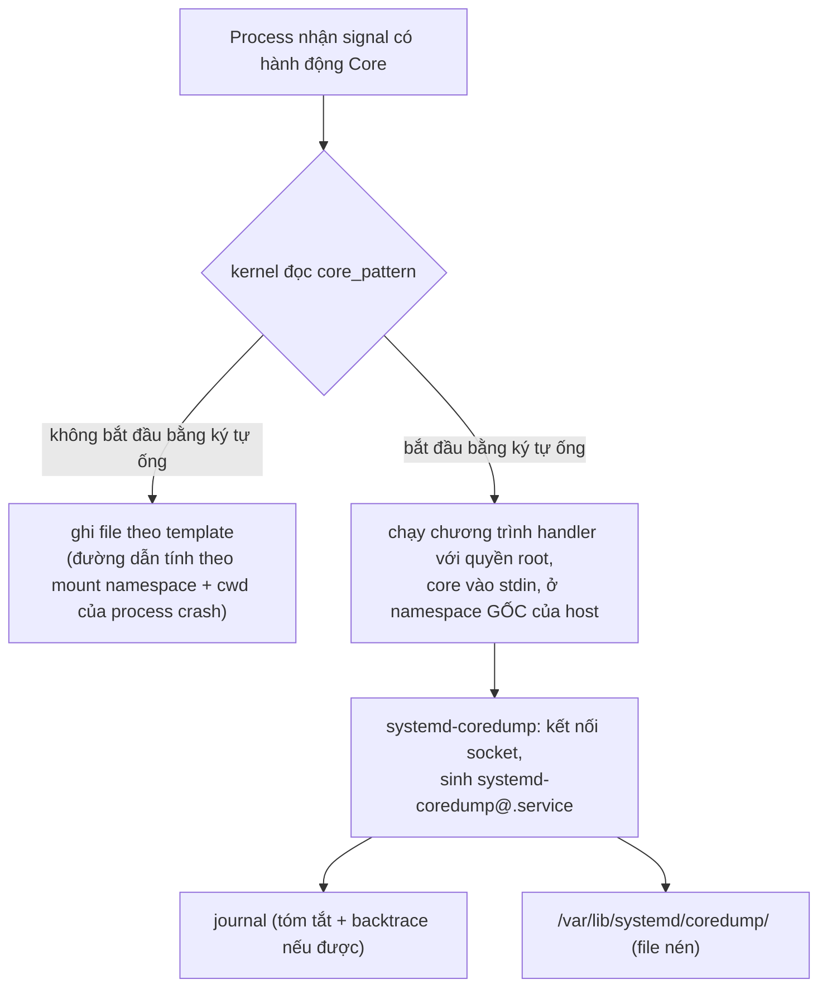

# P11 · Chương 05 — Core dump, crash và backtrace

> Phạm vi: **Linux** (man-pages 6.03 và systemd 252 của Debian bookworm; kernel docs) và **Rust 1.95.0** (std docs + source tag `1.95.0`). Chương này **không có thí nghiệm chạy thật**: lệnh shell và đoạn code chỉ để minh họa, không kèm output; chỗ nào là suy luận của người soạn đều ghi rõ. Tài liệu gdb lấy từ trang online hiện hành của dự án (không ghim số phiên bản) nên chỉ dùng cho khái niệm ổn định như `bt`, `thread apply`.

## Bạn sẽ hiểu được gì

1. **Q1.** Signal nào làm process chết kèm core dump, và core dump là gì? → mục 1
2. **Q2.** Process crash mà không thấy file core: có những lý do nào, `RLIMIT_CORE` đứng ở đâu? → mục 2
3. **Q3.** `core_pattern` quyết định core đi đâu; pipe sang `systemd-coredump` hoạt động ra sao; chuyện gì xảy ra trong container? → mục 3
4. **Q4.** Trong core có gì (`coredump_filter`), và đọc nó bằng gdb ở mức khái niệm như thế nào? → mục 4
5. **Q5.** Rust `panic!` khác "crash" ở điểm nào; `panic = "abort"` và `process::abort` liên quan thế nào đến core? → mục 5
6. **Q6.** `RUST_BACKTRACE`, `std::backtrace::Backtrace` và panic hook hoạt động ra sao? → mục 6
7. **Q7.** Stack overflow trong Rust xảy ra thế nào: guard page, SIGSEGV handler của std? → mục 7
8. **Q8.** Process treo hoặc deadlock không chết: làm sao lấy stack của mọi thread? → mục 8

## Kiến thức cần trước

- [Chương 05 — Signal (Phase 1)](../01-linux/05-signal.md): disposition, default action, signal đồng bộ do lỗi phần cứng so với signal gửi từ ngoài.
- [Chương 08 — Panic, unwinding, ABI và FFI (Phase 10)](../10-rust-internals/08-panic-abi-ffi.md): `panic = "unwind"` so với `"abort"`, `catch_unwind`, panic xuyên FFI.
- [Chương 04 — Debugger và DWARF](04-debugger-va-dwarf.md): symbol, debug info, đọc stack frame; chương này dùng lại để đọc core.
- [Chương 07 — Stack, alignment và padding (Phase 3)](../03-memory/07-stack-alignment-padding.md): mục 4 giải thích guard page và handler tràn stack của std; mục 7 của chương này chỉ bổ sung phía core dump.

## 1. Signal nào sinh core, và core dump là gì (Q1)

> **Trả lời ngắn.** Khi một process chết vì một số signal nhất định, kernel ghi ảnh bộ nhớ của nó lúc chết ra một file gọi là core dump[^core-default]. Danh sách các signal đó nằm trong `signal(7)`[^core-list]: `SIGSEGV`, `SIGABRT`, `SIGILL`, `SIGFPE`, `SIGBUS` và cả `SIGQUIT`. `SIGTERM` chỉ kết thúc process mà không để lại core[^sg-term]. `SIGKILL` cũng vậy[^sg-kill].

**Giải thích.**

*Với service của bạn.* Giả sử bạn vận hành `billing`, một service Rust xử lý thanh toán, chạy thành container trên một node Linux. Lúc 3 giờ sáng pod của `billing` khởi động lại và bạn phải tìm ra vì sao. Có hai khả năng: orchestrator tắt nó, hoặc nó tự chết vì lỗi. Chỉ khả năng thứ hai mới có thể để lại core, mà core lại là thứ giúp điều tra nhiều nhất. Ta sẽ bám theo `billing` suốt chương (nhận xét của người soạn: đây là ví dụ giả định, không phải code trong repo). Mục 1 xem signal nào sinh core; mục 2 và 3 hỏi core biến đi đâu; mục 4 đọc core; mục 5 đến 7 xét các lỗi của Rust (panic, backtrace, tràn stack) liên quan thế nào tới core; mục 8 xử lý lúc `billing` treo mà không chết.

### 1.1 Core dump là gì

Mỗi signal có một hành động mặc định. Với một nhóm signal, hành động đó là *Core*: kết thúc process rồi ghi core dump, tức một file chứa ảnh bộ nhớ của process tại lúc nó kết thúc[^core-default]. `signal(7)` định nghĩa hành động `Core` đúng như vậy[^sg-core-def]. Ảnh này mở được bằng debugger như gdb, để xem chương trình đang ở trạng thái nào khi chết[^core-debugger].

### 1.2 Những signal sinh core

Bảng dưới lấy từ bảng signal chuẩn của `signal(7)`, gồm các signal có hành động mặc định là `Core`:

| Signal | Ý nghĩa |
|---|---|
| `SIGABRT` | tín hiệu abort do `abort(3)` gửi[^sg-abrt] |
| `SIGBUS` | bus error, truy cập bộ nhớ sai[^sg-bus] |
| `SIGFPE` | lỗi dấu phẩy động / số học[^sg-fpe] |
| `SIGILL` | lệnh không hợp lệ[^sg-ill] |
| `SIGQUIT` | "quit" từ bàn phím[^sg-quit] |
| `SIGSEGV` | tham chiếu bộ nhớ không hợp lệ[^sg-segv] |
| `SIGSYS` | system call sai (xem `seccomp(2)`)[^sg-sys] |
| `SIGTRAP` | trace/breakpoint trap[^sg-trap] |
| `SIGXCPU` | vượt giới hạn CPU time[^sg-xcpu] |
| `SIGXFSZ` | vượt giới hạn kích thước file[^sg-xfsz] |

### 1.3 Signal đến từ đâu

Biết một signal đến từ đâu cho ta biết `billing` đã hỏng kiểu gì. `SIGSEGV`, `SIGFPE`, `SIGILL`, `SIGBUS` thường do chính lệnh máy đang chạy gây ra: CPU phát exception phần cứng, và signal được gửi đúng thread vừa chạy lệnh đó[^sig-thread-directed]. Với `billing`, đây là kiểu chết khi một thread dereference con trỏ sai trong code `unsafe`, hoặc trong thư viện C mà nó gọi qua FFI (nhận xét của người soạn). `SIGABRT` thì process tự gây ra khi gọi `abort(3)`[^sg-abrt]. `SIGQUIT` đến từ bên ngoài: thường là gõ Ctrl-\ trên terminal, `core(5)` có đúng ví dụ này[^core-example-quit], hoặc `kill -QUIT` (nhận xét của người soạn).

### 1.4 Khi nào chắc chắn không có core

`kill -TERM` và `kill -KILL` không để lại core, vì hành động mặc định của `SIGTERM` là `Term` chứ không phải `Core`[^sg-term]. `docker stop` rơi vào nhóm này: process chính nhận `SIGTERM`, hết thời gian chờ thì bị `SIGKILL`[^docker-stop]. OOM killer của cgroup cũng giết bằng `SIGKILL`: ở thí nghiệm `docker run --memory 20m`, process thoát với exit code 137 = 128 + 9 và `OOMKilled:true` (quan sát, xem [Chương 06 (Container), mục 9](../08-containers/06-runtime-oci.md); số đo trên cgroup ở [Chương 03 (Container), mục 4](../08-containers/03-cgroups-v2.md)). Vậy nếu pod `billing` restart với exit code 137, đừng mất công tìm core: nó không có (nhận xét của người soạn). Muốn có "ảnh chụp" của một process đang treo, bạn phải chủ động bắn `SIGQUIT` hoặc dùng `gcore` (mục 8).

<details><summary>Đi sâu: signal đồng bộ và kiến trúc CPU, ranh giới "core" với "exit code"</summary>

- Với lỗi phần cứng, man page cảnh báo rằng signal nào được giao *không được tài liệu hóa và không phải lúc nào cũng hợp lý*: một truy cập bộ nhớ sai có thể gây `SIGSEGV` trên kiến trúc này nhưng `SIGBUS` trên kiến trúc khác[^sig-bugs]. Đừng viết code giả định cứng một loại.
- Process thoát bình thường bằng `exit(code)`, kể cả mã khác 0, không phải "chết do signal" nên không ghi core: `core(5)` chỉ gắn core dump với hành động mặc định của *signal*[^core-default] (suy luận của người soạn: man page này không nêu cơ chế nào khác làm kernel tạo core).
- `core(5)` trỏ ngược sang `signal(7)` để lấy danh sách signal sinh core[^core-list]; hai trang man này viết ra để đọc song song.

</details>

**Quay lại Q1:** core dump là ảnh bộ nhớ process do kernel ghi khi process chết vì signal có hành động mặc định `Core` (`SIGSEGV`, `SIGABRT`, `SIGQUIT`, …); `SIGTERM`/`SIGKILL` không sinh core.

## 2. Crash mà không thấy core: các lý do thường gặp và RLIMIT_CORE (Q2)

> **Trả lời ngắn.** Kernel không ghi core trong khá nhiều trường hợp, và `core(5)` liệt kê rõ: không có quyền ghi vào thư mục đích, ổ đĩa đầy hoặc mount read-only, thư mục đích không tồn tại, binary không đọc được, hay giới hạn `RLIMIT_CORE` bằng 0[^core-notproduced]. `RLIMIT_CORE` là trần kích thước core của mỗi process: bằng 0 thì không tạo file, khác 0 mà core lớn hơn thì bị cắt bớt[^rl-core].

**Giải thích.**

*Với `billing`.* Pod `billing` vừa chết vì `SIGSEGV`, bạn lên node tìm file core và không thấy gì. Đừng đoán: các lý do nằm trong một danh sách ngắn, nên cứ kiểm lần lượt, bắt đầu từ cái hay gặp nhất là `RLIMIT_CORE`. Mục 3 sẽ xét trường hợp ngược lại, khi core có được ghi nhưng không nằm ở chỗ bạn tìm.

### 2.1 `RLIMIT_CORE`

Process đặt soft limit `RLIMIT_CORE` để chặn trên kích thước core file sẽ được tạo khi nó nhận signal sinh core[^core-rlimit]. Về ý nghĩa: đây là kích thước tối đa của core file tính bằng byte; bằng 0 thì không tạo file; khác 0 thì core lớn hơn bị cắt (truncate) xuống đúng mức đó[^rl-core]. Trong shell, giới hạn này đặt bằng lệnh `ulimit`: `core(5)` dẫn người đọc tới tài liệu về lệnh đó[^core-rlimit-fsize] (nhận xét của người soạn: trong bash, dạng thường dùng là `ulimit -c`).

### 2.2 Các lý do khác

Ngoài `RLIMIT_CORE`, `core(5)` liệt kê:

- Không có quyền ghi: thư mục đích không ghi được, hoặc file cùng tên đã tồn tại mà không ghi được hay không phải file thường[^core-perm]. Tên mặc định là `core` hoặc `core.pid`, nằm trong thư mục làm việc hiện tại của process[^core-default-name].
- Filesystem đích đầy, hết inode, mount read-only, hoặc user hết quota[^core-fs-full].
- Thư mục đích không tồn tại[^core-nodir].
- `RLIMIT_CORE` hoặc `RLIMIT_FSIZE` của process bằng 0[^core-rlimit-fsize].
- Binary đang chạy không có quyền đọc, một biện pháp bảo mật để core không làm lộ nội dung executable[^core-noread].
- Process chạy chương trình set-user-ID/set-group-ID thuộc sở hữu user (group) khác với real user (group) của process, hoặc chương trình có file capabilities[^core-suid].
- Kernel build không có `CONFIG_COREDUMP`[^core-nokernel].
- `core_pattern` rỗng và `core_uses_pid` bằng 0[^core-cp-empty].

### 2.3 Hai chỗ dễ nhầm khi vận hành

Chỗ nhầm thứ nhất: `RLIMIT_CORE` không phải lúc nào cũng có hiệu lực. Man page nói rõ nó bị *bỏ qua* nếu hệ thống cấu hình pipe core sang một chương trình[^core-rlimit-zero] (mục 3 giải thích cơ chế này). Vậy `ulimit -c 0` không tắt được core khi `core_pattern` bắt đầu bằng `|`; lúc đó chương trình handler tự quyết giữ core hay bỏ (suy luận của người soạn: vì kernel không còn áp giới hạn này).

Chỗ nhầm thứ hai: process do systemd khởi động nhận giới hạn từ directive `LimitCORE=` (xem `systemd.exec(5)`)[^sd-limitcore], nên `ulimit` trong shell của bạn không tự áp cho service (suy luận của người soạn). Lỗi vận hành kinh điển là chạy `ulimit -c unlimited` trong ssh session rồi kỳ vọng service systemd sinh core (nhận xét của người soạn).

<details><summary>Đi sâu: tên file, độ dài tối đa, biến thể theo phiên bản kernel</summary>

- Tên core có thể là `core`, `core.PID`, hoặc theo template của `/proc/sys/kernel/core_pattern`; kích thước tối đa của tên kết quả là 128 byte (64 byte trước Linux 2.6.19)[^core-pattern-len].
- Nếu `core_pattern` không chứa `%p` và `core_uses_pid` khác 0 thì `.PID` được nối vào tên core[^core-uses-pid].
- Core có thể bỏ sót một phần không gian địa chỉ nếu chương trình đã dùng `madvise(2)` với `MADV_DONTDUMP`[^core-dontdump]. Nhờ vậy những vùng nhớ khổng lồ không cần điều tra (cache, buffer) có thể loại khỏi core để tiết kiệm đĩa.
- Với `SIGXCPU`/`SIGXFSZ` (hai signal trong bảng ở mục 1), hành vi `Core` là của Linux 2.4 trở đi[^sig-xcpu-history]; một số hệ UNIX khác chỉ kết thúc process mà không dump[^sig-xcpu-other].

</details>

**Quay lại Q2:** thiếu core thường do `RLIMIT_CORE = 0`, không có quyền hoặc chỗ ghi, hoặc binary/chương trình thuộc diện bị cấm; kiểm lần lượt theo danh sách trong `core(5)`.

## 3. `core_pattern`: file, pipe, systemd-coredump và container (Q3)

> **Trả lời ngắn.** File `/proc/sys/kernel/core_pattern` chứa template đặt tên core[^core-pattern-default]. Nếu ký tự đầu của nó là `|` thì phần còn lại là dòng lệnh của một chương trình user-space mà kernel sẽ chạy[^core-pipe]. Khi đó kernel không ghi file nữa mà đưa core vào stdin của chương trình ấy[^core-pipe-stdin]. Trên máy dùng systemd, chương trình đó thường là `systemd-coredump`, nó ghi log vào journal và lưu core ở `/var/lib/systemd/coredump/`[^sd-default]. Với process trong container, handler vẫn chạy ở namespace gốc của host chứ không phải trong container[^core-pipe-ns].

**Giải thích.**

*Với `billing`.* `billing` chạy trong container và vừa crash. Câu hỏi "core đi đâu" không do container quyết định: `core_pattern` là cấu hình của cả kernel, mà container dùng chung kernel với host. Mục này đi từ cơ chế đơn giản nhất (ghi file), qua dạng pipe, tới `systemd-coredump`, rồi quay lại chuyện container.

### 3.1 Namespace, đủ dùng cho mục này

Namespace bọc một tài nguyên toàn cục của hệ thống trong một lớp trừu tượng, khiến process bên trong thấy như mình có bản riêng của tài nguyên đó[^ns-def]. Ở đây ta gặp hai loại: PID namespace (process có bộ số PID riêng) và mount namespace (cây thư mục riêng); đây là cách diễn giải của người soạn. "Namespace gốc" là namespace của chính host. Process của `billing` nằm trong các namespace riêng của container, còn host ở namespace gốc (nhận xét của người soạn).



(Sơ đồ là tổng hợp của người soạn từ các mục 3.2 đến 3.4.)

### 3.2 Ghi file theo template

Mặc định core tên `core`; file `/proc/sys/kernel/core_pattern` định nghĩa template để đặt tên, trong đó các `%` được thay bằng giá trị lúc sinh core[^core-pattern-default]. Kernel docs mô tả cùng ý: đây là pattern tên file core, với các chuỗi bắt đầu bằng `%` được thay bằng giá trị thật[^ksys-pattern]. Vài specifier hay dùng theo `core(5)`:

- `%p`: PID trong PID namespace nơi process cư trú[^core-pct-p-local].
- `%P`: PID trong PID namespace *gốc*[^core-pct-p].
- `%e`: tên chương trình (`comm`, cắt tối đa 15 ký tự)[^core-pct-e].

Khi template là đường dẫn, đường dẫn được hiểu theo thiết lập của *process bị crash*: mount namespace, thư mục làm việc và root directory của nó[^core-pattern-paths]. Nghĩa là với `billing`, file core nằm trong filesystem của container (suy luận của người soạn).

### 3.3 Dạng pipe

Dạng pipe chạy một chương trình thay vì ghi file. Kernel docs xác nhận cùng ý với `core(5)`: core được ghi vào stdin của chương trình đó thay vì ghi ra file[^ksys-pipe]. Mấy điểm của `core(5)` cần nhớ:

- Chương trình phải được chỉ định bằng đường dẫn tuyệt đối, ngay sau ký tự `|`[^core-pipe-abs].
- Chương trình chạy với user và group `root`[^core-pipe-root].
- Chương trình chạy trong các namespace *gốc* (PID, mount, user…), không phải namespace của process crash[^core-pipe-ns]. Đường dẫn chương trình cũng được hiểu theo mount namespace gốc[^core-pipe-mntns].
- Vì thế handler dùng specifier `%P` (PID toàn cục) để tìm đúng thư mục `/proc/<pid>` và, nếu cần, "chui vào" namespace của process crash[^core-pipe-p].
- `RLIMIT_CORE` *không* được áp dụng cho core đi qua pipe[^core-pipe-rlimit].

### 3.4 `systemd-coredump`

Trên máy dùng systemd, `core(5)` mô tả rằng core có thể được đặt ở vị trí do systemd quyết định[^core-systemd]. Bạn kiểm bằng cách xem `core_pattern` có trỏ tới chương trình `systemd-coredump(8)` không[^core-systemd-check]. Nếu có, core thường nằm ở `/var/lib/systemd/coredump/`, dưới dạng file nén lz4[^core-systemd-loc]. Lệnh `coredumpctl` liệt kê được những core đã ghi[^core-coredumpctl]. Man page của `systemd-coredump` mô tả thêm:

- Nó là service xử lý core: ghi tóm tắt vào journal (PID, chủ sở hữu, signal đã giết process, stack trace nếu lấy được) và có thể lưu core để xử lý sau[^sd-svc]. Journal ở đây là nhật ký do `systemd-journald` quản lý.
- Mặc định nó ghi log vào journal kèm backtrace nếu được, và lưu core thành file ngoài trong `/var/lib/systemd/coredump`[^sd-default]. Các core này mặc định bị xóa sau vài ngày[^sd-tmpfiles].
- Nó phải được cấu hình trong sysctl `kernel.core_pattern` thì kernel mới dùng nó làm handler[^sd-pattern] (sysctl là tham số cấu hình kernel, đọc/ghi qua `/proc/sys`; giải thích của người soạn). systemd cài file `/usr/lib/sysctl.d/50-coredump.conf` để đặt giá trị đó[^sd-50].
- Nó được gọi *hai lần*: một lần làm handler của kernel, lần hai trong `systemd-coredump@.service` để ghi journal và lưu file[^sd-twice]. Khi kernel gọi, nó chạy ở chế độ đặc quyền, kết nối vào socket của `systemd-coredump.socket`, và socket này sinh một instance `systemd-coredump@.service` không đặc quyền để xử lý core[^sd-socket].
- Core chỉ được xử lý khi các giới hạn tài nguyên liên quan đủ lớn[^sd-limits].

### 3.5 Trong container

Đây là chỗ hay gây hiểu nhầm. `core_pattern` là một sysctl của kernel: kernel docs liệt kê nó dưới `/proc/sys/kernel`[^ksys-pattern]. Còn container là một process bị cô lập, các container chạy chung một kernel với nhau[^docker-shared-kernel]. Trong source kernel v6.1 (chi tiết cài đặt, kernel khác có thể đổi), `core_pattern` là một mảng `static char` toàn cục duy nhất trong `fs/coredump.c`[^kern-cp-array]. Mảng đó đăng ký dưới `/proc/sys/kernel`[^kern-cp-reg]. Nó không phải dữ liệu theo từng namespace, nên suy ra cả máy chỉ có *một* giá trị `core_pattern`, không phải mỗi container một giá trị (suy luận của người soạn từ source đó). Hệ quả cho `billing`:

- Nếu pattern là pipe, handler chạy ở namespace gốc của host với quyền root[^core-pipe-ns]. Core của `billing` được trao cho handler *của host*, không phải cho thứ gì trong container.
- Nếu pattern là đường dẫn file, nó được hiểu theo mount namespace của process crash[^core-pattern-paths]. File core nằm trong filesystem *của container*, và (suy luận của người soạn) sẽ biến mất cùng container nếu bạn không gắn volume.
- Trong cả hai trường hợp, `%p` là PID bên trong container còn `%P` là PID ở host[^core-pct-p]. Handler ở host cần `%P` để đọc `/proc/<pid>`[^core-pipe-p].
- `RLIMIT_CORE` là giới hạn của từng process: `core(5)` nói process tự đặt được soft limit của mình[^core-rlimit]. Vì vậy với container ta đặt nó qua `docker run --ulimit core=…` (suy luận của người soạn). Docker giải thích rằng đặt ulimit bên trong container cần đặc quyền mà container mặc định không có, nên dùng cờ `--ulimit`[^docker-ulimit]; `core` là tùy chọn ứng với `RLIMIT_CORE`[^docker-core]. Nếu không đặt, giá trị được kế thừa từ mặc định của daemon[^docker-inherit]. Nhưng nhớ rằng nếu pattern là pipe thì `RLIMIT_CORE` bị bỏ qua[^core-pipe-rlimit].

Trên Kubernetes, `core_pattern` thuộc về *node*: người vận hành cluster phải chủ động cấu hình node, pod thường không tự đổi được (nhận xét của người soạn, kinh nghiệm chứ không có chú thích nguồn trong chương).

<details><summary>Đi sâu: coredump.conf, core_pipe_limit, thay đổi qua phiên bản kernel</summary>

- Hành vi của `systemd-coredump` cấu hình qua `/etc/systemd/coredump.conf` và drop-in `coredump.conf.d/*.conf`. Mỗi core mới sinh ra một instance mới, nên thay đổi có hiệu lực từ core kế tiếp[^sd-conf-reload].
- Có dùng `systemd-coredump` hay không do `kernel.core_pattern` quyết định, không do `coredump.conf`[^cdconf-who].
- `Storage=` chọn nơi lưu, nhưng để *lấy stack trace* thì core phải được ghi xuống đĩa trước[^cdconf-disk]. Vì vậy, trừ khi `ProcessSizeMax=0`, core vẫn đi qua `/var/lib/systemd/coredump/` dù `Storage=` là gì (suy luận của người soạn từ nguồn đó). `ProcessSizeMax=` là trần kích thước core được xử lý: core lớn hơn có thể được lưu nhưng không sinh stack trace[^cdconf-procmax]. Đặt `Storage=none` và `ProcessSizeMax=0` thì tắt mọi xử lý core, trừ một dòng log[^cdconf-off].
- `core_pipe_limit` (kernel 2.6.32): khi pipe core sang user-space, kernel phải chờ handler thoát để không xóa `/proc/<pid>` của process crash quá sớm[^core-pipe-wait]. Do đó một handler hỏng, không bao giờ thoát, có thể chặn việc thu dọn process chết[^core-pipe-block]. Giá trị `core_pipe_limit` là số process crash đồng thời được pipe[^core-pipelimit]. Giá trị 0 là đặc biệt: không giới hạn số lượng song song nhưng kernel *không chờ*[^core-pipe-zero], nên handler không được bảo đảm đọc được `/proc/<pid>` (suy luận của người soạn).
- Từ Linux 5.3, template pipe được tách thành argv theo khoảng trắng *trước* khi thay specifier[^core-pipe-split]. Trước đó kernel thay trước rồi mới tách, nên `%e`/`%E` có chứa dấu cách bị tách nhầm thành nhiều đối số (suy luận của người soạn từ chữ "trước khi").
- Từ Linux 3.6, nếu `/proc/sys/fs/suid_dumpable` là 2 ("suidsafe") thì pattern phải là đường dẫn tuyệt đối hoặc pipe[^core-suidsafe].

</details>

**Quay lại Q3:** `core_pattern` là một giá trị của cả kernel: dạng file thì ghi theo namespace của process crash, dạng `|handler` (như `systemd-coredump`) thì handler chạy ở host với quyền root và nhận core qua stdin; container không có `core_pattern` riêng.

## 4. Trong core có gì, `coredump_filter` và đọc core bằng gdb (Q4)

> **Trả lời ngắn.** Core không nhất thiết chứa toàn bộ bộ nhớ: file `/proc/<pid>/coredump_filter` là một bitmask chọn loại vùng nhớ nào được ghi (anonymous, file-backed, ELF header, huge page…)[^cf-mask]. Để đọc core, đưa cho gdb *cả* file thực thi lẫn core (`gdb program core`)[^gdb-prog-core]. Rồi dùng `bt` để xem stack, `thread apply all bt` để xem mọi thread[^gdb-bt-all]. Muốn có tên hàm, dòng code và biến thì cần symbol/debug info khớp với binary (nhận xét của người soạn; xem [chương 04](04-debugger-va-dwarf.md)).

**Giải thích.**

*Với `billing`.* Giả sử `billing` giữ vài GB cache trong heap. Ghi hết vào core thì file rất to và chậm, nên kernel cho bạn chọn loại vùng nhớ nào đáng ghi. Sau khi có core, việc còn lại là mở nó lên và đọc stack của các thread xem `billing` chết ở đâu.

### 4.1 `coredump_filter`

Từ Linux 2.6.23, file `/proc/<pid>/coredump_filter` điều khiển những vùng nhớ nào được ghi khi process bị dump[^cf-def]. Giá trị là một bitmask theo loại mapping (xem `mmap(2)`): bit nào bật thì loại mapping đó được dump, ngược lại thì không[^cf-mask]. Bốn bit đầu là bit 0 anonymous private, bit 1 anonymous shared, bit 2 file-backed private và bit 3 file-backed shared[^cf-bits]. Ngoài ra bit 4 là ELF header, bit 5 và 6 là huge page private và shared[^cf-bits2]. Mặc định các bit 0, 1, 4 (nếu kernel bật `CONFIG_CORE_DUMP_DEFAULT_ELF_HEADERS`) và 5 được đặt[^cf-default]. Giá trị hiển thị dạng hex nên mặc định là `33`[^cf-hex].

Một ghi chú nhỏ về cách chọn bit (suy luận của người soạn): vùng file-backed phần lớn là code của binary và thư viện, vốn đã có trên đĩa, còn heap và stack là anonymous private, dữ liệu duy nhất của process. Vì thế mặc định ưu tiên bật nhóm anonymous.

Hai điều cần nhớ thêm:

- Vùng I/O ánh xạ bộ nhớ như frame buffer không bao giờ được dump; trang vDSO luôn được dump, bất kể filter[^cf-mmio]. (vDSO là thư viện nhỏ mà kernel tự ánh xạ vào mọi process user-space[^vdso-def].)
- Con của `fork` thừa hưởng filter của cha, và giá trị giữ nguyên qua `execve`[^cf-inherit]. Vì vậy có thể đặt filter ở shell cha trước khi chạy chương trình[^cf-shell].

Với `billing` có heap vài chục GB, chọn filter bỏ bớt vài loại vùng nhớ sẽ làm core nhỏ đi nhiều, nhưng cũng làm mất dữ liệu có thể cần để điều tra: đó là đánh đổi giữa tốc độ/đĩa và thông tin (suy luận của người soạn).

### 4.2 Lấy core của process đang chạy

Lệnh `gcore` của gdb tạo core cho một process đang chạy[^core-gcore]. gdb mô tả nó là tạo core dump của *inferior process*[^gdb-gcore], với inferior là cách gdb gọi chương trình đang được gỡ lỗi (giải thích của người soạn). Mục 8 dùng lệnh này cho trường hợp process treo.

### 4.3 Đọc core bằng gdb

gdb định nghĩa core file là file ghi lại memory image và process status (giá trị thanh ghi…) của process[^gdb-core-def]. Công dụng chính là gỡ lỗi *post-mortem* một chương trình đã crash khi chạy ngoài debugger[^gdb-postmortem]. Để mở, chạy `gdb program core`, tức khởi động gdb với cả file thực thi lẫn core[^gdb-prog-core]. Cần cả hai vì core thường chỉ chứa *một số phần* của không gian địa chỉ, còn phần khác gdb đọc từ chính file thực thi[^gdb-corefile]. Suy ra (suy luận của người soạn) file thực thi bạn đưa cho gdb phải *đúng* bản đã crash, kể cả các shared library; nếu lệch phiên bản thì backtrace sai hoặc mất tên hàm.

Các lệnh cơ bản (không có output ở đây, chỉ nêu ý):

- `bt` (hay `backtrace`): in một dòng cho mỗi frame, bắt đầu từ frame hiện tại (frame 0) rồi tới caller của nó[^gdb-bt-def].
- `thread apply all bt`: gdb mặc định chỉ in backtrace của *thread hiện tại*; muốn xem mọi thread thì dùng `thread apply`, và đây là lệnh "tiện khi bạn debug core dump của chương trình đa luồng"[^gdb-bt-all].
- `thread apply` áp một lệnh cho một hay nhiều thread; `all` là mọi thread[^gdb-tapply].

Nếu core do `systemd-coredump` giữ, `coredumpctl` giúp bạn khỏi phải tự tìm file: các verb `list` và `debug` liệt kê và mở core trong gdb[^sd-debug-verb]. Còn `coredumpctl dump` rút core ra một file chỉ định[^core-dump-verb].

<details><summary>Đi sâu: bit còn lại của filter, DAX, vai trò symbol, core của Rust</summary>

- Bit 7 và 8 (từ Linux 4.4) là DAX private/shared; bit 4 (từ 2.6.24) là ELF headers; bit 5/6 (từ 2.6.28) là huge page[^cf-bits2].
- File `coredump_filter` chỉ tồn tại nếu kernel được build với `CONFIG_ELF_CORE`[^cf-config].
- Có core mà không có symbol thì backtrace chỉ là một dãy địa chỉ. Với Rust, backtrace có tên file/số dòng đòi hỏi binary build kèm debug info[^bt-debuginfo]; đó cũng là điều kiện để gdb hiện dòng code khi đọc core (suy luận của người soạn: debug info nằm trong binary, không nằm trong core).
- Chi tiết symbol, DWARF, backtrace bằng CFI và debug info tách file: xem [chương 04](04-debugger-va-dwarf.md) (mục 4–7).

</details>

**Quay lại Q4:** `coredump_filter` chọn loại vùng nhớ vào core; `gdb program core` ghép core với file thực thi, `bt` xem stack, `thread apply all bt` xem mọi thread.

## 5. `panic!` không phải "crash": panic, abort và core (Q5)

> **Trả lời ngắn.** `panic!` là một đường chạy *có kiểm soát*: thread panic unwind stack và chạy destructor[^rs-thread-panic]. Nếu main thread panic mà không bắt thì chương trình thoát với mã khác 0[^rs-thread-uncaught]. Source std dùng mã 101[^rs-main-exit]. Đó là exit code chứ không phải signal, nên theo `core(5)` không có core (suy luận của người soạn)[^core-default]. Core chỉ xuất hiện khi process chết vì signal `Core`, chẳng hạn `SIGSEGV` do lỗi bộ nhớ, hoặc `SIGABRT` do `std::process::abort`[^rs-abort-sig]. Với `panic = "abort"`, panic cũng đi tới `process::abort` trong source 1.95.0 (chi tiết cài đặt)[^rt-rust-abort].

**Giải thích.**

*Với `billing`.* Hai kiểu lỗi cho `billing` trông giống nhau từ bên ngoài, vì pod nào cũng "chết", nhưng khác nhau ở chỗ có để lại core hay không. Một worker parse một giao dịch lạ rồi `unwrap()` trên `None` là panic. Một thread dereference con trỏ sai trong code FFI là `SIGSEGV`. Mục này vạch ranh giới giữa hai kiểu đó, rồi chỉ ra khi nào Rust tự biến panic thành `SIGABRT` để có core.

### 5.1 Panic mặc định: exit code, không core

Lỗi logic nghiêm trọng khiến thread panic. Thread đó unwind stack, chạy destructor và giải phóng tài nguyên nó sở hữu[^rs-thread-panic]. Nếu panic không bị bắt thì thread kết thúc, và thread khác phát hiện được qua `join`. Với main thread, panic không bắt thì ứng dụng thoát với exit code khác 0[^rs-thread-uncaught]. Trong source runtime của std, đoạn bọc `main` trả về mã `101` cho chương trình panic[^rs-main-exit].

Điều này quan trọng với vận hành (nhận xét của người soạn): panic ở *thread phụ* không giết process. Process vẫn chạy, chỉ thread đó chết. Nhiều server bị "chết một nửa" vì worker panic mà không ai `join`.

101 là exit code, không phải signal. Theo `core(5)`, core gắn với hành động mặc định của signal[^core-default], nên panic thường (unwind) tự nó không để lại core (suy luận của người soạn từ định nghĩa đó). Cơ chế unwind chi tiết nằm ở [chương P10·08](../10-rust-internals/08-panic-abi-ffi.md).

### 5.2 `panic = "abort"` và `process::abort`: đường tới core

Cargo profile có thiết lập `panic` để chọn chiến lược: `"abort"` là kết thúc process khi panic, `"unwind"` là unwind stack[^cargo-panic]. `process::abort()` kết thúc process theo kiểu bất thường[^rs-abort-fn]. Không destructor nào chạy và buffer I/O của Rust không được flush[^rs-abort-nodtor]. Trên Unix, process chết bằng signal `SIGABRT`[^rs-abort-sig].

Còn `panic = "abort"` thì sao? Source 1.95.0 cho thấy panic runtime `panic_abort` gọi `__rust_abort()`[^pabort-start]. Hàm này std định nghĩa là `process::abort()`[^rt-rust-abort] (chi tiết cài đặt, có thể đổi giữa các phiên bản). Phía libc, `abort()` mở chặn `SIGABRT` rồi tự raise signal đó[^abort3]. `SIGABRT` có hành động mặc định `Core`[^sg-abrt]. Ghép lại: nếu bạn không đổi *disposition* của `SIGABRT` (cách process xử lý signal đó: mặc định, bỏ qua hay chạy handler; xem chương Signal ở phần kiến thức cần trước) thì process chết vì `abort` sinh core. Đây là chuỗi suy luận từ các nguồn trên; core thật có xuất hiện hay không còn tùy mục 2 và mục 3.

Với `panic = "abort"`, `panic!` vẫn gọi panic hook *trước* khi abort, còn `process::abort` thì không gọi hook[^rs-abort-vs-panic]. Hook chạy được ở cả hai runtime, unwind lẫn abort[^hook-reg]. Ngoại lệ là `-C panic=immediate-abort` của rustc: nó kết thúc process mà không gọi panic hook nào[^rustc-panic-flag] (xem [Chương 08 (Rust internals), mục 2](../10-rust-internals/08-panic-abi-ffi.md)).

Vì sao `panic = "abort"` hữu ích cho điều tra (suy luận của người soạn)? Vì không unwind, nên ngay lúc abort stack của thread panic vẫn còn nguyên các frame cha. Core khi đó chứa stack tại *điểm panic*, và `bt` trong gdb cho thấy đường gọi dẫn tới panic. Với unwind, stack đã bị tháo dần trước khi (nếu có gì đó) dừng process. Với `billing`, đổi sang `panic = "abort"` là cách để mỗi lần worker panic thì pod chết kèm một core có stack ngay tại chỗ lỗi, đổi lại là mất khả năng worker panic mà process vẫn sống.

### 5.3 Khi std tự abort

Std tự chuyển sang abort trong hai trường hợp, kể cả khi bạn dùng `panic = "unwind"`. Trường hợp thứ nhất là panic xảy ra *trong* panic hook. Lúc đó source không cố định dạng thông báo, vì chính việc đó có thể là nguyên nhân gây panic lồng nhau[^rs-panic-in-hook]. Nó chỉ in "thread panicked while processing panic. aborting."[^rs-hook-abort-msg] rồi gọi `process::abort`. Trường hợp thứ hai là panic khi không thể unwind tiếp. Source nêu hai ví dụ: panic trong lúc chạy destructor, hoặc unwind qua một hàm không cho unwind như `extern "C"`[^rs-nounwind-why]. Khi đó nó in "thread caused non-unwinding panic. aborting."[^rs-nonunwind] rồi abort. Cả hai trường hợp kết thúc bằng `process::abort`, tức `SIGABRT`, tức có thể có core.

<details><summary>Đi sâu: cargo profile, hook với abort, tests</summary>

- `Cargo.toml` `[profile.*] panic = "abort"` hoặc `-C panic=abort`; tests, benchmarks, build scripts và proc macro bỏ qua thiết lập này. Nguồn và chi tiết ở [Chương 08 (Rust internals), mục 2](../10-rust-internals/08-panic-abi-ffi.md).
- Source `std::panicking`: thứ tự là tăng bộ đếm panic, gọi hook, rồi chuyển cho panic runtime để abort hoặc unwind; bộ đếm panic dùng để phát hiện panic lồng nhau[^rs-hook-then-runtime].
- Runtime của std có macro nội bộ `rtabort!`: in "fatal runtime error: …, aborting" rồi gọi `crate::process::abort()`. Đây là đường dùng cho lỗi runtime không phục hồi được, như tràn stack ở mục 7[^rt-rtabort]. (Đường `panic = "abort"` đi qua `__rust_abort`, xem trên.)

</details>

**Quay lại Q5:** panic thường là thoát có trật tự (exit code, không core); core đến từ signal `Core`, và `panic = "abort"`/`process::abort` đi qua `SIGABRT` nên là cách chủ động tạo core có stack ngay tại điểm lỗi.

## 6. `RUST_BACKTRACE`, `Backtrace` và panic hook (Q6)

> **Trả lời ngắn.** Khi panic, hook mặc định in thông báo ra stderr và sinh backtrace nếu được yêu cầu[^hook-default]. Đặt `RUST_BACKTRACE=1` thì được bản ngắn, `full` thì được bản đầy đủ[^bt-style-1]. Đặt `0` thì tắt[^bt-style-0]. Trong code, `std::backtrace::Backtrace::capture()` chỉ chụp khi biến môi trường bật[^bt-capture-noop]. Còn `force_capture()` chụp bất kể biến môi trường[^bt-force]. Muốn thay hook mặc định, bạn gọi `panic::set_hook`[^hook-reg].

**Giải thích.**

*Với `billing`.* Một worker của `billing` panic lúc 3 giờ sáng, và log chỉ là một dòng trên stderr. Để biết đường gọi nào dẫn tới panic, bạn cần backtrace: danh sách các hàm đang gọi nhau tại thời điểm chụp, từ hàm hiện tại lên tới hàm gọi nó (giải thích của người soạn). Để backtrace đó vào hệ thống log tập trung thay vì chỉ ở stderr, bạn cần đổi panic hook. Mục này đi qua cả hai.

### 6.1 `RUST_BACKTRACE` cho panic mặc định

Hook mặc định được đăng ký khi khởi động. Nó in thông báo ra stderr và sinh backtrace nếu được yêu cầu[^hook-default]. Quy tắc đọc `RUST_BACKTRACE` lấy từ docs của `get_backtrace_style`, một API nightly nhưng là chỗ std ghi quy tắc này:

- `0`: tắt (`Off`)[^bt-style-0].
- `1`: ngắn (`Short`)[^bt-style-1].
- `full`: đầy đủ (`Full`)[^bt-style-full].
- Giá trị khác: hiện cũng là ngắn, nhưng có thể đổi trong tương lai[^bt-style-other].

Biến chỉ được đọc ở lần dùng đầu, sau đó đổi biến môi trường không còn tác dụng[^bt-style-cache]. Khi biến chưa đặt và backtrace tắt, hook mặc định in một dòng gợi ý chạy lại với `RUST_BACKTRACE=1`[^rs-note-run-with]. Hook mặc định cũng ép in backtrace đầy đủ khi gặp panic thứ hai (double panic)[^rs-double-panic].

### 6.2 API `Backtrace`

`Backtrace::capture` tôn trọng `RUST_LIB_BACKTRACE`, và nếu biến này chưa đặt thì dùng `RUST_BACKTRACE`[^bt-lib]. Nó cache trạng thái từ lần chụp đầu[^bt-cache]. `force_capture` thì bỏ qua cả hai biến và luôn chụp[^bt-force]. Quy tắc đọc biến, `Backtrace::status()` và việc gắn backtrace vào error nằm ở [Chương 05 (Rust), mục 6](../09-rust-language/05-error-handling.md). Mục đích điển hình là gắn backtrace vào error (kiểu implement `std::error::Error`) để biết lỗi sinh ra ở đâu[^bt-errors].

Có hai giới hạn cần biết. Thứ nhất, tên file và số dòng, với đa số platform, đòi hỏi build kèm debug info; không có thì không báo được[^bt-debuginfo]. Thứ hai, std nói rõ là *không bảo đảm độ chính xác* của backtrace: địa chỉ lệnh, tên symbol, tên file, số dòng đều có thể sai[^bt-accuracy].

### 6.3 Panic hook

`panic::set_hook` đăng ký hook tùy biến thay thế hook trước đó. Hook được gọi khi thread panic, *trước* khi panic runtime chạy[^hook-reg]. Hook là tài nguyên toàn cục[^hook-global]. Gọi `set_hook` từ một thread đang panic thì bản thân nó panic[^hook-panics]. `take_hook` gỡ hook hiện tại, trả nó về và đăng ký lại hook mặc định[^take-hook]. Hook nhận `PanicHookInfo`, chứa payload và vị trí nguồn của panic[^hook-info]; `location()` trả về vị trí phát sinh panic nếu có[^phi-location].

Đoạn dưới là mẫu cho `billing` (ví dụ minh họa, không kèm output): giữ hook cũ để vẫn in thông báo mặc định, và thêm một bản backtrace vào log của bạn.

```rust
use std::backtrace::Backtrace;
use std::panic;

fn install_hook() {
    let default_hook = panic::take_hook();
    panic::set_hook(Box::new(move |info| {
        // chụp bất kể RUST_BACKTRACE; hook chạy trên thread đang panic
        let bt = Backtrace::force_capture();
        eprintln!("PANIC: {info}\n{bt}");
        default_hook(info); // vẫn gọi hook mặc định
    }));
}
```

`take_hook` rồi `set_hook` đúng như docs mô tả: lấy hook mặc định ra rồi đăng ký hook mới[^take-hook]. Việc gọi lại `default_hook(info)` là mẫu quen thuộc, không phải hợp đồng của std (nhận xét của người soạn). Và đừng quên mục 5: panic *bên trong* hook làm process abort[^rs-panic-in-hook].

<details><summary>Đi sâu: hook trong source, payload, style Short/Full</summary>

- `panic_with_hook` tăng bộ đếm panic. Nếu đã đang ở trong hook thì in thông báo rồi abort. Nếu cờ `always_abort` bật thì in "aborting due to panic" và abort, không in backtrace vì tạo `Backtrace` sẽ cấp phát bộ nhớ, điều cần tránh ở đây[^rs-always-abort].
- `default_hook` chọn kiểu `Short` hoặc `Full` để in, qua `PrintFmt::Short`/`Full`[^rs-print-fmt].
- `PanicHookInfo::payload()` thường là `&'static str` hoặc `String`[^phi-payload]; `payload_as_str()` tiện hơn nếu chỉ quan tâm hai kiểu này.
- Backtrace *của panic* (chụp lúc hook chạy, từ stack còn nguyên) khác với backtrace *từ core* (chụp lúc process chết). Với panic bị bắt bởi `catch_unwind` thì không có core nào, nên backtrace trong log là nguồn duy nhất (nhận xét của người soạn, suy ra từ việc hook chạy trước panic runtime[^hook-reg]).

</details>

**Quay lại Q6:** `RUST_BACKTRACE=1`/`full` bật backtrace trong thông báo panic; `Backtrace::capture` tôn trọng biến môi trường còn `force_capture` thì không; `set_hook` cho bạn thay chỗ in/ghi panic.

## 7. Stack overflow trong Rust: guard page và SIGSEGV handler của std (Q7)

> **Trả lời ngắn.** Mỗi thread có stack hữu hạn, và kế bên nó là một *guard page*, trang bộ nhớ không cho đọc/ghi. Thread chạy lố stack vào vùng guard thì (trên phần lớn kiến trúc) nhận `SIGSEGV`[^pthr-guard-sigsegv]. Runtime của Rust cài một signal handler cho `SIGSEGV`/`SIGBUS`: nếu địa chỉ lỗi nằm trong vùng guard của thread, nó in thông báo "has overflowed its stack" rồi abort. Vì thế bạn thấy `SIGABRT` chứ không phải `SIGSEGV` thô[^so-misleading].

**Giải thích.**

*Với `billing`.* Giả sử một handler của `billing` parse JSON đệ quy, và một request độc hại lồng đối tượng sâu tới mức stack của thread hết chỗ. Chuyện gì xảy ra với thread, process và core? Mục này chỉ giữ phần liên quan tới core; cơ chế từng bước đã có ở chương Bộ nhớ.

*Cơ chế đã có ở chương Bộ nhớ.* Guard page (mức pthread và `mmap`), stack mặc định 2 MiB của thread Rust, từng bước handler của std (so địa chỉ lỗi với vùng guard, in "has overflowed its stack", `rtabort!`, alternate signal stack, trường hợp main thread trên Linux) và thí nghiệm tràn stack với exit 134 được trình bày đầy đủ, kèm source, ở [Chương 07 (Bộ nhớ), mục 4](../03-memory/07-stack-alignment-padding.md).

*Handler chỉ bắt tràn stack.* Handler của std chỉ cài cho `SIGSEGV` và `SIGBUS`[^so-signals]. Nó cũng chỉ cài khi disposition hiện tại còn là mặc định (`SIG_DFL`)[^so-dfl-check]. Vì vậy nếu chương trình, hay một thư viện C nạp vào, đã cài handler riêng thì std không đè lên (suy luận của người soạn từ điều kiện này). Khi handler chạy mà lỗi *không* phải tràn stack, nó tự gỡ đăng ký (đặt lại `SIG_DFL`) rồi trả về để signal gốc được giao lại[^so-notso]. Với `billing`, một `SIGSEGV` thật do con trỏ sai vẫn chết bằng `SIGSEGV` và vẫn sinh core bình thường.

*Quan hệ với core.* Khi nhận ra tràn stack, handler in thông báo rồi gọi abort[^so-abort]. Trên Unix kết cục đó là `SIGABRT`[^rs-abort-sig]. Hành động mặc định của `SIGABRT` là `Core`[^sg-abrt]. Suy luận của người soạn: core vì vậy chứa stack tại thời điểm `abort` *bên trong handler*, chạy trên alt stack. Stack của thread tràn vẫn nằm nguyên trong bộ nhớ, nên `thread apply all bt` thấy các frame đệ quy lặp lại rất nhiều lần.

<details><summary>Đi sâu: <code>panic=immediate-abort</code>, Windows, glibc guard area</summary>

- Khi build với `panic=immediate-abort` thì `stack_overflow::init` vẫn cài guard (vì tính an toàn bộ nhớ, *soundness*) nhưng *không* cài handler in thông báo; comment trong source ghi là chỉ thoát sớm và để người dùng thấy segfault[^so-immediate].
- Với từng thread, vùng guard được xác định qua `pthread_attr_getguardsize`; nếu guard size bằng 0 thì source `panic!("there is no guard page")`[^so-no-guard]. Ngoại lệ là Linux dùng musl, nơi source lấy kích thước một trang làm giá trị thay thế (comment: musl trước 1.1.19 luôn báo guard size bằng 0). Với glibc, comment ghi guard từng nằm *trong* stack, đã sửa từ glibc 2.27 (và trong một số bản backport của distro) nên nằm dưới stack; vì source không biết được ở runtime là trường hợp nào, nó chấp nhận lỗi ở vùng ngay trên hoặc ngay dưới đáy stack là tràn stack[^so-glibc-guard].
- Man page cảnh báo (BUGS, "as at glibc 2.8"): glibc NPTL tính guard area *trong* kích thước stack cấp, chứ không cấp thêm như POSIX yêu cầu[^pthr-guard-bug].
- Trên Windows std dùng vectored exception handler riêng cho stack overflow (`AddVectoredExceptionHandler`), không phải signal[^so-windows].

</details>

**Quay lại Q7:** tràn stack chạm guard page → `SIGSEGV`; handler của std nhận ra địa chỉ nằm trong guard, in "has overflowed its stack" rồi abort (`SIGABRT`), còn `SIGSEGV` khác thì được trả lại cho kernel xử lý như thường.

## 8. Process treo hoặc deadlock: đọc stack mọi thread (Q8)

> **Trả lời ngắn.** Process treo mà không chết thì không có core, nên bạn phải *tạo* core hoặc gắn debugger. Cách thứ nhất là `gcore` của gdb, lệnh tạo core cho process đang chạy[^core-gcore]. Cách thứ hai là bắn `SIGQUIT` (hành động mặc định `Core`) nếu process không bắt signal này[^sg-quit]. Sau đó dùng `thread apply all bt` trong gdb để xem stack của *tất cả* thread và tìm xem thread nào đang chờ gì[^gdb-bt-all].

**Giải thích.**

*Với `billing`.* `billing` không trả lời request nào, CPU gần 0%, nhưng process vẫn còn đó. Không signal nào giết nó nên không có core để đọc; bạn phải lấy một bản chụp trạng thái đang treo. Khi có bản chụp, câu hỏi còn lại là mỗi thread đang đứng ở đâu và đang chờ ai.

### 8.1 Bước 1: lấy "ảnh" của process đang treo

Có ba đường:

- `gcore` (lệnh trong gdb) tạo core cho process đang chạy[^core-gcore]; nó ghi `core.<pid>` nếu bạn không chỉ định tên[^gdb-gcore-name]. Tài liệu gdb ghi rằng lệnh này chỉ cài đặt cho một số hệ, trong đó có GNU/Linux[^gdb-gcore-os]. Lưu ý (nhận xét của người soạn): gdb phải gắn vào process nên process bị tạm dừng trong lúc gdb đọc bộ nhớ; trên production đây là chi phí cần cân nhắc, nhất là với heap lớn.
- `kill -QUIT <pid>`: `SIGQUIT` có hành động mặc định `Core`[^sg-quit]. Tức là kết thúc process và dump core[^sg-core-def]. `core(5)` có ví dụ gõ Ctrl-\ trên terminal để tạo core[^core-example-quit]. Điều kiện là chương trình không bắt hay ignore `SIGQUIT`, và mục 2–3 cho phép ghi core. Process sẽ *chết* sau đó, nên đây là lựa chọn tốn kém hơn `gcore` vì mất luôn process đang chạy (nhận xét của người soạn).
- Gắn thẳng vào process đang chạy bằng `gdb -p <pid>` (tài liệu gdb: truyền PID hoặc dùng `-p` để debug process đang chạy)[^gdb-attach].

### 8.2 Bước 2: xem mọi thread

gdb mặc định chỉ in backtrace của thread hiện tại. Muốn xem nhiều thread thì dùng `thread apply`: ví dụ `thread apply all backtrace` in backtrace của mọi thread, "tiện khi debug core dump của chương trình đa luồng"[^gdb-bt-all]. Cú pháp tổng quát là `thread apply [thread-id-list | all] command`, áp lệnh cho một hay nhiều thread[^gdb-tapply]. Với `all`, lệnh áp cho mọi thread[^gdb-tapply-all].

### 8.3 Bước 3: đọc kết quả

Đây là những mẫu hay gặp, rút từ kinh nghiệm của người soạn (không có output minh họa):

- Deadlock hai lock kinh điển: hai thread, mỗi thread đứng ở một lệnh "lock" (với Rust, `Mutex::lock` bên trong std) và giữ lock mà thread kia cần. Backtrace của hai thread này cho bạn thấy hai hàm của *bạn* đang chờ nhau.
- Một thread giữ lock rồi chờ thứ khác (I/O, channel) trong khi mọi thread còn lại chờ lock đó.
- Thread pool cạn: mọi worker đều đang chặn trong cùng một hàm, ví dụ gọi blocking trong một async runtime.

Với Rust còn một điều cần nhớ: khóa `Mutex` hai lần trong cùng thread đang giữ nó thì hành vi chính xác không được đặc tả, nhưng chắc chắn *không trả về* ở lần gọi thứ hai (có thể panic hoặc deadlock)[^mutex-deadlock]. Nghĩa là deadlock trong Rust an toàn là có thật, và `thread apply all bt` là cách tìm ra nó.

<details><summary>Đi sâu: gcore, <code>coredumpctl</code>, cảnh báo về kích thước</summary>

- Trên GNU/Linux, gdb có thể tính đến `/proc/pid/coredump_filter` khi `gcore`[^gdb-gcore-filter]. Tùy chọn `set use-coredump-filter` bật/tắt việc này[^gdb-usecf]. Vì vậy nội dung core do `gcore` tạo có thể phụ thuộc cấu hình gdb chứ không nhất thiết giống core mà kernel dump (suy luận của người soạn); xem tài liệu gdb nếu cần kiểm soát.
- gdb ghi *sparse core* nếu filesystem hỗ trợ[^gdb-sparse], có ích khi heap lớn (nhận xét của người soạn).
- Ngay cả khi production không có gdb: `systemd-coredump` (mục 3) lưu core và log backtrace vào journal "nếu lấy được" khi process *chết*[^sd-svc]. Còn process treo thì cần can thiệp chủ động như trên.

</details>

**Quay lại Q8:** process treo không tự sinh core; lấy bằng `gcore` hoặc `SIGQUIT`, rồi `thread apply all bt` để xem stack mọi thread và tìm chuỗi chờ nhau.

## Liên hệ với Rust

Tóm lại, những API và hành vi Rust đứng trên các cơ chế Linux của chương này, nhìn từ `billing`:

- **Panic** thoát bằng exit code (101 từ main thread), không bằng signal, nên không có core[^rs-main-exit]. Worker panic ở thread phụ không giết process[^rs-thread-uncaught].
- **`panic = "abort"` / `process::abort`** kết thúc bằng `SIGABRT` trên Unix, mà `SIGABRT` có hành động `Core`[^rs-abort-sig]. Source 1.95.0 cho thấy `panic = "abort"` đi tới `process::abort`[^rt-rust-abort].
- **Stack overflow**: `SIGSEGV` vào guard page, handler của std in "has overflowed its stack" rồi abort[^so-msg].
- **Backtrace**: `RUST_BACKTRACE` cho hook mặc định, `Backtrace::capture` cho code bạn; cần debug info để có file/dòng[^bt-debuginfo].
- **Hook** `set_hook`/`take_hook` là chỗ gắn log/giám sát, và hook chạy trước khi unwind hoặc abort[^hook-reg].

## Tóm tắt

- Core dump là ảnh bộ nhớ process do kernel ghi khi process chết vì signal có hành động mặc định `Core` (`SIGSEGV`, `SIGABRT`, `SIGQUIT`, …)[^sg-core-def]. `SIGTERM`/`SIGKILL` không sinh core[^sg-term].
- Không thấy core thường vì `RLIMIT_CORE = 0`, không có quyền/chỗ ghi, binary không đọc được, hoặc chương trình set-user-ID[^core-notproduced].
- `core_pattern` là một giá trị cho cả kernel: dạng file hoặc dạng `|handler`[^core-pipe]. Handler pipe chạy root ở namespace gốc[^core-pipe-ns]. `RLIMIT_CORE` không áp cho nó[^core-pipe-rlimit].
- `systemd-coredump` nhận core qua pipe, ghi journal và `/var/lib/systemd/coredump/`[^sd-default]. Core ở đó bị xóa sau vài ngày[^sd-tmpfiles]; dùng `coredumpctl list/debug/dump` để thao tác[^sd-debug-verb].
- Trong container: handler của host, `%P` cho PID ở host[^core-pct-p]. `--ulimit core` đặt `RLIMIT_CORE`[^docker-core].
- `/proc/<pid>/coredump_filter` chọn loại vùng nhớ vào core[^cf-mask]. Nó được kế thừa qua fork/exec[^cf-inherit].
- Đọc core: `gdb program core`, `bt`, `thread apply all bt`[^gdb-prog-core]. Cần file thực thi đúng bản đã crash[^gdb-corefile], và debug info để có tên file/dòng (suy luận của người soạn, xem chương 04).
- Panic thường không sinh core (suy luận từ `core(5)`). `process::abort` kết thúc bằng `SIGABRT` nên có thể sinh core[^rs-abort-sig]. `panic = "abort"` đi tới `process::abort` trong source 1.95.0[^rt-rust-abort].
- `RUST_BACKTRACE=0/1/full`[^bt-style-full]; `Backtrace::capture` theo biến môi trường, `force_capture` bỏ qua biến[^bt-force]; `set_hook` thay hook panic[^hook-reg].
- Tràn stack: guard page → `SIGSEGV` → handler std in thông báo và abort[^so-addr]. Process treo thì lấy core bằng `gcore`/`SIGQUIT`[^core-gcore]. Rồi xem mọi thread bằng `thread apply all bt`[^gdb-bt-all].

## Câu hỏi tự kiểm tra

1. Hãy kể ba signal có hành động mặc định sinh core và một signal mà `kill` luôn *không* sinh core. Vì sao `docker stop` quá hạn (bắn `SIGKILL`) không để lại core?
2. Chương trình của bạn `abort()` nhưng không có file `core` nào trong thư mục làm việc. Liệt kê ít nhất bốn nguyên nhân có thể, theo `core(5)`.
3. Đặt `ulimit -c 0` rồi crash, nhưng `systemd-coredump` vẫn lưu core. Giải thích bằng chi tiết nào của `core(5)`?
4. `core_pattern` bắt đầu bằng `|`. Handler chạy với quyền gì, ở namespace nào, nhận core ở đâu? `%p` và `%P` khác nhau ra sao và vì sao handler trên host cần `%P` cho process trong container?
5. Làm sao đặt `RLIMIT_CORE` cho một container? Vì sao với `core_pattern` dạng pipe việc đó có thể không có tác dụng như mong muốn?
6. `coredump_filter` mặc định là `33` hex. Giá trị này bật các bit nào, ý nghĩa mỗi bit, và giá trị được kế thừa như thế nào qua `fork`/`execve`?
7. Vì sao `gdb` cần cả file thực thi lẫn core? Lệnh nào xem backtrace của *mọi* thread trong một core?
8. `panic!` ở main thread thoát với mã nào, có sinh core không? Cần đổi gì để một lần panic kết thúc bằng `SIGABRT`?
9. Mô tả cách `RUST_BACKTRACE` và `RUST_LIB_BACKTRACE` tương tác với `Backtrace::capture` và `force_capture`. Biến môi trường có đổi lại được giữa chừng không?
10. Giải thích vì sao tràn stack ở thread Rust kết thúc bằng `SIGABRT` (kèm thông báo) chứ không phải `SIGSEGV` thô. Điều gì xảy ra nếu `SIGSEGV` đến từ con trỏ sai thay vì tràn stack?
11. Server của bạn treo, CPU 0%. Nêu hai cách thu stack mọi thread mà không cần restart sạch, và hai dấu hiệu trong backtrace gợi ý deadlock.

<details><summary>Đáp án</summary>

1. Ví dụ `SIGSEGV`[^sg-segv] và `SIGABRT`[^sg-abrt] đều có hành động mặc định `Core`. `SIGQUIT` cũng vậy[^sg-quit]. `SIGKILL` có hành động mặc định `Term` nên không sinh core[^sg-kill]. `SIGTERM` cũng vậy[^sg-term]. `docker stop` gửi `SIGTERM`, quá hạn mới `SIGKILL`[^docker-stop], nên không để lại core.
2. Ví dụ: `RLIMIT_CORE` bằng 0[^core-notproduced]. Thư mục đích không ghi được[^core-perm]. Thư mục đích không tồn tại[^core-nodir]. Filesystem đầy, read-only hoặc hết quota[^core-fs-full]. Binary không có quyền đọc[^core-noread]. Chương trình set-uid[^core-suid]. Hoặc `core_pattern` đã chuyển sang pipe nên core nằm chỗ khác[^core-pipe]. Chỗ đó là journal hay `/var/lib/systemd/coredump`[^sd-default].
3. `RLIMIT_CORE` bị bỏ qua nếu hệ thống pipe core sang một chương trình[^core-rlimit-zero]. Nó không được áp cho core qua pipe[^core-pipe-rlimit].
4. Quyền root[^core-pipe-root]; namespace gốc (PID, mount, user…)[^core-pipe-ns]; core vào stdin[^core-pipe-stdin]. `%p` là PID trong PID namespace của process còn `%P` là PID trong namespace gốc[^core-pct-p]. Handler ở host dùng `%P` để tìm `/proc/<pid>`[^core-pipe-p].
5. `docker run --ulimit core=…`[^docker-ulimit]; `core` là tùy chọn ứng với `RLIMIT_CORE`[^docker-core]. Nếu pattern là pipe thì `RLIMIT_CORE` không được áp[^core-pipe-rlimit].
6. Bit 0 (anonymous private) và bit 1 (anonymous shared)[^cf-bits]. Thêm bit 4 (ELF headers, nếu kernel bật tùy chọn tương ứng) và bit 5 (huge page private)[^cf-default]. Giá trị hiển thị hex là `33`[^cf-hex]. Con của `fork` thừa hưởng, và giá trị giữ qua `execve`[^cf-inherit].
7. Core thường chỉ chứa *một số phần* của không gian địa chỉ; gdb lấy phần còn lại từ file thực thi[^gdb-corefile]. Lệnh xem mọi thread là `thread apply all bt`[^gdb-bt-all].
8. Source std trả mã `101`[^rs-main-exit]; không có signal nên không sinh core (suy luận từ `core(5)`[^core-default]). Dùng `panic = "abort"`[^cargo-panic]. Hoặc gọi `process::abort`: process kết thúc bằng `SIGABRT`[^rs-abort-sig].
9. `RUST_LIB_BACKTRACE=0` thì `capture` không bao giờ chụp, giá trị khác thì bật[^bt-lib]. Biến này chưa đặt thì dùng `RUST_BACKTRACE`[^bt-fallback]; cả hai chưa đặt thì tắt[^bt-neither]. `force_capture` bỏ qua tất cả[^bt-force]. Trạng thái được cache từ lần chụp đầu, nên đổi giữa chừng có thể không có tác dụng[^bt-cache].
10. Handler của std bắt `SIGSEGV`/`SIGBUS`; thấy địa chỉ lỗi trong guard page thì in "has overflowed its stack" rồi abort[^so-addr]. Việc này tránh gợi ý sai rằng code unsafe đã truy cập con trỏ không hợp lệ[^so-misleading]. Nếu không phải tràn stack, handler gỡ đăng ký và trả về, nên signal gốc được giao lại và process chết bằng `SIGSEGV` như thường[^so-notso].
11. Dùng `gcore` hoặc `gdb -p`[^core-gcore]. Hoặc bắn `SIGQUIT`[^sg-quit]. Sau đó chạy `thread apply all bt`[^gdb-bt-all]. Dấu hiệu (nhận xét của người soạn): hai thread cùng đứng ở hàm lock mà mỗi thread giữ cái thread kia cần; hoặc mọi thread đứng cùng một chỗ chờ một lock bị một thread bận chờ thứ khác giữ. Chú ý std nói khóa lại `Mutex` trong cùng thread không trả về[^mutex-deadlock].

</details>

## Đọc thêm

- [`core(5)`](https://manpages.debian.org/bookworm/manpages/core.5.en.html): đọc toàn bộ để thấy đủ specifier `%`, `core_pipe_limit`, `coredump_filter`, ví dụ chương trình handler.
- [`signal(7)`](https://manpages.debian.org/bookworm/manpages/signal.7.en.html): bảng signal đầy đủ, thread-directed so với process-directed, thứ tự giao signal.
- [`systemd-coredump(8)`](https://manpages.debian.org/bookworm/systemd-coredump/systemd-coredump.8.en.html) và [`coredump.conf(5)`](https://manpages.debian.org/bookworm/systemd-coredump/coredump.conf.5.en.html): cấu hình lưu trữ, giới hạn, tắt xử lý core.
- [`std::backtrace`](https://doc.rust-lang.org/1.95.0/std/backtrace/index.html) và [`std::panic::set_hook`](https://doc.rust-lang.org/1.95.0/std/panic/fn.set_hook.html): API đã dùng trong chương.
- [Source `stack_overflow.rs` (tag 1.95.0)](https://raw.githubusercontent.com/rust-lang/rust/1.95.0/library/std/src/sys/pal/unix/stack_overflow.rs): handler SIGSEGV, alt stack, guard page theo từng platform.
- [Chương 04 — Debugger và DWARF](04-debugger-va-dwarf.md): symbol, DWARF, backtrace bằng CFI, debug info tách file; nền để gdb biến địa chỉ thành tên hàm và dòng code.
- [Phase 1 · Chương 05 — Signal](../01-linux/05-signal.md) và [P10·08 — Panic, unwinding, ABI và FFI](../10-rust-internals/08-panic-abi-ffi.md): nền tảng signal và cơ chế panic.

[^core-default]: core(5), DESCRIPTION — <https://manpages.debian.org/bookworm/manpages/core.5.en.html> — "The default action of certain signals is to cause a process to terminate and produce a core dump file, a file containing an image of the process's memory at the time of termination."
[^core-debugger]: core(5), DESCRIPTION — <https://manpages.debian.org/bookworm/manpages/core.5.en.html> — "This image can be used in a debugger (e.g., gdb(1)) to inspect the state of the program at the time that it terminated."
[^core-list]: core(5), DESCRIPTION — <https://manpages.debian.org/bookworm/manpages/core.5.en.html> — "A list of the signals which cause a process to dump core can be found in signal(7)."
[^core-rlimit]: core(5), DESCRIPTION — <https://manpages.debian.org/bookworm/manpages/core.5.en.html> — "A process can set its soft RLIMIT_CORE resource limit to place an upper limit on the size of the core dump file that will be produced"
[^core-notproduced]: core(5), DESCRIPTION — <https://manpages.debian.org/bookworm/manpages/core.5.en.html> — "There are various circumstances in which a core dump file is not produced:"
[^core-perm]: core(5), DESCRIPTION — <https://manpages.debian.org/bookworm/manpages/core.5.en.html> — "Writing the core file fails if the directory in which it is to be created is not writable"
[^core-default-name]: core(5), DESCRIPTION — <https://manpages.debian.org/bookworm/manpages/core.5.en.html> — "By default, the core file is called core or core.pid, where pid is the ID of the process that dumped core, and is created in the current working directory."
[^core-fs-full]: core(5), DESCRIPTION — <https://manpages.debian.org/bookworm/manpages/core.5.en.html> — "The filesystem where the core dump file would be created is full; or has run out of inodes; or is mounted read-only; or the user has reached their quota for the filesystem."
[^core-nodir]: core(5), DESCRIPTION — <https://manpages.debian.org/bookworm/manpages/core.5.en.html> — "The directory in which the core dump file is to be created does not exist."
[^core-rlimit-zero]: core(5), DESCRIPTION — <https://manpages.debian.org/bookworm/manpages/core.5.en.html> — "However, RLIMIT_CORE will be ignored if the system is configured to pipe core dumps to a program."
[^core-noread]: core(5), DESCRIPTION — <https://manpages.debian.org/bookworm/manpages/core.5.en.html> — "The binary being executed by the process does not have read permission enabled."
[^core-suid]: core(5), DESCRIPTION — <https://manpages.debian.org/bookworm/manpages/core.5.en.html> — "The process is executing a set-user-ID (set-group-ID) program that is owned by a user (group) other than the real user (group) ID of the process"
[^core-nokernel]: core(5), DESCRIPTION — <https://manpages.debian.org/bookworm/manpages/core.5.en.html> — "(Since Linux 3.7) The kernel was configured without the CONFIG_COREDUMP option."
[^core-cp-empty]: core(5), DESCRIPTION — <https://manpages.debian.org/bookworm/manpages/core.5.en.html> — "/proc/sys/kernel/core_pattern is empty and /proc/sys/kernel/core_uses_pid contains the value 0."
[^core-dontdump]: core(5), DESCRIPTION — <https://manpages.debian.org/bookworm/manpages/core.5.en.html> — "In addition, a core dump may exclude part of the address space of the process if the madvise(2) MADV_DONTDUMP flag was employed."
[^core-pattern-len]: core(5), Naming of core dump files — <https://manpages.debian.org/bookworm/manpages/core.5.en.html> — "The maximum size of the resulting core filename is 128 bytes (64 bytes before Linux 2.6.19)."
[^core-pattern-default]: core(5), Naming of core dump files — <https://manpages.debian.org/bookworm/manpages/core.5.en.html> — "By default, a core dump file is named core, but the /proc/sys/kernel/core_pattern file (since Linux 2.6 and 2.4.21) can be set to define a template that is used to name core dump files."
[^core-pct-p]: core(5), Naming of core dump files — <https://manpages.debian.org/bookworm/manpages/core.5.en.html> — "PID of dumped process, as seen in the initial PID namespace (since Linux 3.12)."
[^core-pct-e]: core(5), Naming of core dump files — <https://manpages.debian.org/bookworm/manpages/core.5.en.html> — "The process or thread's comm value, which typically is the same as the executable filename (without path prefix, and truncated to a maximum of 15 characters)"
[^core-pattern-paths]: core(5), Naming of core dump files — <https://manpages.debian.org/bookworm/manpages/core.5.en.html> — "Paths are interpreted according to the settings that are active for the crashing process."
[^core-suidsafe]: core(5), Naming of core dump files — <https://manpages.debian.org/bookworm/manpages/core.5.en.html> — "Since Linux 3.6, if /proc/sys/fs/suid_dumpable is set to 2"
[^core-pipe]: core(5), Piping core dumps to a program — <https://manpages.debian.org/bookworm/manpages/core.5.en.html> — "If the first character of this file is a pipe symbol (|), then the remainder of the line is interpreted as the command-line for a user-space program (or script) that is to be executed."
[^core-pipe-split]: core(5), Piping core dumps to a program — <https://manpages.debian.org/bookworm/manpages/core.5.en.html> — "Since Linux 5.3.0, the pipe template is split on spaces into an argument list before the template parameters are expanded."
[^core-pipe-stdin]: core(5), Piping core dumps to a program — <https://manpages.debian.org/bookworm/manpages/core.5.en.html> — "Instead of being written to a file, the core dump is given as standard input to the program."
[^core-pipe-abs]: core(5), Piping core dumps to a program — <https://manpages.debian.org/bookworm/manpages/core.5.en.html> — "The program must be specified using an absolute pathname (or a pathname relative to the root directory, /), and must immediately follow the"
[^core-pipe-root]: core(5), Piping core dumps to a program — <https://manpages.debian.org/bookworm/manpages/core.5.en.html> — "The process created to run the program runs as user and group root."
[^core-pipe-mntns]: core(5), Piping core dumps to a program — <https://manpages.debian.org/bookworm/manpages/core.5.en.html> — "The program pathname is interpreted with respect to the initial mount namespace as it is always executed there."
[^core-pipe-ns]: core(5), Piping core dumps to a program — <https://manpages.debian.org/bookworm/manpages/core.5.en.html> — "The process runs in the initial namespaces (PID, mount, user, and so on) and not in the namespaces of the crashing process."
[^core-pipe-p]: core(5), Piping core dumps to a program — <https://manpages.debian.org/bookworm/manpages/core.5.en.html> — "One can utilize specifiers such as %P to find the right /proc/pid directory and probe/enter the crashing process's namespaces if needed."
[^core-pipe-rlimit]: core(5), Piping core dumps to a program — <https://manpages.debian.org/bookworm/manpages/core.5.en.html> — "The RLIMIT_CORE limit is not enforced for core dumps that are piped to a program via this mechanism."
[^core-pipe-wait]: core(5), core_pipe_limit — <https://manpages.debian.org/bookworm/manpages/core.5.en.html> — "In order to do this safely, the kernel must wait for the program collecting the core dump to exit, so as not to remove the crashing process's /proc/pid files prematurely."
[^core-pipe-block]: core(5), core_pipe_limit — <https://manpages.debian.org/bookworm/manpages/core.5.en.html> — "This in turn creates the possibility that a misbehaving collecting program can block the reaping of a crashed process by simply never exiting."
[^core-pipelimit]: core(5), core_pipe_limit — <https://manpages.debian.org/bookworm/manpages/core.5.en.html> — "The value in this file defines how many concurrent crashing processes may be piped to user-space programs in parallel."
[^core-pipe-zero]: core(5), core_pipe_limit — <https://manpages.debian.org/bookworm/manpages/core.5.en.html> — "It indicates that unlimited processes may be captured in parallel, but that no waiting will take place"
[^cf-def]: core(5), coredump_filter — <https://manpages.debian.org/bookworm/manpages/core.5.en.html> — "Since Linux 2.6.23, the Linux-specific /proc/pid/coredump_filter file can be used to control which memory segments are written to the core dump file in the event that a core dump is performed for the process with the corresponding process ID."
[^cf-mask]: core(5), coredump_filter — <https://manpages.debian.org/bookworm/manpages/core.5.en.html> — "If a bit is set in the mask, then memory mappings of the corresponding type are dumped; otherwise they are not dumped."
[^cf-bits]: core(5), coredump_filter — <https://manpages.debian.org/bookworm/manpages/core.5.en.html> — "bit 0 Dump anonymous private mappings. bit 1 Dump anonymous shared mappings. bit 2 Dump file-backed private mappings. bit 3 Dump file-backed shared mappings."
[^cf-bits2]: core(5), coredump_filter — <https://manpages.debian.org/bookworm/manpages/core.5.en.html> — "bit 4 (since Linux 2.6.24) Dump ELF headers. bit 5 (since Linux 2.6.28) Dump private huge pages. bit 6 (since Linux 2.6.28) Dump shared huge pages. bit 7 (since Linux 4.4) Dump private DAX pages. bit 8 (since Linux 4.4) Dump shared DAX pages."
[^cf-default]: core(5), coredump_filter — <https://manpages.debian.org/bookworm/manpages/core.5.en.html> — "By default, the following bits are set: 0, 1, 4 (if the CONFIG_CORE_DUMP_DEFAULT_ELF_HEADERS kernel configuration option is enabled), and 5."
[^cf-hex]: core(5), coredump_filter — <https://manpages.debian.org/bookworm/manpages/core.5.en.html> — "The value of this file is displayed in hexadecimal. (The default value is thus displayed as 33.)"
[^cf-mmio]: core(5), coredump_filter — <https://manpages.debian.org/bookworm/manpages/core.5.en.html> — "Memory-mapped I/O pages such as frame buffer are never dumped, and virtual DSO (vdso(7)) pages are always dumped, regardless of the coredump_filter value."
[^cf-inherit]: core(5), coredump_filter — <https://manpages.debian.org/bookworm/manpages/core.5.en.html> — "A child process created via fork(2) inherits its parent's coredump_filter value; the coredump_filter value is preserved across an execve(2)."
[^cf-shell]: core(5), coredump_filter — <https://manpages.debian.org/bookworm/manpages/core.5.en.html> — "It can be useful to set coredump_filter in the parent shell before running a program"
[^cf-config]: core(5), coredump_filter — <https://manpages.debian.org/bookworm/manpages/core.5.en.html> — "This file is provided only if the kernel was built with the CONFIG_ELF_CORE configuration option."
[^core-systemd]: core(5), Core dumps and systemd — <https://manpages.debian.org/bookworm/manpages/core.5.en.html> — "On systems using the systemd(1) init framework, core dumps may be placed in a location determined by systemd(1)."
[^core-systemd-check]: core(5), Core dumps and systemd — <https://manpages.debian.org/bookworm/manpages/core.5.en.html> — "One can verify this by checking whether core dumps are being piped to the systemd-coredump(8) program:"
[^core-systemd-loc]: core(5), Core dumps and systemd — <https://manpages.debian.org/bookworm/manpages/core.5.en.html> — "In this case, core dumps will be placed in the location configured for systemd-coredump(8), typically as lz4(1) compressed files in the directory /var/lib/systemd/coredump/."
[^core-coredumpctl]: core(5), Core dumps and systemd — <https://manpages.debian.org/bookworm/manpages/core.5.en.html> — "One can list the core dumps that have been recorded by systemd-coredump(8) using coredumpctl(1):"
[^core-dump-verb]: core(5), Core dumps and systemd — <https://manpages.debian.org/bookworm/manpages/core.5.en.html> — "Various options to coredumpctl(1) allow a specified coredump file to be pulled from the systemd(1) location into a specified file."
[^core-gcore]: core(5), NOTES — <https://manpages.debian.org/bookworm/manpages/core.5.en.html> — "The gdb(1) gcore command can be used to obtain a core dump of a running process."
[^core-example-quit]: core(5), EXAMPLES — <https://manpages.debian.org/bookworm/manpages/core.5.en.html> — "^\ # type control-backslash Quit (core dumped)"
[^rl-core]: getrlimit(2), RLIMIT_CORE — <https://manpages.debian.org/bookworm/manpages-dev/getrlimit.2.en.html> — "This is the maximum size of a core file (see core(5)) in bytes that the process may dump. When 0 no core dump files are created. When nonzero, larger dumps are truncated to this size."
[^sg-core-def]: signal(7), Standard signals — <https://manpages.debian.org/bookworm/manpages/signal.7.en.html> — "Default action is to terminate the process and dump core (see core(5))."
[^sg-abrt]: signal(7), Standard signals — <https://manpages.debian.org/bookworm/manpages/signal.7.en.html> — "SIGABRT P1990 Core Abort signal from abort(3)"
[^sg-bus]: signal(7), Standard signals — <https://manpages.debian.org/bookworm/manpages/signal.7.en.html> — "SIGBUS P2001 Core Bus error (bad memory access)"
[^sg-fpe]: signal(7), Standard signals — <https://manpages.debian.org/bookworm/manpages/signal.7.en.html> — "SIGFPE P1990 Core Floating-point exception"
[^sg-ill]: signal(7), Standard signals — <https://manpages.debian.org/bookworm/manpages/signal.7.en.html> — "SIGILL P1990 Core Illegal Instruction"
[^sg-quit]: signal(7), Standard signals — <https://manpages.debian.org/bookworm/manpages/signal.7.en.html> — "SIGQUIT P1990 Core Quit from keyboard"
[^sg-segv]: signal(7), Standard signals — <https://manpages.debian.org/bookworm/manpages/signal.7.en.html> — "SIGSEGV P1990 Core Invalid memory reference"
[^sg-sys]: signal(7), Standard signals — <https://manpages.debian.org/bookworm/manpages/signal.7.en.html> — "SIGSYS P2001 Core Bad system call (SVr4); see also seccomp(2)"
[^sg-trap]: signal(7), Standard signals — <https://manpages.debian.org/bookworm/manpages/signal.7.en.html> — "SIGTRAP P2001 Core Trace/breakpoint trap"
[^sg-xcpu]: signal(7), Standard signals — <https://manpages.debian.org/bookworm/manpages/signal.7.en.html> — "SIGXCPU P2001 Core CPU time limit exceeded (4.2BSD); see setrlimit(2)"
[^sg-xfsz]: signal(7), Standard signals — <https://manpages.debian.org/bookworm/manpages/signal.7.en.html> — "SIGXFSZ P2001 Core File size limit exceeded (4.2BSD);"
[^sg-term]: signal(7), Standard signals — <https://manpages.debian.org/bookworm/manpages/signal.7.en.html> — "SIGTERM P1990 Term Termination signal"
[^sg-kill]: signal(7), Standard signals — <https://manpages.debian.org/bookworm/manpages/signal.7.en.html> — "SIGKILL P1990 Term Kill signal"
[^sig-thread-directed]: signal(7), Signal mask and pending signals — <https://manpages.debian.org/bookworm/manpages/signal.7.en.html> — "A signal may be thread-directed because it was generated as a consequence of executing a specific machine-language instruction that triggered a hardware exception (e.g., SIGSEGV for an invalid memory access, or SIGFPE for a math error)"
[^sig-bugs]: signal(7), BUGS — <https://manpages.debian.org/bookworm/manpages/signal.7.en.html> — "For example, an invalid memory access that causes delivery of SIGSEGV on one CPU architecture may cause delivery of SIGBUS on another architecture, or vice versa."
[^sig-xcpu-history]: signal(7), NOTES — <https://manpages.debian.org/bookworm/manpages/signal.7.en.html> — "Linux 2.4 conforms to the POSIX.1-2001 requirements for these signals, terminating the process with a core dump."
[^sd-svc]: systemd-coredump(8), DESCRIPTION — <https://manpages.debian.org/bookworm/systemd-coredump/systemd-coredump.8.en.html> — "It will log a summary of the event to systemd-journald.service(8), including information about the process identifier, owner, the signal that killed the process, and the stack trace if possible."
[^sd-limits]: systemd-coredump(8), DESCRIPTION — <https://manpages.debian.org/bookworm/systemd-coredump/systemd-coredump.8.en.html> — "In particular, the core dump will only be processed when the related resource limits are sufficient."
[^sd-debug-verb]: systemd-coredump(8), DESCRIPTION — <https://manpages.debian.org/bookworm/systemd-coredump/systemd-coredump.8.en.html> — "See coredumpctl(1), in particular the list and debug verbs."
[^sd-default]: systemd-coredump(8), DESCRIPTION — <https://manpages.debian.org/bookworm/systemd-coredump/systemd-coredump.8.en.html> — "By default, systemd-coredump will log the core dump to the journal, including a backtrace if possible, and store the core dump (an image of the memory contents of the process) itself in an external file in /var/lib/systemd/coredump."
[^sd-tmpfiles]: systemd-coredump(8), DESCRIPTION — <https://manpages.debian.org/bookworm/systemd-coredump/systemd-coredump.8.en.html> — "These core dumps are deleted after a few days by default; see /usr/lib/tmpfiles.d/systemd.conf for details."
[^sd-twice]: systemd-coredump(8), Invocation of systemd-coredump — <https://manpages.debian.org/bookworm/systemd-coredump/systemd-coredump.8.en.html> — "It is invoked twice: once as the handler by the kernel, and the second time in the systemd-coredump@.service to actually write the data to the journal and process and save the core file."
[^sd-socket]: systemd-coredump(8), Invocation of systemd-coredump — <https://manpages.debian.org/bookworm/systemd-coredump/systemd-coredump.8.en.html> — "When the kernel invokes systemd-coredump to handle a core dump, it runs in privileged mode, and will connect to the socket created by the systemd-coredump.socket unit, which in turn will spawn an unprivileged systemd-coredump@.service instance to process the core dump."
[^sd-limitcore]: systemd-coredump(8), CONFIGURATION — <https://manpages.debian.org/bookworm/systemd-coredump/systemd-coredump.8.en.html> — "For programs started by systemd, process resource limits can be set by directive LimitCORE=, see systemd.exec(5)."
[^sd-pattern]: systemd-coredump(8), CONFIGURATION — <https://manpages.debian.org/bookworm/systemd-coredump/systemd-coredump.8.en.html> — "In order to be used by the kernel to handle core dumps, systemd-coredump must be configured in sysctl(8) parameter kernel.core_pattern."
[^sd-50]: systemd-coredump(8), CONFIGURATION — <https://manpages.debian.org/bookworm/systemd-coredump/systemd-coredump.8.en.html> — "systemd installs the file /usr/lib/sysctl.d/50-coredump.conf which configures kernel.core_pattern accordingly."
[^sd-conf-reload]: systemd-coredump(8), CONFIGURATION — <https://manpages.debian.org/bookworm/systemd-coredump/systemd-coredump.8.en.html> — "A new instance of systemd-coredump is invoked upon receiving every core dump. Therefore, changes in these files will take effect the next time a core dump is received."
[^cdconf-who]: coredump.conf(5), DESCRIPTION — <https://manpages.debian.org/bookworm/systemd-coredump/coredump.conf.5.en.html> — "Whether systemd-coredump is used is determined by the kernel's kernel.core_pattern sysctl(8) setting."
[^cdconf-disk]: coredump.conf(5), OPTIONS — <https://manpages.debian.org/bookworm/systemd-coredump/coredump.conf.5.en.html> — "Note that in order to process a coredump (i.e. extract a stack trace) the core must be written to disk first."
[^cdconf-procmax]: coredump.conf(5), OPTIONS — <https://manpages.debian.org/bookworm/systemd-coredump/coredump.conf.5.en.html> — "The maximum size in bytes of a core which will be processed. Core dumps exceeding this size may be stored, but the stack trace will not be generated."
[^cdconf-off]: coredump.conf(5), OPTIONS — <https://manpages.debian.org/bookworm/systemd-coredump/coredump.conf.5.en.html> — "Setting Storage=none and ProcessSizeMax=0 disables all coredump handling except for a log entry."
[^ksys-pattern]: Linux kernel docs, Documentation for /proc/sys/kernel/ (core_pattern) — <https://docs.kernel.org/admin-guide/sysctl/kernel.html> — "core_pattern is used to specify a core dumpfile pattern name."
[^ksys-pipe]: Linux kernel docs, Documentation for /proc/sys/kernel/ (core_pattern) — <https://docs.kernel.org/admin-guide/sysctl/kernel.html> — "The core dump will be written to the standard input of that program instead of to a file."
[^docker-ulimit]: Docker docs, docker container run — <https://docs.docker.com/reference/cli/docker/container/run/> — "Since setting ulimit settings in a container requires extra privileges not available in the default container, you can set these using the --ulimit flag."
[^docker-core]: Docker docs, docker container run — <https://docs.docker.com/reference/cli/docker/container/run/> — "core Maximum size of core files created (RLIMIT_CORE)"
[^docker-inherit]: Docker docs, docker container run — <https://docs.docker.com/reference/cli/docker/container/run/> — "If you don't provide any values, they are inherited from the default ulimits set on the daemon."
[^gdb-core-def]: GDB manual, How to Produce a Core File from Your Program — <https://sourceware.org/gdb/current/onlinedocs/gdb/Core-File-Generation.html> — "A core file or core dump is a file that records the memory image of a running process and its process status (register values etc.)."
[^gdb-postmortem]: GDB manual, How to Produce a Core File from Your Program — <https://sourceware.org/gdb/current/onlinedocs/gdb/Core-File-Generation.html> — "Its primary use is post-mortem debugging of a program that crashed while it ran outside a debugger."
[^gdb-gcore]: GDB manual, How to Produce a Core File from Your Program — <https://sourceware.org/gdb/current/onlinedocs/gdb/Core-File-Generation.html> — "Produce a core dump of the inferior process."
[^gdb-gcore-name]: GDB manual, How to Produce a Core File from Your Program — <https://sourceware.org/gdb/current/onlinedocs/gdb/Core-File-Generation.html> — "If not specified, the file name defaults to core.pid, where pid is the inferior process ID."
[^gdb-gcore-os]: GDB manual, How to Produce a Core File from Your Program — <https://sourceware.org/gdb/current/onlinedocs/gdb/Core-File-Generation.html> — "Note that this command is implemented only for some systems (as of this writing, GNU/Linux, FreeBSD, Solaris, and S390)."
[^gdb-sparse]: GDB manual, How to Produce a Core File from Your Program — <https://sourceware.org/gdb/current/onlinedocs/gdb/Core-File-Generation.html> — "If supported by the filesystem where the core is written to, GDB generates a sparse core dump file."
[^gdb-corefile]: GDB manual, Commands to Specify Files — <https://sourceware.org/gdb/current/onlinedocs/gdb/Files.html> — "Traditionally, core files contain only some parts of the address space of the process that generated them; GDB can access the executable file itself for other parts."
[^gdb-prog-core]: GDB manual, Invoking GDB — <https://sourceware.org/gdb/current/onlinedocs/gdb/Invoking-GDB.html> — "You can also start with both an executable program and a core file specified:"
[^gdb-attach]: GDB manual, Invoking GDB — <https://sourceware.org/gdb/current/onlinedocs/gdb/Invoking-GDB.html> — "You can, instead, specify a process ID as a second argument or use option -p, if you want to debug a running process:"
[^gdb-bt-def]: GDB manual, Backtraces — <https://sourceware.org/gdb/current/onlinedocs/gdb/Backtrace.html> — "It shows one line per frame, for many frames, starting with the currently executing frame (frame zero), followed by its caller (frame one), and on up the stack."
[^gdb-bt-all]: GDB manual, Backtraces — <https://sourceware.org/gdb/current/onlinedocs/gdb/Backtrace.html> — "For example, if you type thread apply all backtrace, GDB will display the backtrace for all the threads; this is handy when you debug a core dump of a multi-threaded program."
[^gdb-tapply]: GDB manual, Debugging Programs with Multiple Threads — <https://sourceware.org/gdb/current/onlinedocs/gdb/Threads.html> — "The thread apply command allows you to apply the named command to one or more threads."
[^gdb-tapply-all]: GDB manual, Debugging Programs with Multiple Threads — <https://sourceware.org/gdb/current/onlinedocs/gdb/Threads.html> — "To apply a command to all threads in descending order, type thread apply all command."
[^pthr-guard-sigsegv]: pthread_attr_setguardsize(3), NOTES — <https://manpages.debian.org/bookworm/manpages-dev/pthread_attr_setguardsize.3.en.html> — "If a thread overflows its stack into the guard area, then, on most hard architectures, it receives a SIGSEGV signal, thus notifying it of the overflow."
[^pthr-guard-bug]: pthread_attr_setguardsize(3), BUGS — <https://manpages.debian.org/bookworm/manpages-dev/pthread_attr_setguardsize.3.en.html> — "As at glibc 2.8, the NPTL threading implementation includes the guard area within the stack size allocation, rather than allocating extra space at the end of the stack, as POSIX.1 requires."
[^abort3]: abort(3), DESCRIPTION — <https://manpages.debian.org/bookworm/manpages-dev/abort.3.en.html> — "The abort() function first unblocks the SIGABRT signal, and then raises that signal for the calling process (as though raise(3) was called)."
[^rs-thread-panic]: std::thread, module docs — <https://doc.rust-lang.org/1.95.0/std/thread/index.html> — "Fatal logic errors in Rust cause thread panic, during which a thread will unwind the stack, running destructors and freeing owned resources."
[^rs-thread-uncaught]: std::thread, module docs — <https://doc.rust-lang.org/1.95.0/std/thread/index.html> — "If the main thread panics without the panic being caught, the application will exit with a non-zero exit code."
[^rs-main-exit]: rust-lang/rust tag 1.95.0, library/std/src/rt.rs — <https://raw.githubusercontent.com/rust-lang/rust/1.95.0/library/std/src/rt.rs> — "Return error code for panicking programs. 101"
[^rt-rtabort]: rust-lang/rust tag 1.95.0, library/std/src/rt.rs — <https://raw.githubusercontent.com/rust-lang/rust/1.95.0/library/std/src/rt.rs> — "rtprintpanic!("fatal runtime error: {}, aborting\n", format_args!($($t)*)); crate::process::abort();"
[^rs-abort-fn]: std::process::abort, docs — <https://doc.rust-lang.org/1.95.0/std/process/fn.abort.html> — "Terminates the process in an abnormal fashion."
[^rs-abort-nodtor]: std::process::abort, docs — <https://doc.rust-lang.org/1.95.0/std/process/fn.abort.html> — "Rust IO buffers (eg, from BufWriter) will not be flushed, and C stdio buffers will (on most platforms) not be flushed."
[^rs-abort-sig]: std::process::abort, docs — <https://doc.rust-lang.org/1.95.0/std/process/fn.abort.html> — "On Unix, the process will terminate with signal SIGABRT, which typically means that the shell prints"
[^rs-abort-vs-panic]: std::process::abort, docs — <https://doc.rust-lang.org/1.95.0/std/process/fn.abort.html> — "However, panic! will still call the panic hook while abort will not."
[^rustc-panic-flag]: The rustc book, Codegen options — <https://doc.rust-lang.org/1.95.0/rustc/codegen-options/index.html> — "immediate-abort: terminate the process upon panic, and do not call any panic hooks"
[^cargo-panic]: The Cargo Book 1.95.0, Profiles (panic) — <https://doc.rust-lang.org/1.95.0/cargo/reference/profiles.html> — "Terminate the process upon panic."
[^hook-reg]: std::panic::set_hook, docs — <https://doc.rust-lang.org/1.95.0/std/panic/fn.set_hook.html> — "The panic hook is invoked when a thread panics, but before the panic runtime is invoked. As such, the hook will run with both the aborting and unwinding runtimes."
[^hook-default]: std::panic::set_hook, docs — <https://doc.rust-lang.org/1.95.0/std/panic/fn.set_hook.html> — "The default hook, which is registered at startup, prints a message to standard error and generates a backtrace if requested."
[^hook-global]: std::panic::set_hook, docs — <https://doc.rust-lang.org/1.95.0/std/panic/fn.set_hook.html> — "The panic hook is a global resource."
[^hook-panics]: std::panic::set_hook, docs — <https://doc.rust-lang.org/1.95.0/std/panic/fn.set_hook.html> — "Panics if called from a panicking thread."
[^hook-info]: std::panic::set_hook, docs — <https://doc.rust-lang.org/1.95.0/std/panic/fn.set_hook.html> — "The hook is provided with a PanicHookInfo struct which contains information about the origin of the panic, including the payload passed to panic! and the source code location from which the panic originated."
[^take-hook]: std::panic::take_hook, docs — <https://doc.rust-lang.org/1.95.0/std/panic/fn.take_hook.html> — "Unregisters the current panic hook and returns it, registering the default hook in its place."
[^phi-location]: std::panic::PanicHookInfo, docs — <https://doc.rust-lang.org/1.95.0/std/panic/struct.PanicHookInfo.html> — "Returns information about the location from which the panic originated, if available."
[^phi-payload]: std::panic::PanicHookInfo, docs — <https://doc.rust-lang.org/1.95.0/std/panic/struct.PanicHookInfo.html> — "This will commonly, but not always, be a &'static str or String."
[^bt-style-0]: rust-lang/rust tag 1.95.0, library/std/src/panic.rs — <https://raw.githubusercontent.com/rust-lang/rust/1.95.0/library/std/src/panic.rs> — "`RUST_BACKTRACE` is read according to these rules: /// /// * `0` for `BacktraceStyle::Off`"
[^bt-style-full]: rust-lang/rust tag 1.95.0, library/std/src/panic.rs — <https://raw.githubusercontent.com/rust-lang/rust/1.95.0/library/std/src/panic.rs> — "* `0` for `BacktraceStyle::Off` /// * `full` for `BacktraceStyle::Full`"
[^bt-style-1]: rust-lang/rust tag 1.95.0, library/std/src/panic.rs — <https://raw.githubusercontent.com/rust-lang/rust/1.95.0/library/std/src/panic.rs> — "* `full` for `BacktraceStyle::Full` /// * `1` for `BacktraceStyle::Short`"
[^bt-style-other]: rust-lang/rust tag 1.95.0, library/std/src/panic.rs — <https://raw.githubusercontent.com/rust-lang/rust/1.95.0/library/std/src/panic.rs> — "* Other values are currently `BacktraceStyle::Short`, but this may change in"
[^bt-style-cache]: rust-lang/rust tag 1.95.0, library/std/src/panic.rs — <https://raw.githubusercontent.com/rust-lang/rust/1.95.0/library/std/src/panic.rs> — "`get_backtrace_style`, any changes to `RUST_BACKTRACE` will have no effect."
[^bt-lib]: std::backtrace, module docs — <https://doc.rust-lang.org/1.95.0/std/backtrace/index.html> — "RUST_LIB_BACKTRACE - if this is set to 0 then Backtrace::capture will never capture a backtrace. Any other value set will enable Backtrace::capture."
[^bt-fallback]: std::backtrace, module docs — <https://doc.rust-lang.org/1.95.0/std/backtrace/index.html> — "RUST_BACKTRACE - if RUST_LIB_BACKTRACE is not set, then this variable is consulted with the same rules of RUST_LIB_BACKTRACE."
[^bt-neither]: std::backtrace, module docs — <https://doc.rust-lang.org/1.95.0/std/backtrace/index.html> — "If neither of the above env vars are set, then Backtrace::capture will be disabled."
[^bt-cache]: std::backtrace, module docs — <https://doc.rust-lang.org/1.95.0/std/backtrace/index.html> — "Also note that the state of environment variables is cached once the first backtrace is created, so altering RUST_LIB_BACKTRACE or RUST_BACKTRACE at runtime might not actually change how backtraces are captured."
[^bt-debuginfo]: std::backtrace, module docs — <https://doc.rust-lang.org/1.95.0/std/backtrace/index.html> — "For most platforms a backtrace with a filename/line number requires that programs be compiled with debug information."
[^bt-accuracy]: std::backtrace, module docs — <https://doc.rust-lang.org/1.95.0/std/backtrace/index.html> — "Backtraces are attempted to be as accurate as possible, but no guarantees are provided about the exact accuracy of a backtrace."
[^bt-errors]: std::backtrace, module docs — <https://doc.rust-lang.org/1.95.0/std/backtrace/index.html> — "A backtrace is typically quite handy to attach to errors (e.g. types implementing std::error::Error) to get a causal chain of where an error was generated."
[^bt-capture-noop]: std::backtrace::Backtrace, docs — <https://doc.rust-lang.org/1.95.0/std/backtrace/struct.Backtrace.html> — "This function will be a noop if the RUST_BACKTRACE or RUST_LIB_BACKTRACE backtrace variables are both not set."
[^bt-force]: std::backtrace::Backtrace, docs — <https://doc.rust-lang.org/1.95.0/std/backtrace/struct.Backtrace.html> — "This function behaves the same as capture except that it ignores the values of the RUST_BACKTRACE and RUST_LIB_BACKTRACE environment variables, always capturing a backtrace."
[^rs-note-run-with]: rust-lang/rust tag 1.95.0, library/std/src/panicking.rs — <https://raw.githubusercontent.com/rust-lang/rust/1.95.0/library/std/src/panicking.rs> — "note: run with `RUST_BACKTRACE=1` environment variable to display a"
[^rs-double-panic]: rust-lang/rust tag 1.95.0, library/std/src/panicking.rs — <https://raw.githubusercontent.com/rust-lang/rust/1.95.0/library/std/src/panicking.rs> — "If this is a double panic, make sure that we print a backtrace"
[^rs-print-fmt]: rust-lang/rust tag 1.95.0, library/std/src/panicking.rs — <https://raw.githubusercontent.com/rust-lang/rust/1.95.0/library/std/src/panicking.rs> — "drop(lock.print(err, crate::backtrace_rs::PrintFmt::Short)) } Some(BacktraceStyle::Full) => { drop(lock.print(err, crate::backtrace_rs::PrintFmt::Full))"
[^rs-panic-in-hook]: rust-lang/rust tag 1.95.0, library/std/src/panicking.rs — <https://raw.githubusercontent.com/rust-lang/rust/1.95.0/library/std/src/panicking.rs> — "Don't try to format the message in this case, perhaps that is causing the"
[^rs-nonunwind]: rust-lang/rust tag 1.95.0, library/std/src/panicking.rs — <https://raw.githubusercontent.com/rust-lang/rust/1.95.0/library/std/src/panicking.rs> — "thread caused non-unwinding panic. aborting."
[^rs-always-abort]: rust-lang/rust tag 1.95.0, library/std/src/panicking.rs — <https://raw.githubusercontent.com/rust-lang/rust/1.95.0/library/std/src/panicking.rs> — "Unfortunately, this does not print a backtrace, because creating"
[^rs-hook-then-runtime]: rust-lang/rust tag 1.95.0, library/std/src/panicking.rs — <https://raw.githubusercontent.com/rust-lang/rust/1.95.0/library/std/src/panicking.rs> — "let must_abort = panic_count::increase(true);"
[^mutex-deadlock]: std::sync::Mutex::lock, docs — <https://doc.rust-lang.org/1.95.0/std/sync/struct.Mutex.html> — "However, this function will not return on the second call (it might panic or deadlock, for example)."
[^so-abort]: rust-lang/rust tag 1.95.0, library/std/src/sys/pal/unix/stack_overflow.rs — <https://raw.githubusercontent.com/rust-lang/rust/1.95.0/library/std/src/sys/pal/unix/stack_overflow.rs> — "whenever a thread overflows its stack. We then abort to exit and"
[^so-misleading]: rust-lang/rust tag 1.95.0, library/std/src/sys/pal/unix/stack_overflow.rs — <https://raw.githubusercontent.com/rust-lang/rust/1.95.0/library/std/src/sys/pal/unix/stack_overflow.rs> — "users to believe that unsafe code has accessed an invalid pointer; the"
[^so-addr]: rust-lang/rust tag 1.95.0, library/std/src/sys/pal/unix/stack_overflow.rs — <https://raw.githubusercontent.com/rust-lang/rust/1.95.0/library/std/src/sys/pal/unix/stack_overflow.rs> — "If the faulting address is within the guard page, then we print a"
[^so-msg]: rust-lang/rust tag 1.95.0, library/std/src/sys/pal/unix/stack_overflow.rs — <https://raw.githubusercontent.com/rust-lang/rust/1.95.0/library/std/src/sys/pal/unix/stack_overflow.rs> — "'{name}' ({tid}) has overflowed its"
[^so-notso]: rust-lang/rust tag 1.95.0, library/std/src/sys/pal/unix/stack_overflow.rs — <https://raw.githubusercontent.com/rust-lang/rust/1.95.0/library/std/src/sys/pal/unix/stack_overflow.rs> — "If this is not a stack overflow, the handler un-registers itself and"
[^so-signals]: rust-lang/rust tag 1.95.0, library/std/src/sys/pal/unix/stack_overflow.rs — <https://raw.githubusercontent.com/rust-lang/rust/1.95.0/library/std/src/sys/pal/unix/stack_overflow.rs> — "for &signal in &[SIGSEGV, SIGBUS] {"
[^so-dfl-check]: rust-lang/rust tag 1.95.0, library/std/src/sys/pal/unix/stack_overflow.rs — <https://raw.githubusercontent.com/rust-lang/rust/1.95.0/library/std/src/sys/pal/unix/stack_overflow.rs> — "Configure our signal handler if one is not already set."
[^so-immediate]: rust-lang/rust tag 1.95.0, library/std/src/sys/pal/unix/stack_overflow.rs — <https://raw.githubusercontent.com/rust-lang/rust/1.95.0/library/std/src/sys/pal/unix/stack_overflow.rs> — "That said, we do not care about giving nice stackoverflow messages via our custom"
[^so-no-guard]: rust-lang/rust tag 1.95.0, library/std/src/sys/pal/unix/stack_overflow.rs — <https://raw.githubusercontent.com/rust-lang/rust/1.95.0/library/std/src/sys/pal/unix/stack_overflow.rs> — "panic!("there is no guard page");"
[^so-glibc-guard]: rust-lang/rust tag 1.95.0, library/std/src/sys/pal/unix/stack_overflow.rs — <https://raw.githubusercontent.com/rust-lang/rust/1.95.0/library/std/src/sys/pal/unix/stack_overflow.rs> — "There's no easy way for us to know which we have at"
[^so-windows]: rust-lang/rust tag 1.95.0, library/std/src/sys/pal/windows/stack_overflow.rs — <https://raw.githubusercontent.com/rust-lang/rust/1.95.0/library/std/src/sys/pal/windows/stack_overflow.rs> — "let result = c::AddVectoredExceptionHandler(0, Some(vectored_handler));"
[^core-rlimit-fsize]: core(5), DESCRIPTION — <https://manpages.debian.org/bookworm/manpages/core.5.en.html> — "The RLIMIT_CORE (core file size) or RLIMIT_FSIZE (file size) resource limits for the process are set to zero; see getrlimit(2) and the documentation of the shell's ulimit command"
[^core-uses-pid]: core(5), Naming of core dump files — <https://manpages.debian.org/bookworm/manpages/core.5.en.html> — "For backward compatibility, if /proc/sys/kernel/core_pattern does not include %p and /proc/sys/kernel/core_uses_pid (see below) is nonzero, then .PID will be appended to the core filename."
[^sig-xcpu-other]: signal(7), NOTES — <https://manpages.debian.org/bookworm/manpages/signal.7.en.html> — "On some other UNIX systems the default action for SIGXCPU and SIGXFSZ is to terminate the process without a core dump."
[^core-pct-p-local]: core(5), Naming of core dump files — <https://manpages.debian.org/bookworm/manpages/core.5.en.html> — "PID of dumped process, as seen in the PID namespace in which the process resides."
[^ns-def]: namespaces(7), DESCRIPTION — <https://manpages.debian.org/bookworm/manpages/namespaces.7.en.html> — "A namespace wraps a global system resource in an abstraction that makes it appear to the processes within the namespace that they have their own isolated instance of the global resource."
[^vdso-def]: vdso(7), DESCRIPTION — <https://manpages.debian.org/bookworm/manpages/vdso.7.en.html> — "is a small shared library that the kernel automatically maps into the address space of all user-space applications."
[^docker-stop]: Docker docs, docker container stop — <https://docs.docker.com/reference/cli/docker/container/stop/> — "The main process inside the container will receive SIGTERM, and after a grace period, SIGKILL."
[^docker-shared-kernel]: Docker docs, What is a container? — <https://docs.docker.com/get-started/docker-concepts/the-basics/what-is-a-container/> — "A container is simply an isolated process with all of the files it needs to run. If you run multiple containers, they all share the same kernel"
[^kern-cp-array]: Linux v6.1, fs/coredump.c — <https://raw.githubusercontent.com/torvalds/linux/v6.1/fs/coredump.c> — "static char core_pattern[CORENAME_MAX_SIZE] = "core";"
[^kern-cp-reg]: Linux v6.1, fs/coredump.c — <https://raw.githubusercontent.com/torvalds/linux/v6.1/fs/coredump.c> — "register_sysctl_init("kernel", coredump_sysctls);"
[^pabort-start]: rust-lang/rust tag 1.95.0, library/panic_abort/src/lib.rs — <https://raw.githubusercontent.com/rust-lang/rust/1.95.0/library/panic_abort/src/lib.rs> — "This is defined in std::rt. #[rustc_std_internal_symbol] safe fn __rust_abort() -> !;"
[^rt-rust-abort]: rust-lang/rust tag 1.95.0, library/std/src/rt.rs — <https://raw.githubusercontent.com/rust-lang/rust/1.95.0/library/std/src/rt.rs> — "This function is needed by the panic runtime. #[cfg(not(test))] #[rustc_std_internal_symbol] fn __rust_abort() { crate::process::abort(); }"
[^rs-hook-abort-msg]: rust-lang/rust tag 1.95.0, library/std/src/panicking.rs — <https://raw.githubusercontent.com/rust-lang/rust/1.95.0/library/std/src/panicking.rs> — "panicked while processing panic. aborting."
[^rs-nounwind-why]: rust-lang/rust tag 1.95.0, library/std/src/panicking.rs — <https://raw.githubusercontent.com/rust-lang/rust/1.95.0/library/std/src/panicking.rs> — "If a thread panics while running destructors or tries to unwind through a nounwind function (e.g. extern "C") then we cannot continue unwinding and have to abort immediately."
[^gdb-gcore-filter]: GDB manual, How to Produce a Core File from Your Program — <https://sourceware.org/gdb/current/onlinedocs/gdb/Core-File-Generation.html> — "On GNU/Linux, this command can take into account the value of the file /proc/pid/coredump_filter when generating the core dump"
[^gdb-usecf]: GDB manual, How to Produce a Core File from Your Program — <https://sourceware.org/gdb/current/onlinedocs/gdb/Core-File-Generation.html> — "Enable or disable the use of the file /proc/pid/coredump_filter when generating core dump files."
