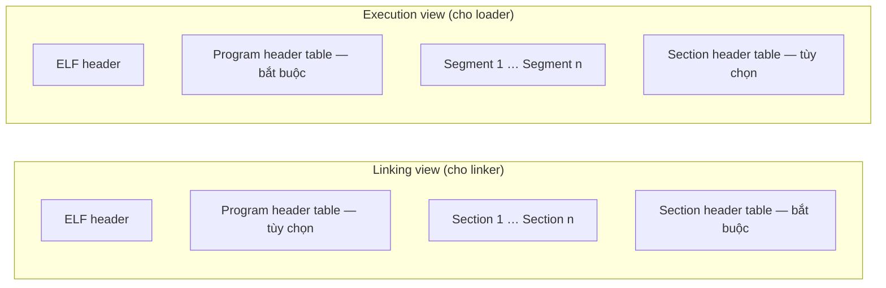
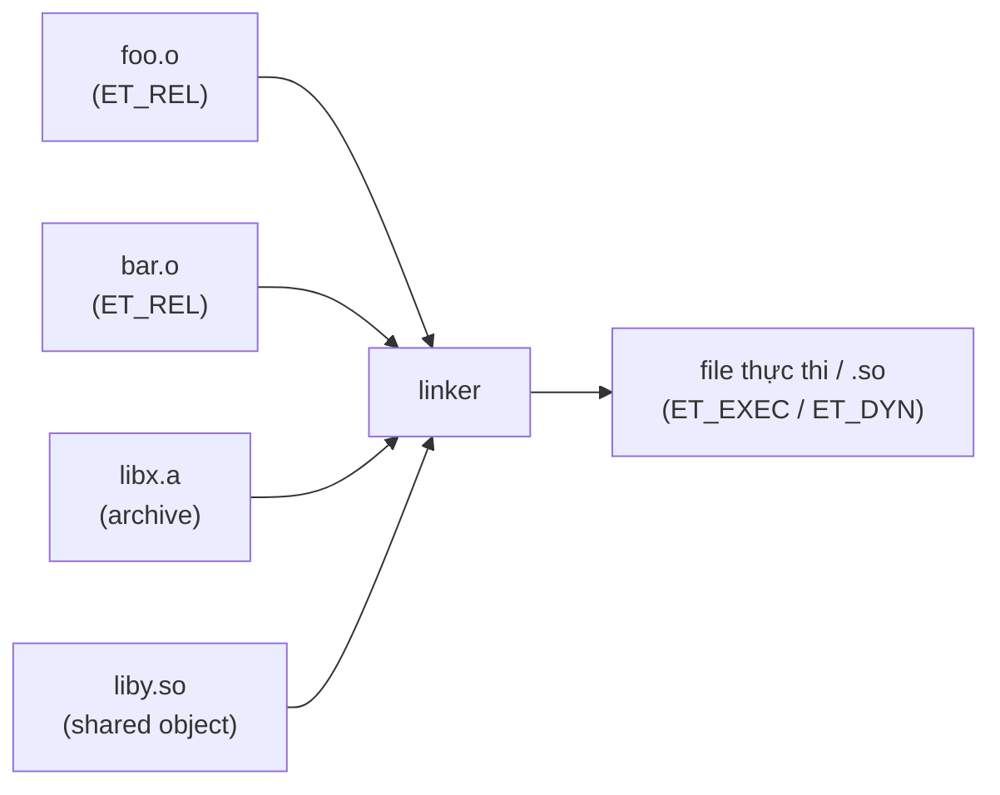
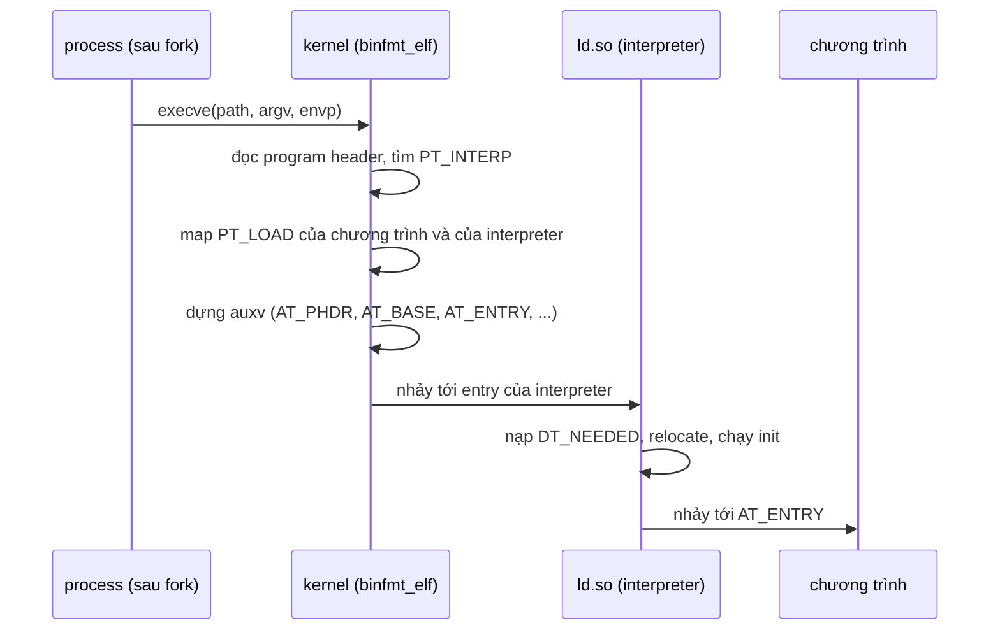
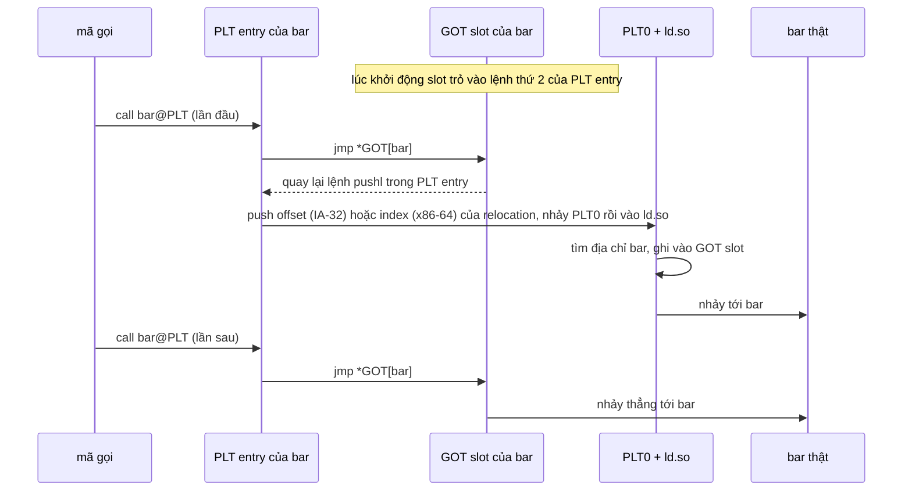

# P11 · Chương 06 — ELF, linker và loader

> Mọi khẳng định về kernel/syscall là về **Linux** (man page Debian bookworm, `man-pages 6.03`; mã nguồn kernel `v6.8`). Phần `ld.so` mô tả **glibc**; phần musl lấy từ tài liệu của dự án musl. Chương này **không chạy thí nghiệm**: lệnh `readelf`/`objdump` trong chương là lệnh minh họa để bạn tự chạy, không kèm kết quả. Ví dụ mô tả PLT lấy từ tài liệu của Drepper viết cho IA-32 (x86 32-bit); mục 5 đối chiếu thêm với đặc tả x86-64 psABI: cơ chế tương tự nhưng chi tiết khác nhau theo kiến trúc.

## Bạn sẽ hiểu được gì

1. **Q1.** ELF gồm những gì; *section* khác *segment* ở đâu, và vì sao file có hai bảng mục lục? → mục 1
2. **Q2.** Symbol và relocation là gì; linker biến nhiều file `.o` thành một file chạy được ra sao? → mục 2
3. **Q3.** `execve` nạp một ELF thế nào; `PT_INTERP` và `ld.so` vào cuộc lúc nào? → mục 3
4. **Q4.** `ld.so` tìm thư viện ở đâu (`LD_LIBRARY_PATH`, `RPATH`/`RUNPATH`, `ld.so.cache`)? → mục 4
5. **Q5.** PLT/GOT và lazy binding hoạt động ra sao; RELRO bảo vệ cái gì? → mục 5
6. **Q6.** PIE và ASLR là gì; kernel đặt chương trình ở địa chỉ nào? → mục 6
7. **Q7.** Static vs dynamic, glibc vs musl, symbol versioning: chọn gì cho binary chạy trong container? → mục 7
8. **Q8.** Rust ánh xạ lên các khái niệm trên thế nào: crate type, target `*-musl`, `-C relocation-model`, `strip`, kích thước binary? → mục 8

## Kiến thức cần trước

- [P2·03 — Assembly x86-64 và AArch64](../02-cpu/03-assembly-x86-64-va-aarch64.md): đọc được `call`, `jmp`, và cách lấy địa chỉ kiểu `@GOTPCREL(%rip)`; chương này dùng lại khi nói về GOT/PLT.
- [P3·05 — Bộ nhớ của tiến trình trên Linux](../03-memory/05-bo-nho-tien-trinh-linux.md): mục 1–3 đã giới thiệu ELF, `.bss`, `PT_LOAD`, `/proc/<pid>/maps` và ASLR ở mức nhập môn. Chương này đi sâu vào *file* ELF, linker và loader; không lặp lại thí nghiệm `.bss`.
- [P8·08 — Rust trong container](../08-containers/08-rust-trong-container.md): mục 5–6 đo kích thước image musl/glibc và tác dụng của `strip`. Chương này giải thích *vì sao* những con số đó khác nhau.

## 1. ELF: header, section và segment (Q1)

> **Trả lời ngắn.** ELF là định dạng file thực thi, thư viện và object trên Linux. File bắt đầu bằng ELF header ở offset 0, trỏ tới hai bảng mục lục: *section header table* (dành cho linker và công cụ) và *program header table* (dành cho loader/kernel)[^elf-hdr-tables]. Một segment chứa một hoặc nhiều section[^elf-phdr]; file dùng để dựng process bắt buộc phải có program header table[^gabi-pht].

**Giải thích.**

Hình dung (nhận xét của người soạn): một cuốn sách có hai mục lục. Mục lục thứ nhất theo *chương* (section) cho biên tập viên và nhà in: chương này là mã, chương kia là dữ liệu chỉ đọc, chương nọ là bảng tên. Mục lục thứ hai theo *kệ sách* (segment) cho thủ thư: "trang 1–40 xếp lên kệ chỉ-đọc-chạy-được, trang 41–60 xếp lên kệ đọc-ghi". Người dùng cuối (CPU) chỉ cần mục lục thứ hai để biết xếp sách thế nào.

**Ba loại file ELF.** *Relocatable* (đầu ra của compiler, thường `.o`): mã và dữ liệu sẵn sàng để linker ghép với các object khác thành file thực thi hoặc shared object. *Executable*: chương trình sẵn sàng chạy[^gabi-3types]. *Shared object* (`.so`): dùng được ở hai ngữ cảnh — linker ghép nó với object khác, và dynamic linker kết hợp nó với executable lúc chạy để tạo process image[^gabi-so]. Loại file nằm ở trường `e_type` của header: `ET_REL`, `ET_EXEC`, `ET_DYN`, `ET_CORE`[^elf-etype]. Một PIE động (mục 6) là `ET_DYN` có *interpreter* (chương trình mà `PT_INTERP` chỉ tới, tức `ld.so`; mục 3)[^binfmt-pie].

**Hai khung nhìn của cùng một file.** Định dạng cung cấp hai "khung nhìn" song song vì hai việc (build và chạy) cần thông tin khác nhau[^gabi-views]; hình dưới là bố cục của hai khung nhìn.



(Sơ đồ theo Hình 4-1 của gABI. Thứ tự thực tế trong file có thể khác hình; chỉ ELF header có vị trí cố định[^gabi-order].)

Hệ quả trực tiếp: file dùng để dựng process **phải** có program header table, còn relocatable thì không cần[^gabi-pht]; file dùng lúc linking phải có section header table, các file khác có thể có hoặc không[^gabi-sht]. Nói cách khác, kernel nạp chương trình dựa vào segment; section là thông tin cho công cụ (suy luận của người soạn từ hai trích dẫn trên).

**ELF header** nằm ở offset 0[^elf-hdr-tables]. Các trường đáng nhớ:

| Trường | Nói gì |
|---|---|
| `e_ident` | 16 byte nhận dạng; byte đầu là magic `0x7f` rồi `'E'`, `'L'`, `'F'`[^elf-magic]; còn chứa class 32/64-bit[^elf-class] và cách mã hóa dữ liệu |
| `e_type` | `ET_REL` / `ET_EXEC` / `ET_DYN` / `ET_CORE`[^elf-etype] |
| `e_machine` | kiến trúc yêu cầu; ví dụ `EM_X86_64`[^elf-machine] |
| `e_entry` | địa chỉ ảo mà hệ thống chuyển điều khiển tới đầu tiên[^elf-entry] |
| `e_phoff`, `e_phnum` | vị trí và số phần tử của program header table[^elf-phoff][^elf-phnum] |
| `e_shoff`, `e_shnum` | vị trí và số phần tử của section header table; bằng 0 nếu không có bảng[^elf-shoff] |
| `e_shstrndx` | chỉ số section chứa tên các section[^elf-shstrndx] |

**Section** là đơn vị của linker. Section header table "cho phép định vị mọi section của file"[^elf-shdr]; mỗi section có tên (là chỉ số vào bảng chuỗi tên section), kiểu, cờ, địa chỉ, offset, kích thước. Hai điểm quan trọng:

- Cờ `SHF_ALLOC` đánh dấu section chiếm bộ nhớ khi chương trình chạy; một số section điều khiển không có mặt trong memory image[^elf-shf-alloc]. Ví dụ section `.debug` chứa thông tin debug mà nội dung không được đặc tả[^elf-debug] — loader không cần nó để chạy chương trình (suy luận của người soạn).
- Kiểu `SHT_NOBITS` là section không chiếm chỗ trong file nhưng "giống" `SHT_PROGBITS`[^elf-nobits]; `.bss` là ví dụ[^elf-bss] (thí nghiệm thấy ở [P3·05 mục 1](../03-memory/05-bo-nho-tien-trinh-linux.md)).

**Segment** là đơn vị của loader. Program header table là mảng cấu trúc, mỗi phần tử mô tả một segment hoặc thông tin khác hệ thống cần để chuẩn bị chạy; một segment chứa một hoặc nhiều section[^elf-phdr]. Các loại hay gặp:

| `p_type` | Ý nghĩa |
|---|---|
| `PT_LOAD` | segment nạp được, mô tả bằng `p_filesz`/`p_memsz`; byte của file được map vào đầu segment, phần `p_memsz` dư được định nghĩa là số 0[^elf-load][^elf-load-zero] |
| `PT_INTERP` | đường dẫn (kết thúc bằng null) của interpreter cần gọi; tối đa một lần, và nếu có thì phải đứng trước mọi `PT_LOAD`[^elf-interp] |
| `PT_DYNAMIC` | thông tin liên kết động[^elf-ptdynamic] |
| `PT_PHDR` | vị trí của chính program header table trong memory image[^elf-phdr-self] |
| `PT_GNU_STACK` | extension GNU, kernel Linux dùng để điều khiển trạng thái stack qua `p_flags`[^elf-gnustack] |

Cờ `p_flags` quy định quyền của segment: segment text (chứa mã lệnh) thường có `PF_X` và `PF_R`, segment data thường có `PF_W` và `PF_R`[^elf-pflags].

**Vài section đáng biết** (tên là quy ước theo `elf(5)`):

| Section | Chứa gì |
|---|---|
| `.interp` | pathname của program interpreter[^elf-interp-sec] |
| `.dynamic` | thông tin liên kết động[^elf-dynamic-sec] |
| `.dynsym` | bảng symbol dành cho liên kết động, tối thiểu[^elf-dynsym] |
| `.symtab` | bảng symbol đầy đủ, điển hình để link editing[^elf-symtab] |
| `.relaNAME` | các relocation áp lên section `NAME`[^elf-relaname] |
| `.got` / `.plt` | global offset table / procedure linkage table (mục 5)[^elf-got][^elf-plt] |
| `.gnu.version_r` | các version symbol mà file *cần* (mục 7)[^elf-verneed] |

<details><summary>Đi sâu: <code>e_phnum</code> tràn, căn chỉnh <code>p_vaddr</code>/<code>p_offset</code>, lệnh để tự xem</summary>

- Nếu số phần tử program header ≥ `PN_XNUM` (0xffff) thì `e_phnum` giữ giá trị `PN_XNUM` và số thật nằm ở `sh_info` của phần tử đầu section header table[^elf-phnum-xnum]. Hai trường kia tràn theo cơ chế riêng, với ngưỡng `SHN_LORESERVE` (0xff00): `e_shnum` bằng 0 và số thật nằm ở `sh_size` của phần tử đầu section header table[^elf-shnum-xindex]; `e_shstrndx` giữ `SHN_XINDEX` (0xffff) và chỉ số thật nằm ở `sh_link` của phần tử đầu[^elf-shstrndx-xindex].
- Segment nạp được phải có `p_vaddr` và `p_offset` đồng dư theo kích thước page[^elf-malign]. (Suy luận của người soạn: đó là điều kiện để kernel map trực tiếp page của file vào địa chỉ ảo.)
- `PT_INTERP` phải đứng trước mọi `PT_LOAD`[^elf-interp], và `PT_PHDR` cũng vậy[^elf-phdr-self].
- Đoạn mã đọc ELF header bằng tay (minh họa, không phải kết quả đã chạy): đọc 16 byte đầu rồi so với `7f 45 4c 46`; byte thứ 5 là class (`ELFCLASS64` = "định nghĩa kiến trúc 64-bit"[^elf-class]).
- Lệnh để tự xem (chưa chạy trong chương này): `readelf -h` (ELF header), `readelf -lW` (program header, tức segment), `readelf -SW` (section header), `readelf -d` (`.dynamic`), `objdump -p file | grep NEEDED` (các `DT_NEEDED`).
- Core file cũng là ELF (`ET_CORE`); ghi chú (note) cho phép đính kèm thông tin tùy ý cho hệ thống dùng và chủ yếu thấy trong core file[^elf-notes].

</details>

**Quay lại Q1:** ELF có header ở offset 0 trỏ tới hai bảng: section (cho linker/công cụ) và segment (cho loader); lúc chạy kernel chỉ cần các segment, đặc biệt `PT_LOAD` và `PT_INTERP`.

## 2. Symbol và relocation: linker làm gì (Q2)

> **Trả lời ngắn.** Mỗi file `.o` định nghĩa một số *symbol* (tên hàm/biến) và tham chiếu tới symbol định nghĩa nơi khác; địa chỉ cuối cùng chưa biết nên compiler để lại chỗ trống kèm một *relocation entry* ghi "chỗ này cần điền địa chỉ của symbol X". Relocation là quá trình nối tham chiếu symbol với định nghĩa symbol[^gabi-reloc]; linker nối các object, tìm định nghĩa cho từng tham chiếu rồi điền vào chỗ trống.

**Giải thích.**

Hình dung (nhận xét của người soạn): bạn viết bản thảo nhiều chương, mỗi chương ghi chú "xem trang [chương 7]". Lúc viết chưa biết số trang. Nhà in dàn trang xong mới điền số trang thật vào từng chỗ ghi chú. Chỗ ghi chú = relocation entry; nhà in = linker.

**Từ vựng.** *Static linker* (`ld`, chạy lúc build) ghép các object thành file đầu ra; *dynamic linker* (`ld.so`, chạy lúc chương trình khởi động) tìm và nạp shared object rồi chuẩn bị chương trình chạy[^ldso-desc]. Chữ "linker" đứng một mình trong mục này là static linker (giải nghĩa thuật ngữ của người soạn).

**Symbol.** Bảng symbol giữ thông tin cần để định vị và relocate các định nghĩa và tham chiếu symbol của chương trình[^elf-symtab-def]. Mỗi entry có tên (chỉ số vào bảng chuỗi symbol)[^elf-st-name], giá trị[^elf-st-value], kích thước[^elf-st-size], loại và binding (`st_info`)[^elf-st-info], visibility (`st_other`)[^elf-st-other], và chỉ số section mà nó thuộc về (`st_shndx`)[^elf-st-shndx]. Có hai bảng: `.symtab` đầy đủ, điển hình cho link editing; `.dynsym` tối thiểu cho liên kết động[^elf-symtab][^elf-dynsym].

Ba binding quyết định cách linker xử lý khi gặp trùng tên:

- `STB_LOCAL`: không nhìn thấy ngoài object chứa định nghĩa; hai file có thể có local symbol cùng tên mà không đụng nhau[^elf-bind-local].
- `STB_GLOBAL`: nhìn thấy với mọi object đang được ghép; định nghĩa ở file này thỏa mãn tham chiếu chưa định nghĩa ở file khác[^elf-bind-global]. Linker không cho phép nhiều định nghĩa `STB_GLOBAL` cùng tên[^gabi-global-weak].
- `STB_WEAK`: giống global nhưng định nghĩa có độ ưu tiên thấp hơn[^elf-bind-weak]; nếu đã có định nghĩa global thì weak cùng tên không gây lỗi, linker giữ bản global[^gabi-global-weak].

Một symbol có `st_shndx` là `SHN_UNDEF` nghĩa là *chưa định nghĩa* trong file này; khi linker ghép với file định nghĩa nó, tham chiếu sẽ được nối với định nghĩa thật[^gabi-undef].

**Relocation entry.** Mỗi entry ghi: `r_offset` (chỗ cần sửa), `r_info` (chỉ số symbol + loại relocation)[^elf-relocs] và, ở dạng `Rela`, `r_addend` (hằng số cộng thêm)[^elf-raddend]. Loại relocation phụ thuộc bộ xử lý và được mô tả trong processor supplement[^gabi-reloc-type]. Dạng `Rel` không có trường addend mà để giá trị cộng thêm ngay tại chỗ cần sửa[^gabi-rel-addend]. Ý nghĩa của `r_offset` đổi theo loại file: trong relocatable file đó là offset trong một section, còn trong executable/shared object đó là địa chỉ ảo của chỗ cần sửa[^elf-roffset]. Cách áp dụng điển hình: xác định giá trị symbol được tham chiếu, lấy addend, áp công thức của loại relocation lên cặp (symbol, addend), rồi đặt kết quả vào chỗ cần sửa[^gabi-reloc-apply].

**Linker ghép các mảnh.** Quy trình khái quát (mô tả của người soạn, các điểm chi tiết có chú thích bên dưới):



- Với archive `.a`: linker *rút* (extract) các member chứa định nghĩa cho symbol global còn chưa định nghĩa và chép vào đầu ra[^gabi-archive-extract][^gabi-archive-copy]; với tham chiếu weak chưa định nghĩa, linker không rút member, và weak chưa giải quyết có giá trị 0[^gabi-weak-undef]. Đây là lý do một binary liên kết tĩnh chỉ chứa các member archive được rút để giải quyết symbol còn thiếu, chứ không phải cả thư viện (suy luận của người soạn từ hai trích dẫn đó; đơn vị rút là member, nên phần không dùng *bên trong* một member đã rút vẫn có mặt).
- Với shared object: định nghĩa *không* được chép vào; tham chiếu được ghi lại để dynamic linker xử lý lúc chạy (mục 3–5). Mã đã nạp thì chương trình tĩnh "đã được static linker làm xong mọi thứ"[^dr-static].
- Với executable truyền thống: địa chỉ nạp biết lúc link, nên static linker tự thực hiện relocation, "ứng dụng không có relative relocation"[^dr-no-relative]. (Câu này của Drepper nói về executable cố định địa chỉ; PIE ở mục 6 khác.)

**Visibility.** `STV_DEFAULT`: symbol global/weak có sẵn cho module khác, và tham chiếu trong module có thể bị định nghĩa ở module khác *chèn vào thay thế* (interposition)[^elf-vis-default]. `STV_HIDDEN`: không thấy ngoài module, và tham chiếu trong module luôn trỏ vào bản cục bộ[^elf-vis-hidden]. Điều này liên quan tới việc lời gọi có cần đi qua PLT hay không (mục 5; suy luận của người soạn).

<details><summary>Đi sâu: relocation tĩnh vs động, chi phí, tên symbol, lệnh tự xem</summary>

- Trong executable/shared object, các relocation còn lại *dành cho dynamic linker* nằm ở các section `.rela*`; `DT_JMPREL` trỏ vào nhóm relocation gắn riêng với PLT để dynamic linker có thể bỏ qua chúng lúc khởi tạo nếu bật lazy binding[^gabi-jmprel].
- Drepper chia relocation động làm hai loại: *relative* (đích nằm trong chính object — linker biết offset, dynamic linker chỉ cộng địa chỉ nạp rồi ghi kết quả[^dr-relative]) và *theo symbol* (cần tìm định nghĩa, "tốn kém, càng nhiều DSO và symbol thì tra cứu càng lâu"[^dr-symreloc-cost]).
- Nếu relocation phải sửa vào segment chỉ-đọc (text relocation), page bị sửa không còn chia sẻ được với process khác dùng cùng object[^dr-textrel]. Đó là một lý do thư viện được biên dịch position-independent (mục 5).
- Tên symbol có thể khác tên trong mã nguồn: Rust "mangle" tên symbol (mục 8). Liên hệ với assembly: `call foo@PLT` hay `@GOTPCREL(%rip)` trong [P2·03](../02-cpu/03-assembly-x86-64-va-aarch64.md) là những chỗ trong mã mà địa chỉ phải được điền lúc link hoặc lúc chạy (suy luận của người soạn; mục 5 giải thích PLT/GOT).
- Lệnh tự xem (chưa chạy): `readelf -sW file.o` (symbol), `readelf -rW file.o` (relocation trong `.o`), `readelf -rW exe` (relocation động còn lại).

</details>

**Quay lại Q2:** `.o` chỉ chứa tên và "lỗ" cần điền; linker nối các tham chiếu symbol với định nghĩa và điền địa chỉ (relocation); phần nào thuộc shared object thì để dynamic linker làm lúc chạy.

## 3. `execve` nạp ELF: `PT_INTERP`, auxv, `ld.so` (Q3)

> **Trả lời ngắn.** `execve` thay chương trình đang chạy của process bằng chương trình mới[^execve-replace]. Kernel đọc program header; nếu có `PT_INTERP` thì mở file interpreter đó, map cả chương trình lẫn interpreter, dựng auxiliary vector trên stack rồi chuyển điều khiển cho *interpreter* chứ không phải cho chương trình[^dr-entry]. Interpreter (`ld.so`) nạp các thư viện cần, relocate, rồi mới chạy chương trình[^ldso-desc].

**Giải thích.**

Hình dung (nhận xét của người soạn): kernel là người dọn nhà. Với binary tĩnh, mọi đồ đạc đã đóng sẵn trong một thùng: kernel xếp vào và bật công tắc. Với binary động, thùng còn thiếu — trên nhãn ghi "nhờ quản lý kho `ld.so` mang đồ thiếu tới"; kernel mang quản lý kho vào *trước*, đưa cho ông ấy danh sách và để ông ấy hoàn tất rồi mới bật công tắc.

Từng bước (với binary liên kết động):

1. **Thay chương trình.** `execve()` thay chương trình hiện tại bằng chương trình mới với stack, heap và data segment mới khởi tạo[^execve-replace]; memory mapping cũ không được giữ lại[^execve-mappings].
2. **Tìm `PT_INTERP`.** Chương trình ghi interpreter trong program header: kernel không hard-code `ld.so`[^dr-ptinterp]. Trong source kernel `v6.8`, `load_elf_binary` duyệt program header, gặp `PT_INTERP` thì đọc chuỗi đường dẫn rồi mở file đó[^binfmt-interp][^binfmt-open], và vòng lặp dừng ở `PT_INTERP` đầu tiên[^binfmt-interp-break]. Interpreter không phải định dạng nhận ra được → `ELIBBAD`[^execve-elibbad]. Lưu ý khác biệt giữa tài liệu và code: `execve(2)` ghi rằng nhiều hơn một `PT_INTERP` → `EINVAL`[^execve-einval] và `elf(5)` nói `PT_INTERP` không được xuất hiện quá một lần[^elf-interp]; nhưng trong đoạn `v6.8` đã đọc người soạn không thấy kiểm tra tương ứng (nhận xét của người soạn; chi tiết cài đặt, có thể khác ở bản kernel khác).
3. **Map hai ELF.** Kernel map các `PT_LOAD` của chương trình, rồi gọi `load_elf_interp` để map interpreter và nhận lại địa chỉ nạp của nó[^binfmt-interp-load]. Interpreter phải hoàn chỉnh và có thể relocate tự do, vì chính nó không có ai nạp hộ[^dr-interp-complete] (vế sau là suy luận của người soạn).
4. **Dựng auxiliary vector (auxv).** Kernel đặt một mảng cặp (tag, value) lên stack process mới; mảng này giúp dynamic linker tránh nhiều syscall[^dr-auxv]. Source kernel đặt vào đó, trong số các mục khác, `AT_PHDR` (địa chỉ program header của chương trình), `AT_PHENT`, `AT_PHNUM`, `AT_BASE` (địa chỉ nạp interpreter) và `AT_ENTRY` (entry của chương trình)[^binfmt-auxv]. Ý nghĩa theo `getauxval(3)`: `AT_BASE` là base address của program interpreter[^auxv-base]; `AT_ENTRY` là entry address của executable[^auxv-entry]; `AT_PHDR` là địa chỉ program header của executable[^auxv-phdr].
5. **Chuyển điều khiển cho interpreter.** Entry kernel nhảy tới là `e_entry` của *interpreter* cộng địa chỉ nạp[^binfmt-entry], không phải entry của chương trình[^dr-entry].
6. **`ld.so` làm việc.** Nhiệm vụ: xác định và nạp các dependency, relocate chương trình cùng mọi dependency, khởi tạo chúng theo đúng thứ tự[^dr-steps]. Tóm gọn: "tìm và nạp các shared object cần, chuẩn bị chương trình để chạy, rồi chạy nó"[^ldso-desc]. Khi đã xong, điều khiển mới đến chương trình[^dr-dynlinker-tasks] (dùng `AT_ENTRY` làm đích — suy luận của người soạn từ định nghĩa `AT_ENTRY`).



**Binary tĩnh cổ điển** (địa chỉ nạp cố định, không PIE) không có `PT_INTERP`: tải trọng "đã hoàn chỉnh", nên kernel chỉ cần đưa binary vào address space và chuyển điều khiển tới entry của ứng dụng; mọi việc còn lại đã do static linker làm[^dr-static]. Static-PIE (mục 6) cũng không có `PT_INTERP` nhưng không có địa chỉ nạp cố định, nên câu của Drepper (viết cho trường hợp "fixed load address") không áp dụng nguyên văn: suy luận của người soạn là nó cần thêm bước relocate lúc chạy; chương này không đi sâu.

<details><summary>Đi sâu: PIE và interpreter nạp ở đâu, chạy <code>ld.so</code> trực tiếp, <code>ldd</code>, vDSO, script <code>#!</code></summary>

- Source kernel phân biệt hai loại `ET_DYN`: *chương trình* (PIE: `ET_DYN` có `INTERP`) và *loader* (`ET_DYN` không có `INTERP`, vì chúng *chính là* interpreter)[^binfmt-pie]. Lý do tách: loader phải nạp xa chương trình, vì chương trình có thể đụng vào loader (đặc biệt khi `ET_EXEC` không có vị trí ngẫu nhiên)[^binfmt-loader-away]. Chương trình PIE được đặt lệch từ `ELF_ET_DYN_BASE`, còn loader vào vùng mmap ngẫu nhiên độc lập[^binfmt-pie-base]. (Suy luận của người soạn: static-PIE — `ET_DYN` không có `INTERP` — rơi vào nhóm thứ hai theo phân loại này.) Mục 6 quay lại.
- Chạy interpreter trực tiếp: `/lib/ld-linux.so.* [OPTIONS] [PROGRAM [ARGUMENTS]]`; chạy gián tiếp qua một chương trình động thì không truyền được option cho dynamic linker, và với ELF thì interpreter ghi ở `.interp` được thực thi[^ldso-interp-sec]. Option hữu ích: `--list` ("liệt kê mọi dependency và cách chúng được giải quyết")[^ldso-list].
- `ldd` gọi dynamic linker chuẩn với biến môi trường `LD_TRACE_LOADED_OBJECTS` bằng 1[^ldd-trace]. **Cảnh báo an toàn:** với chương trình khai báo interpreter khác `ld-linux.so`, một số phiên bản `ldd` có thể thực thi chương trình; không bao giờ chạy `ldd` trên executable không tin cậy[^ldd-sec]. Cách an toàn hơn là `objdump -p /path/to/program | grep NEEDED` (chỉ liệt kê dependency trực tiếp)[^ldd-objdump].
- Dòng `linux-vdso.so.1` trong đầu ra `ldd` là dependency đặc biệt: `ldd` ghi chú vdso và ld-linux là đặc biệt[^ldd-special]; auxv có `AT_SYSINFO_EHDR` là địa chỉ page chứa vDSO *ảo* mà kernel tạo ra để cung cấp bản cài đặt nhanh cho một số syscall[^auxv-vdso].
- `execve` cũng chạy được script bắt đầu bằng `#!interpreter [optional-arg]`[^execve-script]; đó là cơ chế khác `PT_INTERP`: interpreter của script là chương trình đọc file script, còn `PT_INTERP` của ELF là bộ nạp.
- `AT_SECURE` khác 0 nghĩa là chương trình cần được xử lý "an toàn", thường do set-user-ID/set-group-ID[^auxv-secure]; `ld.so` dùng nó để chọn secure-execution mode (mục 4).

</details>

**Quay lại Q3:** kernel đọc `PT_INTERP`, map chương trình và `ld.so`, đưa thông tin qua auxv rồi nhảy vào `ld.so`; `ld.so` nạp thư viện, relocate và chuyển điều khiển sang chương trình.

## 4. `ld.so` tìm thư viện ở đâu (Q4)

> **Trả lời ngắn.** Với dependency có chứa dấu `/`, `ld.so` coi đó là đường dẫn và nạp thẳng[^ldso-slash]. Nếu không, theo `ld.so(8)` nó thử lần lượt: `DT_RPATH` (chỉ khi không có `DT_RUNPATH`), `LD_LIBRARY_PATH`, `DT_RUNPATH`, cache `/etc/ld.so.cache`, rồi thư mục mặc định `/lib` và `/usr/lib`[^ldso-order-rpath][^ldso-order-ldlp][^ldso-order-runpath][^ldso-order-cache][^ldso-order-default].

**Giải thích.**

Hình dung (nhận xét của người soạn): bạn cần cuốn "libssl". Thủ thư đầu tiên xem ghi chú dính trên chương trình (RPATH/RUNPATH), nhưng trước đó có biển báo "ưu tiên kệ của anh" do người dùng dựng (LD_LIBRARY_PATH); sau đó tra danh mục trung tâm (ld.so.cache), cuối cùng lục các kệ mặc định.

Tên trong `DT_NEEDED` là bản sao của chuỗi `DT_SONAME` (tên định danh do chính shared object khai báo[^gabi-soname]) hoặc đường dẫn của shared object dùng lúc build[^gabi-needed-names] — nên bạn thường thấy `libc.so.6` (SONAME) chứ không phải đường dẫn tuyệt đối. Thứ tự tìm với tên không có `/` (theo `ld.so(8)`):

| Bước | Nguồn | Ghi chú |
|---|---|---|
| 1 | `DT_RPATH` của binary | chỉ khi **không** có `DT_RUNPATH`; `DT_RPATH` bị đánh dấu deprecated[^ldso-order-rpath]; áp dụng cho cả cây dependency[^ldso-order-runpath] |
| 2 | `LD_LIBRARY_PATH` | bị bỏ qua trong secure-execution mode[^ldso-order-ldlp] |
| 3 | `DT_RUNPATH` | chỉ dùng để tìm dependency trực tiếp (`DT_NEEDED`) của object chứa nó, *không* áp xuống con cháu[^ldso-order-runpath][^gabi-runpath-scope] |
| 4 | `/etc/ld.so.cache` | danh sách đã biên dịch các shared object ứng viên[^ldso-order-cache] |
| 5 | `/lib`, rồi `/usr/lib` | (trên một số kiến trúc 64-bit là `/lib64`, `/usr/lib64`; bước này bị bỏ qua nếu binary được link với `-z nodeflib`)[^ldso-order-default] |

**`$ORIGIN` và đóng gói.** `$ORIGIN` được mở rộng thành thư mục chứa chương trình hoặc shared object[^ldso-tokens]; việc mở rộng token áp dụng trong giá trị các tag `DT_NEEDED`, `DT_RPATH`, `DT_RUNPATH`... của binary ELF, ngoài ra còn ở các biến môi trường như `LD_LIBRARY_PATH`[^ldso-tokens-where]. Ví dụ man page: build với `-Wl,-rpath,'$ORIGIN/../lib'` để chương trình tìm shared object đi kèm trong `somedir/lib` bất kể `somedir` nằm đâu[^ldso-origin]. Nhờ đó ứng dụng "turn-key" có thể giải nén ở thư mục bất kỳ[^ldso-origin-turnkey]. (Nhận xét của người soạn: cách này dùng khi bạn phải mang theo `.so` riêng trong image thay vì cài vào hệ thống.)

**Bẫy `LD_LIBRARY_PATH`.** Danh sách phân tách bằng dấu hai chấm hoặc chấm phẩy, không có cơ chế escape; **một tên thư mục độ dài 0 nghĩa là thư mục hiện tại**[^ldso-ldlp]. Ở secure-execution mode (kích hoạt khi `AT_SECURE` khác 0[^ldso-secure], ví dụ chương trình set-user-ID — file có bit cho process chạy với quyền của chủ file), biến này bị bỏ qua[^ldso-order-ldlp]. Với `LD_PRELOAD` — nạp thêm shared object *trước* mọi object khác để có thể ghi đè hàm[^ldso-preload] — chế độ này cũng hạn chế đường dẫn có dấu `/`[^ldso-preload-secure]. (Nhận xét của người soạn: vì thế đừng dựa vào hai biến này cho chương trình đặc quyền; còn trong container, ưu tiên cài `.so` đúng chỗ hoặc dùng `RUNPATH` có `$ORIGIN` thay vì để `LD_LIBRARY_PATH` trong image.)

**`dlopen` dùng cùng quy tắc.** Theo mô tả của `dlopen(3)`, khi chương trình gọi `dlopen` với tên không có `/`, dynamic linker tìm theo trình tự tương tự: `DT_RPATH` (nếu không có `DT_RUNPATH`) của *đối tượng gọi*, `LD_LIBRARY_PATH`, `DT_RUNPATH`, cache, rồi `/lib`, `/usr/lib`[^dlopen-search].

<details><summary>Đi sâu: thư viện sai kiến trúc, <code>LD_DEBUG</code>, <code>--list</code>, hardware capabilities</summary>

- Khi tìm, gặp một file ELF có thuộc tính không hợp (sai class, sai `e_machine`...) **không** phải lỗi nghiêm trọng: dynamic linker vét hết các đường dẫn rồi mới kết luận không tìm thấy[^gabi-wrong-attrs].
- Chẩn đoán: `LD_DEBUG` bật log chi tiết hoạt động của dynamic linker[^ldso-debug]; hạng mục `libs` hiển thị các đường dẫn tìm thư viện[^ldso-debug-libs] (`LD_DEBUG=help` liệt kê các hạng mục). `ld.so --list` liệt kê dependency và cách giải quyết[^ldso-list].
- `ld.so.cache` do `ldconfig(8)` duy trì (theo `ld.so(8)`: file chứa danh sách đã biên dịch các thư mục và danh sách có thứ tự các shared object ứng viên)[^ldso-cache-file]. Suy luận của người soạn: thêm `.so` vào một thư mục mà chưa cập nhật cache thì bước 4 không thấy nó.
- Biến `LD_LIBRARY_PATH` được `ld.so` đọc khi chương trình *khởi động*; `dlopen` dùng giá trị tại thời điểm chương trình bắt đầu chạy[^dlopen-ldlp-start].
- `DT_RPATH` và `DT_RUNPATH` trong `.dynamic`: `DT_RPATH` ghi là deprecated; `DT_RUNPATH` là chuỗi chứa đường dẫn tìm thư viện[^elf-dt-rpath][^elf-dt-runpath].
- `ld.so` còn ưu tiên các thư mục "hardware capabilities" (ví dụ thư viện tối ưu cho tập lệnh mở rộng) nếu có và phù hợp với CPU[^ldso-hwcap].

</details>

**Quay lại Q4:** `ld.so` tìm theo thứ tự RPATH (nếu không có RUNPATH) → `LD_LIBRARY_PATH` → RUNPATH → `ld.so.cache` → `/lib`, `/usr/lib`; `$ORIGIN` cho phép đóng gói thư viện cạnh binary, và `LD_LIBRARY_PATH` bị bỏ qua với chương trình đặc quyền.

## 5. PLT, GOT, lazy binding và RELRO (Q5)

> **Trả lời ngắn.** Mã trong shared object không được chứa địa chỉ tuyệt đối của hàm/biến bên ngoài, vì sẽ phải sửa vào text lúc chạy[^dr-got-why]. Thay vào đó, mã đọc địa chỉ từ một bảng dữ liệu (GOT), và gọi hàm ngoài qua một đoạn "bắc cầu" (PLT)[^dr-plt-stub]. Với *lazy binding*, lần gọi đầu đi qua dynamic linker để tìm địa chỉ thật rồi ghi vào GOT; các lần sau nhảy thẳng[^dr-plt-resolve]. RELRO chuyển các section chỉ bị relocation sửa sang trang riêng và gỡ quyền ghi sau khi relocate xong[^dr-relro]; với Full RELRO (kèm bind-now) cả GOT thành chỉ-đọc[^rs-relro-full].

**Giải thích.**

Hình dung (nhận xét của người soạn): GOT là cuốn danh bạ điện thoại in sẵn nhưng nhiều ô còn trống; PLT là tổng đài trung gian. Lần đầu gọi "bar", ô trong danh bạ trống nên cuộc gọi chuyển tới tổng đài (`ld.so`); tổng đài tra số, **ghi vào danh bạ**, rồi nối máy. Từ lần sau, bạn đọc số từ danh bạ và quay thẳng, không qua tổng đài.

**Vì sao cần GOT.** Với `extern int foo; extern int bar(int);`, hàm dùng cả hai cần hai relocation: một để nạp giá trị `foo`, một để tìm địa chỉ `bar`[^dr-two-relocs]. Nếu mã mã hóa thẳng địa chỉ vào lệnh thì khi địa chỉ chỉ dynamic linker biết, text segment (vùng mã lệnh) phải bị sửa lúc chạy — điều cần tránh[^dr-got-why]. Mã sinh ra cho DSO (*dynamic shared object*, cách Drepper gọi shared object; `-fpic`/`-fPIC` là cờ compiler sinh mã position-independent) lấy địa chỉ `foo` từ GOT; vị trí của ô GOT so với một thanh ghi PIC (`%ebx` trong ví dụ IA-32 của Drepper) biết lúc link, nên *chỉ GOT bị sửa, text giữ nguyên*[^dr-got-load]. Trên x86-64 cùng ý tưởng: psABI mô tả GOT là bảng giữ địa chỉ tuyệt đối trong dữ liệu riêng, nhờ đó địa chỉ có sẵn mà không làm mất tính position-independent của text[^psabi-got]; mã truy cập bằng địa chỉ tương đối `%rip`, ví dụ `jmp *name1@GOTPCREL(%rip)` trong entry PLT[^psabi-plt-entry] (xem `@GOTPCREL` trong [P2·03](../02-cpu/03-assembly-x86-64-va-aarch64.md)).

**Vì sao cần PLT.** Hàm không chắc được định nghĩa trong chính object gọi[^dr-plt-always] thì mỗi lần gọi đi qua một đoạn stub trong PLT[^dr-plt-stub]. Ngay cả khi có định nghĩa cùng file vẫn không đủ để tránh PLT, vì định nghĩa có thể bị object khác chèn thay thế (interposition)[^dr-plt-always][^dr-interposition].

**Lazy binding từng bước** (mô hình IA-32 của Drepper; kiến trúc khác chi tiết khác[^dr-plt-arch]):



- Mỗi entry PLT đúng một symbol hàm; lệnh đầu là nhảy gián tiếp qua một slot GOT[^dr-plt-slot]. Lúc khởi động, dynamic linker điền slot bằng địa chỉ trỏ vào lệnh thứ hai của chính entry PLT; nên lần gọi đầu nhảy tới lệnh `pushl` kế tiếp, đẩy offset relocation của hàm cần gọi lên stack[^dr-plt-first].
- Sau đó điều khiển chuyển tới entry PLT đặc biệt đầu tiên, đẩy thêm giá trị và nhảy vào dynamic linker[^dr-plt0].
- Khi đã xác định địa chỉ hàm, dynamic linker ghi vào đúng slot GOT mà lệnh `jmp` đầu PLT dùng rồi nhảy tới hàm; mọi lần dùng sau không qua dynamic linker nữa, mà nhảy thẳng tới hàm[^dr-plt-resolve] (nhận xét của người soạn: lời gọi vẫn đi qua entry PLT và một lệnh nhảy gián tiếp qua slot GOT).
- **Đối chiếu x86-64 (psABI)** — cùng khung, khác chi tiết so với ví dụ IA-32. Entry PLT gồm `jmp *name@GOTPCREL(%rip)`, `pushq $index`, `jmp .PLT0`[^psabi-plt-entry]. Lúc tạo memory image, dynamic linker đặt giá trị đặc biệt vào ô GOT thứ hai và thứ ba[^psabi-got-special]; lúc đầu slot của hàm chứa địa chỉ lệnh `pushq` kế tiếp[^psabi-got-init]; lệnh `pushq` đẩy một relocation *index* (ví dụ IA-32 của Drepper nói *offset*)[^psabi-index]. `.PLT0` đẩy giá trị ở `GOT+8` lên stack rồi nhảy tới địa chỉ ở `GOT+16`, tức vào dynamic linker[^psabi-plt0]. Sau khi bind, `jmp` đầu entry nhảy thẳng tới hàm thay vì rơi xuống `pushq`[^psabi-subseq].

Lazy binding là *tùy chọn* của dynamic linker: gABI cho phép dynamic linker đánh giá entry PLT một cách lười, tránh phân giải symbol và relocation cho hàm không được gọi[^gabi-lazy]. Chỉ tham chiếu *hàm* được bind lười; tham chiếu biến luôn được bind ngay khi nạp[^dlopen-lazy-var]. Mục `DT_JMPREL` tách riêng các relocation PLT để dynamic linker bỏ qua chúng lúc khởi tạo khi lazy binding bật[^gabi-jmprel].

**Tắt lazy binding (bind now).** Có ba cách: biến môi trường `LD_BIND_NOW` khác rỗng → phân giải mọi symbol lúc khởi động[^ldso-bindnow]; cờ trong chính object (gABI: mục `DT_BIND_NOW`, nay đã được thay bằng cờ `DF_BIND_NOW`) → xử lý mọi relocation của object đó trước khi chuyển điều khiển, và có ưu tiên hơn chỉ thị lazy từ môi trường hoặc `dlopen`[^gabi-dtbindnow]; và `-z now` lúc link, linker đặt cờ `DF_BIND_NOW` trong entry `DT_FLAGS` của DSO[^dr-bindnow]. `dlopen` có `RTLD_NOW` để phân giải hết trước khi `dlopen` trả về[^dlopen-now].

**RELRO.** Nếu kẻ tấn công ghi được một word tùy ý vào address space thì nhắm vào một ô GOT là mục tiêu đáng giá: đổi địa chỉ hàm gọi qua PLT sang chỗ khác[^dr-got-attack]. Chặn ghi GOT mà cho dynamic linker vẫn ghi được là khó, vì gọi `mprotect` mỗi lần đổi giá trị thì quá đắt[^dr-mprotect]. Giải pháp: `-z relro` — linker chuyển các section chỉ bị sửa bởi relocation sang trang bộ nhớ riêng và phát ra program header `PT_GNU_RELRO` trỏ tới các trang đó; lúc chạy dynamic linker gỡ quyền ghi sau khi xong việc[^dr-relro]. Đây là giải pháp một phần; kết hợp `-z now` thì mọi relocation đều đủ điều kiện được bảo vệ, đổi lại chi phí khởi động tăng[^dr-now]. rustc gọi các mức này là `relro-level`:

| Mức | Hành vi theo rustc book |
|---|---|
| `off` | hàm động được phân giải lười và GOT ghi được[^rs-relro-off] |
| `partial` | hàm động phân giải lười, ghi vào phần GOT của PLT (`.got.plt`); phần GOT còn lại (`.got`) thành chỉ-đọc[^rs-relro-partial] |
| `full` | hàm động được phân giải ngay lúc bắt đầu chạy, GOT được điền sớm rồi chuyển thành chỉ-đọc; tốn thêm bộ nhớ và làm tăng thời gian khởi động process[^rs-relro-full] |

rustc bật Full RELRO mặc định trên nền tảng hỗ trợ[^rs-relro-default]; trong source target spec của Rust 1.95.0, nền tảng Linux đặt `relro_level: RelroLevel::Full`[^rs-base-linux]. Drepper nhận xét với ứng dụng chạy lâu và nhạy cảm bảo mật thì chi phí khởi động không nặng bằng lợi ích an ninh[^dr-now-longrun]. (Nhận xét của người soạn: với service backend chạy hàng ngày, Full RELRO gần như không đáng kể; với công cụ CLI khởi động hàng nghìn lần mỗi giờ hay chương trình cần cold start cực ngắn thì nên cân nhắc đo.)

<details><summary>Đi sâu: x86-64 vs IA-32, quan sát bind, musl, <code>RTLD_*</code></summary>

- Cấu trúc GOT/PLT là chi tiết riêng của từng kiến trúc (theo psABI). Ví dụ ở IA-32 PLT chỉ-đọc, còn một số kiến trúc khác (Drepper không nêu tên) thì PLT phải ghi được vì entry PLT bị sửa trực tiếp thay vì nhảy gián tiếp qua GOT[^dr-plt-arch]; entry PLT x86-64 thì nhảy gián tiếp qua GOT như đã thấy ở trên[^psabi-plt-entry]. Vì vậy mô hình IA-32 chỉ là *ví dụ minh họa* cho cơ chế.
- Quan sát: `LD_BIND_NOT` (nếu đặt) khiến dynamic linker **không** cập nhật GOT/PLT sau khi phân giải; kết hợp với `LD_DEBUG` hạng mục `bindings` và `symbols` có thể xem mọi lần bind lúc chạy[^ldso-bindnot].
- Symbol `STV_HIDDEN` không bị chèn thay thế nên tham chiếu trong module luôn trỏ vào bản cục bộ[^elf-vis-hidden]; đây là lý do thư viện nên ẩn symbol không xuất khẩu (suy luận của người soạn: để tránh PLT cho lời gọi nội bộ — Drepper hứa giải thích "khi nào và cách tránh PLT" ở phần sau của tài liệu[^dr-avoid-plt]).
- **musl không hỗ trợ lazy binding**: vì lý do tin cậy (không thể báo cáo lỗi bind lười) và vì giảm đáng kể mã dễ lỗi phụ thuộc kiến trúc[^musl-lazy]; glibc thì có lazy binding, trì hoãn giải quyết tới lần gọi đầu tiên[^musl-glibc-lazy].
- `dlopen`: `RTLD_LAZY` — "chỉ phân giải symbol khi mã tham chiếu được thực thi; symbol không bao giờ được tham chiếu thì không bao giờ phân giải"[^dlopen-lazy]; `RTLD_NOW` hoặc `LD_BIND_NOW` đặt thì phải phân giải hết symbol chưa định nghĩa trước khi `dlopen` trả về[^dlopen-now]; `LD_BIND_NOW` thắng `RTLD_LAZY`[^dlopen-lazy-var].

</details>

**Quay lại Q5:** GOT là bảng địa chỉ được ghi lúc chạy, PLT là đoạn stub dùng GOT; lazy binding bind hàm ở lần gọi đầu; RELRO khóa phần GOT chỉ bị relocation sửa sau khi relocate xong (Full RELRO kèm bind-now: cả GOT chỉ-đọc).

## 6. PIE và ASLR (Q6)

> **Trả lời ngắn.** *PIE* (Position Independent Executable) là executable được build để chạy đúng ở địa chỉ nạp bất kỳ, nên kernel có thể đặt nó lệch ngẫu nhiên. *ASLR* là cơ chế của kernel ngẫu nhiên hóa vị trí các vùng của process, điều khiển bằng `kernel.randomize_va_space`; ở mức 1 nó ngẫu nhiên hóa mmap base, stack và trang vDSO, và với binary PIE cả điểm bắt đầu của code[^aslr-1]. Binary không PIE (`ET_EXEC`) thì nằm ở địa chỉ cố định ghi trong file[^gabi-exec-abs][^binfmt-elf-load].

**Giải thích.**

Hình dung (nhận xét của người soạn): ASLR giống việc khách sạn mỗi ngày xếp lại số phòng. Kẻ cướp mà "biết" phòng 101 có két sắt thì hôm nay đến sai chỗ. Nhưng để xếp lại được, mọi biển chỉ dẫn trong khách sạn phải *tương đối* ("cách thang máy 3 bước") chứ không phải số phòng cố định — đó là position-independent.

**Executable truyền thống vs shared object.** Executable "thường chứa mã tuyệt đối": các segment phải nằm ở đúng địa chỉ ảo đã dùng khi build; còn segment của shared object thường chứa mã position-independent, nên địa chỉ ảo có thể đổi từ process này sang process khác mà không làm hỏng việc thực thi[^gabi-exec-abs][^gabi-base]. Chênh lệch giữa địa chỉ ảo thực trong bộ nhớ và địa chỉ ảo trong file là một hằng số cho mỗi object trong một process; hằng số đó là *base address*[^gabi-baseaddr]. Drepper: DSO (*dynamic shared object*, tức shared object) "gần như chỉ là một loại binary đặc biệt" — khác ở chỗ không có địa chỉ nạp cố định nên cần dynamic linker mới chạy được; với PIE sự khác biệt còn thu hẹp hơn[^dr-dso][^dr-pie].

**PIE trong kernel.** Source kernel `v6.8` xếp: PIE là `ET_DYN` có `INTERP`[^binfmt-pie] (ở đây gọi *PIE động* để phân biệt với static-PIE). Với loại này, kernel đặt `load_bias = ELF_ET_DYN_BASE` rồi — khi cờ `PF_RANDOMIZE` bật — cộng thêm `arch_mmap_rnd()`[^binfmt-load-bias]; chương trình PIE được nạp lệch từ `ELF_ET_DYN_BASE`, còn loader vào vùng mmap ngẫu nhiên độc lập[^binfmt-pie-base]. Với `ET_EXEC` thì khác: `load_bias` khởi tạo bằng 0[^binfmt-load-bias-init], dòng chú thích nói không cần xử lý đặc biệt[^binfmt-etexec], và mỗi `PT_LOAD` được map tại `load_bias + vaddr`[^binfmt-elf-load] — tức đúng tại `p_vaddr` ghi trong file, với cờ `MAP_FIXED_NOREPLACE` cho segment đầu[^binfmt-etexec-fixed]. Đây là đọc từ source `v6.8` (chi tiết cài đặt, không phải bảo đảm của `execve(2)`); khớp với gABI: executable chứa mã tuyệt đối nên segment phải nằm ở địa chỉ đã dùng khi build[^gabi-exec-abs]. Suy luận của người soạn: static-PIE (`ET_DYN` không `INTERP`) rơi vào nhóm "loader" của phân loại trên, tức vào vùng mmap ngẫu nhiên chứ không lệch từ `ELF_ET_DYN_BASE`.

**ASLR là một sysctl.** `randomize_va_space` có ba mức 0/1/2; ý nghĩa từng mức (kèm trích tài liệu kernel) và cách quan sát trên `maps` ở [P3·05 mục 3](../03-memory/05-bo-nho-tien-trinh-linux.md). Phần riêng của chương này là phía kernel khi nạp ELF: ở mức 1 trở lên, với binary PIE cả điểm bắt đầu của code cũng được ngẫu nhiên hóa[^aslr-1]. Trong `load_elf_binary`, process được đặt cờ `PF_RANDOMIZE` trừ khi personality có `ADDR_NO_RANDOMIZE` hoặc sysctl bằng 0[^binfmt-pfrandomize]; khi dựng stack, hàm này truyền `randomize_stack_top(STACK_TOP)`[^binfmt-stack-rnd] (thân hàm đó nằm ngoài đoạn source đã đọc nên chương này không khẳng định nó phụ thuộc điều kiện nào).

**Chi phí của PIE: relative relocation.** Mọi con trỏ tuyệt đối nằm trong *dữ liệu* và trỏ tới đích nằm trong chính file (ví dụ mảng con trỏ hàm, vtable) cần được cộng địa chỉ nạp lúc chạy: đó là relative relocation — dynamic linker chỉ cộng địa chỉ nạp vào offset đã tính sẵn rồi ghi vào chỗ chỉ định[^dr-relative]. Con trỏ tới symbol ở object khác thì cần relocation theo symbol (xem phần Đi sâu mục 2). Drepper lưu ý executable không PIE không có relative relocation vì địa chỉ nạp biết lúc link[^dr-no-relative]; PIE phải có chúng (suy luận của người soạn từ hai câu đó).

<details><summary>Đi sâu: PIE trong Rust, static-PIE, quan sát backtrace</summary>

- rustc: `-C relocation-model` điều khiển việc sinh position-independent code[^rs-reloc-intro]; `pic` — relocatable hoàn toàn, lệnh máy phải dùng chế độ địa chỉ tương đối[^rs-reloc-pic] — là mặc định cho đa số target[^rs-reloc-default]; `pie` là relocatable nhưng không hỗ trợ interposition (thay symbol theo tên bằng `LD_PRELOAD`...) và không link được vào shared library[^rs-reloc-pie]; `static` là non-relocatable, lệnh có thể dùng địa chỉ tuyệt đối[^rs-reloc-static].
- Khi relocation model là `pic` và target hỗ trợ PIE, linker được yêu cầu (`-pie`) sinh executable PIE[^rs-reloc-link]. Target Linux của Rust đặt `position_independent_executables: true`[^rs-base-linux].
- Nếu target không hỗ trợ đồng thời position-independent và statically linked executable, `-C target-feature=+crt-static` "thắng" `-C relocation-model=pic` và linker sinh binary tĩnh không PIE[^rs-reloc-crt]. Target `x86_64-unknown-linux-musl` đặt `static_position_independent_executables = true`[^rs-x64-musl]; định nghĩa trong spec: executable vừa tĩnh vừa position-independent *được hỗ trợ*[^rs-spec-static-pie]. Hai nguồn này chỉ cho thấy target spec khai báo khả năng đó, không mô tả cơ chế tạo static-PIE; chương này không khẳng định binary musl cụ thể của bạn có phải static-PIE hay không — tự kiểm bằng `readelf -h` (`e_type`) và `readelf -lW` (có/không `PT_INTERP`) (lệnh minh họa, chưa chạy).
- Suy luận của người soạn (backend): địa chỉ trong crash log/backtrace của binary PIE đổi mỗi lần chạy, nên khi symbolize cần địa chỉ nạp (đọc từ `/proc/<pid>/maps`, hoặc `AT_BASE`/`AT_PHDR` ở auxv) để quy về offset trong file — xem [P3·05 mục 3](../03-memory/05-bo-nho-tien-trinh-linux.md).
- Tắt ASLR theo từng process bằng personality `ADDR_NO_RANDOMIZE` — source kernel kiểm tra nó khi đặt `PF_RANDOMIZE`[^binfmt-pfrandomize]; `LD_PREFER_MAP_32BIT_EXEC` (chỉ x86-64) *giảm* không gian ngẫu nhiên hóa vì `MAP_32BIT` chỉ ánh xạ 2 GB thấp, nên luôn bị tắt ở secure-execution mode[^ldso-map32].

</details>

**Quay lại Q6:** PIE động là executable `ET_DYN` có interpreter để kernel đặt lệch ngẫu nhiên khi ASLR bật; ASLR (`randomize_va_space`) ngẫu nhiên hóa mmap base/stack/vDSO/PIE và, ở mức 2, cả heap.

## 7. Static vs dynamic, glibc vs musl, symbol versioning (Q7)

> **Trả lời ngắn.** Binary *tĩnh* chép thư viện vào file nên tự đủ; binary *động* chỉ ghi tên thư viện (`DT_NEEDED`) và nhờ `ld.so` nạp lúc chạy. Với glibc, symbol versioning khiến binary build trên distro mới có thể từ chối chạy trên distro cũ hơn khi thiếu version cần (suy luận của người soạn từ cơ chế mô tả bên dưới); musl + liên kết tĩnh cho một binary không phụ thuộc gì bên ngoài[^musl-no-deps], đổi lại có vài khác biệt hành vi (DNS, dynamic loader, stack thread). Trong container, binary tĩnh không cần `ld.so` hay `libc.so` trong image nên có thể chạy trên image `scratch` chỉ chứa binary (suy luận của người soạn; số đo ở P8·08).

**Giải thích.**

Hình dung (nhận xét của người soạn): binary tĩnh như hành lý đã đóng sẵn cả bộ đồ nghề; binary động như mang theo tờ danh sách "cần cưa hiệu A phiên bản ≥ 2". Đến nơi nếu không có cưa thì khỏi làm việc. Symbol versioning là *ghi rõ phiên bản* cho từng món trong danh sách.

**Hai chế độ.** `ld.so(8)`: binary Linux cần liên kết động trừ khi truyền `-static` cho `ld(1)` lúc build[^ldso-static]. Binary tĩnh cổ điển (không PIE) được static linker hoàn thiện sẵn; kernel chỉ việc nạp và nhảy vào entry[^dr-static]. Binary động chưa "hoàn chỉnh" khi nằm trên đĩa nên kernel không chuyển điều khiển ngay cho ứng dụng, mà cần dynamic linker bổ sung phần còn lại[^dr-dynamic-incomplete]. Mỗi dependency được ghi bằng một entry `DT_NEEDED` trong `.dynamic`[^elf-needed]; shared object được nối vào process đúng một lần dù xuất hiện nhiều lần trong danh sách dependency[^gabi-once]; dynamic linker tìm symbol theo thứ tự breadth-first, từ executable rồi tới các `DT_NEEDED` theo thứ tự[^gabi-bfs].

**libc làm gì.** libc là thư viện cài đặt chuẩn ISO C/POSIX và các extension thông dụng; ví dụ musl được xây trên API syscall của Linux[^musl-libc-def]. Nó cung cấp lớp C cho các giao diện OS, stdio có đệm, quản lý bộ nhớ, tạo thread và đồng bộ, nạp shared library...[^musl-libc-does]. Vì vậy chọn libc là chọn nền tảng thực thi của binary (nhận xét của người soạn).

**Symbol versioning** giải quyết bài toán "thư viện cần đổi API/ABI nhưng không muốn đổi tên file". Drepper mô tả ba lớp:

1. *Đổi tên file* (đổi `DT_SONAME`): thô nhất; mỗi lần có thay đổi không tương thích phải đổi tên[^dr-ver-filename]. Phụ thuộc: `DT_NEEDED` ghi tên DSO, thường lấy từ `DT_SONAME`[^dr-soname].
2. *Versioning nội bộ kiểu Sun*: mỗi symbol gắn một version; linker ghi lại phiên bản symbol dùng và lưu danh sách version cần vào binary[^dr-ver-record]; lúc khởi động dynamic linker kiểm tra mọi interface cần có đủ version — **nếu không khớp thì DSO ở runtime không tương thích và chương trình không khởi động**[^dr-ver-fail].
3. *Cơ chế của Linux (và GNU Hurd)*: mở rộng (2); cho phép **nhiều định nghĩa của cùng một symbol** (version phải khác nhau) và binary ghi lại *từng symbol* đã dùng version nào từ DSO nào[^dr-linux-ver-two]. Nhờ đó ABI *thường* có thể giữ ổn định lâu tùy ý[^dr-linux-ver].

Trong file ELF, các section `.gnu.version_d` (định nghĩa version), `.gnu.version_r` (version cần) và `.gnu.version` (bảng version symbol) mang thông tin này[^elf-verdef][^elf-verneed][^elf-versym].

**Hệ quả với glibc.** Dynamic linker của glibc kiểm tra từng version mà object cần (đọc `elf/dl-version.c` tag `glibc-2.36`, bản của Debian bookworm; chi tiết cài đặt): nếu không tìm thấy thì tham chiếu weak không gây lỗi nghiêm trọng[^glibc-ver-weak], còn lại báo lỗi dạng `version ... not found (required by ...)`[^glibc-ver-msg]. Suy luận của người soạn: binary build trên distro có glibc mới có thể ghi nhận một version symbol mà glibc cũ không định nghĩa (Drepper nói linker ghi lại version của symbol đã dùng[^dr-ver-record]), nên dừng theo cơ chế trên. Muốn binary chạy rộng, build trên môi trường glibc *cũ nhất* bạn cần hỗ trợ (nhận xét của người soạn). Bảng nền tảng của rustc ghi `x86_64-unknown-linux-gnu` kèm "kernel 3.2+, glibc 2.17+"[^rs-glibc217]; binary bạn tự build còn phụ thuộc thêm glibc của máy build.

**musl và binary tĩnh.** musl cho phép triển khai ứng dụng thành *một* file duy nhất chạy trên máy có kiến trúc và Linux kernel (hoặc lớp tương thích syscall ABI) phù hợp[^musl-single]; binary liên kết tĩnh với musl không có dependency ngoài, kể cả với tính năng như DNS lookup hay chuyển charset mà glibc cài đặt bằng dynamic loading[^musl-no-deps]. musl cũng nhắm tới độ nhỏ: binary tĩnh tối thiểu có thể dưới 10 kB mã, ngay cả khi có thread, và chương trình hữu ích có thể dưới 50 kB[^musl-small].

Khác biệt hành vi quan trọng giữa glibc và musl (theo trang "Functional differences from glibc" của musl):

| Chủ đề | glibc | musl |
|---|---|---|
| Lazy binding | có, hoãn đến lần gọi hàm đầu[^musl-glibc-lazy] | **không hỗ trợ**[^musl-lazy] |
| `dlclose` | đếm tham chiếu và gỡ thư viện khi đếm về 0[^musl-dlclose-glibc] | thư viện nạp vĩnh viễn tới khi process thoát/`exec`; `dlclose` là no-op[^musl-dlclose] |
| Symbol versioning | hỗ trợ versioned symbol qua version table trong section ELF riêng của GNU | chỉ hỗ trợ tập con cho phép chọn *version mặc định*[^musl-ver] |
| Stack mặc định của thread | theo `RLIMIT_STACK` của main thread, thường 2–10 MB[^glibc-stack] | 128k[^musl-stack] |
| DNS nhiều nameserver | thử lần lượt[^musl-dns-seq] | hỏi song song, nhận phản hồi đến trước[^musl-dns-parallel] |
| DNS qua TCP | — | chưa hỗ trợ trước 1.2.4[^musl-dns-tcp] |

**Hai khác biệt chạm thẳng vào vận hành backend** (nhận xét của người soạn, dựa trên các trích dẫn): (1) *resolver*: `search` dài hơn 256 ký tự bị musl bỏ qua[^musl-dns-256], và với tên có số dấu chấm ≥ `ndots` musl chỉ thử ở global namespace, không quay lại `search` như glibc[^musl-dns-ndots]. Kubernetes cấu hình `/etc/resolv.conf` của Pod để mở rộng truy vấn bằng `search`[^k8s-resolv], và ví dụ trong docs có `options ndots:5`[^k8s-ndots]; vì vậy DNS nội bộ Kubernetes có thể cư xử khác giữa hai libc (suy luận của người soạn). (2) *thread stack*: nếu code (hoặc thư viện C) tạo thread bằng pthread mà không đặt kích thước thì musl chỉ cấp 128k. Rust `std::thread` mặc định 2 MiB trên các nền tảng Tier-1[^rs-thread-stack]; riêng với musl, source std 1.95.0 (đã đọc ở [P3·07 mục 9](../03-memory/07-stack-alignment-padding.md), Đi sâu) đặt `DEFAULT_MIN_STACK_SIZE = 2 * 1024 * 1024` cho các target Unix không ngoại lệ (nhánh riêng chỉ có cho l4re, vxworks, espidf, nuttx) và gọi `pthread_attr_setstacksize` với `max(stack, min_stack_size)`[^std-default-stack][^std-setstacksize]. Vì thế mặc định 128k của musl không áp lên `std::thread` (suy luận của người soạn từ source; chưa đo trên musl); chỉ thread do thư viện C tự tạo mới nhận 128k.

<details><summary>Đi sâu: static trong container, allocator, vì sao chưa nên nói "musl chậm"/"musl nhanh"</summary>

- Image `scratch` chỉ có binary: cần binary tĩnh; số đo kích thước image/binary ở [P8·08 mục 5](../08-containers/08-rust-trong-container.md), còn arena của glibc ở [P8·08 mục 2](../08-containers/08-rust-trong-container.md) (malloc của musl chưa được đo ở đó). Chương này giải thích vì sao tĩnh: không có `PT_INTERP` (mục 3) nên không cần `ld.so` và không cần `libc.so` trong image.
- Rust tài liệu cho biết một số target có chế độ C runtime tĩnh *mặc định*, trong đó có `x86_64-unknown-linux-musl`; phần lớn target khác link động mặc định[^rs-crt-default]. Trong source target spec, đặc tả x86_64 musl có chú thích FIXME của team compiler: "target musl nên link động theo mặc định" và đặt `crt_static_default = true`[^rs-x64-musl-crt]; đặc tả aarch64 musl (target của máy lab) có đúng chú thích và giá trị đó[^rs-a64-musl-crt]. Nghĩa là musl tĩnh là mặc định *hiện tại*, không phải khẳng định thiết kế lâu dài (suy luận của người soạn).
- `crt-static` thuộc loại feature mà rustc đọc qua `-C target-feature=+crt-static` / `-crt-static`[^rs-crt-flag]; target không hỗ trợ chuyển đổi sẽ bỏ qua cờ này, và Rust khuyên kiểm tra lại binary sau khi build[^rs-crt-ineffective].
- Allocator: docs Rust không chỉ định allocator toàn cục mặc định; source std 1.95.0 hiện dùng `System`, tức `malloc` của libc, khi chương trình không đăng ký `#[global_allocator]` (chi tiết cài đặt có thể đổi, không phải lời hứa; xem [P3·06 mục 10](../03-memory/06-heap-allocator.md) và [P8·08 mục 2](../08-containers/08-rust-trong-container.md)). Vì vậy *hiện nay* allocator mặc định đi theo libc; chi tiết glibc (arena) ở [P3·06 mục 7](../03-memory/06-heap-allocator.md). Chương này không có nguồn riêng về malloc của musl (P8·08 cũng nói không đo hành vi của nó), nên không khẳng định gì về malloc của musl hay chiều nhanh/chậm.
- Khi `dlclose`, glibc chạy destructor (nếu không còn tham chiếu) và lần mở lại sẽ chạy lại constructor; musl thì constructor chỉ chạy lần đầu và destructor chỉ chạy khi thoát[^musl-dlclose-ctor].
- Plugin qua `dlopen` (`libloading`...) nên cân nhắc: với musl, `dlclose` là no-op[^musl-dlclose] — hành vi quan sát được khi hot-reload plugin (nhận xét của người soạn).

</details>

**Quay lại Q7:** tĩnh = thư viện chép vào file, không `ld.so`; động = `DT_NEEDED` + `ld.so`; symbol versioning làm binary động có thể từ chối khởi động nếu thiếu version cần; musl+tĩnh cho binary tự đủ nhưng DNS, dynamic loader và stack thread khác glibc.

## 8. Rust: crate type, target `*-musl`, `relocation-model`, `strip` (Q8)

> **Trả lời ngắn.** rustc biên dịch crate thành object rồi gọi linker hệ thống (thường qua C compiler) để ra ELF[^rs-linker-cc]. *Crate type* quyết định loại artifact: `bin` → executable, `rlib` → file trung gian rustc đọc lại, `staticlib` → `.a` cho C, `cdylib` → `.so` cho ngôn ngữ khác, `dylib` → `.so` Rust, `proc-macro` → macro cho compiler. Target `x86_64-unknown-linux-musl` link libc tĩnh mặc định; target `*-gnu` link động mặc định. `-C relocation-model`, `-C relro-level`, `-C strip` điều khiển PIE, RELRO và việc gỡ symbol.

**Giải thích.**

Hình dung (nhận xét của người soạn): rustc là xưởng sản xuất linh kiện, còn linker là xưởng lắp ráp. Crate type là *loại thành phẩm xưởng lắp ráp phải giao*: xe hoàn chỉnh (`bin`), bộ linh kiện đóng thùng cho nhà máy Rust khác (`rlib`), thùng tất-cả-trong-một cho nhà máy C (`staticlib`).

**Các crate type** (theo Rust Reference, mục Linkage). Một lần biên dịch có thể sinh nhiều artifact bằng cờ dòng lệnh hoặc thuộc tính `crate_type`; nếu có cờ dòng lệnh thì mọi thuộc tính `crate_type` bị bỏ qua[^rs-link-type]. Cargo đặt tương ứng qua trường `crate-type` của target; trường này chỉ chỉ định được cho library và example[^cargo-crate-type].

| Crate type | Sinh ra | Ghi chú (theo Reference) |
|---|---|---|
| `bin` | executable chạy được | cần hàm `main`; liên kết mọi dependency Rust và native, ra một binary phân phối được; là mặc định[^rs-link-bin] |
| `lib` | thư viện Rust "kiểu compiler khuyến nghị" | khái niệm mơ hồ; rustc luôn dùng lại được, nhưng loại thực tế có thể đổi theo thời gian[^rs-link-lib] |
| `rlib` | file "Rust library" | artifact trung gian, có thể coi là "static Rust library"; rustc đọc lại ở lần link sau, tìm metadata trong rlib như trong dynamic library[^rs-link-rlib] |
| `dylib` | `.so` (Linux), `.dylib`, `.dll` | *ép* sinh dynamic library; dùng làm dependency cho library/executable khác[^rs-link-dylib] |
| `cdylib` | `.so`... để nạp từ ngôn ngữ khác | thư viện hệ thống động cho ngôn ngữ khác nạp[^rs-link-cdylib] |
| `staticlib` | `.a` trên Linux | chứa mã crate cục bộ + mọi upstream; rustc không bao giờ link tới `staticlib`[^rs-link-staticlib] |
| `proc-macro` | macro cho compiler | chỉ được export procedural macro; luôn biên dịch cho cùng target với compiler[^rs-link-procmacro] |

**Rust chọn rlib hay dylib cho dependency?** Theo Reference, executable *không* có `-C prefer-dynamic` thì dependency được tìm trước ở dạng rlib[^rs-dep-prefer]; rustc book xác nhận: mặc định rustc ưu tiên link tĩnh các dependency[^rs-prefer-dynamic]. Hệ quả: một binary Rust thường chứa luôn code của `std` và crate khác (nhận xét của người soạn). Nếu tạo `staticlib`, mọi upstream phải có dạng rlib vì dynamic library không chuyển thành tĩnh được[^rs-dep-staticlib]. Mục tiêu của compiler: một thư viện không bao giờ xuất hiện hơn một lần trong artifact[^rs-single-copy].

**Libc: gnu hay musl?** Std "cố gắng" hỗ trợ cả C runtime liên kết tĩnh lẫn động tùy target; mỗi target có chế độ mặc định, thường là động, với ngoại lệ tĩnh như `x86_64-unknown-linux-musl`[^rs-crt-intro][^rs-crt-default]. Chọn bằng `-C target-feature=+crt-static` hoặc `-crt-static`[^rs-crt-flag]. Các target Linux Tier 1/2 đi kèm libc cụ thể: `x86_64-unknown-linux-gnu` cần kernel 3.2+ và glibc 2.17+; `x86_64-unknown-linux-musl` đi với musl 1.2.5[^rs-glibc217][^rs-musl-125]. Chi tiết đo kích thước image: [P8·08 mục 5](../08-containers/08-rust-trong-container.md).

**PIE, RELRO, rpath** đã nói ở mục 5–6: `relocation-model=pic` là mặc định của đa số target[^rs-reloc-default]; target Linux dựa trên `base/linux.rs` đặt `position_independent_executables: true` và `relro_level: Full`[^rs-base-linux] (mỗi target có default riêng[^rs-relro-default]). `-C rpath` mặc định tắt; nếu bật, rustc thêm rpath tương đối vị trí đầu ra (`$ORIGIN` trên ELF) cho mọi dependency dạng dylib[^rs-rpath-off][^rs-rpath-on]. (`-C rpath` ảnh hưởng `DT_RUNPATH`/`DT_RPATH` ở mục 4 — nhận xét của người soạn.)

**Strip và kích thước.** `-C strip` điều khiển việc gỡ debuginfo và dữ liệu phụ trợ tương tự khỏi binary lúc link[^rs-strip-intro]. `none`: không đụng; `debuginfo`: gỡ section debuginfo và symbol debuginfo khỏi bảng symbol — backtrace gần như còn nguyên nhưng debugger như gdb/lldb kém tác dụng; `symbols`: như `debuginfo` và gỡ cả phần còn lại của bảng symbol tùy nền tảng[^rs-strip-values]. rustc cảnh báo `-C strip=symbols` có thể làm trace khó đọc ở nơi dựa vào bảng symbol; chương trình cần crash-reporting thường nên tránh nó[^rs-strip-warn]. Không thể dựa vào strip như một biện pháp bảo mật hay làm rối có ý nghĩa: disassembler và decompiler vẫn trích được nhiều thông tin dù không có symbol[^rs-strip-security]. Cargo: `strip` trong profile điều khiển cờ `-C strip` của rustc[^cargo-strip]. Kết quả đo giảm kích thước (4,8 MB → 595 kB) xem [P8·08 mục 6](../08-containers/08-rust-trong-container.md).

Liên hệ với mục 1–2 (suy luận của người soạn): "strip symbols" nhắm tới bảng symbol và debug (`.symtab`, `.debug*`), là các section không cần để chạy (không có `SHF_ALLOC`[^elf-shf-alloc]); symbol động trong `.dynsym` cần cho liên kết động[^elf-dynsym] — nên binary vẫn chạy.

**Symbol và `#[no_mangle]`.** `no_mangle` tắt mangling tên chuẩn: symbol là đúng tên identifier, và item được export công khai khỏi library/object file[^rs-no-mangle][^rs-no-mangle-export]; thuộc tính này `unsafe` vì symbol không mangle có thể đụng tên khác hoặc tên nổi tiếng gây UB[^rs-no-mangle-unsafe]. Đây là cách xuất hàm C ABI từ `cdylib`/`staticlib`. Định dạng mangling mặc định là "do compiler chọn, có thể đổi trong tương lai"[^rs-mangling-default], nên đừng dựa vào dạng tên `_ZN...`.

**Trộn Rust với C/C++.** Reference đưa hai hướng: dùng rustc để link (truyền thư viện non-Rust bằng `-L`, `-l` và/hoặc `#[link]`) hoặc dùng linker của bên ngoài với một `staticlib` Rust[^rs-foreign-linkers]. Với hướng thứ hai: chỉ một `staticlib` cho mỗi binary vì nhiều staticlib Rust có khả năng đụng nhau, và truyền rlib thẳng cho linker ngoài *chưa được hỗ trợ*[^rs-foreign-conflict]. Staticlib chứa mã của mọi dependency (kể cả `std`) và xuất mọi public symbol của chúng, nên khi link vào executable hay shared library có thể cần xử lý đặc biệt[^rs-staticlib-care]; với shared library, danh sách symbol xuất phải được giới hạn (ví dụ bằng linker hoặc symbol version script), và có thể bỏ phần không dùng bằng `--gc-sections`[^rs-staticlib-limit]. Dependency động của staticlib phải chỉ định tay; cờ `--print=native-static-libs` có thể giúp[^rs-staticlib-native]. Thuộc tính `#[link(name = "...", kind = "static")]` chọn thư viện native tĩnh; kind mặc định (`dylib`) là thư viện động[^rs-link-attr-dylib][^rs-link-attr-static].

<details><summary>Đi sâu: <code>Cargo.toml</code> mẫu, unwinding qua ranh giới, <code>dlopen</code>, quy ước đặt cờ</summary>

Ví dụ cấu hình (minh họa cú pháp; không kèm kết quả chạy):

```toml
# Cargo.toml — thư viện C-ABI nạp từ ngôn ngữ khác
[lib]
crate-type = ["cdylib"]       # hoặc ["staticlib"] để link vào ứng dụng C
```

```rust
// lib.rs — xuất một hàm C ABI với tên symbol không bị mangle
#[unsafe(no_mangle)]
pub extern "C" fn add(a: i32, b: i32) -> i32 { a + b }
```

Một số điểm bổ sung:

- Nếu build tĩnh bằng musl: `rustup target add x86_64-unknown-linux-musl` rồi `cargo build --release --target x86_64-unknown-linux-musl` (lệnh minh họa); sau đó dùng `readelf -lW` để kiểm tra *không có* `PT_INTERP` và `readelf -d` không có `NEEDED` — Rust khuyên tự kiểm tra binary sau khi build vì target không hỗ trợ có thể bỏ qua cờ[^rs-crt-ineffective].
- Ranh giới unwinding: nếu artifact "có thể unwind" thì mọi crate trong đó phải build với panic strategy `unwind`; nếu không, unwinding có thể gây UB. Khi *không* link bằng rustc (ví dụ `dlopen`), bạn tự bảo đảm điều này[^rs-unwind-prohibited][^rs-unwind-dlopen].
- Với `dlopen` plugin viết bằng Rust: hai `cdylib` mỗi cái chứa bản sao `std` riêng (suy luận của người soạn: mỗi cdylib là artifact độc lập chứa đủ upstream, theo định nghĩa `staticlib`/`cdylib` ở trên); đừng truyền kiểu có layout Rust qua ranh giới, dùng `extern "C"` và kiểu `#[repr(C)]` (nhận xét của người soạn).
- Cờ chuyển cho linker: `-C link-arg=...` (ví dụ `-Clink-arg=file.o` để link `.o`)[^rs-foreign-linkers]. Một ví dụ liên quan: musl hỗ trợ tăng stack thread mặc định qua program header `PT_GNU_STACK`, đặt lúc link bằng `-Wl,-z,stack-size=N`[^musl-stack-ptgnu]; chuyển nó qua `-C link-arg` là cách dùng (nhận xét của người soạn: nên đo trước khi áp dụng).

</details>

**Quay lại Q8:** crate type chọn *loại ELF* rustc giao (executable, rlib, staticlib, cdylib...); target quyết định libc và tĩnh/động; `relocation-model`, `relro-level`, `strip` là ba cờ điều khiển PIE, RELRO và lượng symbol trong file.

## Liên hệ với Rust (tổng hợp)

Cả chương gắn với Rust ở mục 8; phần này gom lại thành checklist cho một service Rust triển khai trên Linux:

1. *Libc*: chọn có chủ đích `*-gnu` (động, glibc; build ở môi trường glibc cũ nhất cần hỗ trợ) hay `*-musl` (tĩnh; chấp nhận khác biệt DNS và allocator; kiểm tra `PT_INTERP`/`NEEDED` sau khi build).
2. *Hardening*: mặc định đã là PIE và Full RELRO; đừng hạ `relro-level` hay `relocation-model` nếu chưa có lý do đo được.
3. *Kích thước và debug*: `strip` hợp cho image sản xuất nhưng giữ symbol cho crash-reporting; địa chỉ PIE đổi theo lần chạy nên cần base address khi symbolize.
4. *Ranh giới C/Rust*: `cdylib`/`staticlib` + `#[unsafe(no_mangle)]` + `extern "C"`; một `staticlib` mỗi binary; không dựa vào định dạng mangling.
5. *Vận hành*: khi service không khởi động được vì thiếu thư viện hay version, hãy nghĩ tới `ld.so` (mục 3–4) — dùng `ld.so --list` hoặc `LD_DEBUG=libs` để chẩn đoán; không dùng `ldd` với binary không tin cậy (nhận xét của người soạn).

## Tóm tắt

- ELF có header ở offset 0 và hai bảng mục lục: section (linker/công cụ) và segment (loader); file dùng để dựng process bắt buộc có program header table, còn section header table bắt buộc với file dùng lúc linking[^gabi-pht][^gabi-sht].
- Relocation là bước nối tham chiếu symbol với định nghĩa[^gabi-reloc]; shared object để lại relocation động cho `ld.so` xử lý lúc chạy[^dr-relative][^dr-symreloc-cost].
- `execve` đọc `PT_INTERP`, map chương trình và interpreter, dựng auxv và nhảy vào interpreter; `ld.so` nạp thư viện, relocate, khởi tạo rồi chạy chương trình[^dr-ptinterp][^dr-steps].
- Thứ tự tìm thư viện: `DT_RPATH` (nếu không có `DT_RUNPATH`) → `LD_LIBRARY_PATH` → `DT_RUNPATH` → `ld.so.cache` → `/lib`, `/usr/lib`; `LD_LIBRARY_PATH` bị bỏ qua ở secure-execution[^ldso-order-rpath][^ldso-order-ldlp].
- GOT là bảng địa chỉ ghi lúc chạy; PLT là stub; lazy binding bind hàm ở lần gọi đầu[^dr-plt-resolve]; RELRO + bind-now khóa GOT chỉ-đọc[^dr-relro][^dr-now].
- PIE động = `ET_DYN` có interpreter, được kernel đặt lệch từ `ELF_ET_DYN_BASE` và ngẫu nhiên thêm khi `PF_RANDOMIZE` bật[^binfmt-pie][^binfmt-load-bias]; `randomize_va_space` 0/1/2 điều khiển mức ngẫu nhiên hóa[^aslr-0][^aslr-1][^aslr-2].
- Binary tĩnh cổ điển không cần `ld.so`[^dr-static]; symbol versioning khiến binary động có thể không khởi động nếu thiếu version cần[^dr-ver-fail]; musl không có lazy binding và `dlclose` là no-op[^musl-lazy][^musl-dlclose].
- Rust: `bin` mặc định *ưu tiên* liên kết tĩnh các dependency Rust (thiếu rlib thì rơi sang động)[^rs-prefer-dynamic]; `relocation-model=pic` là mặc định của đa số target[^rs-reloc-default]; `x86_64-unknown-linux-musl` tĩnh theo mặc định[^rs-crt-default]; không thể dựa vào `strip` như biện pháp bảo mật có ý nghĩa[^rs-strip-security].

## Câu hỏi tự kiểm tra

1. Section và segment khác nhau thế nào, và bảng nào *bắt buộc* với file để chạy?
<details><summary>Đáp án</summary>

Section (section header table) là đơn vị cho linker; segment (program header table) là đơn vị cho loader; một segment chứa một hoặc nhiều section[^elf-phdr]. File dùng để dựng process phải có program header table; section header table thì file dùng lúc linking mới bắt buộc[^gabi-pht][^gabi-sht].

</details>

2. `.bss` có chiếm chỗ trong file không? Làm sao có đủ bộ nhớ số 0 lúc chạy?
<details><summary>Đáp án</summary>

Không: `SHT_NOBITS` không chiếm chỗ trong file[^elf-nobits]. Segment `PT_LOAD` có `p_memsz` lớn hơn `p_filesz` thì phần dư được định nghĩa là số 0[^elf-load-zero].

</details>

3. `SHN_UNDEF` nghĩa là gì và ai giải quyết?
<details><summary>Đáp án</summary>

Symbol chưa định nghĩa trong file này; khi linker ghép với file định nghĩa nó thì tham chiếu được nối với định nghĩa thật[^gabi-undef]. Nếu định nghĩa nằm trong shared object thì phần nối được hoãn cho dynamic linker (mục 2, 3).

</details>

4. Nêu hai khác biệt giữa symbol global và weak khi link.
<details><summary>Đáp án</summary>

Linker không cho phép nhiều định nghĩa `STB_GLOBAL` cùng tên; weak cùng tên với một định nghĩa global không gây lỗi và bị bỏ qua[^gabi-global-weak]. Linker cũng không rút archive member chỉ để giải quyết tham chiếu weak chưa định nghĩa, và weak chưa giải quyết có giá trị 0[^gabi-weak-undef].

</details>

5. Kernel làm gì khi gặp `PT_INTERP`, và đưa cho `ld.so` thông tin bằng cách nào?
<details><summary>Đáp án</summary>

Đọc đường dẫn interpreter, mở file, map nó cùng chương trình[^binfmt-interp][^binfmt-open][^binfmt-interp-load]; đặt auxiliary vector (có `AT_PHDR`, `AT_BASE`, `AT_ENTRY`) lên stack[^dr-auxv][^binfmt-auxv]; rồi nhảy vào entry của interpreter[^dr-entry].

</details>

6. Binary có `DT_RUNPATH`, chạy với `LD_LIBRARY_PATH=/x`. Thư mục nào được thử trước? Và nếu binary là set-user-ID?
<details><summary>Đáp án</summary>

`LD_LIBRARY_PATH` trước `DT_RUNPATH`[^ldso-order-ldlp][^ldso-order-runpath]. Với set-user-ID (secure-execution mode) biến này bị bỏ qua[^ldso-order-ldlp][^ldso-secure]. `DT_RUNPATH` chỉ dùng cho dependency trực tiếp của object chứa nó[^ldso-order-runpath].

</details>

7. Mô tả bước lazy binding ở lần gọi hàm ngoài đầu tiên.
<details><summary>Đáp án</summary>

Gọi vào entry PLT → nhảy gián tiếp qua slot GOT, lúc đầu trỏ vào lệnh sau trong chính entry PLT → `push` offset relocation (IA-32; x86-64 đẩy index), nhảy PLT0, vào dynamic linker → tìm địa chỉ, ghi vào slot GOT, nhảy tới hàm; lần sau slot đã chứa địa chỉ thật[^dr-plt-first][^dr-plt0][^dr-plt-resolve][^psabi-index].

</details>

8. Full RELRO khác partial RELRO thế nào, và cái giá của Full?
<details><summary>Đáp án</summary>

Partial: hàm vẫn phân giải lười, phần `.got.plt` ghi được còn `.got` chỉ-đọc[^rs-relro-partial]. Full: phân giải ngay lúc bắt đầu, GOT điền sớm rồi chỉ-đọc; tốn thêm bộ nhớ và tăng thời gian khởi động[^rs-relro-full]. Rust bật Full theo mặc định trên nền tảng hỗ trợ[^rs-relro-default].

</details>

9. Vì sao binary PIE phải có relative relocation còn executable truyền thống thì không?
<details><summary>Đáp án</summary>

Executable truyền thống có địa chỉ nạp biết lúc link nên static linker tự relocate[^dr-no-relative]. PIE động được kernel đặt ở địa chỉ nạp không biết trước lúc link (lệch từ `ELF_ET_DYN_BASE`, và ngẫu nhiên thêm khi ASLR bật)[^binfmt-load-bias], nên con trỏ tuyệt đối trong dữ liệu trỏ tới địa chỉ trong chính file phải được cộng địa chỉ nạp lúc chạy — việc của relative relocation[^dr-relative] (suy luận từ hai nguồn đó).

</details>

10. Vì sao binary build trên distro mới có thể không chạy trên distro cũ dù cùng kiến trúc, và musl tĩnh tránh điều đó thế nào?
<details><summary>Đáp án</summary>

Linker ghi vào binary danh sách version symbol cần; dynamic linker kiểm tra lúc khởi động và nếu không khớp thì không khởi động[^dr-ver-record][^dr-ver-fail]; glibc 2.36 cũng báo lỗi khi không tìm thấy version cần (trừ tham chiếu weak)[^glibc-ver-weak]. Việc binary build trên glibc mới ghi version mới hơn là suy luận của người soạn. musl tĩnh không có dependency ngoài[^musl-no-deps].

</details>

11. Kể ba khác biệt hành vi giữa glibc và musl có thể ảnh hưởng một service Rust.
<details><summary>Đáp án</summary>

Resolver: musl hỏi song song mọi nameserver[^musl-dns-parallel] và xử lý `ndots`/`search` khác[^musl-dns-ndots]; dynamic loader: musl không có lazy binding và `dlclose` là no-op[^musl-lazy][^musl-dlclose]; thread stack mặc định 128k so với 2–10 MB của glibc[^musl-stack][^glibc-stack].

</details>

12. `strip = "symbols"` có phải biện pháp bảo vệ mã nguồn không? Có làm hỏng backtrace không?
<details><summary>Đáp án</summary>

Không nên coi là biện pháp bảo vệ: nguồn nói không thể dựa vào nó như biện pháp bảo mật hay làm rối có ý nghĩa, vì disassembler và decompiler vẫn trích được nhiều thông tin[^rs-strip-security]. `symbols` có thể làm trace khó đọc ở nơi dựa vào bảng symbol; chương trình cần crash-reporting thường nên tránh[^rs-strip-warn].

</details>

## Đọc thêm

- [P3·05 — Bộ nhớ của tiến trình trên Linux](../03-memory/05-bo-nho-tien-trinh-linux.md), mục 1–3: `.bss` quan sát bằng `/proc/<pid>/maps`, thí nghiệm ASLR.
- [P2·03 — Assembly x86-64 và AArch64](../02-cpu/03-assembly-x86-64-va-aarch64.md): đọc `@GOTPCREL(%rip)`, `call foo@PLT` — nơi relocation GOT/PLT xuất hiện trong mã.
- [P8·08 — Rust trong container](../08-containers/08-rust-trong-container.md), mục 5–6: kích thước image scratch+musl vs distroless vs debian-slim, hiệu ứng `strip`/`lto`/`panic=abort`.
- Ulrich Drepper, *How To Write Shared Libraries* (<https://akkadia.org/drepper/dsohowto.pdf>): mục 1.5 (relocation, GOT/PLT), mục 2.6 (bảo mật, RELRO), mục 3.3 (ABI versioning) — đọc để hiểu sâu cơ chế và chi phí.
- System V gABI, chương 4–5 (<https://refspecs.linuxfoundation.org/elf/gabi4+/ch4.intro.html>, `ch5.dynamic.html`): đặc tả chính thức của section, symbol, relocation, dynamic section.
- `ld.so(8)` (<https://manpages.debian.org/bookworm/manpages/ld.so.8.en.html>): mọi biến `LD_*`; `elf(5)` (<https://manpages.debian.org/bookworm/manpages/elf.5.en.html>) cho struct.
- Rust Reference 1.95.0, Linkage (<https://doc.rust-lang.org/1.95.0/reference/linkage.html>) và rustc book, Codegen options (<https://doc.rust-lang.org/1.95.0/rustc/codegen-options/index.html>): crate type, `crt-static`, `relocation-model`, `relro-level`, `strip`.
- musl wiki, "Functional differences from glibc" (<https://wiki.musl-libc.org/functional-differences-from-glibc.html>): danh sách đầy đủ khác biệt hành vi.

[^elf-hdr-tables]: elf(5), Debian bookworm (man-pages 6.03), mô tả chung — <https://manpages.debian.org/bookworm/manpages/elf.5.en.html> — "An executable file using the ELF file format consists of an ELF header, followed by a program header table or a section header table, or both. The ELF header is always at offset zero of the file."
[^elf-phdr]: elf(5), Program header — <https://manpages.debian.org/bookworm/manpages/elf.5.en.html> — "An executable or shared object file's program header table is an array of structures, each describing a segment or other information the system needs to prepare the program for execution. An object file segment contains one or more sections."
[^gabi-3types]: System V gABI, ch.4 Object Files, Introduction — <https://refspecs.linuxfoundation.org/elf/gabi4+/ch4.intro.html> — "A relocatable file holds code and data suitable for linking with other object files to create an executable or a shared object file. An executable file holds a program suitable for execution;"
[^gabi-so]: System V gABI, ch.4 Object Files, Introduction — <https://refspecs.linuxfoundation.org/elf/gabi4+/ch4.intro.html> — "First, the link editor [see ld(BA_OS)] processes the shared object file with other relocatable and shared object files to create another object file. Second, the dynamic linker combines it with an executable file and other shared objects to create a process image."
[^elf-etype]: elf(5), e_type — <https://manpages.debian.org/bookworm/manpages/elf.5.en.html> — "ET_REL A relocatable file. ET_EXEC An executable file. ET_DYN A shared object."
[^gabi-views]: System V gABI, ch.4, File Format — <https://refspecs.linuxfoundation.org/elf/gabi4+/ch4.intro.html> — "For convenience and efficiency, the object file format provides parallel views of a file's contents, reflecting the differing needs of those activities."
[^gabi-order]: System V gABI, ch.4, File Format — <https://refspecs.linuxfoundation.org/elf/gabi4+/ch4.intro.html> — "Moreover, sections and segments have no specified order. Only the ELF header has a fixed position in the file."
[^gabi-pht]: System V gABI, ch.4, File Format — <https://refspecs.linuxfoundation.org/elf/gabi4+/ch4.intro.html> — "Files used to build a process image (execute a program) must have a program header table; relocatable files do not need one."
[^gabi-sht]: System V gABI, ch.4, File Format — <https://refspecs.linuxfoundation.org/elf/gabi4+/ch4.intro.html> — "Files used during linking must have a section header table; other object files may or may not have one."
[^elf-magic]: elf(5), e_ident — <https://manpages.debian.org/bookworm/manpages/elf.5.en.html> — "The first byte of the magic number. It must be filled with ELFMAG0. (0: 0x7f)"
[^elf-class]: elf(5), e_ident EI_CLASS — <https://manpages.debian.org/bookworm/manpages/elf.5.en.html> — "ELFCLASS64 This defines the 64-bit architecture."
[^elf-machine]: elf(5), e_machine — <https://manpages.debian.org/bookworm/manpages/elf.5.en.html> — "EM_X86_64 AMD x86-64"
[^elf-entry]: elf(5), e_entry — <https://manpages.debian.org/bookworm/manpages/elf.5.en.html> — "This member gives the virtual address to which the system first transfers control, thus starting the process."
[^elf-phoff]: elf(5), e_phoff — <https://manpages.debian.org/bookworm/manpages/elf.5.en.html> — "This member holds the program header table's file offset in bytes."
[^elf-phnum]: elf(5), e_phnum — <https://manpages.debian.org/bookworm/manpages/elf.5.en.html> — "This member holds the number of entries in the program header table."
[^elf-shoff]: elf(5), e_shoff — <https://manpages.debian.org/bookworm/manpages/elf.5.en.html> — "This member holds the section header table's file offset in bytes. If the file has no section header table, this member holds zero."
[^elf-shstrndx]: elf(5), e_shstrndx — <https://manpages.debian.org/bookworm/manpages/elf.5.en.html> — "This member holds the section header table index of the entry associated with the section name string table."
[^elf-shdr]: elf(5), Section header — <https://manpages.debian.org/bookworm/manpages/elf.5.en.html> — "A file's section header table lets one locate all the file's sections."
[^elf-shf-alloc]: elf(5), sh_flags SHF_ALLOC — <https://manpages.debian.org/bookworm/manpages/elf.5.en.html> — "This section occupies memory during process execution. Some control sections do not reside in the memory image of an object file."
[^elf-debug]: elf(5), section .debug — <https://manpages.debian.org/bookworm/manpages/elf.5.en.html> — "This section holds information for symbolic debugging. The contents are unspecified."
[^elf-nobits]: elf(5), sh_type SHT_NOBITS — <https://manpages.debian.org/bookworm/manpages/elf.5.en.html> — "A section of this type occupies no space in the file but otherwise resembles SHT_PROGBITS."
[^elf-bss]: elf(5), section .bss — <https://manpages.debian.org/bookworm/manpages/elf.5.en.html> — "This section holds uninitialized data that contributes to the program's memory image. By definition, the system initializes the data with zeros when the program begins to run. This section is of type SHT_NOBITS."
[^elf-load]: elf(5), PT_LOAD — <https://manpages.debian.org/bookworm/manpages/elf.5.en.html> — "The array element specifies a loadable segment, described by p_filesz and p_memsz. The bytes from the file are mapped to the beginning of the memory segment."
[^elf-load-zero]: elf(5), PT_LOAD — <https://manpages.debian.org/bookworm/manpages/elf.5.en.html> — "bytes are defined to hold the value 0 and to follow the segment's initialized area. The file size may not be larger than the memory size."
[^elf-interp]: elf(5), PT_INTERP — <https://manpages.debian.org/bookworm/manpages/elf.5.en.html> — "The array element specifies the location and size of a null-terminated pathname to invoke as an interpreter. This segment type is meaningful only for executable files (though it may occur for shared objects). However it may not occur more than once in a file. If it is present, it must precede any loadable segment entry."
[^elf-ptdynamic]: elf(5), PT_DYNAMIC — <https://manpages.debian.org/bookworm/manpages/elf.5.en.html> — "The array element specifies dynamic linking information."
[^elf-phdr-self]: elf(5), PT_PHDR — <https://manpages.debian.org/bookworm/manpages/elf.5.en.html> — "The array element, if present, specifies the location and size of the program header table itself, both in the file and in the memory image of the program. This segment type may not occur more than once in a file. Moreover, it may occur only if the program header table is part of the memory image of the program. If it is present, it must precede any loadable segment entry."
[^elf-gnustack]: elf(5), PT_GNU_STACK — <https://manpages.debian.org/bookworm/manpages/elf.5.en.html> — "GNU extension which is used by the Linux kernel to control the state of the stack via the flags set in the p_flags member."
[^elf-pflags]: elf(5), p_flags — <https://manpages.debian.org/bookworm/manpages/elf.5.en.html> — "A text segment commonly has the flags PF_X and PF_R . A data segment commonly has PF_W and PF_R."
[^elf-interp-sec]: elf(5), section .interp — <https://manpages.debian.org/bookworm/manpages/elf.5.en.html> — "This section holds the pathname of a program interpreter."
[^elf-dynamic-sec]: elf(5), section .dynamic — <https://manpages.debian.org/bookworm/manpages/elf.5.en.html> — "This section holds dynamic linking information."
[^elf-dynsym]: elf(5), sh_type SHT_DYNSYM — <https://manpages.debian.org/bookworm/manpages/elf.5.en.html> — "This section holds a minimal set of dynamic linking symbols."
[^elf-symtab]: elf(5), sh_type SHT_SYMTAB — <https://manpages.debian.org/bookworm/manpages/elf.5.en.html> — "This section holds a symbol table. Typically, SHT_SYMTAB provides symbols for link editing, though it may also be used for dynamic linking."
[^elf-relaname]: elf(5), section .relaNAME — <https://manpages.debian.org/bookworm/manpages/elf.5.en.html> — "This section holds relocation information as described below. If the file has a loadable segment that includes relocation, the section's attributes will include the SHF_ALLOC bit."
[^elf-got]: elf(5), section .got — <https://manpages.debian.org/bookworm/manpages/elf.5.en.html> — "This section holds the global offset table."
[^elf-plt]: elf(5), section .plt — <https://manpages.debian.org/bookworm/manpages/elf.5.en.html> — "This section holds the procedure linkage table."
[^elf-verneed]: elf(5), section .gnu.version_r — <https://manpages.debian.org/bookworm/manpages/elf.5.en.html> — "This section holds the version symbol needed elements, a table of ElfN_Verneed structures."
[^elf-verdef]: elf(5), section .gnu.version_d — <https://manpages.debian.org/bookworm/manpages/elf.5.en.html> — "This section holds the version symbol definitions, a table of ElfN_Verdef structures."
[^elf-versym]: elf(5), section .gnu.version — <https://manpages.debian.org/bookworm/manpages/elf.5.en.html> — "This section holds the version symbol table, an array of ElfN_Half elements."
[^elf-phnum-xnum]: elf(5), e_phnum — <https://manpages.debian.org/bookworm/manpages/elf.5.en.html> — "If the number of entries in the program header table is larger than or equal to PN_XNUM (0xffff), this member holds PN_XNUM (0xffff) and the real number of entries in the program header table is held in the sh_info member of the initial entry in section header table."
[^elf-malign]: elf(5), p_align — <https://manpages.debian.org/bookworm/manpages/elf.5.en.html> — "Loadable process segments must have congruent values for p_vaddr and p_offset, modulo the page size."
[^elf-notes]: elf(5), Notes — <https://manpages.debian.org/bookworm/manpages/elf.5.en.html> — "ELF notes allow for appending arbitrary information for the system to use. They are largely used by core files (e_type of ET_CORE), but many projects define their own set of extensions."
[^elf-symtab-def]: elf(5), String and symbol tables — <https://manpages.debian.org/bookworm/manpages/elf.5.en.html> — "An object file's symbol table holds information needed to locate and relocate a program's symbolic definitions and references."
[^elf-bind-local]: elf(5), STB_LOCAL — <https://manpages.debian.org/bookworm/manpages/elf.5.en.html> — "Local symbols are not visible outside the object file containing their definition. Local symbols of the same name may exist in multiple files without interfering with each other."
[^elf-bind-global]: elf(5), STB_GLOBAL — <https://manpages.debian.org/bookworm/manpages/elf.5.en.html> — "Global symbols are visible to all object files being combined. One file's definition of a global symbol will satisfy another file's undefined reference to the same symbol."
[^elf-bind-weak]: elf(5), STB_WEAK — <https://manpages.debian.org/bookworm/manpages/elf.5.en.html> — "Weak symbols resemble global symbols, but their definitions have lower precedence."
[^gabi-global-weak]: System V gABI, ch.4, Symbol Table — <https://refspecs.linuxfoundation.org/elf/gabi4+/ch4.symtab.html> — "When the link editor combines several relocatable object files, it does not allow multiple definitions of STB_GLOBAL symbols with the same name. On the other hand, if a defined global symbol exists, the appearance of a weak symbol with the same name will not cause an error. The link editor honors the global definition and ignores the weak ones."
[^gabi-undef]: System V gABI, ch.4, Symbol Table, SHN_UNDEF — <https://refspecs.linuxfoundation.org/elf/gabi4+/ch4.symtab.html> — "This section table index means the symbol is undefined. When the link editor combines this object file with another that defines the indicated symbol, this file's references to the symbol will be linked to the actual definition."
[^elf-relocs]: elf(5), Relocation entries — <https://manpages.debian.org/bookworm/manpages/elf.5.en.html> — "This member gives both the symbol table index with respect to which the relocation must be made and the type of relocation to apply."
[^gabi-reloc]: System V gABI, ch.4, Relocation — <https://refspecs.linuxfoundation.org/elf/gabi4+/ch4.reloc.html> — "Relocation is the process of connecting symbolic references with symbolic definitions. For example, when a program calls a function, the associated call instruction must transfer control to the proper destination address at execution."
[^gabi-reloc-type]: System V gABI, ch.4, Relocation — <https://refspecs.linuxfoundation.org/elf/gabi4+/ch4.reloc.html> — "Relocation types are processor-specific; descriptions of their behavior appear in the processor supplement."
[^gabi-rel-addend]: System V gABI, ch.4, Relocation — <https://refspecs.linuxfoundation.org/elf/gabi4+/ch4.reloc.html> — "Entries of type Elf32_Rel and Elf64_Rel store an implicit addend in the location to be modified."
[^elf-roffset]: elf(5), r_offset — <https://manpages.debian.org/bookworm/manpages/elf.5.en.html> — "For a relocatable file, the value is the byte offset from the beginning of the section to the storage unit affected by the relocation. For an executable file or shared object, the value is the virtual address of the storage unit affected by the relocation."
[^gabi-reloc-apply]: System V gABI, ch.4, Relocation — <https://refspecs.linuxfoundation.org/elf/gabi4+/ch4.reloc.html> — "The typical application of an ELF relocation is to determine the referenced symbol value, extract the addend (either from the field to be relocated or from the addend field contained in the relocation record, as appropriate for the type of relocation record), apply the expression implied by the relocation type to the symbol and addend, extract the desired part of the expression result, and place it in the field to be relocated."
[^gabi-archive-extract]: System V gABI, ch.4, Symbol Table, weak symbols — <https://refspecs.linuxfoundation.org/elf/gabi4+/ch4.symtab.html> — "it extracts archive members that contain definitions of undefined global symbols."
[^gabi-archive-copy]: System V gABI, ch.5, Shared Object Dependencies — <https://refspecs.linuxfoundation.org/elf/gabi4+/ch5.dynamic.html> — "When the link editor processes an archive library, it extracts library members and copies them into the output object file. These statically linked services are available during execution without involving the dynamic linker."
[^gabi-weak-undef]: System V gABI, ch.4, Symbol Table, weak symbols — <https://refspecs.linuxfoundation.org/elf/gabi4+/ch4.symtab.html> — "The link editor does not extract archive members to resolve undefined weak symbols. Unresolved weak symbols have a zero value."
[^dr-static]: Drepper, How To Write Shared Libraries v4.1.2, 1.2 — <https://akkadia.org/drepper/dsohowto.pdf> — "Such an application has a fixed load address which the kernel knows. The load process consists simply of making the binary available in the appropriate address space of a newly created process and transferring control to the entry point of the application. Everything else was done by the static linker when creating the executable."
[^dr-no-relative]: Drepper, How To Write Shared Libraries v4.1.2, 1.5.1 — <https://akkadia.org/drepper/dsohowto.pdf> — "Note that applications do not have relative relocations since the load address of the code is known at link-time and therefore the static linker is able to perform the relocation."
[^elf-vis-default]: elf(5), STV_DEFAULT — <https://manpages.debian.org/bookworm/manpages/elf.5.en.html> — "Default symbol visibility rules. Global and weak symbols are available to other modules; references in the local module can be interposed by definitions in other modules."
[^elf-vis-hidden]: elf(5), STV_HIDDEN — <https://manpages.debian.org/bookworm/manpages/elf.5.en.html> — "Symbol is unavailable to other modules; references in the local module always resolve to the local symbol (i.e., the symbol can't be interposed by definitions in other modules)."
[^gabi-jmprel]: System V gABI, ch.5, Dynamic Section, DT_JMPREL — <https://refspecs.linuxfoundation.org/elf/gabi4+/ch5.dynamic.html> — "Separating these relocation entries lets the dynamic linker ignore them during process initialization, if lazy binding is enabled."
[^dr-relative]: Drepper, How To Write Shared Libraries v4.1.2, 1.5.1 — <https://akkadia.org/drepper/dsohowto.pdf> — "The implementation of relative relocations is easy. The linker can compute the offset of the target destination in the object file at link-time. To this value the dynamic linker only has to add the load address of the object and store the result in the place indicated by the relocation."
[^dr-symreloc-cost]: Drepper, How To Write Shared Libraries v4.1.2, 1.5.1 — <https://akkadia.org/drepper/dsohowto.pdf> — "Fact is that symbol relocation is a costly process and the more DSOs participate or the more symbols are defined in the DSOs, the longer the symbol lookup takes."
[^dr-textrel]: Drepper, How To Write Shared Libraries v4.1.2, 1.5.1 — <https://akkadia.org/drepper/dsohowto.pdf> — "But the result is that the modified page cannot be shared with other processes using the same object."
[^execve-replace]: execve(2), Debian bookworm — <https://manpages.debian.org/bookworm/manpages-dev/execve.2.en.html> — "This causes the program that is currently being run by the calling process to be replaced with a new program, with newly initialized stack, heap, and (initialized and uninitialized) data segments."
[^execve-mappings]: execve(2), Effect on process attributes — <https://manpages.debian.org/bookworm/manpages-dev/execve.2.en.html> — "Memory mappings are not preserved (mmap(2))."
[^dr-entry]: Drepper, How To Write Shared Libraries v4.1.2, 1.4 — <https://akkadia.org/drepper/dsohowto.pdf> — "After setting up the auxiliary vector the kernel is finally ready to transfer control to the dynamic linker in user mode. The entry point is defined in e entry field of the ELF header of the dynamic linker."
[^ldso-desc]: ld.so(8), DESCRIPTION — <https://manpages.debian.org/bookworm/manpages/ld.so.8.en.html> — "The programs ld.so and ld-linux.so* find and load the shared objects (shared libraries) needed by a program, prepare the program to run, and then run it."
[^dr-ptinterp]: Drepper, How To Write Shared Libraries v4.1.2, 1.4 — <https://akkadia.org/drepper/dsohowto.pdf> — "Which binary implements the dynamic linker is not hardcoded in the kernel. Instead the program header of the application contains an entry with the tag PT INTERP."
[^binfmt-interp]: Linux v6.8, fs/binfmt_elf.c, load_elf_binary — <https://raw.githubusercontent.com/torvalds/linux/v6.8/fs/binfmt_elf.c> — "if (elf_ppnt->p_type != PT_INTERP) continue; /* * This is the program interpreter used for shared libraries - * for now assume that this is an a.out format binary. */"
[^binfmt-open]: Linux v6.8, fs/binfmt_elf.c, load_elf_binary — <https://raw.githubusercontent.com/torvalds/linux/v6.8/fs/binfmt_elf.c> — "retval = elf_read(bprm->file, elf_interpreter, elf_ppnt->p_filesz, elf_ppnt->p_offset); if (retval < 0) goto out_free_interp; /* make sure path is NULL terminated */ retval = -ENOEXEC; if (elf_interpreter[elf_ppnt->p_filesz - 1] != '\0') goto out_free_interp; interpreter = open_exec(elf_interpreter); kfree(elf_interpreter); retval = PTR_ERR(interpreter);"
[^execve-einval]: execve(2), ERRORS — <https://manpages.debian.org/bookworm/manpages-dev/execve.2.en.html> — "An ELF executable had more than one PT_INTERP segment (i.e., tried to name more than one interpreter)."
[^execve-elibbad]: execve(2), ERRORS — <https://manpages.debian.org/bookworm/manpages-dev/execve.2.en.html> — "ELIBBAD An ELF interpreter was not in a recognized format."
[^binfmt-interp-load]: Linux v6.8, fs/binfmt_elf.c, load_elf_binary — <https://raw.githubusercontent.com/torvalds/linux/v6.8/fs/binfmt_elf.c> — "elf_entry = load_elf_interp(interp_elf_ex, interpreter, load_bias, interp_elf_phdata, &arch_state);"
[^dr-interp-complete]: Drepper, How To Write Shared Libraries v4.1.2, 1.4 — <https://akkadia.org/drepper/dsohowto.pdf> — "The difference is that the dynamic linker itself must be complete and should be freely relocatable."
[^dr-auxv]: Drepper, How To Write Shared Libraries v4.1.2, 1.4 — <https://akkadia.org/drepper/dsohowto.pdf> — "The kernel puts an array of tag-value pairs on the stack of the new process. This auxiliary vector contains beside the two aforementioned values several more values which allow the dynamic linker to avoid several system calls."
[^binfmt-auxv]: Linux v6.8, fs/binfmt_elf.c, create_elf_tables — <https://raw.githubusercontent.com/torvalds/linux/v6.8/fs/binfmt_elf.c> — "NEW_AUX_ENT(AT_PHDR, phdr_addr); NEW_AUX_ENT(AT_PHENT, sizeof(struct elf_phdr)); NEW_AUX_ENT(AT_PHNUM, exec->e_phnum); NEW_AUX_ENT(AT_BASE, interp_load_addr); if (bprm->interp_flags & BINPRM_FLAGS_PRESERVE_ARGV0) flags |= AT_FLAGS_PRESERVE_ARGV0; NEW_AUX_ENT(AT_FLAGS, flags); NEW_AUX_ENT(AT_ENTRY, e_entry);"
[^auxv-base]: getauxval(3), Debian bookworm — <https://manpages.debian.org/bookworm/manpages-dev/getauxval.3.en.html> — "AT_BASE The base address of the program interpreter (usually, the dynamic linker)."
[^auxv-entry]: getauxval(3) — <https://manpages.debian.org/bookworm/manpages-dev/getauxval.3.en.html> — "AT_ENTRY The entry address of the executable."
[^auxv-phdr]: getauxval(3) — <https://manpages.debian.org/bookworm/manpages-dev/getauxval.3.en.html> — "AT_PHDR The address of the program headers of the executable."
[^binfmt-entry]: Linux v6.8, fs/binfmt_elf.c, load_elf_binary — <https://raw.githubusercontent.com/torvalds/linux/v6.8/fs/binfmt_elf.c> — "interp_load_addr = elf_entry; elf_entry += interp_elf_ex->e_entry;"
[^dr-steps]: Drepper, How To Write Shared Libraries v4.1.2, 1.5 — <https://akkadia.org/drepper/dsohowto.pdf> — "Determine and load dependencies; Relocate the application and all dependencies; Initialize the application and dependencies in the correct order."
[^dr-dynlinker-tasks]: Drepper, How To Write Shared Libraries v4.1.2, 1.2 — <https://akkadia.org/drepper/dsohowto.pdf> — "The task of the dynamic linker is it, to complete the dynamically linked application by loading the DSOs it needs (the dependencies) and to perform the relocations. Then finally control can be transferred to the program."
[^binfmt-pie]: Linux v6.8, fs/binfmt_elf.c, load_elf_binary — <https://raw.githubusercontent.com/torvalds/linux/v6.8/fs/binfmt_elf.c> — "There are effectively two types of ET_DYN binaries: programs (i.e. PIE: ET_DYN with INTERP) and loaders (ET_DYN without INTERP, since they _are_ the ELF interpreter)."
[^binfmt-loader-away]: Linux v6.8, fs/binfmt_elf.c, load_elf_binary — <https://raw.githubusercontent.com/torvalds/linux/v6.8/fs/binfmt_elf.c> — "The loaders must be loaded away from programs since the program may otherwise collide with the loader (especially for ET_EXEC which does not have a randomized position)."
[^binfmt-pie-base]: Linux v6.8, fs/binfmt_elf.c, load_elf_binary — <https://raw.githubusercontent.com/torvalds/linux/v6.8/fs/binfmt_elf.c> — "Therefore, programs are loaded offset from ELF_ET_DYN_BASE and loaders are loaded into the independently randomized mmap region (0 load_bias without MAP_FIXED nor MAP_FIXED_NOREPLACE)."
[^ldso-interp-sec]: ld.so(8), SYNOPSIS — <https://manpages.debian.org/bookworm/manpages/ld.so.8.en.html> — "in the ELF case, the dynamic linker which is stored in the .interp section of the program is executed"
[^ldso-list]: ld.so(8), OPTIONS — <https://manpages.debian.org/bookworm/manpages/ld.so.8.en.html> — "--list List all dependencies and how they are resolved."
[^ldd-trace]: ldd(1), Debian bookworm — <https://manpages.debian.org/bookworm/manpages/ldd.1.en.html> — "In the usual case, ldd invokes the standard dynamic linker (see ld.so(8)) with the LD_TRACE_LOADED_OBJECTS environment variable set to 1."
[^ldd-sec]: ldd(1), Security — <https://manpages.debian.org/bookworm/manpages/ldd.1.en.html> — "Thus, you should never employ ldd on an untrusted executable, since this may result in the execution of arbitrary code."
[^ldd-objdump]: ldd(1), Security — <https://manpages.debian.org/bookworm/manpages/ldd.1.en.html> — "Note, however, that this alternative shows only the direct dependencies of the executable, while ldd shows the entire dependency"
[^ldd-special]: ldd(1) — <https://manpages.debian.org/bookworm/manpages/ldd.1.en.html> — "(The linux-vdso and ld-linux shared dependencies are special; see vdso(7) and ld.so(8).)"
[^auxv-vdso]: getauxval(3) — <https://manpages.debian.org/bookworm/manpages-dev/getauxval.3.en.html> — "The address of a page containing the virtual Dynamic Shared Object (vDSO) that the kernel creates in order to provide fast implementations of certain system calls."
[^execve-script]: execve(2), DESCRIPTION — <https://manpages.debian.org/bookworm/manpages-dev/execve.2.en.html> — "pathname must be either a binary executable, or a script starting with a line of the form: #!interpreter [optional-arg]"
[^auxv-secure]: getauxval(3) — <https://manpages.debian.org/bookworm/manpages-dev/getauxval.3.en.html> — "AT_SECURE Has a nonzero value if this executable should be treated securely."
[^ldso-slash]: ld.so(8), DESCRIPTION — <https://manpages.debian.org/bookworm/manpages/ld.so.8.en.html> — "If a slash is found, then the dependency string is interpreted as a (relative or absolute) pathname, and the shared object is loaded using that pathname."
[^ldso-order-rpath]: ld.so(8), DESCRIPTION — <https://manpages.debian.org/bookworm/manpages/ld.so.8.en.html> — "Using the directories specified in the DT_RPATH dynamic section attribute of the binary if present and DT_RUNPATH attribute does not exist. Use of DT_RPATH is deprecated."
[^ldso-order-ldlp]: ld.so(8), DESCRIPTION — <https://manpages.debian.org/bookworm/manpages/ld.so.8.en.html> — "Using the environment variable LD_LIBRARY_PATH, unless the executable is being run in secure-execution mode (see below), in which case this variable is ignored."
[^ldso-order-runpath]: ld.so(8), DESCRIPTION — <https://manpages.debian.org/bookworm/manpages/ld.so.8.en.html> — "Such directories are searched only to find those objects required by DT_NEEDED (direct dependencies) entries and do not apply to those objects' children, which must themselves have their own DT_RUNPATH entries. This is unlike DT_RPATH, which is applied to searches for all children in the dependency tree."
[^ldso-order-cache]: ld.so(8), DESCRIPTION — <https://manpages.debian.org/bookworm/manpages/ld.so.8.en.html> — "From the cache file /etc/ld.so.cache, which contains a compiled list of candidate shared objects previously found in the augmented library path."
[^ldso-order-default]: ld.so(8), DESCRIPTION — <https://manpages.debian.org/bookworm/manpages/ld.so.8.en.html> — "In the default path /lib, and then /usr/lib. (On some 64-bit architectures, the default paths for 64-bit shared objects are /lib64, and then /usr/lib64.) If the binary was linked with the -z nodeflib linker option, this step is skipped."
[^gabi-needed-names]: System V gABI, ch.5, Shared Object Dependencies — <https://refspecs.linuxfoundation.org/elf/gabi4+/ch5.dynamic.html> — "Names in the dependency list are copies either of the DT_SONAME strings or the path names of the shared objects used to build the object file."
[^gabi-runpath-scope]: System V gABI, ch.5, Shared Object Dependencies — <https://refspecs.linuxfoundation.org/elf/gabi4+/ch5.dynamic.html> — "One object's DT_RUNPATH entry does not affect the search for any other object's dependencies."
[^ldso-tokens]: ld.so(8), Dynamic string tokens — <https://manpages.debian.org/bookworm/manpages/ld.so.8.en.html> — "This expands to the directory containing the program or shared object."
[^ldso-origin]: ld.so(8), Dynamic string tokens — <https://manpages.debian.org/bookworm/manpages/ld.so.8.en.html> — "so that it finds an associated shared object in somedir/lib no matter where somedir is located in the directory hierarchy."
[^ldso-origin-turnkey]: ld.so(8), Dynamic string tokens — <https://manpages.debian.org/bookworm/manpages/ld.so.8.en.html> — "This facilitates the creation of turn-key applications that do not need to be installed into special directories, but can instead be unpacked into any directory and still find their own shared objects."
[^ldso-ldlp]: ld.so(8), LD_LIBRARY_PATH — <https://manpages.debian.org/bookworm/manpages/ld.so.8.en.html> — "A list of directories in which to search for ELF libraries at execution time. The items in the list are separated by either colons or semicolons, and there is no support for escaping either separator. A zero-length directory name indicates the current working directory."
[^ldso-secure]: ld.so(8), Secure-execution mode — <https://manpages.debian.org/bookworm/manpages/ld.so.8.en.html> — "A binary is executed in secure-execution mode if the AT_SECURE entry in the auxiliary vector (see getauxval(3)) has a nonzero value."
[^ldso-preload]: ld.so(8), LD_PRELOAD — <https://manpages.debian.org/bookworm/manpages/ld.so.8.en.html> — "A list of additional, user-specified, ELF shared objects to be loaded before all others. This feature can be used to selectively override functions in other shared objects."
[^ldso-preload-secure]: ld.so(8), LD_PRELOAD — <https://manpages.debian.org/bookworm/manpages/ld.so.8.en.html> — "In secure-execution mode, preload pathnames containing slashes are ignored."
[^dlopen-search]: dlopen(3), Debian bookworm — <https://manpages.debian.org/bookworm/manpages-dev/dlopen.3.en.html> — "(ELF only) If the calling object (i.e., the shared library or executable from which dlopen() is called) contains a DT_RPATH tag, and does not contain a DT_RUNPATH tag, then the directories listed in the DT_RPATH tag are searched."
[^gabi-wrong-attrs]: System V gABI, ch.5, Shared Object Dependencies — <https://refspecs.linuxfoundation.org/elf/gabi4+/ch5.dynamic.html> — "When the dynamic linker is searching for shared objects, it is not a fatal error if an ELF file with the wrong attributes is encountered in the search."
[^ldso-debug]: ld.so(8), LD_DEBUG — <https://manpages.debian.org/bookworm/manpages/ld.so.8.en.html> — "Output verbose debugging information about operation of the dynamic linker."
[^ldso-debug-libs]: ld.so(8), LD_DEBUG — <https://manpages.debian.org/bookworm/manpages/ld.so.8.en.html> — "libs Display library search paths."
[^ldso-cache-file]: ld.so(8), FILES — <https://manpages.debian.org/bookworm/manpages/ld.so.8.en.html> — "File containing a compiled list of directories in which to search for shared objects and an ordered list of candidate shared objects."
[^dlopen-ldlp-start]: dlopen(3) — <https://manpages.debian.org/bookworm/manpages-dev/dlopen.3.en.html> — "If, at the time that the program was started, the environment variable LD_LIBRARY_PATH was defined to contain a colon-separated list of directories, then these are searched."
[^elf-dt-rpath]: elf(5), Dynamic tags — <https://manpages.debian.org/bookworm/manpages/elf.5.en.html> — "DT_RPATH String table offset to library search path (deprecated)"
[^elf-dt-runpath]: elf(5), Dynamic tags — <https://manpages.debian.org/bookworm/manpages/elf.5.en.html> — "DT_RUNPATH String table offset to library search path"
[^ldso-hwcap]: ld.so(8), Hardware capabilities — <https://manpages.debian.org/bookworm/manpages/ld.so.8.en.html> — "The dynamic linker checks these directories against the hardware of the machine and selects the most suitable version of a given shared object."
[^dr-got-why]: Drepper, How To Write Shared Libraries v4.1.2, 1.5.5 — <https://akkadia.org/drepper/dsohowto.pdf> — "If the address is only known to the dynamic linker the text segment would have to be modified at run-time."
[^dr-plt-stub]: Drepper, How To Write Shared Libraries v4.1.2, 1.5.5 — <https://akkadia.org/drepper/dsohowto.pdf> — "Instead control is transferred to a stub for bar in the PLT (indicated by bar@PLT)."
[^dr-plt-resolve]: Drepper, How To Write Shared Libraries v4.1.2, 1.5.5 — <https://akkadia.org/drepper/dsohowto.pdf> — "Once the dynamic linker has determined the address of the function it stores the result in the GOT entry which was used in the jmp instruction at the beginning of the PLT entry before jumping to the found function. This has the effect that all future uses of the PLT entry will not go through the dynamic linker, but will instead directly transfer to the function."
[^dr-relro]: Drepper, How To Write Shared Libraries v4.1.2, 2.6 — <https://akkadia.org/drepper/dsohowto.pdf> — "Creating objects this way is enabled by the -z relro linker option. The linker is instructed to move the sections, which are only modified by relocations, onto separate memory page and emit a new program header entry PT GNU RELRO to point the dynamic linker to these special pages. At runtime the dynamic linker can then remove the write access to these pages after it is done."
[^dr-two-relocs]: Drepper, How To Write Shared Libraries v4.1.2, 1.5.5 — <https://akkadia.org/drepper/dsohowto.pdf> — "The call to bar requires two relocations: one to load the value of foo and another one to find the address of bar."
[^dr-got-load]: Drepper, How To Write Shared Libraries v4.1.2, 1.5.5 — <https://akkadia.org/drepper/dsohowto.pdf> — "The address of the variable foo is now not part of the instruction. Instead it is loaded from the GOT. The address of the location in the GOT relative to the PIC register value (%ebx) is known at link-time. Therefore the text segment does not have to be changed, only the GOT."
[^dr-plt-always]: Drepper, How To Write Shared Libraries v4.1.2, 1.5.5 — <https://akkadia.org/drepper/dsohowto.pdf> — "The PLT stub is always used if the function is not guaranteed to be defined in the object which references it. Please note that a simple definition in the object with the reference is not enough to avoid the PLT entry."
[^dr-interposition]: Drepper, How To Write Shared Libraries v4.1.2, 1.5.5 — <https://akkadia.org/drepper/dsohowto.pdf> — "Looking at the symbol lookup process it should be clear that the definition could be found in another object (interposition) in which case the PLT is needed."
[^dr-plt-arch]: Drepper, How To Write Shared Libraries v4.1.2, 1.5.5 — <https://akkadia.org/drepper/dsohowto.pdf> — "For instance, while the PLT on IA-32 is read-only it must be writable for other architectures since instead of indirect jumps using GOT values the PLT entries are modified directly."
[^dr-plt-slot]: Drepper, How To Write Shared Libraries v4.1.2, 1.5.5 — <https://akkadia.org/drepper/dsohowto.pdf> — "All the following entries belong to exactly one function symbol. The first instruction is an indirect jump where the address is taken from a slot in the GOT. Each PLT entry has one GOT slot."
[^dr-plt-first]: Drepper, How To Write Shared Libraries v4.1.2, 1.5.5 — <https://akkadia.org/drepper/dsohowto.pdf> — "At startup time the dynamic linker fills the GOT slot with the address pointing to the second instruction of the appropriate PLT entry. I.e., when the PLT entry is used for the first time the jump ends at the following pushl instruction. The value pushed on the stack is also specific to the PLT slot and it is the offset of the relocation entry for the function which should be called."
[^dr-plt0]: Drepper, How To Write Shared Libraries v4.1.2, 1.5.5 — <https://akkadia.org/drepper/dsohowto.pdf> — "Then control is transferred to the special first PLT entry which pushes some more values on the stack and finally jumps into the dynamic linker."
[^gabi-lazy]: System V gABI, ch.5, Dynamic Linking — <https://refspecs.linuxfoundation.org/elf/gabi4+/ch5.dynamic.html> — "The dynamic linker is permitted to evaluate procedure linkage table entries lazily, thus avoiding symbol resolution and relocation overhead for functions that are not called."
[^dlopen-lazy-var]: dlopen(3), RTLD_LAZY — <https://manpages.debian.org/bookworm/manpages-dev/dlopen.3.en.html> — "(Lazy binding is performed only for function references; references to variables are always immediately bound when the shared object is loaded.) Since glibc 2.1.1, this flag is overridden by the effect of the LD_BIND_NOW environment variable."
[^ldso-bindnow]: ld.so(8), LD_BIND_NOW — <https://manpages.debian.org/bookworm/manpages/ld.so.8.en.html> — "If set to a nonempty string, causes the dynamic linker to resolve all symbols at program startup instead of deferring function call resolution to the point when they are first referenced."
[^gabi-dtbindnow]: System V gABI, ch.5, Dynamic Section, DT_BIND_NOW — <https://refspecs.linuxfoundation.org/elf/gabi4+/ch5.dynamic.html> — "If present in a shared object or executable, this entry instructs the dynamic linker to process all relocations for the object containing this entry before transferring control to the program. The presence of this entry takes precedence over a directive to use lazy binding for this object when specified through the environment or via dlopen(BA_LIB). This entry is at level 2. Its use has been superseded by the DF_BIND_NOW flag."
[^dr-bindnow]: Drepper, How To Write Shared Libraries v4.1.2, 1.5.1 — <https://akkadia.org/drepper/dsohowto.pdf> — "Lazy relocation can be disabled for an individual object by adding the -z now option to the linker command line. The linker will set the DF BIND NOW flag in the DT FLAGS entry of the dynamic section to mark the DSO."
[^dlopen-now]: dlopen(3), RTLD_NOW — <https://manpages.debian.org/bookworm/manpages-dev/dlopen.3.en.html> — "all undefined symbols in the shared object are resolved before dlopen() returns."
[^dr-got-attack]: Drepper, How To Write Shared Libraries v4.1.2, 2.6 (security) — <https://akkadia.org/drepper/dsohowto.pdf> — "This kind of attack would not be possible if the data GOT and PLT could not be modified by the user program."
[^dr-mprotect]: Drepper, How To Write Shared Libraries v4.1.2, 2.6 (security) — <https://akkadia.org/drepper/dsohowto.pdf> — "The required calls to mprotect are prohibitively expensive, ruling out this solution for any system which aims to be performing well."
[^dr-now]: Drepper, How To Write Shared Libraries v4.1.2, 2.6 (security) — <https://akkadia.org/drepper/dsohowto.pdf> — "By using the -z now linker option it is possible to disable all lazy relocation at the expense of increased startup costs and make all relocations eligible for this special treatment."
[^dr-now-longrun]: Drepper, How To Write Shared Libraries v4.1.2, 2.6 (security) — <https://akkadia.org/drepper/dsohowto.pdf> — "For long-running applications which are security relevant this is definitely attractive: the startup costs should not weigh in as much as the gained security."
[^rs-relro-off]: rustc book 1.95.0, Codegen options, relro-level — <https://doc.rust-lang.org/1.95.0/rustc/codegen-options/index.html> — "off: Dynamically linked functions are resolved lazily and the GOT is writable."
[^rs-relro-partial]: rustc book 1.95.0, Codegen options, relro-level — <https://doc.rust-lang.org/1.95.0/rustc/codegen-options/index.html> — "partial: Dynamically linked functions are resolved lazily and written into the Procedure Linking Table (PLT) part of the GOT (.got.plt). The non-PLT part of the GOT (.got) is made read-only and both are moved to prevent writing from buffer overflows."
[^rs-relro-full]: rustc book 1.95.0, Codegen options, relro-level — <https://doc.rust-lang.org/1.95.0/rustc/codegen-options/index.html> — "full: Dynamically linked functions are resolved at the start of program execution and the Global Offset Table (.got/.got.plt) is populated eagerly and then made read-only. The GOT is also moved to prevent writing from buffer overflows. Full RELRO uses more memory and increases process startup time."
[^rs-relro-default]: rustc book 1.95.0, Codegen options, relro-level — <https://doc.rust-lang.org/1.95.0/rustc/codegen-options/index.html> — "Each rustc target has its own default for RELRO. rustc enables Full RELRO by default on platforms where it is supported."
[^rs-base-linux]: rust-lang/rust tag 1.95.0, compiler/rustc_target/src/spec/base/linux.rs — <https://raw.githubusercontent.com/rust-lang/rust/1.95.0/compiler/rustc_target/src/spec/base/linux.rs> — "position_independent_executables: true, relro_level: RelroLevel::Full, has_thread_local: true, crt_static_respected: true,"
[^dr-avoid-plt]: Drepper, How To Write Shared Libraries v4.1.2, 1.5.5 — <https://akkadia.org/drepper/dsohowto.pdf> — "We will later explain exactly when and how to avoid PLT entries."
[^ldso-bindnot]: ld.so(8), LD_BIND_NOT — <https://manpages.debian.org/bookworm/manpages/ld.so.8.en.html> — "do not update the GOT (global offset table) and PLT (procedure linkage table) after resolving a function symbol. By combining the use of this variable with LD_DEBUG (with the categories bindings and symbols), one can observe all run-time function bindings."
[^musl-lazy]: musl wiki, Functional differences from glibc, Lazy bindings — <https://wiki.musl-libc.org/functional-differences-from-glibc.html> — "In any case, musl does not support lazy binding. This is both for robustness reasons (reporting failure of lazy binding is impossible) and because it greatly reduces the amount of fragile, arch-dependent code needed in the dynamic linker."
[^musl-glibc-lazy]: musl wiki, Functional differences from glibc, Lazy bindings — <https://wiki.musl-libc.org/functional-differences-from-glibc.html> — "glibc's dynamic linker supports lazy binding: deferring resolution of symbol references to the first time the function is called."
[^dlopen-lazy]: dlopen(3), RTLD_LAZY — <https://manpages.debian.org/bookworm/manpages-dev/dlopen.3.en.html> — "Perform lazy binding. Resolve symbols only as the code that references them is executed. If the symbol is never referenced, then it is never resolved."
[^aslr-1]: Linux kernel docs, admin-guide/sysctl/kernel, randomize_va_space — <https://docs.kernel.org/admin-guide/sysctl/kernel.html> — "Make the addresses of mmap base, stack and VDSO page randomized. This, among other things, implies that shared libraries will be loaded to random addresses. Also for PIE-linked binaries, the location of code start is randomized."
[^gabi-exec-abs]: System V gABI, ch.5, Base Address — <https://refspecs.linuxfoundation.org/elf/gabi4+/ch5.pheader.html> — "Executable files typically contain absolute code. To let the process execute correctly, the segments must reside at the virtual addresses used to build the executable file."
[^gabi-base]: System V gABI, ch.5, Base Address — <https://refspecs.linuxfoundation.org/elf/gabi4+/ch5.pheader.html> — "On the other hand, shared object segments typically contain position-independent code. This lets a segment's virtual address change from one process to another, without invalidating execution behavior."
[^gabi-baseaddr]: System V gABI, ch.5, Base Address — <https://refspecs.linuxfoundation.org/elf/gabi4+/ch5.pheader.html> — "The differences between the virtual address of any segment in memory and the corresponding virtual address in the file is thus a single constant value for any one executable or shared object in a given process. This difference is the base address."
[^dr-dso]: Drepper, How To Write Shared Libraries v4.1.2, 1.2 — <https://akkadia.org/drepper/dsohowto.pdf> — "In fact, DSOs are little more than a special kind of binary; the difference is that they have no fixed load address and hence require the dynamic linker to actually become executable."
[^dr-pie]: Drepper, How To Write Shared Libraries v4.1.2, 1.2 — <https://akkadia.org/drepper/dsohowto.pdf> — "With Position Independent Executable (PIEs) the difference shrinks even more."
[^binfmt-load-bias]: Linux v6.8, fs/binfmt_elf.c, load_elf_binary — <https://raw.githubusercontent.com/torvalds/linux/v6.8/fs/binfmt_elf.c> — "if (interpreter) { load_bias = ELF_ET_DYN_BASE; if (current->flags & PF_RANDOMIZE) load_bias += arch_mmap_rnd();"
[^binfmt-load-bias-init]: Linux v6.8, fs/binfmt_elf.c, load_elf_binary — <https://raw.githubusercontent.com/torvalds/linux/v6.8/fs/binfmt_elf.c> — "unsigned long load_bias = 0, phdr_addr = 0;"
[^binfmt-etexec]: Linux v6.8, fs/binfmt_elf.c, load_elf_binary — <https://raw.githubusercontent.com/torvalds/linux/v6.8/fs/binfmt_elf.c> — "This logic is run once for the first LOAD Program Header for ET_EXEC binaries. No special handling is needed."
[^aslr-0]: Linux kernel docs, admin-guide/sysctl/kernel, randomize_va_space — <https://docs.kernel.org/admin-guide/sysctl/kernel.html> — "Turn the process address space randomization off."
[^aslr-2]: Linux kernel docs, admin-guide/sysctl/kernel, randomize_va_space — <https://docs.kernel.org/admin-guide/sysctl/kernel.html> — "Additionally enable heap randomization. This is the default if CONFIG_COMPAT_BRK is disabled."
[^binfmt-pfrandomize]: Linux v6.8, fs/binfmt_elf.c, load_elf_binary — <https://raw.githubusercontent.com/torvalds/linux/v6.8/fs/binfmt_elf.c> — "if (!(current->personality & ADDR_NO_RANDOMIZE) && randomize_va_space) current->flags |= PF_RANDOMIZE;"
[^binfmt-stack-rnd]: Linux v6.8, fs/binfmt_elf.c, load_elf_binary — <https://raw.githubusercontent.com/torvalds/linux/v6.8/fs/binfmt_elf.c> — "retval = setup_arg_pages(bprm, randomize_stack_top(STACK_TOP),"
[^rs-reloc-intro]: rustc book 1.95.0, Codegen options, relocation-model — <https://doc.rust-lang.org/1.95.0/rustc/codegen-options/index.html> — "This option controls generation of position-independent code (PIC)."
[^rs-reloc-pic]: rustc book 1.95.0, Codegen options, relocation-model — <https://doc.rust-lang.org/1.95.0/rustc/codegen-options/index.html> — "pic - fully relocatable position independent code, machine instructions need to use relative addressing modes."
[^rs-reloc-default]: rustc book 1.95.0, Codegen options, relocation-model — <https://doc.rust-lang.org/1.95.0/rustc/codegen-options/index.html> — "depending on the produced crate types. This is the default model for majority of supported targets."
[^rs-reloc-pie]: rustc book 1.95.0, Codegen options, relocation-model — <https://doc.rust-lang.org/1.95.0/rustc/codegen-options/index.html> — "pie - position independent executable, relocatable code but without support for symbol interpositioning (replacing symbols by name using LD_PRELOAD and similar)."
[^rs-reloc-static]: rustc book 1.95.0, Codegen options, relocation-model — <https://doc.rust-lang.org/1.95.0/rustc/codegen-options/index.html> — "static - non-relocatable code, machine instructions may use absolute addressing modes."
[^rs-reloc-link]: rustc book 1.95.0, Codegen options, relocation-model (Linking effects) — <https://doc.rust-lang.org/1.95.0/rustc/codegen-options/index.html> — "If the relocation model is pic and the current target supports position-independent executables (PIE), the linker will be instructed (-pie) to produce one."
[^rs-reloc-crt]: rustc book 1.95.0, Codegen options, relocation-model (Linking effects) — <https://doc.rust-lang.org/1.95.0/rustc/codegen-options/index.html> — "If the target doesn’t support both position-independent and statically linked executables, then -C target-feature=+crt-static “wins” over -C relocation-model=pic, and the linker is instructed (-static) to produce a statically linked but not position-independent executable."
[^rs-x64-musl]: rust-lang/rust tag 1.95.0, compiler/rustc_target/src/spec/targets/x86_64_unknown_linux_musl.rs — <https://raw.githubusercontent.com/rust-lang/rust/1.95.0/compiler/rustc_target/src/spec/targets/x86_64_unknown_linux_musl.rs> — "base.stack_probes = StackProbeType::Inline; base.static_position_independent_executables = true;"
[^rs-spec-static-pie]: rust-lang/rust tag 1.95.0, compiler/rustc_target/src/spec/mod.rs, TargetOptions — <https://raw.githubusercontent.com/rust-lang/rust/1.95.0/compiler/rustc_target/src/spec/mod.rs> — "Executables that are both statically linked and position-independent are supported."
[^ldso-map32]: ld.so(8), LD_PREFER_MAP_32BIT_EXEC — <https://manpages.debian.org/bookworm/manpages/ld.so.8.en.html> — "Because MAP_32BIT reduces the address range available for address space layout randomization (ASLR), LD_PREFER_MAP_32BIT_EXEC is always disabled in secure-execution mode."
[^ldso-static]: ld.so(8), DESCRIPTION — <https://manpages.debian.org/bookworm/manpages/ld.so.8.en.html> — "Linux binaries require dynamic linking (linking at run time) unless the -static option was given to ld(1) during compilation."
[^dr-dynamic-incomplete]: Drepper, How To Write Shared Libraries v4.1.2, 1.2 — <https://akkadia.org/drepper/dsohowto.pdf> — "Dynamically linked binaries, in contrast, are not complete when they are loaded from disk. It is therefore not possible for the kernel to immediately transfer control to the application."
[^elf-needed]: elf(5), Dynamic tags — <https://manpages.debian.org/bookworm/manpages/elf.5.en.html> — "DT_NEEDED String table offset to name of a needed library"
[^gabi-once]: System V gABI, ch.5, Shared Object Dependencies — <https://refspecs.linuxfoundation.org/elf/gabi4+/ch5.dynamic.html> — "Even when a shared object is referenced multiple times in the dependency list, the dynamic linker will connect the object only once to the process."
[^gabi-bfs]: System V gABI, ch.5, Shared Object Dependencies — <https://refspecs.linuxfoundation.org/elf/gabi4+/ch5.dynamic.html> — "When resolving symbolic references, the dynamic linker examines the symbol tables with a breadth-first search. That is, it first looks at the symbol table of the executable program itself, then at the symbol tables of the DT_NEEDED entries (in order), and then at the second level DT_NEEDED entries, and so on."
[^musl-libc-def]: musl, About musl — <https://musl.libc.org/about.html> — "an implementation of the standard library functionality described in the ISO C and POSIX standards, plus common extensions, built on top of the Linux system calls API."
[^musl-libc-does]: musl, About musl — <https://musl.libc.org/about.html> — "providing C bindings for the OS interfaces constructing higher-level buffered stdio, memory allocation management, thread creation and synchronization operations, shared library loading, and so on using the lower-level interfaces the kernel provides"
[^dr-ver-filename]: Drepper, How To Write Shared Libraries v4.1.2, 3.3 — <https://akkadia.org/drepper/dsohowto.pdf> — "The first method is the oldest and coarsest grained one. It is implemented by using a different filename for each incompatible DSO."
[^dr-soname]: Drepper, How To Write Shared Libraries v4.1.2, 3.3 — <https://akkadia.org/drepper/dsohowto.pdf> — "In ELF binaries dependencies on DSOs are recorded using DT NEEDED entries in the dynamic segment. The string associated with the entry has to be the name of an existing DSO. It is usually taken from the string associated with the DT SONAME entry in the DSO."
[^dr-ver-record]: Drepper, How To Write Shared Libraries v4.1.2, 3.3 — <https://akkadia.org/drepper/dsohowto.pdf> — "When the linker uses the versioned DSO to satisfy a dependency it also records the version of the used symbol. This way it gets for each DSO a list of required versions. This list is recorded in the binary which is produced."
[^dr-ver-fail]: Drepper, How To Write Shared Libraries v4.1.2, 3.3 — <https://akkadia.org/drepper/dsohowto.pdf> — "If no matching entry is found the DSO used at runtime is incompatible and the program does not start up."
[^dr-linux-ver-two]: Drepper, How To Write Shared Libraries v4.1.2, 3.3 — <https://akkadia.org/drepper/dsohowto.pdf> — "it is possible to have more than one definition of a given symbol (the associated version must differ) and the application or DSO linked with the versioned DSO contains not only a list of the required version, but also records for each symbol which symbol version was used and from which DSO the definition came."
[^dr-linux-ver]: Drepper, How To Write Shared Libraries v4.1.2, 3.3 — <https://akkadia.org/drepper/dsohowto.pdf> — "With Linux's symbol versioning mechanism this is not necessary. ABIs can normally be kept stable for as long as wanted."
[^rs-glibc217]: rustc book 1.95.0, Platform Support — <https://doc.rust-lang.org/1.95.0/rustc/platform-support.html> — "x86_64-unknown-linux-gnu 64-bit Linux (kernel 3.2+, glibc 2.17+)"
[^musl-single]: musl, About musl, Ease of deployment — <https://musl.libc.org/about.html> — "An application can really be deployed as a single binary file and run on any machine with the appropriate instruction set architecture and Linux kernel or Linux syscall ABI emulation layer."
[^musl-no-deps]: musl, About musl, Ease of deployment — <https://musl.libc.org/about.html> — "Binaries statically linked with musl have no external dependencies, even for features like DNS lookups or character set conversions that are implemented with dynamic loading on glibc."
[^musl-small]: musl, About musl, Resource efficiency — <https://musl.libc.org/about.html> — "Minimal static-linked binaries can be under 10 kB of code, even with threads, and even useful programs can be under 50 kB."
[^musl-dlclose]: musl wiki, Functional differences from glibc, Unloading libraries — <https://wiki.musl-libc.org/functional-differences-from-glibc.html> — "musl's dynamic loader loads libraries permanently for the lifetime of the process, until it exits or calls exec. dlclose is a no-op."
[^musl-ver]: musl wiki, Functional differences from glibc, Symbol versioning — <https://wiki.musl-libc.org/functional-differences-from-glibc.html> — "the musl dynlinker only supports the subset of symbol versioning that allows to pick the default symbol version, instead of the oldest version, which comes first in the regular symbol tables."
[^glibc-stack]: musl wiki, Functional differences from glibc, Thread stack size — <https://wiki.musl-libc.org/functional-differences-from-glibc.html> — "The default stack size for new threads on glibc is determined based on the resource limit governing the main thread’s stack (RLIMIT_STACK). It generally ends up being 2-10 MB."
[^musl-stack]: musl wiki, Functional differences from glibc, Thread stack size — <https://wiki.musl-libc.org/functional-differences-from-glibc.html> — "musl provides a default thread stack size of 128k (80k prior to 1.1.21)."
[^musl-dns-parallel]: musl wiki, Functional differences from glibc, Name Resolver/DNS — <https://wiki.musl-libc.org/functional-differences-from-glibc.html> — "musl’s resolver queries them all in parallel and accepts whichever response arrives first."
[^musl-dns-tcp]: musl wiki, Functional differences from glibc, Name Resolver/DNS — <https://wiki.musl-libc.org/functional-differences-from-glibc.html> — "musl’s resolver did not support the use of DNS over TCP until version 1.2.4."
[^musl-dns-256]: musl wiki, Functional differences from glibc, Name Resolver/DNS — <https://wiki.musl-libc.org/functional-differences-from-glibc.html> — "search lines in musl are ignored if they exceed 256 chars."
[^musl-dns-ndots]: musl wiki, Functional differences from glibc, Name Resolver/DNS — <https://wiki.musl-libc.org/functional-differences-from-glibc.html> — "but those with at least as many dots as ndots are only tried in the global namespace (never falling back to search, which glibc would do if the name is not found in the global DNS namespace)."
[^rs-thread-stack]: Rust std 1.95.0, std::thread, Stack size — <https://doc.rust-lang.org/1.95.0/std/thread/index.html> — "The default stack size is platform-dependent and subject to change. Currently, it is 2 MiB on all Tier-1 platforms."
[^rs-crt-default]: Rust Reference 1.95.0, Linkage, Static and dynamic C runtimes — <https://doc.rust-lang.org/1.95.0/reference/linkage.html> — "Typically targets are linked dynamically by default, but there are exceptions which are static by default such as:"
[^rs-x64-musl-crt]: rust-lang/rust tag 1.95.0, compiler/rustc_target/src/spec/targets/x86_64_unknown_linux_musl.rs — <https://raw.githubusercontent.com/rust-lang/rust/1.95.0/compiler/rustc_target/src/spec/targets/x86_64_unknown_linux_musl.rs> — "FIXME(compiler-team#422): musl targets should be dynamically linked by default. base.crt_static_default = true;"
[^rs-a64-musl-crt]: rust-lang/rust tag 1.95.0, compiler/rustc_target/src/spec/targets/aarch64_unknown_linux_musl.rs — <https://raw.githubusercontent.com/rust-lang/rust/1.95.0/compiler/rustc_target/src/spec/targets/aarch64_unknown_linux_musl.rs> — "FIXME(compiler-team#422): musl targets should be dynamically linked by default. base.crt_static_default = true;"
[^std-default-stack]: rust-lang/rust tag 1.95.0, library/std/src/sys/thread/unix.rs — <https://raw.githubusercontent.com/rust-lang/rust/1.95.0/library/std/src/sys/thread/unix.rs> — "pub const DEFAULT_MIN_STACK_SIZE: usize = 2 * 1024 * 1024;"
[^std-setstacksize]: rust-lang/rust tag 1.95.0, library/std/src/sys/thread/unix.rs — <https://raw.githubusercontent.com/rust-lang/rust/1.95.0/library/std/src/sys/thread/unix.rs> — "cmp::max(stack, min_stack_size(attr.as_ptr()))"
[^rs-crt-flag]: Rust Reference 1.95.0, Linkage, crt-static — <https://doc.rust-lang.org/1.95.0/reference/linkage.html> — "The linkage of the C runtime is configured to respect the crt-static target feature."
[^rs-crt-ineffective]: Rust Reference 1.95.0, Linkage, Static and dynamic C runtimes — <https://doc.rust-lang.org/1.95.0/reference/linkage.html> — "Targets which do not support switching between linkage of the C runtime will ignore this flag. It’s recommended to inspect the resulting binary to ensure that it’s linked as you would expect after the compiler succeeds."
[^musl-dlclose-ctor]: musl wiki, Functional differences from glibc, Unloading libraries — <https://wiki.musl-libc.org/functional-differences-from-glibc.html> — "Destructors will run on dlclose (as long as there are no remaining references) under glibc, and subsequent opens of the same library will run their constructors again. Under musl, constructors only run the first time a library is run, and destructors only run on exit."
[^rs-linker-cc]: rust-lang/rust tag 1.95.0, compiler/rustc_target/src/spec/mod.rs, LinkerFeatures — <https://raw.githubusercontent.com/rust-lang/rust/1.95.0/compiler/rustc_target/src/spec/mod.rs> — "Invoke the linker via a C/C++ compiler (e.g. on most unix targets)."
[^rs-link-type]: Rust Reference 1.95.0, Linkage — <https://doc.rust-lang.org/1.95.0/reference/linkage.html> — "In one session of compilation, the compiler can generate multiple artifacts through the usage of either command line flags or the crate_type attribute. If one or more command line flags are specified, all crate_type attributes will be ignored in favor of only building the artifacts specified by command line."
[^cargo-crate-type]: Cargo Book 1.95.0, Cargo Targets, The crate-type field — <https://doc.rust-lang.org/1.95.0/cargo/reference/cargo-targets.html> — "The crate-type field defines the crate types that will be generated by the target. It is an array of strings, allowing you to specify multiple crate types for a single target. This can only be specified for libraries and examples."
[^rs-link-bin]: Rust Reference 1.95.0, Linkage — <https://doc.rust-lang.org/1.95.0/reference/linkage.html> — "A runnable executable will be produced. This requires that there is a main function in the crate which will be run when the program begins executing. This will link in all Rust and native dependencies, producing a single distributable binary. This is the default crate type."
[^rs-link-lib]: Rust Reference 1.95.0, Linkage — <https://doc.rust-lang.org/1.95.0/reference/linkage.html> — "The output library will always be usable by rustc, but the actual type of library may change from time-to-time."
[^rs-link-rlib]: Rust Reference 1.95.0, Linkage — <https://doc.rust-lang.org/1.95.0/reference/linkage.html> — "These rlib files, unlike staticlib files, are interpreted by the compiler in future linkage. This essentially means that rustc will look for metadata in rlib files like it looks for metadata in dynamic libraries."
[^rs-link-dylib]: Rust Reference 1.95.0, Linkage — <https://doc.rust-lang.org/1.95.0/reference/linkage.html> — "A dynamic Rust library will be produced. This is different from the lib output type in that this forces dynamic library generation."
[^rs-link-cdylib]: Rust Reference 1.95.0, Linkage — <https://doc.rust-lang.org/1.95.0/reference/linkage.html> — "A dynamic system library will be produced. This is used when compiling a dynamic library to be loaded from another language."
[^rs-link-staticlib]: Rust Reference 1.95.0, Linkage — <https://doc.rust-lang.org/1.95.0/reference/linkage.html> — "A static system library will be produced. This is different from other library outputs in that the compiler will never attempt to link to staticlib outputs."
[^rs-link-procmacro]: Rust Reference 1.95.0, Linkage — <https://doc.rust-lang.org/1.95.0/reference/linkage.html> — "Crates compiled with this crate type must only export procedural macros. The compiler will automatically set the proc_macro configuration option. The crates are always compiled with the same target that the compiler itself was built with."
[^rs-dep-prefer]: Rust Reference 1.95.0, Linkage — <https://doc.rust-lang.org/1.95.0/reference/linkage.html> — "If an executable is being produced and the -C prefer-dynamic flag is not specified, then dependencies are first attempted to be found in the rlib format."
[^rs-prefer-dynamic]: rustc book 1.95.0, Codegen options, prefer-dynamic — <https://doc.rust-lang.org/1.95.0/rustc/codegen-options/index.html> — "By default, rustc prefers to statically link dependencies."
[^rs-dep-staticlib]: Rust Reference 1.95.0, Linkage — <https://doc.rust-lang.org/1.95.0/reference/linkage.html> — "If a static library is being produced, all upstream dependencies are required to be available in rlib formats. This requirement stems from the reason that a dynamic library cannot be converted into a static format."
[^rs-single-copy]: Rust Reference 1.95.0, Linkage — <https://doc.rust-lang.org/1.95.0/reference/linkage.html> — "A major goal of the compiler is to ensure that a library never appears more than once in any artifact."
[^rs-crt-intro]: Rust Reference 1.95.0, Linkage, Static and dynamic C runtimes — <https://doc.rust-lang.org/1.95.0/reference/linkage.html> — "The standard library in general strives to support both statically linked and dynamically linked C runtimes for targets as appropriate."
[^rs-musl-125]: rustc book 1.95.0, Platform Support — <https://doc.rust-lang.org/1.95.0/rustc/platform-support.html> — "x86_64-unknown-linux-musl 64-bit Linux with musl 1.2.5"
[^rs-rpath-off]: rustc book 1.95.0, Codegen options, rpath — <https://doc.rust-lang.org/1.95.0/rustc/codegen-options/index.html> — "n, no, off or false: disable rpath (the default)."
[^rs-rpath-on]: rustc book 1.95.0, Codegen options, rpath — <https://doc.rust-lang.org/1.95.0/rustc/codegen-options/index.html> — "If enabled, rustc will add output-relative (using @load_path on Mach-O and $ORIGIN on ELF respectively) rpaths to all dylib dependencies."
[^rs-strip-intro]: rustc book 1.95.0, Codegen options, strip — <https://doc.rust-lang.org/1.95.0/rustc/codegen-options/index.html> — "The option -C strip=val controls stripping of debuginfo and similar auxiliary data from binaries during linking."
[^rs-strip-values]: rustc book 1.95.0, Codegen options, strip — <https://doc.rust-lang.org/1.95.0/rustc/codegen-options/index.html> — "debuginfo - debuginfo sections and debuginfo symbols from the symbol table section are stripped at link time and are not copied to the produced binary. This should leave backtraces mostly-intact but may make using a debugger like gdb or lldb ineffectual."
[^rs-strip-warn]: rustc book 1.95.0, Codegen options, strip — <https://doc.rust-lang.org/1.95.0/rustc/codegen-options/index.html> — "Programs which may be combined with others, such as CLI pipelines and developer tooling, or even anything which wants crash-reporting, should usually avoid -Cstrip=symbols."
[^rs-strip-security]: rustc book 1.95.0, Codegen options, strip — <https://doc.rust-lang.org/1.95.0/rustc/codegen-options/index.html> — "-Cstrip cannot be relied on as a meaningful security or obfuscation measure, as disassemblers and decompilers can extract considerable information even in the absence of symbols."
[^cargo-strip]: Cargo Book 1.95.0, Profiles, strip — <https://doc.rust-lang.org/1.95.0/cargo/reference/profiles.html> — "The strip option controls the -C strip flag, which directs rustc to strip either symbols or debuginfo from a binary."
[^rs-no-mangle]: Rust Reference 1.95.0, ABI, no_mangle — <https://doc.rust-lang.org/1.95.0/reference/abi.html> — "The no_mangle attribute may be used on any item to disable standard symbol name mangling. The symbol for the item will be the identifier of the item’s name."
[^rs-no-mangle-export]: Rust Reference 1.95.0, ABI, no_mangle — <https://doc.rust-lang.org/1.95.0/reference/abi.html> — "Additionally, the item will be publicly exported from the produced library or object file, similar to the used attribute."
[^rs-no-mangle-unsafe]: Rust Reference 1.95.0, ABI, no_mangle — <https://doc.rust-lang.org/1.95.0/reference/abi.html> — "This attribute is unsafe as an unmangled symbol may collide with another symbol with the same name (or with a well-known symbol), leading to undefined behavior."
[^rs-mangling-default]: rustc book 1.95.0, Codegen options, symbol-mangling-version — <https://doc.rust-lang.org/1.95.0/rustc/codegen-options/index.html> — "The default, if not specified, will use a compiler-chosen default which may change in the future."
[^rs-foreign-linkers]: Rust Reference 1.95.0, Linkage, Mixed Rust and foreign codebases — <https://doc.rust-lang.org/1.95.0/reference/linkage.html> — "Use rustc. Pass any non-Rust libraries using -L \<directory> and -l\<library> rustc arguments, and/or #[link] directives in your Rust code. If you need to link against .o files you can use -Clink-arg=file.o."
[^rs-foreign-conflict]: Rust Reference 1.95.0, Linkage, Mixed Rust and foreign codebases — <https://doc.rust-lang.org/1.95.0/reference/linkage.html> — "Multiple Rust staticlib files are likely to conflict. Passing rlibs directly into your foreign linker is currently unsupported."
[^rs-staticlib-care]: Rust Reference 1.95.0, Linkage, staticlib — <https://doc.rust-lang.org/1.95.0/reference/linkage.html> — "Note that, because the resulting static library contains the code of all the dependencies, including the standard library, and also exports all public symbols of them, linking the static library into an executable or shared library may need special care."
[^rs-staticlib-native]: Rust Reference 1.95.0, Linkage, staticlib — <https://doc.rust-lang.org/1.95.0/reference/linkage.html> — "will have to be specified manually when linking that static library from somewhere. The --print=native-static-libs flag may help with this."
[^rs-link-attr-dylib]: Rust Reference 1.95.0, External blocks, the link attribute — <https://doc.rust-lang.org/1.95.0/reference/items/external-blocks.html> — "dylib — Indicates a dynamic library. This is the default if kind is not specified."
[^rs-link-attr-static]: Rust Reference 1.95.0, External blocks, the link attribute — <https://doc.rust-lang.org/1.95.0/reference/items/external-blocks.html> — "static — Indicates a static library."
[^rs-unwind-prohibited]: Rust Reference 1.95.0, Linkage, Prohibited linkage and unwinding — <https://doc.rust-lang.org/1.95.0/reference/linkage.html> — "If a Rust artifact is potentially unwinding, then all its crates must be built with the unwind panic strategy. Otherwise, unwinding can cause undefined behavior."
[^rs-unwind-dlopen]: Rust Reference 1.95.0, Linkage, Prohibited linkage and unwinding — <https://doc.rust-lang.org/1.95.0/reference/linkage.html> — "Linking without rustc includes using dlopen or similar facilities where linking is done by the system runtime without rustc being involved."
[^musl-stack-ptgnu]: musl wiki, Functional differences from glibc, Thread stack size — <https://wiki.musl-libc.org/functional-differences-from-glibc.html> — "Since 1.1.21, musl supports increasing the default thread stack size via the PT_GNU_STACK program header, which can be set at link time via -Wl,-z,stack-size=N."
[^ldso-tokens-where]: ld.so(8), Dynamic string tokens — <https://manpages.debian.org/bookworm/manpages/ld.so.8.en.html> — "inside the values of the dynamic section tags DT_NEEDED, DT_RPATH, DT_RUNPATH, DT_AUDIT, and DT_DEPAUDIT of ELF binaries"
[^elf-raddend]: elf(5), r_addend — <https://manpages.debian.org/bookworm/manpages/elf.5.en.html> — "This member specifies a constant addend used to compute the value to be stored into the relocatable field."
[^elf-shnum-xindex]: elf(5), e_shnum — <https://manpages.debian.org/bookworm/manpages/elf.5.en.html> — "If the number of entries in the section header table is larger than or equal to SHN_LORESERVE (0xff00), e_shnum holds the value zero and the real number of entries in the section header table is held in the sh_size member of the initial entry in section header table."
[^elf-shstrndx-xindex]: elf(5), e_shstrndx — <https://manpages.debian.org/bookworm/manpages/elf.5.en.html> — "If the index of section name string table section is larger than or equal to SHN_LORESERVE (0xff00), this member holds SHN_XINDEX (0xffff) and the real index of the section name string table section is held in the sh_link member of the initial entry in section header table."
[^elf-st-name]: elf(5), st_name — <https://manpages.debian.org/bookworm/manpages/elf.5.en.html> — "This member holds an index into the object file's symbol string table, which holds character representations of the symbol names."
[^elf-st-value]: elf(5), st_value — <https://manpages.debian.org/bookworm/manpages/elf.5.en.html> — "This member gives the value of the associated symbol."
[^elf-st-size]: elf(5), st_size — <https://manpages.debian.org/bookworm/manpages/elf.5.en.html> — "Many symbols have associated sizes. This member holds zero if the symbol has no size or an unknown size."
[^elf-st-info]: elf(5), st_info — <https://manpages.debian.org/bookworm/manpages/elf.5.en.html> — "This member specifies the symbol's type and binding attributes:"
[^elf-st-other]: elf(5), st_other — <https://manpages.debian.org/bookworm/manpages/elf.5.en.html> — "This member defines the symbol visibility."
[^elf-st-shndx]: elf(5), st_shndx — <https://manpages.debian.org/bookworm/manpages/elf.5.en.html> — "This member holds the relevant section header table index."
[^gabi-soname]: System V gABI, ch.5, Dynamic Section, DT_SONAME — <https://refspecs.linuxfoundation.org/elf/gabi4+/ch5.dynamic.html> — "This element holds the string table offset of a null-terminated string, giving the name of the shared object."
[^binfmt-interp-break]: Linux v6.8, fs/binfmt_elf.c, load_elf_binary — <https://raw.githubusercontent.com/torvalds/linux/v6.8/fs/binfmt_elf.c> — "retval = elf_read(interpreter, interp_elf_ex, sizeof(*interp_elf_ex), 0); if (retval < 0) goto out_free_dentry; break;"
[^binfmt-elf-load]: Linux v6.8, fs/binfmt_elf.c, load_elf_binary — <https://raw.githubusercontent.com/torvalds/linux/v6.8/fs/binfmt_elf.c> — "error = elf_load(bprm->file, load_bias + vaddr, elf_ppnt, elf_prot, elf_flags, total_size);"
[^binfmt-etexec-fixed]: Linux v6.8, fs/binfmt_elf.c, load_elf_binary — <https://raw.githubusercontent.com/torvalds/linux/v6.8/fs/binfmt_elf.c> — "This logic is run once for the first LOAD Program Header for ET_EXEC binaries. No special handling is needed. */ elf_flags |= MAP_FIXED_NOREPLACE;"
[^psabi-plt-entry]: System V x86-64 psABI (gitlab commit e1ce0983, 2025-03-12), dl.tex, Procedure Linkage Table — <https://gitlab.com/x86-psABIs/x86-64-ABI/-/raw/e1ce098331da5dbd66e1ffc74162380bcc213236/x86-64-ABI/dl.tex> — ".PLT1: jmp *name1@GOTPCREL(%rip) # 16 bytes from .PLT0 pushq $index1 jmp .PLT0"
[^psabi-got]: System V x86-64 psABI (gitlab commit e1ce0983, 2025-03-12), dl.tex, Global Offset Table — <https://gitlab.com/x86-psABIs/x86-64-ABI/-/raw/e1ce098331da5dbd66e1ffc74162380bcc213236/x86-64-ABI/dl.tex> — "Global offset tables hold absolute addresses in private data, thus making the addresses available without compromising the position-independence and shareability of a program's text."
[^psabi-got-special]: System V x86-64 psABI (gitlab commit e1ce0983, 2025-03-12), dl.tex, Procedure Linkage Table — <https://gitlab.com/x86-psABIs/x86-64-ABI/-/raw/e1ce098331da5dbd66e1ffc74162380bcc213236/x86-64-ABI/dl.tex> — "When first creating the memory image of the program, the dynamic linker sets the second and the third entries in the global offset table to special values."
[^psabi-got-init]: System V x86-64 psABI (gitlab commit e1ce0983, 2025-03-12), dl.tex, Procedure Linkage Table — <https://gitlab.com/x86-psABIs/x86-64-ABI/-/raw/e1ce098331da5dbd66e1ffc74162380bcc213236/x86-64-ABI/dl.tex> — "Initially the global offset table holds the address of the following"
[^psabi-index]: System V x86-64 psABI (gitlab commit e1ce0983, 2025-03-12), dl.tex, Procedure Linkage Table — <https://gitlab.com/x86-psABIs/x86-64-ABI/-/raw/e1ce098331da5dbd66e1ffc74162380bcc213236/x86-64-ABI/dl.tex> — "Now the program pushes a relocation index"
[^psabi-plt0]: System V x86-64 psABI (gitlab commit e1ce0983, 2025-03-12), dl.tex, Procedure Linkage Table — <https://gitlab.com/x86-psABIs/x86-64-ABI/-/raw/e1ce098331da5dbd66e1ffc74162380bcc213236/x86-64-ABI/dl.tex> — "places the value of the second global offset table entry (GOT+8) on the stack, thus giving the dynamic linker one word of identifying information. The program then jumps to the address in the third global offset table entry (GOT+16), which transfers control to the dynamic linker."
[^psabi-subseq]: System V x86-64 psABI (gitlab commit e1ce0983, 2025-03-12), dl.tex, Procedure Linkage Table — <https://gitlab.com/x86-psABIs/x86-64-ABI/-/raw/e1ce098331da5dbd66e1ffc74162380bcc213236/x86-64-ABI/dl.tex> — "Subsequent executions of the procedure linkage table entry will transfer directly to"
[^glibc-ver-weak]: glibc 2.36, elf/dl-version.c (match_symbol) — <https://raw.githubusercontent.com/bminor/glibc/glibc-2.36/elf/dl-version.c> — "Symbol not found. If it was a weak reference it is not fatal."
[^glibc-ver-msg]: glibc 2.36, elf/dl-version.c (match_symbol) — <https://raw.githubusercontent.com/bminor/glibc/glibc-2.36/elf/dl-version.c> — "version `%s' not found (required by %s)"
[^musl-dlclose-glibc]: musl wiki, Functional differences from glibc, Unloading libraries — <https://wiki.musl-libc.org/functional-differences-from-glibc.html> — "This is very different from glibc's approach of reference counting libraries and unloading them when the count reaches zero."
[^musl-dns-seq]: musl wiki, Functional differences from glibc, Name Resolver/DNS — <https://wiki.musl-libc.org/functional-differences-from-glibc.html> — "Traditional resolvers, including glibc's, make use of multiple nameserver lines in resolv.conf by trying each one in sequence and falling to the next after one times out."
[^k8s-resolv]: Kubernetes docs, DNS for Services and Pods, Namespaces of Services — <https://kubernetes.io/docs/concepts/services-networking/dns-pod-service/> — "DNS queries may be expanded using the Pod's /etc/resolv.conf. kubelet configures this file for each Pod. For example, a query for just data may be expanded to data.test.svc.cluster.local. The values of the search option are used to expand queries."
[^k8s-ndots]: Kubernetes docs, DNS for Services and Pods, Namespaces of Services (ví dụ resolv.conf) — <https://kubernetes.io/docs/concepts/services-networking/dns-pod-service/> — "nameserver 10.32.0.10 search \<namespace>.svc.cluster.local svc.cluster.local cluster.local options ndots:5"
[^rs-staticlib-limit]: Rust Reference 1.95.0, Linkage, staticlib — <https://doc.rust-lang.org/1.95.0/reference/linkage.html> — "In case of a shared library the list of exported symbols will have to be limited via e.g. a linker or symbol version script, exported symbols list (macOS), or module definition file (Windows). Additionally, unused sections can be removed to remove all code of dependencies that is not actually used (e.g. --gc-sections or -dead_strip for macOS)."
