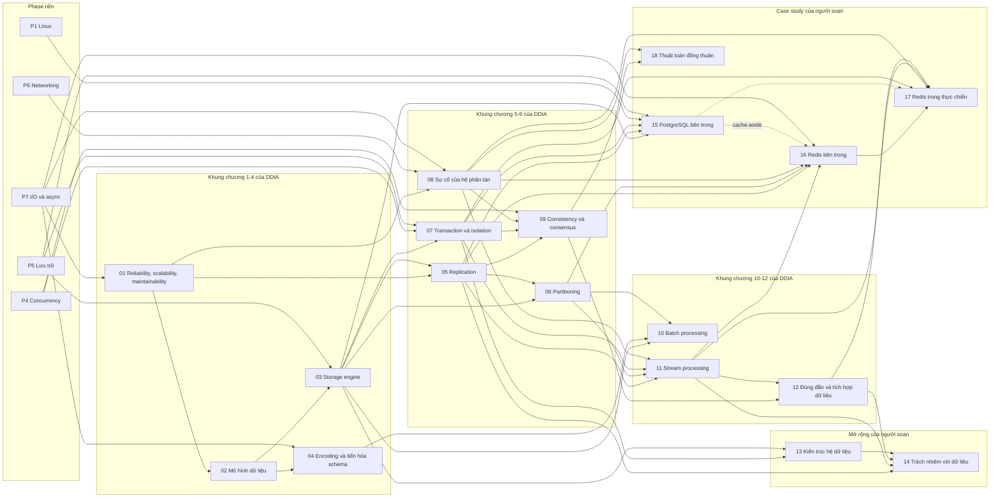

# P12 · Tổng quan — Hệ thống dữ liệu

> Trang này chỉ điều hướng: mục tiêu, ánh xạ chương với khung DDIA, bản đồ chương, thứ tự đọc, nguồn gốc và câu hỏi tổng hợp. Mọi khẳng định kỹ thuật có chú thích nằm trong từng chương; các lời khuyên về thứ tự đọc là của người soạn. Chú thích ở trang này chỉ dùng để chứng minh tên chương trong mục lục sách.

## Mục tiêu của phase

Phase này trả lời câu hỏi "dữ liệu của một service nằm ở đâu, được sao chép, chia nhỏ, cập nhật và đọc lại thế nào khi có nhiều máy, nhiều bản sao và nhiều thứ có thể hỏng": đo độ tin cậy và hiệu năng của hệ thống dữ liệu, mô hình dữ liệu và storage engine, mã hóa và tiến hóa schema, replication, partitioning, transaction và isolation, sự cố của hệ phân tán, consistency và consensus, batch và stream processing, tính đúng đắn khi ghép nhiều kho dữ liệu, kiến trúc operational/analytical, rồi trách nhiệm với dữ liệu cá nhân. Phase đứng trên P4 (lock, memory model), P5 (WAL, `fsync`, journaling), P6 (TCP, timeout) và P7 (async, hủy và `timeout` trong Tokio); đây là nhận xét của người soạn về thứ tự học, và mỗi chương ghi rõ chương nền của nó ở mục "Kiến thức cần trước". Đích đến là khi bạn thiết kế hoặc vận hành một backend Rust chạm vào database, hàng đợi hay kho phân tích, bạn biết hệ thống đang hứa gì, không hứa gì, lỗi nào là bình thường (retry, lag, trùng sự kiện) và phần nào phải tự xử lý ở tầng ứng dụng. Ba chương cuối (15, 16, 17) là case study: mở PostgreSQL và Redis ra xem các khái niệm trên được hiện thực và vận hành cụ thể thế nào.

## Khung DDIA và ánh xạ chương

Phase này **dùng khung chương của *Designing Data-Intensive Applications* (DDIA, Martin Kleppmann, O'Reilly, ấn bản 1) làm đường dẫn chủ đề**: thứ tự và tên chủ đề của chương 01–12 theo mục lục của sách. Đây là lựa chọn của người soạn để bạn dễ đối chiếu nếu đang đọc sách. Nội dung của các chương **không phải tóm tắt hay trích dẫn sách**: sách không được dùng làm nguồn cho bất kỳ khẳng định nào, và chú thích trong phase này trỏ tới paper, bài giảng, tài liệu chính thức của sản phẩm, RFC và tài liệu mở khác. Mục lục dưới đây lấy từ bản mục lục do ETH Library lưu, chỉ để chứng minh tên chương; mục lục chia sách làm ba phần: Phần I "Foundations of Data Systems" (chương 1–4), Phần II "Distributed Data" (chương 5–9), Phần III "Derived Data" (chương 10–12).

| Chương P12 | Chương DDIA ấn bản 1 (theo mục lục ETH) | Ghi chú của người soạn |
|---|---|---|
| [01 — Reliability, scalability, maintainability](01-reliability-scalability-maintainability.md) | Phần I, chương 1: *Reliable, Scalable, and Maintainable Applications*[^toc-ch1] | Tương ứng chủ đề. |
| [02 — Mô hình dữ liệu và ngôn ngữ truy vấn](02-mo-hinh-du-lieu.md) | Chương 2: *Data Models and Query Languages*[^toc-ch2] | Tương ứng chủ đề. |
| [03 — Storage engine](03-storage-engine.md) | Chương 3: *Storage and Retrieval*[^toc-ch3] | Tương ứng chủ đề (log-structured, B-tree, OLTP/OLAP, lưu theo cột). |
| [04 — Encoding và tiến hóa schema](04-encoding-va-tien-hoa-schema.md) | Chương 4: *Encoding and Evolution*[^toc-ch4] | Tương ứng chủ đề. |
| [05 — Replication](05-replication.md) | Phần II, chương 5: *Replication*[^toc-ch5] | Tương ứng chủ đề. |
| [06 — Partitioning](06-partitioning.md) | Chương 6: *Partitioning*[^toc-ch6] | Tương ứng chủ đề. |
| [07 — Transaction và isolation](07-transaction.md) | Chương 7: *Transactions*[^toc-ch7] | Tương ứng chủ đề. |
| [08 — Sự cố của hệ phân tán](08-su-co-he-phan-tan.md) | Chương 8: *The Trouble with Distributed Systems*[^toc-ch8] | Tương ứng chủ đề. |
| [09 — Consistency và consensus](09-consistency-va-consensus.md) | Chương 9: *Consistency and Consensus*[^toc-ch9] | Tương ứng chủ đề. |
| [10 — Batch processing](10-batch-processing.md) | Phần III, chương 10: *Batch Processing*[^toc-ch10] | Tương ứng chủ đề. |
| [11 — Stream processing](11-stream-processing.md) | Chương 11: *Stream Processing*[^toc-ch11] | Tương ứng chủ đề. |
| [12 — Đúng đắn và tích hợp dữ liệu](12-dung-dan-va-tich-hop-du-lieu.md) | Chương 12: *The Future of Data Systems*[^toc-ch12] | Tương ứng một phần: chương 12 của sách có các mục về tích hợp dữ liệu, unbundling database và tính đúng đắn; chương P12·12 lấy các chủ đề đó. |
| [13 — Kiến trúc hệ dữ liệu](13-kien-truc-he-du-lieu.md) | Không có chương tương ứng 1-1 | **Mở rộng của người soạn** (warehouse/lake/lakehouse, định dạng cột, object storage, table format mở, cloud so với tự vận hành). Chủ đề liền kề trong mục lục sách: chương 3 có các mục *Data Warehousing* và *Column-Oriented Storage*[^toc-ch3-olap], chương 12 có mục *Data Integration*[^toc-ch12-int]. |
| [14 — Trách nhiệm với dữ liệu](14-trach-nhiem-voi-du-lieu.md) | Không có chương tương ứng 1-1 | **Mở rộng của người soạn** (GDPR, quyền xóa, anonymisation, quyết định tự động, quy tắc đạo đức nghề nghiệp). Chủ đề liền kề trong mục lục sách: các mục *Doing the Right Thing*, *Predictive Analytics*, *Privacy and Tracking* ở cuối chương 12[^toc-ch12-ethics]. |
| [15 — PostgreSQL bên trong](15-postgresql-ben-trong.md) | Không có chương DDIA tương ứng — **case study của người soạn** | Một hệ thống cụ thể (PostgreSQL 16) *thực sự chạy* thế nào: process, bộ nhớ, VACUUM, lock, planner. Dùng lại khái niệm của 03, 05, 07 chứ không dạy lại. |
| [16 — Redis bên trong](16-redis-ben-trong.md) | Không có chương DDIA tương ứng — **case study của người soạn** | Một hệ thống cụ thể (Redis) *thực sự chạy* thế nào: event loop, cấu trúc dữ liệu, persistence, replication, cluster, lock/cache. Dùng lại khái niệm của 05, 06, 08, 11. |
| [17 — Redis trong thực chiến](17-redis-patterns.md) | Không có chương DDIA tương ứng — **case study của người soạn** | Ghép primitive của Redis (chương 16) thành pattern cho backend — cache, rate limiter, lock/idempotency, job queue, leaderboard, thống kê, session — và chỉ ra chỗ mỗi pattern hỏng. |
| [18 — Thuật toán đồng thuận](18-thuat-toan-dong-thuan.md) | Không có chương DDIA tương ứng — **chương chuyên sâu của người soạn** | Đi sâu hơn mục 6–7 của chương 09: vì sao Paxos và Raft an toàn (chứng minh, vết chạy), quorum, Multi-Paxos, snapshot và đổi thành viên, PreVote/CheckQuorum, các họ hàng (VR, Zab, EPaxos, PBFT), hiệu năng và lỗi ngoài đời. |

## Bản đồ chương

Mũi tên nghĩa là chương đích dùng khái niệm của chương nguồn (nhận xét của người soạn về thứ tự học, rút từ mục "Kiến thức cần trước" của từng chương). Các hộp P1 và P4–P7 là phase nền bên ngoài; mũi tên nét đứt 15 → 16 là liên kết đọc thêm, không phải tiên quyết; chỉ vẽ những chương lấy từ phase đó khái niệm chính.

## Các chương

| Chương | Nội dung chính |
|---|---|
| [01 — Reliability, scalability, maintainability](01-reliability-scalability-maintainability.md) | Fault vs failure và fault tolerance; ba nguồn fault (phần cứng, phần mềm, con người); throughput, response time, latency; percentile thay vì trung bình; tail latency amplification khi fan-out; SLI, SLO, SLA, "số 9", error budget; scale up vs scale out; operability, simplicity, evolvability. |
| [02 — Mô hình dữ liệu và ngôn ngữ truy vấn](02-mo-hinh-du-lieu.md) | Mô hình quan hệ của Codd và "phụ thuộc dữ liệu"; document model và `jsonb` của PostgreSQL; impedance mismatch; nhiều-nhiều, join, normalization; schema-on-write vs schema-on-read; truy vấn khai báo vs mệnh lệnh; graph model, Cypher và recursive CTE. |
| [03 — Storage engine](03-storage-engine.md) | Log nối thêm và hash index; SSTable và LSM-tree; compaction và ba loại amplification; Bloom filter; B-tree, page, WAL, copy-on-write; LSM vs B-tree; secondary, clustered, covering index; OLTP vs OLAP, lưu theo cột và nén. |
| [04 — Encoding và tiến hóa schema](04-encoding-va-tien-hoa-schema.md) | Vì sao phải encode; hạn chế của JSON và CSV; Protocol Buffers (field number, wire type, varint) và đổi schema đúng cách; Avro (writer/reader schema); backward/forward compatibility và rolling upgrade; dataflow qua database, RPC/REST và message broker. |
| [05 — Replication](05-replication.md) | Single-leader sync/async/semi-sync; thêm follower, failover, split brain; statement, WAL và logical replication; replication lag và ba bảo đảm đọc; multi-leader, LWW, CRDT; leaderless kiểu Dynamo (quorum, sloppy quorum, hinted handoff); read repair và anti-entropy; vector clock và siblings. |
| [06 — Partitioning](06-partitioning.md) | Chia theo khoảng khóa hay theo băm; skew và hot spot; consistent hashing và virtual node; secondary index local vs global; chiến lược rebalancing; request routing; giá của việc chia dữ liệu; chọn shard trong Rust (`Hash` của std không ổn định để chia shard). |
| [07 — Transaction và isolation](07-transaction.md) | ACID từng chữ; các mức isolation của chuẩn SQL và bảng hiện tượng; dirty write/read, read skew, lost update, write skew, phantom; snapshot isolation và MVCC của PostgreSQL; `UPDATE` nguyên tử, `SELECT ... FOR UPDATE`, compare-and-set; 2PL và predicate lock; SSI; lỗi `40001`/`40P01` và vòng retry. |
| [08 — Sự cố của hệ phân tán](08-su-co-he-phan-tan.md) | Partial failure và RPC không hồi đáp; mô hình liên kết mạng và TCP; two generals; mô hình hệ thống và failure detector; đồng hồ time-of-day vs monotonic; NTP và vì sao không dùng timestamp để sắp thứ tự; process pause; lease và fencing token. |
| [09 — Consistency và consensus](09-consistency-va-consensus.md) | Linearizability vs serializability và memory model của máy nhiều core; CAP; happens-before, Lamport clock, vector clock; total order broadcast; two-phase commit; Paxos và FLP; Raft (bầu leader, sao chép log, safety); etcd và ZooKeeper. |
| [10 — Batch processing](10-batch-processing.md) | Pipe của Unix đến batch; MapReduce (map, shuffle, sort, reduce); chịu lỗi bằng chạy lại; distributed filesystem và locality; join phía reduce/phía map và skew; output và commit của batch; dataflow engine (Spark RDD, lineage, stage); batch so với MPP database. |
| [11 — Stream processing](11-stream-processing.md) | Event, stream, producer, consumer; queue vs log; bên trong log kiểu Kafka (partition, offset, consumer group, compaction); at-most-once, at-least-once, exactly-once; CDC, event sourcing, stream–table duality; event time, window, watermark; stream join; chịu lỗi cho xử lý có state. |
| [12 — Đúng đắn và tích hợp dữ liệu](12-dung-dan-va-tich-hop-du-lieu.md) | System of record vs dữ liệu dẫn xuất và vì sao dual write hỏng; unbundling database; end-to-end argument; idempotency và `Idempotency-Key`; "exactly-once" là at-least-once cộng dedup; outbox pattern; checksum, kiểm tra ngoài luồng, audit. |
| [13 — Kiến trúc hệ dữ liệu](13-kien-truc-he-du-lieu.md) | Vận hành vs phân tích; ETL vs ELT; warehouse, lake, lakehouse; Parquet và Arrow; object storage bảo đảm gì; Iceberg và Delta; tách compute/storage, serverless, cloud vs tự vận hành; một máy đủ khi nào. |
| [14 — Trách nhiệm với dữ liệu](14-trach-nhiem-voi-du-lieu.md) | Dữ liệu cá nhân và nguyên tắc nền của GDPR; privacy by design (Điều 25); quyền xóa (Điều 17); vì sao xóa khó trong log bất biến, MVCC, replica, backup và crypto-shredding; pseudonymisation vs anonymisation; quyết định tự động (Điều 22) và thiên lệch; ACM Code of Ethics; Việt Nam (mục phụ); newtype, `Debug`, `secrecy`, `zeroize` trong Rust. |

| [15 — PostgreSQL bên trong: process, bộ nhớ, VACUUM, lock, planner](15-postgresql-ben-trong.md) | Connection = process (postmaster, backend, process nền); vì sao connection đắt và PgBouncer ở ba chế độ; `shared_buffers`, `work_mem`, `maintenance_work_mem`, `effective_cache_size` và double buffering; đường đi của một `UPDATE` tới WAL và checkpoint; VACUUM, autovacuum, XID wraparound và transaction mở lâu; table/row lock, hàng đợi lock, deadlock và migration; đọc `EXPLAIN`/`EXPLAIN ANALYZE`; `pg_stat_activity`, `pg_stat_statements`, `pg_locks`, wait event và các cấu hình hay gây sự cố. |
| [16 — Redis bên trong: event loop, cấu trúc dữ liệu, persistence, replication, cluster](16-redis-ben-trong.md) | Một thread, event loop `ae`, `io-threads` và lệnh O(N); encoding (SDS, listpack, quicklist, intset, skiplist + dict) và ngưỡng đổi encoding; `maxmemory`, `maxmemory-policy`, LRU/LFU xấp xỉ và expire; RDB (fork + COW) và AOF (`appendfsync`, rewrite); replication bất đồng bộ, PSYNC, backlog, `WAIT`, Sentinel; Redis Cluster và vì sao không strong consistency; `MULTI`/`EXEC`, `WATCH`, Lua/Functions, Pub/Sub và Streams; `SET NX PX`, Redlock, cache-aside, rate limiter. |
| [17 — Redis trong thực chiến: kết hợp primitive thành pattern](17-redis-patterns.md) | Cache-aside, write-through/behind, negative caching và ba cách chặn stampede; rate limiter (fixed window, sliding window log, token bucket); lock và idempotency key (và vì sao vẫn cần fencing, DB unique); job queue bằng List `BLMOVE` hay Stream consumer group; leaderboard bằng ZSET; counter, HyperLogLog, bitmap; session, feature flag, `CLIENT TRACKING`; pipeline vs `MULTI`/`WATCH`/Lua, thiết kế key, hash tag, TTL và các anti-pattern (`KEYS`, big key, hot key). |
| [18 — Thuật toán đồng thuận: chứng minh, biến thể và vận hành](18-thuat-toan-dong-thuan.md) | Đặc tả bài toán, mô hình lỗi, vì sao 2f+1 và 3f+1, Flexible Paxos; chứng minh an toàn của Paxos đơn quyết định và vết chạy tranh chấp; Multi-Paxos và bài học của Paxos Made Live; Leader Completeness và Hình 8 của Raft từng bước; snapshot, đổi thành viên, chuyển giao leader; PreVote, CheckQuorum, ReadIndex và lease read; Viewstamped Replication, Zab, EPaxos, PBFT; cái giá của một commit, batching, pipelining, cụm nhiều vùng; lỗi đã được tìm ra (Jepsen) và cách kiểm thử; các nút cấu hình tương ứng trong crate Rust. |

## Thứ tự đọc

Đọc 01 → 18 theo số là ổn: thứ tự này đi theo khung chương của DDIA, và mỗi chương nhắc ở mục "Kiến thức cần trước" những chương đứng trước nó. Gợi ý của người soạn:

- 01 là cổng vào của cả phase (fault, percentile, tail latency xuất hiện lại ở 05, 08, 11). 02 → 03 đi cùng nhau; 04 đọc sau 02 là đủ.
- 05 → 06 là cặp (sao chép rồi chia dữ liệu); 07 chỉ xét transaction trên **một** node, nên có thể đọc ngay sau 03.
- 08 → 09 là cặp quan trọng nhất của phase: 08 nêu các tiền đề (mạng, đồng hồ, process pause), 09 xây thuật toán trên các tiền đề đó và dùng lại ý quorum của 05 và isolation của 07.
- 10 → 11 → 12 đọc liền một mạch; 12 dùng lại log, offset và CDC của 11 mà không giải thích lại.
- 13 và 14 là phần mở rộng. 13 đọc lướt được sau 03 và 07; 14 dùng lại MVCC (07), replica (05), log bất biến (11), dữ liệu dẫn xuất (12) và warehouse (13) làm chỗ dữ liệu nằm.
- 15, 16 và 17 là **case study**, không có chương DDIA tương ứng: mỗi chương mở một hệ thống cụ thể ra xem. 15 đọc sau 03, 05 và 07 (WAL, MVCC, isolation, replication đã nói ở đó; 15 chỉ nói cách PostgreSQL hiện thực). 16 đọc sau 05, 06 và 08 (replication, partitioning, lease/fencing), nên đọc thêm 11 khi tới Streams. 17 đọc ngay sau 16 (ghép primitive của 16 thành pattern; cần thêm 07, 08, 11, 12 khi tới lock, idempotency và queue). 15 độc lập với 16 và 17, đọc theo hệ thống bạn đang vận hành; nếu dùng Redis làm cache phía trước PostgreSQL thì đọc 15 trước, rồi mục 8 của 16 (cache-aside, stampede, stale).
- 18 là chương **chuyên sâu** về consensus, đọc ngay sau 09 khi bạn cần vận hành hoặc chọn một hệ dùng Raft/Paxos (như etcd ở chương 09). Chương giả định đã đọc mục 6–8 của 09 và không giảng lại.
- Nếu chỉ có thời gian cho vài chương, [roadmap](../00-roadmap.md) mục 5 chọn 05, 07, 08 và 09; chương 12 là ứng viên kế tiếp (cần thêm 11).

## Nguồn gốc và lộ trình đọc

Các nguồn dưới đây đều là nguồn mà chương của phase đã dùng (số chương ghi ở cuối mỗi dòng); mở đọc song song với chương tương ứng. Không bắt buộc: chương đã tự chứa phần cần thiết. Danh sách là bản chọn lọc, ưu tiên bài giảng và paper gốc; tài liệu sản phẩm (PostgreSQL, Kafka, Flink, RocksDB, docs.rs…) và nguồn của ba case study 15, 16, 17 (docs PostgreSQL 16, tài liệu Redis, source ghim) nằm ở chú thích và mục "Đọc thêm" của từng chương. Nhiều trang là tài liệu sống nên không ghim phiên bản.

**Bài giảng và bài viết của Kleppmann**

- [Kleppmann — Distributed Systems, lecture notes (Cambridge 2021–22)](https://www.cl.cam.ac.uk/teaching/2122/ConcDisSys/dist-sys-notes.pdf) — chương 01, 04, 05, 07, 08, 09, 10, 11, 12, 13.
- [Kleppmann, Beresford, Svingen — Online Event Processing (CACM 2019)](https://martin.kleppmann.com/papers/olep-cacm.pdf) — chương 12, 13.
- [Kleppmann — How to do distributed locking](https://martin.kleppmann.com/2016/02/08/how-to-do-distributed-locking.html) — chương 08, 09.
- [Kleppmann — A Critique of the CAP Theorem](https://arxiv.org/pdf/1509.05393) — chương 09.
- [Hermitage (Kleppmann) — README](https://raw.githubusercontent.com/ept/hermitage/f029bec8e32af6a9506508638fdf74ef61286225/README.md) — chương 07.

**Độ tin cậy, mô hình dữ liệu, storage engine, encoding**

- [Gray — Why Do Computers Stop and What Can Be Done About It?](https://jimgray.azurewebsites.net/papers/TandemTR85.7_WhyDoComputersStop.pdf) — chương 01.
- [Schroeder và Gibson — Disk failures in the real world (FAST 2007)](https://www.usenix.org/legacy/events/fast07/tech/schroeder/schroeder.pdf) — chương 01.
- [Oppenheimer, Ganapathi, Patterson — Why do Internet services fail](https://www2.eecs.berkeley.edu/Pubs/TechRpts/2002/CSD-02-1185.pdf) — chương 01.
- [Dean và Barroso — The Tail at Scale](https://www.barroso.org/publications/TheTailAtScale.pdf) — chương 01.
- [Google SRE book — Service Level Objectives](https://sre.google/sre-book/service-level-objectives/) — chương 01.
- [Codd — A Relational Model of Data for Large Shared Data Banks (1970)](https://www.seas.upenn.edu/~zives/03f/cis550/codd.pdf) — chương 02.
- [Bitcask (Sheehy và Smith, Basho)](https://riak.com/assets/bitcask-intro.pdf) — chương 03.
- [O'Neil và cộng sự — The Log-Structured Merge-Tree](https://www.cs.umb.edu/~poneil/lsmtree.pdf) — chương 03.
- [Chang và cộng sự — Bigtable (OSDI 2006)](https://static.googleusercontent.com/media/research.google.com/en//archive/bigtable-osdi06.pdf) — chương 03; cùng bài ở một bản khác: [research.google.com](https://research.google.com/archive/bigtable-osdi06.pdf) — chương 06.
- [Stonebraker và cộng sự — C-Store (VLDB 2005)](https://www.vldb.org/archives/website/2005/program/paper/thu/p553-stonebraker.pdf) — chương 03.
- [Abadi, Madden, Hachem — Column-Stores vs. Row-Stores (SIGMOD 2008)](https://www.cs.umd.edu/~abadi/papers/abadi-sigmod08.pdf) — chương 03.
- [Protocol Buffers — Encoding](https://protobuf.dev/programming-guides/encoding/) — chương 04.
- [Apache Avro 1.12.0 — Specification](https://avro.apache.org/docs/1.12.0/specification/) — chương 04.

**Replication, partitioning, transaction**

- [DeCandia và cộng sự — Dynamo (SOSP 2007)](https://www.allthingsdistributed.com/files/amazon-dynamo-sosp2007.pdf) — chương 05, 06, 08.
- [Terry và cộng sự — Session Guarantees for Weakly Consistent Replicated Data](https://www.cs.cornell.edu/courses/cs734/2000FA/cached%20papers/SessionGuaranteesPDIS_1.html) — chương 05.
- [Vogels — Eventually Consistent — Revisited](https://www.allthingsdistributed.com/2008/12/eventually_consistent.html) — chương 05.
- [PostgreSQL 16 — Logical Decoding Concepts](https://www.postgresql.org/docs/16/logicaldecoding-explanation.html) — chương 05, 11, 12.
- [Karger và cộng sự — Consistent Hashing and Random Trees (STOC 1997)](https://people.csail.mit.edu/karger/Papers/web.pdf) — chương 06.
- [Lamping và Veach — A Fast, Minimal Memory, Consistent Hash Algorithm](https://arxiv.org/pdf/1406.2294) — chương 06.
- [Berenson và cộng sự — A Critique of ANSI SQL Isolation Levels](https://arxiv.org/pdf/cs/0701157) — chương 07.
- [PostgreSQL 16 — Transaction Isolation](https://www.postgresql.org/docs/16/transaction-iso.html) — chương 07.
- [Ports và Grittner — Serializable Snapshot Isolation in PostgreSQL (VLDB 2012)](https://vldb.org/pvldb/vol5/p1850_danrkports_vldb2012.pdf) — chương 07.
- [Jepsen — Snapshot Isolation](https://jepsen.io/consistency/models/snapshot-isolation) và [Serializability](https://jepsen.io/consistency/models/serializable) — chương 07.

**Hệ phân tán, consistency, consensus**

- [RFC 9293 — TCP](https://www.rfc-editor.org/rfc/rfc9293.html) — chương 08.
- [Burrows — The Chubby lock service (OSDI 2006)](https://static.googleusercontent.com/media/research.google.com/en//archive/chubby-osdi06.pdf) — chương 09; cùng bài ở một bản khác: [research.google.com](https://research.google.com/archive/chubby-osdi06.pdf) — chương 08.
- [Lamport — Time, Clocks, and the Ordering of Events in a Distributed System](https://lamport.azurewebsites.net/pubs/time-clocks.pdf) — chương 09.
- [Herlihy và Wing — Linearizability (1990)](https://cs.brown.edu/~mph/HerlihyW90/p463-herlihy.pdf) — chương 09.
- [Gilbert và Lynch — Brewer's Conjecture (2002)](https://www.comp.nus.edu.sg/~gilbert/pubs/BrewersConjecture-SigAct.pdf) — chương 09.
- [Fischer, Lynch, Paterson — Impossibility of Distributed Consensus with One Faulty Process](https://groups.csail.mit.edu/tds/papers/Lynch/jacm85.pdf) — chương 09.
- [Lamport — Paxos Made Simple](https://lamport.azurewebsites.net/pubs/paxos-simple.pdf) — chương 09, 18.
- [Ongaro và Ousterhout — In Search of an Understandable Consensus Algorithm (Raft)](https://raft.github.io/raft.pdf) — chương 09, 18.
- [Hunt và cộng sự — ZooKeeper (USENIX ATC 2010)](https://www.usenix.org/legacy/event/atc10/tech/full_papers/Hunt.pdf) — chương 09.
- [etcd v3.5 — API guarantees](https://etcd.io/docs/v3.5/learning/api_guarantees/) — chương 09.

**Batch, stream, tích hợp dữ liệu**

- [Dean và Ghemawat — MapReduce (OSDI 2004)](https://static.googleusercontent.com/media/research.google.com/en//archive/mapreduce-osdi04.pdf) — chương 10.
- [Ghemawat và cộng sự — The Google File System (SOSP 2003)](https://static.googleusercontent.com/media/research.google.com/en//archive/gfs-sosp2003.pdf) — chương 10.
- [Zaharia và cộng sự — Resilient Distributed Datasets (NSDI 2012)](https://www.usenix.org/system/files/conference/nsdi12/nsdi12-final138.pdf) — chương 10.
- [Pavlo và cộng sự — A Comparison of Approaches to Large-Scale Data Analysis](https://www.cs.umd.edu/~abadi/papers/benchmarks-sigmod09.pdf) — chương 10.
- [Blanas và cộng sự — A Comparison of Join Algorithms for Log Processing in MapReduce](https://pages.cs.wisc.edu/~jignesh/publ/hadoopjoin.pdf) — chương 10.
- [Akidau và cộng sự — The Dataflow Model (VLDB 2015)](https://www.vldb.org/pvldb/vol8/p1792-Akidau.pdf) — chương 11.
- [Apache Flink 1.20 — Event Time and Watermarks](https://nightlies.apache.org/flink/flink-docs-release-1.20/docs/concepts/time/) — chương 11.
- [Debezium 2.7 — PostgreSQL connector](https://debezium.io/documentation/reference/2.7/connectors/postgresql.html) — chương 11, 12.
- [Saltzer, Reed, Clark — End-to-End Arguments in System Design](https://web.mit.edu/Saltzer/www/publications/endtoend/endtoend.pdf) — chương 11, 12.
- [Helland — Life beyond Distributed Transactions: an Apostate's Opinion](https://www.cidrdb.org/cidr2007/papers/cidr07p15.pdf) — chương 12.
- [Helland — Immutability Changes Everything (CIDR 2015)](https://www.cidrdb.org/cidr2015/Papers/CIDR15_Paper16.pdf) — chương 12.
- [Bairavasundaram và cộng sự — An Analysis of Data Corruption in the Storage Stack](https://www.usenix.org/legacy/event/fast08/tech/full_papers/bairavasundaram/bairavasundaram.pdf) — chương 12.
- [Google SRE book — Data Integrity](https://sre.google/sre-book/data-integrity/) — chương 12, 14.

**Kiến trúc hệ dữ liệu**

- [Armbrust và cộng sự — Delta Lake (VLDB 2020)](https://www.databricks.com/wp-content/uploads/2020/08/p975-armbrust.pdf) — chương 13.
- [Armbrust, Ghodsi, Xin, Zaharia — Lakehouse (CIDR 2021)](https://www.cidrdb.org/cidr2021/papers/cidr2021_paper17.pdf) — chương 13.
- [Dageville và cộng sự — The Snowflake Elastic Data Warehouse (SIGMOD 2016)](https://www.cs.cmu.edu/~15721-f24/papers/Snowflake.pdf) — chương 13.
- [Apache Arrow — Columnar Format specification](https://arrow.apache.org/docs/format/Columnar.html) — chương 13.
- [Apache Iceberg 1.5.0 — Table Spec](https://raw.githubusercontent.com/apache/iceberg/apache-iceberg-1.5.0/format/spec.md) — chương 13.
- [Delta Lake v3.2.0 — Transaction Log Protocol](https://raw.githubusercontent.com/delta-io/delta/v3.2.0/PROTOCOL.md) — chương 13.
- [McSherry, Isard, Murray — Scalability! But at what COST? (HotOS 2015)](https://www.usenix.org/system/files/conference/hotos15/hotos15-paper-mcsherry.pdf) — chương 13.

**Dữ liệu cá nhân, đạo đức**

- [GDPR — Regulation (EU) 2016/679](https://publications.europa.eu/resource/cellar/3e485e15-11bd-11e6-ba9a-01aa75ed71a1.0006.03/DOC_1) — chương 14.
- [Article 29 Working Party — Opinion 05/2014 on Anonymisation Techniques (WP216)](https://ec.europa.eu/justice/article-29/documentation/opinion-recommendation/files/2014/wp216_en.pdf) — chương 14.
- [NIST SP 800-88 Rev. 1 — Guidelines for Media Sanitization](https://nvlpubs.nist.gov/nistpubs/SpecialPublications/NIST.SP.800-88r1.pdf) — chương 14.
- [Narayanan và Shmatikov — How To Break Anonymity of the Netflix Prize Dataset](https://arxiv.org/abs/cs/0610105) — chương 14.
- [Dwork và Roth — The Algorithmic Foundations of Differential Privacy](https://www.cis.upenn.edu/~aaroth/Papers/privacybook.pdf) — chương 14.
- [Dwork và cộng sự — Fairness Through Awareness](https://arxiv.org/abs/1104.3913) — chương 14.
- [ACM Code of Ethics and Professional Conduct (2018)](https://www.acm.org/binaries/content/assets/about/acm-code-of-ethics-booklet.pdf) — chương 14.

## Câu hỏi tổng hợp xuyên chương

Không có đáp án ở đây; mỗi câu trỏ về chương cần đọc lại.

1. Một request từ service Rust tới một dịch vụ khác hết thời gian chờ mà bạn không biết bên kia đã xử lý hay chưa. Vì sao tình huống này là bản chất của hệ phân tán, và để retry an toàn thì cần những gì ở cả client lẫn server (request ID, idempotency, dedup)? ([chương 08](08-su-co-he-phan-tan.md), [chương 12](12-dung-dan-va-tich-hop-du-lieu.md); P7 [chương 09](../07-io-async/09-async-trong-production.md) cho `timeout` và hủy future).
2. Vừa ghi xong rồi đọc từ replica lại thấy dữ liệu cũ: lag sinh ra những hiện tượng nào, ba bảo đảm đọc (read-your-writes, monotonic reads, consistent prefix) nghĩa là gì, và quorum `w + r > n` bảo đảm gì, không bảo đảm gì? ([chương 05](05-replication.md), [chương 09](09-consistency-va-consensus.md)).
3. Serializable, snapshot isolation và linearizable khác nhau ở đâu; write skew xảy ra ở mức nào, và vòng retry nào là đúng khi database trả lỗi `40001`? ([chương 07](07-transaction.md), [chương 09](09-consistency-va-consensus.md)).
4. Vì sao `hash(key) mod N` hỏng khi đổi số node, chọn shard key thế nào để tránh hot spot, và chia dữ liệu làm hỏng những gì (unique, join, giao dịch xuyên shard)? ([chương 06](06-partitioning.md), [chương 07](07-transaction.md), [chương 09](09-consistency-va-consensus.md) cho two-phase commit).
5. Một khóa phân tán hoặc leader election dựa vào thời gian cục bộ bị process pause hay lệch đồng hồ phá thế nào, và lease cộng fencing token, hay Raft với etcd/ZooKeeper, sửa được đến đâu? ([chương 08](08-su-co-he-phan-tan.md), [chương 09](09-consistency-va-consensus.md)).
6. Ghi vào database rồi gửi sự kiện sang Kafka sao cho không mất, không lệch thứ tự và xử lý được trùng: vì sao dual write hỏng, outbox và CDC thay đổi điều gì, "exactly-once" thực chất là gì, và schema của sự kiện đổi theo thời gian thì tương thích ra sao? ([chương 12](12-dung-dan-va-tich-hop-du-lieu.md), [chương 11](11-stream-processing.md), [chương 04](04-encoding-va-tien-hoa-schema.md)).
7. Chọn LSM-tree hay B-tree cho một workload ghi nhiều hay đọc nhiều (ba loại amplification), và vì sao phân tích lại hợp với lưu theo cột, Parquet và một hệ vận hành tách riêng? ([chương 03](03-storage-engine.md), [chương 13](13-kien-truc-he-du-lieu.md); P5 [chương 06](../05-storage/06-durability-trong-thuc-te.md) cho `fsync` và durability).
8. Dữ liệu cá nhân của một người dùng nằm trong database, replica, backup, log bất biến của Kafka và warehouse: yêu cầu xóa theo GDPR đòi hệ thống làm gì, vì sao khó, và crypto-shredding đứng ở đâu? ([chương 14](14-trach-nhiem-voi-du-lieu.md), [chương 11](11-stream-processing.md), [chương 13](13-kien-truc-he-du-lieu.md), [chương 05](05-replication.md)).

## Lab

Phase này có hai lab:

- **[Lab P12a — một node](../labs/12a-du-lieu-mot-node-lab.md)** (crate `labs/crates/lab-data`): log nối đuôi có compaction và khôi phục khi đuôi file bị xé (chương 03), LSM-tree với Bloom filter đặt cạnh page store (chương 03), row store so với column store (chương 03), varint và tiến hóa schema (chương 04), MVCC và các anomaly của isolation (chương 07), batch job (chương 10), percentile và tail latency (chương 01), cùng các script SQL cho PostgreSQL (chương 15).
- **[Lab P12b — phân tán](../labs/12b-du-lieu-phan-tan-lab.md)** (crate `labs/crates/lab-distributed`): mô phỏng tất định, cùng seed cho cùng kết quả. Gồm replication lag (chương 05), quorum (chương 05), partitioning và hash slot của Redis (chương 06 và 16), fencing token (chương 08), Lamport clock và bầu leader kiểu Raft (chương 09), delivery semantics và watermark (chương 11), dedup bằng idempotency key (chương 12), cùng các pattern Redis (chương 16 và 17).

Phần Rust có output thật, chạy trên macOS. Các phần cần server thật được ghi rõ là **chưa chạy**: PostgreSQL ở P12a có lệnh `docker` và `psql`, Redis ở P12b có lệnh `redis-cli`.

[^toc-ch1]: Designing Data-Intensive Applications (O'Reilly, ấn bản 1), mục lục do ETH Library lưu, chương 1 — <https://toc.library.ethz.ch/objects/pdf03/z01_978-1-4493-7332-0_01.pdf> — "Part I. 1. Foundations of Data Systems Reliable, Scalable, and Maintainable Applications"
[^toc-ch2]: Designing Data-Intensive Applications (O'Reilly, ấn bản 1), mục lục do ETH Library lưu, chương 2 — <https://toc.library.ethz.ch/objects/pdf03/z01_978-1-4493-7332-0_01.pdf> — "2. Data Models and Query Languages"
[^toc-ch3]: Designing Data-Intensive Applications (O'Reilly, ấn bản 1), mục lục do ETH Library lưu, chương 3 — <https://toc.library.ethz.ch/objects/pdf03/z01_978-1-4493-7332-0_01.pdf> — "Storage and Retrieval 69 Data Structures That Power Your Database 70"
[^toc-ch4]: Designing Data-Intensive Applications (O'Reilly, ấn bản 1), mục lục do ETH Library lưu, chương 4 — <https://toc.library.ethz.ch/objects/pdf03/z01_978-1-4493-7332-0_01.pdf> — "Encoding and Evolution 111 Formats for Encoding Data 112"
[^toc-ch5]: Designing Data-Intensive Applications (O'Reilly, ấn bản 1), mục lục do ETH Library lưu, chương 5 — <https://toc.library.ethz.ch/objects/pdf03/z01_978-1-4493-7332-0_01.pdf> — "Part II. 5. Distributed Data Replication 151 Leaders and Followers"
[^toc-ch6]: Designing Data-Intensive Applications (O'Reilly, ấn bản 1), mục lục do ETH Library lưu, chương 6 — <https://toc.library.ethz.ch/objects/pdf03/z01_978-1-4493-7332-0_01.pdf> — "Partitioning 199 Partitioning and Replication"
[^toc-ch7]: Designing Data-Intensive Applications (O'Reilly, ấn bản 1), mục lục do ETH Library lưu, chương 7 — <https://toc.library.ethz.ch/objects/pdf03/z01_978-1-4493-7332-0_01.pdf> — "7. Transactions 221 214 The Slippery Concept of a Transaction 222"
[^toc-ch8]: Designing Data-Intensive Applications (O'Reilly, ấn bản 1), mục lục do ETH Library lưu, chương 8 — <https://toc.library.ethz.ch/objects/pdf03/z01_978-1-4493-7332-0_01.pdf> — "8. The Trouble with Distributed Systems Faults and Partial Failures"
[^toc-ch9]: Designing Data-Intensive Applications (O'Reilly, ấn bản 1), mục lục do ETH Library lưu, chương 9 — <https://toc.library.ethz.ch/objects/pdf03/z01_978-1-4493-7332-0_01.pdf> — "Consistency and Consensus 321 Consistency Guarantees 322"
[^toc-ch10]: Designing Data-Intensive Applications (O'Reilly, ấn bản 1), mục lục do ETH Library lưu, chương 10 — <https://toc.library.ethz.ch/objects/pdf03/z01_978-1-4493-7332-0_01.pdf> — "Derived Data 10. Batch Processing 389 Batch Processing with Unix Tools"
[^toc-ch11]: Designing Data-Intensive Applications (O'Reilly, ấn bản 1), mục lục do ETH Library lưu, chương 11 — <https://toc.library.ethz.ch/objects/pdf03/z01_978-1-4493-7332-0_01.pdf> — "11. Stream Processing 439 Transmitting Event Streams"
[^toc-ch12]: Designing Data-Intensive Applications (O'Reilly, ấn bản 1), mục lục do ETH Library lưu, chương 12 — <https://toc.library.ethz.ch/objects/pdf03/z01_978-1-4493-7332-0_01.pdf> — "12. The Future of Data Systems Data Integration Combining Specialized Tools by Deriving Data Batch and Stream Processing Unbundling Databases Composing Data Storage Technologies Designing Applications Around Dataflow Observing Derived State Aiming for Correctness"
[^toc-ch3-olap]: Designing Data-Intensive Applications (O'Reilly, ấn bản 1), mục lục do ETH Library lưu, chương 3 — <https://toc.library.ethz.ch/objects/pdf03/z01_978-1-4493-7332-0_01.pdf> — "Data Warehousing 91 Stars and Snowflakes: Schemas for Analytics 93 Column-Oriented Storage 95"
[^toc-ch12-int]: Designing Data-Intensive Applications (O'Reilly, ấn bản 1), mục lục do ETH Library lưu, chương 12 — <https://toc.library.ethz.ch/objects/pdf03/z01_978-1-4493-7332-0_01.pdf> — "The Future of Data Systems Data Integration Combining Specialized Tools by Deriving Data Batch and Stream Processing"
[^toc-ch12-ethics]: Designing Data-Intensive Applications (O'Reilly, ấn bản 1), mục lục do ETH Library lưu, chương 12 — <https://toc.library.ethz.ch/objects/pdf03/z01_978-1-4493-7332-0_01.pdf> — "Doing the Right Thing Predictive Analytics Privacy and Tracking Summary"
